# Docker 数据卷：把容器数据"搬出"容器——理解数据持久化的边界

> 本文整理自 B 站视频《Docker数据卷：实现容器数据持久化与管理技巧》，依据视频演说图文稿逐窗口核对、纠正自动字幕错拼后整理。
> 视频地址：[BV1M7h9z8Eqs](https://www.bilibili.com/video/BV1M7h9z8Eqs)

## 本讲要解决的核心问题（SCQA）

**背景**：容器是"用完即弃"的——`docker rm` 一条命令就能把它抹掉；而镜像本身是只读的，跑起来的容器只是在只读层之上又叠了一层**可写层**（容器层），我们往里拷的文件、改的配置都写在这一层里。

**冲突**：视频开头做了一个小实验：往一个 nginx 容器里拷进改好的配置文件，让它生效；随后 `docker stop` + `docker rm` 把容器删掉。问题来了——那个刚拷进去、改好的文件，还在吗？

**疑问**：**容器里写进去的数据，到底能不能留下来？这条"留得住 / 留不住"的边界画在哪里？想留住又该怎么做？**

**回答（中心思想）**：容器可写层里的数据**随容器一起消失**，它天然是"一次性的"；要让数据跨越容器生命周期活下来，必须把它落到**容器之外**——宿主机目录，这正是 **Docker 数据卷（volume，也叫存储卷）** 要解决的问题。本讲用一个贯穿始终的 nginx 实验，把这条边界的两侧都演示清楚：

> ① 容器删了、卷里的数据还在 → 数据被"持久化"到了宿主机；
> ② 挂载是**覆盖性**的 → 宿主机目录会"盖住"容器目录，空目录挂上去会把容器里的文件清空，甚至让 nginx 起不来；
> ③ 因此挂载前要先把容器里的目录**拷出来**，改好再挂回去。

## 一、数据为什么会丢：可写层的"一次性"

### 1.1 实验：把配置拷进容器，再把容器删掉

先把默认的 nginx 配置文件改一改——比如把"进程连接的最大数"改成 10240——再用 `docker cp` 把它拷进容器，覆盖掉容器里默认的 `nginx.conf`。[【跳转到 0:19】](https://www.bilibili.com/video/BV1M7h9z8Eqs/?t=19)

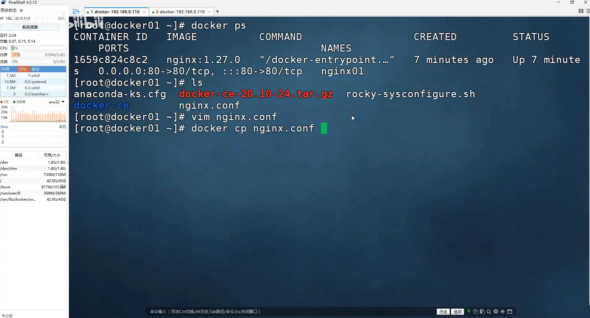

配置改完想让生效，还要 `docker restart 容器名` 重启一下，让 nginx 重新加载配置。

接着把容器删掉：先 `docker stop nginx01` 停掉，再 `docker rm nginx01` 删除。[【跳转到 1:09】](https://www.bilibili.com/video/BV1M7h9z8Eqs/?t=69)

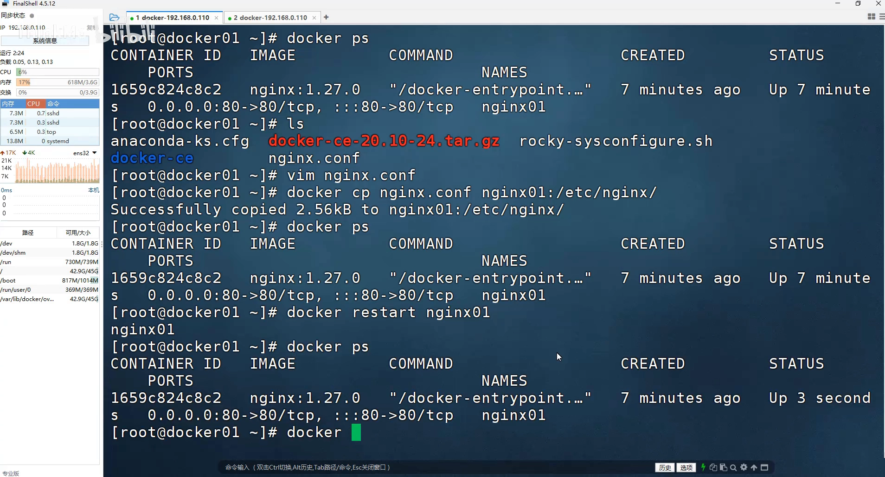

### 1.2 结论：容器都没了，数据自然也留不住

**容器里的数据会随着容器一起被删除。**[【跳转到 1:26】](https://www.bilibili.com/video/BV1M7h9z8Eqs/?t=86)

道理很直白："容器都没了，数据怎么可能还在呢？" 我们写进去的东西（改过的配置、`docker cp` 的产物）都在**容器可写层**里，容器删掉，可写层也跟着删掉。

> 这正是**持久化的边界**：容器可写层里的数据 = 一次性的；一旦要"容器删了数据还在"，就必须把数据放到容器之外。

## 二、数据卷：给容器外挂一个"留下来"的目录

### 2.1 在宿主机建目录，用 -v 挂进容器

思路很朴素：**在宿主机上建一个目录，创建容器时把它挂载到容器里的某个路径**。这样写在这个路径下的数据其实落在宿主机上，自然不受容器生死影响。[【跳转到 2:04】](https://www.bilibili.com/video/BV1M7h9z8Eqs/?t=124)

先在当前目录建一个目录，叫 `volume-nginx`：[【跳转到 2:23】](https://www.bilibili.com/video/BV1M7h9z8Eqs/?t=143)

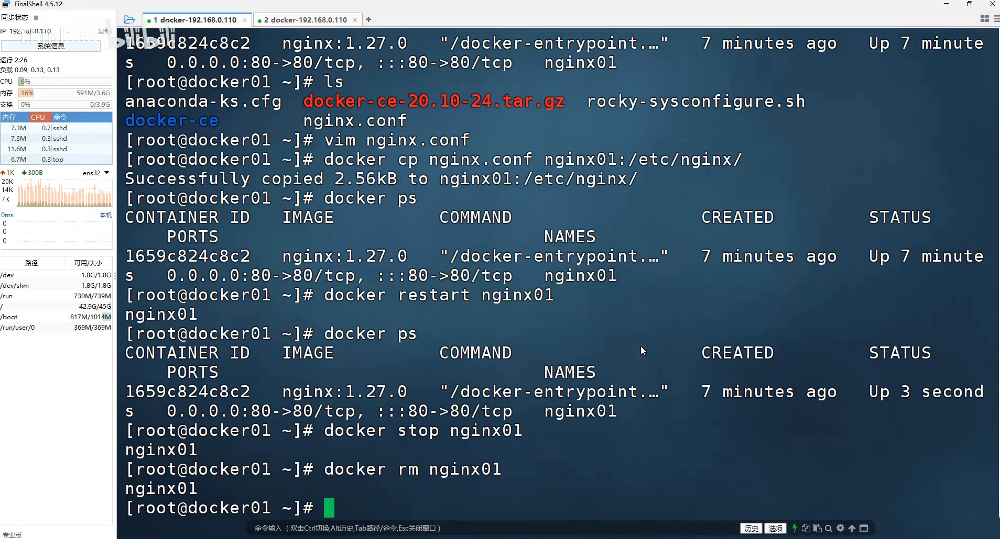

然后创建容器时用 `-v` 做挂载：`docker run -d --name nginx01 ... -v 宿主机目录:容器目录 ... nginx:1.27.0`。

**关键提醒：`-v` 里一定要写绝对路径，不要写相对路径。**[【跳转到 3:24】](https://www.bilibili.com/video/BV1M7h9z8Eqs/?t=204)

- 例如把宿主机的 `volume-nginx/logs` 挂到容器的 `/var/log/nginx`；
- 这个 `logs` 目录在宿主机上还不存在也**没关系，Docker 会自动帮你创建**；
- 但路径必须用绝对目录——就算你站在相对目录下，挂载时也不要写相对路径，否则后续会失效。

### 2.2 容器跑起来后，怎么知道挂了哪些卷？——docker inspect

容器创建好是 up 状态：[【跳转到 5:29】](https://www.bilibili.com/video/BV1M7h9z8Eqs/?t=329)

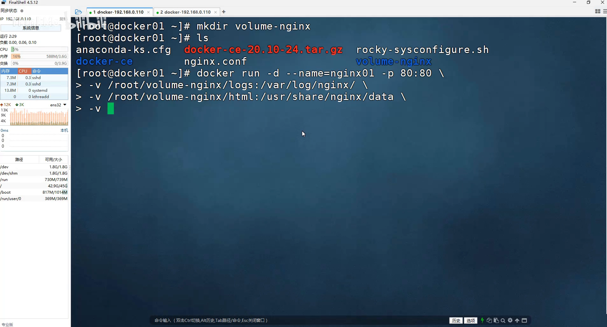

只有**创建容器时**才知道挂了什么，事后想查看，就用 `docker inspect <容器名>`（前面讲容器时提到过），往下翻能看到一段专门显示容器数据卷挂载的信息。[【跳转到 5:54】](https://www.bilibili.com/video/BV1M7h9z8Eqs/?t=354)

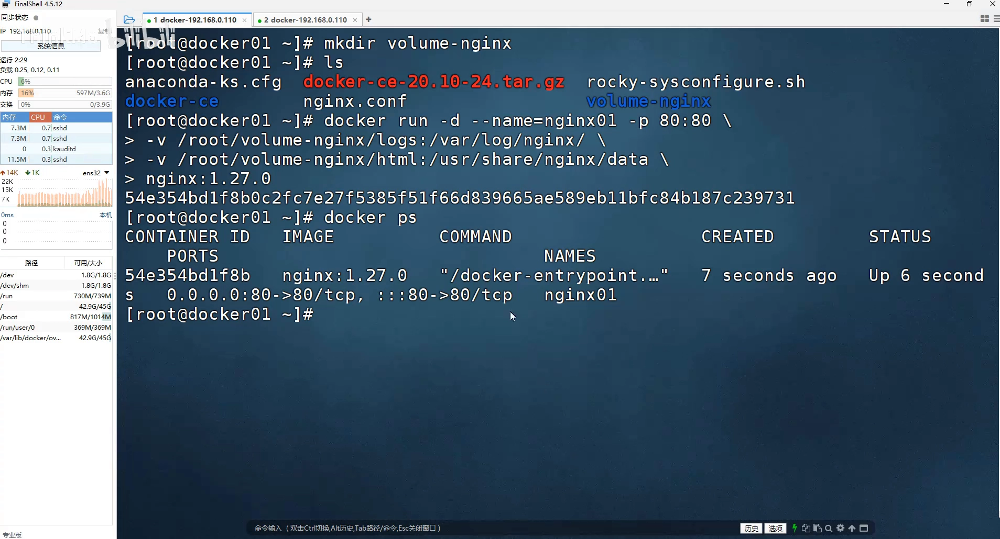

在这一段里，每一项都写清了：[【跳转到 6:19】](https://www.bilibili.com/video/BV1M7h9z8Eqs/?t=379)

- `Type`：挂载类型，这里是**绑定（bind）**——也就是"绑定数据卷"；
- `Source`：宿主机侧绑定的目录或文件；
- `Destination`：容器侧对应的目录或文件。

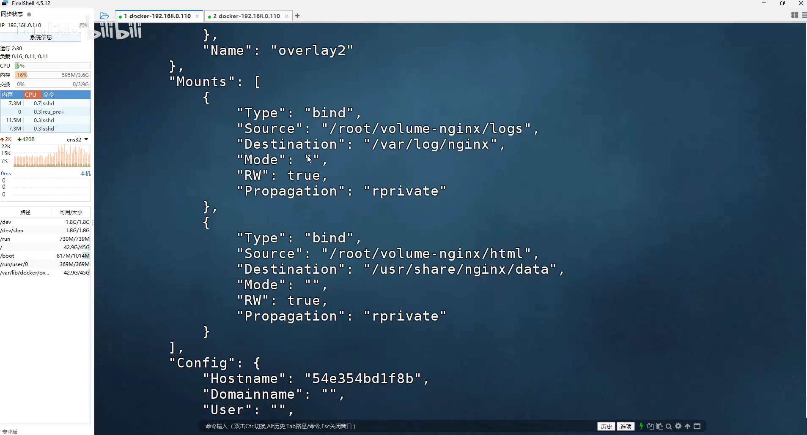

挂了几个就显示几条——这里挂了两个（logs、html），所以有两组 Source/Destination，含义就是"宿主机的这个目录 ↔ 容器的这个目录"。

### 2.3 挂载之后，宿主机与容器双向同步

挂载的目录两边是**实时同步**的。看一下宿主机 `volume-nginx/logs`，容器里的两个日志文件就被"挂出来"了；而 `html` 目录里空空的也很正常——它本来就是挂载时新创建的目录。[【跳转到 7:09】](https://www.bilibili.com/video/BV1M7h9z8Eqs/?t=429)

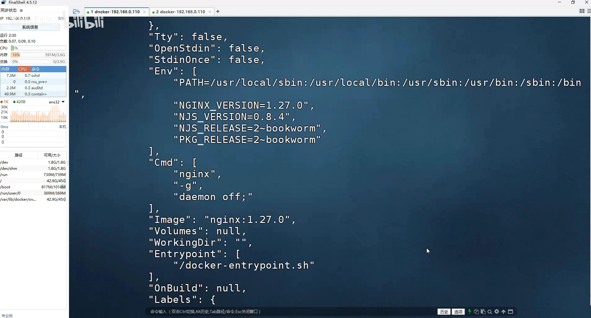

- 往宿主机的数据卷目录里放文件 → 自动同步进容器对应目录；
- 在容器挂载目录里建文件 → 也会同步回宿主机。

这就是数据卷的第一个作用：**解决宿主机与容器之间的数据同步**。[【跳转到 9:26】](https://www.bilibili.com/video/BV1M7h9z8Eqs/?t=566)

## 三、边界的一侧：容器删掉，卷里的数据还在

数据卷的第二个作用，是**持久化**。先把容器删掉：`docker stop nginx01`、`docker rm nginx01`。[【跳转到 10:36】](https://www.bilibili.com/video/BV1M7h9z8Eqs/?t=636)

再来看看宿主机对应的数据卷目录——**两个文件都还在，一个没丢**。[【跳转到 10:56】](https://www.bilibili.com/video/BV1M7h9z8Eqs/?t=656)

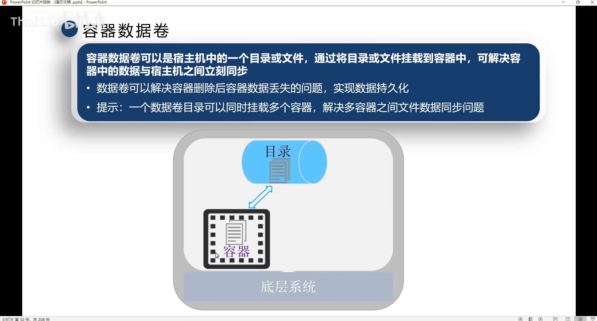

所以：**只要把想保留的重要数据通过数据卷挂载到宿主机目录，容器删了它也不会丢。** 这条"持久化边界"就清楚了——边界之内（容器可写层）随容器消失，边界之外（宿主机目录）留得下来。

## 四、边界的另一侧：挂载是"覆盖性"的

数据卷好是好，但有一个**必须记住的坑**：**它属于覆盖性挂载。**[【跳转到 11:33】](https://www.bilibili.com/video/BV1M7h9z8Eqs/?t=693)

### 4.1 用一个空目录挂上去，容器里的文件全没了

演示：先把宿主机上的一个目录**清空**，再把它挂载到容器中一个原本有文件的目录上。[【跳转到 11:58】](https://www.bilibili.com/video/BV1M7h9z8Eqs/?t=718)

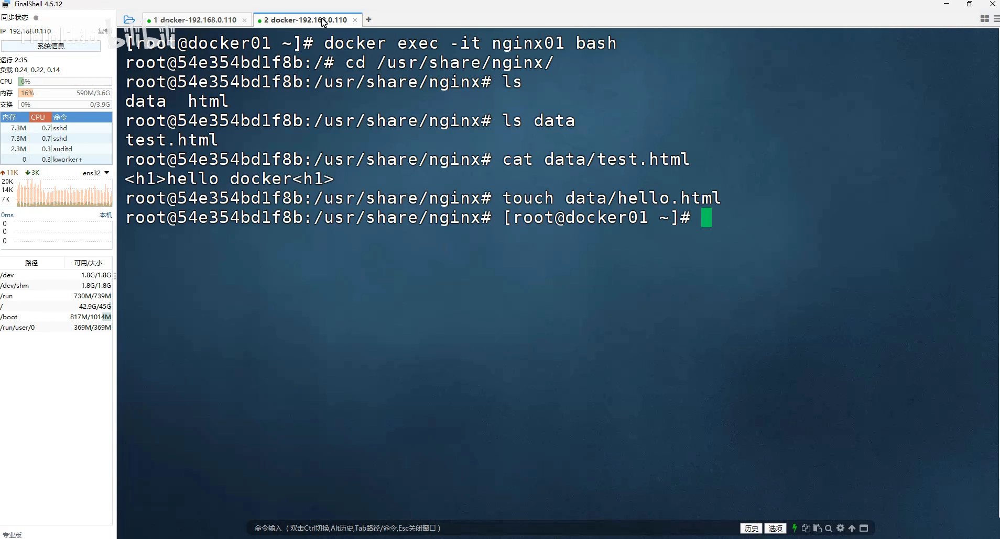

正常一个 nginx 容器的 `/usr/share/nginx/html` 里会自带两个默认首页文件；但把宿主机上的空 html 目录挂进去之后，再进容器一看——**文件没了**。[【跳转到 13:38】](https://www.bilibili.com/video/BV1M7h9z8Eqs/?t=818)

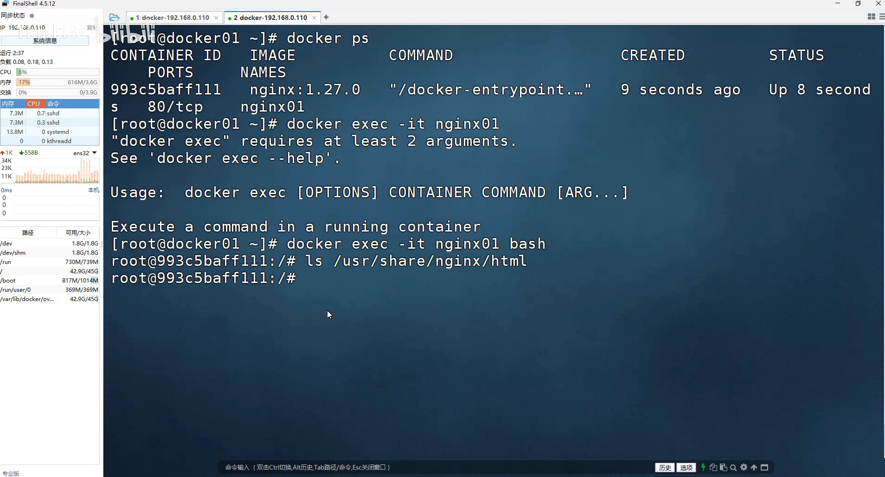

规则就是：**挂载后，容器目录的内容以宿主机目录为准**——宿主机目录是空的，容器里就全空；宿主机目录里另有一个文件，容器里原来的文件也会被全部清理掉，两边保持一致。

### 4.2 灾难案例：把空的 conf 挂上去，nginx 直接起不来

把这个坑踩到极致：宿主机上 `conf` 目录本身是空的，却把它挂到容器的 `/etc/nginx`，然后启动 nginx。结果 `docker ps -a` 一看，容器**根本没起来，处于退出状态**。[【跳转到 15:43】](https://www.bilibili.com/video/BV1M7h9z8Eqs/?t=943)

看日志就明白了：nginx 报 `/etc/nginx/nginx.conf` **"没有这样的文件或目录"**。[【跳转到 16:43】](https://www.bilibili.com/video/BV1M7h9z8Eqs/?t=1003)

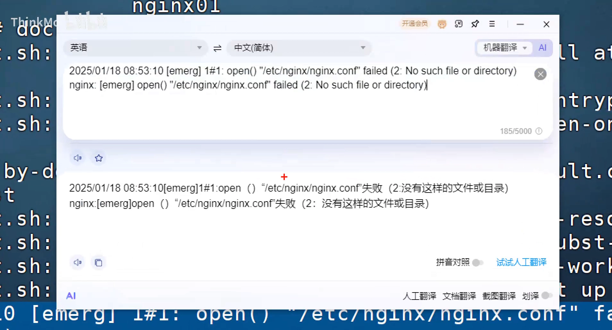

原因还是覆盖性：`conf` 目录是空的，一挂到 `/etc/nginx`，nginx 目录下原来所有的东西（包括它要加载的 `nginx.conf`）都被清理掉了。nginx 启动时找不到配置文件，自然起不来。

### 4.3 补救办法：先把目录"拷出来"，改好再挂回去

既然危险来自"用空目录覆盖"，那就**先把容器里的整个目录拷贝出来，改好，再挂回去**。[【跳转到 17:51】](https://www.bilibili.com/video/BV1M7h9z8Eqs/?t=1071)

1. 先 run 一个容器，用 `docker cp` 把容器里 `/etc/nginx` 整个目录拷到宿主机（比如 `volume-nginx/conf`）；
2. 把拷出来的内容整理进 `conf`，需要改的就地改好；
3. 再用 `-v` 把 `conf` 挂到 `/etc/nginx`。

这里有个小坑：拷出来的文件里可能混着**软链接**——它在宿主机上看是"异常"的。[【跳转到 19:56】](https://www.bilibili.com/video/BV1M7h9z8Eqs/?t=1196)

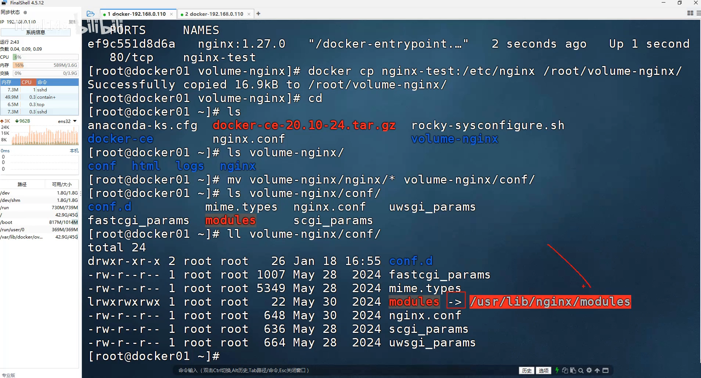

在宿主机上"异常"不要紧，只要挂回容器、容器里能解析到这个链接就没事。

按这个办法挂回去后再启动，进容器 `ls /etc/nginx`——**文件又回来了**；`cat` 一下 `nginx.conf`，正是我们前面改成 10240 的那份。[【跳转到 21:36】](https://www.bilibili.com/video/BV1M7h9z8Eqs/?t=1296)

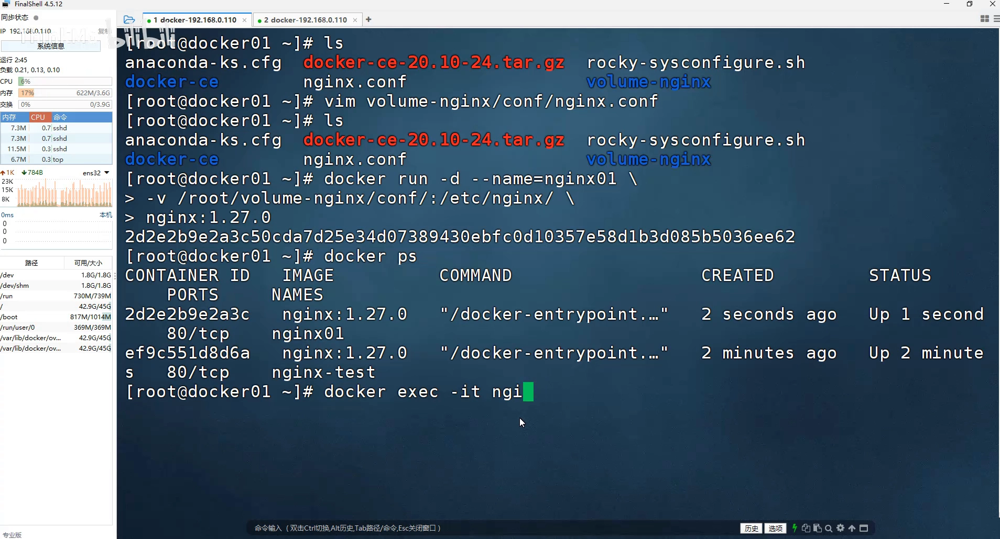

之后想改配置，直接在宿主机数据卷目录里改，容器里就会同步过去。[【跳转到 23:23】](https://www.bilibili.com/video/BV1M7h9z8Eqs/?t=1403)

## 五、补充：一个数据卷也能被多个容器共享

数据卷还可以被**多个容器**同时挂载，从而实现"多容器之间的数据同步"：一个容器产生的数据先同步到数据卷目录，再由数据卷目录同步给另一个容器。**不过这种用法非常少，了解即可。** [【跳转到 24:13】](https://www.bilibili.com/video/BV1M7h9z8Eqs/?t=1453)

## 小结

- **持久化边界**：容器可写层里的数据是"一次性"的，容器 `rm` 后就没了；要留住数据，必须把它落到**容器之外**（宿主机目录 / 数据卷）。
- **数据卷（存储卷 / volume）** 解决两件事：宿主机与容器之间的**数据同步**，以及容器删除后的**数据持久化**。
- **挂载写法**：`docker run -v 宿主机绝对路径:容器路径 ...`；宿主机路径不存在时 Docker 会**自动创建**，但必须用绝对路径。
- **查看挂载**：`docker inspect <容器>` 的 `Mounts` 段，逐条给出 `Type`（绑定）、`Source`（宿主机）、`Destination`（容器）。
- **覆盖性挂载**：容器目录的内容**以宿主机目录为准**；用空目录去挂，会把容器里原有文件清空，甚至让 nginx 起不来。
- **稳妥做法**：先 `docker cp` 把容器目录**整个拷出来**、改好，再挂回去；注意拷出的文件里可能有**软链接**。
- 一个数据卷可被多个容器共享（多容器同步），但**用得很少**。

## 关键术语速查

| 术语 | 一句话解释 |
| --- | --- |
| 可写层（容器层） | 容器在只读镜像层之上新增的一层，写入的数据随容器删除而丢失 |
| 数据卷 / 存储卷（volume） | 把宿主机目录映射进容器的机制，用于数据同步与持久化 |
| 绑定挂载（bind mount） | `docker inspect` 里 `Type` 显示为 `bind` 的挂载，即 `-v 宿主机路径:容器路径` |
| `-v` | `docker run` 用来挂载数据卷的参数：`宿主机绝对路径:容器内路径` |
| `docker inspect` | 查看容器详情；其中 `Mounts` 段列出挂载的卷（Source/Destination） |
| `docker cp` | 在宿主机与容器之间拷贝文件/目录，常用于把容器目录拷出来再挂回去 |
| 覆盖性挂载 | 挂载后容器目录内容以宿主机目录为准，空目录会清空容器内原有文件 |
| 持久化 | 让数据跨越容器生命周期存活，落在宿主机而非容器可写层 |
