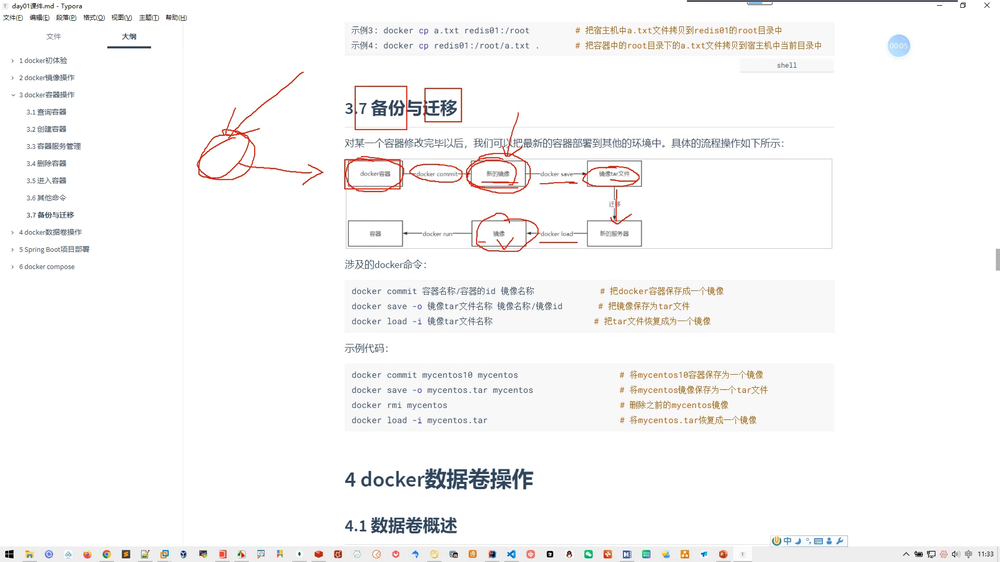
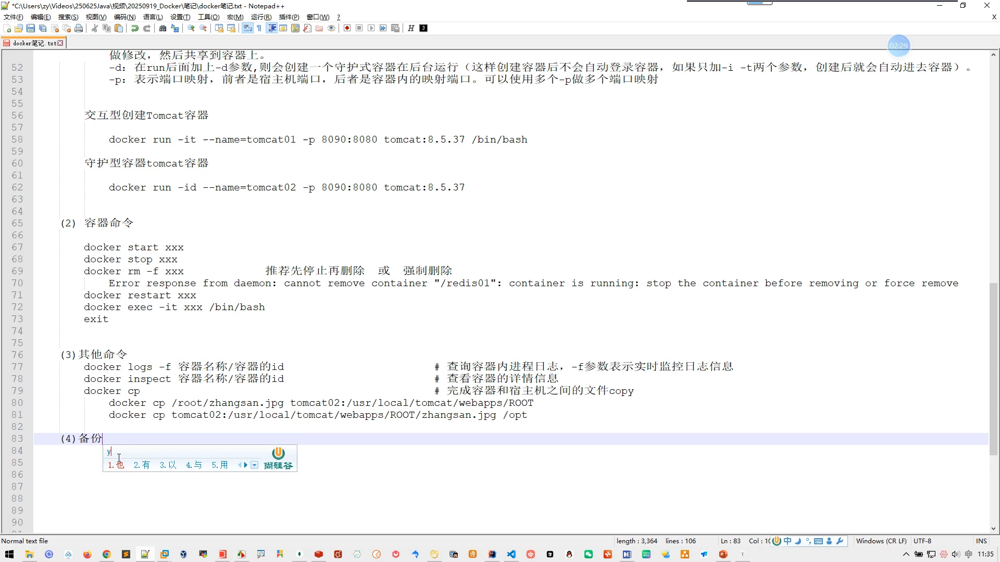
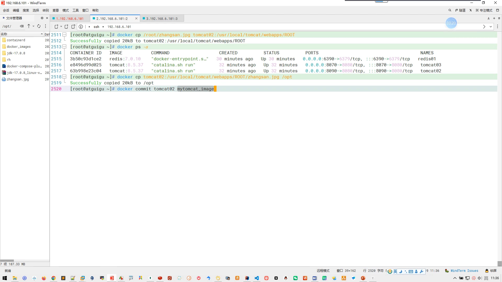
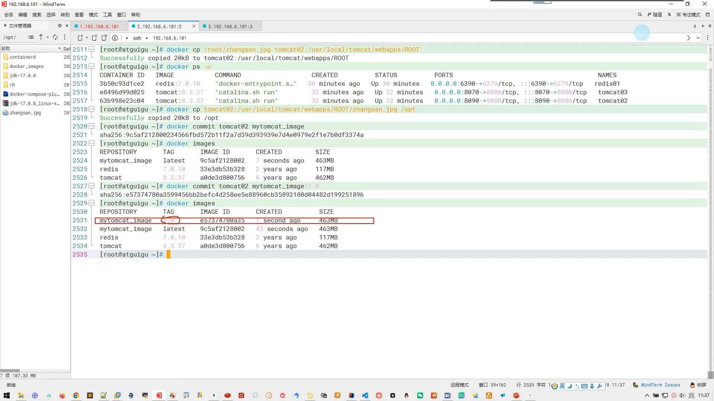
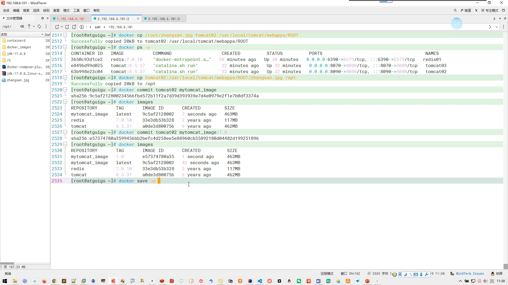
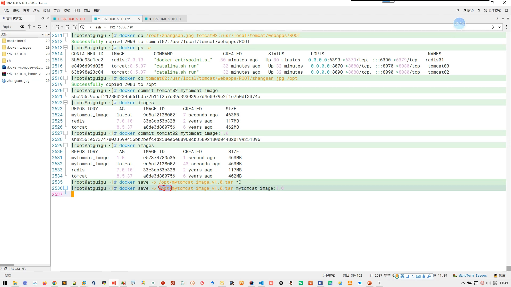
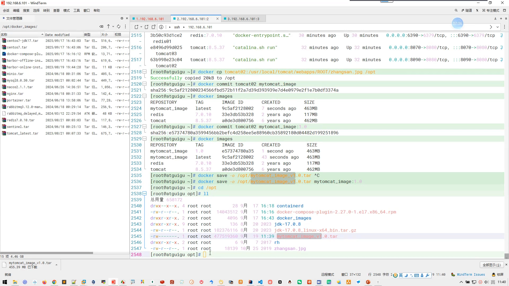
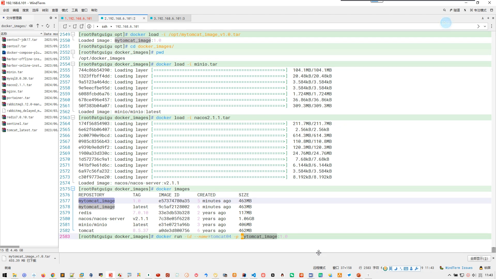

# 09-Docker 容器命令：迁移与备份

> 本文整理自 B 站视频《09-docker容器命令_迁移与备份》（UP 主：轻绘梨花泪沾衣_0419），依据视频演说图文稿逐窗口核对、纠正自动字幕错拼后整理。
> 视频地址：[BV148LP6AEnK](https://www.bilibili.com/video/BV148LP6AEnK)

## 本讲要解决的核心问题（SCQA）

**背景**：我们已经在一个容器里把项目跑起来了——tomcat 装好、页面放好、各种配置调好。这个容器是我们一步一步"辛苦搭"出来的。

**冲突**：现在想把这个搭好的环境交给同学用，让同学不必从头再部署一遍。可容器不是普通文件，没法直接拷给别人：容器是运行时的东西，对方的机器上并没有它。

**疑问**：怎样才能把一个已经配置好的容器"打包"出去？对方拿到之后，又怎样才能"还原"出一个和我这边一模一样的容器？

**回答（中心思想）**：整个迁移与备份只要三步，对应三条命令——

| 步骤 | 命令 | 作用 |
| --- | --- | --- |
| ① 固化 | `docker commit` | 把**容器**存成一个**镜像**（相当于给容器拍快照） |
| ② 打包 | `docker save` | 把**镜像**导出成一个 **tar 包**（因为镜像不能直接传，得打包成离线文件） |
| ③ 还原 | `docker load` + `docker run` | 对方把 tar 包导入成镜像，再跑出新容器，环境就和原来一模一样 |

## 一、为什么不能直接给容器，而要先 commit 成镜像

容器是"**由镜像生成、又在运行中不断被改动**"的东西。我们下载一个官方镜像、用它启动容器，然后在容器里加文件、改配置——这些改动只存在于**这个正在运行的容器**里。[【跳转到 0:25】](https://www.bilibili.com/video/BV148LP6AEnK/?t=25)



所以，要把"我改过的环境"传给别人，第一步必须先**把容器固化成一份新镜像**。这一步之后，新旧镜像的差别就在于：

- **新镜像**创建出来的容器里，会有我部署的项目、有我在容器里放进去的东西（视频里用"张三"这个文件打比方）；
- **旧镜像**创建出来的容器里没有这些——就是一份干净的原始环境。[【跳转到 0:50】](https://www.bilibili.com/video/BV148LP6AEnK/?t=50)

一句话：**镜像是可交付的"模具"，容器是这个模具浇出来的"成品"；把成品变回模具，就是 commit。**

## 二、commit：把容器"拍"成镜像

`docker commit` 的语法很简单，只需要**两个名字**：

```bash
docker commit <容器名或容器ID> <要保存成的镜像名>
```

- 第一个参数：要保存**哪个**容器（可以是容器名，也可以是容器 ID）；
- 第二个参数：保存**成什么名字**的镜像。[【跳转到 2:30】](https://www.bilibili.com/video/BV148LP6AEnK/?t=150)



视频里把自己那个 `tomcat02` 容器存成了一个新镜像：

```bash
docker commit tomcat02 mytomcat_image
```

镜像名随便起。执行完再用 `docker images` 查看本地镜像库，就会发现**多了一个镜像**——它和原来的 tomcat 镜像在**大小上有区别**（多出来的就是我们塞进去的那点东西），**镜像 ID 也不一样**。[【跳转到 3:20】](https://www.bilibili.com/video/BV148LP6AEnK/?t=200)



**一个小知识点——版本号**：上面没写版本，默认版本就是 `latest`。如果给镜像名带上冒号和版本，比如 `mytomcat_image:1.0`，就能指定版本；再 `docker images` 一看，本地会**多出一个 1.0 的镜像**。所以同一个仓库可以有多个版本。[【跳转到 3:45】](https://www.bilibili.com/video/BV148LP6AEnK/?t=225)

## 三、save：把镜像导出成 tar 包

镜像**不能像普通文件那样直接发给别人**——它由很多层组成、带校验，是"离线"打包的形态。所以第二步用 `docker save` 把它导出成一个 **tar 压缩包**。[【跳转到 1:15】](https://www.bilibili.com/video/BV148LP6AEnK/?t=75)

```bash
docker save -o <输出文件.tar> <镜像名:版本>
```

- `-o` 是 output（输出）的意思，**后面跟着要输出的文件名**；
- 最后才是要导出**哪个镜像**（名字 + 版本，或 ID）。[【跳转到 4:10】](https://www.bilibili.com/video/BV148LP6AEnK/?t=250)



**关于保存位置**：如果只写一个文件名、不写路径，它会**默认存到家目录**（`~`，即当前用户的家）。想存到别处，就写**绝对路径**，例如存到 `/opt` 下。[【跳转到 5:00】](https://www.bilibili.com/video/BV148LP6AEnK/?t=300)

```bash
docker save -o /opt/mytomcat_image_V1.0.tar mytomcat_image:1.0
```



执行完到 `/opt` 下 `ll` 一看，就会多出一个 `mytomcat_image_V1.0.tar` 文件（视频里这个包六百多兆，因为里面装着完整镜像）。这个 tar 包就可以下载到 Windows、用内网通发给同学了。[【跳转到 6:15】](https://www.bilibili.com/video/BV148LP6AEnK/?t=375)



## 四、load + run：对方还原出一样的容器

同学拿到 tar 包后，把它上传到自己的虚拟机里，放到哪都行，然后一条命令导入：

```bash
docker load -i <tar 包路径>
```

- `-i` 是 input（输入）的意思，后面跟着要导入的文件；
- 可以用**绝对路径**，也可以用**相对路径**。[【跳转到 7:36】](https://www.bilibili.com/video/BV148LP6AEnK/?t=456)



导入完成后，对方 `docker images` 就能看到这个镜像——**和发件人的镜像完全一样**。这也解释了视频开头那个说法：镜像是**一层一层**组成的，`load` 时就是把这些层**逐层**还原出来。用这种方式在离线环境里批量导入镜像（视频里还导入了 mysql、nginx 等），比从网上下载要**快得多**。[【跳转到 8:26】](https://www.bilibili.com/video/BV148LP6AEnK/?t=506)

最后，**用这个新镜像跑一个新容器**即可。视频里是守护式运行：

```bash
docker run -d --name tomcat04 -p 8080:8080 mytomcat_image:1.0
```

- `-d`：后台（守护）方式运行；
- `--name tomcat04`：给新容器起名；
- `-p 8080:8080`：把宿主机端口映射到容器端口；
- 守护式不需要 `-it` 交互。

启动后访问映射的端口，**之前容器里的内容（"张三"）照样能访问**。至此，"备份与迁移"就全部完成了。[【跳转到 10:28】](https://www.bilibili.com/video/BV148LP6AEnK/?t=628)



## 小结

- **迁移的本质**是"把可交付物标准化"：容器先在本地固化成镜像，镜像再打包成文件，文件传过去后还原成镜像、跑成容器。
- `docker commit <容器> <镜像名>`：把容器固化成镜像；不写版本默认 `latest`，可写成 `镜像名:版本`。
- `docker save -o <文件.tar> <镜像名:版本>`：把镜像导出成 tar 包；只给文件名会存到家目录，给绝对路径则存到指定目录。
- `docker load -i <文件.tar>`：把 tar 包导回成镜像，路径可用绝对或相对。
- 拿到镜像后 `docker run` 出来的容器，与源容器的环境**一模一样**。
- 注意：这套"commit/save/load"备份的是**镜像与容器本身**，容器里运行时产生的**业务数据**（数据库、上传的文件等）默认在可写层里，需要另外用数据卷来持久化——那正是后面几条存储类视频的主题。

## 关键术语速查

| 术语 | 一句话解释 |
| --- | --- |
| `docker commit` | 把一个容器的当前状态固化成一份新镜像（相当于给容器拍快照） |
| `docker save` | 把本地镜像导出成一个 tar 离线包，便于传输 |
| `docker load` | 把 tar 离线包导入成本地镜像 |
| tar 包 | 这里指把镜像打包成的离线文件，可下载、拷贝、分发 |
| `latest` | 镜像不指定版本时的默认标签 |
| `-d` / `-it` | 容器后台运行 / 交互式运行；守护式用 `-d`，不需要 `-it` |
