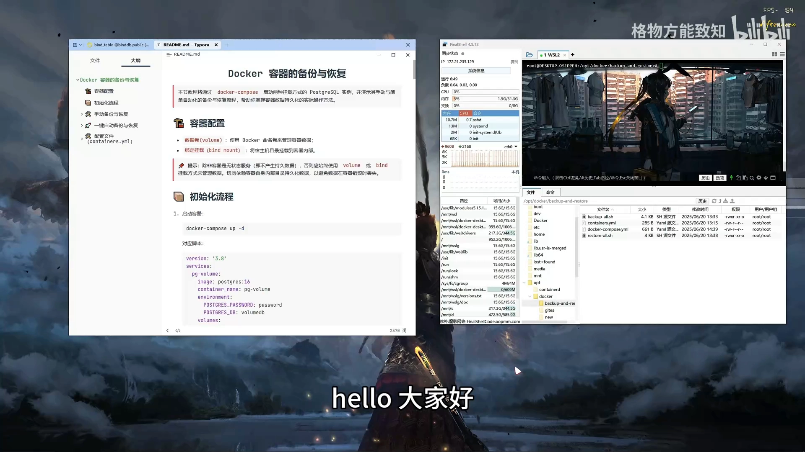
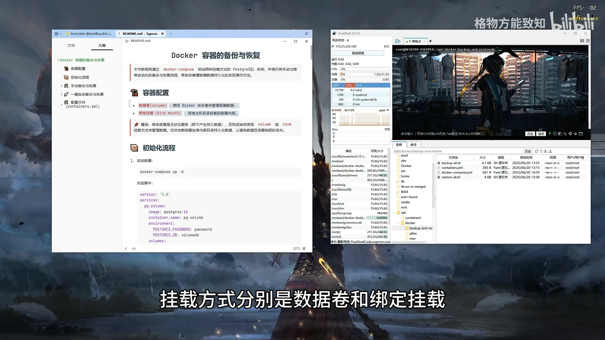
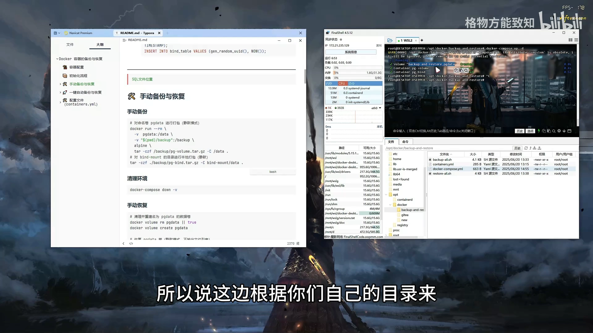
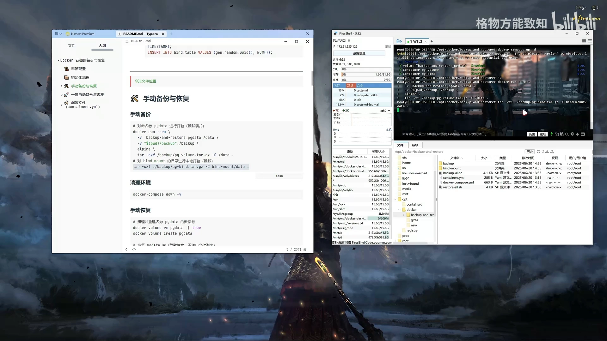
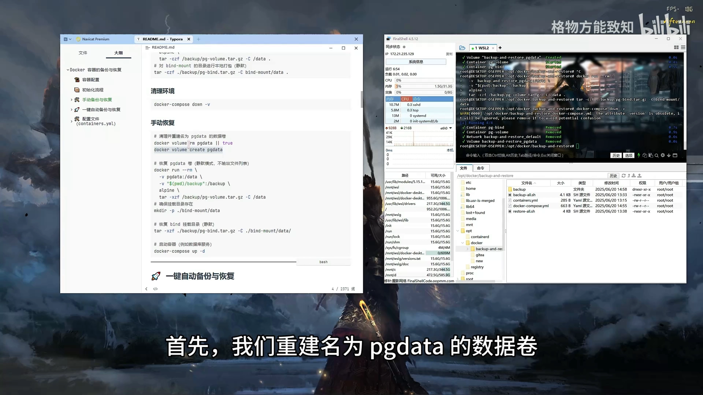
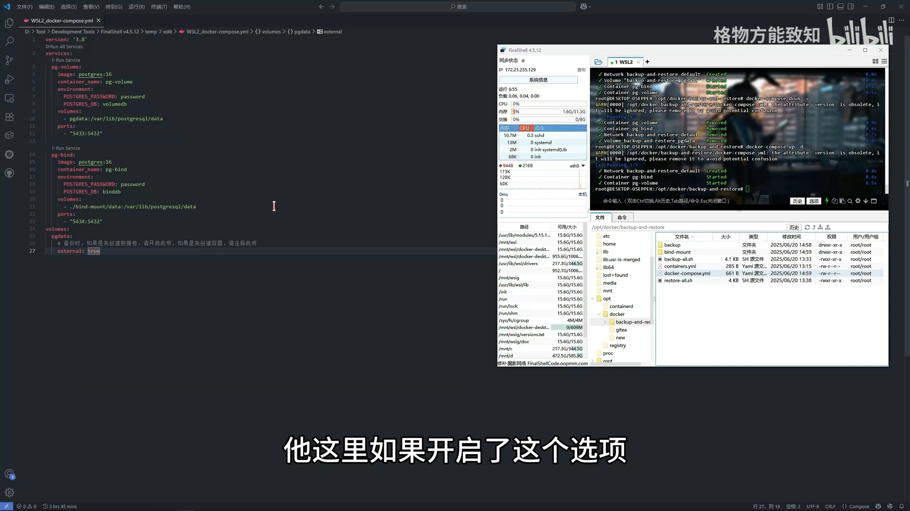
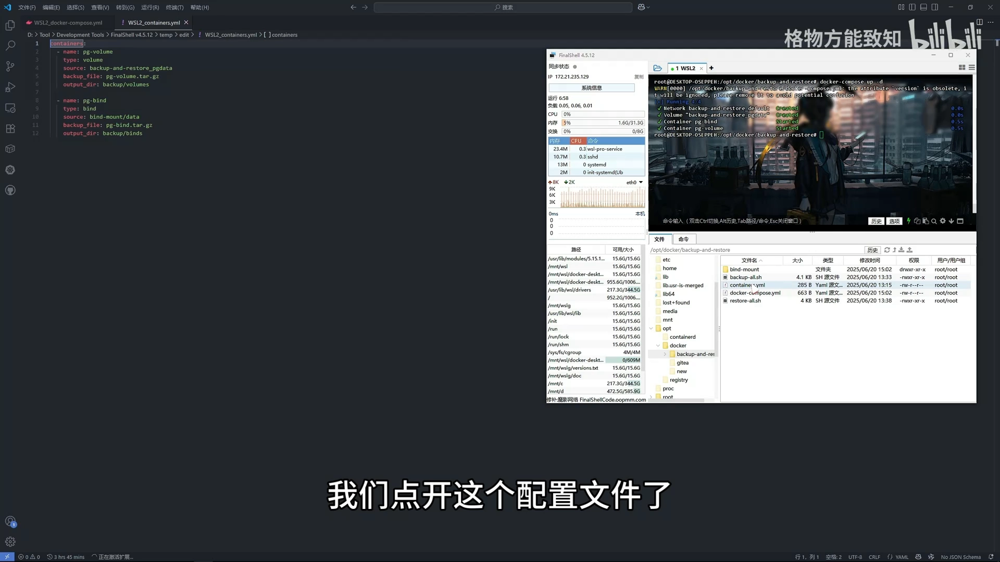
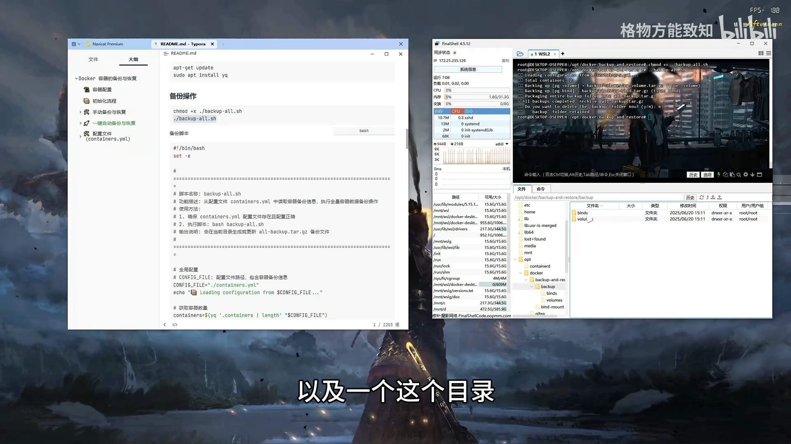
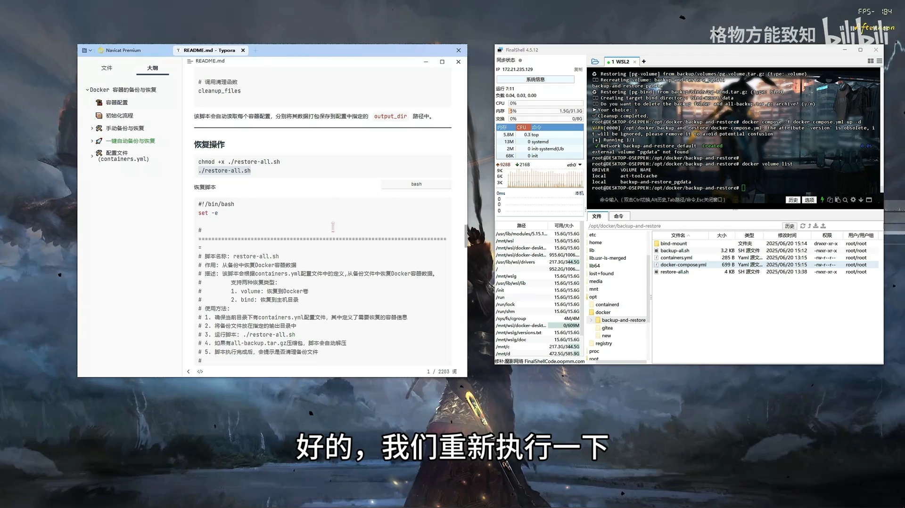

# Docker 的备份与恢复：以 docker compose 管理的数据卷为例

> 本文整理自 B 站视频《Docker的备份与恢复》（UP 主：格物方能致知），依据视频演说图文稿逐窗口核对、纠正自动字幕错拼后整理。
> 视频地址：[BV1VqKwztE1A](https://www.bilibili.com/video/BV1VqKwztE1A)

## 本讲要解决的核心问题（SCQA）

**背景**：用 docker compose 起一个数据库（PostgreSQL）很容易。只要写了 compose 文件，`up` 一下就有两个实例在跑，库里也有数据。

**冲突**：可一旦要**重装、升级或换机器**，问题就来了：compose 文件里用的是**命名数据卷**（数据在 `/var/lib/docker` 里，名字还跟着项目目录走）或者**绑定挂载**（数据在本地目录里）。这两类挂载方式的**备份与恢复动作并不一样**，稍不留神就会踩坑。

**疑问**：compose 场景下，数据到底存在哪？怎么**手动**备份和恢复？能不能用脚本**自动化**一键备份/恢复？

**回答（中心思想）**：本讲用 compose 起的两个 PostgreSQL 实例做演示，结论是——
> ① **有状态服务必须把数据放进数据卷或绑定挂载**，别依赖容器内部目录；
> ② 备份 = **把挂载的数据（数据卷内容 / 本地目录）打包**；恢复 = **重建挂载点（重建同名卷 / 建回目录）再把数据放回去**、最后启动容器；
> ③ 命名卷的名字会被 compose 的"项目名"影响，**迁移时必须改配置**，因此实践中**更推荐绑定挂载**。

## 一、两种挂载方式先摆在台面上对比

视频准备了一个 compose 脚本，同时起了两个 PostgreSQL 实例——**一个挂载数据卷、一个绑定本地目录**，用同一套数据来做对照。[【跳转到 0:50】](https://www.bilibili.com/video/BV1VqKwztE1A/?t=50)



这里先给出一条**通用的判断题**：

> **除非容器是无状态服务，否则应始终使用数据卷或绑定挂载来管理数据，切勿依赖容器自身内部目录来持久化数据**，否则数据会在容器销毁时丢失。[【跳转到 0:25】](https://www.bilibili.com/video/BV1VqKwztE1A/?t=25)



两种方式的本质区别很简单：

| 挂载方式 | 数据落在哪 | 备份时要处理的对象 |
| --- | --- | --- |
| **命名数据卷**（volume） | Docker 管理的 `/var/lib/docker/volumes/<卷名>/` | 数据卷（内容是宿主机上的一个目录） |
| **绑定挂载**（bind mount） | 你指定的宿主机本地目录 | 那个本地目录 |

## 二、准备工作：让两个实例都有数据

启动 compose 后，两个实例的库都是空的。复制一段**初始化 SQL** 执行一下，就能看到表里有了数据。[【跳转到 1:15】](https://www.bilibili.com/video/BV1VqKwztE1A/?t=75)



有了数据，才能验证"备份→清空→恢复"这条链路是否真的有效。

## 三、手动备份：记录卷名 + 打包挂载内容

**备份的第一步，是先把"数据卷的名字"记下来。** 因为不同的人项目目录不同，compose 自动生成的数据卷名字也不同——所以要**按自己的目录/卷名去替换**命令里的名字。[【跳转到 1:40】](https://www.bilibili.com/video/BV1VqKwztE1A/?t=100)

接下来分别打包两种挂载的内容：

- 对**数据卷**：把卷对应的目录打包；
- 对**绑定挂载**：把那个本地目录打包。

例如对本地目录可以直接：

```bash
tar czf <备份名>.tar.gz <本地目录>
```

**手动备份的完成效果**：会得到一份"挂载数据"的压缩包。[【跳转到 2:05】](https://www.bilibili.com/video/BV1VqKwztE1A/?t=125)

## 四、动手清空环境，再恢复

备份好之后，**清理环境**：把数据卷清理掉、把本地目录手动删掉——此时数据"没了"。[【跳转到 2:30】](https://www.bilibili.com/video/BV1VqKwztE1A/?t=150)



然后**恢复**，步骤是：

1. **重建数据卷**（视频里重建名为 `pg_data` 的卷）；
2. **恢复数据**（把备份内容放回卷）；
3. **重建挂载目录**（绑定挂载用的本地目录）；
4. **恢复挂载目录**（把备份内容放回该目录）；
5. **最后启动容器**。[【跳转到 2:55】](https://www.bilibili.com/video/BV1VqKwztE1A/?t=175)



## 五、踩坑：compose 会把"项目名"拼进数据卷名字

手动恢复时视频里出现了一个**典型问题**：恢复后启动容器，数据卷的名字**又变成了另一个**，导致找不到原来的卷。原因是要修改 compose 配置文件里的一个**开关选项**（视频里"把这个给他开启"）。[【跳转到 4:13】](https://www.bilibili.com/video/BV1VqKwztE1A/?t=253)

这个坑的机制是：

- compose 默认会把**项目名**（通常是所在目录名）拼进数据卷名字，形成类似 `<项目名>_<卷名>` 的真实卷名；
- 如果你**第一次启动时没带某个选项**（就是创建这个实例时），那这个实例用的卷名和迁移后按新配置算出来的**对不上**；
- 所以**迁移之后必须把配置文件里的卷名改成实际的那个名字**。[【跳转到 4:28】](https://www.bilibili.com/video/BV1VqKwztE1A/?t=268)



正因如此，视频作者给出建议：

> **还是建议把数据挂载到宿主机的操作（绑定挂载）**，这样更**方便**、也更**安全**。

## 六、再进一步：用脚本一键备份 / 恢复

手动流程跑通后，视频演示了一套**自动化脚本**：先改一下配置文件，把某个开关注释掉，重启；然后打开脚本的**配置文件**来指定参数。[【跳转到 5:54】](https://www.bilibili.com/video/BV1VqKwztE1A/?t=354)

配置项包括：[【跳转到 6:05】](https://www.bilibili.com/video/BV1VqKwztE1A/?t=365)

- **数据卷的名称 / 名字 / 类型**（是"数据卷挂载"还是"绑定挂载"）；
- **备份文件名**（打包后叫什么）；
- **输出目录**；
- **原路径**（数据卷的源，或绑定的本地目录源）；
- **包名**。



**前置依赖**：脚本需要用到 `yq` 工具（视频里已提前装好）。[【跳转到 6:38】](https://www.bilibili.com/video/BV1VqKwztE1A/?t=398)

运行备份脚本的流程：[【跳转到 7:01】](https://www.bilibili.com/video/BV1VqKwztE1A/?t=421)

1. 先给脚本**执行权限**；
2. 执行脚本，脚本会**询问是否清除目录**（示例里选了"否"）；
3. 结果：生成一个**压缩包**和**一个目录**——目录里会把"数据卷方式的备份"和"绑定方式的备份"**分开放**，最后整体再打成一个压缩包。[【跳转到 7:26】](https://www.bilibili.com/video/BV1VqKwztE1A/?t=446)



然后**清空数据**、删掉目录，给**还原脚本**赋予执行权限并运行。这次又遇到"**没找到这个数据卷**"——还是因为 compose 默认创建的是拼接了项目名的卷名，需要**修改配置**后才能对上。[【跳转到 8:29】](https://www.bilibili.com/video/BV1VqKwztE1A/?t=509)



改好后重新执行，**两个实例都启动了，数据库里的数据全部恢复**。[【跳转到 9:07】](https://www.bilibili.com/video/BV1VqKwztE1A/?t=547)

**使用条件**：这两个脚本（备份脚本 + 还原脚本）以及它们的**配置文件要放在同一个目录下**。[【跳转到 9:32】](https://www.bilibili.com/video/BV1VqKwztE1A/?t=572)

## 小结

- **有状态服务必须用卷或绑定挂载**，不能让数据留在容器可写层里。
- **备份** = 打包挂载的数据（数据卷内容或本地目录）；**恢复** = 先重建挂载点（重建同名卷 / 建回目录），再把数据放回去，最后启动容器。
- **绑定挂载 vs 命名卷**：命名卷的数据在 `/var/lib/docker/volumes/` 且卷名会被 compose 项目名影响，迁移时容易对不上；绑定挂载用普通目录、更直观可控，**实践中更受推荐**。
- **compose 最大的坑**：数据卷真实名字 = 项目名 + 卷名，**迁移/恢复必须把配置里的卷名改成实际名字**。
- **自动化**：可以用脚本按配置一键备份/恢复，但需要 `yq` 等前置工具，且脚本与配置必须在同一目录。
- **数据无价**：备份/恢复操作建议"多试几次、确认无误"后再真正执行。

## 关键术语速查

| 术语 | 一句话解释 |
| --- | --- |
| docker compose | 用一个 YAML 文件声明并批量启动多个容器/服务 |
| 命名数据卷 | 由 Docker 管理、有名字的卷，数据存于 `/var/lib/docker/volumes/<卷名>` |
| 绑定挂载 | 把宿主机某个本地目录直接挂进容器 |
| 项目名 | compose 按所在目录名生成的前缀，会拼进数据卷的真实名字里 |
| `tar` 打包 | 把挂载的数据目录/卷打包成压缩文件，即"备份" |
| `yq` | 命令行 YAML 处理工具，自动化脚本用它读取配置 |
| 数据持久化 | 让数据独立于容器生命周期保存下来，容器删了数据还在 |
