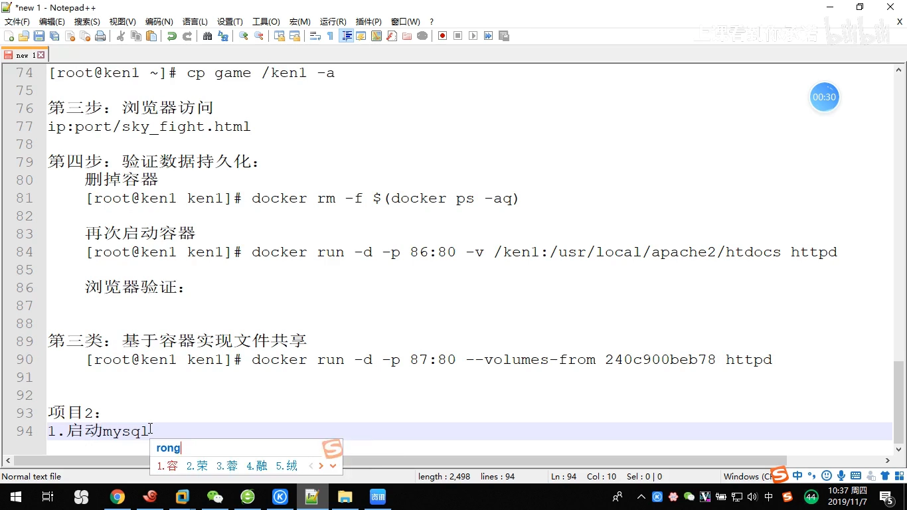
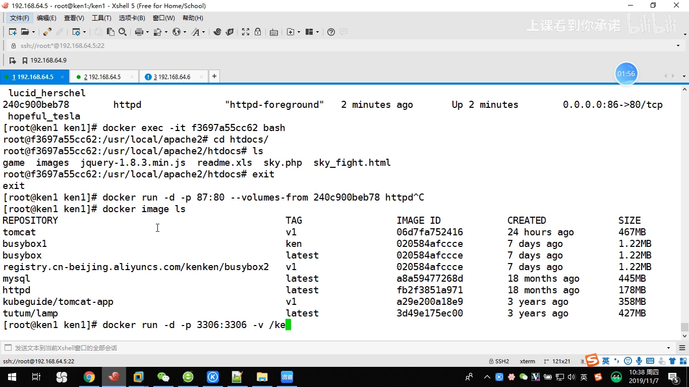
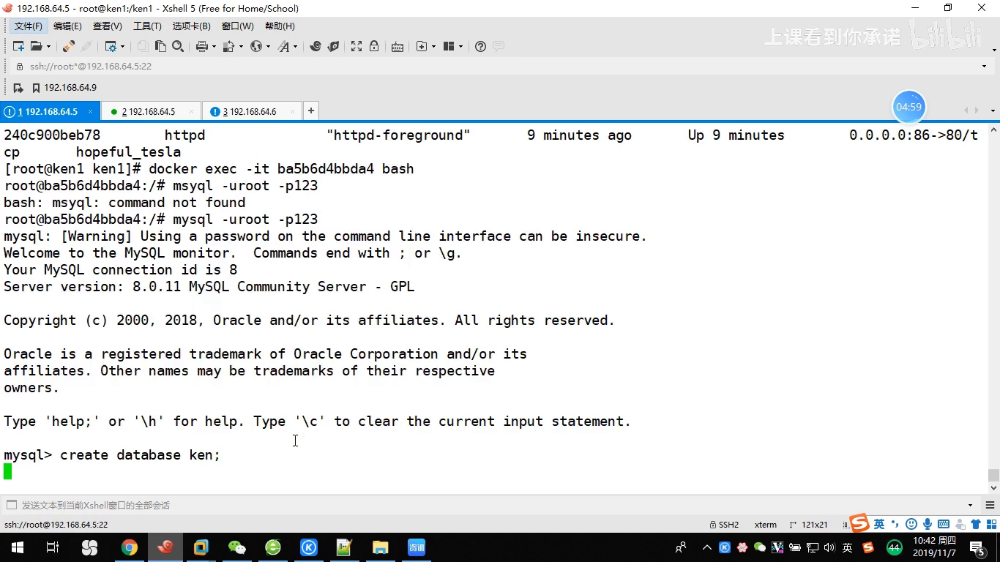
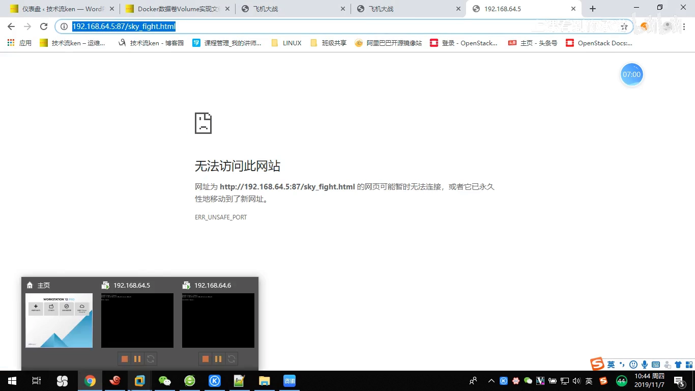
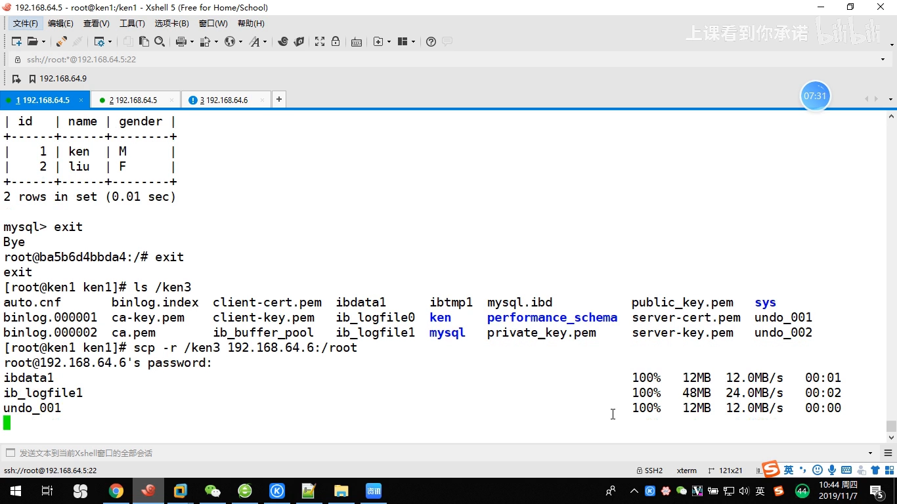
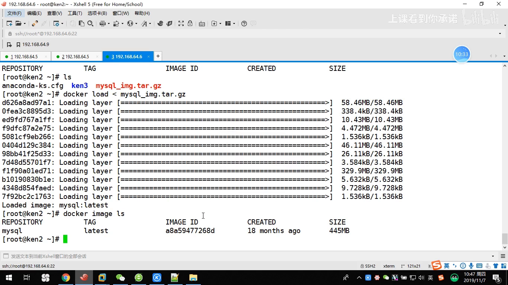
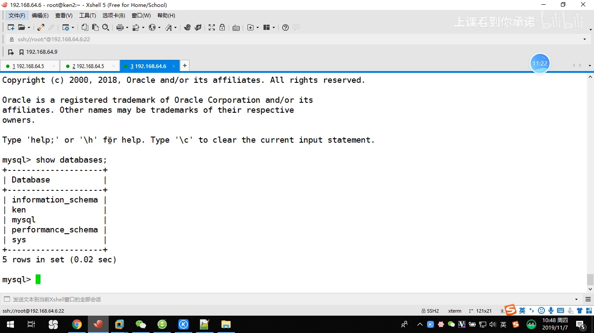

# 数据备份与迁移实战：用数据卷把数据库搬到另一台机器

> 本文整理自 B 站视频《docker容器怎么进行数据迁移和数据备份》（UP 主：上课看到你承诺），依据视频演说图文稿逐窗口核对、纠正自动字幕错拼后整理。
> 视频地址：[BV1UM411x7z1](https://www.bilibili.com/video/BV1UM411x7z1)

## 本讲要解决的核心问题（SCQA）

**背景**：前面我们学过"镜像层面的迁移"——`docker commit`/`save`/`load` 可以把镜像搬来搬去。但镜像里装的是**程序**，不是**数据**。

**冲突**：真正的业务数据（数据库里的库、表、记录）都写在容器的**数据卷**里。如果一台机器坏了，光搬镜像没用，**数据还在原来的机器上**。

**疑问**：一台节点上的数据库数据，怎么**备份**下来，又怎么**迁移**到另一台节点上、并且保证数据不丢？

**回答（中心思想）**：本节用一个小项目走通全流程，核心结论一句话——
> **数据备份/迁移 = 直接对"挂载到宿主机的那份目录"做打包与复制**；
> 先 `tar` 打包该目录（备份），把目录复制到另一台节点、再用它启动同一个镜像的容器，数据就回来了（迁移）。
> 全程只需要掌握一个 Docker 技巧：**怎么找到数据库真实数据存在宿主机的哪个目录**。

## 一、先看清项目要做的四步

视频用一个小项目贯穿始终，四步是：[【跳转到 0:30】](https://www.bilibili.com/video/BV1UM411x7z1/?t=30)

1. **启动 mysql 容器**（准备两个节点，两个节点上都要装好 docker）；
2. **创建数据库和表**，并插入数据；
3. **模拟节点宕机**（让节点 A"坏掉"）；
4. **在节点 B 上启动并恢复数据**，验证数据还在。



看着复杂，其实每一步都很简单。关键前提是：**要有 mysql 的镜像**（视频里已提前上传好，用 `docker load` 导入）。

## 二、启动 mysql 容器：它比普通容器"特殊"一点

### 2.1 先用 -v 把数据挂出来

启动命令是普通的 `docker run`：`-d` 后台运行、`-p 3306:3306` 映射端口、`-v` 把数据目录挂出来。[【跳转到 1:31】](https://www.bilibili.com/video/BV1UM411x7z1/?t=91)

```bash
docker run -d -p 3306:3306 -v <宿主机目录>:/var/lib/mysql <mysql镜像>
```

### 2.2 关键：怎么知道数据库的数据在容器里的哪个目录？

如果不知道 mysql 把数据写在哪儿，视频给了一个**通用小技巧**：用 `docker history`（或 `docker inspect`）去看镜像声明的 **VOLUME**，就知道它默认把哪个目录当作数据目录。mysql 就是 `/var/lib/mysql`。[【跳转到 2:17】](https://www.bilibili.com/video/BV1UM411x7z1/?t=137)



**这个技巧很重要**：不同数据库/应用的"数据目录"不一样，找到它、把它 `-v` 挂出来，才能做后面"打包宿主机目录"的备份。

### 2.3 踩坑：mysql 容器必须显式指定 root 密码

启动后 `docker ps` 看不到容器（它退出了），用 `docker logs` 看日志，会看到报错：数据库**没有初始化完成**，提示 **"you need to specify one of them"**——必须指定一个 root 密码（或指定密码为空、或指定为随机数）。[【跳转到 2:42】](https://www.bilibili.com/video/BV1UM411x7z1/?t=162)

所以启动 mysql（这类数据库容器）时，要用 `-e` 指定环境变量：

```bash
docker run -d -p 3306:3306 -e MYSQL_ROOT_PASSWORD=123 -v <宿主机目录>:/var/lib/mysql <mysql镜像>
```

- `-e` 是**指定环境变量**的意思；
- `MYSQL_ROOT_PASSWORD=123` 表示把数据库的 root 密码设为 `123`。[【跳转到 3:07】](https://www.bilibili.com/video/BV1UM411x7z1/?t=187)

加上这一项后，容器就正常起来了。

## 三、进容器建库建表、插入数据

数据库起来后，进入容器：

```bash
docker exec -it <容器ID> bash
mysql -u root -p123
```

登录进去后，创建数据库和一张测试表（视频里表叫 `t1`，字段例如 `id int`、`name varchar(28)` 等），再 `insert into t1 value(...)` 插入两条记录，`select` 一看，表里有数据了。[【跳转到 5:00】](https://www.bilibili.com/video/BV1UM411x7z1/?t=300)



这两条数据就是我们后面要"保住"的东西。

## 四、备份：把挂载目录 tar 打包

要模拟宕机，**先把数据备份**。备份的方法非常直接——**对挂载到宿主机的那个数据目录做 `tar` 打包**。[【跳转到 7:01】](https://www.bilibili.com/video/BV1UM411x7z1/?t=421)

```bash
tar czf <备份文件名>.tar.gz <宿主机数据目录>
```



为什么这么简单就行？因为 `-v` 已经让容器的 `/var/lib/mysql` **和宿主机的某个真实目录一一对应**——数据库写的每一字节，其实都落在宿主机那个目录里。**打包那个目录，就等于打包了整个数据库。**

## 五、模拟宕机：把数据目录删掉

备份完，就"模拟宕机"——直接 `rm -rf` 把宿主机上的数据目录删掉。

此时再去看，容器里的表和数据**都没了**：因为数据目录没了，容器 `-v` 挂的就是一个空目录。[【跳转到 7:56】](https://www.bilibili.com/video/BV1UM411x7z1/?t=476)



这一步模拟的就是"机器坏掉、数据丢失"的场景。

## 六、迁移到节点 B：复制目录 + 启动容器 + 验证

现在到**另一个节点 B**（视频里是 `192.168.64.6`）上做恢复。前提是节点 B 也装好了 docker、并 `docker load` 导入了同一个 mysql 镜像。[【跳转到 8:58】](https://www.bilibili.com/video/BV1UM411x7z1/?t=538)

恢复只需三步：

1. **把备份目录复制到节点 B**；
2. **解包还原数据目录**（把 tar 解到对应位置）；
3. **用同一镜像启动容器**，`-v` 指向还原后的目录：

   ```bash
   docker run -d -p 3306:3306 -e MYSQL_ROOT_PASSWORD=123 -v /root/k3:/var/lib/mysql <mysql镜像>
   ```

   视频里把挂载源路径改成了 `/root/k3`（节点 B 上放还原数据的位置）。[【跳转到 10:34】](https://www.bilibili.com/video/BV1UM411x7z1/?t=634)



容器起来后，进容器 `mysql -u root -p123`，`show tables`、`select * from t1`——**表还在、数据还在**。[【跳转到 10:59】](https://www.bilibili.com/video/BV1UM411x7z1/?t=659)



数据为什么一定在？因为原目录是**完整复制**过来的，数据本来就在目录里，自然不会丢。

## 小结

- **镜像管程序、数据卷管数据**：镜像迁移（commit/save/load）搬的是程序，业务数据要靠数据卷备份迁移。
- **找到数据目录**是前提：用 `docker history` / `docker inspect` 看镜像声明的 `VOLUME`，确定数据真实落在宿主机的哪个目录。
- **启动数据库容器要额外指定密码**：不指定 root 密码（`-e MYSQL_ROOT_PASSWORD=...`）容器会初始化失败并退出。
- **备份 = 打包挂载目录**：`tar czf x.tar.gz <宿主机数据目录>`；因为 `-v` 让容器数据目录与宿主机目录一一对应。
- **迁移 = 复制目录 + 换机器启动容器**：把目录复制到新节点、让它作为 `-v` 的源、用同一镜像启动容器即可。
- **验证一致性**：恢复后进库 `show tables` / `select`，确认库、表、记录都在。
- **实操提醒**：以上演示是在"容器/数据库已停止"的前提下直接打包目录。生产中为了拿到一致快照，通常应先停止写入（或对数据库做逻辑备份）再打包，避免备份到"写了一半"的文件。

## 关键术语速查

| 术语 | 一句话解释 |
| --- | --- |
| 数据卷 / `-v` 挂载 | 把容器里的某个目录和宿主机的某个真实目录绑定，数据落在宿主机上 |
| `VOLUME` | 镜像里声明的默认数据目录，可用 `docker history`/`inspect` 查看 |
| `-e MYSQL_ROOT_PASSWORD` | 用环境变量给 mysql 容器指定 root 密码，否则容器无法完成初始化 |
| `docker exec -it` | 进入正在运行的容器，在里面执行命令 |
| `tar` 打包 | 把宿主机上的数据目录压成一个文件，即"备份" |
| 数据迁移 | 把备份目录复制到另一节点、作为挂载源启动容器，让数据"搬"过去 |
