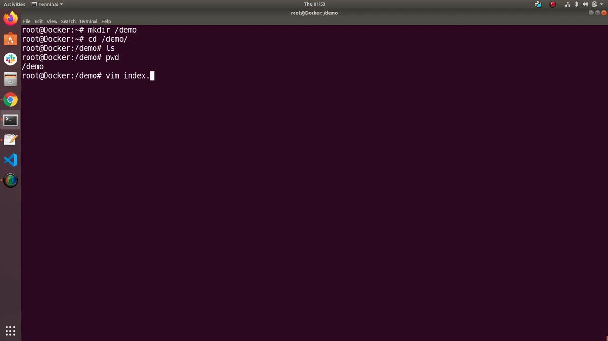
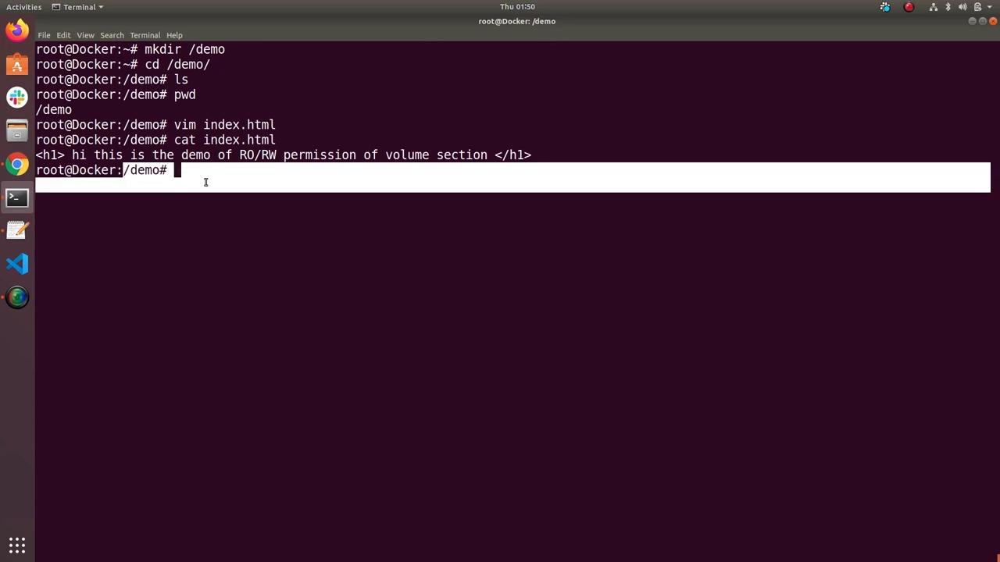
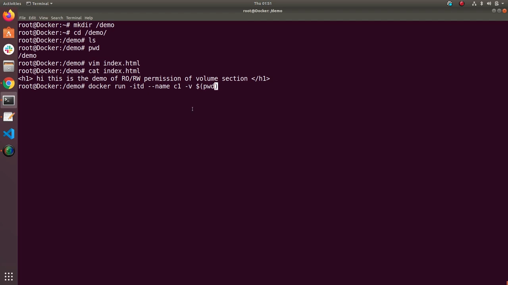
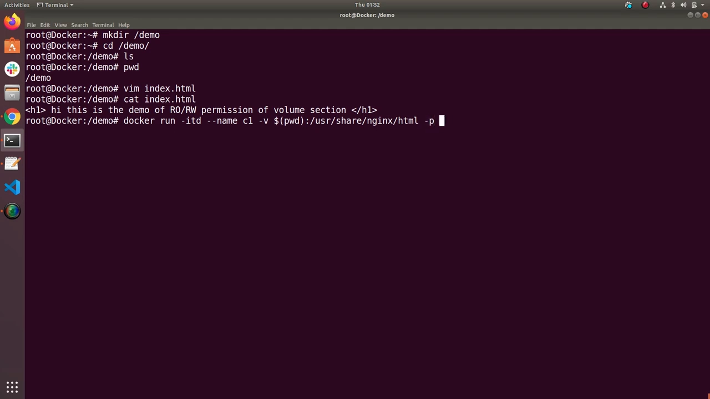
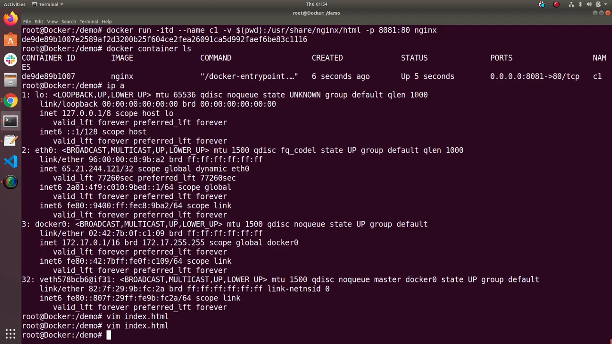
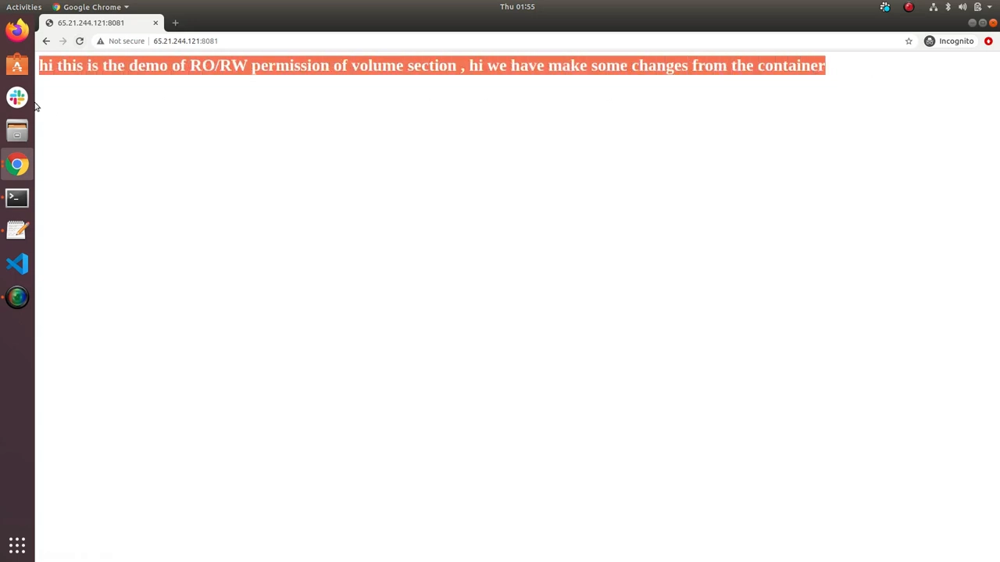
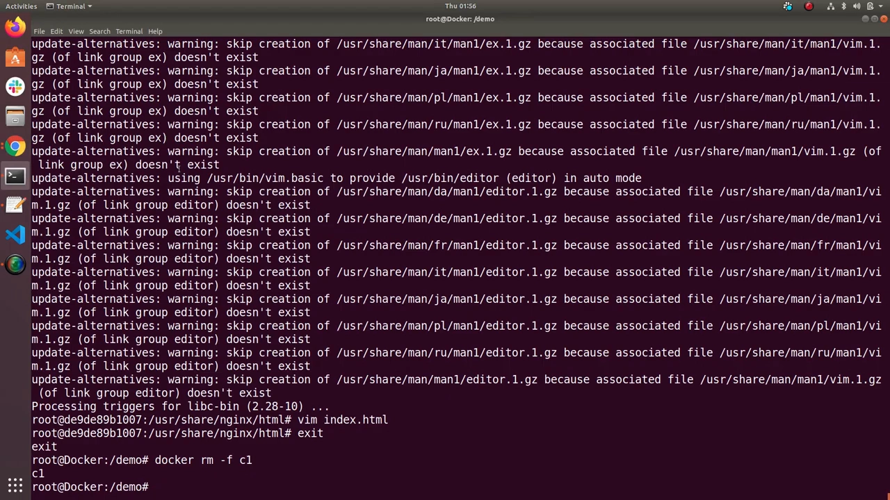
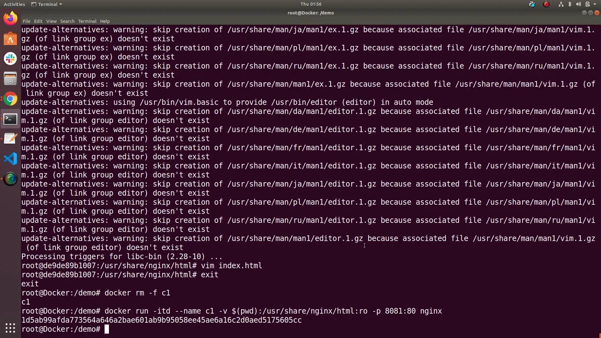
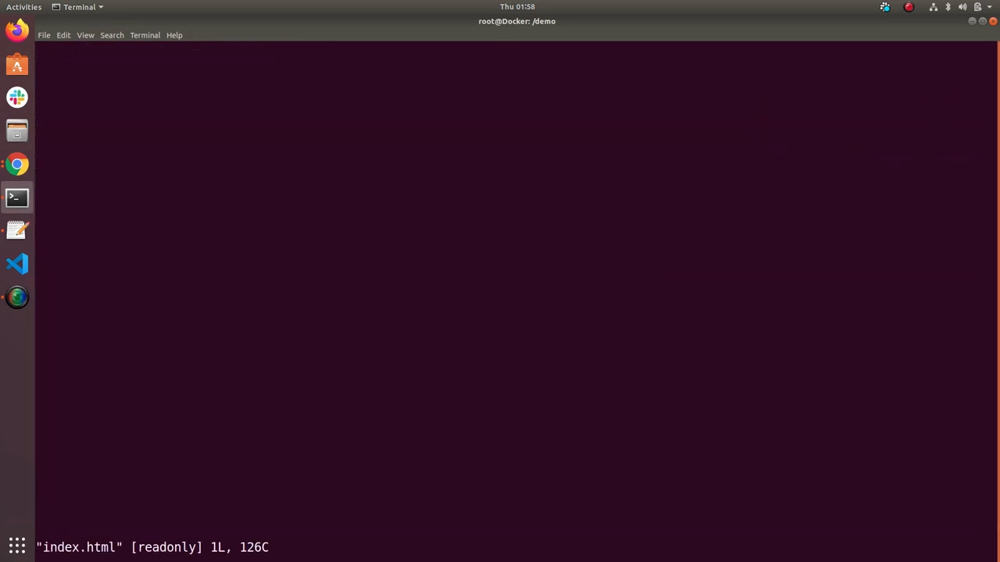
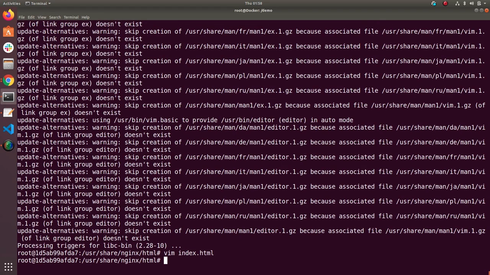

# Docker 卷的只读与读写权限：默认是什么，怎么切换

> 视频来源：YouTube 视频 [Docker volume with RO/RW permission](https://www.youtube.com/watch?v=oAoOAcmZDms)（约 10 分 12 秒，英文讲解）。本文基于视频演说图文稿整理，时间戳可跳转到原视频对应位置，配图取自视频画面。字幕来自 YouTube 自动字幕（英文 ASR），术语与错拼已逐窗口核对纠正（如 "rate write / rewrite"→`read-write`、"usain genius html"→`/usr/share/nginx/html`、"hyphen"→`-`、"iphone id"→`-it`）。

## 本讲要解决的核心问题（SCQA）

**背景**：我们已经会用 `-v` 把宿主机的目录挂进容器，也知道宿主机和容器里的文件**实时同步**。

**冲突**：但同步是**双向**的——容器里的进程也能**改写**你挂进去的文件。这有时正是我们要的（开发时改代码即时生效），有时却是**安全隐患**：谁都能从容器里动手脚。

**疑问**：卷的**默认权限**到底是只读还是读写？怎么把一次挂载**从读写改成只读（或反过来）**？改完之后，宿主机侧和容器侧分别还能不能改文件？

**回答（中心思想）**：用 `-v` 挂载时，**默认权限是读写（rw）**；只要在挂载参数末尾**加上 `:ro`**，这次挂载就变成**只读**——此后**容器内部无法修改**挂载点里的任何内容，但**宿主机侧仍然可以正常修改**。[【跳转到 00:00】](https://www.youtube.com/watch?v=oAoOAcmZDms&t=0)

---

## 一、准备现场：造一个目录和一个网页

先创建一个目录（视频里建在 `/demo`），并往里放一个 `index.html`，内容写成一句简单的说明，方便待会儿在浏览器里肉眼验证：

```html
<h1>Hi, this is the demo of read-only and read-write permission of volume section</h1>
```



[【跳转到 00:50】](https://www.youtube.com/watch?v=oAoOAcmZDms&t=50)

## 二、把宿主机目录挂进 nginx 的网页目录

接着创建容器，把这个目录挂到 nginx 的默认网页根目录上：

```bash
docker run -itd --name c1 \
  -v $(pwd):/usr/share/nginx/html \
  -p 8081:80 nginx
```

拆开看这行命令：

- `-v`：卷/挂载参数。
- `$(pwd)`：**当前工作目录**（宿主机这一侧）。
- 冒号后面 `/usr/share/nginx/html`：**容器这一侧**的路径。这是 nginx 容器**默认欢迎页**所在的位置。
- `-p 8081:80`：把宿主机 8081 端口映射到容器 80 端口，方便在浏览器访问。



这样一来，我们**挂进去的 `index.html` 会覆盖掉 nginx 默认的欢迎页**——浏览器上不再是 "Welcome to nginx"，而是我们自己的内容。



[【跳转到 01:34】](https://www.youtube.com/watch?v=oAoOAcmZDms&t=94) · [【跳转到 01:59】](https://www.youtube.com/watch?v=oAoOAcmZDms&t=119)

## 三、默认是读写：两个方向都能改

### 3.1 宿主机改了，浏览器刷新就变

在宿主机上编辑 `index.html` 保存，回到浏览器**刷新**——新内容立刻出现。这就是挂载（bind mount）的**实时同步**特性。



[【跳转到 02:49】](https://www.youtube.com/watch?v=oAoOAcmZDms&t=169)

### 3.2 进容器里改，也能改——说明默认是读写

再进入容器内部试一次：

```bash
docker exec -it c1 bash
cd /usr/share/nginx/html
```

（容器里可能没有 vim/vi，需要先 `apt update && apt install vim`。）改完文件保存，**改动同样生效**。




**结论**：**默认情况下是读写（read-write）权限**——容器可以随意改动挂载进来的内容。这有时不够安全，因为**任何能进容器的人都能改**。



[【跳转到 04:58】](https://www.youtube.com/watch?v=oAoOAcmZDms&t=298) · [【跳转到 06:21】](https://www.youtube.com/watch?v=oAoOAcmZDms&t=381)

---

## 四、改成只读：在挂载参数末尾加 `:ro`

命令**其余部分完全一样**，只在挂载参数末尾多写一个 **`ro`（read-only）**：

```bash
# 先删掉旧容器
docker rm -f c1

# 用 :ro 重新挂载（同一宿主机目录 → 同一容器路径，但这次只读）
docker run -itd --name c1 \
  -v $(pwd):/usr/share/nginx/html:ro \
  -p 8081:80 nginx
```



[【跳转到 07:06】](https://www.youtube.com/watch?v=oAoOAcmZDms&t=426)

## 五、验证：宿主机能改，容器内部改不了

### 5.1 宿主机侧仍可修改

在宿主机上直接改 `index.html`——**照旧生效**。只读限制的是**容器内部**，不是宿主机。



[【跳转到 07:37】](https://www.youtube.com/watch?v=oAoOAcmZDms&t=457)

### 5.2 容器内部被拒绝

进入容器再试着改同一个文件，这次会被拒绝，编辑器会提示类似 **"changing a read-only file"（正在修改只读文件）** 的警告，**改动无法保存**。



**一句话总结**：在挂载参数里加上 **`ro`**，就变成**只读**——**容器内任何人都改不了挂载点里的内容**；如果是在宿主机**直接改这个文件**，则依然可以。默认权限是**读写**，需要收紧时就按上面的写法加上 `ro`。



[【跳转到 08:52】](https://www.youtube.com/watch?v=oAoOAcmZDms&t=532) · [【跳转到 09:28】](https://www.youtube.com/watch?v=oAoOAcmZDms&t=568)

---

## 小结

- **默认是读写**：用 `-v` 挂载，宿主机和容器两侧**都能修改**挂载点里的文件（双向实时同步）。
- **只读要用 `:ro`**：在挂载参数末尾加 `:ro`，这次挂载即变为**只读**；命令其余部分不变。
- **只读只约束容器侧**：加了 `:ro` 后，**容器内部改不了**（报 "read-only file"），但**宿主机侧照旧能改**。
- **安全意义**：对"容器只需要读、不需要写"的目录（如只读配置、静态资源），用 `:ro` 能避免容器里的进程误改或恶意改写宿主机文件。

## 关键术语速查

| 术语 | 一句话解释 |
| --- | --- |
| `-v <宿主路径>:<容器路径>` | 把宿主机目录挂载进容器（bind mount），两侧实时同步 |
| `:ro` | read-only，给本次挂载加**只读**限制；默认是读写（rw） |
| `-p 8081:80` | 把宿主机 8081 端口映射到容器的 80 端口 |
| `/usr/share/nginx/html` | nginx 容器默认的网页根目录（欢迎页所在位置） |
| `docker exec -it <容器> bash` | 进入正在运行的容器内部执行命令 |
| read-write（rw） | 挂载默认权限：容器内外都可修改挂载点内容 |
