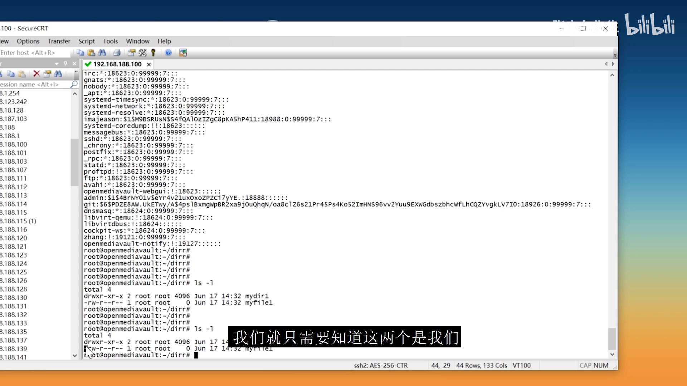
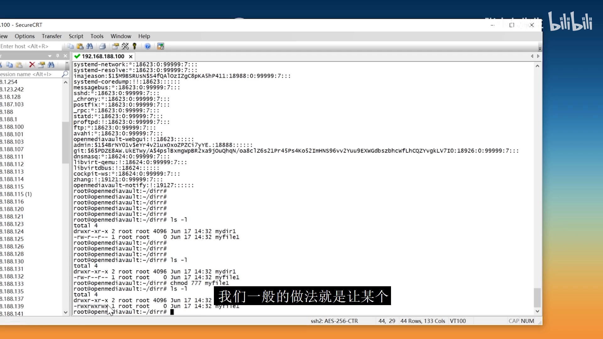
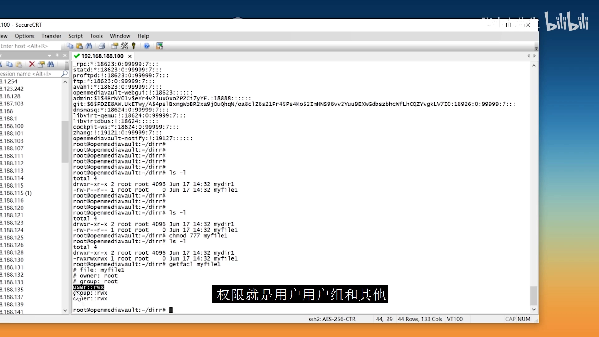
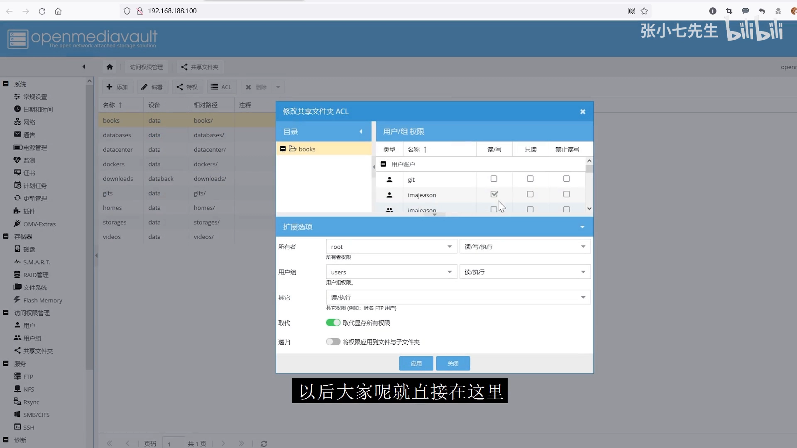
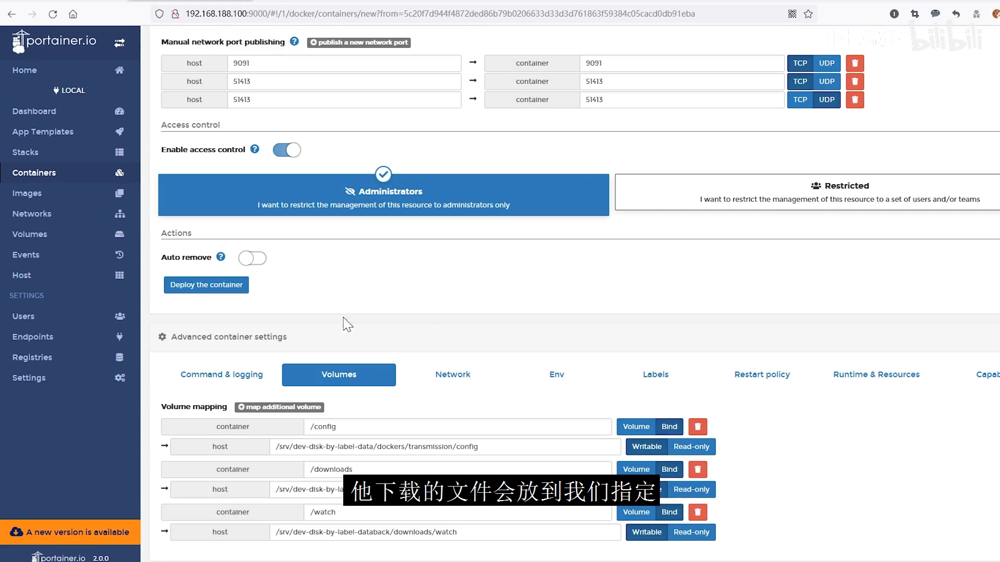
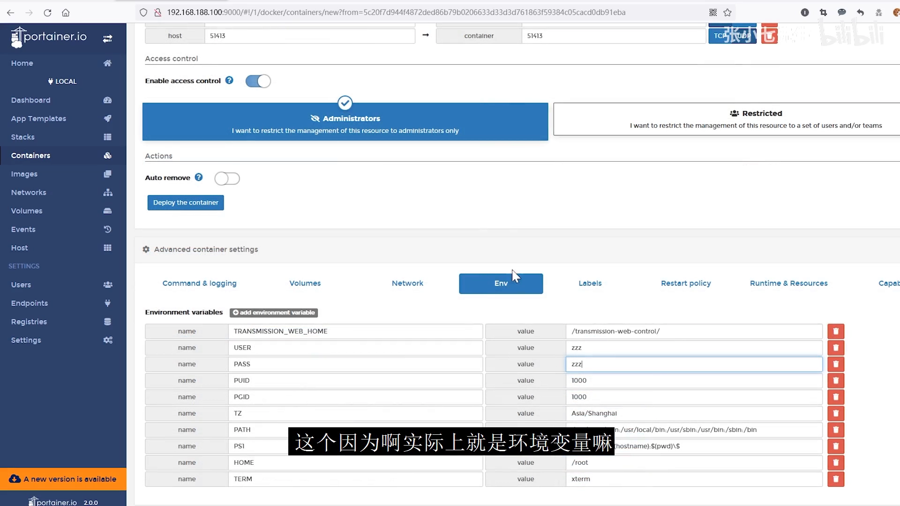
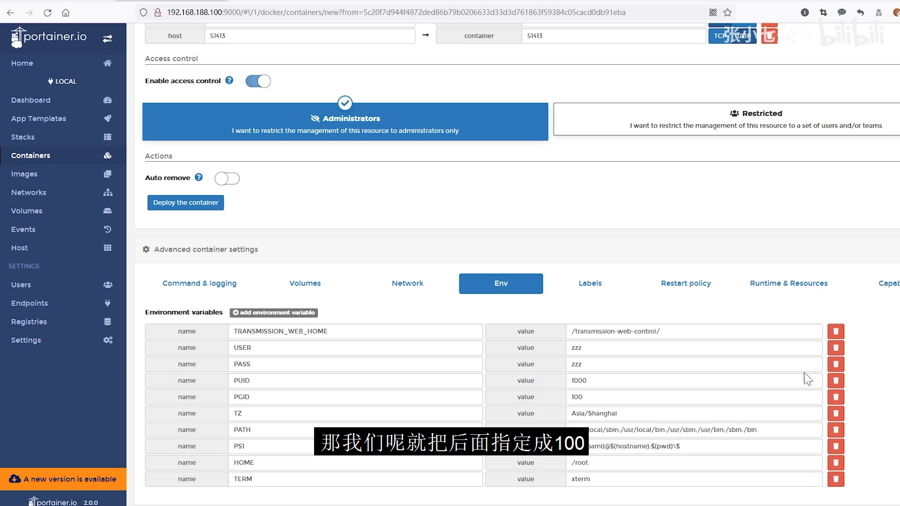

# NAS 权限与 Docker 容器权限：让容器写出的文件"能被访问"

> 视频来源：Bilibili 视频 [NAS权限问题以及docker容器权限](https://www.bilibili.com/video/BV1gU4y197fb/)（UP 主 张乃七，约 7 分 05 秒，中文讲解）。本文基于视频演说图文稿整理，时间戳可跳转到原视频对应位置，配图取自视频画面。字幕来自 B 站 AI 字幕，术语与错拼已逐窗口核对纠正（如 "NCL / SL"→`ACL`、"LS 杠 L"→`ls -l`、"邮政独立 / U者组"→`user` 组、"sub 共享"→`SMB` 共享、"音位"→"环境变量"、"777777"→`777`）。

## 本讲要解决的核心问题（SCQA）

**背景**：在 Linux 和 NAS 上，每个文件/目录都有**属主（用户）和属组**，还有一套读写执行权限。我们平时查看、共享文件，靠的就是这套机制。

**冲突**：很多人（新手老手都一样）会突然发现——**有的文件我能访问，有的却"访问不到"**；而用 NAS 的 Docker 装了下载工具后，**它下载出来的文件，做共享时又打不开**。

**疑问**：Linux 权限到底怎么定"谁能访问"？NAS 的图形界面该在哪里调？为什么**容器创建出来的文件属主是 root**、导致共享访问不到？怎么才能让容器写出的文件归"我"所有？

**回答（中心思想）**：访问不到，本质是**用户/用户组的身份不匹配**。在 NAS 上，把 **ACL（访问控制列表）图形界面当作唯一权限入口**即可解决共享问题；在 Docker 上，则要给容器设置 **`PUID`/`PGID` 环境变量**，让容器以你（而不是 root）的身份运行，它创建的文件才会属于你。[【跳转到 00:00】](https://www.bilibili.com/video/BV1gU4y197fb/?t=0)

---

## 一、先打地基：Linux 最基本的就是"用户 + 用户组"

### 1.1 每个文件都有属主，`ls -l` 一眼看懂权限

Linux 中所有文件都有一个**属主（用户）和属组**。当你创建文件或目录时，它的属主**默认就是你当前这个用户**。用 `ls -l` 就能看到文件的详细信息：

- **第 1 位**：文件类型。`d` 是目录，`-` 是普通文件（还有其它类型，但日常最常见的就是这两个）。
- **后面 9 位**：文件权限，**每三位一组**，共三组——分别对应 **属主、属组、其他用户**，每组都是 `rwx`。

[【跳转到 00:33】](https://www.bilibili.com/video/BV1gU4y197fb/?t=33)

### 1.2 权限可以随意改，但别乱给 777

这套 `rwx` 是**可以随意修改**的。你可以把一个文件改成 `777`——也就是让**所有人（自己、属组、其他人）都能读写执行**。但大部分时候我们不会这么做，因为**这样做比较危险**。

[【跳转到 01:23】](https://www.bilibili.com/video/BV1gU4y197fb/?t=83)

更常规的做法是：**让某个用户拥有这个文件**，或者**把某个用户加进这个文件的属组里**——属组有权限，组里的用户也就有了权限。

### 1.3 不属于组的人怎么办？用 ACL

如果想让一个**不在组里的用户**访问某个文件，除了给"所有人"开权限（太危险）之外，还可以**单独给某个用户授权**，这就是 **ACL（Access Control List，访问控制列表）**：

- 查看某个文件的 ACL，能看到它最基本的权限就是**属主、属组和其他**三类。
- 也可以通过命令行给文件**添加 ACL 规则**（`setfacl`），不过作为 NAS 用户，直接在**图形界面**下操作就够了。

[【跳转到 01:48】](https://www.bilibili.com/video/BV1gU4y197fb/?t=108) · [【跳转到 02:13】](https://www.bilibili.com/video/BV1gU4y197fb/?t=133)

---

## 二、在 NAS 上：把 ACL 图形界面当作唯一权限入口

### 2.1 加用户：默认就落在 `users` 组

视频里以某款 NAS 为例演示：在界面里**添加一个用户**，它默认的组是 **`users` 组**，系统会自动帮你选上，这个不用改；创建完之后，用户一般默认就在 `user`/`users` 组里。

如果你需要某个文件被某个用户访问，**把它的权限赋给 `users` 组**即可。而真正需要你动手设置的，主要是**目录的 ACL**：

- 界面中下方那块，代表的就是**文件属主、属组以及其他的权限**。
- 一般来说**不需要去改文件的属主和属组**；想让某个用户能访问某个文件，**直接在这一块勾上**就行（也可以勾"组"，但一般直接指定用户即可，因为用户不多）。
- 如果是**让某个组**来访问，就勾上组，并**记得把"递归"也勾上**。

### 2.2 递归选项的关键区别

- **不勾递归**：只对该目录**以及新创建的文件**有效。
- **勾上递归**：对**现有文件也都生效**。改完**直接应用**一下即可。

[【跳转到 03:04】](https://www.bilibili.com/video/BV1gU4y197fb/?t=184)

### 2.3 结论：访问不到，就来这里改

大家会发现——平时修改"某个用户有没有权限"，**其实全是靠 ACL 来改的**。所以遇到"有的文件能访问、有的访问不到"，本质就是**用户和用户组不匹配**导致的。以后就记住一条：

> **把 ACL 界面当作唯一一个控制"某用户能否访问某目录/文件"的渠道**。访问不了，就来这里勾上；其他地方不用管。

[【跳转到 03:29】](https://www.bilibili.com/video/BV1gU4y197fb/?t=209)

---

## 三、Docker 的权限问题：容器为什么写出"别人的"文件

### 3.1 现象：容器创建的文件，做共享时访问不到

还有一个典型的权限问题来自 **Docker 容器**：**容器会创建某些文件，但这些文件的读写权限会出现"缺失"**。

以 **Transmission**（一个下载工具）为例：它把下载的文件放到我们指定的下载目录里。它创建的文件当然也有**属主和属组**——**这个属主，就是"容器启动时用的那个用户"**。也就是说，**容器用哪个用户身份启动，它创建出来的文件就属于哪个用户**。

[【跳转到 04:11】](https://www.bilibili.com/video/BV1gU4y197fb/?t=251)

### 3.2 原因：默认用 root 启动

容器启动时的这些参数，**本质上就是环境变量**。可以给容器指定两个关键参数：

- **`PUID`**：容器以**哪个用户**的身份来启动。
- **`PGID`**：容器以**哪个用户组**的身份来启动。

**如果你不设置这两个参数，它就默认用 `root` 账户和 `root` 组来启动容器**。这样一来，容器运行过程中产生的文件，属主就变成了 **`root`**——这也就是为什么"有的容器创建出来的文件，你共享的时候访问不了"：因为它是以 root 身份生成的，而你做 **SMB 共享**时又不可能用 root 账户去共享（你肯定是新建了一个普通用户），**所以你自然访问不到**。

[【跳转到 04:41】](https://www.bilibili.com/video/BV1gU4y197fb/?t=281)

### 3.3 正确做法：用 `id` 查到自己的 UID/GID 再填进去

正确设置就是：**每创建一个容器，都指定它的用户和用户组**。注意——这里填的**不是用户名/组名，而是用户 ID 和组 ID（UID/GID）**。ID 怎么查？

1. 打开 SSH，运行 **`id <你的用户名>`**，它会告诉你 **UID 是多少、GID 是多少**。
2. 一般用户组就填 **`users`**（所有用户的默认组）。
3. 视频中以 **1000 / 1000** 为例——这通常是**第一个用户的 ID**。不想到处查的话，**如果你只有一个用户，用 1000 就对了**；用户多的话，就需要分别查到各自的 ID。
4. 改完后，**重新部署这个容器**。

[【跳转到 05:47】](https://www.bilibili.com/video/BV1gU4y197fb/?t=347)

### 3.4 重建容器的注意事项

部署之前要知道两件事：

- **容器的任何参数修改都会导致容器重建**。
- 已经在容器里**映射出来的目录，内容不会丢**；但**没有映射出来的内容**，如果你想保留，**必须在重新部署之前先从容器里拷出来**。

[【跳转到 06:05】](https://www.bilibili.com/video/BV1gU4y197fb/?t=365)

---

## 小结

- **权限 = 身份匹配**：Linux 靠"属主 + 属组 + 其他"三组 `rwx` 决定谁能访问；`ls -l` 第一位是类型，后九位是权限。
- **`777` 别乱给**：给"所有人"开权限危险；更稳妥的是指定用户、加进属组，或用 ACL 单独授权。
- **NAS 上认准 ACL 界面**：加用户默认进 `users` 组；要给目录授权就在 ACL 里勾用户/组，并注意**递归**是否勾选（不勾只对新文件生效，勾了对现有文件也生效）。
- **Docker 的坑在"以谁的身份启动"**：容器默认用 **root** 启动，生成的文件夹属主是 root，所以普通用户/SMB 共享访问不到。
- **解法是 `PUID`/`PGID`**：用 `id <用户名>` 查到自己的 UID/GID（常见 1000/1000），填进容器环境变量，再**重建容器**；已映射目录的内容不会丢，未映射的先备份出来。

## 关键术语速查

| 术语 | 一句话解释 |
| --- | --- |
| 属主 / 属组 | 文件归哪个用户、哪个用户组所有；创建时默认是当前用户 |
| `rwx` | 读（read）、写（write）、执行（execute），每三位一组，共三组（属主/属组/其他） |
| `chmod 777` | 给所有人读写执行权限，方便但危险，一般不这么用 |
| ACL（访问控制列表） | 在"属主/属组/其他"之外，**单独给某个用户或组授权**的机制 |
| SMB 共享 | 局域网文件共享协议；共享用户通常是普通用户，而非 root |
| `PUID` / `PGID` | 容器启动时指定的用户 ID / 组 ID，决定容器内进程以什么身份运行、生成的文件归谁 |
| `id <用户>` | 查看某用户的 UID、GID 及所属组 |
| 递归（勾选） | 权限变更是否作用于目录下**现有文件**；不勾只对新创建的文件生效 |
