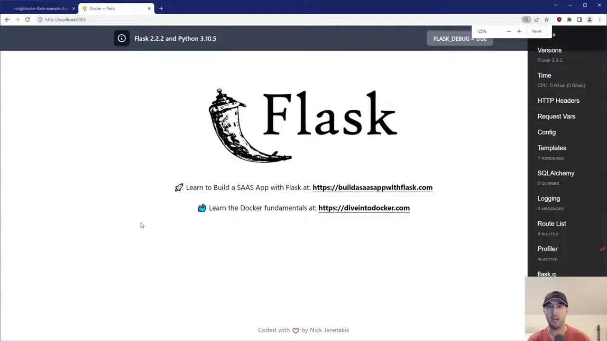
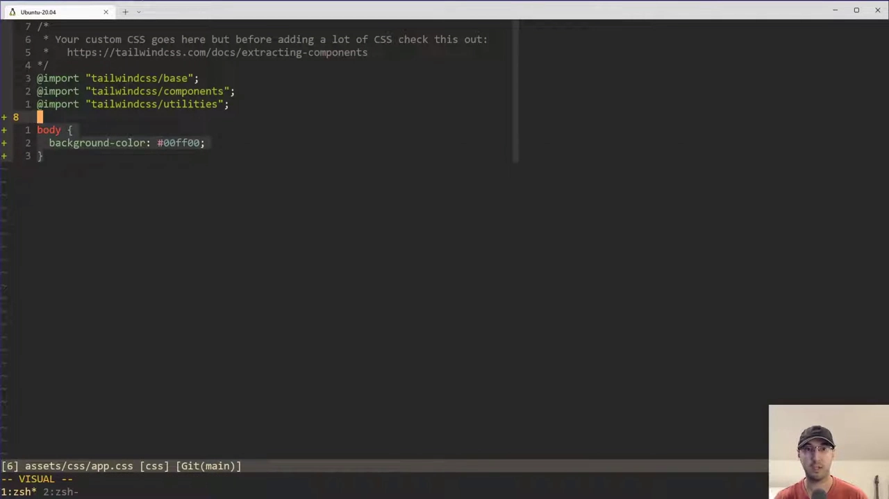
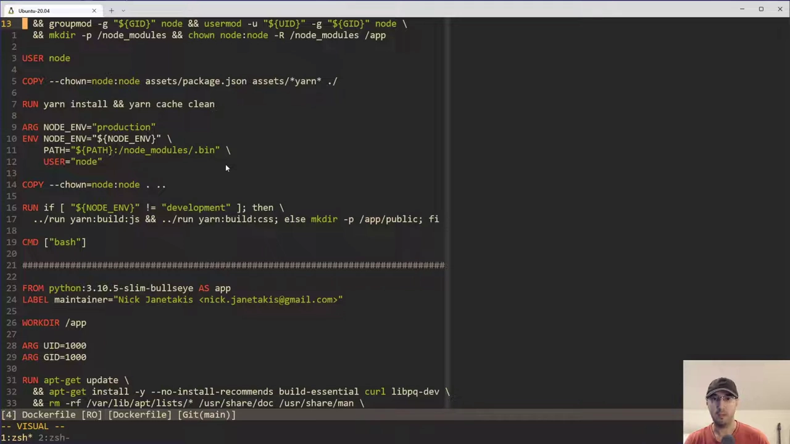
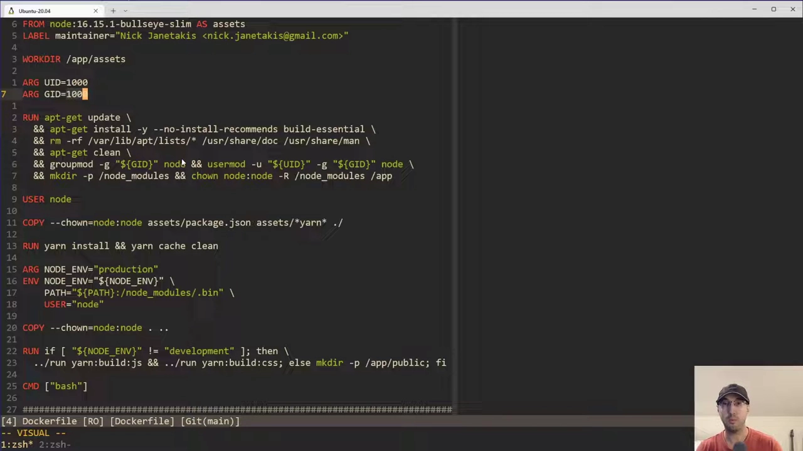
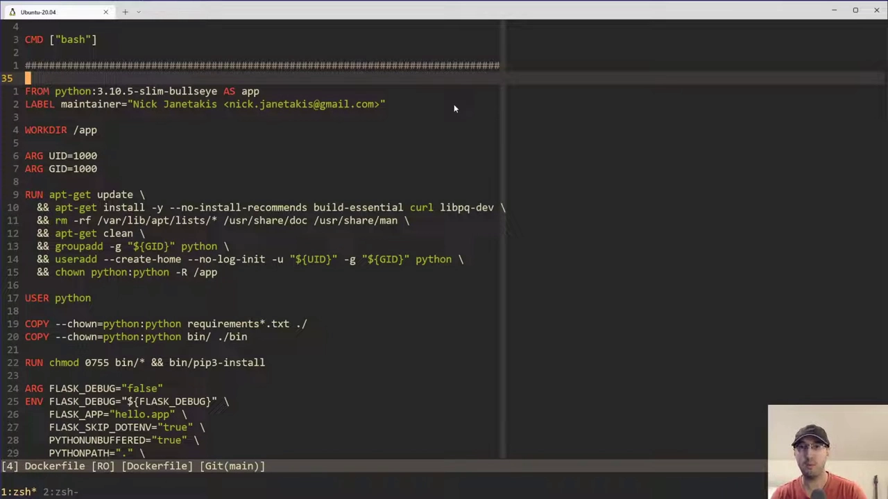
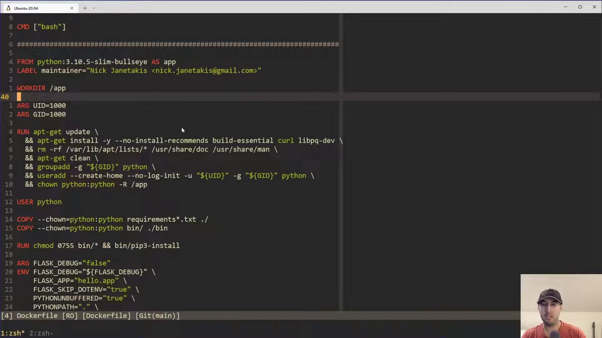
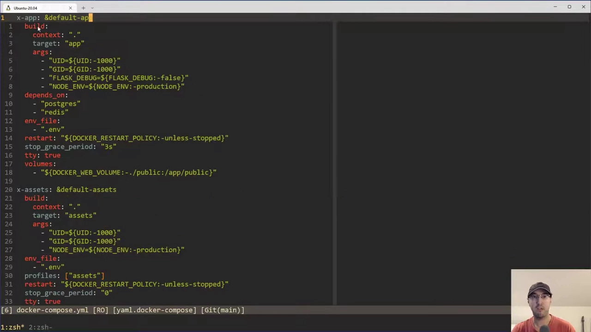
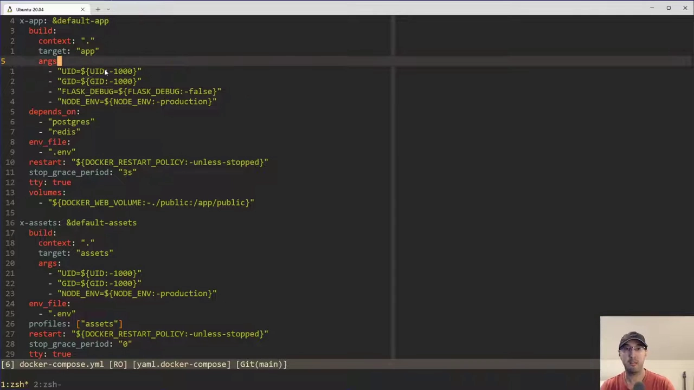
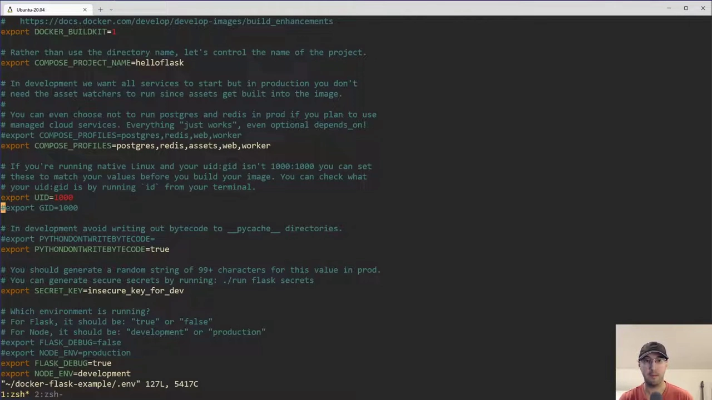
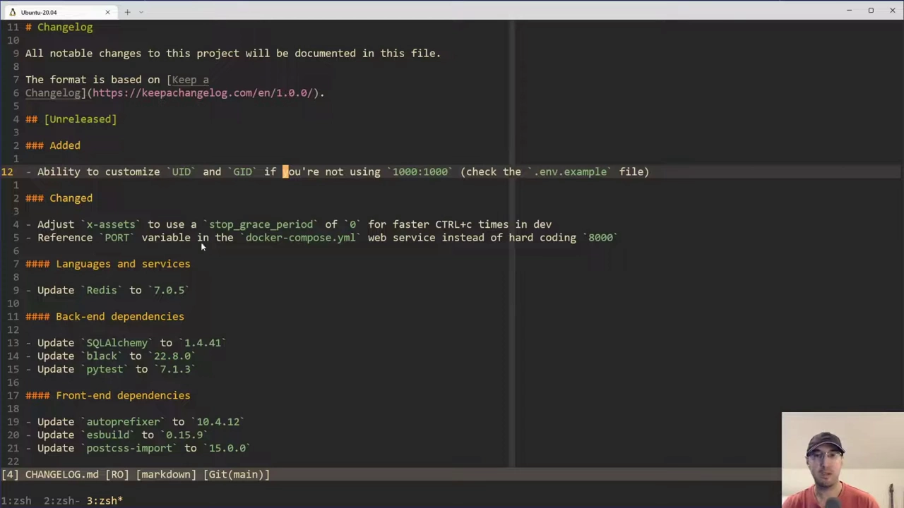

# 自定义 UID 与 GID 解决挂载卷权限错误

> 视频来源：YouTube 视频 [Running Docker Containers as a Non-root User with a Custom UID / GID](https://www.youtube.com/watch?v=sXfaogNlc7Y)（作者 Nick，约 16 分 25 秒，英文讲解）。本文基于视频演说图文稿整理，时间戳可跳转到原视频对应位置，配图取自视频画面。字幕来自 YouTube 自动字幕（英文 ASR），术语与错拼已逐窗口核对纠正（如 "next hack"→`Nick`、"1,00 1000"→`1000`、"squigglies"→`${…}` 变量插值语法、"Hadolint"→ Dockerfile 静态检查工具）。

## 本讲要解决的核心问题（SCQA）

**背景**：开发时会用 `-v` 把宿主机的项目目录**绑定挂载**进容器——改一下宿主机上的样式或模板文件，浏览器刷新就能立刻看到效果，这是最省事的开发方式。

**冲突**：但绑定挂载能不能读写，取决于**两边的用户身份**。镜像里"第一个用户"的 UID/GID **默认是 `1000`**；而你在宿主机上如果**建了多个用户**，第二个用户会是 `1001`、`1002`……一旦**容器内的 UID/GID 与宿主机用户对不上**，容器读写挂载进来的文件就会报 **`permission denied`**，卷直接失效。

**疑问**：为什么会有这种不一致？又该怎么把**镜像内用户的 UID/GID** 改成和宿主机用户**一模一样**？每次 `docker build` 都手敲这些值，岂不是很容易忘？

**回答（中心思想）**：用 Docker 的 **build args（`ARG UID` / `ARG GID`）** 在**构建镜像时**把镜像内用户的 UID/GID 改写为宿主机用户的值；再借 **docker-compose 的变量插值 + `.env` 文件**把这些值自动喂给构建，就不必每次在命令行手动指定。[【跳转到 00:00】](https://www.youtube.com/watch?v=sXfaogNlc7Y&t=0)

---

## 一、先看"一切正常"时的样子

作者先用一个现成的 `docker compose up` 演示正常状态：应用正常启动，页面刷新几次都加载正常。

此时打开项目目录可以看到，**所有文件的属主都是 `Nick:Nick`**，而且**整个目录都被绑定挂载进了容器**——这正是开发时的标准做法：改项目里的文件，浏览器里立即能看到变化。



接着改一下 `app.css` 里的背景色（比如改成绿色），保存后回到浏览器刷新，页面立刻变绿。这说明**绑定挂载完全正常工作**。

[【跳转到 01:39】](https://www.youtube.com/watch?v=sXfaogNlc7Y&t=99) · [【跳转到 02:07】](https://www.youtube.com/watch?v=sXfaogNlc7Y&t=127)

---

## 二、什么时候会翻车：容器内 UID/GID 与宿主机对不上

### 2.1 根因：镜像里的"第一个用户"永远是 1000

在 Linux 上（**包括 Docker 镜像内部**），你创建的**第一个用户**，其 UID/GID **默认就是 `1000`**。

关键在于：**你通常不会在镜像里创建多个用户**——镜像里那个用作运行身份的用户，UID/GID 就固定是 `1000/1000`；可宿主机上你可能有多个用户，第二个用户是 `1001`、再往后还有别的值……



### 2.2 复现：把项目搬到一个 UID/GID 不是 1000 的用户下

作者做了一个对照实验：

1. 把 `Docker Flask example` 项目目录**复制到宿主机上另一个用户**（演示里叫 `someone`）的家目录；
2. `su` 到 `someone` 后 `id` 一下——**这个用户的 UID/GID 并不是 `1000/1000`**，而是别的值；
3. 在该用户下 `docker compose build`，再 `docker compose down` / `up`。

预判的结果如期而至：**出现 `permission denied`**。原因正如图中所示——**镜像里的 UID/GID 是 `1000`，而宿主机这个用户是另一个值（`1002`/`1003` 一类）**，两者对不上。UID/GID 不匹配，容器就写不动挂载进来的文件，"一切都坏了"。

> 提示：具体数值随环境而变，**用 `id` 命令查到的才是准的**；要不要折腾，也取决于你的 UID/GID 是否等于 `1000`。


### 2.3 中途插曲：文件属主变成 root

调试过程中作者还遇到文件**属主变成 `root`**（因为之前用错身份操作过），于是先 `sudo chown -R someone:someone` 把这个目录递归改回 `someone:someone`。期间 `vim` 还弹出过 **"changing a read-only file"** 的警告，查明是"当前身份不对 / 文件不归自己"所致，改回正确属主后即可正常编辑。

[【跳转到 03:27】](https://www.youtube.com/watch?v=sXfaogNlc7Y&t=207) · [【跳转到 04:16】](https://www.youtube.com/watch?v=sXfaogNlc7Y&t=256)

---

## 三、解法一：在 Dockerfile 里用 build args 定制 UID/GID

作者的方案是**给所有示例应用都加上"可自定义 UID/GID"的能力**。核心工具就是 Docker 的 **build args（构建参数）**。

### 3.1 build args 是什么，和运行时环境变量有何不同

**build args 是"构建期"可以改的参数**——你在**真正构建镜像那一刻**决定某些值是多少。这跟运行时才关心的**环境变量**完全不是一回事，作者特别强调 **build time 与 runtime 的区别**：

- **构建期（build args）**：决定镜像里用户的 UID/GID、装哪些包等，**打进镜像**。
- **运行期（环境变量）**：决定容器启动后程序读到的配置。

因为要在**镜像构建时**就把用户 UID/GID 定下来，所以这里必须用 build args。



### 3.2 关键点：ARG 默认回退到 1000

Dockerfile 里声明了两个参数——**一个 UID、一个 GID**：

```dockerfile
ARG UID=1000
ARG GID=1000
```

如果**不主动定制**，它们就取默认值 `1000`。作者指出：**就算你不写这两个 `ARG`，结果也是 `1000`**——因为那是你在 Linux 系统（含镜像）里创建**第一个用户**的默认 ID。

### 3.3 两个构建阶段，都要处理用户身份

这是一个**多阶段构建（multi-stage build）**，作者在两个阶段用了同一套模式：

**（a）assets 阶段：Node 官方镜像自带一个 `node` 用户**

这个阶段以 **Node 官方镜像**为基础。它和很多官方镜像不同——**已经替你创建好了一个 `node` 用户**，你无需自己建。但问题在于：**这个 `node` 用户的 UID/GID 就是 `1000`**，照样会冲突。

所以要做两件事：

1. **把 `node` 组的 GID 改成 `ARG GID` 的值**；
2. **再把 `node` 用户本身的 UID/GID 也改成构建参数的值**。

作者顺带提醒：**这不是 assets 阶段独有的问题**——只要你用这个 Node 镜像跑服务端 JavaScript，一样会撞上。




**（b）app 阶段：Python 镜像没有自带用户，得自己建**

Python 镜像**不会**预先创建 `python` 用户，所以需要**自己动手创建**：

1. **先把 `python` 组的 GID 改成与参数匹配的值**；
2. **再新建一个 `python` 用户**（带上 `-m` 之类的参数以创建家目录等——这些标志和本讲主题无关，作者说自己也没太深究）。

作者还提到有个 **`--user-group` 之类的标志**本可以让 `useradd` 顺手建组，但其实**必须显式先跑"改组"那一步**，否则仍会报权限错误（他把这个"为什么"留给观众在评论区解答）。

另外还提到一个 `Hadolint` 加进去的检查标志——`Hadolint` 是个 **Dockerfile 静态检查工具（linter）**，它提示"这里不加某个标志迟早出问题"，作者就照加了。





### 3.4 两条注意

- **切换用户之后，所有指令都以该用户运行**：执行到 `USER python` 之后，镜像里往下的命令都以 `python` 身份执行；
- **`COPY` 进来的文件记得 `chown`**：把文件拷进镜像时，需要**显式 `chown` 给目标用户**，否则属主不对。

此外，作者把几个示例应用（**Rails、Django、Node、Phoenix**）都做了同样的改造，开源在 **`Docker Flask example`** 仓库里，方便不同技术栈的人直接取用。

[【跳转到 08:26】](https://www.youtube.com/watch?v=sXfaogNlc7Y&t=506)

---

## 四、解法二：用 docker-compose + .env 自动把值喂进去

每次构建都在命令行手敲 `--build-arg UID=... --build-arg GID=...` 太麻烦。作者改成**在 `docker-compose.yml` 里统一声明**。

### 4.1 在 compose 里用变量插值传 build args

在 `docker-compose.yml` 的 `build.args` 里写下 `UID` / `GID`，值用 **`${UID}` / `${GID}`** 这种**变量插值**语法（下为示意，写法以仓库为准）：

```yaml
x-app: &app
  build:
    context: .
    args:
      UID: ${UID:-1000}
      GID: ${GID:-1000}

services:
  web:
    <<: *app
  worker:
    <<: *app
```

（视频里还用了 **YAML 锚点（anchor）**，让 `web` 和 `worker` 两个服务共享同一组公共属性。）

**看到 `${...}` 这种"波浪号"写法就知道**：Compose 会去一个 **`.env` 文件**里找对应的变量。**默认情况下文件不存在或变量没定义，就回退到后面写的默认值**（这里是 `1000`）。



### 4.2 .env 与 .env.example

仓库里同时提供 **`.env.example`（已提交进版本库，当作文档）** 和 `.env`。用法是：**把 `.env.example` 复制成 `.env` 即可**（README 里有说明）。

`.env` 里的 UID/GID 默认是**被注释掉的**——因为默认就是 `1000`，**不需要覆盖**。文件里的注释也写明：**如果你是原生 Linux 运行，且 `id` 命令显示你的 UID/GID 不是 `1000`，就把这两行取消注释、改成实际值。**



（作者在这里又踩了一次"文件只读 / 身份不对"的坑，回头 `sudo chown` 后才把 `.env` 改成功。）

[【跳转到 09:16】](https://www.youtube.com/watch?v=sXfaogNlc7Y&t=556) · [【跳转到 10:56】](https://www.youtube.com/watch?v=sXfaogNlc7Y&t=656)

---

## 五、验证：重建后权限错误消失

把 `.env` 里的 `UID` / `GID` 改成 `id` 命令查到的**真实值**（作者的这台机器上不是 `1000`），然后：

```bash
docker compose build   # 因为改的是构建期参数，必须重建镜像
docker compose down    # 清掉旧容器
docker compose up      # 重新起
```



这一次 **`compose up` 不再报任何权限错误**：浏览器刷回去，页面恢复正常；再随手改个模板文件（比如给标题加几个感叹号）保存，刷新后立即生效——**挂载和读写都彻底正常了**。



作者补充说，这套改动**在包括 Docker Desktop 的两套系统上都测过**，并非草率发布。

[【跳转到 14:30】](https://www.youtube.com/watch?v=sXfaogNlc7Y&t=870) · [【跳转到 15:16】](https://www.youtube.com/watch?v=sXfaogNlc7Y&t=916)

---

## 六、到底什么时候需要它

**先说结论**：**用 Docker Desktop 就不必操心**——它会**自动帮你修好权限**。以下几种情况才真的需要：

- **WSL2 里原生跑 Docker**；
- **原生 Linux**（不想用、或不能用 Docker Desktop）；
- **把应用部署到 Linux 生产服务器**（生产上同样可能想用卷，比如把静态文件目录挂出来给宿主机的 nginx 用）。

**但也不是所有人都需要**：如果你在 Linux 上**没有创建多个用户**，UID/GID 大概率就是 `1000/1000`，压根不用折腾；自建的 VPS 或云主机上，用户通常也就 `1000/1000`。

**唯一的遗憾**：改 UID/GID **必须重建镜像**——因为 `usermod` 那一步发生在**镜像构建期**，绕不开。作者也坦承这有点别扭，但一时想不到更好的替代方案，很欢迎有人给出更优做法。

[【跳转到 08:51】](https://www.youtube.com/watch?v=sXfaogNlc7Y&t=531) · [【跳转到 13:51】](https://www.youtube.com/watch?v=sXfaogNlc7Y&t=831)

---

## 小结

- **问题的根**：绑定挂载时，**容器内用户的 UID/GID 必须与宿主机用户一致**，否则报 `permission denied`；镜像里"第一个用户"默认是 `1000`，宿主机多用户时很容易对不上。
- **工具**：用 Docker 的 **build args**（`ARG UID` / `ARG GID`，默认 `1000`）在**构建期**改写镜像内用户的 UID/GID；即使不写 `ARG`，默认也是 `1000`。
- **两个阶段都要改**：Node 镜像**自带** `node` 用户（改它的组 GID + 用户 UID/GID）；Python 镜像**没有**用户，需先改组 GID、再 `useradd` 新建。
- **自动传参**：在 `docker-compose.yml` 里用 `${UID}` / `${GID}` 变量插值，Compose 会去 **`.env`** 取值、缺省回退 `1000`；把 `.env.example` 复制成 `.env`，原生 Linux 且 `id` 不是 `1000` 时取消注释改成实际值。
- **验证**：改 `.env` → `compose build`（必须重建）→ `down` / `up` → 无权限错误、卷读写恢复。
- **适用范围**：Docker Desktop 自动修权限、无需设置；原生 Linux / WSL2 / 生产服务器才需要，且只有"存在多个用户、UID/GID 不是 `1000`"时才要动手。
- **代价**：改 UID/GID 一定要重建镜像。

## 关键术语速查

| 术语 | 一句话解释 |
| --- | --- |
| 绑定挂载（bind mount） | 把宿主机目录直接挂进容器、两侧实时同步，常用于开发。 |
| UID / GID | 用户 ID / 组 ID，Linux 靠它（而非用户名）判定文件归属与权限。 |
| build args | 镜像**构建期**可传入的参数，用 `ARG` 声明、`--build-arg` 或 `build.args` 传入。 |
| `ARG` | Dockerfile 里声明构建参数的指令，可给默认值（如 `ARG UID=1000`）。 |
| 变量插值 | Compose 里 `${VAR}` 语法，会去 `.env` 等取环境变量，缺失则用默认值。 |
| `.env` | Compose 自动读取的变量文件；`.env.example` 是入库模板。 |
| `permission denied` | 因 UID/GID 不匹配，容器读写挂载文件被拒的典型报错。 |
| Docker Desktop | 会自动修正挂载权限，掩盖了原生 Linux 才会暴露的 UID/GID 问题。 |
