# 容器里的数据为什么会丢：从写时复制到数据卷

> 视频来源：Bilibili 视频 [Docker_为什么我的容器中的数据丢失了？](https://www.bilibili.com/video/BV1wqkaBiE1w/)（约 8 分 03 秒，中文讲解，画面为图解动画）。本文基于视频演说图文稿整理，时间戳可跳转到原视频对应位置，配图取自视频画面。字幕来自 B 站 AI 字幕，术语与错拼已逐窗口核对纠正（如 "容其移山"→"容器一删"、"写实复制"→"写时复制"、"copyonwr"→`copy on write`、"iknow的"→`inode`、"Bind the month"→`Bind Mount`、"原声磁盘"→"原生磁盘"、"生产及系统"→"生产级系统"）。

## 本讲要解决的核心问题（SCQA）

**背景**：Docker 镜像是**只读层**的堆叠，容器运行时会在最上面**加一层薄薄的可写层**——所以容器天生就是"阅后即焚"、用完就扔的。[【跳转到 00:44】](https://www.bilibili.com/video/BV1wqkaBiE1w/?t=44)

**冲突**：如果直接把数据（比如数据库文件）写进这层可写层，就会踩进两个大坑——**一是容器一删数据就没了，二是应用性能急剧下降**（写时复制带来的 IO 放大）。第二个坑更隐蔽，是个"沉默的杀手"。

**疑问**：数据到底该放哪？为什么放"卷"里就安全？绑定挂载和数据卷又该怎么选？

**回答（中心思想）**：把数据**挂载到容器之外**（绑定挂载 / 数据卷），本质是用 **inode 映射绕过容器的分层文件系统**，既避免数据丢失、又绕开写时复制的性能开销；而**生产环境应当用 Docker 数据卷**——它**生命周期独立、自动处理权限、易于备份迁移、又是原生磁盘速度**。

---

## 一、先回顾原理：镜像只读、容器可写层是临时的

容器像一个**俄罗斯套娃**：最底下是一层一层**只读的镜像**，这些是固定的、动不了；每次启动容器，Docker 会在**最顶上盖一层薄薄的、可以随便写的临时层（可写层）**。[【跳转到 00:44】](https://www.bilibili.com/video/BV1wqkaBiE1w/?t=44)

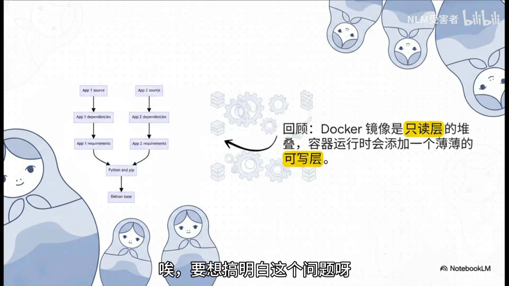

由此可以理解视频开头的那个"噩梦"场景：一个正服务着成千上万用户的 MySQL 容器，因为升级或小故障不得不**删掉重建**——那么"我的用户数据是不是也跟着灰飞烟灭了"？要回答它，就得先看**把数据写进可写层会发生什么**。[【跳转到 00:19】](https://www.bilibili.com/video/BV1wqkaBiE1w/?t=19)

---

## 二、陷阱：把数据写进可写层的两个大坑

如果直接把数据写在容器最上面那个**可写层**里，就等于踩进一个隐藏的陷阱，里面有两个坑：[【跳转到 01:15】](https://www.bilibili.com/video/BV1wqkaBiE1w/?t=75)

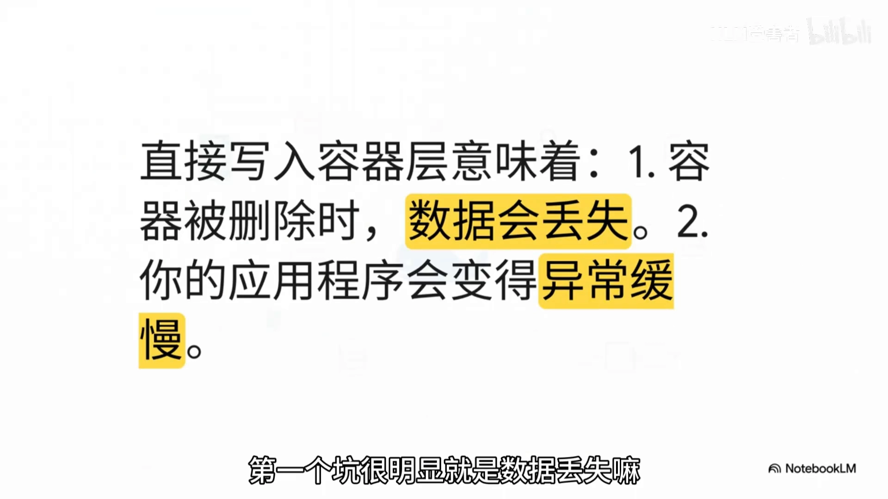

1. **数据丢失**：容器一删，这层就没了，数据当然也跟着没了。（这个坑"很明显"。）
2. **性能变慢**：你的应用会变得**特别特别慢**——这才是真正要命的"沉默杀手"，不知不觉就把应用拖垮。

### 2.1 元凶是"写时复制"（Copy-on-Write, COW）

这个性能杀手有个听起来挺高级的名字，叫**写时复制**，英文 **copy on write**，简称 **COW**。[【跳转到 01:51】](https://www.bilibili.com/video/BV1wqkaBiE1w/?t=111)

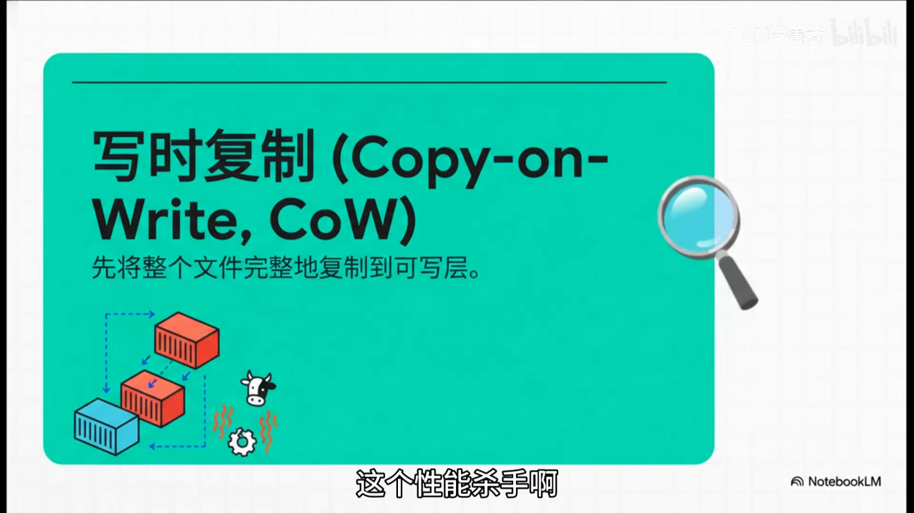

"写时复制"听起来好像挺聪明——需要的时候才复制，多高效啊。**但是在数据库这种需要不停写入数据的场景下，这个机制简直就是一场灾难。**

### 2.2 "上浮复制"的四步过程

当你**第一次**往容器里的某个文件写东西时，背后其实发生了好几步：[【跳转到 02:21】](https://www.bilibili.com/video/BV1wqkaBiE1w/?t=141)

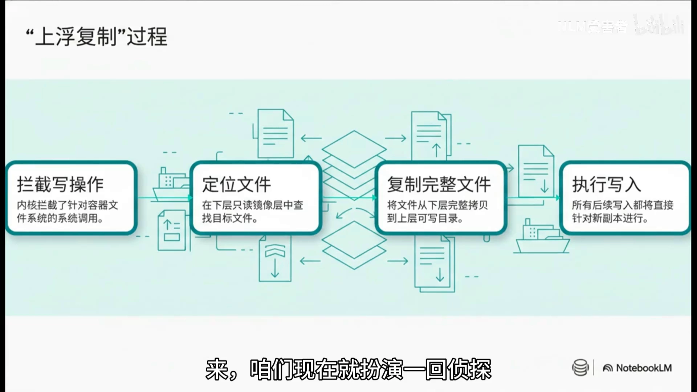

1. **拦截写操作**：内核拦截了针对容器文件系统的系统调用。
2. **定位文件**：在下层只读镜像层中查找目标文件。
3. **复制完整文件**：把文件从下层**完整拷贝**到上层可写目录。
4. **执行写入**：所有后续写入都直接针对这个**新副本**进行。

每一步都在悄悄吃掉系统性能，**对大文件，这个机制的影响简直是毁灭性的**。

### 2.3 IO 放大：改 4KB，先搬整个文件

举个例子：假设你有一个**体积庞大**的数据库文件，现在只想改里面**一行数据**——可能就几个字节，**4KB 撑死了**。但就因为写时复制，Docker **必须先把这整个庞大的文件从只读层完整复制到可写层**，然后才去改那 4KB。[【跳转到 02:38】](https://www.bilibili.com/video/BV1wqkaBiE1w/?t=158)

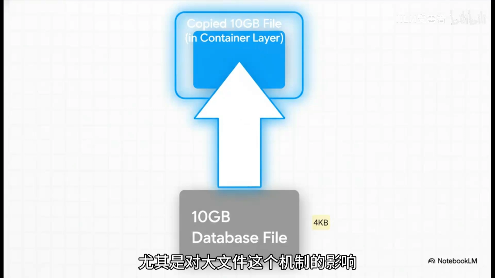

结果就是：**一个简单的 4KB 写入，在磁盘上产生的实际读写量可能被放大整整 500 万倍**。这种级别的 IO 放大，就像"你只想挪动一粒沙子，结果却要搬动一整座山"——足以让一个本来性能很好的数据库瞬间卡死、动弹不得。[【跳转到 03:12】](https://www.bilibili.com/video/BV1wqkaBiE1w/?t=192)

---

## 三、解法：在"牢笼"上开一个"数据隧道"

既然这个陷阱这么可怕，怎么逃出来？很明显：需要找到一种方法，**完完全全绕开容器的分层文件系统**。[【跳转到 03:51】](https://www.bilibili.com/video/BV1wqkaBiE1w/?t=231)

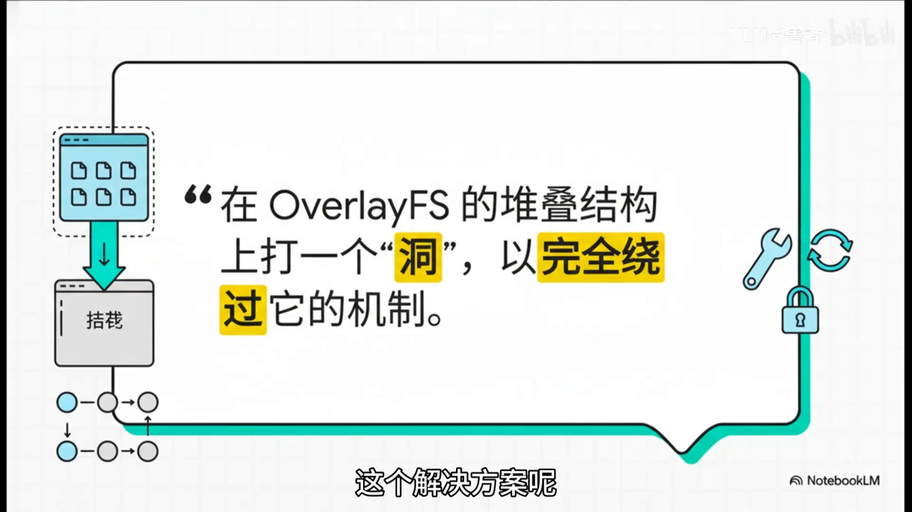

画面形容得很形象：在容器这个"像监狱一样层层包裹的墙壁"上**开一个虫洞**，建立一条能从容器内部**直接通到宿主机硬盘**的隧道。在 Docker 的世界里，这个技术就叫做**挂载**（**mount**）。[【跳转到 04:12】](https://www.bilibili.com/video/BV1wqkaBiE1w/?t=252)

### 3.1 底层用的是 Linux 的绑定挂载

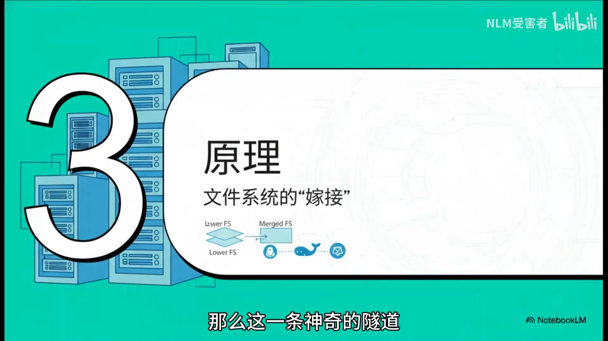

这背后的"魔法"并不是 Docker 自己发明的黑科技，而是 Linux 系统里一个非常标准的功能——**绑定挂载**，也就是 **`mount --bind`** 命令：把一个**已存在的目录树重新挂载到另一个位置**，实现"**路径到路径**"的映射。[【跳转到 04:28】](https://www.bilibili.com/video/BV1wqkaBiE1w/?t=268)

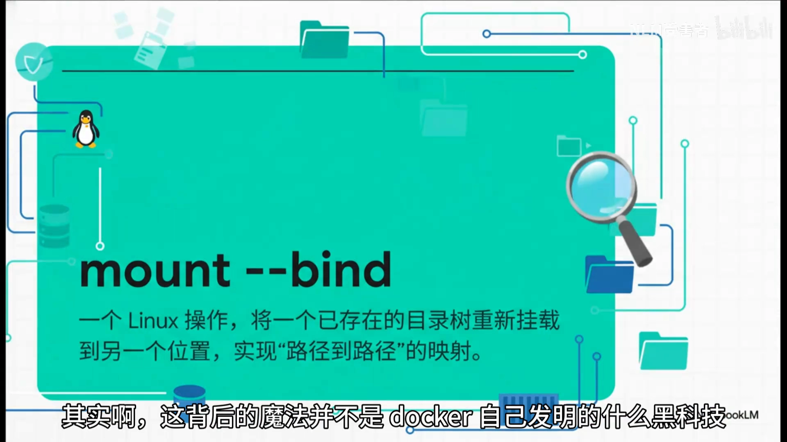

### 3.2 关键概念：inode（文件的"身份证号"）

要理解这个"嫁接"，必须先认识 **inode**——它代表**文件物理实体的核心数据结构**，存储文件的**元数据**，但**不包含文件名**。[【跳转到 04:47】](https://www.bilibili.com/video/BV1wqkaBiE1w/?t=287)

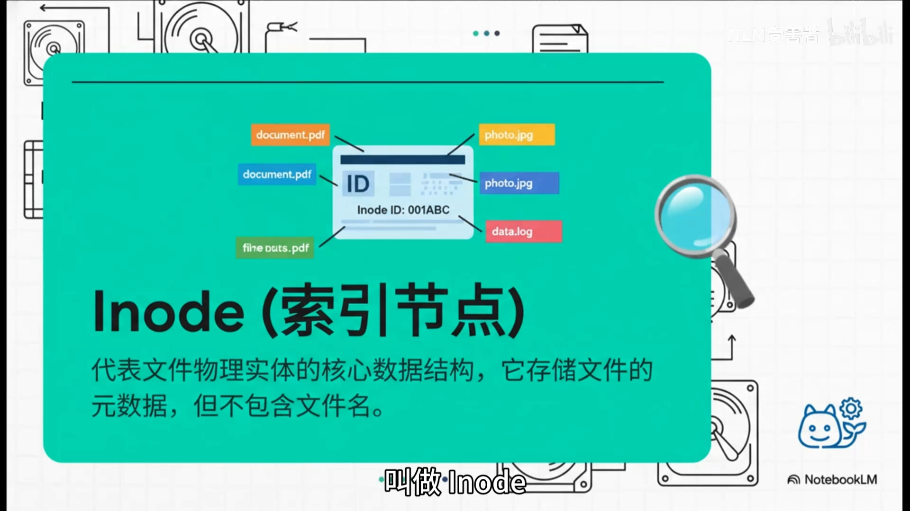

可以把 inode 想象成**每个文件在硬盘上的身份证号**：它才是文件真正的实体，而我们平时看到的**文件名**，充其量只是贴在这张身份证上的一个"姓名贴"而已。

那绑定挂载在做什么呢？当使用绑定挂载时，我们实际上是在告诉操作系统：**宿主机上的那个目录、和容器里的这个目录，虽然路径和名字不一样，但它们用的是同一个 inode**。于是它们在**物理上就是同一个文件**，所有对它的读写都直接作用于**宿主机的硬盘**——完美绕开了写时复制的性能巨坑。[【跳转到 05:28】](https://www.bilibili.com/video/BV1wqkaBiE1w/?t=328)

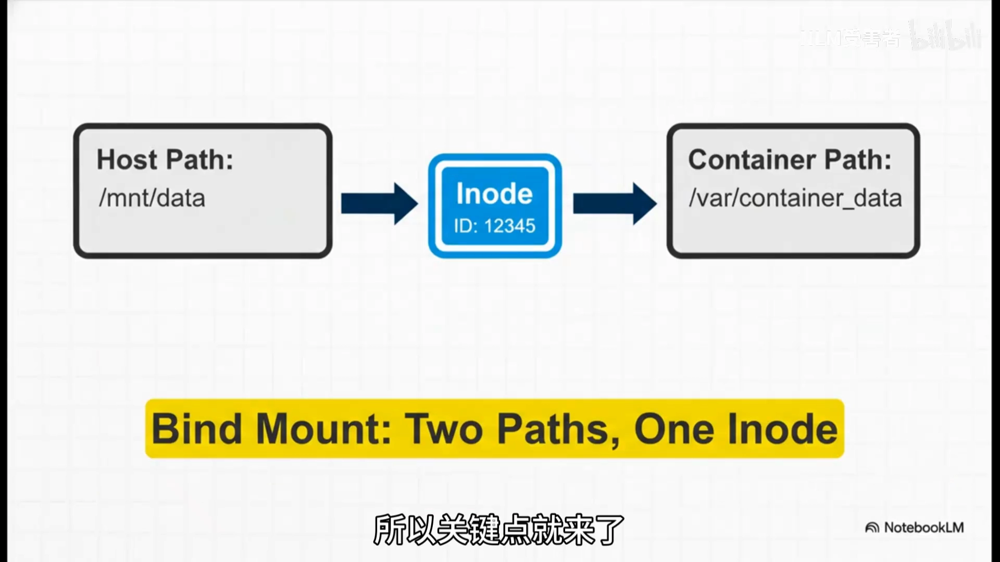

---

## 四、两种挂载方式：绑定挂载 vs 数据卷

原理搞明白了，实操中 Docker 提供了**两种主要挂载方式**：**绑定挂载（Bind Mount）** 和 **数据卷（Volumes）**。虽然底层都是 inode 映射，但设计理念和推荐场景差别很大。[【跳转到 05:47】](https://www.bilibili.com/video/BV1wqkaBiE1w/?t=347)

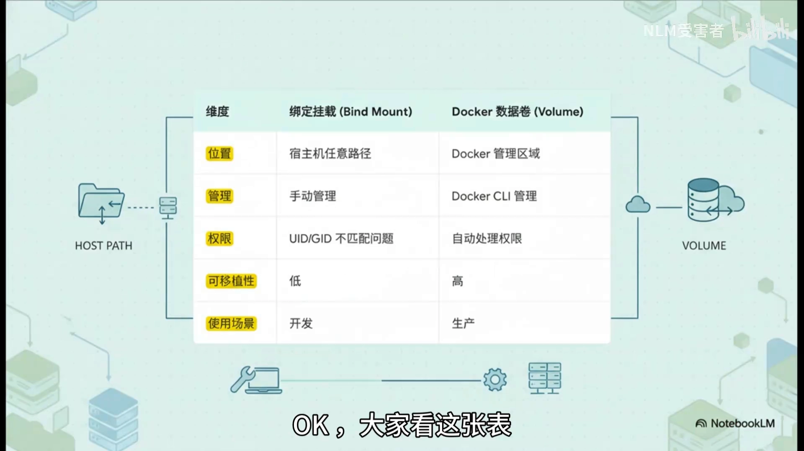

| 维度 | 绑定挂载（Bind Mount） | 数据卷（Volume） |
| --- | --- | --- |
| 位置 | 宿主机**任意路径**（`HOST PATH`） | **Docker 管理区域**（`VOLUME`） |
| 管理 | **手动**管理 | **Docker CLI** 管理 |
| 权限 | 有 **UID/GID 不匹配**问题 | **自动处理权限** |
| 可移植性 | 差（依赖宿主机路径） | 好（Docker 统一管理） |
| 使用场景 | **开发** | **生产** |

由此得出最佳实践，很简单就一句话：**开发用绑定挂载，生产用数据卷**。[【跳转到 06:10】](https://www.bilibili.com/video/BV1wqkaBiE1w/?t=370)

- **开发**：你希望本地代码一改、容器里马上生效——用**绑定挂载**最方便，直接把代码目录映射进去，实现代码热重载。
- **生产**：数据安全、备份、迁移变得至关重要——用由 **Docker 统一管理的数据卷**，确保安全、可移植、易于备份。

---

## 五、为什么数据卷是生产环境的"黄金标准"

再总结一下数据卷的四大优点：[【跳转到 06:43】](https://www.bilibili.com/video/BV1wqkaBiE1w/?t=403)

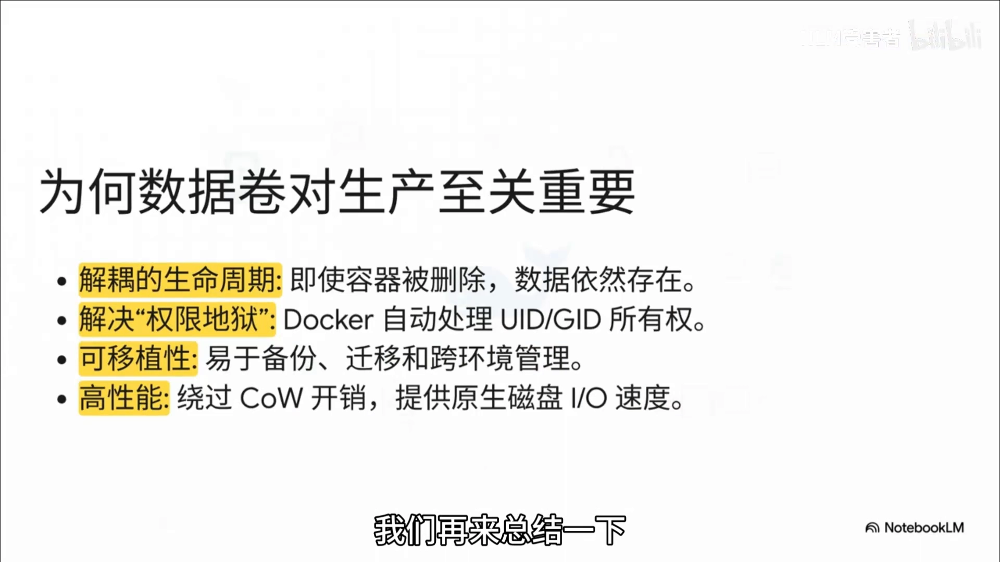

1. **解耦的生命周期**：即使容器被删除，**数据依然存在**。
2. **解决"权限地狱"**：Docker **自动处理 UID/GID 所有权**。
3. **可移植性**：易于**备份、迁移**和跨环境管理。
4. **高性能**：**绕过 COW 开销**，提供**原生磁盘 I/O 速度**。

把这些优点加在一起，才是生产环境真正需要的、健壮可靠可维护的数据持久化方案。

> **一句话结论**：**永远不要在容器可写层运行高负载数据库**，**数据卷是唯一稳健的选择**。[【跳转到 07:21】](https://www.bilibili.com/video/BV1wqkaBiE1w/?t=441)

到这里，数据已经被"救出牢笼"、变得安全又持久。视频也顺势抛出了下一个问题：**应用容器和带数据卷的数据库容器之间，要怎么安全可靠地通信呢？**（留待后续再讲。）[【跳转到 07:40】](https://www.bilibili.com/video/BV1wqkaBiE1w/?t=460)

---

## 小结

- **根因**：镜像只读、容器可写层临时，**数据写在可写层 = 容器一删就丢**。
- **性能杀手是写时复制（COW）**：改 4KB 要先把**整个文件**复制到可写层，IO 可能被放大到夸张的地步。
- **解法是挂载**：用 **`mount --bind`**（绑定挂载）做"路径到路径"映射，靠 **inode** 让宿主机目录与容器目录指向**同一个物理文件**，绕过分层文件系统。
- **两种方式**：绑定挂载（**开发**，宿主机任意路径、手动管理、有 UID/GID 问题）vs 数据卷（**生产**，Docker 管理、自动权限、可移植）。
- **生产选数据卷**：生命周期独立、解决权限地狱、易于备份迁移、原生磁盘速度；**别在可写层跑高负载数据库**。

## 关键术语速查

| 术语 | 一句话解释 |
| --- | --- |
| 可写层（writable layer） | 容器启动时叠加在只读镜像层之上的临时层，容器删除即消失 |
| 写时复制（COW） | 修改文件前先把整个文件复制到可写层的机制，对大文件会造成严重 IO 放大 |
| 绑定挂载（Bind Mount） | 把宿主机上的目录/文件映射进容器，适合开发，依赖宿主机路径 |
| 数据卷（Volume） | 由 Docker 管理的持久化存储，生命周期独立于容器，适合生产 |
| `mount --bind` | Linux 原生的绑定挂载命令，把一个目录树重挂到另一个位置 |
| inode | 文件的物理实体（索引节点），存元数据、不含文件名；绑定挂载让多个路径共享同一 inode |
| IO 放大（IO amplification） | 一次小写入引发的实际磁盘读写量远大于写入量（如改 4KB 却复制整个文件） |
