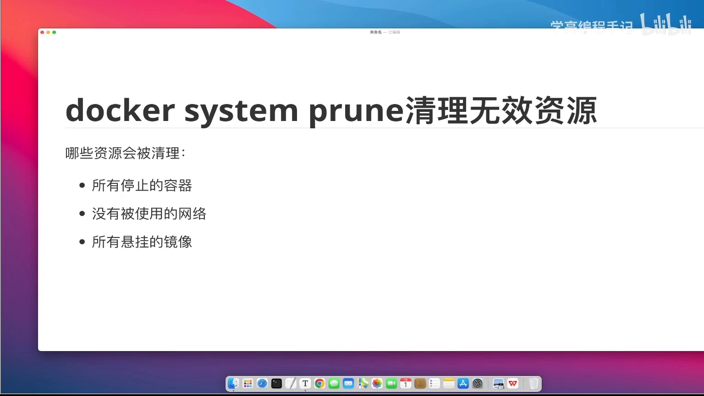
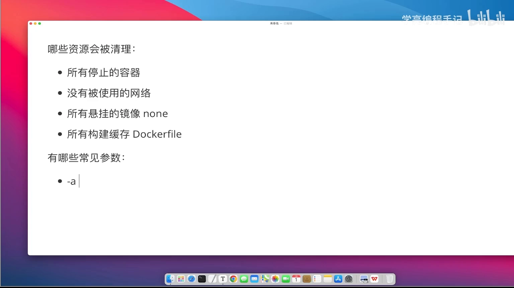
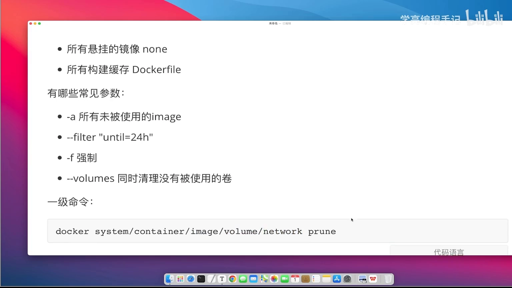

# docker system prune：一条命令回收哪些无效资源，怎么控制它删什么

> 视频来源：Bilibili 视频 [docker system prune清理无效资源](https://www.bilibili.com/video/BV1GrgQzkEC7/)（约 5 分 09 秒，中文讲解）。本文基于视频演说图文稿整理，时间戳可跳转到原视频对应位置，配图取自视频画面。字幕来自 B 站 AI 字幕，术语与错拼已逐窗口核对纠正（如 "workersystemprove"→`docker system prune`、"tag为long"→`tag` 为空 `<none>`、"多fire/多范"→`Dockerfile`、"杠A"→`-a`、"杠杠filter/VR转"→`--filter`、"Lumes/venues"→`--volumes`）。

## 本讲要解决的核心问题（SCQA）

**背景**：Docker 用久了，主机上会攒下大量"看不见的垃圾"——停掉的容器、没人用的网络、悬空镜像、构建缓存、没人引用的卷。[【跳转到 00:00】](https://www.bilibili.com/video/BV1GrgQzkEC7/?t=0)

**冲突**：这些东西一直占着磁盘，但一个个命令去删又麻烦，而且"哪些能被安全回收、哪些会被误删"也不清楚——万一连还在用的镜像、卷都被清掉就麻烦了。

**疑问**：`docker system prune` 到底会删掉**哪些**资源？用什么参数能**控制**它删什么、只删我想要的？

**回答（中心思想）**：`docker system prune` 一条命令回收四类资源——**所有停止的容器 + 没有使用的网络 + 所有悬挂的镜像（`<none>`）+ 所有构建缓存**；再配合 `-a`（扩展到所有未使用镜像）、`--volumes`（扩展到悬空卷）、`--filter "until=…"`（按时间收窄）、`-f`（免确认）来精确控制；也可以换成 `docker volume prune` 等**子命令**只清某一类。

---

## 一、默认会清理哪些资源

先要看清楚：执行 `docker system prune`（默认方式）会回收哪些东西。[【跳转到 00:25】](https://www.bilibili.com/video/BV1GrgQzkEC7/?t=25)



一共四类：

1. **所有停止的容器**——注意"停止"两个字：如果你的容器只是被 `stop` 了，**执行前要小心，先把它启动起来**，否则会被一并干掉。
2. **没有被使用的网络（network）**——网络也是资源。
3. **所有悬挂的镜像**——"悬挂"指 `tag` 为空的镜像，也就是 **`tag` 为 `<none>`** 的那些，默认会被清掉。
4. **所有构建缓存**——构建缓存是什么？比如你基于一个 `Dockerfile` 构建镜像，构建一次之后，因为镜像是**分层**的，其中有些层会被缓存下来；下次再执行相同命令构建时，这些层就能被**复用**，从而加速构建。这些缓存也在被清理之列。



所以第一步必须搞明白：执行这条命令，**哪些资源会被清除**。[【跳转到 02:30】](https://www.bilibili.com/video/BV1GrgQzkEC7/?t=150)

---

## 二、常见参数：控制它删什么

接下来看常用参数。[【跳转到 03:20】](https://www.bilibili.com/video/BV1GrgQzkEC7/?t=200)


| 参数 | 作用 | 注意 |
| --- | --- | --- |
| `-a` | 删除**所有未被使用**的镜像 | 不只是 `tag` 为空的悬挂镜像，**范围更大**，要更小心 |
| `--filter "until=24h"` | 按**创建时间**过滤 | 例如只清理 24 小时之前创建的无用资源（`until` 支持 `24h` 这类时间表达） |
| `-f` / `--force` | **不提示确认**、直接执行 | 默认命令是**交互式**的，需要你输入 `Y` 确认；`-f` 在 Linux 下通常就是"强制"之意 |
| `--volumes` | **同时清理没有被使用的卷** | 会连悬空的卷也一起清掉 |

关键点：

- **`-a` 扩大的是镜像范围**：不加 `-a` 只清"悬挂"（无 tag）镜像；加了 `-a` 连**所有未被使用的镜像**都清。
- **`--filter` 用来"按时间收窄"**：比如只清一天前创建的，避免误删刚做出来的东西。
- **默认是交互式**：不加 `-f` 时它会问你要不要继续，输 `Y` 才删；加 `-f` 就直接执行。
- **`--volumes` 才碰卷**：默认的 `prune` **不**清理卷，只有显式加上 `--volumes` 才会。

---

## 三、"一级命令"：也能只清某一类资源

`docker system` 是一个**系统级别的全局命令**；但它还有**一级命令（子命令）**，可以只针对某一类资源操作。[【跳转到 04:10】](https://www.bilibili.com/video/BV1GrgQzkEC7/?t=250)

```bash
docker system prune      # 全局：清理上面那几类无效资源
docker container prune   # 只清理（停止的）容器
docker image prune       # 只清理镜像
docker volume prune      # 只清理卷
docker network prune     # 只清理网络
```



也就是说，`docker system prune` 是"一把梭"，而 `container` / `image` / `volume` / `network` 这些**子命令**可以让你只操作容器、只操作镜像、只操作卷、只操作网络；而**上面讲的那些参数同样适用于这些子命令**。[【跳转到 05:00】](https://www.bilibili.com/video/BV1GrgQzkEC7/?t=300)

> 想只清卷又不想动别的，就优先用 `docker volume prune`（必要时再加 `--filter`），比 `docker system prune --volumes` 更聚焦。

---

## 小结

- **默认清四类**：所有**停止的容器**、**没被使用的网络**、所有**悬挂镜像**（`<none>`）、所有**构建缓存**。
- **`-a` 扩大镜像范围**：从"只清悬挂镜像"变成"清所有未被使用的镜像"。
- **`--volumes` 才动卷**：默认不清理卷，加上它才顺带清悬空卷。
- **`--filter "until=24h"` 按时间收窄**；**`-f` 免交互确认**。
- **可用子命令聚焦**：`docker volume prune` / `image prune` / `container prune` / `network prune` 只清某一类，参数通用。
- **执行前先确认**：`-f` 与 `--volumes`、`-a` 都会放大删除范围，**生产环境 prune 前务必看清楚会删什么**。

## 关键术语速查

| 术语 | 一句话解释 |
| --- | --- |
| `docker system prune` | 一键回收 Docker 系统里的无效资源（停止容器、未用网络、悬挂镜像、构建缓存） |
| 悬挂镜像（dangling image） | `tag` 为空的镜像，显示为 `<none>` |
| 构建缓存（build cache） | Docker 分层构建时被缓存复用的层，用于加速下次构建 |
| `-a` / `--all` | 把镜像清理范围从"悬挂镜像"扩大到"所有未被使用的镜像" |
| `--filter "until=24h"` | 按创建时间过滤，只处理指定时间之前的资源 |
| `--volumes` | 让 `prune` 同时清理未被使用的卷 |
| `-f` / `--force` | 跳过交互式确认，直接执行 |
