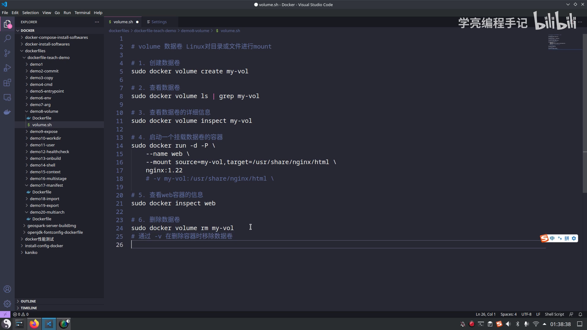
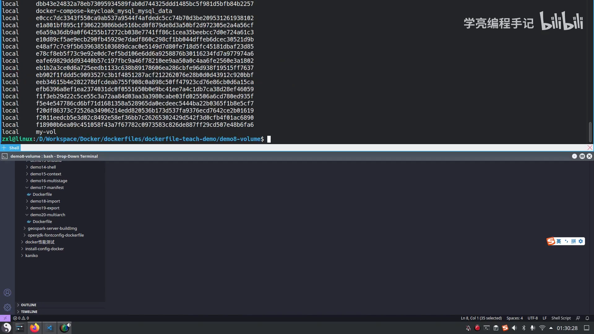
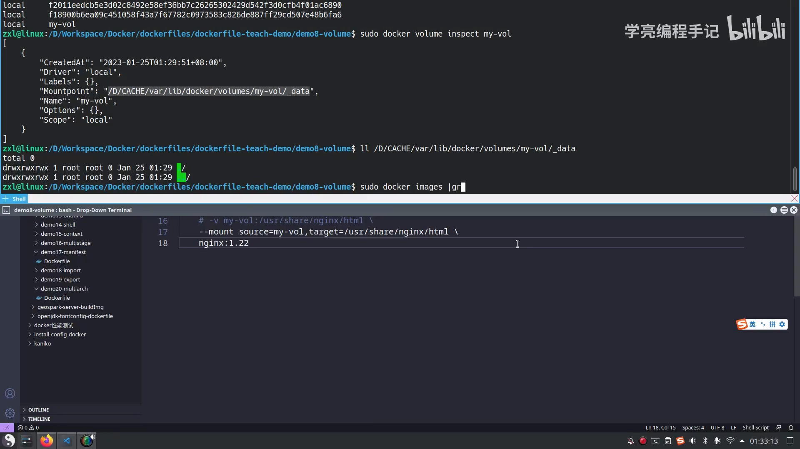
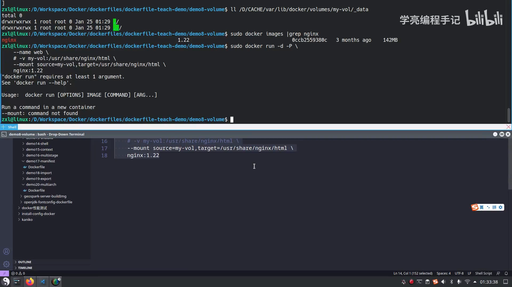
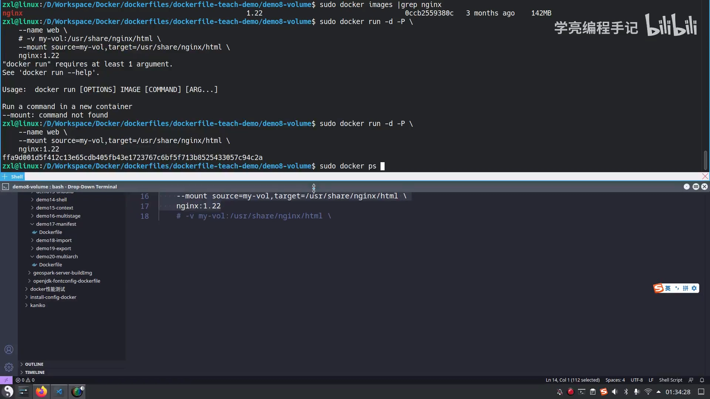
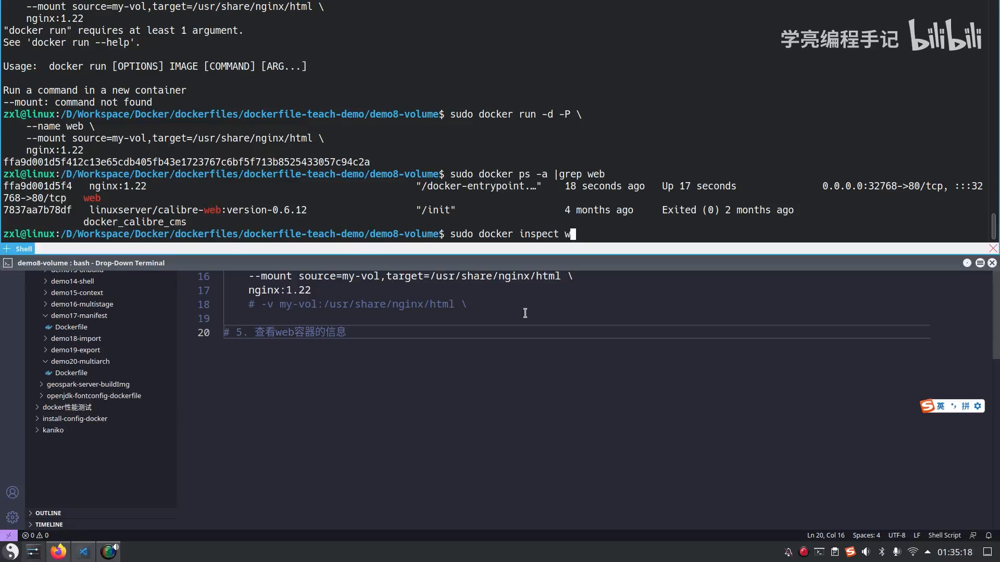
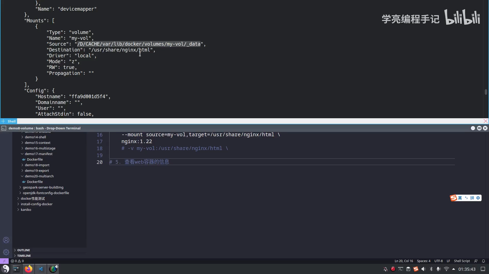
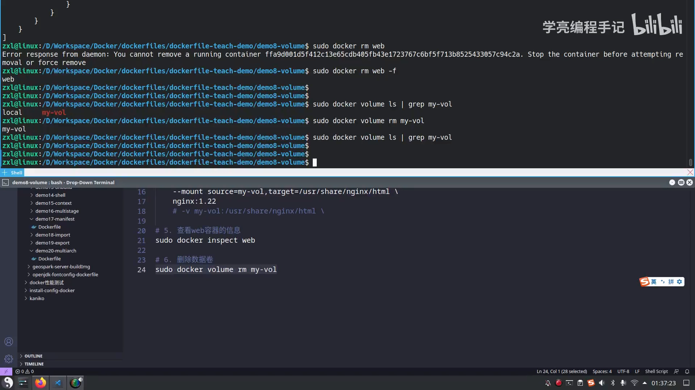

# Docker 数据卷的生命周期：创建、查看、挂载、删除与清理

> 视频来源：Bilibili 视频 [【Docker教程】docker管理volume数据卷：创建、使用及删除](https://www.bilibili.com/video/BV1sT411f7Nc/)（约 13 分 35 秒，中文讲解）。本文基于视频演说图文稿整理，时间戳可跳转到原视频对应位置，配图取自视频画面。字幕来自 B 站 AI 字幕，术语与错拼已逐窗口核对纠正（如 "unionfs / 多克"→`unionfs`/`Docker`、"mt / 杠杠 mont"→`mount`/`--mount`、"杠v"→`-v`、"value"（命令语境）→`volume`、"rrm 杠v"→`docker rm -v`）。

## 本讲要解决的核心问题（SCQA）

**背景**：前面的课程在讲 Dockerfile 时顺带提过 `VOLUME` 指令，但日常真正用来管理数据卷的，是 `docker volume` 这一组命令。[【跳转到 00:00】](https://www.bilibili.com/video/BV1sT411f7Nc/?t=0)

**冲突**：数据卷"默认存在、独立于容器"——容器删了卷还在，而且**没有任何容器引用它时也不会被自动回收（没有垃圾回收机制）**。结果就是：看不见、找不到、不知道怎么清，越攒越多。

**疑问**：数据卷到底该怎么**创建、查看、使用、删除**？它的**生命周期**和容器之间是什么关系？什么时候会删、什么时候不会删？

**回答（中心思想）**：`docker volume` 的 **create → ls → inspect → 挂载使用 → rm → prune** 覆盖了数据卷的完整生命周期；**数据卷的生命周期独立于容器**——删除容器**不会**自动删除数据卷，必须主动 `docker volume rm` / `prune`（或在删容器时用 `docker rm -v` 连带删除）。搞清这条链路，才算真正"排查"得了卷的问题。

---

## 一、数据卷是什么：绕过 unionfs 的"共享目录"

数据卷（volume）是一个**可供一个或多个容器使用的特殊目录**。它**绕过了 unionfs**——也就是 Docker 底层支撑的 `unionfs` 联合文件系统。它有这些特性：

- 可以在**容器之间共享和重用**；对它的修改、更新都会**立马生效**。
- **默认会存在**：就算把容器删了，数据卷还在——这也是它被设计出来"持久化数据"的原因。

要理解它的"寿命"，可以类比 K8s：数据卷**类似 K8s 里的一个资源对象**，它和 `deployment`、`statefulset` **没有任何关联**。就像 `deployment` 里的 `container` 用到了 volume、又用到了 PV，但你把 `deployment` 实例删掉之后，它的 **PV 依然存在**——数据卷是同样的道理。[【跳转到 01:00】](https://www.bilibili.com/video/BV1sT411f7Nc/?t=60)

数据卷的**使用方式**类似 Linux 下对目录或文件按顺序 `mount`；镜像中**被指定为挂载点**的目录里的文件，会被复制到这个数据卷中——**当且仅当数据卷为空时**才会复制。[【跳转到 01:50】](https://www.bilibili.com/video/BV1sT411f7Nc/?t=110)

---

## 二、走完生命周期：六步实操

视频用一个脚本 `volume.sh` 把数据卷的一生走了一遍，共六步。[【跳转到 12:34】](https://www.bilibili.com/video/BV1sT411f7Nc/?t=754)



### 2.1 创建：`docker volume create`

```bash
sudo docker volume create my-vol   # 创建一个名为 my-vol 的数据卷
```

执行后数据卷即创建成功。[【跳转到 02:00】](https://www.bilibili.com/video/BV1sT411f7Nc/?t=120)

### 2.2 查看：`docker volume ls`

查看数据卷用 `ls`。如果只想看某一个，可以**过滤**（例如 `docker volume ls | grep my-vol`）。输出里能看到每个卷都是 **`local` 类型**。[【跳转到 02:25】](https://www.bilibili.com/video/BV1sT411f7Nc/?t=145)



### 2.3 查看详情：`docker volume inspect`

还有一条更详细的指令 `inspect`：



输出里 **`Driver`（驱动）是 `local` 类型**，并且能看到它对应**本机的一个目录（Mountpoint）**——数据就保存在那里；此刻里面是空的，因为还没往卷里写过东西。[【跳转到 03:10】](https://www.bilibili.com/video/BV1sT411f7Nc/?t=190)

顺着这个路径去宿主机目录里看一眼，能确认**卷的实体就在宿主机磁盘上**：



[【跳转到 07:34】](https://www.bilibili.com/video/BV1sT411f7Nc/?t=454)

### 2.4 使用：把卷挂进容器（`--mount` / `-v`）

创建了就要用。挂载卷有两种写法：`-v` 和 `--mount`。以 `-v` 为例，格式是 `-v my-vol:/usr/share/nginx/html`（冒号前是**数据卷名字**，冒号后是**容器里的路径**）：

```bash
sudo docker run -d -P \
  --name web \
  --mount source=my-vol,target=/usr/share/nginx/html \
  nginx:1.22
# 等价的 -v 写法：# -v my-vol:/usr/share/nginx/html
```



> **踩坑提示**：视频里 `--mount` 一度报 "`--mount: command not found`"，原因是**命令里的换行/注释**导致行尾的反斜杠 `\` 没被识别——**手敲能识别的 `\` 换行，直接复制粘贴文本时可能失效**。排错时留意一下换行和注释即可。[【跳转到 09:14】](https://www.bilibili.com/video/BV1sT411f7Nc/?t=554)



### 2.5 核对：`docker inspect` 看挂载关系

容器跑起来后，用 `docker inspect web` 查看容器的 **`Mounts`** 信息，能清楚地看到这次挂载的"来龙去脉"：[【跳转到 09:39】](https://www.bilibili.com/video/BV1sT411f7Nc/?t=579)

- `Type`: `volume`（类型是数据卷）
- `Name`: `my-vol`
- `Source`: `/var/lib/docker/volumes/my-vol/_data`（**宿主机上的真实目录**）
- `Destination`: `/usr/share/nginx/html`（**容器内的挂载路径**）



### 2.6 删除：`docker volume rm`

删除数据卷用 `docker volume rm my-vol`。视频特意先确认了"容器已经删掉，但数据卷依旧存在"，再删卷——这正是"生命周期独立"的直观验证。[【跳转到 10:54】](https://www.bilibili.com/video/BV1sT411f7Nc/?t=654)

---

## 三、关键结论：数据卷的生命周期独立于容器

视频把这一点讲得很明确：

- 数据卷主要被设计用来**存储、持久化数据**，它的**生命周期独立于容器**：**容器被删除之后，它不会自动删除数据卷**。
- 而且**不存在垃圾回收机制**来处理"没有任何容器引用"的数据卷——没人用也不会被自动清掉。
- 如果**需要在删除容器的同时删掉数据卷**，可以在移除容器时用 `docker rm -v` 这个命令。[【跳转到 11:19】](https://www.bilibili.com/video/BV1sT411f7Nc/?t=679)

`docker rm -v web` 里的 **`-v` 表示"删除容器时一并移除它使用的数据卷"**；再加 `-f` 可强制删除。

> **踩坑提示**：直接 `docker rm web` 会报错 "**You cannot remove a running container**"——**运行中的容器不能直接删**，要先 `stop` 或加 `-f` 强制删除。排错时先看清报错原文。[【跳转到 11:19】](https://www.bilibili.com/video/BV1sT411f7Nc/?t=679)



## 四、批量清理：`docker volume prune`

最后还有一个"清理"指令 `docker volume prune`：

> 清理的话就不管你是谁了——**用这个命令，本机所有未被使用的 volume 数据卷都会被干掉**，是一个"一锅端"的全新操作，**执行前务必确认**。[【跳转到 12:59】](https://www.bilibili.com/video/BV1sT411f7Nc/?t=779)

---

## 小结

- **是什么**：数据卷是绕过 `unionfs` 的共享目录，可在容器间共享，修改即时生效，**默认持久存在**。
- **全生命周期命令**：`create` 创建 → `ls` 查看 → `inspect` 看详情（Driver/Mountpoint）→ 用 `--mount`/`-v` 挂载 → `rm` 删除 → `prune` 批量清理。
- **生命周期独立**：删容器**不会**自动删卷，也**没有垃圾回收**；要连带删除用 `docker rm -v`。
- **数据落点**：卷的实体在宿主机 `/var/lib/docker/volumes/<卷名>/_data`，`docker volume inspect` / `docker inspect` 的 `Mounts` 都能查到。
- **排错要点**：`docker rm` 删运行中容器会报错（需 `stop` 或 `-f`）；脚本里换行/注释会让 `--mount` 的续行反斜杠失效。

## 关键术语速查

| 术语 | 一句话解释 |
| --- | --- |
| 数据卷（volume） | 由 Docker 管理、独立于容器生命周期的持久化目录，位于宿主机 `/var/lib/docker/volumes/` 下 |
| `unionfs` | 联合文件系统，Docker 镜像分层与容器可写层的底层技术；数据卷**绕过**它 |
| `docker volume inspect` | 查看卷详情：`Driver`、`Mountpoint`（宿主机落盘路径）等 |
| `--mount` / `-v` | 把卷（或目录）挂进容器的两种写法，`--mount source=...,target=...` 或 `-v 卷名:容器路径` |
| `docker rm -v` | 删除容器时**连同**其使用的（匿名）数据卷一起删除 |
| `docker volume prune` | 清理本机**所有未被使用**的数据卷，操作不可逆，需谨慎 |
