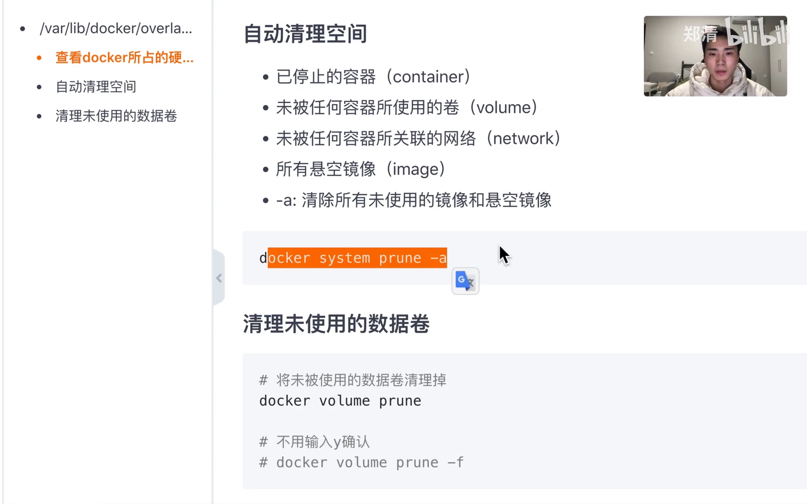

# Docker 磁盘被撑满怎么办：控制容器日志大小 + 清理未使用的资源

> 视频来源：Bilibili 视频 [Docker日志文件大小控制&清理overlay2](https://www.bilibili.com/video/BV1224y1G7bz/)（约 2 分 23 秒，中文讲解）。本文基于视频演说图文稿整理，时间戳可跳转到原视频对应位置，配图取自视频画面。字幕来自 B 站 AI 字幕，术语与错拼已逐窗口核对纠正（如 `--log-opt`、`max-size`、`max-file`、`/etc/docker/daemon.json`、`docker system prune -a`、`docker volume prune`）。

## 本讲要解决的核心问题（SCQA）

**背景**：用 Docker 部署服务之后，宿主机上的 `/var/lib/docker` 这个目录会越用越大——它是 Docker 存放镜像层、容器可写层、日志和卷的地方。[【跳转到 00:00】](https://www.bilibili.com/video/BV1224y1G7bz/?t=0)

**冲突**：这个目录的占用涨得很快，**一方面是日志问题**（容器不限制地往日志文件里写，日志能把磁盘撑爆），**另一方面是目录下堆积了没被使用、也没被删除的数据**（停掉的容器、悬空镜像、没人引用的卷）。两块加起来，磁盘很快就吃紧。

**疑问**：怎么才能**管住容器的日志大小**？又怎么把那些**没用到的资源清理掉**？

**回答（中心思想）**：分两步——**先「限流」再「清仓」**。限流有两个层次：**运行时**在 `docker run` 上加 `--log-opt max-size` 与 `--log-opt max-file` 控制单个容器；**全局**改 `/etc/docker/daemon.json` 里的 `log-opts` 一次管住所有新容器。清仓则有 `docker system prune`（`-a` 进一步清理所有未使用镜像）和 `docker volume prune`（清未被使用的数据卷）两条命令。两者合起来，`/var/lib/docker` 的占用就能被有效控制。[【跳转到 02:09】](https://www.bilibili.com/video/BV1224y1G7bz/?t=129)

---

## 一、先看清：`/var/lib/docker` 里到底有什么

排查前先建立「目录地图」。视频在 `root@...:/var/lib/docker` 下执行 `ll`，可以清楚看到这个目录的构成。[【跳转到 00:00】](https://www.bilibili.com/video/BV1224y1G7bz/?t=0)


各子目录的作用（初学者对照记）：

| 子目录 | 存放什么 |
| --- | --- |
| `image` | 本地**镜像**的元数据 |
| `overlay2` | **镜像层与容器可写层**的实际数据（占大头的常是它） |
| `containers` | 每个**容器**的配置与**日志文件**（本讲要对付的重点之一） |
| `volumes` | **数据卷（volume）**的内容 |
| `network` | Docker **网络**的元数据 |
| `buildkit` / `tmp` / `trust` / `plugins` / `runtimes` / `swarm` | 构建缓存、临时文件、签名信任、插件、运行时、集群等 |

对照视频里的观察：一方面**日志**会让目录变大（落在 `containers` 下），另一方面**没被使用 / 没被删除的数据**（停掉的容器、悬空镜像、闲置卷）也会一直占着空间。下面分别处理。

---

## 二、控制日志大小之一：运行容器时用 `--log-opt`

### 2.1 两个参数：`max-size` 与 `max-file`

运行容器时，加上两个 `--log-opt` 参数就能控制日志大小。[【跳转到 00:19】](https://www.bilibili.com/video/BV1224y1G7bz/?t=19)

```bash
docker run -d -p 666:666 --name test -e server.port=666 \
  --log-opt max-size=30m \
  --log-opt max-file=3 \
  registry.cn-hangzhou.aliyuncs.com/zhengqing/test:dev
```


两个参数的含义：

- **`--log-opt max-size=30m`**：**单个日志文件的最大大小**，例如 30MB。写满就**轮转**（rotate）。
- **`--log-opt max-file=3`**：**最多保留几个日志文件**，例如 3 个。

> 「轮转（rotate）」是日志领域的通用做法：文件写满后，把它改名归档（`.1`、`.2`…），再新建一个空文件继续写，最旧的被丢弃。它保证日志**总量有上限**，而不是无限增长。

### 2.2 验证：日志文件在哪、轮转长什么样

容器跑起来之后，进到对应的日志目录看效果。[【跳转到 00:41】](https://www.bilibili.com/video/BV1224y1G7bz/?t=41)

```bash
cd /var/lib/docker/containers/<容器ID>/
```


Docker 默认用 **`json-file`** 日志驱动，每个容器的日志就落在：

```
/var/lib/docker/containers/<容器ID>/<容器ID>-json.log
```

不断请求服务接口制造日志后，观察文件大小的变化。[【跳转到 00:46】](https://www.bilibili.com/video/BV1224y1G7bz/?t=46)


当单文件写到 30MB 上限后，就会**轮转**出新的文件。[【跳转到 01:05】](https://www.bilibili.com/video/BV1224y1G7bz/?t=65)


结果正如参数所设：当前文件写满 30MB 后，变成 `-json.log.1`，再写满变成 `-json.log.2`，**最多只保留 3 个**——也就是这个容器的日志上限被钉在 `30MB × 3` 左右，不会再无限膨胀。这就是**单个容器**的日志控制。

> 局限：这种写法**只对当前这个容器生效**。如果有一堆容器，逐个加参数很麻烦，于是有了下面的全局配置。

---

## 三、控制日志大小之二：全局配置 `daemon.json`

想让**所有（新）容器**统一受限，就改 Docker 的守护进程配置文件。[【跳转到 01:19】](https://www.bilibili.com/video/BV1224y1G7bz/?t=79)


```bash
cat /etc/docker/daemon.json
```

```json
{
  "log-driver": "json-file",
  "log-opts": {
    "max-size": "100m",
    "max-file": "3"
  }
}
```

要点：

- **位置**：`/etc/docker/daemon.json`（没有就创建）。
- **含义**：`log-driver` 指定日志驱动为 `json-file`；`log-opts` 里的 `max-size` / `max-file` 就是第二节那两个参数——只是从「命令行的 `--log-opt`」变成了「配置文件的 `log-opts`」，**键名几乎一样**，迁移记忆很省事。
- **重要提示**：这是**「新容器生效」**——改动**不会**追溯已经跑着的旧容器，只影响此后**新建**的容器。改完记得让 Docker 重载配置（`systemctl reload docker` 或重启 Docker 服务）。

---

## 四、清理未被使用的资源：`prune` 两条命令

日志管住了，还要处理「堆着不用的数据」。这就轮到 `prune`（修剪）系列命令。[【跳转到 01:31】](https://www.bilibili.com/video/BV1224y1G7bz/?t=91)


### 4.1 `docker system prune`：清理系统里的无效资源

```bash
docker system prune        # 清理：已停止的容器 + 未被使用的网络 + 所有悬空镜像
docker system prune -a     # 在上面基础上，再清除所有未被使用的镜像（不只悬空镜像）
```

- **默认**会清掉：**已停止的容器**、**未被任何容器使用的网络**、**所有悬空镜像**（`tag` 为空的 `<none>` 镜像）。
- **加 `-a`（all）**：把镜像的清理范围**扩大**到「**所有没有被使用的镜像**」——不只是悬空镜像。**范围更大，要更谨慎**。

### 4.2 `docker volume prune`：清理未被使用的数据卷

```bash
docker volume prune        # 将未被使用的数据卷清理掉（会提示确认）
docker volume prune -f     # 不用输入 y 确认，直接执行
```

- **数据卷**往往体积不小，且默认的 `docker system prune` **不碰**卷，所以要单独清。
- `-f`（force）跳过交互确认；不加时 Docker 会问一句，输 `y` 才执行。

### 4.3 一条龙组合

两件事配合起来：**用 `--log-opt` / `daemon.json` 控制日志不要疯长**，**用 `prune` 定期清走停掉的容器、悬空/未用镜像、闲置网络与卷**——视频的最后一句就是：这一条龙服务下来，`/var/lib/docker` 的磁盘空间就能得到有效控制了。[【跳转到 02:09】](https://www.bilibili.com/video/BV1224y1G7bz/?t=129)

---

## 五、边界与提醒：什么时候别用自动清理

视频里给了两条重要的使用边界。[【跳转到 01:56】](https://www.bilibili.com/video/BV1224y1G7bz/?t=116)



- **前提是「数据不重要」**：`prune` 是**自动**判断「未使用」并删除的，它并不知道某个停止的容器是不是你明天还要 `start` 回来的。
- **数据重要就手动清理**：如果容器/卷里的数据很重要，别用一把梭的自动清理，而是**自己确认清楚**再删。
- **适用场景**：视频举的例子是**无状态服务**（如 Java 服务）——重启后数据从别处来，容器和卷都不承载唯一副本，这类场景用 `prune` 及时清理就很合适。

> 另外，视频最后提到相关资料整理在作者的多个代码仓库里（如 Gitee 上的 `docker-compose` 仓库，含 Docker 笔记）。[【跳转到 02:04】](https://www.bilibili.com/video/BV1224y1G7bz/?t=124)

---

## 小结

- **先说诊断**：`/var/lib/docker` 变大有两块来源——**容器日志**与**堆着不用的资源**。
- **限流（单个容器）**：`docker run` 加 `--log-opt max-size=30m --log-opt max-file=3`；日志落在 `/var/lib/docker/containers/<ID>/<ID>-json.log`，写满后轮转为 `.1`、`.2`，最多保留 `max-file` 个。
- **限流（全局）**：改 `/etc/docker/daemon.json` 的 `log-driver` + `log-opts`，**新容器生效**，不影响旧容器。
- **清仓**：`docker system prune` 清停止容器 / 未用网络 / 悬空镜像；`-a` 扩展到所有未使用镜像；`docker volume prune` 清未使用的卷（`-f` 免确认）。
- **安全底线**：自动清理的前提是**数据不重要**；重要数据请手动清理。无状态服务适合用这套命令定期维护。

## 关键术语速查

| 术语 | 一句话解释 |
| --- | --- |
| `/var/lib/docker` | Docker 在 Linux 上的默认数据根目录，存放镜像、容器可写层、日志、卷、网络等 |
| `json-file` 日志驱动 | Docker 默认日志驱动，把容器标准输出以 JSON 行格式写入 `<容器ID>-json.log` |
| 日志轮转（rotate） | 日志写满上限后改名归档（`.1`、`.2`…）并新建空文件继续写，使总量有上限 |
| `--log-opt max-size` | 单个日志文件的最大大小（如 `30m`）；写满即轮转 |
| `--log-opt max-file` | 最多保留的日志文件个数（如 `3`） |
| `/etc/docker/daemon.json` | Docker 守护进程配置文件；在其中配置 `log-driver` / `log-opts` 可对**所有新容器**统一控制日志 |
| `docker system prune` | 一键清理已停止容器、未使用网络、悬空镜像；`-a` 扩展到所有未使用镜像 |
| 悬空镜像（dangling image） | `tag` 为空的镜像，显示为 `<none>` |
| `docker volume prune` | 清理未被任何容器使用的数据卷；`-f` 跳过确认 |
| 无状态服务 | 自身不保存唯一数据的服务（如 Java 应用），容器/卷可安全回收 |
