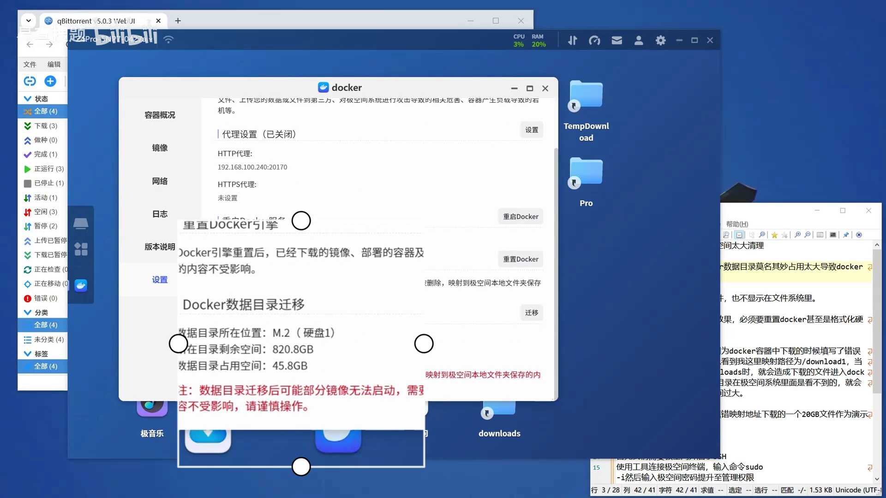
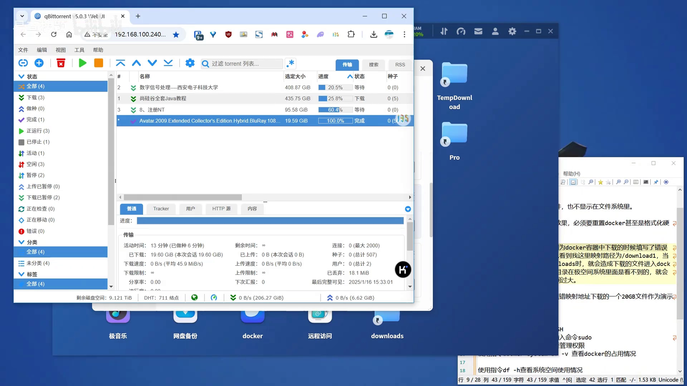
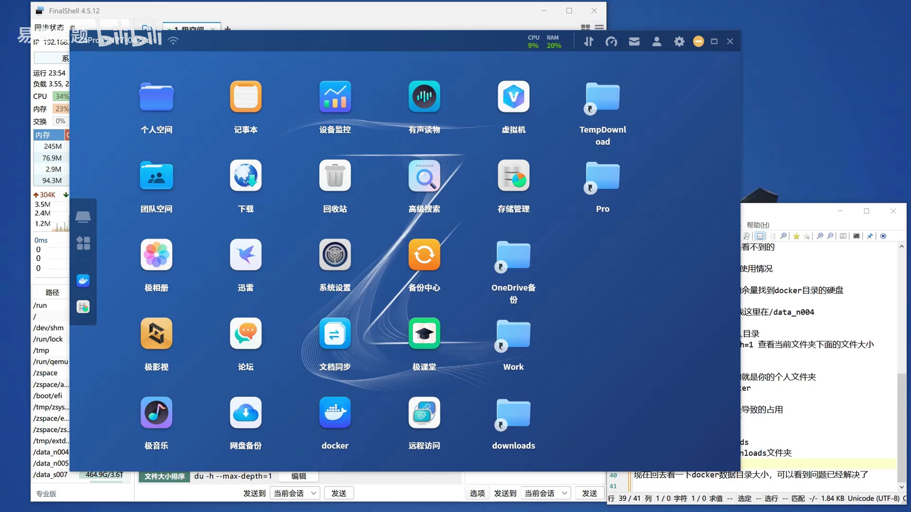

# Docker 数据目录被悄悄写满：从 45.8GB 异常占用到揪出 overlay2 里的下载目录

> 视频来源：Bilibili 视频 [极空间Docker数据目录占用空间过大，导致Docker启动不了](https://www.bilibili.com/video/BV1bbwVeEEZB/)（约 5 分 08 秒，中文讲解）。本文基于视频演说图文稿整理，时间戳可跳转到原视频对应位置，配图取自视频画面。字幕来自 B 站 AI 字幕，术语与错拼已逐窗口核对纠正（如「/download1」「/downloads」等下载路径、`docker system df -v`、`du -h --max-depth=1`、`rm -r`；AI 字幕中把「data_n004」识成「data_ne04」，本文按画面中的实际路径 `data_n004` 还原）。

## 本讲要解决的核心问题（SCQA）

**背景**：在极空间这类 NAS 上跑 Docker，容器的镜像、容器可写层、日志都放在一个专门的 Docker 数据目录里；正常情况下这个目录的大小与「装了多少镜像、跑了多少容器」大致相称。[【跳转到 00:00】](https://www.bilibili.com/video/BV1bbwVeEEZB/?t=0)

**冲突**：这位用户的数据目录**莫名占了 45.8GB**，直接把 Docker 撑到启动不了；更让人抓狂的是——在 Docker 界面里**找不到**占用的文件，在极空间的文件系统里也**看不到**，**重启 Docker、甚至重启整个极空间都没用**，按官方说法好像只能「重置 Docker」甚至「格式化硬盘」才能解决。[【跳转到 00:13】](https://www.bilibili.com/video/BV1bbwVeEEZB/?t=13)

**疑问**：这凭空多出来的几十 GB 到底藏在哪？为什么会跑到 Docker 数据目录里去？在不重置、不格盘的前提下，怎么把它找出来并删掉？

**回答（中心思想）**：这类问题**绝大多数是容器把「下载目录」映射错了**——下载软件（QB，qBittorrent）在容器里映射的路径是 `/download1`，但实际下载时却选了 `/downloads`，于是文件被写进了该容器的 **overlay2 可写层**里，而 overlay2 藏在 NAS 的 Docker 数据目录深处、极空间的文件界面根本不会显示它。解决办法是一条「**沿目录树逐层下钻**」的排查链：用 `docker system df -v` 确认是哪一类资源在占 → 用 `df -h` 找到 Docker 数据盘 → 用 `du -h --max-depth=1` 从盘根一层层往里钻到 `overlay2` → 进到出问题的容器目录里找到那个**名字对不上**的目录 → `rm -r` 删掉它，数据目录立刻从 45.8GB 回落到 6.6GB。[【跳转到 04:58】](https://www.bilibili.com/video/BV1bbwVeEEZB/?t=298)

---

## 一、症状：数据目录凭空多出 45.8GB，系统里却看不见

先在极空间的 Docker 设置里确认「病象」。[【跳转到 00:13】](https://www.bilibili.com/video/BV1bbwVeEEZB/?t=13)



截图里能看到三行关键信息：

- **数据目录所在位置**：`M.2（硬盘1）`——数据目录是**落在一块具体的物理盘上**的，先记住这一点，后面找盘要用。
- **所在目录剩余空间**：820.8GB。
- **数据目录占用空间**：**45.8GB**——这就是被撑起来的那个数。

对照视频里的操作顺序，这个故障的典型特征是「三找不到」：Docker 里**找不到**占用文件、文件系统里**不显示**、**重启无效**，剩下的「官方出路」只有重置 Docker 或格式化硬盘。

> 关键认识：Docker 的「数据目录」是一个**由 Docker 自己管理的内部目录**，它的内容（镜像层、容器可写层、日志、卷）**不会**完整地出现在 NAS 的文件管理器里。所以「文件系统里看不见」并不等于「没占空间」——这正是它难排查的原因。

---

## 二、根因：容器下载路径填错，文件写进了 Docker 数据目录

这位用户的场景很典型：机器上跑着 QB（qBittorrent）做下载。问题出在**下载路径填写不一致**。[【跳转到 00:34】](https://www.bilibili.com/video/BV1bbwVeEEZB/?t=34)



对照视频里的说明：

- QB 容器里，**映射路径**被配成了 `/download1`（宿主机的某个真实文件夹挂到容器里的 `/download1`）。
- 但在 QB 里**实际下载时选的是 `/downloads`**——而 `/downloads` 这个路径**并没有被映射出去**，它只是容器内部的一个普通目录。
- 于是下载的文件**落进了容器自己的可写层**，而容器的可写层位于 Docker 数据目录下的 `overlay2` 里。

一句话：**该写到宿主机的文件，写到了容器里**；容器里的东西，最后都算在 Docker 数据目录头上。而 `overlay2` 在极空间文件系统里**看不到**，就造成了「数据目录暴涨、却找不到文件」的怪象。

> 为了演示，视频里**故意填错了映射地址**，下载了一个约 **20GB** 的文件；后面对应的就是它。[【跳转到 00:46】](https://www.bilibili.com/video/BV1bbwVeEEZB/?t=46)

**要根治，先要做到两件事**：一是把 QB 的下载路径**改成真实被映射出去的目录**（如 `/download1`），别再用没映射的 `/downloads`；二是把这次已经写进容器层的那份文件清掉。下面就是「清理」的完整排查链。

---

## 三、排查：四条命令沿目录树逐层下钻，锁定罪魁祸首

排查的总体思路是**「先确认是哪一类资源在占 → 再定位到哪块盘 → 再一层层钻进 Docker 数据目录 → 最后进到出问题的容器可写层」**。整个过程需要 SSH 到 NAS 的终端操作。

### 3.1 准备工作：开启 SSH，用 `sudo -i` 提权

先在极空间的系统设置里**开启 SSH**，再用终端工具（视频里用 FinalShell）连上去。[【跳转到 01:22】](https://www.bilibili.com/video/BV1bbwVeEEZB/?t=82)


连接后第一件事是提权——**排查和删除都需要 root 权限**：

```bash
sudo -i          # 输入极空间密码，提升到管理权限（提示符变成 root@...）
```

### 3.2 `docker system df -v`：先确认是哪一类资源在占

提权后，先让 Docker 自己报账。[【跳转到 01:48】](https://www.bilibili.com/video/BV1bbwVeEEZB/?t=108)


`docker system df -v` 会分别列出**镜像（Images）、容器（Containers）、本地卷（Local Volumes）**各自占用的空间明细。视频里一眼就能看到：

- 其它容器的 SIZE 都是几 MB、几十 MB 的**正常量级**；
- 唯独 **`linuxserver/qbittorrent` 这一行，SIZE 是 21GB**——数字大了一个数量级，非常扎眼。

> 这一步的意义是**「缩小范围」**：Docker 数据目录被占，无非镜像、容器、卷三类；先看明细，就能把嫌疑锁定到「某个容器的可写层」上。视频里所说的「正常这里是非常小的，这就说明这里有错误的文件占用」，指的就是这个对比。[【跳转到 01:43】](https://www.bilibili.com/video/BV1bbwVeEEZB/?t=103)

### 3.3 `df -h`：定位 Docker 数据目录在哪块盘

知道「是容器占的」还不够，还得知道这些数据**物理上落在哪块盘**。[【跳转到 02:11】](https://www.bilibili.com/video/BV1bbwVeEEZB/?t=131)


`df -h`（disk free，human-readable）列出**每个文件系统的总量、已用、可用和挂载点**。视频里的诀窍是：

- 先看**极空间里这块硬盘的容量和余量**（例如某块 SSD 总容量约 1.8T、已用约 1T）；
- 再用这个「容量 + 余量」的特征，**在 `df -h` 输出里对号入座**，找到容量相符的那一行，它的 `Mounted on` 就是 Docker 数据目录所在的盘。


在视频这台机器上，答案就是 **`/data_n004`**。

> 注意：**`/data_n004` 只是这台机器的盘符**，你自己的机器上要按同样的「容量对齐」方法找出对应的目录。

### 3.4 `du -h --max-depth=1`：一层层往下钻

找到盘之后，从盘根开始**逐层下钻**。[【跳转到 03:01】](https://www.bilibili.com/video/BV1bbwVeEEZB/?t=181)

```bash
cd /data_n004
du -h --max-depth=1     # 只看「当前目录下每个子目录」各占多大，不递归展开
```

`du -h --max-depth=1` 的含义是：**统计当前目录下、深度为 1 的每个子目录的大小**，用人类可读的单位（K/M/G/T）显示。它不展开多层，所以输出清爽、能一眼看出「哪个子目录最大」。


然后**重复同一个套路**：进入最大的那个子目录，再执行一次 `du -h --max-depth=1`。视频里的下钻链条是：

```
/data_n004
  └─ data           (1009G)   ← 进入
       └─ udata     (995G)    ← 进入
            └─ real  (995G)   ← 进入
                 └─ zdocker  (46G)   ← 进入（Docker 相关）
```


两个实用提示：

- **带电话号码命名的目录，通常是你的「个人文件夹」**（极空间按账号分配）；
- 往下一般是 **`docker` 文件夹**（视频这台机器里叫 **`zdocker`**），Docker 数据目录就在这里。

### 3.5 进入出问题的容器可写层，找到那个「名字对不上」的目录

再往里，就是 `overlay2`——Docker 用来存放镜像层与容器可写层的地方。[【跳转到 04:16】](https://www.bilibili.com/video/BV1bbwVeEEZB/?t=256)


`overlay2` 下面全是**哈希字符串命名的目录**（如 `4ef06d90c1c4b8c75e219...`），一眼看不出谁是谁。方法还是老一套：**挑最大的那个进去**。


顺次看下钻结果：

- 进到哈希目录里，`./diff`（容器的**可写层差异目录**，容器里新增/修改的文件都在这）占 **20G**；
- 再 `cd ./diff`，里面出现了一串目录：`download3`、`download`、`download1`、`download2`、`downloads`……
- 其中 **`./downloads` 正是那个 20G**——就是第二节里那个被写错路径的下载目录。

**关键判断就在这一步**：这个目录的**名字（`downloads`）和 QB 里映射出去的名字（`/download1`）对不上**，说明它就是「本来不该存在容器里、却被写了进来」的那份数据。视频原话：到这里终于找到罪魁祸首了，这个文件夹的名字和 Docker 里映射的名字不一样。[【跳转到 04:16】](https://www.bilibili.com/video/BV1bbwVeEEZB/?t=256)

---

## 四、清理与验证：删掉误入的目录，数据目录恢复

确认了是误入的下载目录，就可以把它删掉。[【跳转到 04:41】](https://www.bilibili.com/video/BV1bbwVeEEZB/?t=281)

```bash
rm -r ./downloads      # 递归删除这个目录；实际执行时请换成你自己确认过的目录名
```

- `rm -r`：**递归删除**整个目录（目录及其下所有内容）；删目录必须加 `-r`，否则 `rm` 会因「是目录」而拒绝。
- 视频里反复强调：**务必把目录名换成你自己确认过的那一个**（视频举例用的是 `./Part5`，你机器上可能是别的名字）——删错目录会误删数据。

删完再回头执行一次 `docker system df -v`，就能看到该容器的占用**已经掉了下去**。

最后回到极空间界面刷新，数据目录恢复正常。[【跳转到 04:58】](https://www.bilibili.com/video/BV1bbwVeEEZB/?t=298)



数据目录占用空间从 **45.8GB 降到 6.6GB**，Docker 也能正常启动了。

> **别忘了根治**：文件删掉只是「止血」，还要回到 QB（或其它下载/服务容器）**检查映射路径与实际使用路径是否一致**，把下载目录改回真正被映射出去的目录（如 `/download1`）。不然后续下载还会继续往容器层里灌数据，问题会复发。

---

## 小结

- **症状识别**：Docker 数据目录异常暴涨（本例 45.8GB）、Docker 里看不到占用文件、文件系统里也不显示、重启无效——这是「数据写进了 Docker 内部目录」的典型信号。
- **根因定位**：绝大多数是**容器映射路径与实际使用路径不一致**（QB 映射 `/download1`，却下载到没映射的 `/downloads`），导致数据落进容器的可写层（`overlay2` 的 `diff`）。
- **排查链条**：`sudo -i` 提权 → `docker system df -v` 看是哪类资源在占（锁定到某个容器）→ `df -h` 用「容量+余量」对号找出数据盘（`/data_n004`）→ `du -h --max-depth=1` 从盘根逐层下钻到 `zdocker/overlay2` → 进最大的哈希目录、进 `./diff`，找到那个**名字对不上**的目录。
- **清理与验证**：`rm -r ./<确认过的目录名>` 删除误入数据，回头 `docker system df -v` 与界面刷新验证（45.8GB → 6.6GB）。
- **根治**：把下载/服务容器的路径改回真正被映射出去的目录，避免复发。
- **风险提示**：`rm -r` 不可逆，执行前务必核对路径与目录名；排查阶段只读命令（`docker system df` / `df` / `du`）可放心执行。

## 关键术语速查

| 术语 | 一句话解释 |
| --- | --- |
| Docker 数据目录 | Docker 自己管理的内部存储目录（默认 `/var/lib/docker`），存放镜像层、容器可写层、日志、卷；NAS 上常被改到某块数据盘的深处 |
| 容器可写层（writable layer） | 容器启动后在镜像之上新增的可写层，容器运行期间产生的新文件都写在这里；在 `overlay2` 中对应某个哈希目录的 `diff` |
| `overlay2` | Docker 默认的存储驱动目录，镜像层与容器可写层都以哈希命名的子目录形式存放在这里 |
| 绑定挂载（bind mount） | 把宿主机上的一个真实目录映射进容器（如 `-v /host/download1:/download1`）；只有挂载过去的路径，容器内写入才会落到宿主机上 |
| `docker system df -v` | 查看镜像/容器/卷三类资源各自占用的空间明细，`-v` 展开到每一行；快速定位「谁在占空间」 |
| `df -h` | 显示各文件系统（磁盘/分区）的总量、已用、可用与挂载点 |
| `du -h --max-depth=1` | 统计当前目录下每个子目录的大小，`--max-depth=1` 表示只展开一层，用于逐层下钻定位大目录 |
| `rm -r` | 递归删除目录及其内容；删目录必须加 `-r`，不可逆，执行前要核对路径 |
| SSH | 远程登录 NAS/服务器的通道；极空间需在系统设置里显式开启 SSH 才能连终端 |
| `sudo -i` | 切换到 root 管理权限的交互式 shell；排查 Docker 数据目录需要 root 权限 |
