# Linux 网络命名空间核心：虚拟网线、虚拟交换机、虚拟路由器

> 本文整理自 B 站视频《Linux网络命名空间核心 | 虚拟网线、虚拟交换机、虚拟路由器》（技术蛋老师），全程用 `ip` 命令手工复刻一遍 Docker 的网络隔离，看清"容器网络"在底层到底是什么。

## 本讲要解决的核心问题（SCQA）

**背景**：Docker 常被宣传成能"网络隔离"——创建一个完全不联网的容器，就能把隐私文件牢牢锁住。

**冲突**：但"隔离"到底靠不靠谱？如果它只是营销话术，把敏感数据交给它反而更危险。

**疑问**：Docker 的网络隔离背后究竟做了什么？我们能不能亲手把它复现出来？

**回答（中心思想）**：Docker 的网络隔离来自 Linux 的**网络命名空间（network namespace）**。命名空间之间要靠 **veth pair（虚拟网线）** 连起来，多个空间用**网桥**汇聚成"虚拟交换机"，再靠**虚拟路由器 + NAT** 接入外网。本讲就用 `ip` 命令一步步把这些搭出来——你会发现，这正是 Docker 网络在底层做的事。

---

## 一、先认识网络命名空间与网络接口

### 1.1 命名空间：对内核资源的不同划分

Linux 里有一整套命名空间，用来把内核的不同资源隔离开：

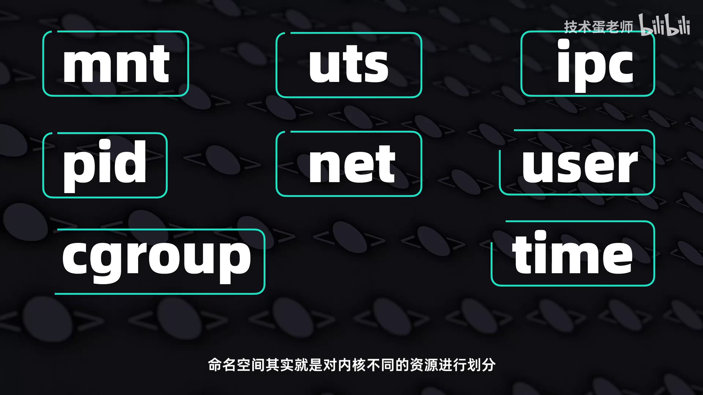

它们分别是：

- `mnt`：挂载点，`uts`：主机名与域名，`ipc`：进程间通信，
- `pid`：进程号，`user`：用户与权限，`net`：网络栈，
- 还有 `time`（时间）与 `cgroup`（控制组）等。

**命名空间本质上就是对内核的不同资源进行划分。** 本讲只研究其中的 **`net`（网络命名空间）**：它隔离的是**网络栈的"视图"**——网络接口、IP 地址、路由表、防火墙规则。理解了它，对 Linux 网络的认识会有质的提升。

### 1.2 用 ip 命令和 TCP/IP 五层模型定位

网络命名空间主要是用 **`ip` 命令族**来实现的。用 TCP/IP 五层模型来看，`ip` 命令主要负责**网络层和数据链路层**：

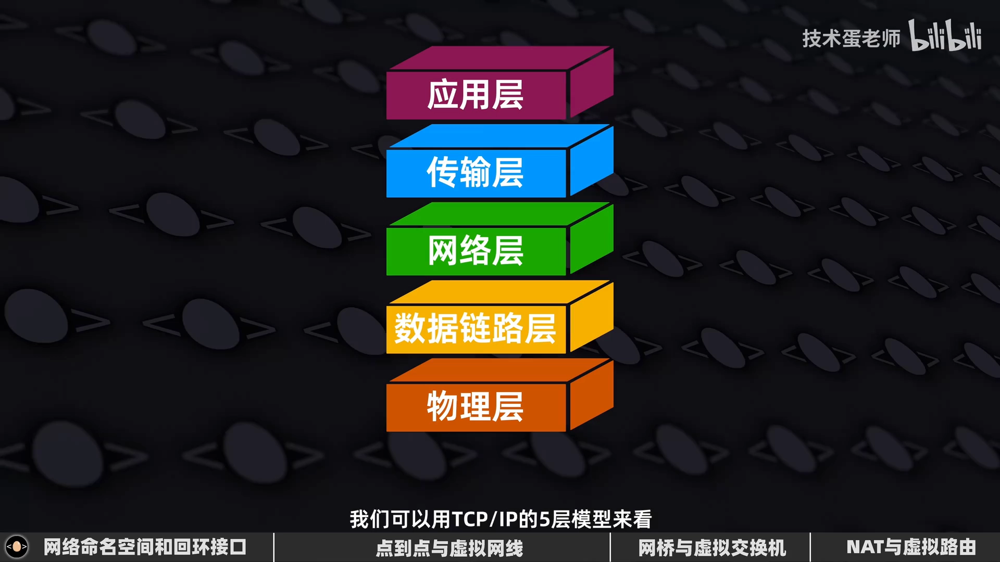

**为什么先看网卡状态，而不是先配 IP？** 因为数据要进进出出，都得靠网卡上的**网络接口（interface）**；接口没起来，配了 IP 也发不出包。所以第一步永远是检查接口状态，用 `ip link`（link 就是"链路"）：

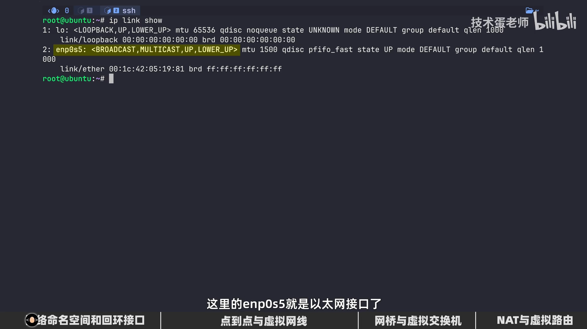

- **`lo`（loopback，回环接口）**：每个程序员都熟悉的虚拟接口，用于让**同一台机器上的程序与程序之间**互相通信。
- **`enp0s5`（以太网接口）**：负责对外通信的物理网卡接口。

两个接口都显示 `UP`——这不是"up 主"的 up，而是告诉我们接口已经启动，随时能对内、对外通信。[【跳转到 01:27】](https://www.bilibili.com/video/BV1Fd5V6VED8/?t=87)

---

## 二、创建网络命名空间：一个被完全隔离的网络"视窗"

### 2.1 创建与罗列

有了上面的概念，就可以创建网络命名空间了，直接用 `ip netns`：

```bash
[root@ubuntu ~]# ip netns add QQ
[root@ubuntu ~]# ip netns list
QQ
```

`netns` 就是 *network namespace* 的缩写，`add` 后面跟上自定义的名字即可。


这个空间的隔离是彻底的：**只有宿主（host）能创建、管理和销毁它**——"要杀要剐全凭你说了算"。

### 2.2 用 ip netns exec 在空间里执行命令

要在某个网络命名空间里执行命令，需要在 `ip netns` 后面加上 **`exec`（execute，执行）** 和空间名：

```bash
ip netns exec QQ ip link show
```

### 2.3 隔离的证明：空间里只有 lo，而且是 DOWN

执行上面的命令，会发现空间里**只有回环接口，没有任何以太网接口**——意味着它无法和外界通信：

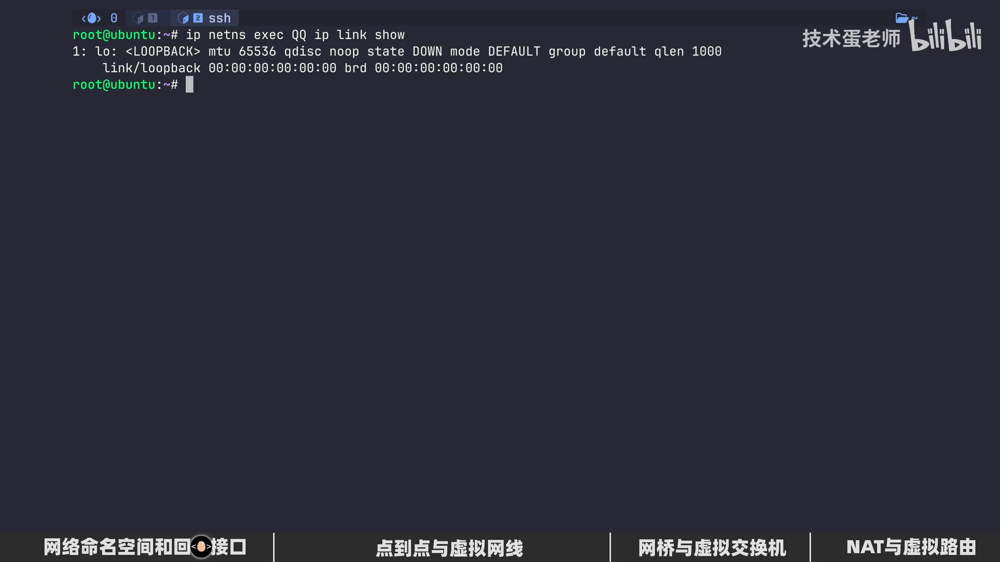

更关键的是，这个回环接口连 `UP` 状态都没有，意味着它**连与自己通信的能力都没有**。视频里打了个比方：这个空间就像被丢进一间没人能找到的牢房，还被《海贼王》里的柯拉松撕掉了隔音壁。

要验证这一点，只需在空间里 ping 一下本地回环地址：

```bash
ip netns exec QQ ping 127.0.0.1
```

结果网络完全不通。这正是隔离该有的样子。**如果你有加密货币私钥，这样的网络隔离就是保护它的步骤之一。**

### 2.4 先打开回环：让空间内部的程序能互相通信

如果需要在**同一个空间里的两个程序**之间通信，就必须把回环接口打开：

```bash
ip netns exec QQ ip link set lo up
```

再查看链路，`lo` 就变成 `UP` 了，`ping 127.0.0.1` 也完全没问题。[【跳转到 03:35】](https://www.bilibili.com/video/BV1Fd5V6VED8/?t=215)

---

## 三、让两个空间连通：虚拟网线 veth pair

### 3.1 类比：两台电脑用一根网线互连

在《红色警戒》的年代，两台电脑联机要么用（贵得离谱的）路由器，要么用（不贵但也不便宜的）集线器，最省事的办法是直接用一根**交叉线**把两台机器连起来。

**要让两个网络命名空间连通，也是同样的思路——用一根"网线"把它们接起来。**

### 3.2 创建 veth pair

先创建两个空间（视频里叫"七度空间"和"八度空间"）：

```bash
ip netns add space7
ip netns add space8
```

然后创建一条**虚拟以太网网线（veth pair）**。它在宿主环境下创建，和真实网线一样**两端各有一个接口**：


```bash
ip link add interface7 type veth peer name interface8
```

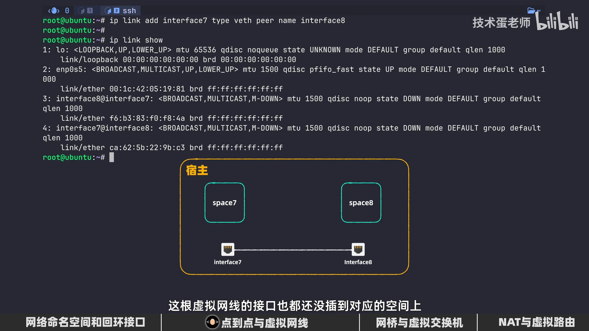

命令要点：

- `type veth`：`veth` 就是 *virtual ethernet*（虚拟以太网）的缩写；
- `peer name interface8`：定义另一端的接口名字。

接口名里的 `@`（如 `interface8@interface7`）表示这是**对等接口**。此时要清醒地意识到：**这根虚拟网线还在宿主这边**，它的接口都还没插到对应的空间上。

### 3.3 把两端分别"插"进空间

用 `ip link set ... netns ...` 把接口放进对应空间：

```bash
ip link set interface7 netns space7
ip link set interface8 netns space8
```


之后在宿主用 `ip link` 查看，会发现这两个接口**已经不在宿主环境里了**。

> 光插上网线还不够——"插了网线不通电也没用"。要用 `ip link set <接口> up` 把两端都启动。

### 3.4 配置 IP 地址与子网掩码

启动了接口，但两个空间都还没有 IP 地址，还是没法用 `ping` 发数据。进入其中一个空间 `ip addr` 查看，会发现只有回环接口有 IP，虚拟网线那一段只有链路层、没有 `inet` 行。

于是逐个空间配置：

```bash
ip netns exec space7 ip addr add 172.20.0.10/24 dev interface7
ip netns exec space8 ip addr add 172.20.0.20/24 dev interface8
```

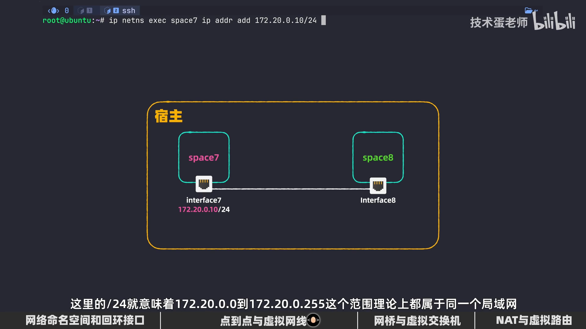

因为打算让两个空间"走局域网"通信，所以要配**内网地址**；另外**千万别忘了加子网掩码**——没有掩码，系统就没法判断数据包该往哪个方向走。

- `/24` 表示前缀长度，等价于掩码 255.255.255.0：地址 `172.20.0.0` 到 `172.20.0.255` 理论上都属于同一局域网；
- 末尾的 `dev` 是 *device*（设备），指明 IP 与掩码要配到**哪个接口**上。

配好后 `ip addr` 就能看到各自的 IP 地址了。

### 3.5 路由表与点到点通信

"虚拟网线不是已经把两个空间连起来了吗，为什么还要配子网掩码？"这里的关键是**路由表**。配好 IP 和掩码后，空间里会自动多出一条本地直连路由：

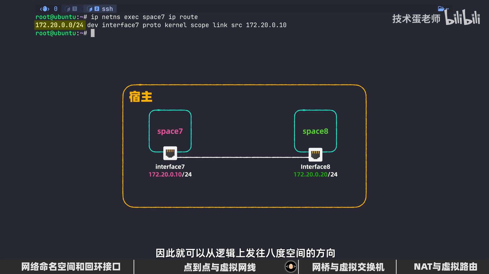

从 space7 访问 space8 的 IP 时，会先查路由表；路由表刚好有这条 `172.20.0.0/24 dev interface7` 的规则，而 space8 就在这个目标网络范围内，于是就"从逻辑上"发往 space8。

```bash
ip netns exec space7 ping 172.20.0.20   # 通
ip netns exec space8 ping 172.20.0.10   # 通
```

这样我们就实现了**点到点（point-to-point）通信**。它经常用在前端与后端的直连通信中——比如在 space8 里起一个 web 服务，space7 就能直接访问。[【跳转到 08:13】](https://www.bilibili.com/video/BV1Fd5V6VED8/?t=493)

---

## 四、点到点不够用：用网桥做"虚拟交换机"

点到点虽然直接明了，但**空间一多就乱套了**——每个空间都要和别的空间拉一根专线，简直比堆在门口的鞋子还乱：

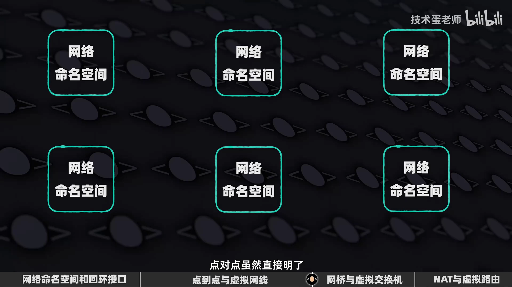

物理世界里解决这个问题的办法是**交换机**：所有设备都接到一台交换机上，由它转发。在网络命名空间的"局域网"里，我们可以用**网桥（bridge）**来实现交换机的功能。

### 4.1 创建网桥

设置网桥和设置虚拟网线是同样的道理，先在**宿主**里用 `ip link add` 添加一个 `bridge` 类型的接口：

```bash
ip link add LiJiaoQiao type bridge
ip link set LiJiaoQiao up
```

把网桥放在宿主里（而不是塞进某个空间），是为了让多个空间都能通过它对外通信。

### 4.2 用 veth 把空间接到网桥上

要把 space7 和网桥连起来，还是一样需要虚拟网线：一端在空间里，另一端**挂到网桥上**：

```bash
ip link add 7-to-bridge type veth peer name bridge-to-7
ip link set 7-to-bridge netns space7
ip link set bridge-to-7 master LiJiaoQiao      # 把接口"插"到网桥上
ip netns exec space7 ip link set 7-to-bridge up
ip link set bridge-to-7 up
```

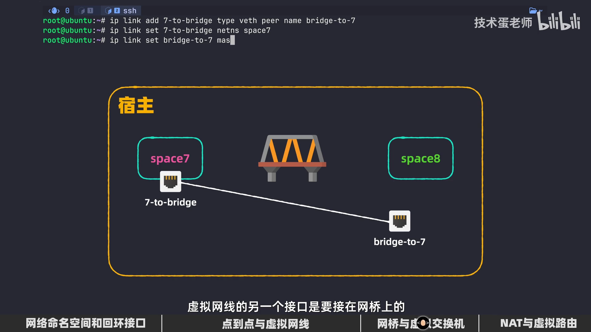

这里的 `master LiJiaoQiao` 就是"把接口归属到网桥"，相当于把网线插到交换机上。space8 用同样的方式再接一根线。

### 4.3 二层交换只看 MAC：网桥本身不用配 IP

到这一步，可能会有人习惯性地也给网桥配一个 IP 地址。其实**这里的网桥相当于二层的交换机，二层设备是看 MAC 地址的**，只要分别给两个空间各自的接口配好 IP 就好——网桥自己不需要 IP：

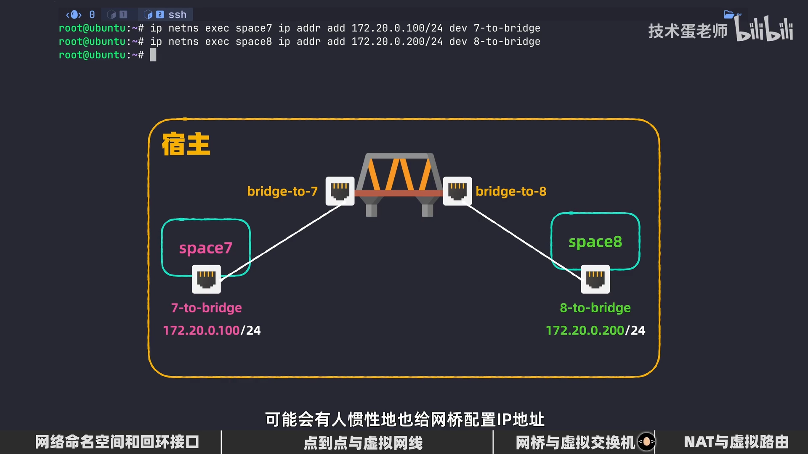

此时从一个空间向另一个空间 `ping`，网桥的作用就体现出来了，**即使有再多的空间也能被"桥接"起来**。[【跳转到 08:48】](https://www.bilibili.com/video/BV1Fd5V6VED8/?t=528)

---

## 五、升级为虚拟路由器：默认路由、转发与 NAT

局域网的问题解决了，但让空间去访问**公网 IP** 还是不行：

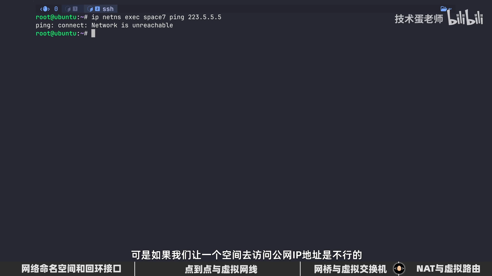

原因是现在的空间还**缺少路由器**。不过我们可以把刚才的网桥"升级"为**虚拟路由器**——虚拟网线都已经插好了，能省掉很多步骤。

### 5.1 给网桥配 IP，让它成为网关

**路由的本质，是根据 IP 地址转发数据包**，所以需要给网桥接口配一个 IP 地址。网桥在宿主里，直接执行：

```bash
ip addr add 172.20.0.1/24 dev LiJiaoQiao
```

一般路由器的 IP 地址最后一组数字都是 `1`，所以这里设为 `172.20.0.1`。

### 5.2 在空间里设置默认路由

空间怎么知道该把包发给网桥、还是发给同局域网里的其他空间？靠**路由表**。路由表里通常要有一条**默认路由**，把不在本局域网的数据包统统发往默认路由：

```bash
ip netns exec space7 ip route add default via 172.20.0.1
```

匹配到默认路由时，还用 `via` 指定**下一跳地址**（这里是刚给网桥配的 `172.20.0.1`）。

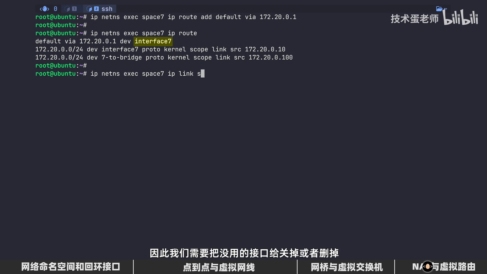

> 视频里踩过一个坑：查看路由表时发现默认路由的接口指向的是"之前点到点的网桥接口"，和现在的虚拟路由器接口不一致。**所以如果你的空间打算改用网桥/路由，建议先把点到点连接全部关掉，以免弄混。**

### 5.3 打开 IP 转发：host 要愿意"帮"空间转发

即使把数据包路由到了宿主，宿主还得**愿意帮你转发**才行。查看 IP 转发开关：

```bash
sysctl net.ipv4.ip_forward      # = 0
sysctl -w net.ipv4.ip_forward=1 # 手动打开
```

默认值是 `0`，意味着宿主**默认不会帮任何数据包转发**。为什么不默认打开？因为**一台默认能转发数据包的电脑一旦被黑，黑客就能借它去攻击同一局域网里的其他设备**。所以需要我们手动设为一。

### 5.4 NAT：让内网地址能"出去又能回来"

数据包终于能出去了，但**出去就回不来**——因为空间里的 IP 是**内网 IP**：目标设备收到内网源地址的包后，根本无法回应；而且内网地址本来就没法在公网里转发。

解决办法是做 **NAT（网络地址转换）**，直接用 `iptables`：

```bash
iptables -t nat -A POSTROUTING -s 172.20.0.0/24 -j MASQUERADE
```

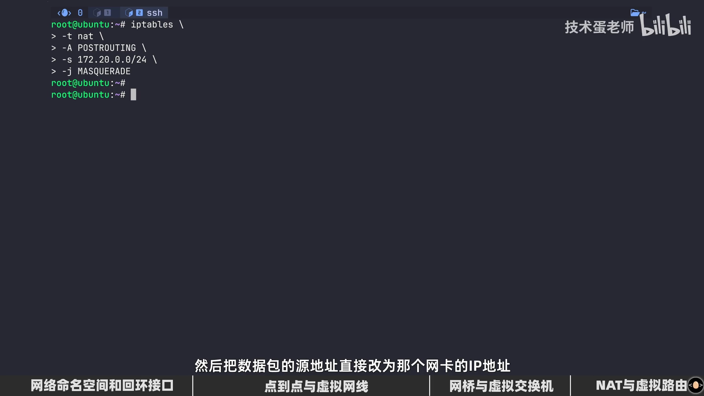

这条规则的每个部分：

- `-t nat`：操作 `nat` 表（`-t` 是 *table*）；
- `-A POSTROUTING`：在 `POSTROUTING`（路由后链）追加规则，这是**数据包离开宿主网卡前的最后一关**（`-A` 是 *append*）；
- `-s 172.20.0.0/24`：限定源地址在 `172.20.0.0`~`172.20.0.255` 范围内（`-s` 是 *source*）；
- `-j MASQUERADE`：执行"伪装"动作——它会**自动找出宿主上能访问外网的那块网卡，把数据包的源地址改成那块网卡的 IP**，于是回包就能按原路返回。

配好后，空间里就能直接访问外部网络了——能 ping 通就说明基本没问题。[【跳转到 14:54】](https://www.bilibili.com/video/BV1Fd5V6VED8/?t=894)

熟悉了这套核心之后，再配合 `iptables` 做**端口转发和网络安全隔离**就很简单了。

---

## 小结

- **网络命名空间**隔离的是网络栈的"视图"：接口、IP、路由表、防火墙规则；一个新建的空间里只有 `lo`，且默认 `DOWN`，完全无法与外界通信。
- **回环接口要手动 `up`**，否则连空间内部的两个程序都无法互通。
- **veth pair 是一根虚拟网线**：先在宿主创建（`ip link add ... type veth peer name ...`），再分别 `ip link set ... netns ...` 插进两个空间，最后 `up` 并配 IP。
- **子网掩码决定路由表**：`/24` 会生成一条本地直连路由，让空间知道往哪发。
- **veth 只适合点到点**；空间一多就要换成**网桥（虚拟交换机）**，用 `master` 把 veth 挂到桥上，网桥本身是二层设备、不用配 IP。
- **网桥配了 IP 就变成虚拟路由器（网关）**；空间里要加**默认路由**（`ip route add default via ...`）。
- **host 必须打开 `net.ipv4.ip_forward=1`** 才肯帮空间转发；默认关闭是为安全。
- 内网地址出网要靠 **NAT**（`iptables -t nat -A POSTROUTING -s ... -j MASQUERADE`），让源地址被自动改写。

**一句话**：Docker 的"容器网络"并没有黑科技，它就是用**网络命名空间 + veth pair + 网桥 + 虚拟路由器 + NAT** 这些积木拼出来的。

## 关键术语速查

| 术语 | 一句话解释 |
| --- | --- |
| 网络命名空间（netns） | 内核对网络栈的隔离"视图"，每个空间有独立的接口、IP、路由与防火墙 |
| `ip netns add/list/exec` | 创建 / 罗列 / 在命名空间内执行命令 |
| `ip link` | 查看与设置网络接口（链路层）状态 |
| `lo`（loopback） | 本机回环接口，供同机程序间通信 |
| veth pair | 一对虚拟以太网接口，像一根网线，一端进包另一端就出包 |
| `ip addr add .../24 dev ...` | 给接口配 IP 和子网掩码 |
| 路由表 / 默认路由 | 决定数据包往哪个方向走；默认路由兜底所有"非本局域网"的流量 |
| 网桥（bridge） | 二层"虚拟交换机"，按 MAC 地址在端口间转发 |
| `master <bridge>` | 把接口归属（插入）到网桥上 |
| `net.ipv4.ip_forward` | 宿主是否愿意代为转发数据包，默认 0（关） |
| NAT / MASQUERADE | 网络地址转换；MASQUERADE 自动把源地址改为出网网卡的 IP |
