# Linux 网络命名空间概述：从"隔离的悖论"到内核网络模型

> 本文整理自 B 站视频《Linux网络命名空间概述》（Linux小兵）。它不讲怎么敲命令，而是从内核的设计逻辑出发，回答一个看似矛盾的问题：**既然命名空间是为了隔离，为什么我们建好墙之后第一件事就是要在墙上打个洞？**

## 本讲要解决的核心问题（SCQA）

**背景**：网络命名空间（network namespace）是 Linux 用来做网络隔离的机制，Docker 这类容器技术正是靠它把每个容器"关进"各自独立的网络世界。

**冲突**：可既然初衷是**隔离**——建一堵墙，为什么我们紧接着就要用 veth pair（虚拟网线）在墙上**打一个洞**，让它能和外面通信？这个设计看起来自相矛盾。

**疑问**：veth 能跨越命名空间边界，到底是一个**巧妙的功能**，还是隔离模型的**一个 bug**？

**回答（中心思想）**：它是**经过深思熟虑、不可或缺的必然设计**。顺着这个悖论往下追，你会发现 Linux 网络设计的核心并不是"虚拟化"，而是一种**重构**——它把现实世界里的主机、网卡、网线、交换机、路由器，全部搬进内核、用软件重新实现了一遍。

---

## 一、隔离的悖论：为什么隔离的墙还要开一扇门

视频用一个"反直觉"的现象开场：网络命名空间被设计出来的初衷就是隔离，就是为了建一堵墙。**那为什么我们建好墙之后，第一件事就是想方设法在墙上打个洞，让它能和外面通信？**

这里的关键组件就是 **veth pair（虚拟以太网设备）**——你可以把它理解成一根**虚拟网线**：

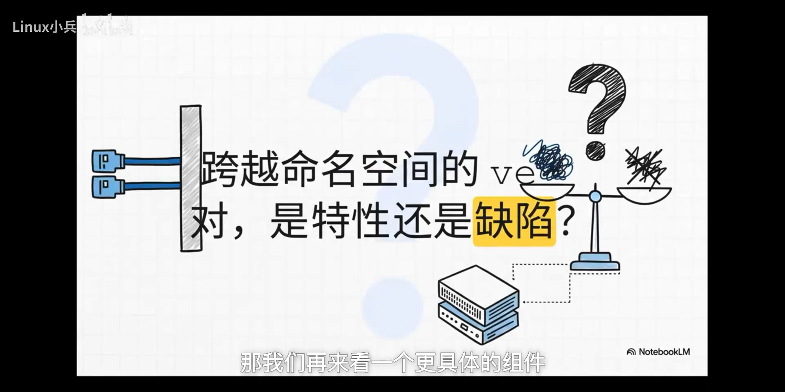

它的存在，**就是为了跨越命名空间的边界**。这就让人纠结了：它到底是巧妙的功能，还是隔离模型的 bug？要解开这个谜题，得先返璞归真，看看内核到底给了我们哪几块最基本的"积木"。

---

## 二、内核的构建模块：struct net 与 net_device

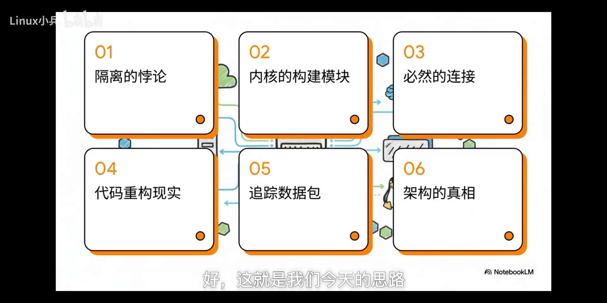

### 2.1 第一块积木：struct net（网络命名空间）

在内核里，网络命名空间对应的结构体是 **`struct net`**。理解它最好的方式，是把它想象成一个**独立的网络视窗**：

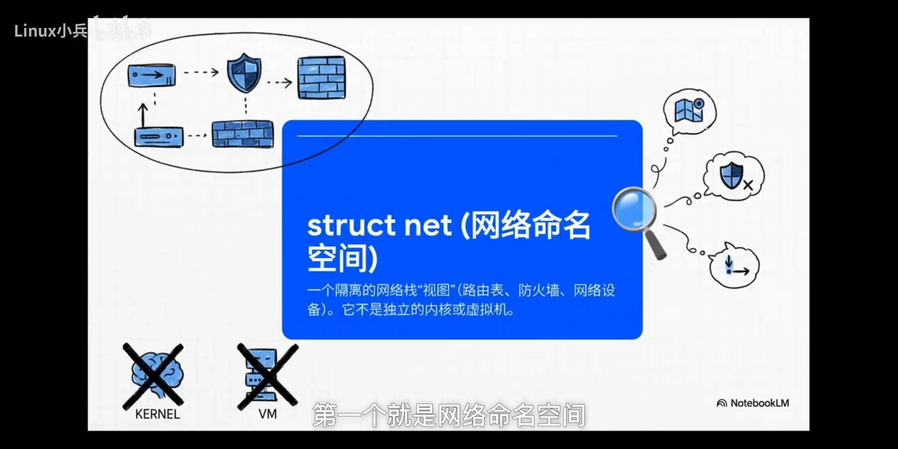

在这个视窗里，你有**自己独立的路由表、防火墙规则、网络设备**，一切都是独立的。但关键点在于：

> **它不是一个独立的内核，更不是一台虚拟机——它只是同一个系统里的一个"不同视角"而已。**

### 2.2 第二块积木：net_device（网络设备）

第二块积木是 **`net_device`**，这个概念很重要：

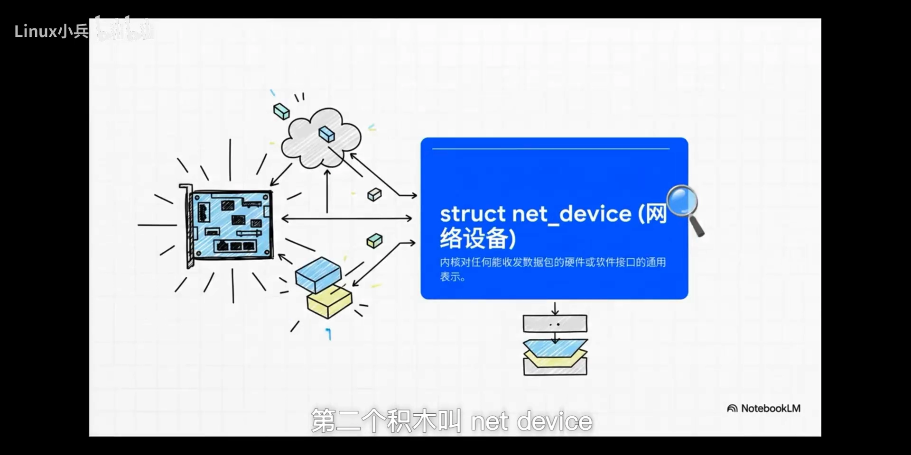

在内核的世界里，**不管是什么，只要能收发数据包，它就是一个 `net_device`**：

- 你的物理网卡是它；
- 无线网卡也是它；
- 前面提到的那个虚拟的 **veth 接口，还是它**。

`net_device` 就是内核对**所有网络接口的通用抽象**。

### 2.3 铁律：一个 net_device 只能属于一个 netns

接下来是最关键的一条规则——一条**不可打破的铁律**：

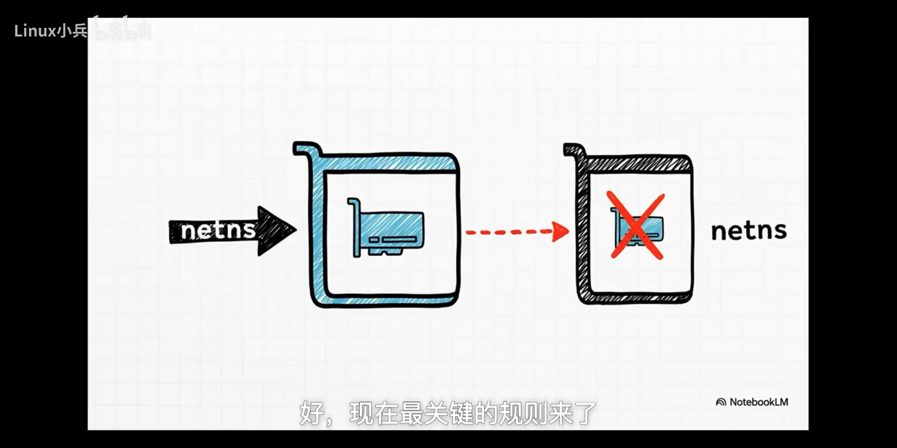

> **每一个 `net_device` 必须、也只能属于一个网络命名空间，没得商量。**

这其实很好理解：想想物理世界里，**一块网卡能同时插在两台电脑上吗？不能。** 内核里的逻辑和现实世界完全一样。

---

## 三、必然的连接：veth 能跨越边界是设计必需

了解了基本规则，视频做了一次**思想实验**，用的是一套很经典的逻辑方法——**反证法**：

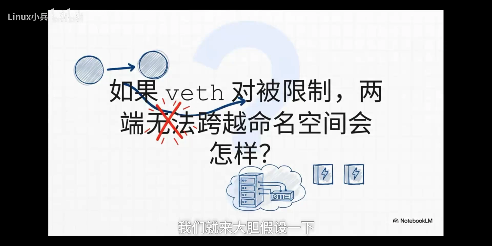

**假设**：veth pair 必须严格遵守命名空间的边界，它的两端绝对不能被放到不同的命名空间里。

**那会发生什么**？结果对于整个 IT 基础设施来说简直是一场灾难：

1. 两个独立的命名空间会真的成为**孤岛**，它们之间没有任何办法直接相连；
2. 我们今天所说的**容器间网络直接就无法实现**；
3. 更根本的是，**可能连模拟现实世界里最简单的东西——一根网线的能力——都失去了**。

于是结论就出来了：

> **veth 能够跨越命名空间边界的能力，根本不是什么设计缺陷或漏洞，而是一个经过深思熟虑、不可或缺的必然设计。**

也正是这一点，为我们揭开了理解整个 Linux 网络设计的**最核心的理念**。[【跳转到 04:01】](https://www.bilibili.com/video/BV19pfjBmEP1/?t=241)

---

## 四、代码重构现实：物理世界与内核对象一一对应

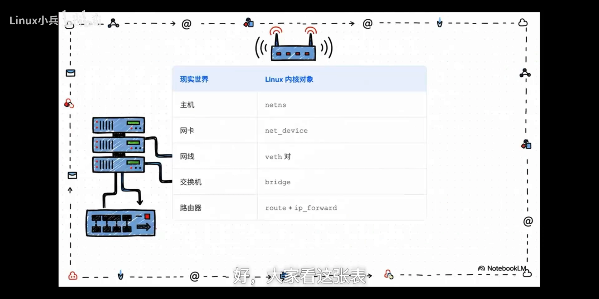

这就是关键。**Linux 网络设计的核心，不是我们通常想的那种"虚拟化"，而更像是一种"重构"**——它是在用软件，把我们熟悉的物理网络世界在内核里重新搭建了一遍：

| 现实世界 | Linux 内核对象 |
| --- | --- |
| 主机 | `netns`（网络命名空间） |
| 网卡（NIC） | `net_device`（网络设备） |
| 网线 | **veth 对**（veth pair） |
| 交换机 | `bridge`（网桥） |
| 路由器 | `route` + `ip_forward` |

也就是说：

- 一个 `netns` = **一台电脑**；
- 一个 `net_device` = **这台电脑上的一块网卡**；
- 一根 veth pair = **一根实实在在的网线**；
- 一个 `bridge` 设备（比如我们熟悉的 `docker0`）= **一台二层交换机**。

**所有物理世界的组件，在内核里都有对应的软件实现。**

---

## 五、追踪数据包：一个 skb 的六步旅程

这个模型到底对不对？视频的办法是**实际检验**——追踪一个数据包在内核里的旅程。这个数据包在内核里叫 **`skb`（socket buffer）**：

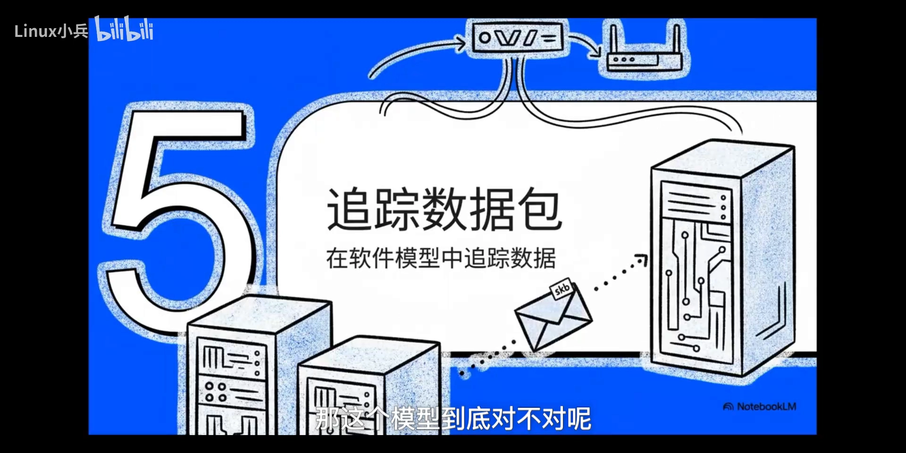

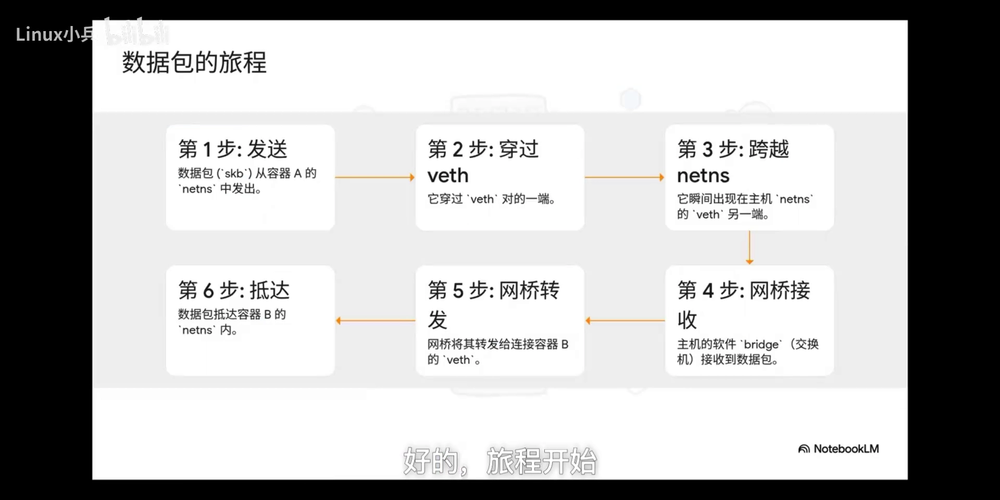

1. **发送**：一个应用程序在**容器 A 的 `netns`** 里发出一个数据包（skb）。
2. **穿过**：这个包首先到达容器 A 的虚拟网卡，也就是 **veth pair 的一端**，它穿过这根虚拟网线。
3. **跨越**：包会**瞬间出现**在它的另一端，也就是**主机的 `netns`** 里。怎么做到的？因为在**内核里，这两个 `net_device` 通过一个 peer 指针互相连接**，数据包的传递几乎是**零成本的内存操作**。
4. **接收**：包到了主机，被**软件网桥 `bridge`（交换机）**接收。
5. **转发**：网桥查看包的**目标 MAC 地址**，把它从正确的端口发出去——而这个端口正好连着**通往容器 B 的那根 veth**。
6. **抵达**：skb 最终到达**容器 B 的 `netns`**。

**整个过程完美复刻了物理世界。**

### 二层与三层：各司其职

这个旅程还引出了网络世界里一个至关重要的区别——**二层与三层**：

- **`bridge` 是一个二层设备**，像个交换机：它的工作是连接**同一个子网**里的设备，只关心 **MAC 地址**。
- 如果你想连接**不同的网络**（比如从一个节点上的容器网络连到另一个节点上的容器网络），**光靠 bridge 就不行了**，这时就需要三层的功能——**路由（`IP forwarding`）**上场，它关心的是 **IP 地址**。

二层和三层各司其职，**和物理世界一模一样**。

---

## 六、架构的真相：三条结论

顺着这条完整的逻辑链走下来——从一个悖论出发，到追踪一个数据包的旅程——终于可以总结出 Linux 网络背后真正的架构思想：

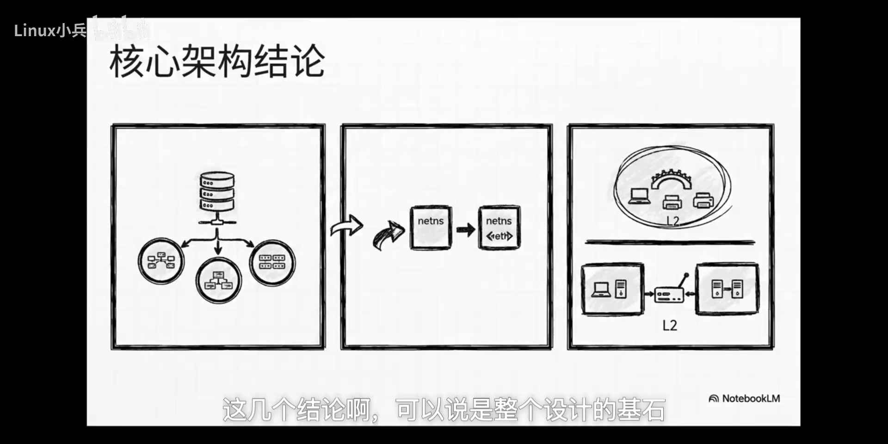

1. **`netns` 隔离的是网络的"视图"，而不是物理资源。** 它不复制网卡、不虚拟硬件，只是给你一个"独立的视角"。
2. **veth pair 不是什么奇怪的黑科技，它就是内核对"一根点对点物理网线"最纯粹的软件抽象。**
3. **二层的 bridge 与三层的 route，职责完全分开、泾渭分明**，就像物理世界里的交换机和路由器一样。

**如果说今天所有内容只能总结成一句话：**

> **Linux 并没有发明一种全新的网络，它只是把我们已经非常熟悉的物理网络里的所有组件——主机、网卡、网线、交换机、路由器——都搬进了内核，用代码重新实现了一遍而已。**

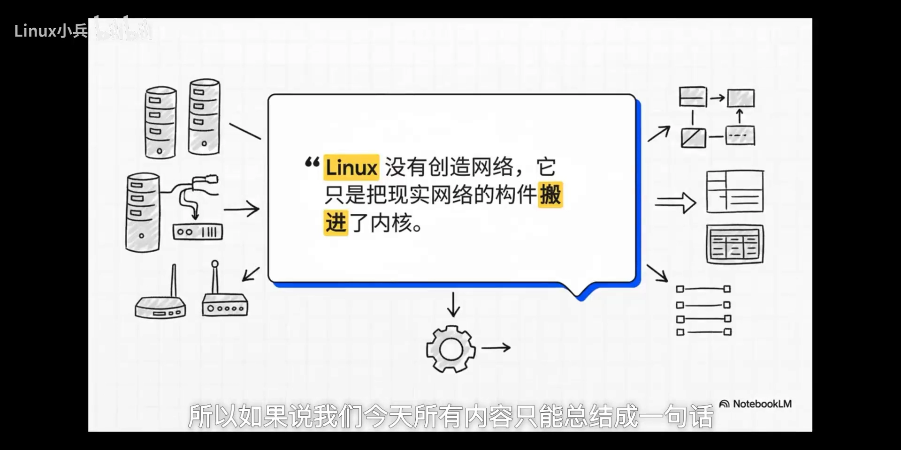

这就留下了最后一个、也可能是最有意思的问题：既然你几乎拥有了一个数据中心里所有的网络设备，而且它们都变成了可以在内核里**随意组合的软件**，那么你还能用它们搭建出怎样复杂、强大的网络拓扑呢？

---

## 小结

- **网络命名空间（`struct net`）隔离的是"视图"，不是物理资源**——它既不是独立内核，也不是虚拟机，只是同一系统里的一个独立网络视角。
- **`net_device` 是内核对一切"能收发数据包的接口"的通用抽象**；铁律是：**一个 `net_device` 只能属于一个 `netns`**。
- **veth pair 能跨越命名空间边界，是设计必然而非缺陷**（用反证法可以证明：否则命名空间会成为无法互通的孤岛，容器间网络无从实现）。
- **Linux 网络 = 用软件重构物理网络**：netns↔主机、net_device↔网卡、veth↔网线、bridge↔交换机、route+ip_forward↔路由器。
- **数据包在容器间的旅程完美复刻物理世界**：容器 A 的 netns → veth 一端 → 主机 netns 的 veth 另一端（零成本内存拷贝）→ 软件网桥 → 网桥按 MAC 转发 → 容器 B 的 netns。
- **二层（bridge，看 MAC）与三层（route/ip_forward，看 IP）职责分明**，与物理世界一致。

## 关键术语速查

| 术语 | 一句话解释 |
| --- | --- |
| 网络命名空间（`struct net`） | 内核里一个隔离的网络栈"视图"，有独立的路由表、防火墙与网络设备 |
| `net_device` | 内核对任何能收发数据包的硬件/软件接口的通用表示 |
| veth pair | 一对虚拟以太网接口，像一根网线，可在不同命名空间间传递数据包 |
| peer 指针 | 内核里把 veth 两端直接相连的指针，使跨端的包传递近乎零成本 |
| bridge | 二层"虚拟交换机"，按 MAC 地址在端口间转发 |
| route / `ip_forward` | 三层功能，按 IP 地址转发数据包 |
| skb（socket buffer） | 内核里表示"一个数据包"的数据结构 |
| 二层 / 三层 | 二层看 MAC、管同子网交换；三层看 IP、管跨网络路由 |
