# Docker 网络内部原理：网桥、veth、iptables 与 overlay

> 本文整理自 YouTube 视频《Docker Networking Internals: Bridge, veth, iptables, Overlay》。它要做的只有一件事：把 Docker 网络从"看起来很神奇"拆到"一点也不神奇"。

## 本讲要解决的核心问题（SCQA）

**背景**：容器网络常被当成 Docker 里最"玄"的部分——Docker 装好，容器之间好像自然而然就能通信。

**冲突**：可容器怎么拿到 IP？怎么靠名字找到彼此？外部流量又怎么钻进某一个具体容器？这些没人讲清楚，就只能当成黑魔法。

**疑问**：Docker 网络的底层，究竟是由哪些内核机制拼起来的？

**回答（中心思想）**：Docker 只用**三个概念**（sandbox、endpoint、network）来描述所有网络；而落到 Linux 内核里，无非是**四样东西**——**Linux 网桥**当交换机、**veth pair** 当网线、**netfilter/iptables** 做 NAT 与隔离、**overlay + VXLAN** 负责跨主机。把它们逐层拆开看，一切都顺理成章。

---

## 一、先立一张地图：三个概念

还记得吗？更早的时候，我们给容器一个自己的隔离网络命名空间——一座只有回环接口的孤岛。这次，就是来"造桥"的。

Docker 把网络组织成一套很小的概念，通常叫 **容器网络模型（container network model）**，只有三个词：

- **sandbox（沙箱）**：容器的隔离网络栈，也就是那个网络命名空间——里面装着它的接口和路由；
- **endpoint（端点）**：一个虚拟连接点，可以想象成"一块能插上去的网卡"；
- **network（网络）**：一组能互相通信的 endpoint——一台它们共同接入的**虚拟交换机**。

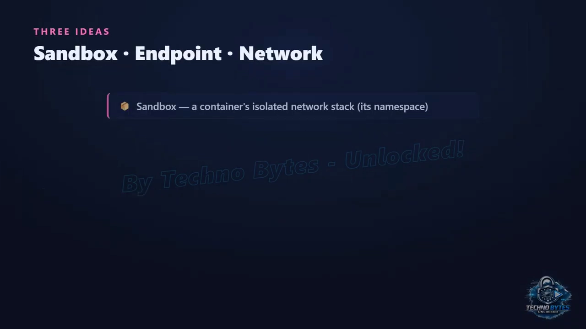

把容器的 sandbox 通过一个 endpoint 连到一个 network，它就能通信了。这套结构之所以重要，是因为它**既能插拔、又始终一致**：同样的三个概念，既能描述简单的单机网桥网络，也能描述复杂的跨主机 overlay 网络——**变的只是底下的实现**。

这也就解释了**为什么 Docker 网络有不同驱动**：`bridge`、`host`、`overlay`、`none`。每个驱动用不同方式实现这三个概念，但你与它们交互的方式是一样的。**模型学一次，之后每种网络类型都看得懂。**

你敲的每一条 `docker network` 命令，都映射到这三个概念上：

- 创建一个网络 = 造一台虚拟交换机；
- 在某个网络上跑一个容器 = 给它的 sandbox 插上一个接入该交换机的 endpoint；
- 把一个容器再连到第二个网络 = 给它加上第二个 endpoint。

以后当你纳闷"为什么这两个容器能或不能互通"时，答案永远是同一句话：**它们的 sandbox 有没有插在同一台网络上？** 这个模型把一团模糊的话题，变成了一个清清楚楚、可以检验的问题。[【跳转到 01:20】](https://www.youtube.com/watch?v=BHW6ghmc_kE&t=80)

---

## 二、网桥：内核里的一台软件交换机

模型给了我们一台"行为像虚拟交换机"的网络。现在来把它真正造出来——因为它是 Linux 内核**实实在在自带**的功能：**软件网桥（software bridge）**。理解它，是理解后面一切的关键。

**Linux 网桥就是一台完全活在内核里的虚拟网络交换机。**

物理交换机有端口，你把网线插进去，它在相连的设备之间转发流量。Linux 网桥做的事**一模一样**，只不过它的端口是虚拟的、网线是软件造出来的。你用一条命令就能建好一台网桥，于是就有了一台可以往上插东西的交换机；它会自己学习"哪台设备在哪"，然后像真交换机一样在它们之间转发。

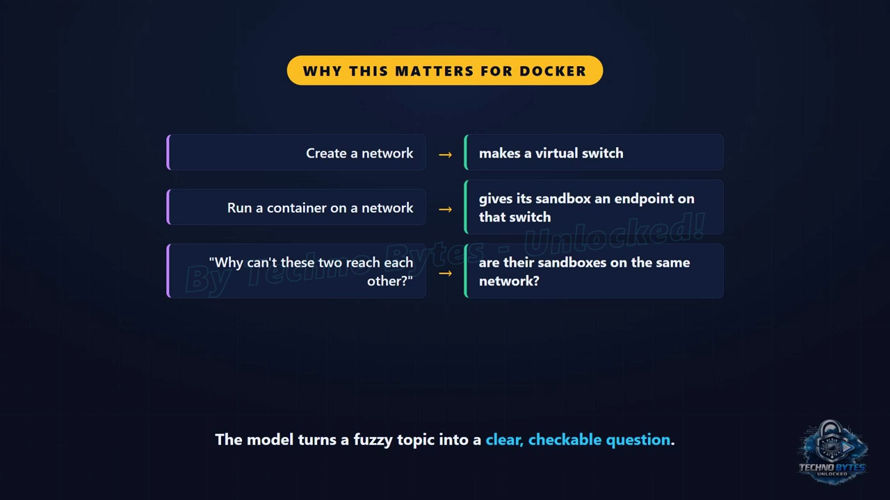

当你安装 Docker 时，它会悄悄在宿主机上创建一台网桥，传统上命名为 **`docker0`**。这就是**大多数容器默认加入的那个网络**：接入它上面的每个容器都会插到这一台交换机上，拿到网桥私有子网里的一个 IP，于是就能访问同一台网桥上的其他所有容器。此外，这台网桥还接向宿主机真实的网络——这正是容器能够访问互联网的原因。

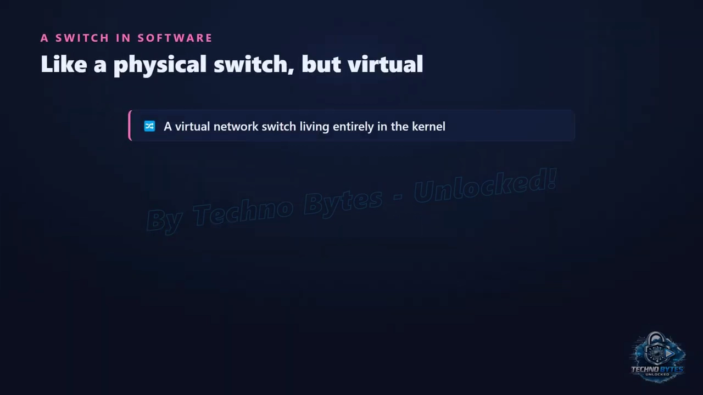

**当你创建一个自己的 Docker 网络时，你其实是在创建另一台网桥、另一台独立的交换机。** 不同网桥上的容器无法直接看见彼此，因为它们插在**不同的交换机**上——这就是 Docker 隔离容器分组的方式：把数据库和应用放在一个自定义网络上，其他网络上的容器就**根本没有通往它们的路**。**独立的交换机，就是独立的世界。**

这还解释了一条容易绊倒初学者的规则：**容器只有在处于同一个自定义网络（同一台网桥）时，才能按名字互相找到。** 这也是为什么推荐"每个应用建一个专用网络"，以及为什么**默认网桥的行为和自定义网桥略有不同**。一旦你把每个 Docker 网络都想象成一台物理交换机，连通性问题自己就回答了自己。

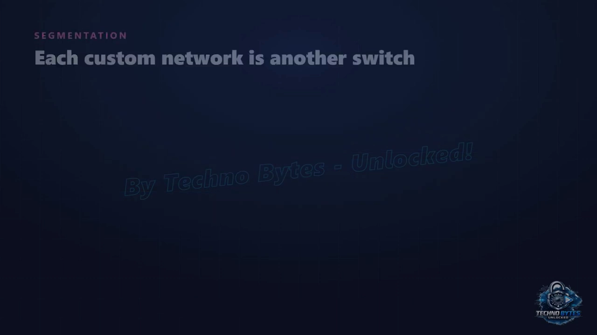

[【跳转到 02:59】](https://www.youtube.com/watch?v=BHW6ghmc_kE&t=179)

---

## 三、veth pair：跨越命名空间的那根网线

现在一边是隔离的容器命名空间，另一边是宿主机上的网桥。我们需要一样东西把它们连起来——**一根跨越命名空间边界的网线**。内核恰好提供了它：**虚拟以太网对（virtual Ethernet pair）**，这个不起眼的小东西，是容器网络的关键一环。

**veth pair 被创建成一对相互连接的网络接口**，而且妙就妙在：**从一端进去的东西，会瞬间从另一端出来**——它是一根软件造的"跳线"。你创建这对接口，然后把一端放进容器的网络命名空间，把另一端留在宿主机上。于是，**一条横跨隔离边界的线就出现了**：容器送进自己那端的包，会从宿主机那端冒出来，反之亦然。孤岛终于有了通往大陆的桥。

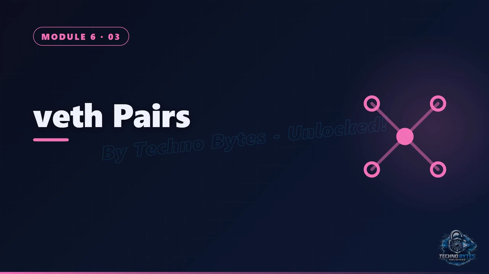

只有一端还不够：

- **容器那一端**成为容器里的网络接口——你在容器里会看到像 `eth0` 这样的接口（带一个 IP 地址）；
- **宿主机那一端**则被插到网桥上，接入那台虚拟交换机。

所以**完整路径**是：容器接口 → 经 veth pair → 到宿主机 → 进网桥 → 再从网桥到任意其他容器的 veth，或者通往更广阔的外网。**网桥上的每个容器，都有一根属于自己的 veth pair 把它连进来。**

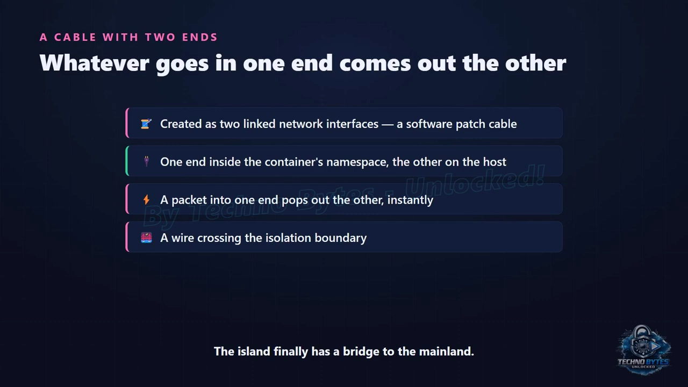

这**正是 Docker 自动为你做的事**：每当一个容器加入网络，它就创建一对 veth，把一端作为网卡移进容器的命名空间，把另一端接到网络的网桥上。当你在宿主机上跑 `ip link`、看到一堆名字古怪的 `veth…` 接口时——**它们就是每个容器那根网线的"宿主机端"**。

[【跳转到 04:18】](https://www.youtube.com/watch?v=BHW6ghmc_kE&t=258)

---

## 四、netfilter / iptables：端口映射（NAT）与网络隔离

现在容器们已经用 veth 网线插上网桥、彼此能说话了，但它们处在一个**私有的、外部世界够不着的子网**里。那么问题来了：**一个从互联网打到宿主机的请求，怎么钻到某个具体容器里去？** 答案是一套我们早就见过的"改写数据包"的机制——**netfilter**，由 **iptables** 来驱动。

### 4.1 发布端口 = 一条改写目的地址的规则

当有人连到你宿主机的公网地址、比如 80 端口时，那个包**根本不知道有容器存在**。必须有人**改写这个包的目的地**，把它重定向到容器的私有地址和端口。这种改写就叫**网络地址转换（NAT, network address translation）**，而它**正是 netfilter 在它的钩子上做的事**。

当你执行 `docker run -p 8000:80` 时，你是在告诉 Docker：**把到达宿主机 8000 端口的流量，送到这个容器里的 80 端口**。Docker 实现它的方式，就是**写一条 iptables 规则**。从此以后，当一个包打到宿主机的 8000 端口，netfilter 就把它的目的地址改写成容器的私有 IP 和 80 端口，内核再把它跨过网桥、穿过 veth、送进容器；**回包则反向改写**。所以外部调用者**永远只看到宿主机的地址**。

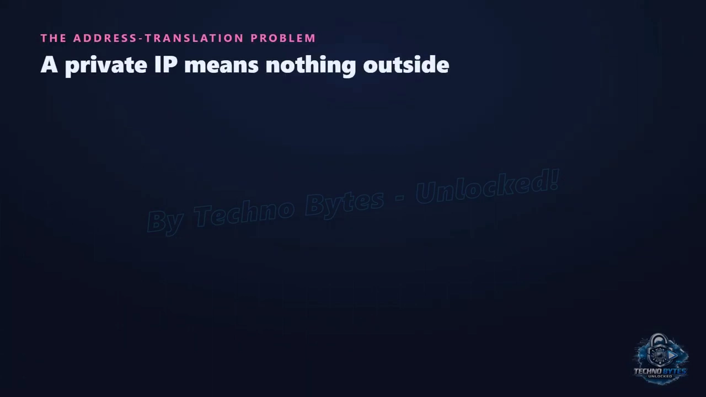

### 4.2 反方向：出网时的"伪装"

同一套机制也处理另一个方向。当容器主动去访问互联网时，它的私有**源**地址会被改写成"看起来像宿主机的地址"，这样回包才能找回来——**这和家用路由器做的 masquerading（伪装）是一回事**。此外，**Docker 的规则还负责隔离**：它们**允许同一网络内的流量、阻断跨网络的流量**，把我们前面说的"分段隔离"真正实现成防火墙规则。

### 4.3 所以 -p 一点都不神秘

这一下就揭穿了这个**用得最多的 Docker 网络功能**：`-p` **不是魔法，它就是一条把宿主机端口重定向到容器的 iptables NAT 规则。** 这也解释了：

- 为什么发布的端口会出现在**宿主机的防火墙规则**里；
- 为什么**两个容器不能发布同一个宿主机端口**；
- 以及为什么懂 NAT，能帮你排查"我进不去我的容器"这类问题。

**当你在宿主机上 inspect iptables、看到那些 Docker 规则时，你读到的正是"外部世界如何抵达你容器"的那套真实管线。**

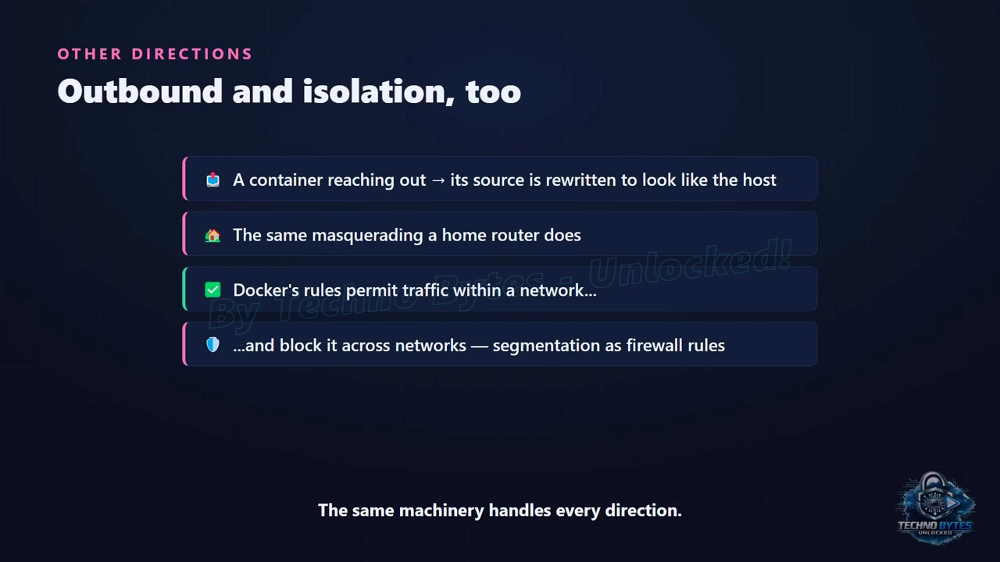

[【跳转到 07:03】](https://www.youtube.com/watch?v=BHW6ghmc_kE&t=423)

---

## 五、overlay：用 VXLAN 把一张交换机铺到多台主机

到目前为止的一切都活在**一台主机**上：一台网桥、若干 veth 网线，再加上 NAT。但真实系统横跨许多机器，一台主机上的容器常常需要和另一台主机上的容器通信，**就像它们共享同一个网络一样**。这就是 **overlay 网络**的工作，它用了一个聪明的把戏——**封装（encapsulation）**。

**网桥是本地的**：一台主机上的网桥，对另一台主机上的网桥一无所知。如果主机 A 上的容器想用私有容器 IP 去够主机 B 上的容器，**是没有路的**——那个私有地址在主机之间的物理网络上根本不可路由。我们需要一种办法，让不同机器上的容器**感觉像在同一台共享交换机上**。办法就是：**把一个网络的包，包进另一个网络的包里。**

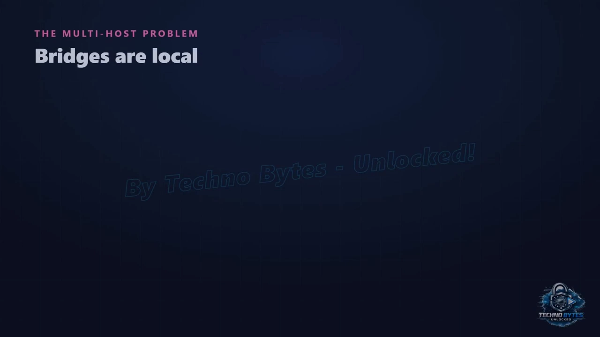

这就是**封装**，而常用的技术是 **VXLAN**。当主机 A 上的容器给主机 B 上的容器发包时，内核把**整个容器包**（连同里面的私有地址）塞进一个**普通的包**里，这个外层包寻址的方向是"从主机 A 到主机 B"，走的是真实网络。主机 B 收到后，**拆开外层**，把里面那个原始的容器包投递给目标容器。**一个包装在另一个包里**——容器网络，就是压在物理网络之上的一层虚拟网络，这正是 **overlay（覆盖）** 的含义。

在封装之上，各主机会**共享"哪个容器在哪台主机"的信息**，于是包就能被正确地封装、发到正确的主机。结果就是：**横跨多台机器的容器，表现得像同在**一个网络上——同一子网、可被按名字找到、对中间的物理机器毫无察觉。往集群里**加一台主机，它的容器就直接加入这个 overlay**。

**overlay 网络是多主机 Docker 的基石**，也正是 Docker Swarm 集群级网络得以实现的原因。当你在 10 个节点上部署一个服务、其容器彼此无缝通信时，那就是一张 **overlay 网络在用 VXLAN 封装它们的流量**。你多半不会手动去配这些细节——但知道"**容器包被包在主机包里**"这个机制，就能把集群网络**从巫术变成可以理解的工程**。

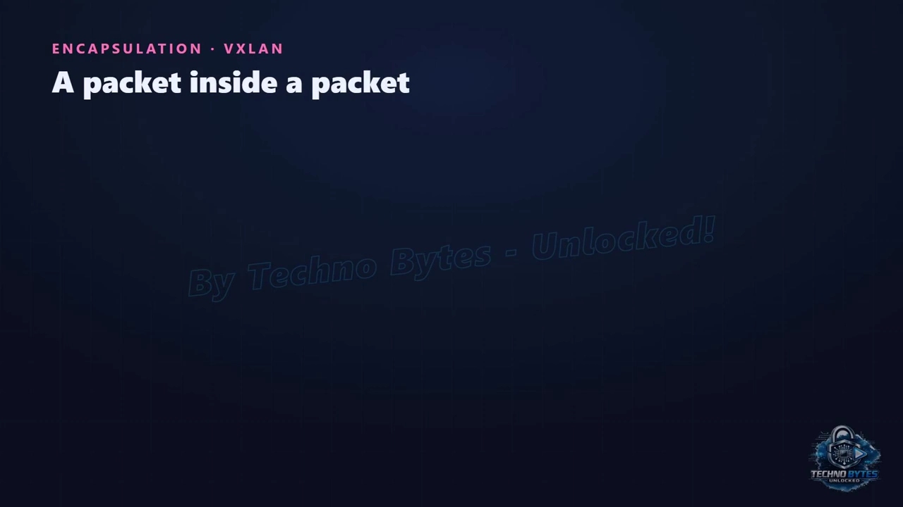

[【跳转到 08:17】](https://www.youtube.com/watch?v=BHW6ghmc_kE&t=497)

---

## 六、动手实验：亲手搭出这条管线，再看一个包跑一趟

最后是动手环节：不借助 Docker，**只用 `ip` 和 tcpdump**，把这套东西手工建一遍，再看着一个真实的包从上面走一趟。

先把管道接好：

- 创建一个网桥（内核里的虚拟交换机）；
- 创建一对 veth（一根两端互通的虚拟网线）：一端挂到网桥上，**另一端推进一个容器命名空间里并命名为 `eth0`**，再给它配 IP `10.0.0.2`。

看一眼：宿主机这侧，我们的网线在网桥上；容器内部，它有它的接口和 IP——**这正是 Docker 为你搭建的那套拓扑**。

接着**看一个真实的包**：在网线的宿主机端开 `tcpdump`，然后在容器里 ping 网桥。抓包一看，**一个来自 `10.0.0.2` 的 echo request 和它的回包都在**——包离开了容器的命名空间、跨过 veth 网线、抵达宿主机，被我们半路逮住。**路径从此不再是理论。**

最后加 NAT，也就是"容器如何连世界、世界如何连容器"的两条规则：

- 第一条：把**出向流量的源地址**从容器私有地址改写成宿主机的——这就是 **masquerade**；
- 第二条：就是 `-p` 背后的那条——它**抓住打向某个宿主机端口（实验里是 8080）的流量，把目的地改写进容器**。

用命令列出规则，**它们就在那里**——正是 Docker 为每一个发布端口装上去的那套地址改写。

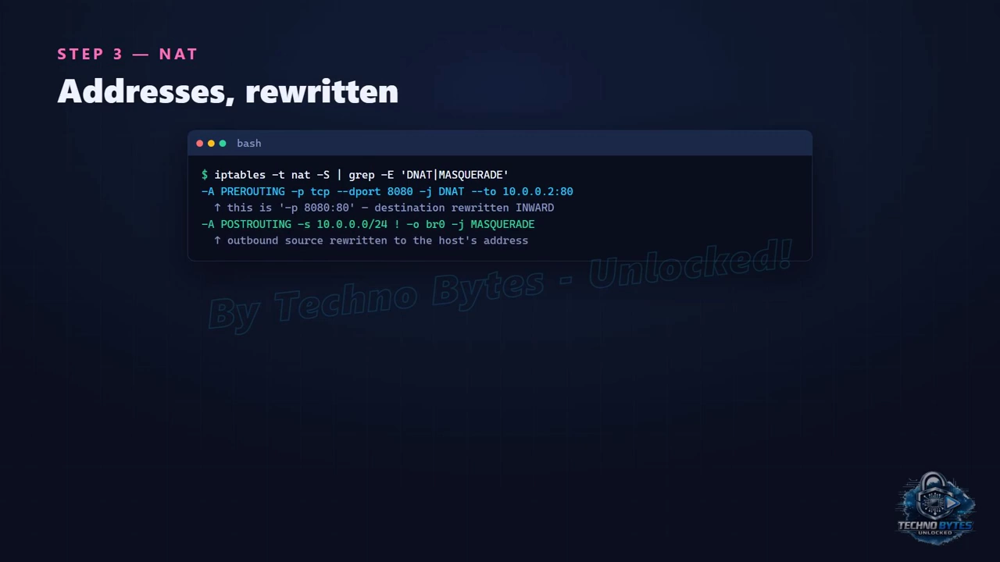

[【跳转到 10:56】](https://www.youtube.com/watch?v=BHW6ghmc_kE&t=656)

---

## 七、回到全局：一切不过是这些内核机制

我们建了一台网桥和一根 veth 网线，把一个容器命名空间接了进来；我们看着一个真实的包 hop by hop 离开容器、出现在宿主机上；我们还看到了让容器"能出去、也能被进来"的那两条 NAT 规则。**容器网络，毫无隐藏。**

退一步总结，Docker 网络就是**三个概念**：

- **sandbox**：容器的网络命名空间；
- **endpoint**：一个端点；
- **network**：一台虚拟交换机。

而落实到内核里只有四件事：

- 交换机是一台 **Linux 网桥**；
- 插进去的网线是一对 **veth pair**，一端在容器里、一端在网桥上；
- 端口映射是**写成规则的网络地址转换**；
- overlay 网络则通过**"把包包进包里"**，把一台交换机铺到许多主机上。

至此，你已经看过了构成一个容器的**每一项内核特性**：命名空间、cgroups、分层文件系统，以及虚拟网络。

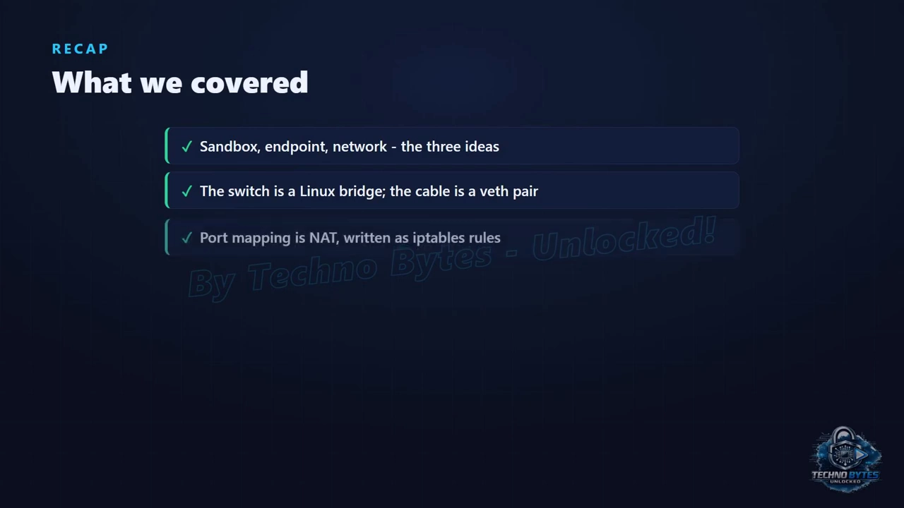

[【跳转到 11:21】](https://www.youtube.com/watch?v=BHW6ghmc_kE&t=681)

---

## 小结

- **三个概念统管一切**：sandbox（网络命名空间）、endpoint（端点）、network（虚拟交换机）；判断连通性只需问"是否插在同一台网络上"。
- **driver 只是实现不同**：`bridge` / `host` / `overlay` / `none` 用不同方式实现同一套概念，交互方式一致。
- **网桥 = 内核里的软件交换机**；`docker0` 是默认网络的那台，自定义网络 = 更多网桥 = 更好的隔离。
- **veth pair = 跨命名空间的网线**：一端进容器成 `eth0`，一端在宿主机接入网桥；Docker 自动为每个容器创建。
- **端口映射是 NAT**：`-p` 就是一条 iptables 规则，把宿主机端口的目的地址重写到容器；出向流量用 masquerade；规则同时承担隔离职责。
- **overlay 用 VXLAN 封装**：把容器包塞进主机包，让多主机容器像在同一张网络里，是 Docker Swarm 集群网络的基石。
- **亲手实验**：用 `ip` + tcpdump 能复现网桥、veth 与两条 NAT 规则，路径不再神秘。

## 关键术语速查

| 术语 | 一句话解释 |
| --- | --- |
| 容器网络模型 | 用 sandbox / endpoint / network 三个概念统一描述所有 Docker 网络 |
| sandbox（沙箱） | 容器的网络命名空间，装着自己的接口与路由 |
| endpoint（端点） | 一块可插拔的"虚拟网卡"，把 sandbox 接到 network 上 |
| Linux 网桥（bridge） | 内核里的软件交换机，`docker0` 就是一例 |
| `docker0` | Docker 默认网桥，默认容器的"市集广场" |
| veth pair | 一对互通虚拟接口，跨命名空间的"虚拟网线" |
| netfilter / iptables | 内核里改写与过滤数据包的框架；NAT 规则的落点 |
| NAT / masquerade | 改写地址：入向 DNAT 做端口映射，出向 masquerade 让容器出网 |
| `-p 8000:80` | 发布端口，本质是一条 DNAT 规则 |
| overlay / VXLAN | 把容器包封装进主机包的跨主机网络技术，集群网络的基石 |
