# Docker 网络模式全解：Bridge、Host、None 到底差在哪

> 本文整理自 B 站视频《【入门篇】Docker网络模式Linux - Bridge | Host | None》（技术蛋老师）。作者故意先把 Docker **卸载掉**，再重新装上——就为了让你亲眼看见：Docker 到底往宿主机里加了什么。

## 本讲要解决的核心问题（SCQA）

**背景**：Docker 装好就能跑，容器网络好像"自动就好了"。

**冲突**：可一旦容器连不上、外部访问不了，你根本不知道从哪查——因为 Docker 背后动了什么手脚，你压根没看见。

**疑问**：Docker 给宿主机加了什么？默认的 `bridge` 网络到底长什么样？`host`、`none` 又各自是什么？

**回答（中心思想）**：Docker 安装时会在宿主机上建一个叫 **`docker0` 的虚拟网桥**，并准备好 **`bridge` / `host` / `none` 三种网络模式**。默认容器接到 `docker0` 上，靠 **veth 网线**连入，既能互相通信、也能出网；但默认网络**不做 DNS 解析**、外部访问还得靠**端口映射**——要更好用，就该换成**自定义 bridge 网络**。把这三种模式的区别搞明白，单机容器网络就通了。

---

## 一、先把 Docker 卸载掉：看清它到底加了什么

视频开头甩出一个反直觉的建议："要理解 Docker 网络，第一件事不是装 Docker，而是**把 Docker 卸载掉**"——当然是玩笑，但用意很实在：**先观察一台干净的 Linux，再看装上 Docker 之后多了什么**，Docker 的手脚就藏不住了。

进入一台没有 Docker 的 Linux，先敲：

```bash
ip address
```

此时主机上只有两个接口：

- **`lo`**：loopback（本地回环），常用来做测试；
- **`enp0s3`**：Ethernet 以太网接口（你的主机可能显示为 `eth0` 或别的名字）。

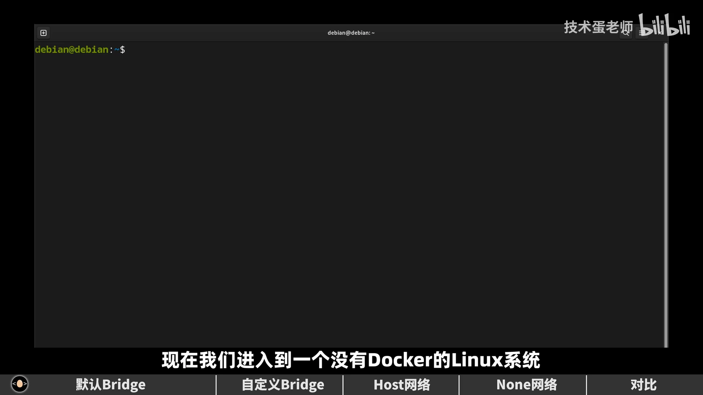

记住：**这台主机目前只有两个接口。** [【跳转到 00:25】](https://www.bilibili.com/video/BV1Aj411r71b/?t=25)

---

## 二、装上 Docker，宿主机上多出一个 docker0

按官方文档装好 Docker 后，再敲一次 `ip address`，会发现**多了一个 `docker0` 接口**，地址一般是 `172.17.0.1`——一个**私有地址**，意味着外部网络不能直接访问它。

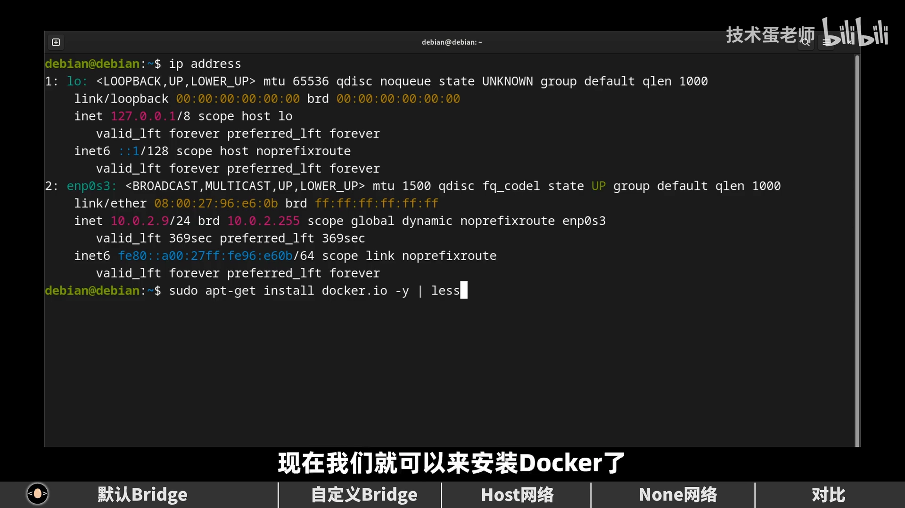

不过光看到一个接口，还证明不了它就是 Docker 建的。我们**从 Docker 身上找答案**：

```bash
docker network ls        # 权限不够就加 sudo
```

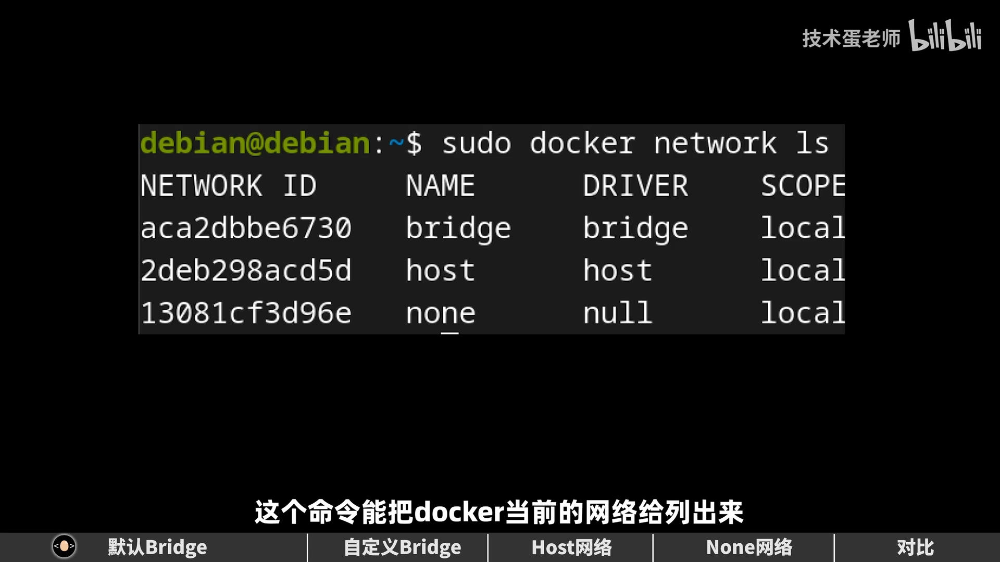

第一次看到结果容易犯晕，先把目光放到 **`driver`（驱动）这一列**：这里有 `bridge`、`host`、`none` 三种不同的驱动，也就是 Docker 提供的**三种网络类型**。装完 Docker，它就用这三种驱动各建了一个网络；因为网络名和驱动名一样，所以看着糊涂也很正常。其中**名为 `bridge` 的就是默认网络**。

[【跳转到 01:32】](https://www.bilibili.com/video/BV1Aj411r71b/?t=92)

---

## 三、解剖默认的 bridge 网络

### 3.1 docker network inspect：看清它的子网和"桥"

用 `docker network inspect` 可以查看某个网络的详情（后面接网络名，结果较长可配 `less`；视频里用 `jq` 提了关键字段）：

```bash
docker network inspect bridge
```

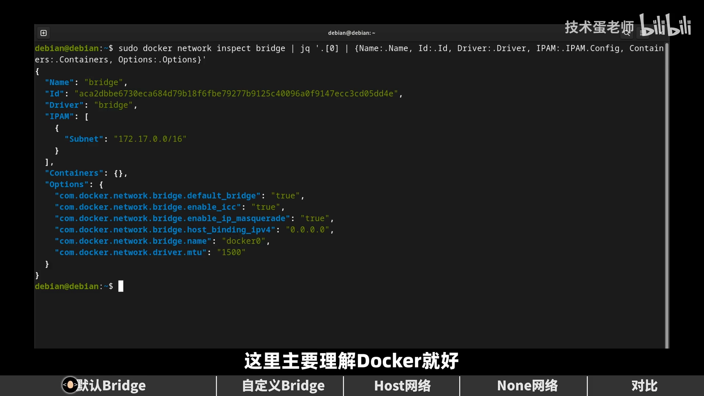

几个关键信息：

- **`name` / `id` / `driver`**：证明这就是我们要检查的那个网络；
- **`IPAM` 里的 `Subnet`**：`172.17.0.0/16`——也就是说 `docker0` 的 `172.17.0.1` 属于这个网络；
- **`Options` 下的 `bridge.name` 是 `docker0`**：这证明 `docker0` 确实是 Docker 生成的；
- **`Containers` 属性为空**：此刻这个网络里还没有任何容器。

[【跳转到 02:38】](https://www.bilibili.com/video/BV1Aj411r71b/?t=158)

### 3.2 创建一个容器，Containers 里就多出 MAC 和 IP

现在创建一个后台运行、并设了主机名的容器 `a1`（用的是自带很多网络工具的镜像）。用 `docker ps` 确认它在运行后，再看 `docker network inspect`：

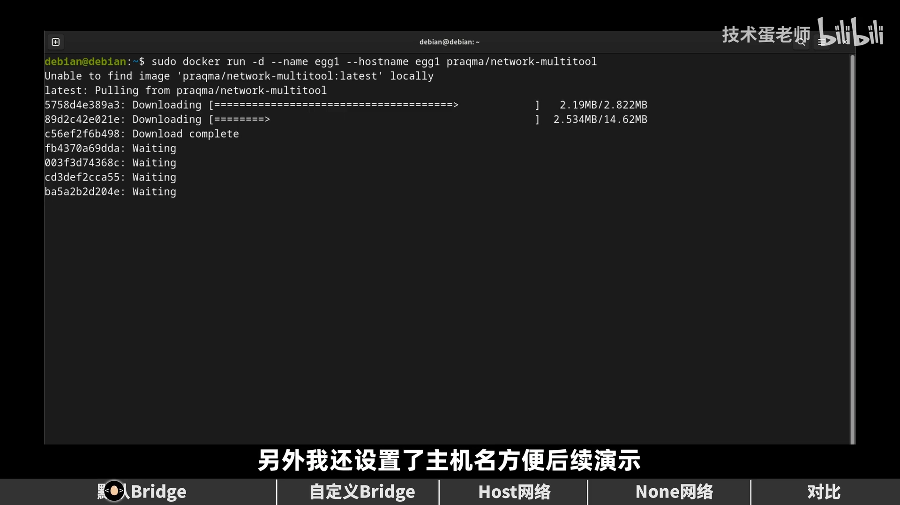

`Containers` 里多了容器信息，名字对得上，还带 **MAC 地址和 IP 地址**，并且这个 IP 确实属于 `172.17.0.0/16` 这个网络。

[【跳转到 03:28】](https://www.bilibili.com/video/BV1Aj411r71b/?t=208)

---

## 四、veth pair：把容器接到网桥上的虚拟网线

### 4.1 宿主机上多出的"怪名字"接口

再回宿主机敲 `ip` 命令，会出现一个有意思的现象：**又多了一个接口**，而且名字一长串、看不懂；更奇怪的是——**接口序号直接从第 4 跳到了第 5，那第 4 个去哪了？**

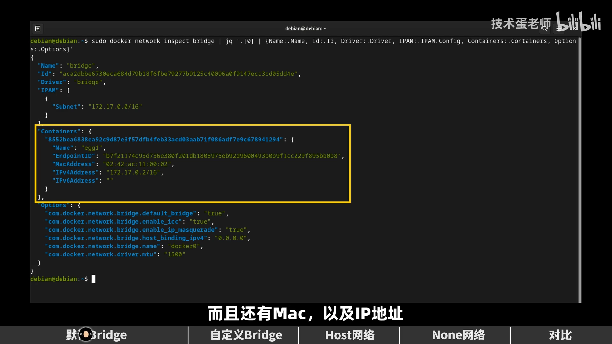

### 4.2 单独看这个接口：master 是 docker0

名字里唯一不陌生的就是 `docker0` 三个字，说明它和 `docker0` 有关系。单独以 JSON 查看这个接口：

```bash
ip -j link show <接口名>
```

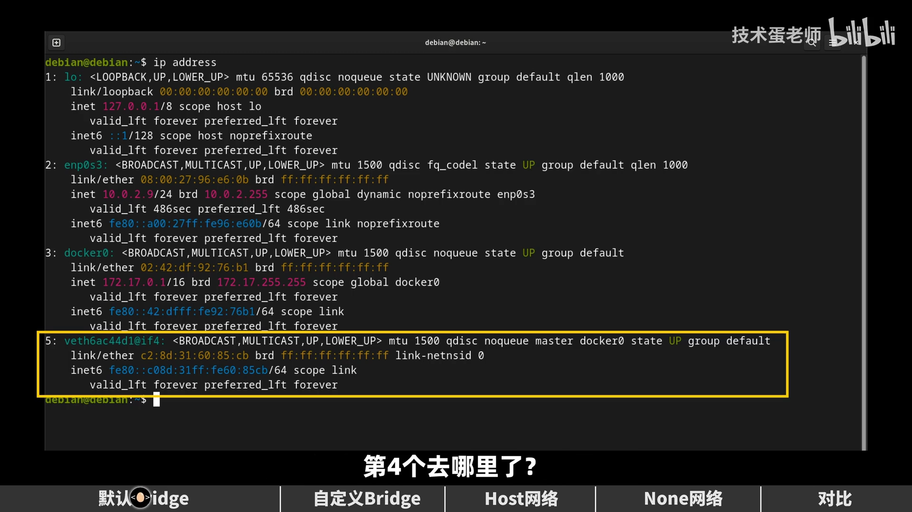

可以看到 **`master` 属性的值是 `docker0`**——也就是说，**`docker0` 是这个新接口的"老大"**（它被挂到了 `docker0` 网桥上）。[【跳转到 04:18】](https://www.bilibili.com/video/BV1Aj411r71b/?t=258)

### 4.3 容器里的那一端：eth0

为了弄清"第 4 个接口去哪了"，进入容器里看 `ip`：能看到 **`eth0` 这个接口，前面序号正是 4**——它会不会就是宿主机上"消失"的那个？而且名字后面还带着 `@if…` 的字符。

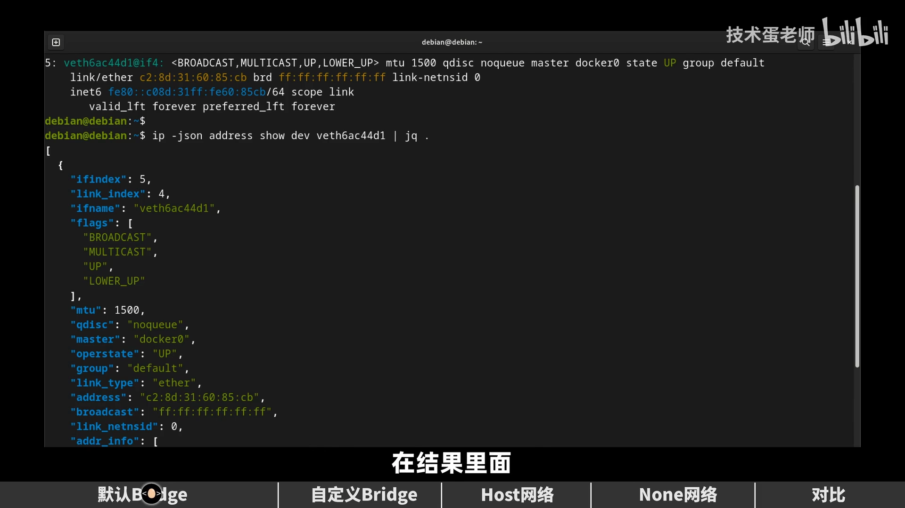

### 4.4 veth = 虚拟以太网（一条虚拟网线）

再看这个接口的详情，挑出两个重点字段：

- **`ifindex`**：interface index 的缩写，即当前接口的序号；
- **`link_index`**：它大概率表示**当前接口正在和哪个接口相连**——为什么这么说？因为这个接口的类型是 **`veth`**。

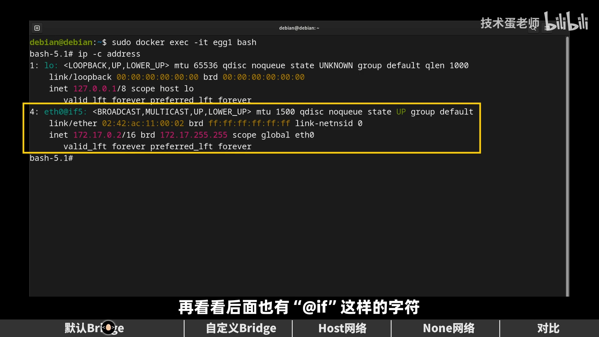

`veth` 是 **virtual ethernet（虚拟以太网）** 的缩写。可以简单地想象成：**有一根虚拟网线，把这两个接口连了起来**——一端在宿主机（那个怪名字接口，`master` 是 `docker0`），另一端在容器里（`eth0`）。容器最终的 IP 也说明它就在默认 `bridge` 网络里。此时**再创建一个容器，它也会自动加入这个默认 `bridge` 网络**。

[【跳转到 05:08】](https://www.bilibili.com/video/BV1Aj411r71b/?t=308)

---

## 五、把这幅图讲清楚

理一下刚刚发生的事：

- 宿主机有一个 `enp0s3` 以太网接口；安装 Docker 后多了一个 **`docker0`**；
- **`docker0` 其实是默认 `bridge` 网络的网关**，容器的数据要出去，得经过 `docker0`；
- 创建新容器时，它**默认就被加入这个网络**；`docker0` 下面会多出一个附属接口，通过 **virtual ethernet** 方式与容器的 `eth0` 相连。

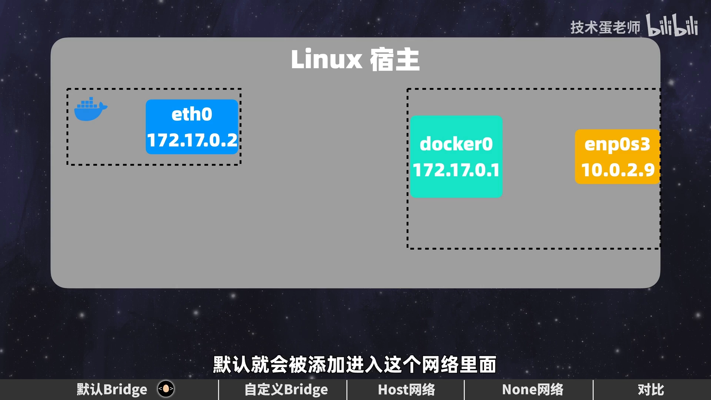

所以这个网络模式叫 **`bridge`（桥）**——**"桥"就是 `docker0`**；而 **virtual ethernet 可以理解为容器各自通往这座桥的路**。正因为有 `docker0` 这座桥，容器里的数据才能抵达宿主机的 `enp0s3`，容器也就能访问外部网络了。

[【跳转到 06:45】](https://www.bilibili.com/video/BV1Aj411r71b/?t=405)

---

## 六、默认 bridge 能做什么、不能做什么

### 6.1 通的：出网、容器互访

进容器实测：

- ping 网关（`docker0`）——没问题；
- ping 常用测试网址——**通了就说明 Docker 允许容器的数据出去**；
- 同一网络里的容器之间互相通信——也没问题。

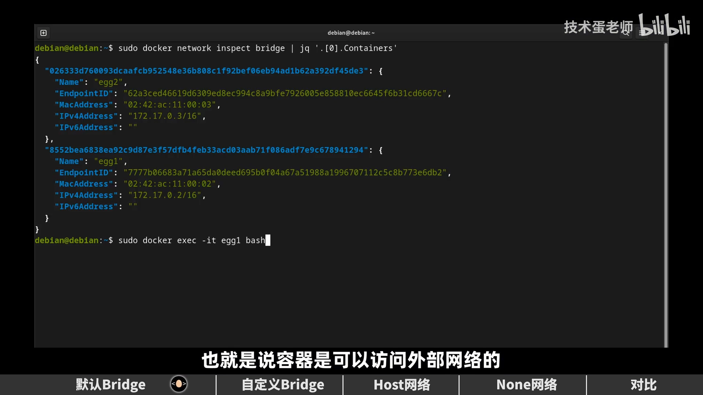

反过来，ping 宿主机也没问题（毕竟都能出网了）；宿主机 ping 容器也 OK。

[【跳转到 07:24】](https://www.bilibili.com/video/BV1Aj411r71b/?t=444)

### 6.2 不通的：按主机名互 ping

创建容器时明明设了主机名 `ex1`、`ex2`，本以为可以直接用主机名 ping——**实际上会出错**。这是**默认 bridge 模式的弊端：它不会自动为容器间做 DNS 解析**。

### 6.3 外部访问容器：必须做端口映射

容器里都是私有地址，外部不能直接访问。要暴露端口，用 `-p` 关联宿主机端口与容器端口：

```bash
docker run -d -p 8080:80 nginx
```

这样访问宿主机的 `8080` 端口，就能看到 NGINX 的默认页面。

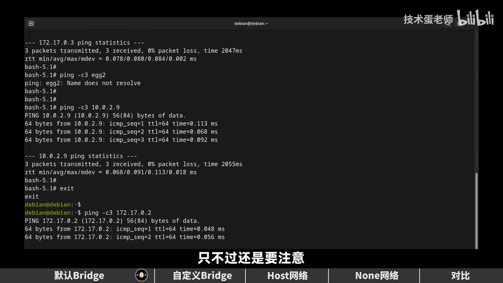

[【跳转到 08:14】](https://www.bilibili.com/video/BV1Aj411r71b/?t=494)

---

## 七、自定义 bridge 网络：顺手补上 DNS 与隔离

既然默认 bridge 不做 DNS，就**自己建一个 bridge 网络**：

```bash
docker network create -d bridge mynet
```

`-d` 后面是要使用的驱动（这里还是 `bridge`），最后给网络起个名字。创建后能在 `docker network ls` 里看到它，驱动和默认 bridge 一样。用 `inspect` 一看，这个网络的网段是 **`172.18.0.0/16`**，和默认 bridge 的 `172.17.0.0/16` 明显不同。

和之前一样，这个网络**也理应有自己的桥**。`ip` 一看，果然多出以 `br` 开头的新接口，名字与新网络 id 相符、IP 也与网关一致——**这就是新网络的桥**。

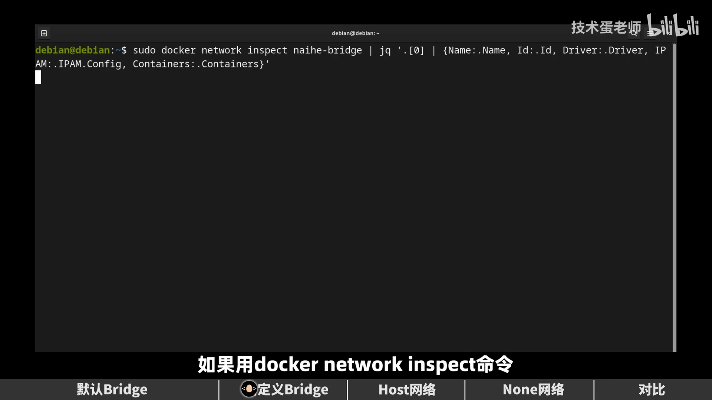

创建容器时用 `--network` 指定加入这个网络，宿主机上照样会自动生成新接口，`master` 指向新的 `br-…`。**这次再进容器用主机名 ping，就没问题了——各种 IP 都正确，说明自定义 bridge 网络的 DNS 起作用了。**

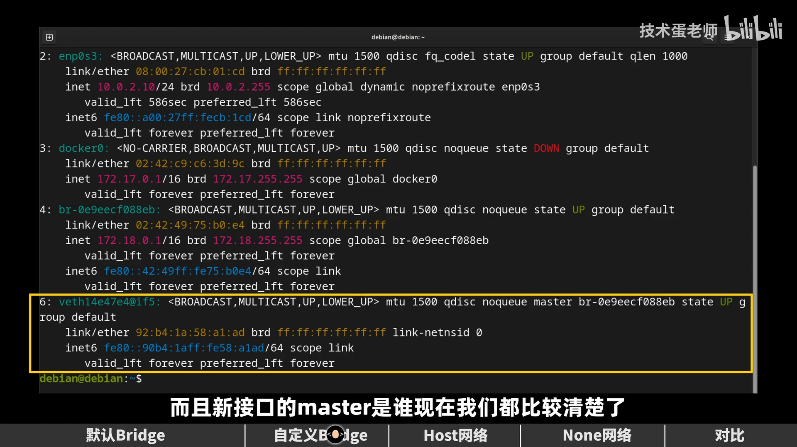

而且更方便的是：**创建容器时甚至可以不用指定 `hostname`，直接 ping 容器名即可**。

[【跳转到 10:22】](https://www.bilibili.com/video/BV1Aj411r71b/?t=622)

---

## 八、host 与 none：另外两种网络模式

### 8.1 host：让容器"合体"成宿主机的一个应用

先说两个删除规则（视频里现场测试）：

- **默认创建的网络不能删**（`docker network rm` 对它们会失败）；
- **`host` 网络也不能自定义**——它**只能有一个，且是默认创建的**。

`inspect` 一下 `host` 网络，会发现**它连 IP 地址都没有**。还有一个有意思的现象：创建容器时想给 `host` 网络做端口映射，Docker 会**直接拒绝端口关联**（容器还是照常生成）。那怎么访问？**根本不用映射**——容器里的服务（比如 NGINX 的 80 端口）会直接开在宿主机上：

```bash
curl localhost
```

就能看到容器的 NGINX 页面。为证明"访问的确实是容器里的东西"，进容器把默认 HTML 文件改掉，再 curl 一次，页面随之变化。

此时在宿主机用 `ip` 看接口，**并没有新增奇怪的接口**；进容器里 `ip` 一看，**输出和宿主机一模一样**——也就是说，**`host` 网络下的容器，直接就成了宿主机的一个应用**。（注意：目前**只有 Linux 的 `host` 网络**能这样，macOS / Windows 不一样。）

[【跳转到 12:30】](https://www.bilibili.com/video/BV1Aj411r71b/?t=750)

### 8.2 none：什么都不连

`none` 网络最好理解——**没有任何网络**。创建容器时用 `none` 指定（**别写成 `nn`**），进去用 `ip` 一看，**只有一个 loopback 接口**，没有以太网接口。也就是说，它根本没打算联网——不信随便 ping 一下，没人理你。

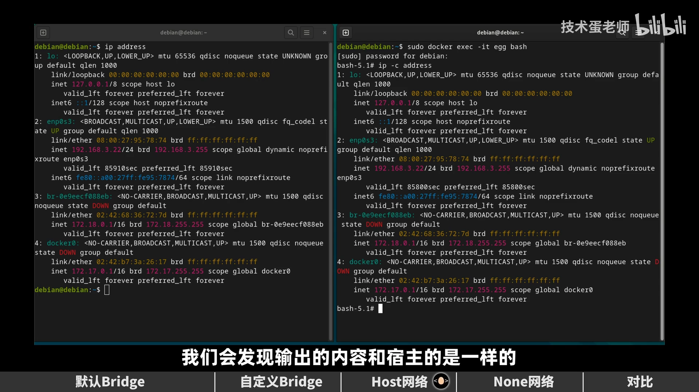

[【跳转到 12:55】](https://www.bilibili.com/video/BV1Aj411r71b/?t=775)

---

## 九、怎么选：三种模式的取舍

- **默认 `bridge`**：只建议**学习**时使用；实际应用建议用**自定义 bridge 网络**——同样是一个网络，但自定义网络**多了自动 DNS 解析**，**不同 bridge 网络之间还能实现更好的隔离**，非常适合在单台宿主机上跑多个容器。
- **NAT 的代价**：正因为网络起到隔离作用，容器里的数据要出来就得做**地址转换（NAT）**；而 NAT 实际会**消耗 CPU、拖低性能**。**不管默认还是自定义 bridge，都有这个问题。**
- **`host`**：**不需要这层地址转换**，因为容器直接和宿主机"合体"了，比较适合**需要高网络性能**的场景；但容器被直接暴露出来，**安全问题也随之增加**。此外，`host` 容器**没有自己的 IP**，在单个容器要处理大量端口时，不必像 bridge 那样逐个端口关联；但**多个容器用同一个端口会冲突**，而且**目前只能在 Linux 主机上实现**。
- **`none`**：完全不能联网，适合**做备份、以及一些需要网络隔离的一次性操作**，也很好用。

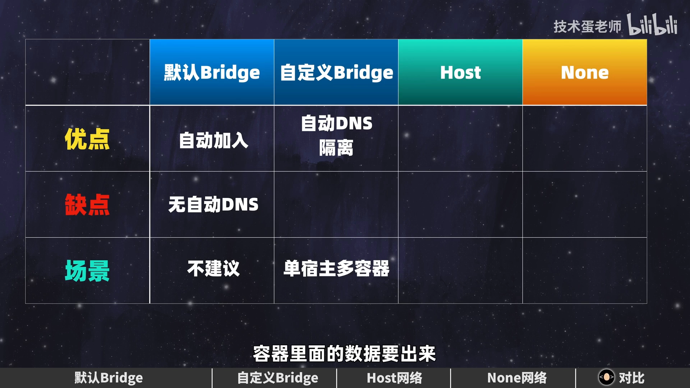

当然，展开来讲优缺点还不止这些，但对入门理解已经足够。[【跳转到 14:26】](https://www.bilibili.com/video/BV1Aj411r71b/?t=866)

---

## 小结

- **先卸载再安装**，是为了看清 Docker 往宿主机上加了什么——多出来的就是 `docker0`。
- **`docker0` 是默认 bridge 网络的网桥（网关）**，地址是私有地址（如 `172.17.0.1`），外部不能直接访问。
- **`docker network ls` 的 driver 列**列出 `bridge` / `host` / `none` 三种网络类型，名为 `bridge` 的是默认网络。
- **veth pair 是"虚拟网线"**：一端在宿主机（`master` 是 `docker0`），一端是容器里的 `eth0`；接口序号 `ifindex` 与 `link_index` 能对上。
- **默认 bridge**：容器能出网、能互访，但**不做 DNS 解析**，外部访问必须**端口映射**。
- **自定义 bridge**：多了**自动 DNS**、更好的**隔离**，是单机多容器的推荐做法。
- **host**：容器与宿主机**共享网络栈**、省掉 NAT，性能好但牺牲隔离与安全，仅限 Linux。
- **none**：完全不联网，适合隔离的一次性任务。

## 关键术语速查

| 术语 | 一句话解释 |
| --- | --- |
| `bridge`（驱动/网络） | Docker 默认网络类型，本质是一个 Linux 网桥 |
| `docker0` | 默认 bridge 网络的网桥，也是容器出网的网关 |
| `host` | 容器与宿主机共享网络栈，不自带独立 IP |
| `none` | 不给容器任何网络，只有 loopback |
| `veth pair` | 一对虚拟网卡构成的"虚拟网线"，连通宿主机与容器 |
| `master` | 接口的归属网桥（谁是这个接口的"老大"） |
| `ifindex` / `link_index` | 接口序号 / 所连接对端的序号 |
| `docker network create -d bridge` | 创建自定义 bridge 网络 |
| `-p 8080:80` | 端口映射：把宿主机 8080 映射到容器 80 |
| NAT | 网络地址转换，让私有地址的容器能出网，代价是 CPU 开销 |
