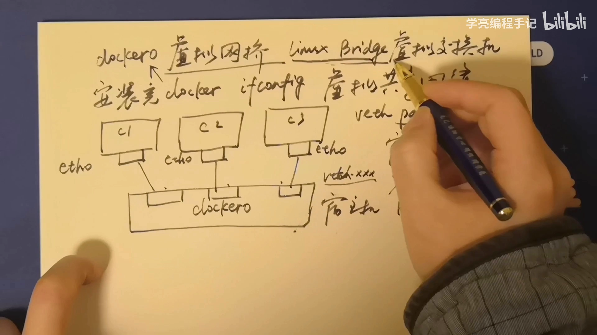
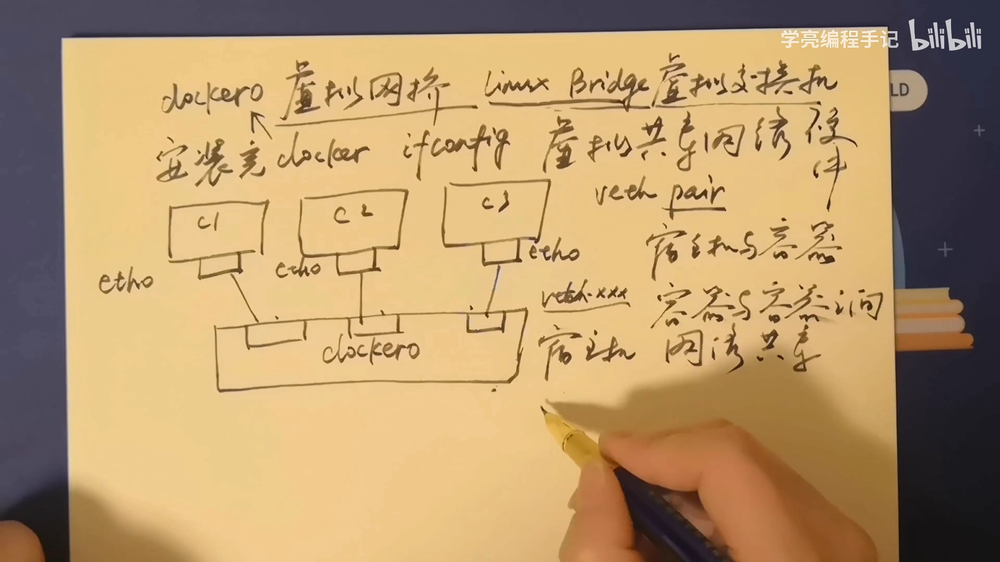
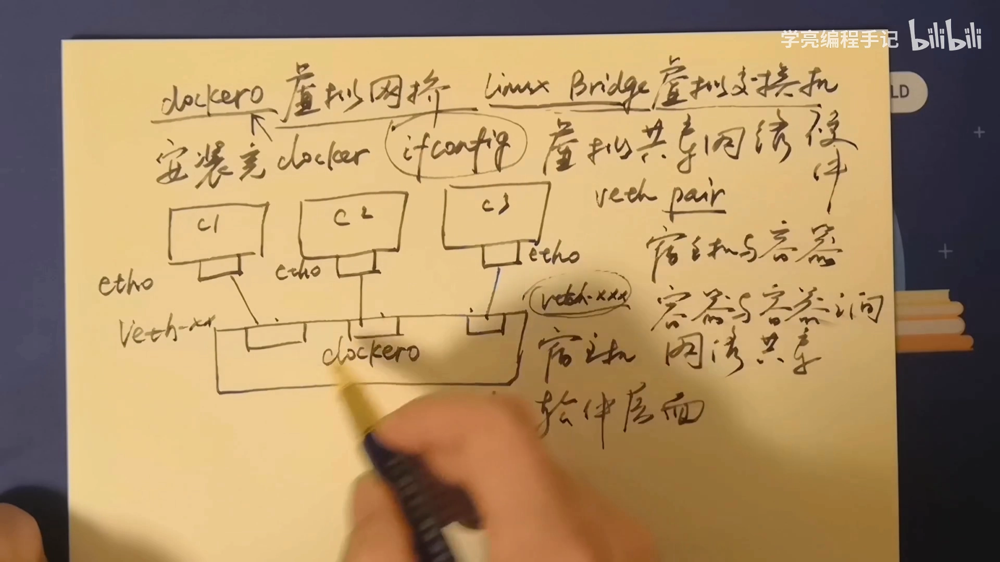
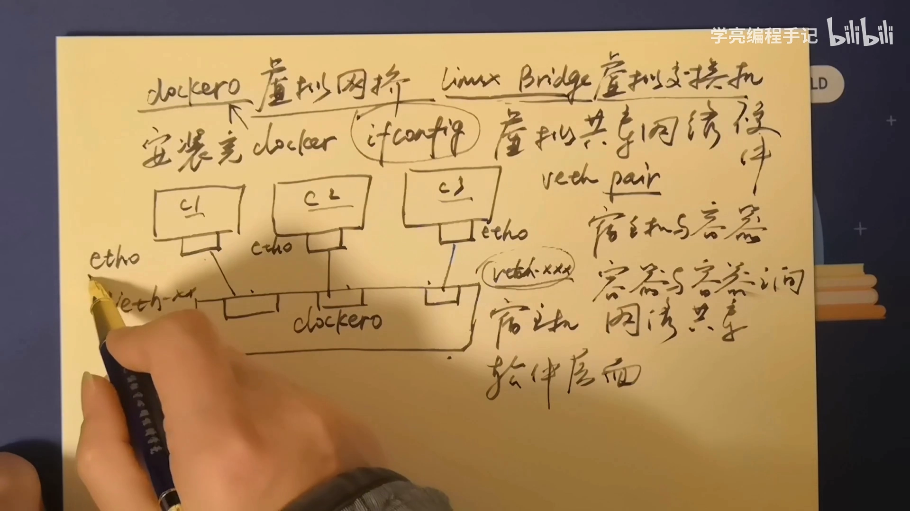
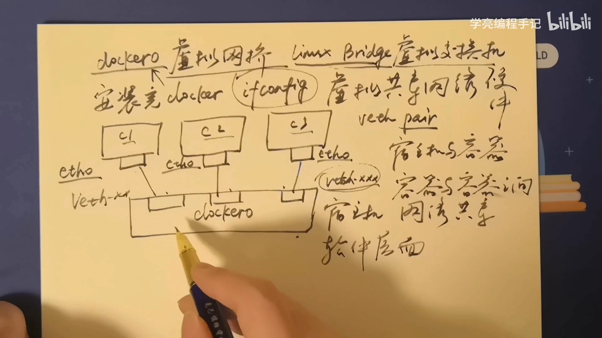
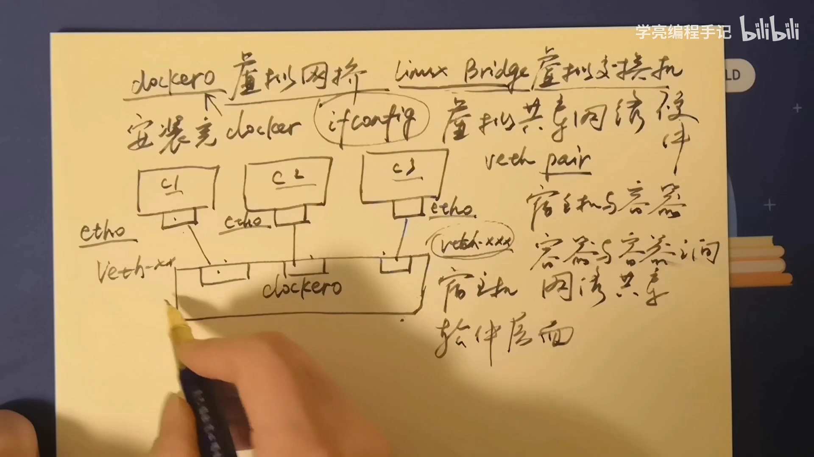
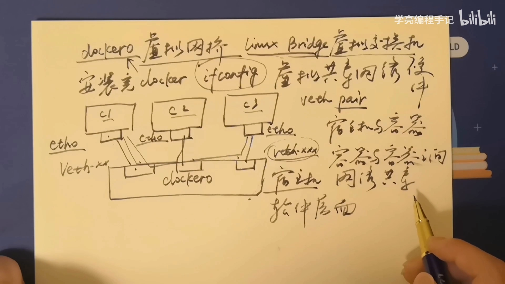

# Docker 虚拟网桥 docker0：容器到底靠什么连在一起

> 本文整理自 B 站视频《【docker教程】docker0虚拟网桥介绍》。全文只想讲清一件事：Docker 里那个叫 `docker0` 的"虚拟网桥"到底是什么，容器之间又是靠什么互相通信的。

## 本讲要解决的核心问题（SCQA）

**背景**：我们平时说的"交换机"，是机房里那种插网线的硬件设备。

**冲突**：可装完 Docker 后，用 `ifconfig` 一看，宿主机上凭空多出一个 `docker0` 接口；此后每创建一个容器，还会多出好几个以 `veth` 开头的接口。

**疑问**：这些接口是什么？容器之间、容器与宿主机之间，究竟是怎么连起来、又怎么互相通信的？

**回答（中心思想）**：Docker 的网络靠的是一台**运行在 Linux 内核里的"软件交换机"——网桥（bridge）**。`docker0` 就是 Docker 默认帮我们建好的那台交换机；每个容器则通过一根 **veth pair（虚拟网线）** 接到这台交换机上。于是宿主机和各个容器就像插在同一台交换机上的设备，可以互相收发数据。这，就是 `docker0` 的全部作用。

---

## 一、Docker 的网桥，本质是 Linux 提供的一台"软件交换机"

### 1.1 硬件交换机能做到的，软件交换机也能做到

我们平时提到的交换机，几乎都是硬件层面的设备；而 Linux 的 **bridge（网桥）** 则是**软件层面**的虚拟交换机。

它虽然是软件实现的，却能完成硬件交换机同样的功能：**把送进任意一个接口的数据包，转发到需要的另一个接口**。所以理解"Docker 网络"，可以从理解这台软件交换机入手。[【跳转到 00:10】](https://www.bilibili.com/video/BV1Hv4y147Xv/?t=10)

### 1.2 为什么先讲 bridge？因为 Docker 自己就是一台虚拟网桥

先讲 bridge 是有原因的：**Docker 本身也是一个虚拟网桥，同样是借助 Linux 的 bridge 来实现的。** 换句话说，看懂 Linux bridge，就看懂了 Docker 网络的地基。

[【跳转到 00:26】](https://www.bilibili.com/video/BV1Hv4y147Xv/?t=26)

---

## 二、安装 Docker 后，宿主机上多出的 docker0 就是那台交换机

装完 Docker 之后，用 `ifconfig` 就能发现，宿主机上已经多出了一个 `docker0` 的虚拟网桥——这就是 Docker 默认创建的那台"软件交换机"。

[【跳转到 00:52】](https://www.bilibili.com/video/BV1Hv4y147Xv/?t=52)

---

## 三、veth pair：把容器"插"到交换机上的那根网线

### 3.1 每创建一个容器，就多出一条虚拟网线

此后每创建一个容器，用 `ifconfig` 都能看到多出以 `v`（也就是 `veth`）开头的一系列接口。它们其实就是把容器接到 `docker0` 上的"网线"。注意：这些是**宿主机侧**的接口，容器内部的接口另有一番样子（见下）。

### 3.2 一条网线，两端分工

一根 veth pair（虚拟网线）有两端，创建容器时会分到两边：

- **一端留在宿主机上**（就是那些 `veth…` 接口），接在 `docker0` 这台虚拟交换机这一侧；
- **另一端伸进容器内部**，成为容器里的虚拟网卡，默认叫 `eth0`。

[【跳转到 01:38】](https://www.bilibili.com/video/BV1Hv4y147Xv/?t=98)

---

## 四、接上同一台交换机，谁都能和谁通信

### 4.1 交换机把包从一端转发到另一端

因为所有容器都接在 `docker0` 这同一台交换机上，所以**数据包从某一个接口进来，可以被任意另一个接口收到**——这正是交换机的工作方式。

### 4.2 于是三种通信都通了

同样的道理推广开去：

- **容器 ↔ 宿主机**：`c1`、`c2`、`c3` 都能和宿主机通信（数据都在 `docker0` 这里流转）；
- **容器 ↔ 容器**：容器之间也能互相通信，从一个容器到另一个容器，就像同一台交换机上的两台设备。

由此实现了这个**虚拟网络的共享**——这就是 Docker 虚拟网桥的作用。

[【跳转到 02:29】](https://www.bilibili.com/video/BV1Hv4y147Xv/?t=149)

---

## 小结

- **Docker 的网桥 = Linux 的 bridge**：一台跑在内核里的"软件交换机"，功能与硬件交换机相同。
- **`docker0` 是 Docker 默认建好的交换机**：装完 Docker，宿主机的 `ifconfig` 里就会多出它。
- **`veth pair` 是虚拟网线**：一端接宿主机的 `docker0`，另一端是容器里的 `eth0`。
- **连到同一台交换机，就能互相通信**：容器与宿主机、容器与容器都能收发数据，从而实现虚拟网络共享。
- **只需记住底层用的是 veth pair 技术**；更细的实现细节不必深究。

**一句话**：`docker0` 是一台软件交换机，容器用 veth 网线接入它，于是"你的容器能连上我的容器"——本质和把两台电脑插到同一台交换机上是一样的。

## 关键术语速查

| 术语 | 一句话解释 |
| --- | --- |
| bridge（网桥） | Linux 内核里的"软件交换机"，在接口之间转发数据帧 |
| `docker0` | Docker 安装后默认创建的虚拟网桥，是默认容器网络的交换机 |
| `veth pair` | 一对连通的虚拟网卡，像一根网线，一端进包另一端就出包 |
| `eth0` | 容器内部的默认虚拟网卡，即 veth 网线在容器里的一端 |
| 虚拟网络共享 | 接在同一台网桥上的宿主机与容器处在同一个虚拟网络里，可互相通信 |
