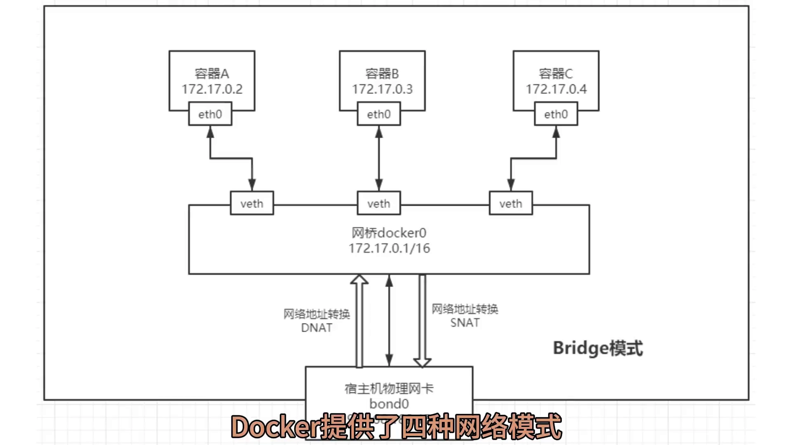
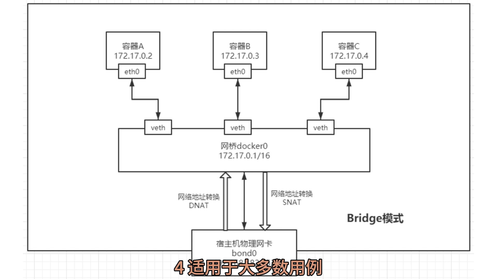
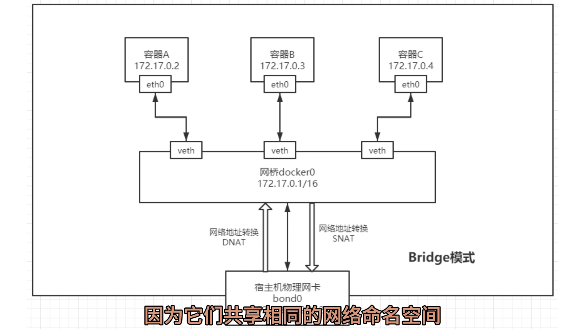
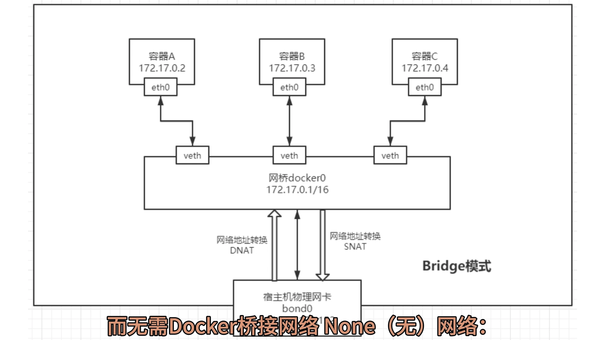
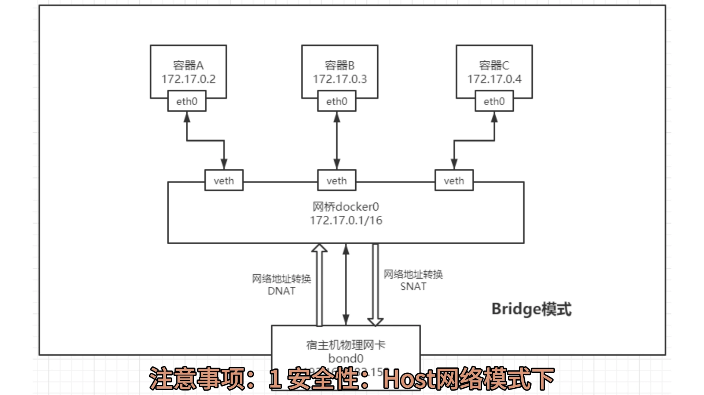

# Docker 四种网络模式速览：bridge、host、container、none

> 本文整理自 B 站视频《Docker四种网络模式（Bridge，Host，Container，None）》（大数据老司机）。这是一支"课件式"短片，把四种网络模式的定义、使用场景与注意事项排得很整齐，适合当速查表用。

## 本讲要解决的核心问题（SCQA）

**背景**：`docker run` 一个容器，它默认就有网络，多数人从来不碰 `--net` 这个参数。

**冲突**：但不同场景对网络的要求并不一样——有的要求容器与外部网络严格隔离；有的追求极致性能、不想多一层转换；有的则希望两个容器共用端口和地址，像同一台机器上的两个进程。

**疑问**：Docker 到底有哪几种网络模式？各自什么时候用、又有什么坑？

**回答（中心思想）**：Docker 提供了四种网络模式——**bridge**（默认，容器接到虚拟网桥上、与外部隔离）、**host**（容器与宿主机共用网络）、**container**（容器与另一个容器共享网络栈）、**none**（容器完全没有网络）。选哪一种，取决于你更要**隔离**、要**性能**，还是要容器之间**紧密耦合**；除此之外还可以自建自定义网络。

---

## 一、bridge：默认的桥接网络

[【跳转到 00:00】](https://www.bilibili.com/video/BV1vw4m127oL/?t=0)

- **默认网络模式**：创建容器时不加 `--network` 参数，用的就是 bridge；
- Docker 为每个容器分配一个**独立的网络接口**，并连接到一张**虚拟的 Docker 网络**上；
- 容器之间可以**通过 Docker 网络彼此通信**，但**与外部网络隔离**；
- 适用于大多数用例，特别是当你需要**隔离容器网络**时。

这里说的"虚拟网络"就是虚拟网桥（默认名为 `docker0`）：每加一个容器，就往这张网桥上再接一条线。也正因为默认接在同一个网桥上，同一台主机上的容器天然可以互相访问。

## 二、host：容器共享宿主机的网络

[【跳转到 00:25】](https://www.bilibili.com/video/BV1vw4m127oL/?t=25)

- 容器**共享宿主机的网络接口**；
- 容器内部的网络环境与宿主机**完全相同**，可以看到宿主机的所有网络接口和地址；
- 容器之间可以直接通信，因为它们**共享相同的网络命名空间**；
- 适用于需要**直接与宿主机或其它容器通信**的应用，如某些网络密集型应用。

一句话理解：host 模式下容器不再自己造网络，而是"寄生"在宿主机的网络栈里，所以少了一层转发、性能最好，但容器与宿主机之间也就没有网络隔离了。

## 三、container：与另一个容器共享网络栈

[【跳转到 00:50】](https://www.bilibili.com/video/BV1vw4m127oL/?t=50)

- 一个容器可以和**其它容器共享网络堆栈**；
- 用 **`--net=container:<容器名>`** 来指定要和哪个容器共享；
- 共享网络的容器之间可以**直接通信**，不需要经过 Docker 桥接网络。

因为共享的是同一套网络栈（同一个 IP、同一批端口），这类容器之间用 `127.0.0.1` 就能互访，通常用在"必须紧挨着"的容器组合里。

## 四、none：没有任何网络

- 容器**不分配网络接口**；
- 通常用于容器之间的**依赖关系**，例如 Docker-in-Docker 场景；
- 需要与另一个使用 `--net=host` 的容器共享网络。

none 模式下容器里只剩一个 `lo`（本地回环）。它适合那些**不需要网络**的容器——既然连不上网，也就不会意外把服务暴露出去，可以作为一种安全措施。

## 五、四种模式怎么选

[【跳转到 01:15】](https://www.bilibili.com/video/BV1vw4m127oL/?t=75)

| 网络模式 | 适用场景 |
| --- | --- |
| **bridge** | 大多数标准应用场景，特别是希望容器之间能通信、同时又与外部网络隔离时 |
| **host** | 需要高性能网络连接的应用，或需要访问外部网络资源的容器 |
| **container** | 需要紧密网络连接的容器，如服务发现、负载均衡场景 |
| **none** | 不需要网络连接的容器，或作为其它容器的网络依赖 |

一句话记忆：**要隔离用 bridge，要性能用 host，要共用端口用 container，要断网用 none。**

## 六、四个必须注意的坑

[【跳转到 02:05】](https://www.bilibili.com/video/BV1vw4m127oL/?t=125)

1. **安全性**：host 模式下容器可以访问宿主机的**所有**网络资源，可能带来安全风险；
2. **隔离性**：bridge 提供了一定程度的隔离，但**不适用于需要严格网络隔离的场景**；
3. **连通性**：使用 container 模式时，要确保被共享网络的容器被**正确地管理**（它一旦停了，依赖它的容器网络也跟着出问题）；
4. **配置**：none 模式的容器通常需要**额外配置**才能实现网络连接。

课件最后强调：每种网络模式都有其特定的用途和限制，**选哪一种取决于你的具体需求和网络策略**——设计和部署 Docker 应用时，要把这些因素先想清楚。

## 小结

- 四种模式按"容器离宿主机的远近"排列：**bridge**（隔离但功能完整，默认）→ **host**（去掉隔离换性能）→ **container**（与别的容器共用一套网络）→ **none**（彻底断网）。
- 默认的 **bridge** 覆盖了大多数场景：容器间能互通，外部访问需要显式暴露端口。
- **host** 的代价是失去网络隔离，且端口会与宿主机抢占；**container** 适合"必须紧挨着"的容器；**none** 适合不需要网络的容器。
- 想自己定义网段、名称解析等，可以在此基础上**创建自定义网络**。

## 关键术语速查

| 术语 | 一句话解释 |
| --- | --- |
| bridge | 默认网络模式，容器接在虚拟网桥（docker0）上，与外部网络隔离 |
| host | 容器共享宿主机的网络接口与命名空间，性能最好、隔离最差 |
| container | 与指定容器共享网络堆栈（`--net=container:<名>`），可用 127.0.0.1 互访 |
| none | 容器没有网络接口，只有 lo，完全隔离 |
| 网络命名空间 | Linux 用来隔离网络资源（网卡、路由、端口等）的机制，Docker 各网络模式本质上是在决定"共享哪一块" |
| 自定义网络 | 用户自己创建的网络，可指定网段与 IP 分配策略 |
