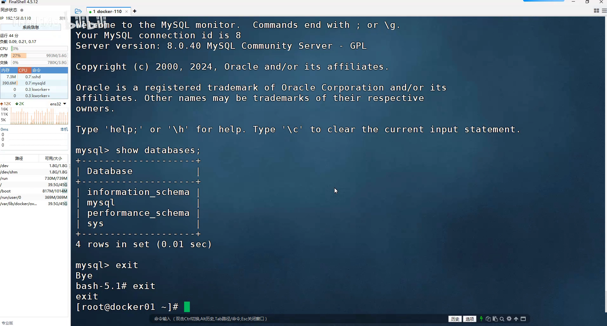
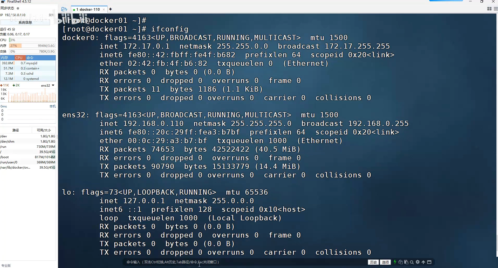
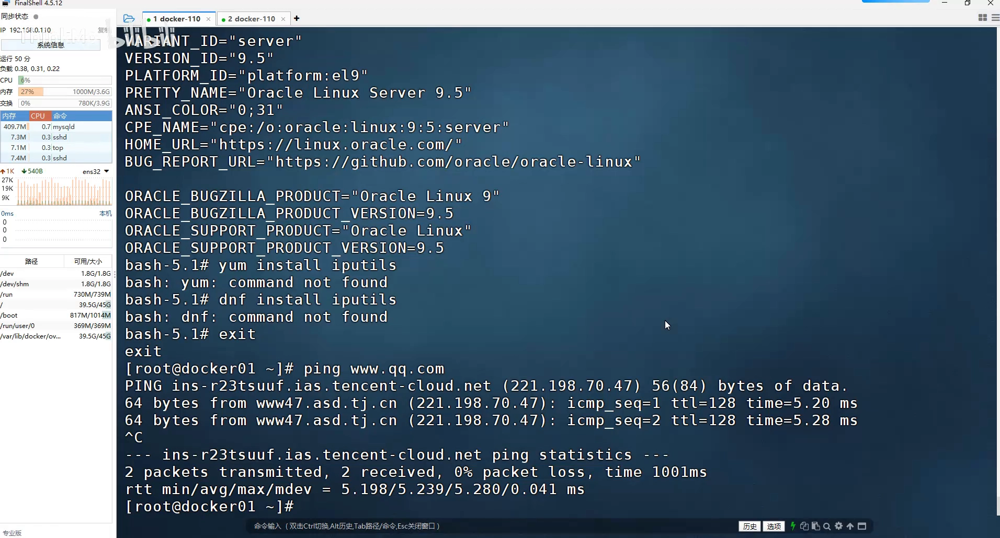
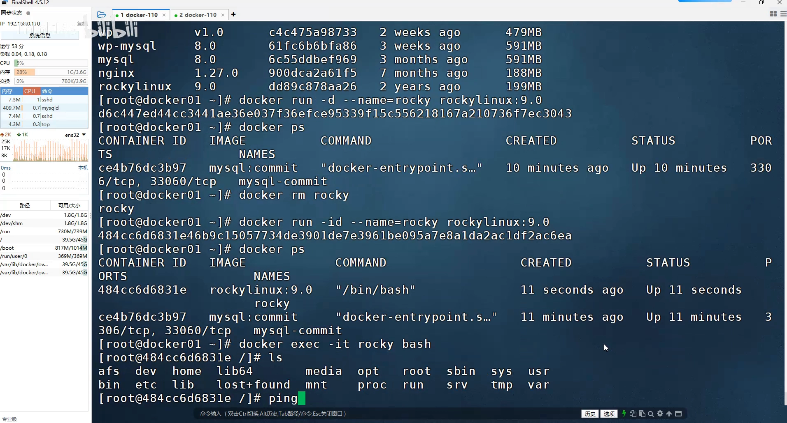
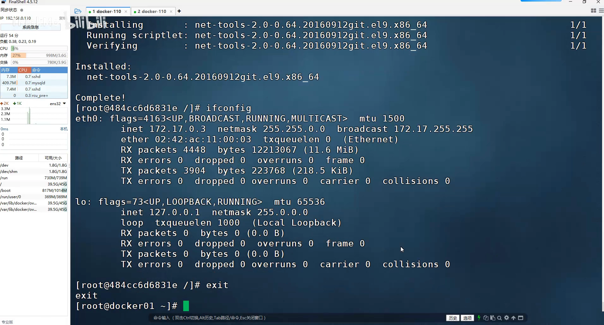
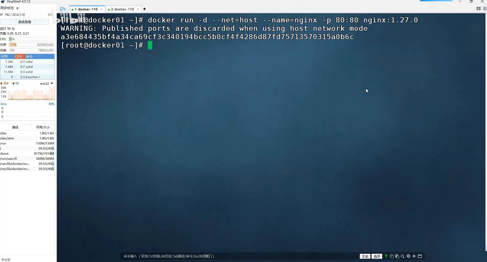
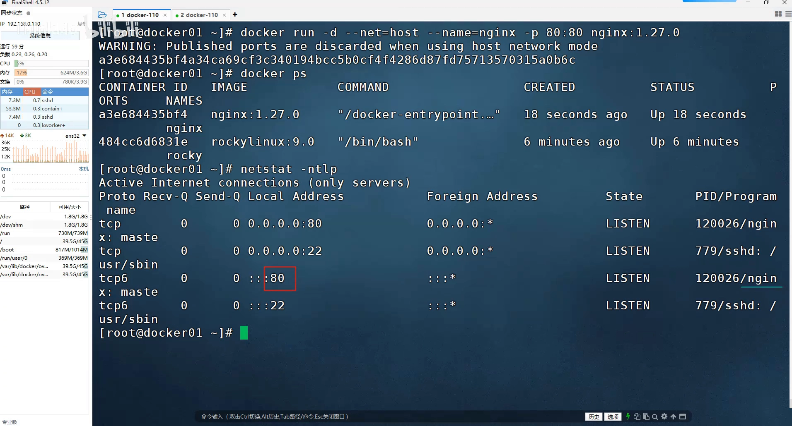

# Docker 网络模式精讲：bridge、host、container、none 该怎么选

> 本文整理自 B 站视频《Docker网络模式精讲：四模式对比与实战应用》（ThinkMo）。讲师在一台已经装好 Docker 的机器上，边敲命令边把四种网络模式逐个演示了一遍，因此这篇笔记里既有概念，也有可以直接复现的排查动作。

## 本讲要解决的核心问题（SCQA）

**背景**：`docker run` 一个容器，它默认就能连外网，同主机上的容器之间也能互相 ping 通，你什么都不用配。

**冲突**：可一旦遇到"要把端口暴露出去""嫌网络性能不够""想让两个容器共用一套端口"这类需求，默认那套就不够用了——而这些需求都指向同一个开关：`--net`。

**疑问**：Docker 一共提供了哪几种网络模式？每一种把容器接到了哪里？又各自牺牲了什么？

**回答（中心思想）**：四种网络模式的差别，本质上是**"容器有没有自己的网卡、以及和谁共享网络栈"**：

- **bridge**（默认）：容器各自接在虚拟网桥 `docker0` 上，分到同网段的 IP，靠 NAT 出网；
- **host**：容器不要网卡，直接用宿主机的网络栈，性能好但失去隔离、`-p` 端口映射失效；
- **container**：新容器与一个已有容器共用同一个网络命名空间，两者用 `127.0.0.1` 互访；
- **none**：容器只有 `lo`，完全断网。

日常默认用 bridge 就够了——它 IP 利用率高、多容器端口也不冲突；另外三种只在你明确知道自己要什么时才用。

---

## 一、默认的 bridge：容器都接在 docker0 这张虚拟网桥上

### 1.1 装完 Docker，宿主机上会多出一块网卡

在宿主机上敲：

```bash
ifconfig        # 或 ip address
```

会发现系统里多了一块名为 **`docker0`** 的网卡，地址通常是 **`172.17.0.1`**。



它是**安装 Docker 时被"虚拟"出来的**。之后每启动一个容器，Docker 都会**按 docker0 的网段给容器分一个同网段的 IP**：因为默认情况下容器用的就是 bridge（桥接）模式，等于每个容器最终都"桥接"在 docker0 这块网卡上，和主机处在同一个网段。 [【跳转到 00:25】](https://www.bilibili.com/video/BV12JaUz1EpS/?t=25)

### 1.2 用 docker inspect 验证：容器的网关就是 docker0

拿视频里已有的 MySQL 容器验证一下：

```bash
docker inspect mysql
```

在输出里找到 **NetworkSettings** 这一段，就能看到容器的网络信息；再往下看网关——它正是 `docker0` 的地址。



对照一下：容器 IP 是 `172.17.0.2`，和 docker0 同网段；它指向的网关，就是 docker0 那个地址。 [【跳转到 01:34】](https://www.bilibili.com/video/BV12JaUz1EpS/?t=94)

### 1.3 容器怎么上网：借道 docker0 做一次 NAT

容器要和宿主机、外部通信，得**借助 docker0 的地址、经过 NAT 转换才能出去**。视频里进容器实测：

```bash
docker exec -it mysql <解释器>
ping qq.com
```

（这个 MySQL 镜像是 Oracle 版 Linux，容器里**没有 ping 命令**；讲师现场查"ping 由哪个包提供"也没能装上，但确认了容器确实能访问外网。）

为什么能出网？因为 docker0 这块网卡可以跟宿主机网卡通信，而宿主机网卡能访问外网。docker0 自己的地址是**内网地址**、上不了互联网，所以最后一步要把私有地址**转换成宿主机网卡的（公网）地址**再出去——这一步就是 NAT。 [【跳转到 02:49】](https://www.bilibili.com/video/BV12JaUz1EpS/?t=169) [【跳转到 04:29】](https://www.bilibili.com/video/BV12JaUz1EpS/?t=269)

也正因为"IP 地址利用率高"（多个容器共用宿主机的出口地址），bridge 成了 Docker 用得最广泛、也是默认的模式。

### 1.4 宿主机上那些 veth 接口，就是容器的"网线"

再回头看宿主机的网卡列表，会发现多了一堆 `veth` 开头的接口：



**每创建一个容器，就会多一个这样的接口**——它就是容器与 docker0 通信用的"网线"。接口名后面那串随机数字不用管；以后你在本机看到莫名多出一堆虚拟网卡，就知道是 Docker 在为它管理的容器接线。 [【跳转到 03:47】](https://www.bilibili.com/video/BV12JaUz1EpS/?t=347)

进到容器里看，网卡名一般是 `eth0`（系统镜像里可能要先装 `net-tools` 才能用 `ifconfig`）：



（顺带一个实操细节：像 Rocky Linux 这类**系统镜像里面没有常驻进程**，直接 `docker run` 会立刻退出，需要加 `-i` 分配一个前台终端才能持续运行。） [【跳转到 05:13】](https://www.bilibili.com/video/BV12JaUz1EpS/?t=513)

### 1.5 能力与边界

- **容器之间可以互访**：因为大家都桥接在 docker0 上，同一台主机里的容器能互相通信；**但跨主机就不行了**。
- 想知道某个容器用的是哪种模式：`docker inspect <容器名>`，在输出里找 `Networks`，看到 `"bridge"` 就说明它用的是桥接模式。



[【跳转到 05:57】](https://www.bilibili.com/video/BV12JaUz1EpS/?t=597)

---

## 二、host 模式：容器不要网卡，直接用宿主机的网络栈

第二种模式叫 **host（主机模式）**：容器**不再虚拟出自己的网卡**，而是**与物理机共享同一个 IP 地址**。

理解它，只需和默认模式对比：

- **bridge 模式**下，外部想访问容器，路径是：先由宿主机地址接收请求 → 宿主机把请求交给 docker0 → docker0 再交给容器，中间有**层层转换**；
- **host 模式省掉了中间环节**：容器想和外部通信，直接就用宿主机的地址，没有地址转换、也没有路由，所以**网络性能更好**。

那对容器来说怎么区分彼此？**靠端口**：起一个 Nginx，它监听的 80 就是这个容器的身份；访问 3306，请求就落到 MySQL 上。

### 2.1 怎么指定，以及一个必须知道的限制

创建容器时加一个选项就行：

```bash
# 默认（bridge）写法：显式做端口映射
docker run -d --name nginx -p 80:80 nginx:1.27.0

# host 模式写法：指定使用主机网络
docker run -d --name nginx --net=host nginx:1.27.0
```

用 host 模式启动时，Docker 会给出一个提示：



> **"使用主机网络时，已发布的端口将被丢弃"**——也就是说，host 模式下 `-p` 端口映射**不再起作用**。

原因是：容器起来后**直接把端口监听到宿主机的网卡上**（Nginx 默认就监听 80），这和你直接在宿主机上 `yum` 装一个 Nginx 没有任何区别：



### 2.2 代价与适用场景

- **代价一：端口冲突**。既然端口直接落在宿主机上，就**不能在同一个主机里再跑一个一模一样的 Nginx**——端口会撞车。
- **代价二：隔离变差**。容器与宿主机共享网络，可能影响宿主机的网络配置，安全风险和管理复杂度都会上升。
- 结论：**用得比较少**。既然效果等同于"直接在主机上装服务"，就失去了 bridge 模式那种高利用率；只有当你确实需要极致网络性能时才考虑它。

访问起来倒是很痛快——不需要任何端口映射，直接用宿主机的地址就能打开容器里的服务。 [【跳转到 07:31】](https://www.bilibili.com/video/BV12JaUz1EpS/?t=731) [【跳转到 09:59】](https://www.bilibili.com/video/BV12JaUz1EpS/?t=959)

---

## 三、container 模式：让新容器与已有容器共用网络栈

第三种模式更"特殊"（讲师原话：更奇葩）：**新创建的容器，和一个已经存在的容器共享同一个网络**。

```bash
docker run -d --name <新容器> --net=container:<目标容器名> <镜像>
```

它解决的问题是：我先起的那个容器已经有了自己的网络，现在希望新容器**和它共用同一个地址**。用法上就是在 `--net` 后面跟上 `container:` 和目标容器的名字。

- 这两个容器之间，通过**本地回环地址 `127.0.0.1`** 就能互相通信；
- **除了网络，其它方面依旧隔离**——进程、文件系统都还是各自独立的。

换句话说，它们像"同一台机器上的两个进程"：共享 IP 和端口空间（所以不能监听同一个端口），但彼此的文件和进程互不可见。 [【跳转到 10:58】](https://www.bilibili.com/video/BV12JaUz1EpS/?t=658)

---

## 四、none 模式：只有 lo 的"断网"容器

第四种是 **none 模式**：容器创建出来之后**没有网卡，只有一个 `lo`**，Docker 不分配任何网络；如果确实需要联网，得自己进容器里添加网卡、配置 IP。

它适合"不需要网络"的工具型容器（例如纯做计算的批处理）；因为不给网络接口，也就不会意外地把服务暴露出去，可以当作一种**安全措施**。 [【跳转到 11:28】](https://www.bilibili.com/video/BV12JaUz1EpS/?t=688)

---

## 五、别忘了自定义网络

讲完四种内置模式，视频最后提到：Docker 的网络驱动**不止这几种**——例如 Swarm 下的 **overlay** 支持多主机通信，还可以使用**第三方网络插件**。单机场景用默认的 bridge 就够。

管理网络的一组命令不用死记，记住 `docker network` 两个单词、直接回车，子命令和说明就会列出来：

```bash
docker network                    # 列出所有子命令
docker network ls                 # 列出已有网络
docker network create <名字>      # 创建自定义网络
```

[【跳转到 11:78】](https://www.bilibili.com/video/BV12JaUz1EpS/?t=1178)

---

## 小结

- **bridge 是默认模式**：容器接在 docker0（`172.17.0.1`）这张虚拟网桥上，按同网段分 IP，靠 docker0 + NAT 访问外网；同主机容器可互访，**跨主机不行**。
- **veth 是容器的"网线"**：宿主机上每多一个 veth 接口，就对应一个容器；容器内部的网卡一般是 `eth0`。
- **`docker inspect` 是最好的排查入口**：容器的 IP、网关、它挂在哪个网络（Networks 里的 `bridge`）都能看到。
- **host 模式用隔离换性能**：容器与宿主机共享 IP，`-p` 端口映射失效、端口会冲突，效果等同于在主机上直接装服务，用得少。
- **container 模式共享网络命名空间**：`--net=container:<名字>`，两个容器用 `127.0.0.1` 互访，网络之外的资源仍隔离。
- **none 模式完全断网**：只有 `lo`，需要联网得自己配。
- **默认就用 bridge**：IP 利用率高、多个容器端口互不冲突；确有必要再换其它模式。

## 关键术语速查

| 术语 | 一句话解释 |
| --- | --- |
| bridge | 默认网络模式，容器接在虚拟网桥 docker0 上，靠 NAT 出网 |
| docker0 | Docker 安装时创建的虚拟网桥，默认地址 172.17.0.1，也是容器的网关 |
| veth | 虚拟网线，一端在宿主机、一端在容器，把容器接到 docker0 上 |
| NAT | 网络地址转换，让容器借宿主机地址访问外网 |
| host 模式 | 容器不要独立网卡，直接用宿主机的网络栈（`--net=host`） |
| container 模式 | 新容器与已有容器共享网络命名空间（`--net=container:<名>`） |
| none 模式 | 容器只有 lo、没有网络（`--net=none`） |
| `docker inspect` | 查看容器/网络详情的命令，可确认容器挂在哪个网络、IP 与网关 |
| overlay 网络 | 跨多台主机通信的网络驱动，多用于 Swarm 集群 |
