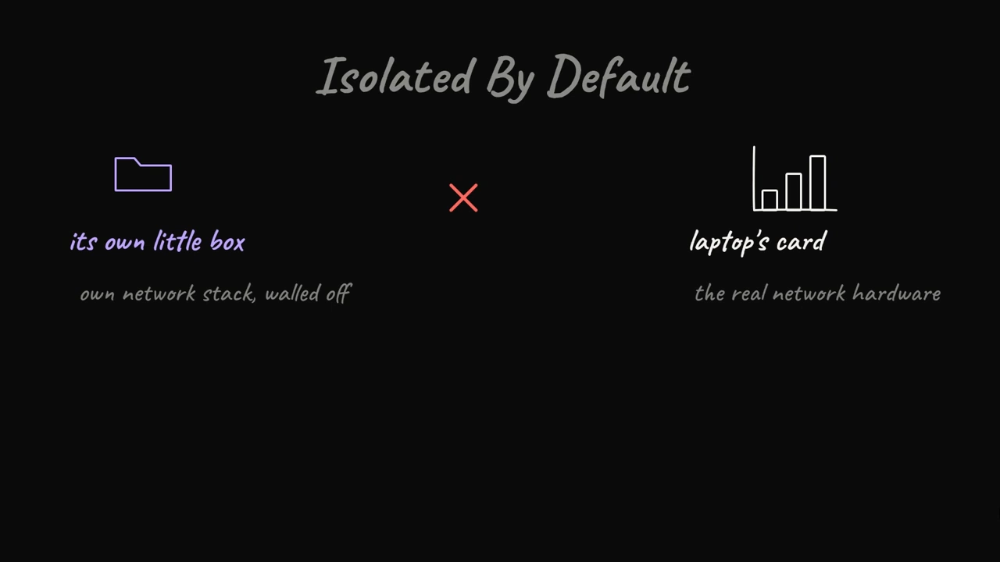
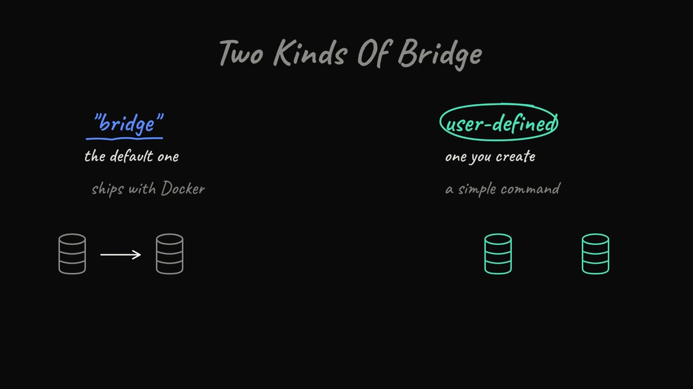
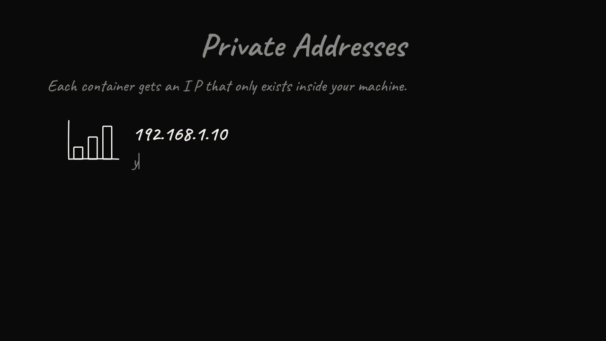
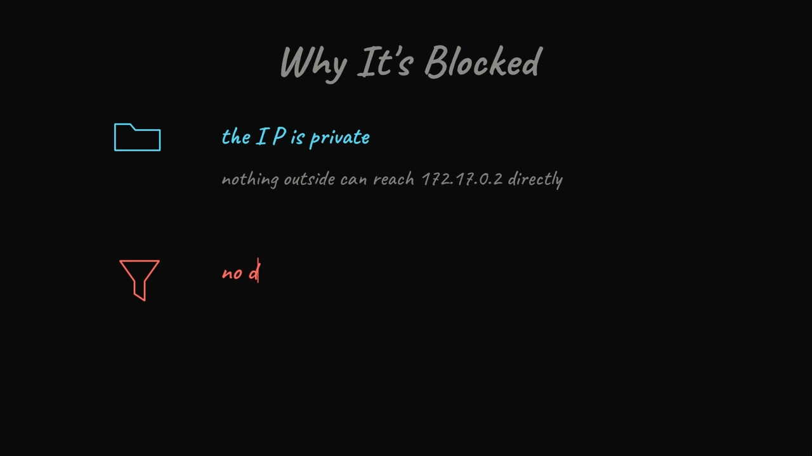
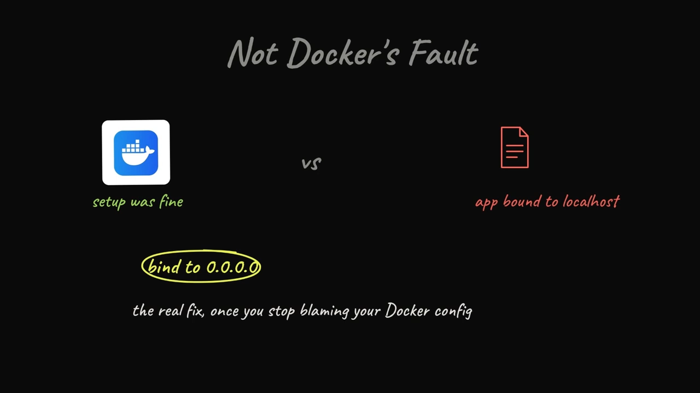
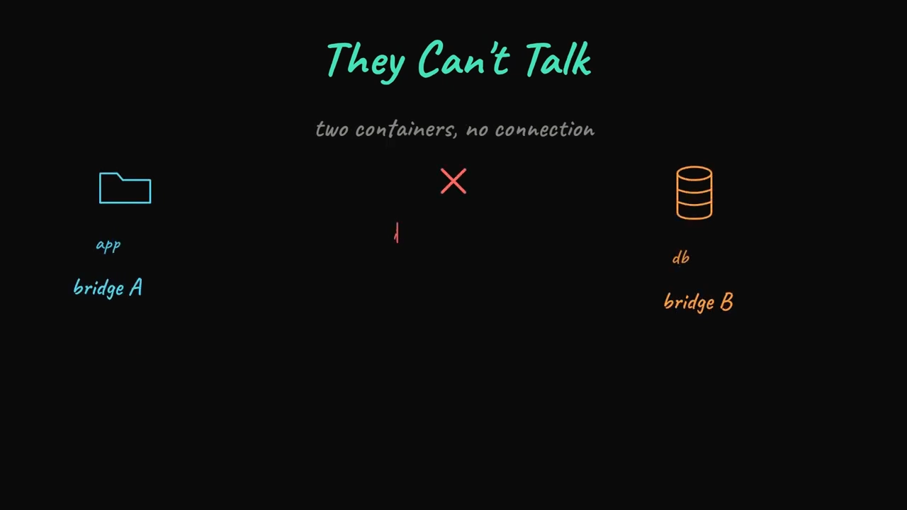

# Docker 网络入门：Bridge、NAT 与端口发布，一个数据包的真实旅程

> 本文整理自 YouTube 视频《Docker Networking for Beginners: Bridge, NAT, and Port Publishing》。它想做一件事：把 Docker 网络从"看起来很晕"讲成"一点也不玄"——顺着一个数据包真正走过的路径，一步步看清楚。

## 本讲要解决的核心问题（SCQA）

**背景**：容器默认是隔离的，每个容器都有自己一整套独立的网络栈。

**冲突**：它并不会"借"用你电脑的网卡、然后自己就能上网；可它确实又能访问互联网，外部也（在配置之后）能访问到它。中间到底发生了什么？

**疑问**：一个数据包从容器出发、到互联网，或者从外部进来、到容器，究竟走了一条怎样的路？为什么我明明启动了 Nginx，浏览器打开却什么都看不到？

**回答（中心思想）**：整件事本质上就是**两条规则**在幕后运行——**一条改写"出去"的地址**（出站 NAT），**一条改写"进来"的地址**（端口发布时的另一条 NAT 规则）；而你的机器就静静夹在中间，同时处理这两个方向。只要把这个"数据包的真实路径"在脑子里跑通，绝大多数 Docker 网络问题就不再神秘。

---

## 一、容器默认是隔离的：先有"路"，才谈得上通信

### 1.1 容器是带独立网络栈的"小盒子"

把容器想象成一个**带自己网络栈的小盒子**。它不会自作主张地借用你笔记本的网卡、直接跑去跟互联网说话。**必须有人在容器和外部世界之间"修一条路"——而这个人就是 Docker。**

### 1.2 Docker 修的路，叫 bridge 网络

装好 Docker、用默认设置启动一个容器时，Docker 会自动创建一个叫 **bridge 网络**的东西。这个 bridge 就像**一台运行在你机器内部的虚拟交换机**：除非你另有指定，否则你启动的每个容器都会被"插"到这台交换机上。

因为大家都插在同一台交换机上，所以容器之间**用各自的内部 IP 就能互相通信，无需额外配置**。



[【跳转到 00:25】](https://www.youtube.com/watch?v=yYnPkleHxS4&t=25)

---

## 二、其实有两种 bridge：默认 bridge 与自定义 bridge

这是**大多数教程会跳过**的一个细节：Docker 其实自带**两种** bridge 网络。

### 2.1 默认 bridge：没有自动名称解析

一种是**默认的 bridge**，名字就叫 `bridge`。它**不提供容器之间自动的名称解析**。也就是说，如果两个容器都在默认 bridge 上，它们只能靠 **IP 地址**互相访问，**不能用容器名找到对方**。

### 2.2 自定义 bridge：内建 DNS

另一种是你用一条简单命令自己创建的 **user-defined bridge（自定义 bridge）**。把容器接到它上面，Docker 就给你**内建的 DNS**：一个容器可以直接用名字 `ping` 到另一个容器——比如 `database`、`back-end`——而且真的能通。

这正是**有经验的 Docker 用户几乎总是创建自定义网络、而不依赖默认网络**的一个重要原因。



[【跳转到 00:50 附近】](https://www.youtube.com/watch?v=yYnPkleHxS4&t=50)

---

## 三、容器到底怎么物理连上你的机器：veth pair

接下来讲**容器"物理上"怎么接到你的机器**——这部分最容易让人卡住。

### 3.1 一对"假网线"

Docker 会创建一种叫 **virtual ethernet pair（虚拟以太网对）** 的东西——说白了就是**一根两端俱全的假网线**：

- **一端在容器内部**，表现为一个叫 **`eth0`** 的接口；
- **另一端接在宿主侧的 bridge 上**。

于是，当容器里的应用发送数据时，它依次经过：**`eth0` → 这根虚拟网线 → bridge → 你机器真正的那块网卡 → 出去**。


[【跳转到 01:40】](https://www.youtube.com/watch?v=yYnPkleHxS4&t=100)

### 3.2 私有 IP 与网关

每个接在这台 bridge 上的容器，都会拿到一个**只在你机器内部存在的私有 IP**：

- 你的笔记本可能有一个真实地址，比如 `192.168.1.2`；
- 而它上面的容器可能分到类似 `172.17.0.2`；
- **bridge 自己通常在 `172.17.0.1`**，它充当**网关**——也就是容器要把任何东西发出去时的"出口门"。



[【跳转到 02:30】](https://www.youtube.com/watch?v=yYnPkleHxS4&t=150)

---

## 四、出站流量：NAT 是怎么让容器上网的

假设容器里跑着一个 Nginx，监听 80 端口。这里要理解**两段完全不同的旅程**，Docker 对它们处理方式截然不同——这正是大家容易卡住的地方。先说**出站（outbound）**：容器主动去访问互联网。

### 4.1 问题：`172.17.0.2` 在外网毫无意义

数据包从 `eth0` 出去、穿过 bridge、落到宿主机上。但问题来了：**这个包的源地址仍然是 `172.17.0.2`，而这个地址在你机器之外毫无意义**——互联网上没有任何服务器知道，该怎么把回包送回一个私有的 Docker IP。


[【跳转到 03:20】](https://www.youtube.com/watch?v=yYnPkleHxS4&t=200)

### 4.2 宿主机改写源地址（NAT）

于是**宿主机介入，在包离开之前把源地址改写掉**——把 `172.17.0.2` 换成你机器的真实地址（比如 `192.168.1.2`）。这就叫 **NAT（Network Address Translation，网络地址转换）**。

对外部世界来说，这个请求**看起来就像是直接从你的笔记本发出的**，而不是来自某个隐藏的容器。当响应回来时，宿主机**记得是哪个容器发的请求**，于是把它**正确地路由回去**。整个过程是自动的——说白了，这部分"你什么都不用想，它就是能跑"。


[【跳转到 03:45】](https://www.youtube.com/watch?v=yYnPkleHxS4&t=225)

---

## 五、入站流量：为什么本地访问不了、怎么"开门"

**入站（inbound）**才是大多数初学者卡住的地方。

### 5.1 默认不放行任何外部流量

你启动了 Nginx，它在容器里跑得好好的；可你在浏览器里打开 `localhost:80`，**什么也加载不出来**。原因一旦看破就很简单：

- 那个容器的 IP 是**私有的**，机器之外的东西**根本没法直接够到它**；
- 而且默认情况下，你的机器**也不会把任何外部流量转发进去**。

### 5.2 用 `-p 8080:80` 显式开门

你必须**显式地开一扇门**——用启动容器时的 **publish 标志（发布端口）**：

```bash
-p 8080:80
```

它的意思是告诉 Docker：**"任何打到我这台机器 8080 端口的流量，都转发到容器内部的 80 端口。"** Docker 会**专门为此再设置一条 NAT 规则**，于是从 8080 进来的请求就被重定向到你的 Nginx 服务器。



[【跳转到 04:35】](https://www.youtube.com/watch?v=yYnPkleHxS4&t=275)

### 5.3 一个坑：应用必须监听 `0.0.0.0`

有一件事最容易让人措手不及：**容器里的应用必须真正监听"所有接口"，写作 `0.0.0.0`**——而不能只监听 `localhost` 或 `127.0.0.1`。

如果你的应用**只绑定在容器自己内部的 localhost**，那么转发进来的流量就撞到了死胡同，你会得到 **`connection refused`**——**即便你的端口发布配置完全正确**。讲者本人就曾在这上面浪费过时间，以为 Docker 配置坏了，其实只是应用配置的问题。


[【跳转到 05:00】](https://www.youtube.com/watch?v=yYnPkleHxS4&t=300)

---

## 六、bridge 之外：还有哪些网络驱动

Docker 还提供了几种值得了解的网络驱动。

### 6.1 host：直接共享宿主机网络栈

host 网络**完全跳过那套虚拟网线和 NAT**，容器**直接使用你机器的网络栈**。因为没有转换开销，它**更快**；但代价是**容器在网络侧不再被隔离，少了一层安全防护**。



[【跳转到 05:25】](https://www.youtube.com/watch?v=yYnPkleHxS4&t=325)

### 6.2 none：完全没有网络

还有一个叫 **none** 的模式，给容器**完全不配网络**——适合某些不需要和任何东西通信的批处理作业。

### 6.3 overlay：跨主机的容器互通

如果你面对的是**多台机器**而不是一台笔记本，那就轮到 **overlay 网络**出场了。Docker Swarm 一类的编排工具用 overlay 网络，让**位于完全不同物理机上的容器，像处在同一局域网里一样互相通信**。它和 bridge 的基本思路一样，只是**用隧道技术把这张网"拉伸"到多台主机上**。

### 6.4 CNI：Kubernetes 的做法

Kubernetes 则通过一种叫 **CNI 插件**的东西来处理这件事，但**底层目标是相同的**：让彼此隔离的容器（或 pod）能可靠地发现、访问对方。

---

## 七、安全提醒：你发布的每一个端口，都是一扇通向机器的门

这一点常被忽略。**你发布的每一个端口，都是打进你机器的一扇门。**

如果你跑着一个数据库容器，却**不加思考地把它的端口发布到了公网 IP 上**，那你可能**把数据库暴露给了整个互联网**，而不仅仅是本地网络。

更安全的习惯是：**只发布你确实需要暴露的端口**；把数据库这类内部服务放在**私有的自定义网络**里，只允许其他容器访问，**完全不向宿主机发布任何端口**。


[【跳转到 06:40】](https://www.youtube.com/watch?v=yYnPkleHxS4&t=400)

---

## 八、排障套路：卡住时先问三个问题

如果你在调试 Docker 网络时卡住了，可以照着这个套路走：

1. **容器能上网，但没人能访问容器** → 你多半是**忘了发布端口**（没写 `-p`）。
2. **两个容器互相不通** → 先看它们**是不是在同一个网络上**：不同 bridge 上的容器默认相互隔离，除非你手动把它们连起来。
3. **配置看起来都对，却还是 `connection refused`** → 检查**容器里的应用到底绑定到了哪个地址**（是不是只绑了 `127.0.0.1`，而不是 `0.0.0.0`）。



[【跳转到 07:43】](https://www.youtube.com/watch?v=yYnPkleHxS4&t=463)

一旦这套心智模型"咔哒"一声对上了，说真的，大多数 Docker 网络问题就都不再神秘了。

---

## 小结

- **容器默认隔离**，Docker 会建一台叫 **bridge 的虚拟交换机**把它们连起来。
- **默认 bridge 没有内建 DNS**（只能靠 IP 互访）；**自定义 bridge 有内建 DNS**（能按名字互访）——这就是老手偏爱自定义网络的原因。
- 容器通过 **veth pair（一端 `eth0`、一端接 bridge）** 物理接入；容器拿到私有 IP（如 `172.17.0.2`），**网关通常是 `172.17.0.1`**。
- **出站靠 NAT**：宿主机把源地址从私有 IP 改写成真实地址，外网才回得来。
- **入站要靠发布端口**：`-p 8080:80` 显式开门，Docker 会再加一条 NAT 规则；**应用必须监听 `0.0.0.0`**，否则 `connection refused`。
- 其他驱动：**host**（快、无网络隔离）、**none**（无网络）、**overlay**（跨主机）、**CNI**（K8s 方案）。
- **安全**：每个发布的端口都是一扇门，内部服务（如数据库）不要发布到宿主机。
- **排障**：忘了发布端口？不在同一网络？应用绑错地址？——三个问题先过一遍。

## 关键术语速查

| 术语 | 一句话解释 |
| --- | --- |
| bridge 网络 | Docker 默认创建的虚拟交换机，容器默认接在上面 |
| user-defined bridge | 自定义 bridge 网络，带内建 DNS，可按键名互访 |
| veth pair | 虚拟以太网对，一根两端俱全的"假网线"，连接容器与 bridge |
| eth0 | 容器内部看到的虚拟网卡接口 |
| 172.17.0.2 | 容器常见的私有 IP，只在本机内部有效 |
| 172.17.0.1 | bridge 的地址，容器的默认网关（出口门） |
| NAT | 网络地址转换，出入方向分别改写源/目的地址 |
| 出站 NAT | 容器访问外网时，宿主机把源地址改写为真实地址 |
| Port publishing | 用 `-p 宿主机端口:容器端口` 显式开放入站端口 |
| 0.0.0.0 | 监听所有接口；应用若只绑 127.0.0.1 会导致转发流量 connection refused |
| host 网络 | 容器直接共享宿主机网络栈，快但无网络隔离 |
| none 网络 | 容器完全没有网络 |
| overlay 网络 | 用隧道把 bridge 思路拉伸到多台主机，实现跨主机容器互通 |
| CNI | Kubernetes 使用的容器网络接口插件机制 |
