# Docker 端口映射：外部机器凭什么能访问到容器

> 本文整理自 B 站视频《Docker端口映射》（连城老李）。围绕四个问题展开：**为什么**需要端口映射、**如何**实现、**如何查看**、**如何修改**，最后补上宿主机防火墙开放端口这件事。

## 本讲要解决的核心问题（SCQA）

**背景**：容器里跑着服务——比如一个 Nginx，对外监听 80 端口。我们希望外部机器能访问它。

**冲突**：可容器跑在宿主机里的一个私有网络里，外部机器和容器根本不在同一个网段。从网络地址就能看出两者处于不同网络环境，外部机器**直接访问容器是访问不通的**。

**疑问**：那外部机器到底该怎么访问到容器里的服务？端口映射怎么配、怎么看，配错了又怎么改？

**回答（中心思想）**：外部机器要访问容器，必须同时满足**两个先决条件**——能连到**宿主机**、且能访问到**容器端口**。**端口映射就是把"宿主机端口"与"容器端口"绑定起来的中介**：外部机器访问宿主机的某个端口，就等同于访问到了容器的对应端口。用 `-p 宿主机端口:容器端口` 就能完成映射，用 `docker port` / `docker ps -a` 查看，要改端口则停掉 Docker、修改容器目录下的 `hostconfig.json` 再重启。

---

## 一、为什么需要端口映射：外部机器访问容器有两个先决条件

### 1.1 两个先决条件

外部机器要访问 Docker 容器提供的服务，必须满足两点：

1. 外部机器**能成功连接到容器所在的宿主机**，也就是两者在网络上是互通的；
2. 外部机器**还能访问到 Docker 容器的端口**——因为端口就代表着容器所提供的服务。

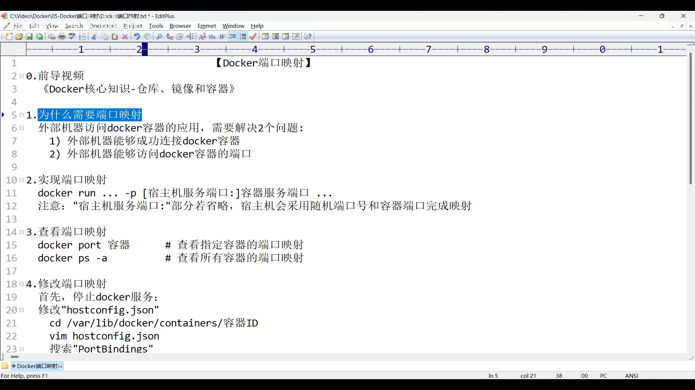

[【跳转到 00:46】](https://www.bilibili.com/video/BV1VC411h7is/?t=46)

### 1.2 实验环境与访问路径

视频用一张示意图交代了实验环境：

- **外部机器**：一台装有 Windows 的电脑；
- **宿主机**：Windows 上用 VirtualBox 装的一台 CentOS 虚拟机；
- 宿主机里装了 Docker，计划启动运行四个容器，以其中一个 **Nginx** 为例；
- 两台机器的 IP 都已在图上标注出来。

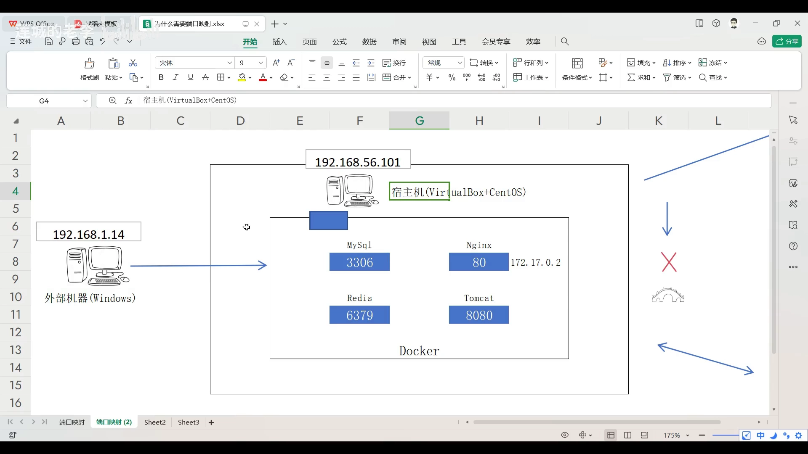

[【跳转到 01:36】](https://www.bilibili.com/video/BV1VC411h7is/?t=96)

在目前的环境下，外部机器想直接访问 Nginx 显然不行——它们处于不同网络环境。于是可以**把宿主机当作桥梁**：

- 外部机器先访问**宿主机**，这一步没问题，两者之间有网桥设备保证网络畅通；
- 再通过宿主机去访问 Nginx 服务，同样有网桥设备提供通路。

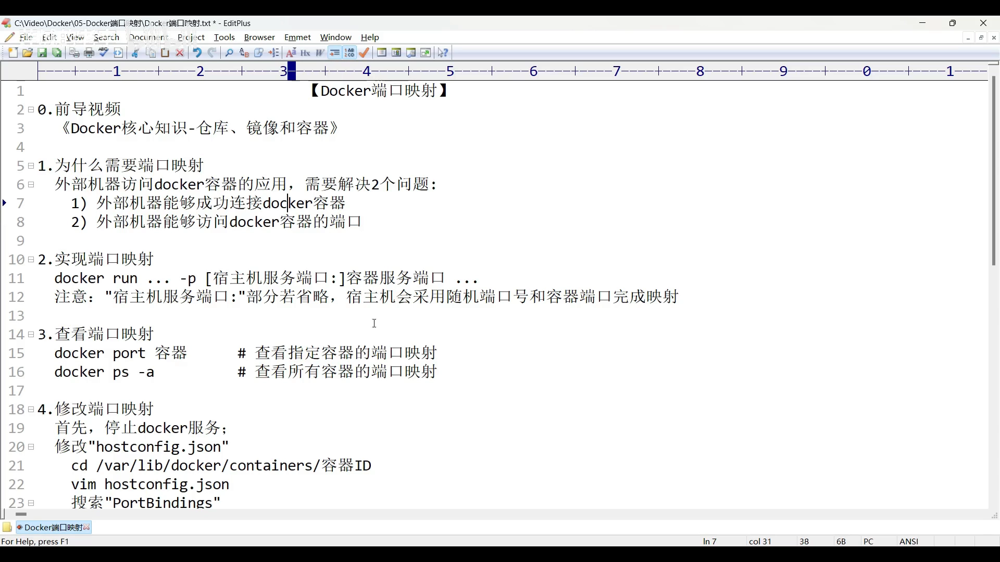

[【跳转到 01:11】](https://www.bilibili.com/video/BV1VC411h7is/?t=71)

### 1.3 用宿主机做桥梁：把宿主机端口映射到容器端口

通道打通之后还有一层：外部机器**不能直接访问容器端口**，它也必须借助宿主机来做端口访问。

这样一来，**宿主机上就必须开放一些端口**。例如宿主机开放一个 **80** 端口；如果宿主机上的 80 端口与容器里的 80 端口做了映射（这就是本讲的重点），那么**外部机器访问宿主机的 80 端口，就等同于访问到了容器的 80 端口**。

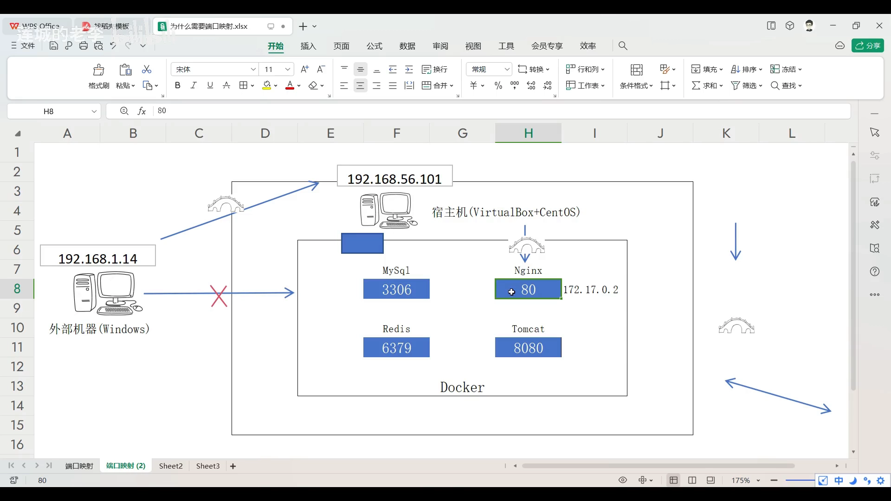

[【跳转到 02:51】](https://www.bilibili.com/video/BV1VC411h7is/?t=171)

宿主机端口也可以与容器端口**编号不一致**，比如用宿主机的 81 端口映射到容器的 80 端口。一般情况下，如果宿主机没有特殊需求，我们会把端口设置得与容器一致，方便后续操作。

---

## 二、如何实现端口映射：`-p` 参数

### 2.1 `-p` 的格式

端口映射主要通过 `docker run` 命令里的 **`-p` 参数**（port 的首字母）实现。它后面跟**两个端口**：一个是**宿主机端口**，一个是**容器端口**，中间用**冒号**分隔：

```bash
-p <宿主机端口>:<容器端口>
```

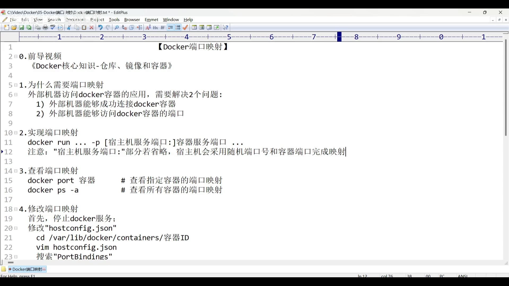

[【跳转到 03:46】](https://www.bilibili.com/video/BV1VC411h7is/?t=226)

### 2.2 省略宿主机端口会随机分配

如果**省略宿主机端口**这一项（只写容器端口，如 `-p 80`），宿主机就会采用一个**随机端口**去和容器指定端口完成映射。一般不推荐这么做，还是自己**手动指定宿主机端口**更清晰。

### 2.3 动手实验：run 一个 Nginx

视频接着做实验：先 `docker images` 看本机镜像，选一个 Nginx 镜像，然后基于它运行容器：

```bash
docker run --name nginx -d -p 80:80 nginx
```

`--name nginx` 给容器取名，`-d` 后台运行，镜像用 `nginx`，`-p 80:80` 把宿主机的 80 端口映射到容器的 80 端口。

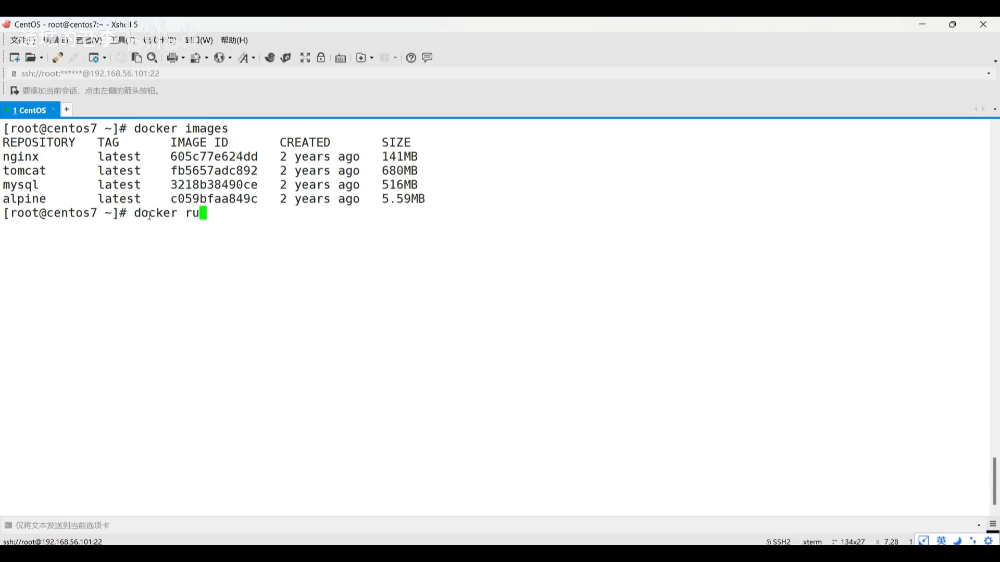

[【跳转到 04:36】](https://www.bilibili.com/video/BV1VC411h7is/?t=276)

（视频里容器之前可能创建过，所以先用 `docker rm -f` 强制删除同名容器，再重新运行一遍。）执行后可以看到名为 `nginx` 的容器成功启动。

### 2.4 在宿主机上先验证：`docker inspect` + `curl`

怎么确认服务正常？先在**宿主机**上试。用一个 `curl` 命令之前，先用 `docker inspect` 确认 Nginx 容器的 IP：

```bash
docker inspect nginx
```

可以看到它分配到的 IP 是 `172.17.0.2`。记下它，然后 `curl` 一下：

```bash
curl 172.17.0.2
```

回车后能看到 Nginx 的首页——这证明**容器里 Nginx 提供的服务本身是正常的**。

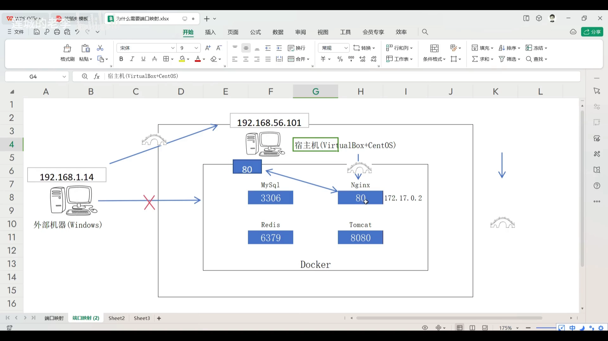

[【跳转到 05:26】](https://www.bilibili.com/video/BV1VC411h7is/?t=326)

### 2.5 在外部机器上验证

接着看外部机器如何访问。按示意图，外部机器要请求的是**宿主机的 80 端口**。打开 Windows 机器，在浏览器地址栏输入：

```
http://192.168.56.101
```

这里的 `192.168.56.101` 就是宿主机的 IP，后面的 `:80` 可以省略。回车后看到 Nginx 首页——**这次访问 Nginx 容器的操作成功了**。

---

## 三、如何查看端口映射

### 3.1 `docker port`

要单独查看某个容器的端口映射，可以用 `docker port`（port 就是端口一词），后面跟容器名：

```bash
docker port nginx
```

回车就能看到映射关系。

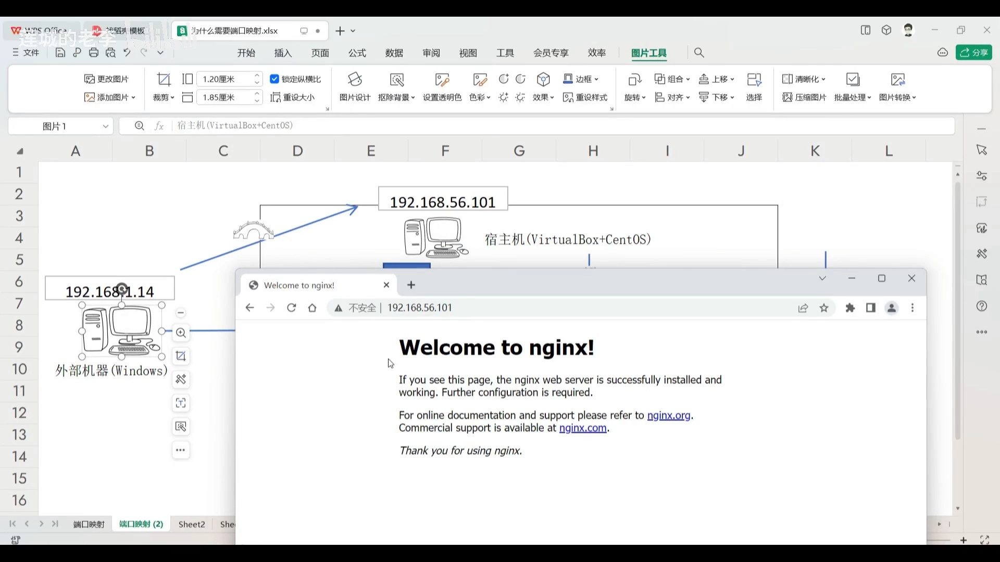

[【跳转到 06:39】](https://www.bilibili.com/video/BV1VC411h7is/?t=399)

### 3.2 `docker ps -a`

平时我们通过 `docker ps` 也能看到端口映射，**建议加一个 `-a`**，这样可以查看**所有**容器（含未运行的）的端口映射。

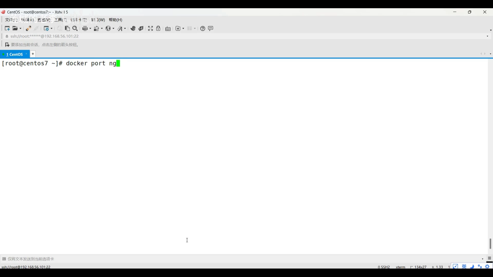

[【跳转到 07:04】](https://www.bilibili.com/video/BV1VC411h7is/?t=424)

---

## 四、如何修改端口映射

假设现在想把宿主机的 **80 改成 81**，也就是用宿主机的 81 端口映射容器的 80 端口，此后外部机器只能访问 81。

### 4.1 第一步：停掉 Docker 服务

```bash
systemctl stop docker
```

停掉之后会有警告：此时**不要再运行任何 Docker 命令**，否则会自动把 Docker 服务再次启动起来。

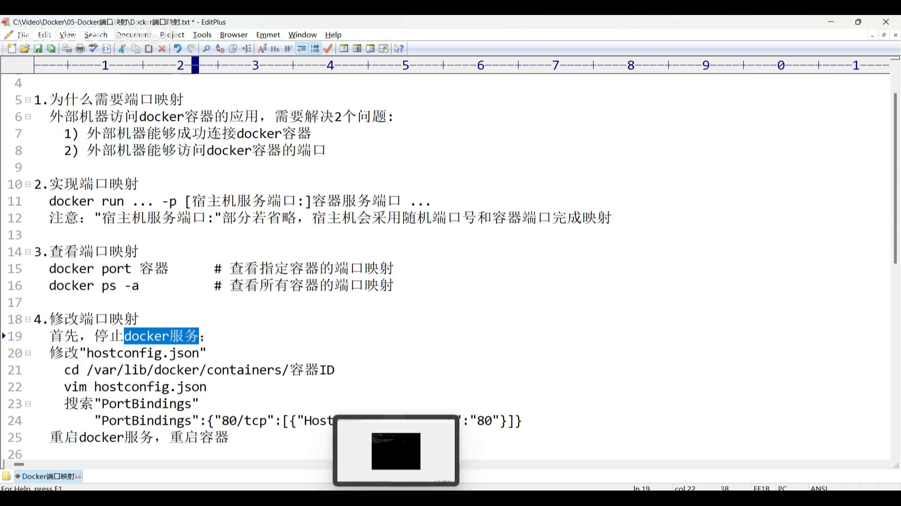

[【跳转到 07:47】](https://www.bilibili.com/video/BV1VC411h7is/?t=467)

### 4.2 第二步：编辑 `hostconfig.json` 里的 `PortBindings`

要改的是一个记录端口映射的 JSON 文件，位置在：

```
/var/lib/docker/containers/<容器ID>/hostconfig.json
```

容器 ID 需要事先查看：`docker ps -a` 里能看到 nginx 容器对应的 ID（前缀几位就够）。操作路径大致是：

1. 进入 `/var/lib/docker/containers/`，`ls` 一下能看到各容器对应的目录；
2. `cd` 到目标容器的 ID 目录（输入 ID 前缀按 `Tab` 自动补全）；
3. 目录里有 `hostconfig.json`，用 `vim` 打开编辑。

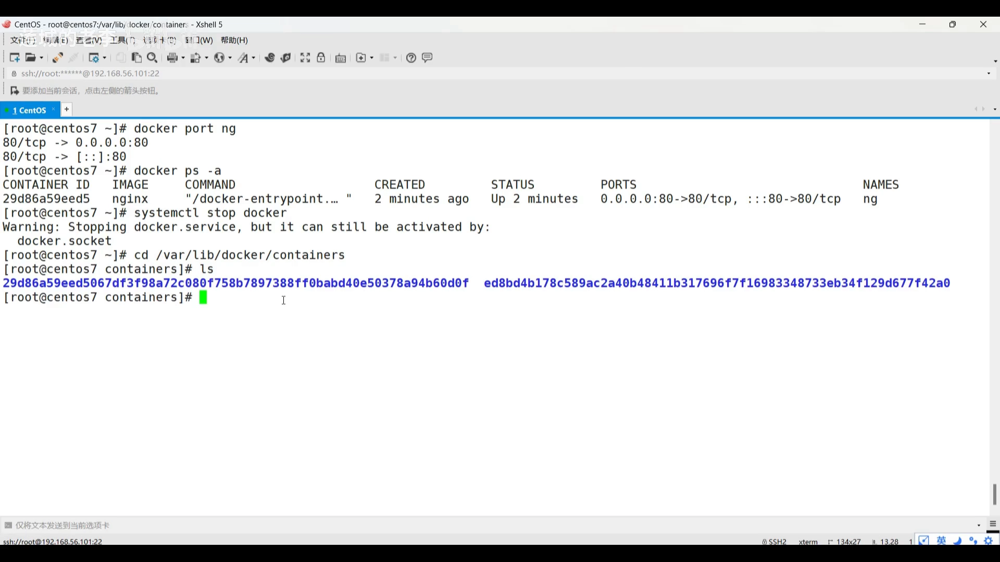

[【跳转到 08:37】](https://www.bilibili.com/video/BV1VC411h7is/?t=517)

在文件里搜索关键字 **`PortBindings`**（就是端口映射）：

- 第一项表示**容器内 80 端口**的映射情况，后面是它的映射配置选项；
- 其中 `HostIp` 表示**允许哪些 IP 访问**——如果不填，表示允许所有 IP 访问这个 Nginx；
- 而 **`HostPort` 就是宿主机的端口设置**，我们只需要把它改成 `81`。

定位到这个配置（视频里在第一行），按 `A` 进入编辑，把 `HostPort` 改成 `81`，保存文件。

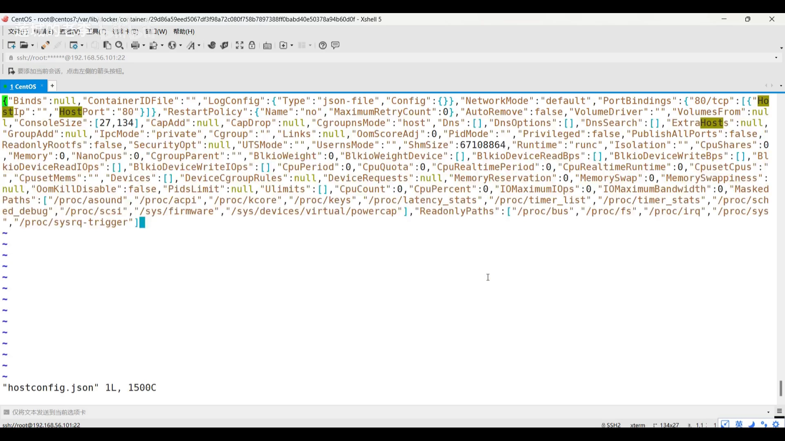

[【跳转到 09:02】](https://www.bilibili.com/video/BV1VC411h7is/?t=542)

### 4.3 第三步：重启 Docker 服务与容器，验证

端口号改完后，把 Docker 服务重启、再把 nginx 容器重启：

```bash
systemctl start docker
docker start nginx
```

然后回到外部机器验证：IP 还是原来的宿主机 IP `192.168.56.101`。**先刷新一下，会发现已经无法访问**——因为原来默认的 80 端口已经被改掉了。此时必须**手动输入 81**：

```
http://192.168.56.101:81
```

回车，又能看到 Nginx 首页——修改端口映射成功。

---

## 五、别忘了防火墙：宿主机端口要开放

### 5.1 两种开放端口的方法

将来会有很多容器在 Docker 里启动，每个容器都有对应的端口；而所有容器的端口都必须借助宿主机的端口映射才能提供给外部机器访问，**所以宿主机上这些端口都必须开放出来**。

开放端口主要指**在防火墙里开放端口**，有两种办法：

1. **手动运行命令**，把对应端口添加到防火墙里；添加完把防火墙操作重启一下，配置立即生效；
2. **把防火墙停止掉**，并且在**开机时也禁止它自动启动**。

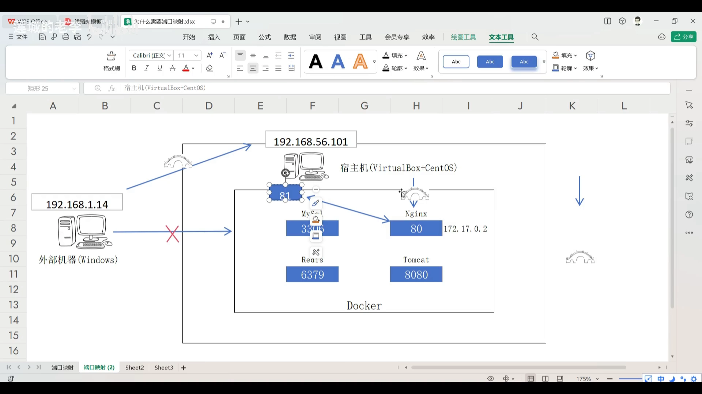

[【跳转到 11:07】](https://www.bilibili.com/video/BV1VC411h7is/?t=667)

### 5.2 安全性权衡

第二种方案是图省事的方案，但**安全性降低了**——这一点"见仁见智，自个儿看着办"。生产环境更推荐第一种：只开放真正需要对外开放的端口。

---

## 小结

- 外部机器访问容器有**两个先决条件**：能连到宿主机、能访问到容器端口。
- **端口映射 = 把宿主机端口与容器端口绑定**；外部机器访问宿主机端口即等同访问容器端口。
- 配置：`docker run -p <宿主机端口>:<容器端口>`；省略宿主机端口会**随机分配**，一般不推荐。
- 查看：`docker port <容器名>` 看单个容器；`docker ps -a` 看所有容器。
- 修改：`systemctl stop docker` → 改 `/var/lib/docker/containers/<ID>/hostconfig.json` 的 `PortBindings.HostPort` → 重启 Docker 与容器。
- 宿主机端口需在**防火墙**里开放（加规则或停用防火墙），并注意其中的**安全取舍**。

## 关键术语速查

| 术语 | 一句话解释 |
| --- | --- |
| 端口映射 | 把宿主机端口与容器端口绑定，让外部能通过宿主机访问容器服务 |
| `-p` | `docker run` 的端口映射参数，格式 `<宿主机端口>:<容器端口>` |
| 随机端口 | 省略宿主机端口时 Docker 自动分配的端口 |
| `docker port` | 查看某个容器端口映射的命令 |
| `docker ps -a` | 列出所有容器（含未运行），可看端口映射 |
| `hostconfig.json` | 容器目录下记录配置（含端口绑定）的文件 |
| `PortBindings` | hostconfig.json 中端口映射配置项；`HostPort` 为宿主机端口，`HostIp` 控制可访问来源 |
| `docker inspect` | 查看容器详细信息（本例取容器 IP） |
| 防火墙开放端口 | 让外部机器能访问宿主机端口的前置条件 |
