# Docker 端口映射的底层原理：`-p` 只是一个"自动写 iptables 的脚本"

> 本文整理自 B 站视频《Docker端口映射底层实现原理：-p只是iptables的自动脚本》。全文只想讲清一件事：`docker run -p` 到底做了什么？它凭什么能把宿主机端口"映射"到容器里？以及——如果当初忘了加 `-p`，还能不能补救？

## 本讲要解决的核心问题（SCQA）

**背景**：用 `docker run -p 8080:80` 就能把宿主机的 8080 端口映射到容器的 80 端口。一条命令，看起来像黑魔法。

**冲突**：可这个"映射"并不是 Docker 自己实现的——Docker 只是一个普通的用户态进程，跟一个跑起来的 Java 进程没有本质区别，它凭什么能改动网络？更麻烦的是：脚本里忘了加 `-p`，容器已经跑了、数据也攒下了、又不想销毁重建，还能不能补救？

**疑问**：`-p` 背后到底是什么机制？如果不用 `-p`，我能不能自己动手实现一模一样的效果？

**回答（中心思想）**：Docker 的端口映射完全建立在 Linux 内核的 **netfilter**（也就是 `iptables` 所操作的框架）之上。**`-p` 本质上只是一个"自动替你写 iptables 规则"的脚本**；看懂它写下的那几条 iptables 规则，你就能手动实现完全相同的效果——于是即便当初忘了加 `-p`，也能事后把容器端口暴露出去。

---

## 一、Docker 没有"独立网络转换能力"，端口映射全靠 iptables

### 1.1 Docker 只是个普通进程，它不是网卡也不是防火墙

很多人以为 `-p` 是 Docker 自带的某种网络功能。但事实是：**Docker 本身不具备独立的网络地址转换能力**。它就是一个用户态的普通进程——和你 `java -jar` 跑起来的那个进程，地位是一样的。

Docker 暴露端口的参数用得特别多：`-p`（小写）和 `-P`（大写）。但包括云原生开发者和一些基础 Linux 运维人员在内，很多人"只知其然、不知其所以然"——感觉会用就行，没必要搞懂底层细节。

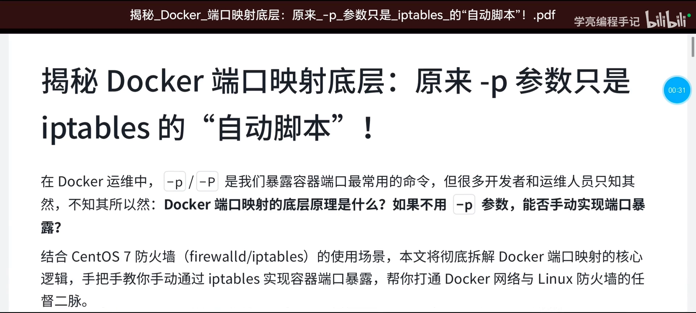

[【跳转到 00:32】](https://www.bilibili.com/video/BV1nXNczeEwk/?t=32)

但一旦端口映射真出了问题，不知道原理的人就"懵了"。所以搞技术的人还是得了解它的底层原理。

### 1.2 一个经典场景：忘了加 `-p`，又不想重建容器

为什么要讲这个原理？视频给了一个很真实的场景：

> 某人写了一个 Docker 运行脚本，但**忘了加 `-p`**。容器运行了一段时间、积累了一定数据，又不想把它销毁重建（重新跑一个），只能在现有基础上再调整。

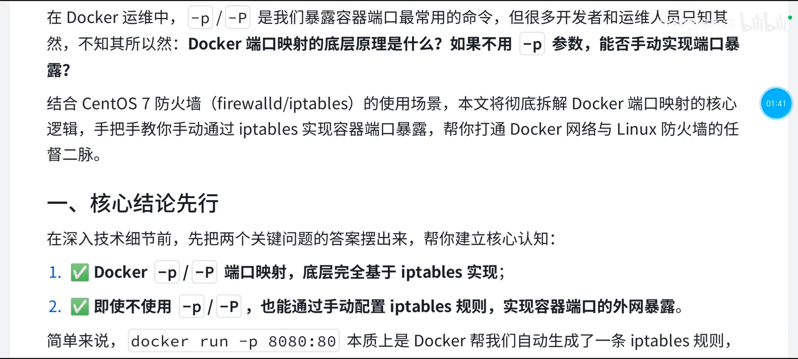

[【跳转到 01:42】](https://www.bilibili.com/video/BV1nXNczeEwk/?t=102)

这时最便捷的途径，就是**直接用 iptables** 来管理端口映射——前提是你懂底层原理。视频以 **CentOS 7** 为例（生产环境里 CentOS 7 管理防火墙的主要工具是 `firewalld`），而 `firewalld` 和 `iptables` 都基于 netfilter，本质上只是命令上大同小异，都是用户态的防火墙管理工具。

### 1.3 顺带一提：Docker 会"绕过"你的防火墙

从运维角度看，Docker 的这套玩法其实"不太地道"：我们总希望有一个统一入口来管理防火墙，但 **Docker 作为用户态进程，可以绕过 firewalld，直接去操作 iptables 的规则**——"我不听你指挥，我想怎么搞就怎么搞"，没有统一的规范和行动。

**结论先摆出来**：

1. Docker 的端口映射与 iptables **紧密相关，底层完全基于 iptables 实现**。默认装完 Docker 后，`iptables` 里就会多出以 `DOCKER` 命名的链，而且不止一条。
2. 即便不使用 `-p`，**也可以手动配置 iptables 规则**来实现容器端口的外网暴露。


[【跳转到 04:53】](https://www.bilibili.com/video/BV1nXNczeEwk/?t=293)

举个对照：我 `run` 一个容器 `-p 8080:80`，把宿主机 8080 映射到容器 80 端口——**本质上就是 Docker 自动生成了一条 iptables 规则**；而手动配置 iptables，就是跳过 Docker 的自动脚本、自己掌控这套端口映射逻辑。

而 `-p` 之所以能工作，是因为它最终依赖的是 **Linux 内核的 netfilter 框架**；`iptables` 只是操作 netfilter 规则的一个命令行工具。执行 `-p` 时，Docker 会自动在 iptables 里添加**三类关键规则**，完成端口映射的全流程——用户感觉特别便捷，但背后一点也不神奇。

---

## 二、Docker 启动时就铺好的地基：`docker0` 与容器网段

要理解那三类规则，先要知道 Docker 启动时为你准备了什么。

### 2.1 `docker0`：Docker 建的虚拟网桥

Docker 启动之后，**首先创建了 `docker0` 这个虚拟网卡（网桥）**。接触过 Docker 的人基本都见过它。

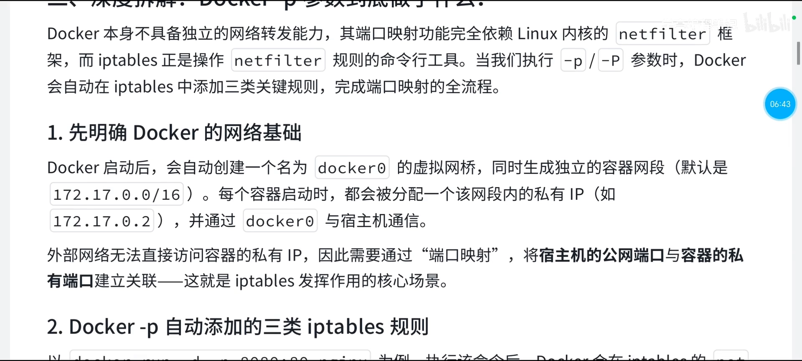

### 2.2 默认网段 172.17.0.0/16，容器从 `.2` 开始分配

同时，Docker 会生成一个**独立的容器网段**，这个网段可以调整、也可以配置，**默认是 `172.17.0.0/16`**。每个容器启动后，都会被分配该网段内的一个 IP，例如 `172.17.0.2`。

这里有个细节：**为什么容器 IP 从 `.2` 开始？** 因为 `172.17.0.1`（`.1`）一般被用作**网关**，也就是 `docker0` 自己的地址，容器通过它跟宿主机通信。

### 2.3 私有 IP 外部访问不到，所以要映射

容器拿到的是私网地址，**外部网络无法直接访问容器的私有 IP**。所以必须通过端口映射，把**宿主机的公网端口**与**容器的私有端口**建立关联——这，正是 iptables 发挥作用的核心场景。

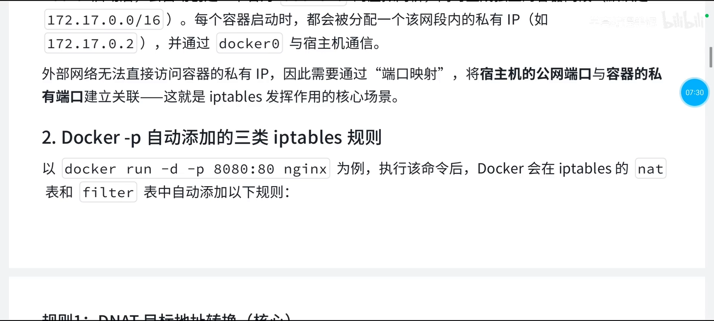

[【跳转到 07:33】](https://www.bilibili.com/video/BV1nXNczeEwk/?t=453)

---

## 三、一次端口映射 = iptables 的三类规则

以 Nginx 容器为例：它在宿主机上暴露的端口是 `8080`，容器内是 `80`。Docker 会在 iptables 的 **nat 表**和 **filter 表**中自动添加以下几类规则。

### 3.1 规则一：DNAT（目标地址转换）——把进来的包改地址

第一条规则是 **DNAT（Destination NAT，目标地址转换）**：把发往"宿主机 8080"的包，改写成发往"容器 `172.17.0.2:80`"。

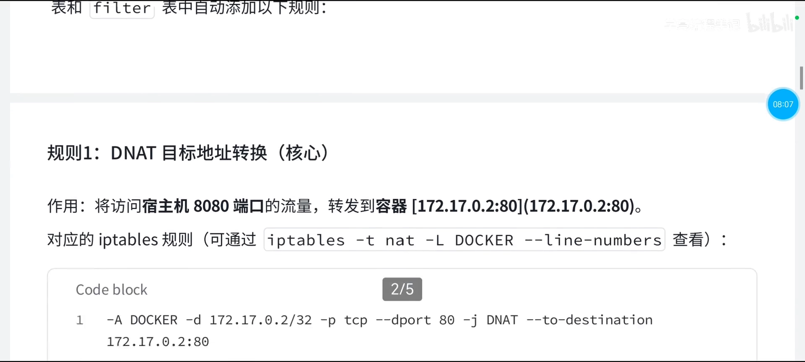

对应的 iptables 命令操作的是 **nat 表的 `DOCKER` 链**（可以用 `iptables -t nat` 查看），大致形态是：

```bash
iptables -t nat -A DOCKER -p tcp --dport 8080 -j DNAT --to-destination 172.17.0.2:80
```

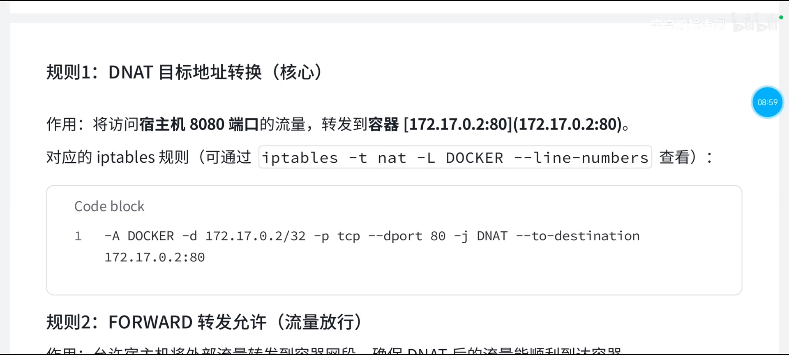

逐段读这条命令：

- `-t nat`：操作 nat 表；
- `-A DOCKER`：`-A` 就是 **append**，往 `DOCKER` 这个链尾部追加一条规则；
- `-p tcp`：匹配 TCP 协议；
- `--dport 8080`：匹配**目标端口 8080**（即宿主机对外的端口）；
- `-j DNAT`：执行动作是目标地址转换；
- `--to-destination 172.17.0.2:80`：把目的地址改写为容器的 `172.17.0.2:80`。

[【跳转到 09:03】](https://www.bilibili.com/video/BV1nXNczeEwk/?t=543)

### 3.2 规则二：FORWARD（转发放行）——确保包真的能到达容器

只做地址改写还不够。改完地址后，包还需要被"放行转发"到容器所在的网段，才能顺利到达容器。所以第二条规则在 **filter 表的 `DOCKER` 链**里追加一条 `ACCEPT`：

```bash
iptables -A DOCKER -j ACCEPT
```

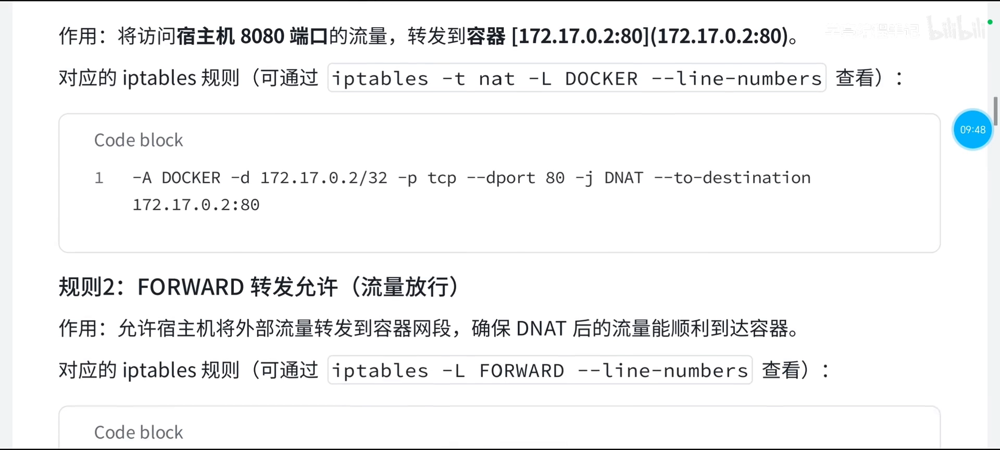

注意：filter 表是默认表，所以不用写 `-t filter`；但要指定 `-A DOCKER` 这个链。其中我们主要关注的是 `-j ACCEPT`——允许。

[【跳转到 09:52】](https://www.bilibili.com/video/BV1nXNczeEwk/?t=592)

### 3.3 规则三：SNAT / MASQUERADE——让容器能访问外网

第三条规则属于**另一个方向**：**SNAT（Source NAT，源地址转换）**，也就是"伪装"。

当容器要**访问外网**时（比如容器里跑着 Nginx，其中的负载均衡要去调用别的服务器），容器发出的包源地址是私有 IP，外网无法回包。于是需要**把源地址伪装成宿主机的公网 IP**，确保外网能正常回包。

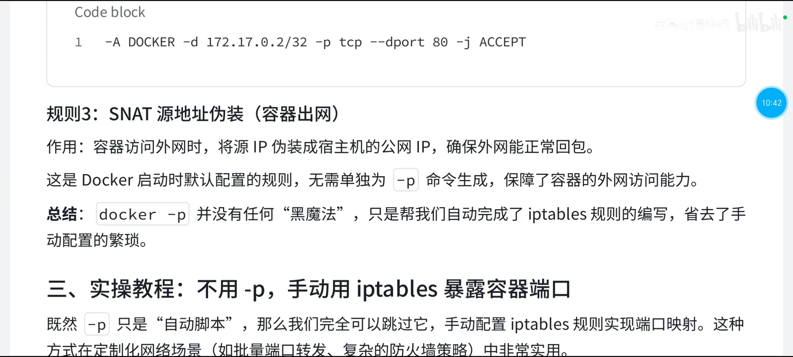

**关键区别**：这条规则**不是执行 `-p` 时才生成的**，而是 **Docker 启动时就配置好的默认规则**——它是保障"容器能访问外网"的基础能力。

[【跳转到 10:46】](https://www.bilibili.com/video/BV1nXNczeEwk/?t=646)

### 3.4 小结：使用 `-p` 与不用 `-p` 只是"谁写规则"的区别

把三条规则串起来看，结论就很清楚了：

- 使用 `-p`：Docker 自动帮你写好这些 iptables 规则；
- 不使用 `-p`：你把这几条规则**手动加进去**，效果完全一样。

"Docker 能写，你为什么不能写？你同样能写，只不过它帮你完成了而已。"——`-p` 提供的价值是**自动化程度更高**，而这份自动化在**批量端口转发、复杂防火墙策略**等定制化网络场景里其实是可以自己接管的。

---

## 四、不用 `-p` 也能量：手动配置 iptables 实战

理论讲完，进入实操。假设我们有一个 Nginx 容器，想把它暴露到宿主机的 **8081** 端口。

### 4.1 第一步：拿到容器的私有 IP

用 `docker inspect` 可以查看容器的私有 IP；默认输出内容很多，可以用 `--format` 只取我们要的 `IPAddress`：

```bash
docker inspect --format '{{ .NetworkSettings.IPAddress }}' <容器名或ID>
```

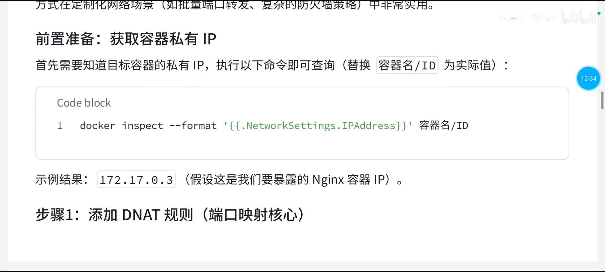

假设取到的容器 IP 是 `172.17.0.3`。

[【跳转到 12:39】](https://www.bilibili.com/video/BV1nXNczeEwk/?t=759)

### 4.2 第二步：加 DNAT 规则（端口映射的核心）

```bash
iptables -t nat -A DOCKER -p tcp --dport 8081 -j DNAT --to-destination 172.17.0.3:80
```

这里把宿主机 `8081` 映射到容器的 `80`。视频里还特别提醒了一个易错点：**`--dport` 写错端口是常见疏忽**——它必须写你要暴露的宿主机端口（8081，而不是随手的 80），否则映射关系就完全跑偏了。

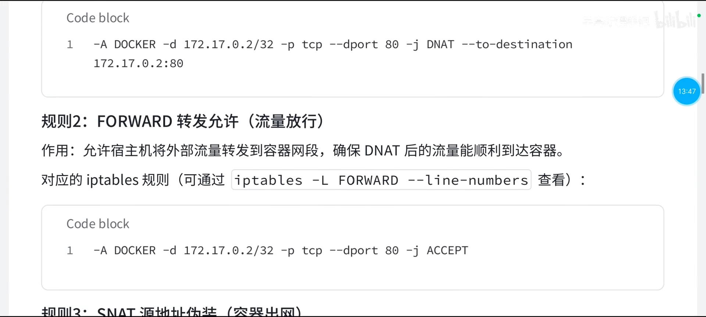

[【跳转到 13:53】](https://www.bilibili.com/video/BV1nXNczeEwk/?t=833)

### 4.3 第三步：加 FORWARD 放行规则

```bash
iptables -A DOCKER -j ACCEPT
```

这就是让宿主机把流量**放行转发**到容器。它操作的是 filter 表的 `DOCKER` 链（默认表，无需写 `-t filter`）。

至于第三条 SNAT/伪装规则，**Docker 启动时默认就配好了**，不用我们再手工添加。

### 4.4 验证：访问宿主机的 8081

完成上面两条规则的编写后，直接在宿主机（或外部机器）访问 **8081** 端口：

```bash
curl http://<宿主机IP>:8081
```

如果 Nginx 的 `index.html` 没做过改动，你应该能看到它的默认页面——**这说明手动配置的 iptables 规则已经生效了**。

---

## 五、规则是"临时"的：持久化，以及和 firewalld 的关系

### 5.1 重启就丢：为什么必须做持久化

上面用 `iptables` 敲进去的规则，**默认是临时的——宿主机重启之后就会全部丢失**。所以要让映射长期有效，必须做**规则持久化**。

### 5.2 两种持久化方式

1. **`service iptables save`**：如果启用了 iptables 服务，可以直接用它保存。
2. **`iptables-save` + `iptables-restore`（更通用，推荐）**：

```bash
iptables-save > /etc/sysconfig/iptables      # 把当前规则写进文件
iptables-restore < /etc/sysconfig/iptables   # 从文件恢复规则
```

可以把这理解成**数据库的备份与恢复**。

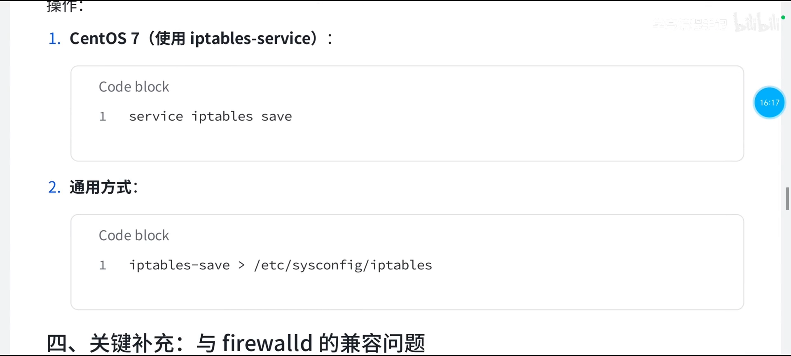

[【跳转到 16:23】](https://www.bilibili.com/video/BV1nXNczeEwk/?t=983)

### 5.3 和 firewalld 的关系

- Docker 直接操作底层 iptables 规则，**无论宿主机是否启用 firewalld，都不影响 Docker 的端口映射功能**。
- firewalld 本身也是基于 iptables 实现的，只是提供了更友好的管理界面。
- **手动添加的 iptables 规则优先级高于 firewalld 的默认规则**，所以它能"绕过" firewalld。

如果你需要**同时**使用 firewalld 和手动 iptables 功能，一般建议：**先停掉 firewalld**，或者配置 firewalld 的直连规则，避免规则冲突。

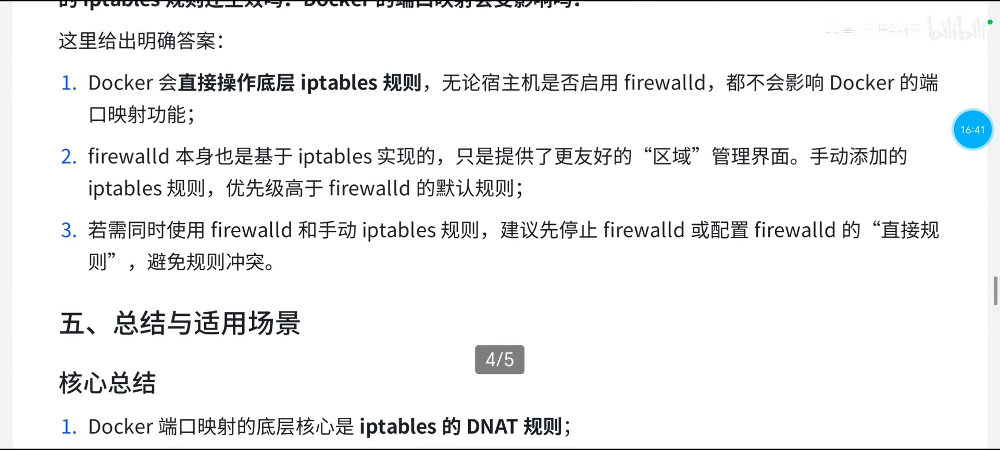

[【跳转到 16:48】](https://www.bilibili.com/video/BV1nXNczeEwk/?t=1008)

---

## 小结

- **Docker 没有独立的网络转换能力**，它只是个用户态普通进程；端口映射完全依赖内核的 netfilter 框架。
- **`-p` 只是"自动生成 iptables 规则"的脚本**——它写下的规则，你手动同样能写。
- 一次端口映射对应三类规则：
  1. **DNAT**：nat 表 `DOCKER` 链，把宿主机端口的包改写到容器地址；
  2. **FORWARD ACCEPT**：filter 表放行转发，让包能到达容器；
  3. **SNAT / 伪装**：容器出网时改写源地址，**启动时默认就有**。
- 不用 `-p` 时的手动流程：`docker inspect --format` 取容器 IP → 加 DNAT 规则 → 加 FORWARD 放行规则 → 访问宿主机端口验证。
- iptables 规则**默认临时**，重启即失；用 `service iptables save` 或 `iptables-save` / `iptables-restore` 持久化。
- 手动 iptables 规则**优先级高于 firewalld**，可绕过它；两者并用时先停 firewalld 或配置直连规则。

## 关键术语速查

| 术语 | 一句话解释 |
| --- | --- |
| netfilter | Linux 内核里的网络数据包处理框架，防火墙与 NAT 的真正实现所在 |
| iptables | 操作 netfilter 规则的命令行工具（用户态） |
| `-p` / `-P` | `docker run` 的端口映射参数，本质是自动写 iptables 规则 |
| docker0 | Docker 启动时创建的虚拟网桥，容器默认接在它上面 |
| 172.17.0.0/16 | Docker 默认容器网段；`.1` 为网关、容器 IP 从 `.2` 起分配 |
| nat 表 | iptables 里做地址转换的表，DNAT 与 SNAT 都在这里 |
| filter 表 | iptables 里做放行/拦截的表，转发放行规则在这里 |
| DNAT | Destination NAT，改写目的地址：宿主机端口 → 容器端口 |
| SNAT / MASQUERADE | Source NAT / 伪装，改写源地址：容器 → 宿主机公网 IP |
| FORWARD | 内核转发链，决定包能否从一个网卡转发到另一个网卡 |
| 持久化 | 把临时 iptables 规则保存到文件，重启后恢复 |
| firewalld | CentOS 7 默认防火墙管理工具，同样基于 netfilter，但可被手动 iptables 规则绕过 |
