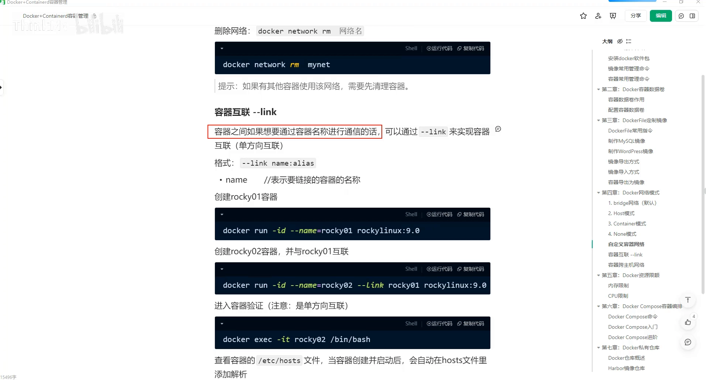
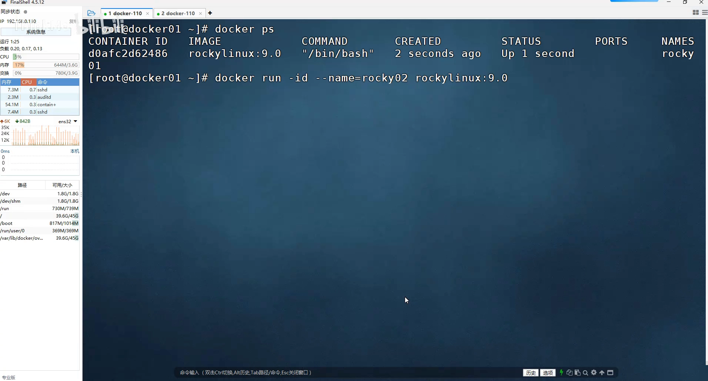
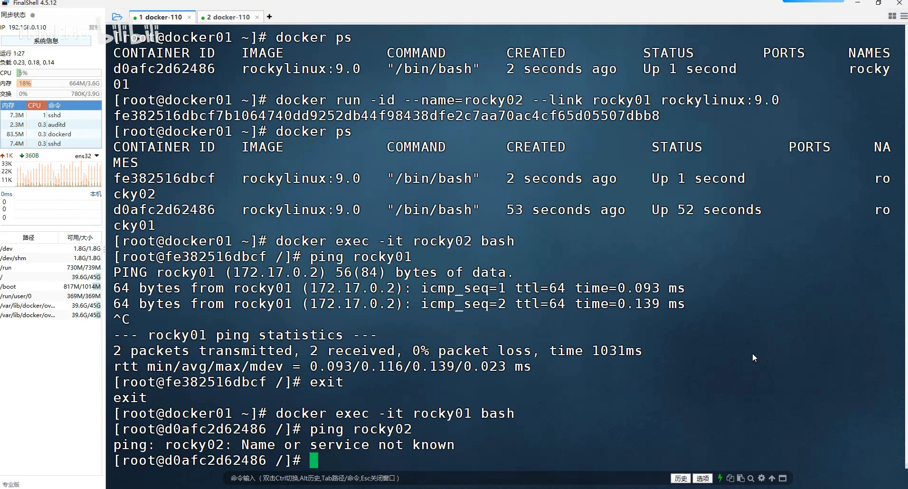
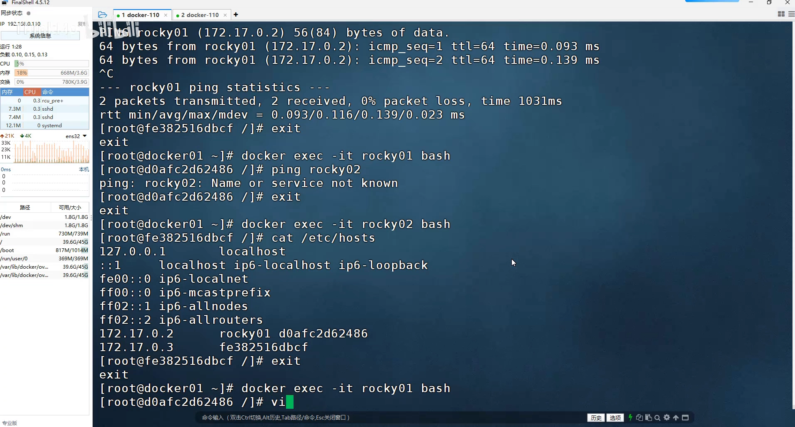

# 容器互联的真相：--link 其实就是往 /etc/hosts 里写了一条解析

> 本文整理自 B 站视频《Docker容器互联：Link与Hosts配置》。它用一个实验把"容器互联"这件看似玄乎的事拆开：**`--link` 并没有做什么魔法，它只是往目标容器的 `/etc/hosts` 里加了一行解析**。

## 本讲要解决的核心问题（SCQA）

**背景**：在同一个网络里的两个容器，本来就可以用 IP 互相通信。

**冲突**：但 IP 不好记、还会变；我们更希望"用容器名就能访问对方"——这就是所谓的"容器互联"。

**疑问**：容器名是怎么变成能 ping 通的地址的？`--link` 到底在背后干了什么？为什么有人说它"基本上没啥用"？

**回答（中心思想）**：`--link` 做的事很简单——**它在创建容器时，往容器的 `/etc/hosts` 文件里写进一条"容器名→IP"的解析记录**，于是名字就能被解析了。理解了这一点，你既知道它为什么默认**单向**，也知道它为什么**容器一重启就失效**——因为写死的 IP 变了。

---

## 一、什么是容器互联：从"按 IP 通信"到"按名字通信"

- 容器之间**本身就能通过 IP 地址通信**，这是默认就有的。
- 但我们也可以让它**通过容器名称来通信**，这就叫**容器互联**。
- 实现方式是通过 **`--link`**；而且默认情况下互联是**单方向的**。
- `--link` 的格式里，还可以用 `:别名` 的方式给被连接的容器**起一个别名**，不过在互联时基本上用不着。

[【跳转到 00:10】](https://www.bilibili.com/video/BV15oYKz5E34/?t=10)



---

## 二、动手实验：用 --link 连接两个容器

### 2.1 先建两个容器

先建第一个容器，命名为 `rocky01`，镜像用 `rockylinux 9.0`：

```bash
docker run -itd --name rocky01 rockylinux:9.0
```

[【跳转到 00:40】](https://www.bilibili.com/video/BV15oYKz5E34/?t=40)

然后再建第二个容器 `rock02`。我们希望这两个容器之间**可以通过名称相互访问**。

### 2.2 加上 --link

因为它们都在同一个网络下，既能按 IP 访问，又想能按名字访问，于是创建 `rock02` 时加上 `--link`，指定要跟哪个容器按名字互联：

```bash
docker run -itd --name rock02 --link rock01 <镜像>
```

就这么简单——`--link rock01` 表示"我想跟 `rock01` 这个容器按名称相互访问"。

[【跳转到 01:05】](https://www.bilibili.com/video/BV15oYKz5E34/?t=105)



---

## 三、它是单向的：一个方向能通，另一个方向不通

这是最容易被忽略的一点：**`--link` 默认是单方向的。**

- 进入 `rock02`，去 ping `rock01`：**能 ping 通**。
- 反过来进入 `rock01`，去 ping `rock02`：**不通。**

[【跳转到 01:30】](https://www.bilibili.com/video/BV15oYKz5E34/?t=130)

如果你希望**双向**都能按名字访问，就需要**两边都加上 `--link`**，让它别只是单方向的。

---

## 四、本质：--link 改的是容器的 /etc/hosts 文件

那么"容器互联"的本质到底是什么？进入 `rock02` 容器，看它的 `/etc/hosts` 文件就明白了：

**你在创建容器时加的那个 `--link`，就等于改了容器里的 hosts 文件**——它把 `rock01` 这个**容器名**、`rock01` 的**容器 IP**、以及它的**容器 ID** 都写成了一条解析记录。也就是说，它只是**在容器里替你添加了一条解析**。

[【跳转到 03:00】](https://www.bilibili.com/video/BV15oYKz5E34/?t=180)



---

## 五、既然只是改 hosts，那我们自己也能改——以及为什么它"没啥用"

### 5.1 手动改 hosts 就能实现同样的效果

既然 `--link` 只是加了一条解析，那你**完全可以手动实现，不必非得用 `--link`**：

进入 `rocky01` 容器，自己编辑它的 `/etc/hosts`，加一行解析，把 `rock02` 的地址（视频里是 `172.17.0.3`）对应到名字 `rock02`，保存即可。之后在 `rock01` 里 ping `rock02`，一样能通——这就是"容器互联"。

[【跳转到 03:50】](https://www.bilibili.com/video/BV15oYKz5E34/?t=230)



### 5.2 致命弱点：容器重启，IP 变了就失效

这种把 **IP 写死在 hosts 里**的做法有个致命弱点：**容器一旦重启，IP 就变了，那条解析就失效了。** 正因如此，视频里直言：**这玩意基本上没啥用**。

> 想让"按名字访问"真正可靠，应该用**用户自定义网络的内嵌 DNS**——它会实时解析、不受 IP 变动影响。详见本条目另一篇《[为什么容器能用名字互相访问：Docker 的内嵌 DNS 只在自定义网络里生效](How Docker Container DNS Resolution Works.md)》。

---

## 小结

- 容器默认就能按 IP 通信；让它**按名字通信**就是"容器互联"，靠 **`--link`** 实现，**默认单向**，还可用 `:别名` 起别名（基本用不着）。
- 实验：建 `rocky01` 与 `rock02`，创建 `rock02` 时加 `--link rock01`——`rock02` 能 ping 通 `rock01`，反向不通；要双向就两边都加。
- **本质**：`--link` 就是往容器的 **`/etc/hosts`** 里写一条"容器名 / IP / 容器 ID"的解析记录。
- 既然只是改 hosts，**手动编辑 `/etc/hosts` 也能实现**同样的效果。
- **弱点**：IP 是写死的，**容器重启 IP 一变就失效**——所以 `--link` 基本没用了，可靠的做法是自定义网络的内嵌 DNS。

## 关键术语速查

| 术语 | 一句话解释 |
| --- | --- |
| 容器互联 | 让容器之间按"名字"而非 IP 互相访问 |
| `--link` | 创建容器时建立名字解析，本质是往对方 `/etc/hosts` 写记录 |
| 单向互联 | `--link` 默认只在一个方向加解析，反向需另行 `--link` |
| `/etc/hosts` | 容器内的本地静态解析表，`--link` 与手动编辑都改这里 |
| IP 失效问题 | 容器重启后 IP 改变，写死在 hosts 里的解析随之失效 |
