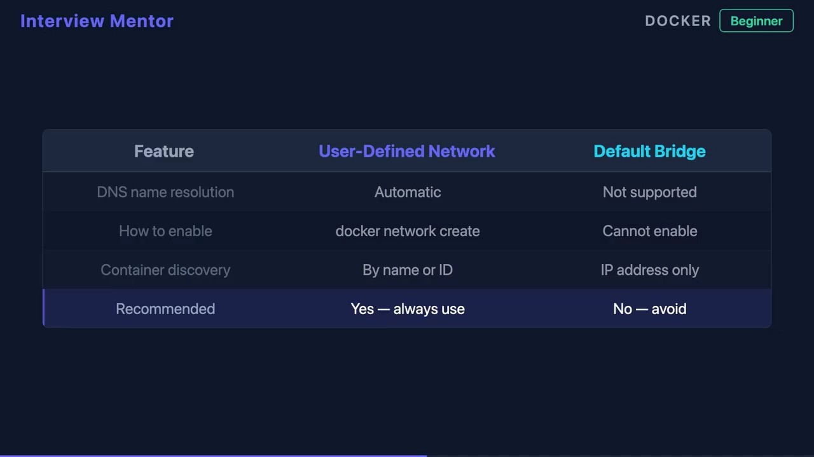

# 为什么容器能用名字互相访问：Docker 的内嵌 DNS 只在自定义网络里生效

> 本文整理自 YouTube 视频《How Docker Container DNS Resolution Works》。它点破了一个很多人踩过的坑：**同一句"用服务名访问对方"，在 Docker Compose 里好使，换成裸 `docker run` 就失败**——差别就在这背后的一套内嵌 DNS。

## 本讲要解决的核心问题（SCQA）

**背景**：容器之间经常要靠"名字"互相访问，比如一个容器去连名为 `database` 的另一个容器。

**冲突**：同样一句话，在 Compose 里写服务名就能通，改用裸 `docker run` 却失败。代码没变，为什么行为不一样？

**疑问**：容器名是怎么被解析成 IP 的？为什么有时能用、有时不能用？

**回答（中心思想）**：**Docker 引擎里内嵌了一台 DNS 服务器**。当容器尝试按名字访问另一个容器时，Docker 会拦截这条 DNS 查询，自动解析成目标容器的 IP——**但这个自动解析只对"用户自定义 bridge 网络"生效，默认 bridge 网络没有这个能力**。Compose 之所以"名字即通"，就是因为它自动为每个项目建了一个自定义网络。

---

## 一、Docker 引擎里藏着一台 DNS 服务器

Docker 引擎内部**内嵌了一台 DNS 服务器**。当容器 A 想按名字访问容器 B 时：

1. A 发出一条 DNS 查询，问"名叫 B 的机器 IP 是多少"；
2. Docker **拦截**这条查询；
3. Docker 把它**自动解析成目标容器 B 的 IP 地址**。

[【跳转到 00:00】](https://www.youtube.com/watch?v=9JsrGddp7EU&t=0)

### 为什么这件事很重要

因为**容器的 IP 每次重启都会变**。如果你在配置里写死了 IP，容器一重启就得改配置。而按"名字"来引用容器，就能让整套架构保持稳定——名字不变，IP 变了也照样找得到。

---

## 二、关键细节：自动名字解析只在自定义 bridge 网络生效

这是全篇最重要的一句话：**这种自动名字解析，只在"用户自定义 bridge 网络（user-defined bridge network）"上工作。**

- 当你用 `docker network create` 创建一个网络时，**Docker 会把该网络上的每个容器都接到它的 DNS 服务器上**。
- 于是这个网络里的**任意容器都能通过名字或容器 ID 到达任意另一个容器**，而且是**实时的**——容器来来去去都能即时解析到。

[【跳转到 00:25】](https://www.youtube.com/watch?v=9JsrGddp7EU&t=25)

---

## 三、默认 bridge 网络没有这个能力

Docker 在你**不指定网络**时会分配一个**默认 bridge 网络**。关键点是：**默认 bridge 拿不到这套 DNS 功能。**

在默认 bridge 上，你只剩两条路：

- 用**老旧的 `--link` 参数**；
- 或者**手动记录并维护 IP 地址**。

这两条都**很脆弱**（fragile）——一旦容器重建、IP 变化，就容易失效。

[【跳转到 00:50】](https://www.youtube.com/watch?v=9JsrGddp7EU&t=50)

> 想深挖 `--link` 到底做了什么、为什么"脆弱"，可对照本条目另一篇《[容器互联的真相：--link 其实就是往 /etc/hosts 里写了一条解析](Docker容器互联：Link与Hosts配置.md)》。

---

## 四、Compose 与 Kubernetes：把同一套机制顺延下去

**Docker Compose** 之所以让"服务名即通"，是因为它**自动为每个项目创建一个用户自定义网络**——于是前面那套内嵌 DNS 直接生效，服务名自然就能互相解析。

**Kubernetes** 则在此基础上更进一步：它为**每个 Service 提供集群范围的 DNS 记录**，让服务名的解析能力扩展到整个集群。

### 一句话总结（面试版）

> Docker 内嵌的 DNS 会把容器名解析成 IP，**但只在用户自定义网络上生效，默认 bridge 网络不行。**

[【跳转到 01:15】](https://www.youtube.com/watch?v=9JsrGddp7EU&t=75)

---

## 小结

- Docker 引擎**内嵌一台 DNS 服务器**，会拦截容器按名字发出的查询，并解析成目标容器的 IP。
- 按名字（而非 IP）引用容器，能在"IP 每次重启都变"的环境里保持架构稳定。
- **自动名字解析只在用户自定义 bridge 网络生效**：`docker network create` 会把网络里的容器都接到内嵌 DNS 上，任意容器可按名字或容器 ID 实时互访。
- **默认 bridge 网络没有这个功能**，只能用老旧的 `--link` 或手动维护 IP（都不稳）。
- **Compose** 自动为每个项目建自定义网络，所以服务名"开箱即用"；**Kubernetes** 进一步提供集群级的 Service DNS。

## 关键术语速查

| 术语 | 一句话解释 |
| --- | --- |
| 内嵌 DNS（embedded DNS） | Docker 引擎内置的 DNS 服务器，负责把容器名解析成容器 IP |
| 用户自定义 bridge 网络 | 用 `docker network create` 建的网络，启用自动名字解析 |
| 默认 bridge 网络 | 不指定网络时 Docker 分配的默认网络，**没有**自动名字解析 |
| `--link` | 旧式的容器互联方式，默认 bridge 上勉强能用，较脆弱 |
| 容器 ID / 容器名解析 | 自定义网络上，既可按名字也可按容器 ID 找到对方 |
| Service DNS（K8s） | Kubernetes 为每个 Service 提供的集群范围 DNS 记录 |
