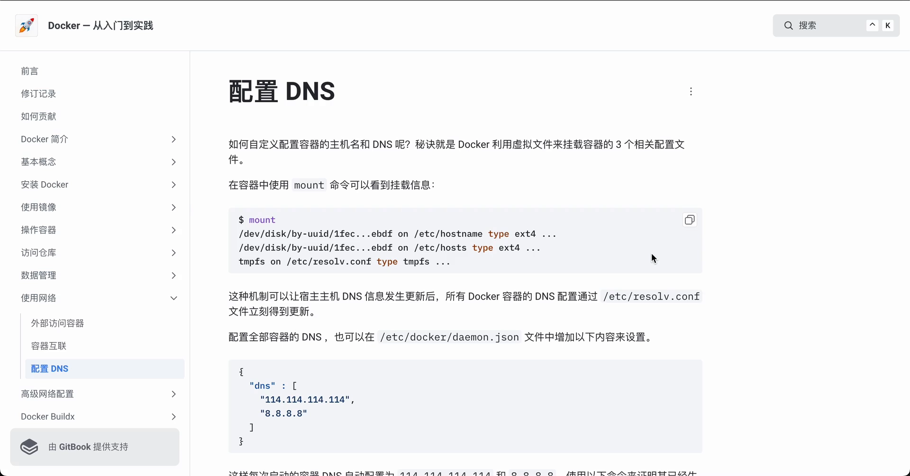
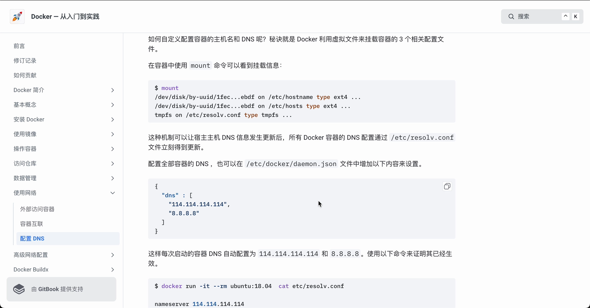
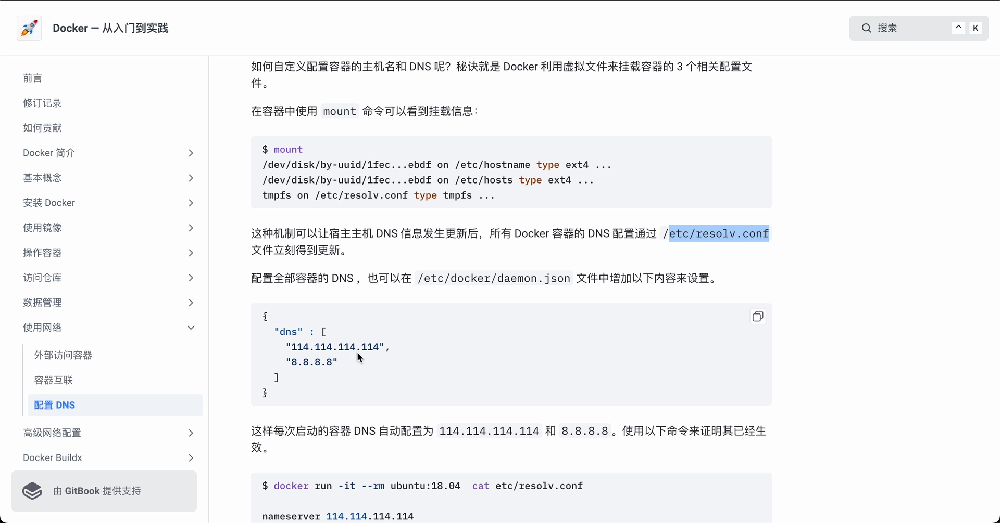
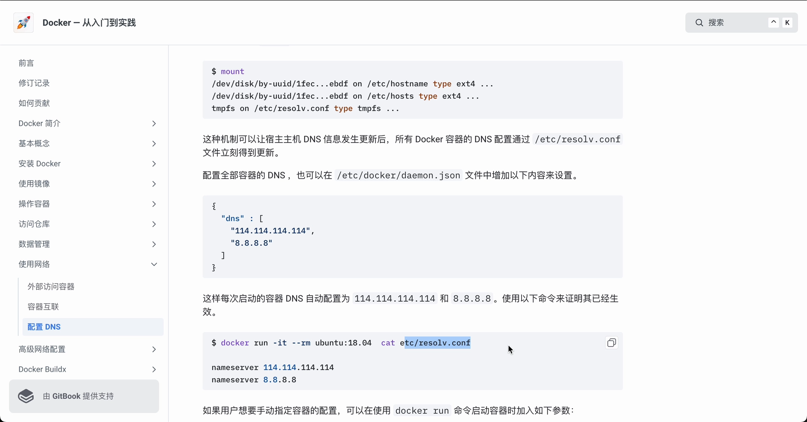
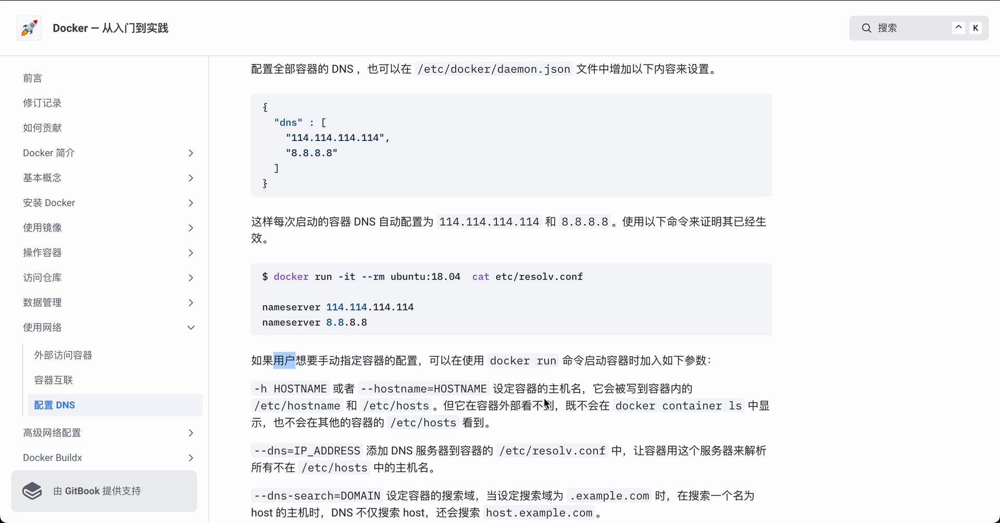
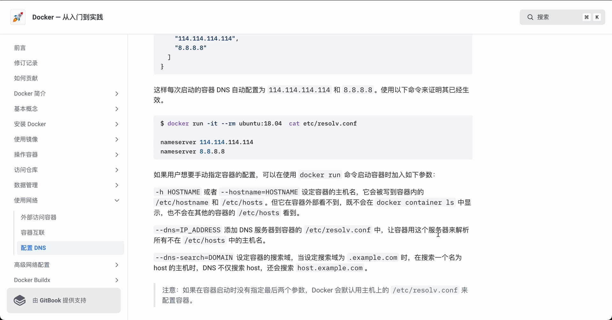

# 容器里的三个"身份文件"：Docker 如何配置主机名与 DNS

> 本文整理自 B 站视频《docker-配置 DNS》。它回答一个小而关键的问题：**容器里的主机名、DNS 配置到底是谁写进去的？** 看清这一点，就能理解为什么"在宿主机上改 DNS，容器里的解析也跟着变"。

## 本讲要解决的核心问题（SCQA）

**背景**：每个容器都像一台独立的小机器，它也有自己的主机名（hostname），也知道该找哪台服务器做域名解析。

**冲突**：可你从没在容器里手动配过这些东西；更奇怪的是，你在宿主机上改了 DNS 服务器，容器里的解析居然也立刻跟着变了。

**疑问**：容器里的主机名和 DNS 究竟是谁配的？宿主机的改动为什么能"穿透"进容器？我又该怎么手动指定它们？

**回答（中心思想）**：Docker 并不在容器里"自己管一套配置"，而是**用挂载（mount）的方式，把几个虚拟文件挂到容器的三个关键位置**——`/etc/hostname`、`/etc/hosts`、`/etc/resolv.conf`。正因为是挂载，宿主机一改，容器立刻跟着改；而想手动指定，就用 `docker run` 的 `--hostname`、`--dns`、`--dns-search` 三个参数。

---

## 一、容器的主机名与 DNS，靠 Docker "挂"三个文件实现

### 1.1 先认识三个文件

在 Linux 里，和"我是谁、该找谁做解析"有关的一共三个文件：

| 文件 | 管什么 |
| --- | --- |
| `/etc/hostname` | 这台机器自己的名字（hostname） |
| `/etc/hosts` | 本地静态解析表：把某些名字直接映射成 IP，命中就不再走 DNS |
| `/etc/resolv.conf` | 该用哪台 DNS 服务器去解析域名 |

### 1.2 秘诀：不是写进容器，而是"挂载"进容器

Docker 的做法，是**利用虚拟文件把容器的这几个相关配置文件挂载进去**。好处是容器本身不必保存一份固定副本——配置的"真身"仍在宿主机侧，容器只是"看到"了它。

要亲眼看到这个挂载关系，在容器里执行 `mount` 命令就能看到这些配置文件的挂载信息。

[【跳转到 00:00】](https://www.bilibili.com/video/BV1zB42167QJ/?t=0)



### 1.3 为什么宿主机一改，容器就跟着改

这套挂载机制带来一个直接后果：**当宿主机的 DNS 信息发生更新时，所有 Docker 容器的 `/etc/resolv.conf` 会立刻同步更新**。也就是说，你不必逐个进容器改，改一次宿主机，全体容器一起生效。

---

## 二、想统一改，两种典型做法

### 2.1 改宿主机，全部容器跟着变

如上一节所说，改宿主机的 DNS 配置，所有容器都会通过 `/etc/resolv.conf` 立刻拿到更新。

### 2.2 在 daemon.json 里设置，每次启动都自动套用

如果希望**每次启动容器时都自动套用某个 DNS**，可以在 `/etc/docker/daemon.json` 里增加相应配置。这样新起的容器会默认按这里的设置来配 DNS。

[【跳转到 00:25】](https://www.bilibili.com/video/BV1zB42167QJ/?t=25)



配好后，可以用下面这条命令验证是否已经生效——它把容器里的 `/etc/resolv.conf` 打印出来给你看：

```bash
docker run -it --rm <镜像> cat /etc/resolv.conf
```

[【跳转到 00:50】](https://www.bilibili.com/video/BV1zB42167QJ/?t=50)



---

## 三、想单独指定一个容器，用 docker run 的三个参数

如果只是想给**某一个容器**单独指定主机名或 DNS，可以在它启动时用 `docker run` 加参数。视频讲了三个：

### 3.1 `--hostname`：设定容器的主机名

`--hostname`（可简写 `-h`）用来设定容器的主机名。它会被**写入容器的 `/etc/hostname` 和 `/etc/hosts`**。

要注意它的可见范围很有限：这个主机名**在容器外部看不到**，**不会出现在 `docker container ls` 列表里**，**其他容器的 `/etc/hosts` 里也看不到它**。

[【跳转到 01:15】](https://www.bilibili.com/video/BV1zB42167QJ/?t=75)



### 3.2 `--dns=<IP>`：给容器换一台 DNS 服务器

`--dns=<IP>` 会把指定的 DNS 服务器**写进容器的 `/etc/resolv.conf`**。此后，**所有不在 `/etc/hosts` 里的主机名**，都会交给这台服务器去解析。

[【跳转到 01:40】](https://www.bilibili.com/video/BV1zB42167QJ/?t=100)



### 3.3 `--dns-search=<域名>`：设置搜索域

`--dns-search=<域名>` 用来设置容器的**搜索域**。它的作用是：当你解析一个"短名字"时，DNS 会在后面自动补上搜索域再试一次。

例如把搜索域设为 `.example.com`，那么当你去解析名为 `host` 的主机时，DNS **不仅会查 `host`，还会接着查 `host.example.com`**。

[【跳转到 02:05】](https://www.bilibili.com/video/BV1zB42167QJ/?t=125)



---

## 四、什么都不设时，Docker 默认用宿主机的 resolv.conf 副本

如果在启动容器时**没有指定 `--dns` 和 `--dns-search` 这两个参数**，Docker 会**默认拿宿主机上 `/etc/resolv.conf` 的副本**（copy）来配置容器的 DNS。

[【跳转到 02:30】](https://www.bilibili.com/video/BV1zB42167QJ/?t=150)

这正好回扣了开头：默认情况下容器的 DNS 就是"跟着宿主机走"的，所以宿主机一改 DNS，容器也就跟着变。

---

## 小结

- 容器的主机名与 DNS，不是 Docker 逐台配出来的，而是**把 `/etc/hostname`、`/etc/hosts`、`/etc/resolv.conf` 以挂载方式挂进容器**。
- 因为是挂载，**宿主机 DNS 一更新，所有容器的 `/etc/resolv.conf` 立刻同步**。
- 想统一设置，可以改宿主机，或在 `/etc/docker/daemon.json` 里配置，让新容器自动套用；用 `docker run ... cat /etc/resolv.conf` 可验证。
- 想单独指定，用 `docker run` 的 `--hostname`、`--dns`、`--dns-search` 三个参数。
- `--hostname` 写入 `/etc/hostname` 与 `/etc/hosts`，但对外部和其他容器不可见；不指定 `--dns`/`--dns-search` 时，默认用宿主机 `/etc/resolv.conf` 的副本。

## 关键术语速查

| 术语 | 一句话解释 |
| --- | --- |
| `/etc/hostname` | 容器自己的名字，由 `--hostname` 写入 |
| `/etc/hosts` | 本地静态解析表，名字→IP 直接映射，命中不走 DNS |
| `/etc/resolv.conf` | 决定用哪台 DNS 服务器解析域名 |
| `--dns=<IP>` | 指定 DNS 服务器，写进容器的 `/etc/resolv.conf` |
| `--dns-search=<域名>` | 设置搜索域，解析短名时自动补后缀再试 |
| daemon.json | Docker 守护进程配置文件，可统一设置新容器的 DNS |
