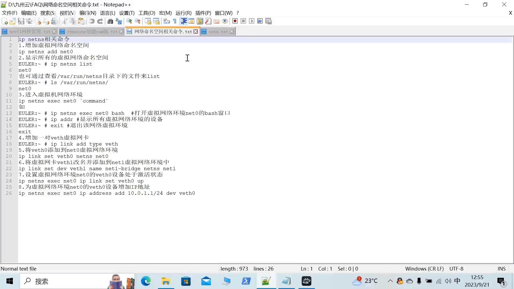

# Linux 网络命名空间实战：用一组命令从零搭起容器网络的底座

> 本文整理自 B 站视频《Linux网络命名空间深入讲解》。这是一节"照着敲"的动手课：它不讲抽象理论，而是把**网络命名空间（netns）**和 **veth pair（虚拟网卡对）**的常用命令，按固定顺序一条条演示出来。看懂这一串命令，你就摸到了 Docker、K8s 网络的最底下一层。

## 本讲要解决的核心问题（SCQA）

**背景**：容器能互相通信、能访问外网，靠的是 Linux 内核提供的两块"积木"——**网络命名空间**和 **veth 虚拟网卡对**。

**冲突**：Docker 把这两块积木包在了 `docker network` 一条命令里，用起来很方便，可一旦网络不通，你根本不知道底层发生了什么，也就无从排查。

**疑问**：如果抛开 Docker，只用系统自带的 `ip` 命令，我们能不能手工搭出一个"有独立网络、又连得通"的命名空间环境？

**回答（中心思想）**：能，而且只需要固定的八步。只要按「**建空间 → 看空间 → 进空间 → 造网线 → 放网线 → 改名 → 激活 → 配 IP**」这条流水线操作，你就亲手复刻了容器网络的地基——而这一套 `ip netns` 与 `ip link` 的组合，正是云计算、分布式系统乃至 Kubernetes 共同的底层。



---

## 一、先分清两个主角：命名空间和虚拟网卡

### 1.1 网络命名空间（netns）：一台"隔离出来的虚拟电脑"

**是什么**：网络命名空间（英文 network namespace，视频里简称 `net ns`）是 Linux 提供的一种网络隔离机制。一个命名空间里，有**自己独立的一套网络设备、IP 地址、路由表**，看起来就像一台独立的电脑。

**为什么需要**：容器要和宿主机、其它容器隔离网络，靠的就是它——每个容器都被放进各自的命名空间，互不干扰。

**怎么用（核心命令）**：创建一个命名空间只要一条命令：

```bash
ip netns add net0
```

这条命令做的事情，是在内核里登记了一个叫 `net0` 的网络命名空间。

### 1.2 veth pair：一根"虚拟网线"

**是什么**：veth pair（虚拟以太网设备对）是**成对出现**的两块虚拟网卡，你可以把它想成**一根网线被剪成两半**——一头叫 `veth0`，另一头叫 `veth1`；往一头塞数据，另一头立刻收到。

**为什么需要**：一个命名空间是"封闭"的，它要跟外面的世界通信，就必须有一根跨出去的"网线"。veth pair 就是这根网线：一端留在容器里，另一端接到外面的网桥上。

**注意**：物理网卡（视频演示环境里是 `eth0` 之类）是能插网线的真实硬件；而 veth 是一对"虚拟的"网卡，是内核用软件造出来的——但它的工作方式和物理网卡**一模一样**，也要配 IP、也要激活，只是没有实体。

---

## 二、动手实操：八步命令

下面这八步，就是视频里那张命令清单的全貌。

### 步骤 1：建一个网络命名空间

```bash
ip netns add net0
```

创建一个名为 `net0` 的网络命名空间。命名空间的名字可以**自定义**——`net0` 表示这是第一个，编号只是习惯。

### 步骤 2：查看当前有哪些命名空间

```bash
ip netns list
```

执行后会列出所有已创建的命名空间（本例中只有一个 `net0`）。

还有第二种等效办法——**直接看目录**：

```bash
ls /var/run/netns/
```

因为每创建一个命名空间，系统都会在 `/var/run/netns/` 目录下登记一个同名文件。看到 `net0` 这个文件，就说明命名空间建好了。

### 步骤 3：进入命名空间里干活

```bash
ip netns exec net0 bash
```

`ip netns exec <名字> <命令>` 的意思是"**在这个命名空间里执行某条命令**"。这里开了一个 `net0` 的 bash 窗口，体验上和 `docker exec` 进容器几乎一样——所以视频里说，"进来"的办法让你一眼就联想到进 Docker 容器。

进去以后可以查看这个命名空间里的网络设备：

```bash
ip addr      # 显示当前（命名空间内）所有网络设备
```

你会发现，新命名空间里设备非常"干净"——只有一块 `lo`（本地回环），而且默认还是 DOWN（未激活）状态。这正是"隔离"的体现：它是一台刚装好、什么都没配的"电脑"。

看完退出：

```bash
exit
```

[【跳转到 03:20】](https://www.bilibili.com/video/BV1qk4y1F72D/?t=200)

### 步骤 4：造一对 veth 虚拟网卡

```bash
ip link add type veth
```

`ip link add` 用来新增网络设备，`type veth` 表明要建的是"成对"的虚拟网卡——**一条命令，同时生出两块网卡**（默认是 `veth0` 和 `veth1`）。

> 提示：`ip link add` 的完整写法一般是 `ip link add veth0 type veth peer name veth1`（由你自己指定两端的名字）。视频里的清单直接写了 `ip link add type veth`，核心都在 `type veth` 上：它决定了这次创建的是**一对**，而不是一块。

这里要记住一个关键点：**这对网卡是绑在一起的**，它们天生一对，谁也不能单独存在。

### 步骤 5：把网卡的一端放进命名空间

```bash
ip link set veth0 netns net0
```

`ip link set ... netns ...` 用来**把一块网络设备移动到指定的命名空间里**。执行之后：

- `veth0` 就"搬进"了 `net0`，在宿主机上用 `ip link` **再也看不到它**了；
- 而它的"兄弟"`veth1` 还留在宿主机上——因为它俩是绑在一起的，另一端被拉走，这一端反而留在了外面。

这正是"网线跨出去"的比喻：一端在墙里（容器内），一端在墙外（宿主机上）。

### 步骤 6：给网卡改个有意义的名字

```bash
ip link set dev veth1 name net1-bridge netns net1
```

这一步做了两件事：把设备**改名**（`veth1` → `net1-bridge`），并把它放进目标命名空间。

**为什么要改名**：当环境变大时，一个宿主机里可能同时有几十上百个虚拟接口，如果都叫 `veth0` / `veth1`，根本分不清谁是谁。**取一个能看懂的名字**，就像写代码时给变量取有意义的名字一样——是为了日后**好维护、好升级、好迁移**。

### 步骤 7：激活网卡（很多人会漏掉的一步）

```bash
ip netns exec net0 ip link set veth0 up
```

新网卡默认是 DOWN 的，**必须显式激活（up）才能工作**。视频特别强调：不少人前面都配好了，最后却怎么都不通，就是忘了把端口"激活"——设备没通电，自然连不上。

### 步骤 8：给网卡配 IP 地址

```bash
ip netns exec net0 ip address add 10.0.1.1/24 dev veth0
```

网络设备要能通信，**必须有一个 IP 地址**——这一点虚拟网卡和物理网卡完全一样。这里给 `net0` 里的 `veth0` 配上了 `10.0.1.1/24` 这个地址。

注意，这条命令前面带着 `ip netns exec net0`：**因为 `veth0` 已经在 `net0` 里了，操作它同样要"进到"那个命名空间里去执行**，这和在物理机上操作 `eth0` 的写法是一致的。

[【跳转到 08:45】](https://www.bilibili.com/video/BV1qk4y1F72D/?t=525)

---

## 三、这套命令意味着什么

视频结尾点出了这套操作的分量：**网络命名空间 + 网桥（bridge）**，就是很多开源分布式系统、云计算平台以及 Kubernetes 的底层核心。

换句话说，你在上面手敲的这八条命令，并不是为演示而演示——它复刻的正是 Docker 每启动一个容器时，在背后替你做的那一套事。理解了它，以后再遇到容器网络问题，你就能顺着"命名空间有没有建好 → veth 有没有放对 → 有没有激活 → IP 配没配对"的思路，一层层往下查。

---

## 小结

- **网络命名空间**是一套隔离的网络环境，相当于一台"虚拟电脑"，用 `ip netns add` 创建。
- 查看命名空间可以用 `ip netns list`，也可以看 `/var/run/netns/` 目录。
- `ip netns exec <名字> <命令>` 用来在某个命名空间里执行命令，类似 `docker exec`。
- **veth pair** 是一对绑死的虚拟网卡，相当于一根虚拟网线，用 `ip link add type veth` 一次生成两块。
- `ip link set ... netns ...` 把网卡移进命名空间；移进去后宿主机就看不到它了。
- 给设备取有意义的名字，是为了复杂环境下的可维护性。
- 新设备默认 DOWN，**必须 `up` 激活**，否则不通。
- 虚拟网卡和物理网卡一样，**必须配 IP** 才能通信。
- 这一套 `netns + veth`（再配合网桥）就是容器网络乃至 K8s 的底层地基。

## 关键术语速查

| 术语 | 一句话解释 |
| --- | --- |
| 网络命名空间（netns） | 一套独立的网络环境（设备、IP、路由），相当于一台虚拟电脑 |
| veth pair | 成对出现、彼此绑定的两块虚拟网卡，相当于一根虚拟网线 |
| `ip netns add` | 创建一个网络命名空间 |
| `ip netns list` | 列出所有网络命名空间（也可看 `/var/run/netns/` 目录） |
| `ip netns exec` | 在指定命名空间内执行命令，类似 `docker exec` |
| `ip link add type veth` | 创建一对 veth 虚拟网卡 |
| `ip link set ... netns ...` | 把网络设备移动到指定命名空间 |
| `ip link set ... up` | 激活（启用）网络设备 |
| `ip address add ... dev ...` | 给网络设备配置 IP 地址 |
| 网桥（bridge） | 把多个网络设备连起来做二层转发，是命名空间互联的下一块积木 |
