# veth pair 是什么：两个网络命名空间之间的"秘密通道"

> 本文整理自 B 站视频《vethpair是什么两个网络命名空间的秘密通道》（DeeparchWorks）。它用一个"反直觉"的问题开场——**容器里 ping 宿主机，明明隔着一道隔离墙，为什么一毫秒不到就回来了？**——然后一路拆到内核源码，把 `veth pair` 这根"虚拟网线"讲透。

## 本讲要解决的核心问题（SCQA）

**背景**：在 Docker / K8s 里，容器和宿主机、容器和容器之间可以高速互相访问，仿佛它们就在同一台机器上。

**冲突**：可容器是被**网络命名空间**隔离起来的——按理说，隔离就意味着"隔开"，数据至少该经过一张物理网卡或一台交换机，通信不该这么快、这么"直接"。

**疑问**：容器和宿主机之间那根"秘密通道"到底是什么？它为什么能既**隔离**、又**互通**？

**回答（中心思想）**：那条通道叫 **veth pair**。它其实是内核里的**一对虚拟网卡**，被一根叫 `peer` 的**指针**绑死在一起。数据在两个命名空间之间传递时，**根本没离开内核内存**，只是把数据包结构体里的一个设备指针改了个方向——没有物理网卡、没有 DMA、没有中断。理解了这一个指针，就理解了容器网络的物理基础。

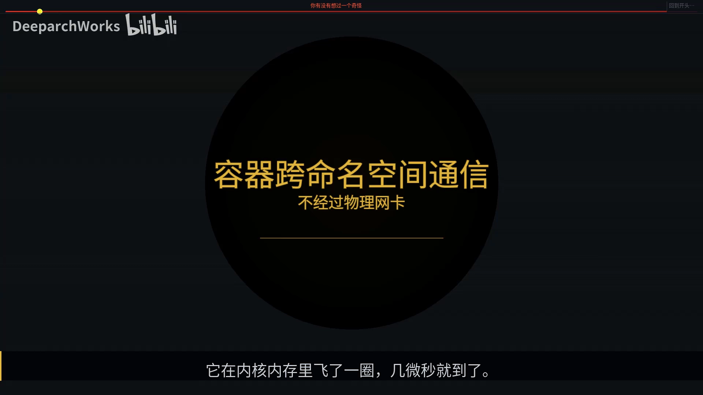

---

## 一、veth pair 是什么：一根"内力"网线

**是什么**：veth pair 是**成对出现**的两块虚拟网卡（veth = virtual ethernet）。它没有铜、没有光，也不经过任何网卡硬件——但它撑起了整个容器世界的网络。

**一个好懂的类比**：你和房东住在隔壁两间屋子，你想给他递个东西，又不想绕道走廊，于是干脆在墙上凿了一对**对穿的传声筒**：你房间这一头叫 `veth1`，他那头叫 `veth0`，**这两头物理上就是同一根管子**。你塞张纸条进去，他立刻就能拿到——不用敲门、不用快递、不用门铃。veth pair 在内核里干的，就是这样一件事。

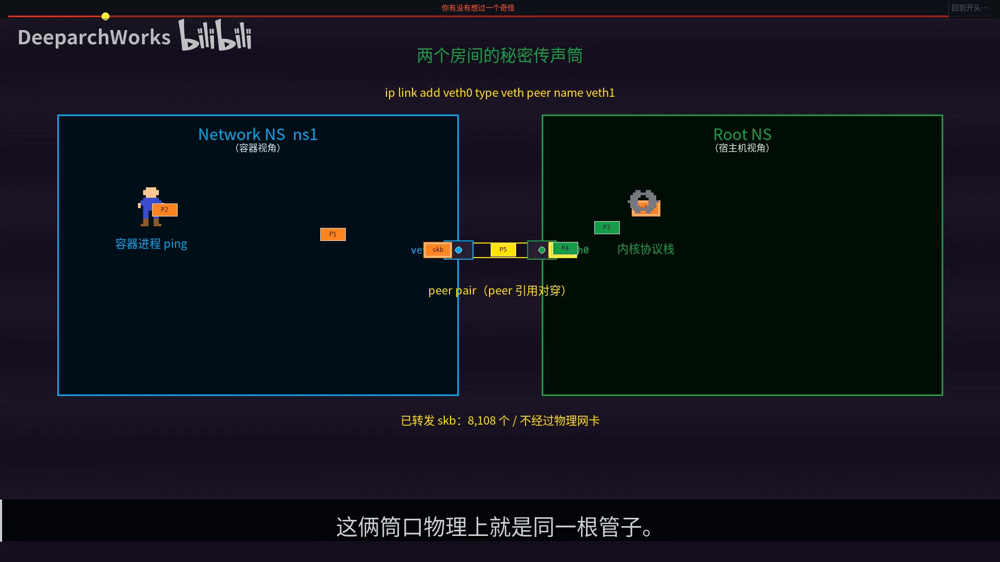

**为什么它存在得这么自然**：veth 并不是 Linus Torvalds 亲手写的，但它能存在，靠的是 Linux 从内核第一行代码起就立下的一条铁律——

> **网络设备只是一个抽象**：对协议栈来说，背后是 PCI 板卡还是一段内存，没有任何区别。

正因为内核对"网卡"做了统一抽象，veth 这种纯软件的虚拟网卡才能**复用同一套网络框架**，不必为容器另造一套轮子——只要写一段内存，它就变成了一块"网卡"。

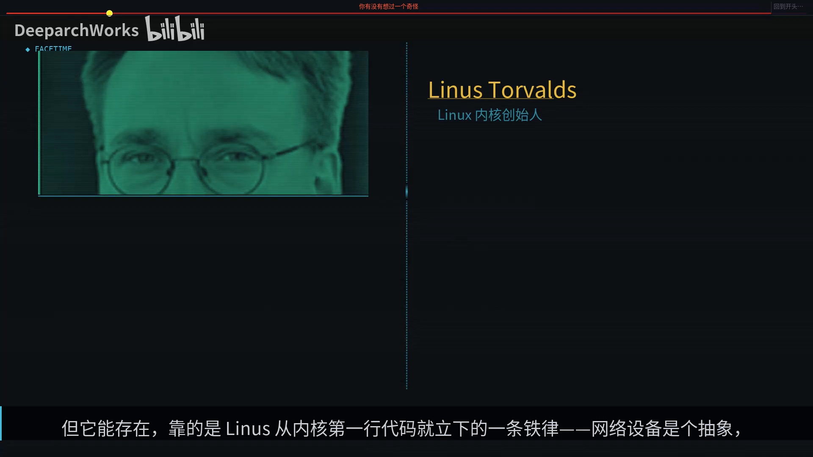

## 二、创建与迁移：一条命令生出两块网卡，一根指针把它们绑死

### 2.1 从用户命令到内核

你在终端敲下：

```bash
ip link add veth0 type veth peer name veth1
```

（视频演示时用的是 `ip link add type veth` 的简写。视频里强调：命令里 **`type veth` 是关键**。）这条命令的旅程是：

1. 用户态的 `ip` 命令通过 **netlink** 协议，把请求发进内核；
2. 内核命中 veth 注册的 `link_ops`；
3. 最后落到 `drivers/net/veth.c`——一个**不到 500 行**的源文件里，"所有的秘密都在这 500 行里"。

关键就在 `type veth`：**一条命令同时生出两个 `net_device`**（两个内核网络设备对象），一个名字由你指定，另一个用 `peer name` 指定。

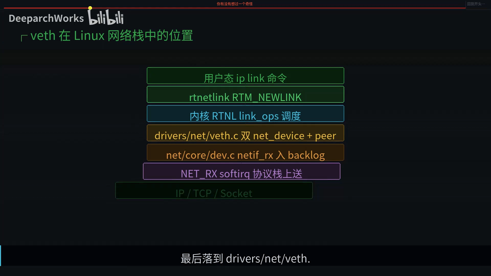

### 2.2 把一端"塞进"命名空间

```bash
ip netns add ns1                          # 先建一个命名空间
ip link set veth1 netns ns1               # 再把 veth1 移进去
```

执行后，从宿主机上敲 `ip link`，就**再也看不到 `veth1`** 了——它已经被移进了命名空间 `ns1`。

但神奇的是：**内核里那根 `peer` 指针还连着，管道并没有断**。在 `drivers/net/veth.c` 的创建逻辑里，最后那两行代码把两端的 `peer` 指针**互相赋值**——veth pair 的本质就是：**两个普普通通的 `net_device`，在创建那一刻被一根受 RCU 保护的指针绑死，"你是我的对端、我是你的对端"**。后面所有的奇迹，都靠这一个指针。

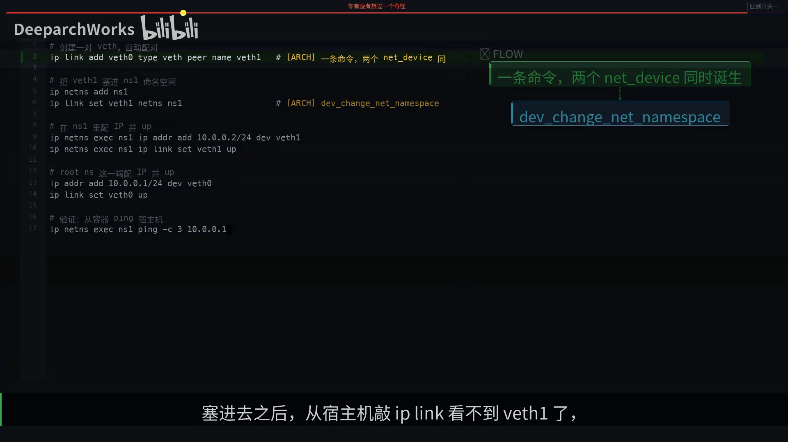

## 三、数据怎么走：veth_xmit 把物理网卡的三件事全砍了

物理网卡发一个包要做三件事：**填 DMA 描述符、写硬件寄存器、等中断**。而 veth 的发送函数 `veth_xmit` 把这三步**全砍了**——因为它根本就是一次**普通的函数调用**：

```c
// 第一步：一次指针 deref 找到对端，没有路由查找、没有 ARP 解析
rcv = rcu_dereference(priv->peer);

// 第二步：把包的归属设备改成对端（注意：不重新封装 MAC 头）
dev_forward_skb(rcv, skb);

// 第三步：把它丢进对端 CPU 的接收队列，等软中断接走
netif_rx(skb);
```

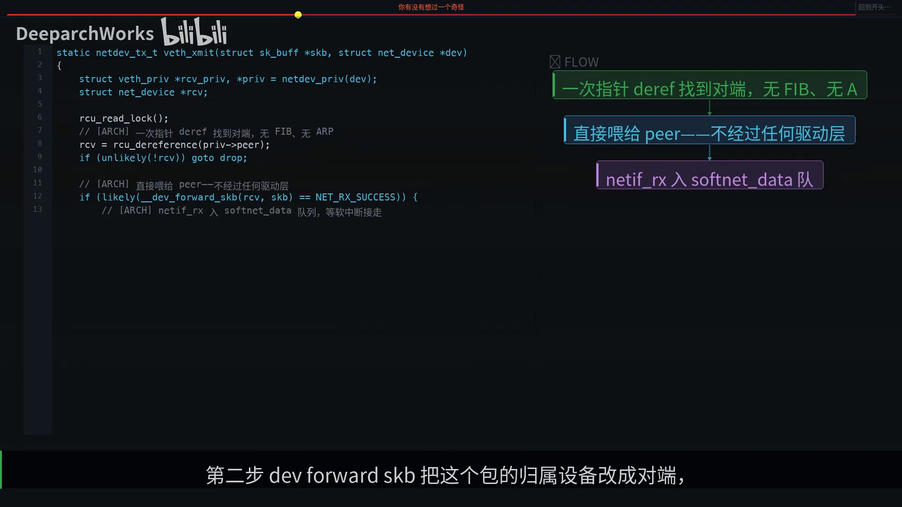

最妙的是中间那一步"改 `dev = veth0`"：它**没有移动任何数据**，只是改了 `skb`（socket buffer，内核里表示"一个数据包"的结构体）里的**一个指针字段**——原来挂在 `veth1` 名下的包，现在挂到了 `veth0` 名下。**包还是那个包，但身份变了。**

从你 `write` 一个字节，到对面收到，整个过程发生在**同一个系统调用上下文**里，可能只要两微秒。没有一次 DMA、没有一次中断——**容器和宿主机的通信，本质上就是内核里"扳指针"的过程**。视频用一条时间线把它量化了出来：整条 ping 往返路径都在微秒量级。

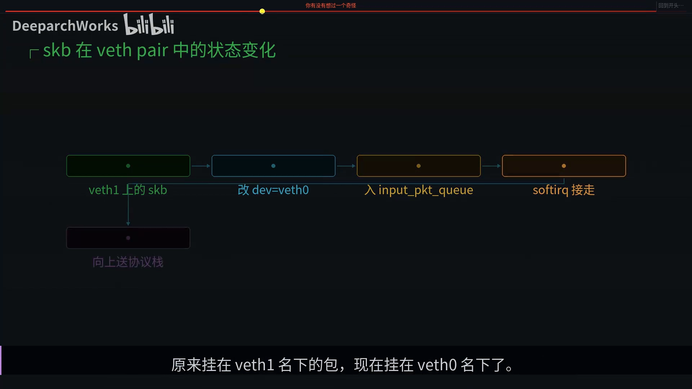

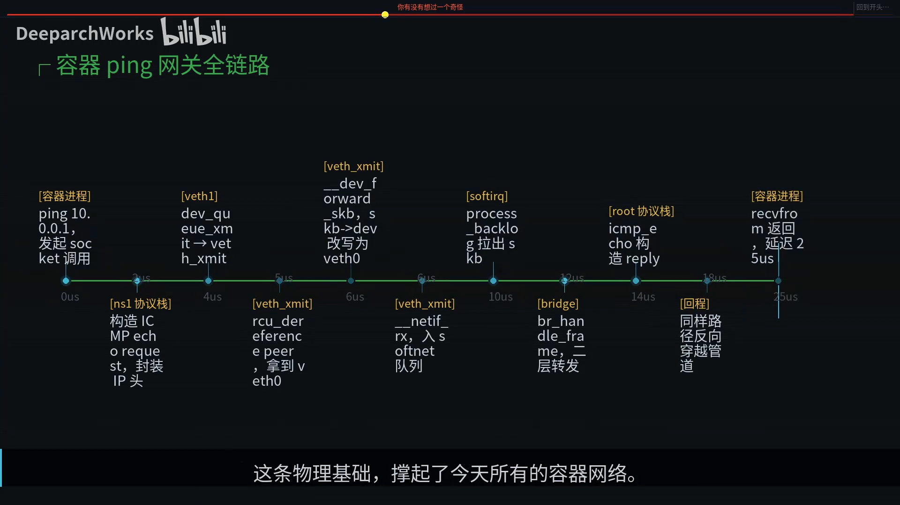

> 顺带一提：`ip link add` 这条命令背后，其实是一段 netlink 协议消息发到内核，而这套用户态与内核态的"对话规则"，由长期维护 iproute2 的 **Stephen Hemminger** 等人打磨——没有它，配对设备也没法用一条命令一气呵成地创建出来。

**和 tap / tun 的对比**（视频里给了一张 Before / After 图）：tap / tun 需要**用户态进程**去读写，多一次内存拷贝、多两次上下文切换；而 veth 完全在内核里，没有进程参与，就是纯函数调用。容器之间通信频率极高，**任何一次用户态切换都是奢侈**，所以容器网络选了 veth。

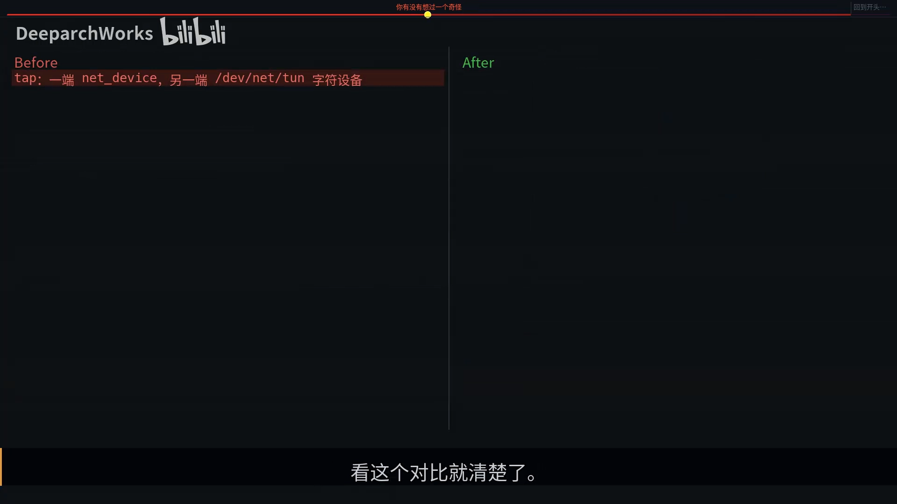

## 四、隔离与数据通路是"正交"的

一个更让人佩服的细节：把 `veth1` 塞进命名空间后，**内核里那根 peer 指针变了吗？没有**，它还是指向 root 命名空间里的 `veth0`。

负责迁移的函数 `dev_change_net_namespace` 只做了三件事：

1. 从原命名空间的设备列表里**摘除**（`list_del`）；
2. 把 `dev->nd_net` 字段**改**为新命名空间（`dev_net_set`）；
3. 把它**加入**新命名空间的设备列表（`list_add_tail`），并通知 netlink 用户"这块网卡换命名空间了"。

**peer 指针根本没碰。** 这体现了一个优雅的设计思想：**"隔离"这个横切关注点，正交于"设备行为"**——veth 的收发逻辑完全不知道"命名空间"的存在，隔离交给上层的 `dev_net` 字段去管。视频把它称作"优雅工程的样板"。

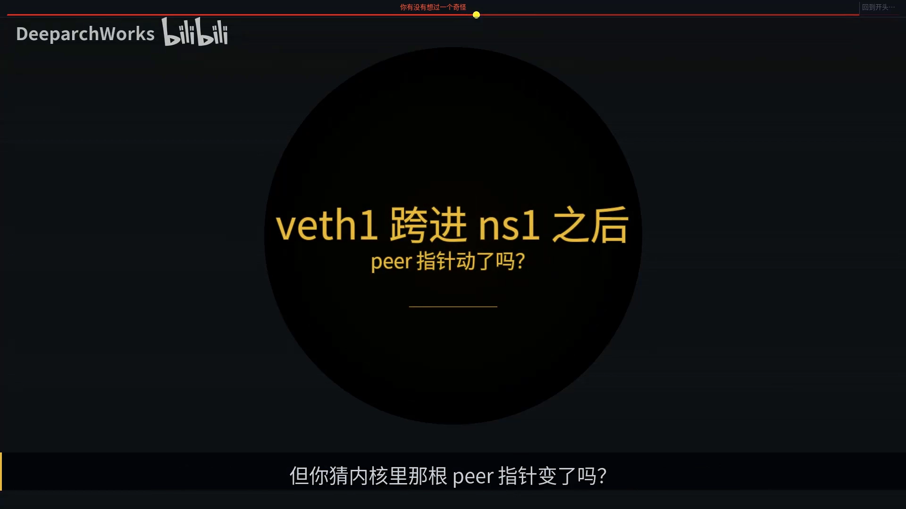

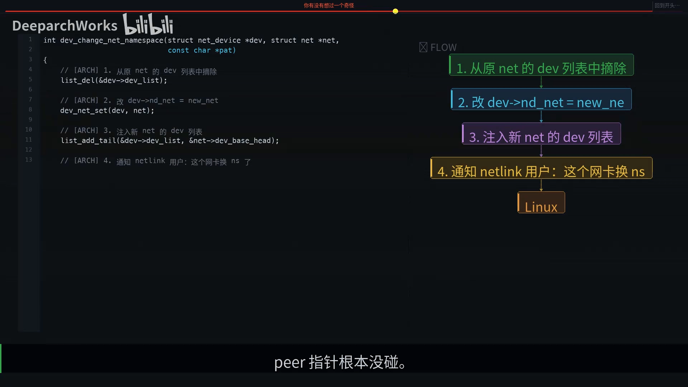

这套"正交"设计的背后，是 Linux 网络命名空间的主导设计者 **Eric W. Biederman**（内核长期维护者，2007 年与 Pavel Emelianov 合作引入 net namespace）。

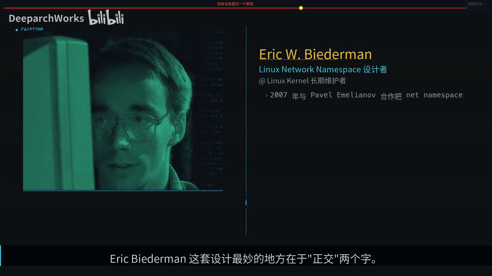

## 五、放进真实世界：容器 + bridge + 物理网卡全图

把上面这些拼起来，就是 Docker 默认网络的物理基础：

- **每个容器 = 一个命名空间 + 一对 veth**；
- veth 的**容器侧**：配 IP，作为容器的"出口"；
- veth 的**宿主机侧**：不配 IP，直接挂到 **网桥（bridge）** 上；
- 网桥收到帧后按 **MAC 表**做二层转发走出去，出网时再由 **NAT** 改写地址。

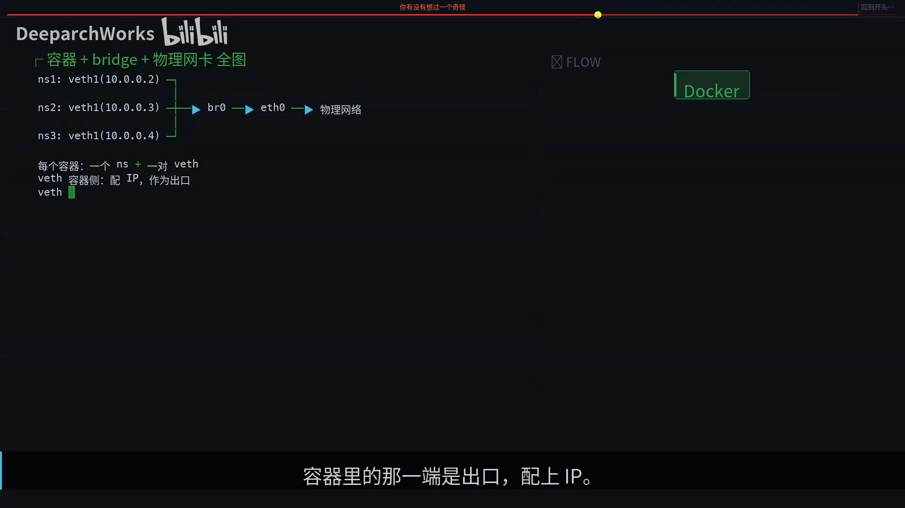

## 六、性能与演进：为什么 veth 比 lo 慢，又如何用 XDP 反超

**为什么 veth 既然只是函数调用，还比 loopback（`lo`）慢？** 因为 `lo` 是**直接同步**调用接收函数，省掉了"入队再出队"这一步；而 veth 必须走 **softnet 队列**——这是为了**防止协议栈递归太深导致调用栈溢出**（比如 IP 进 bridge、再进 IP、再进 veth 层层递归下去，调用栈就爆了）。veth 多了一次软中断调度，**换来的是安全**。视频给出的数字：本机 `lo` 约 50 Gbps、veth pair 约 30 Gbps、而物理 10G 网卡的 TCP 约 9.4 Gbps（受 PHY 带宽限制）。

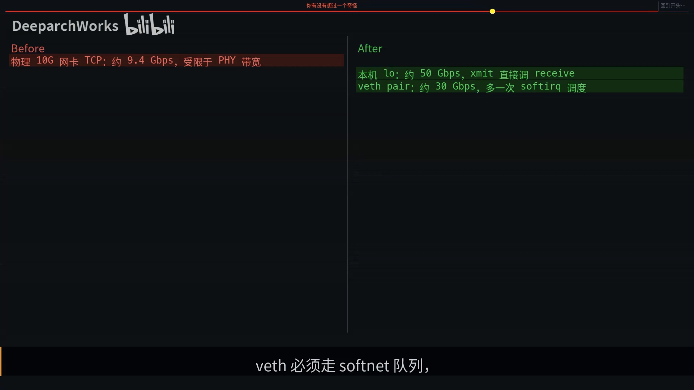

**演进**：从 5.x 内核开始，veth 支持 **XDP 原生模式**。XDP 程序运行在协议栈**之前**，可以直接 redirect / drop / 修改数据包，绕过协议栈那一长串路径，在某些零拷贝场景能把 veth 的吞吐推到 **80 Gbps** 量级。这也是为什么 Cilium 等云原生网络方案，最终都收敛到 **"veth + XDP"** 这条路。

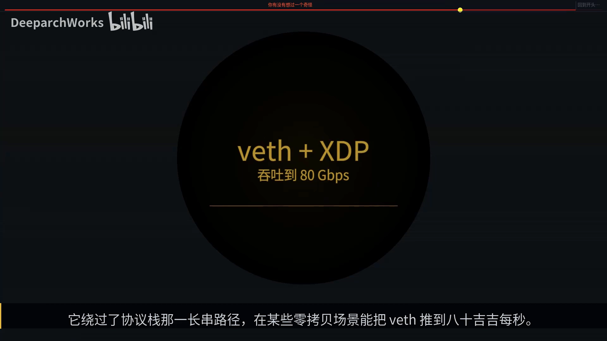

**为什么用 wireshark 抓 veth，看到的却是完整的以太网帧？** 因为 veth 是一个 **L2（二层）设备**，`dev_forward_skb` 并**不重新封装 MAC 头**——MAC 帧原样穿过管道。这样设计的好处是：网桥（也是二层设备）能无缝处理 veth 的输出，让 veth 和物理网卡在二层"混着用"，共用同一套 L2 抽象。

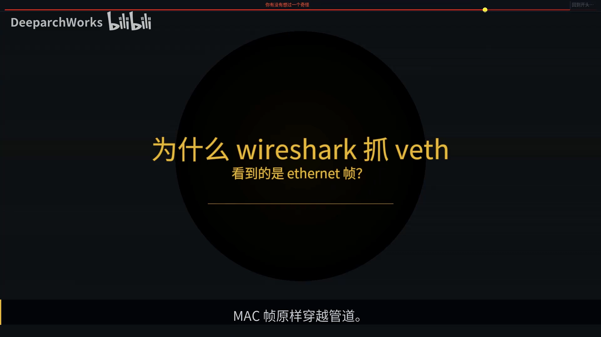

## 七、生命周期：删掉一端，就等于剪断整根线

最后讲"生命周期"里最干脆的一条规则：**删掉 veth 的一端，另一端会自动跟着消失**。

因为两端是**绑死**的——删一个就等于剪断管道，另一头当然也得跟着没。这个清理是**原子**的：内核保证在你 `ip link del veth0` 的那一刻，无论容器里有没有人还持有 `veth1`，都会被通知到（内核用 `veth_dellink` 同时清理另一端，把两端 `peer` 指针互相置为 `NULL`，两个 `net_device` 一起注销）。

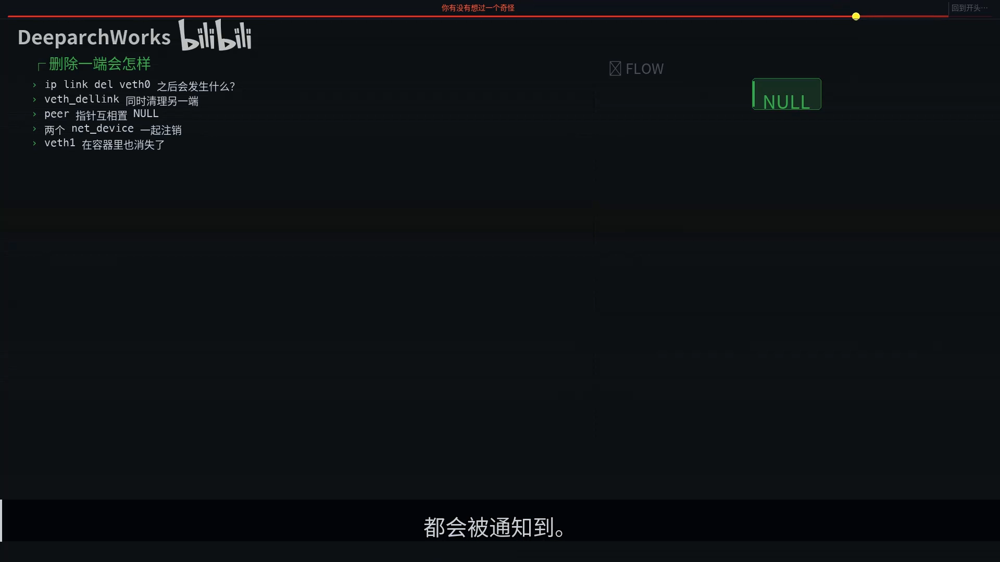

一句话总结整篇：**所有复杂的容器网络，归根结底就是——一根线，两个端点，都在同一个内核里。**

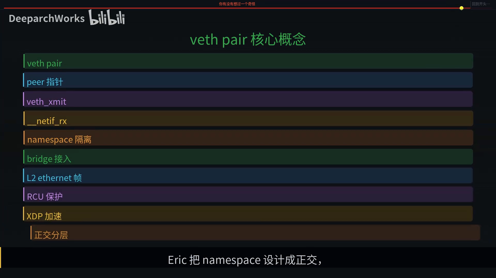

## 小结

- **veth pair 是一对绑死的虚拟网卡**，就像一根虚拟网线：两头物理上是一体的。
- 它之所以能存在，靠的是 Linux **"网络设备是抽象"**这条铁律——纯软件也能成为一块网卡。
- `ip link add type veth` **一条命令生成两块 `net_device`**，二者被一根 **RCU 保护的 `peer` 指针**绑死。
- 数据传递靠 `veth_xmit` 这个**普通函数调用**：改一下 `skb` 的 `dev` 指针、丢进对端接收队列——**没有 DMA、没有中断**。
- **隔离与数据通路正交**：`dev_change_net_namespace` 只动三处，不碰 `peer` 指针。
- 真实世界 = **每个容器一个命名空间 + 一对 veth**，容器侧配 IP，宿主机侧接网桥，网桥做二层转发、NAT 出网。
- veth 走软中断队列所以比 `lo` 慢一点，但换来防栈溢出；配合 **XDP** 又能反超到 80 Gbps。
- **删除一端即销毁整对**，这是 veth 生命周期的核心规则。

## 关键术语速查

| 术语 | 一句话解释 |
| --- | --- |
| veth pair | 成对出现、被 peer 指针绑死的两块虚拟网卡，相当于一根虚拟网线 |
| peer 指针 | veth 两端互相引用的、受 RCU 保护的指针，是这根虚拟网线的"线芯" |
| net_device | 内核对"能收发数据包的网络接口"的统一抽象，物理网卡和 veth 都是它 |
| skb（socket buffer） | 内核里表示"一个数据包"的结构体 |
| veth_xmit | veth 的发送函数，把包直接转给对端，不走 DMA / 中断 |
| netif_rx | 把包丢进对端 CPU 的接收队列，等软中断处理 |
| dev_change_net_namespace | 把网络设备迁移到另一个命名空间的内核函数（只改 3 处，不碰 peer） |
| 网络命名空间隔离 | 由 Eric W. Biederman 主导设计，与 veth 的收发逻辑正交 |
| bridge（网桥） | 二层转发设备，把 veth 宿主机侧汇聚起来 |
| XDP | 运行在协议栈之前的高速数据面，veth + XDP 吞吐可达 80 Gbps |
