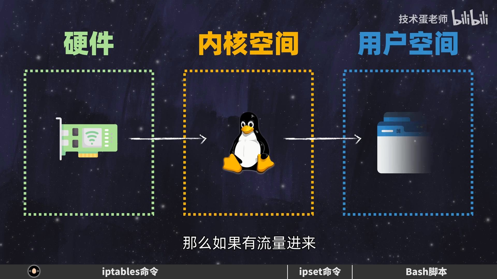
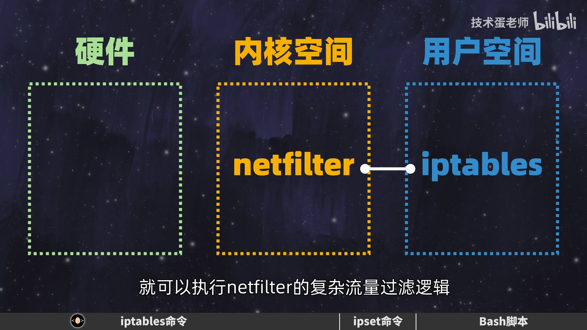
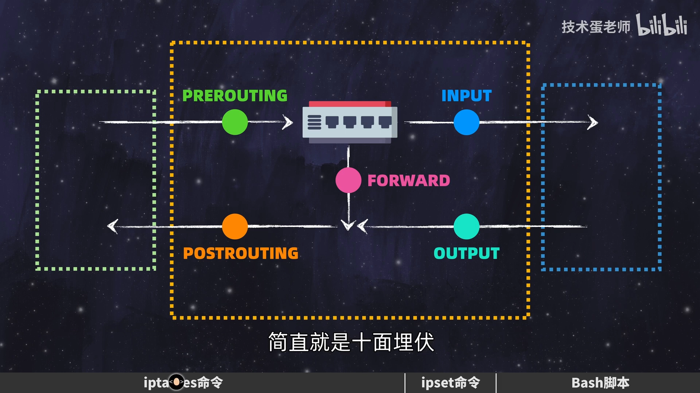
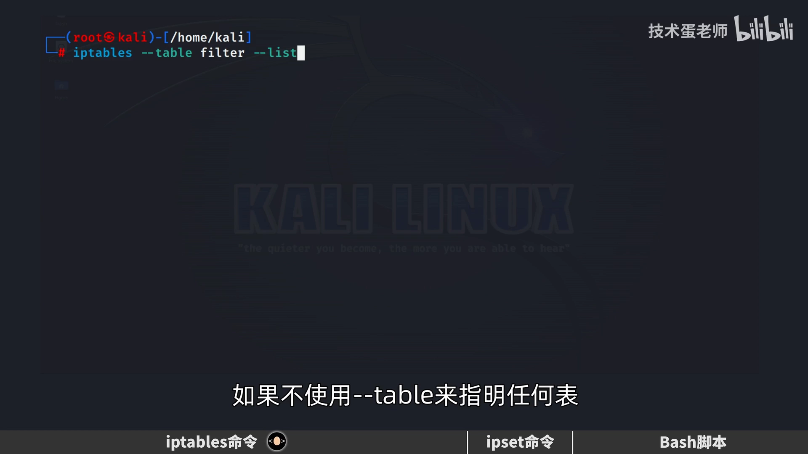
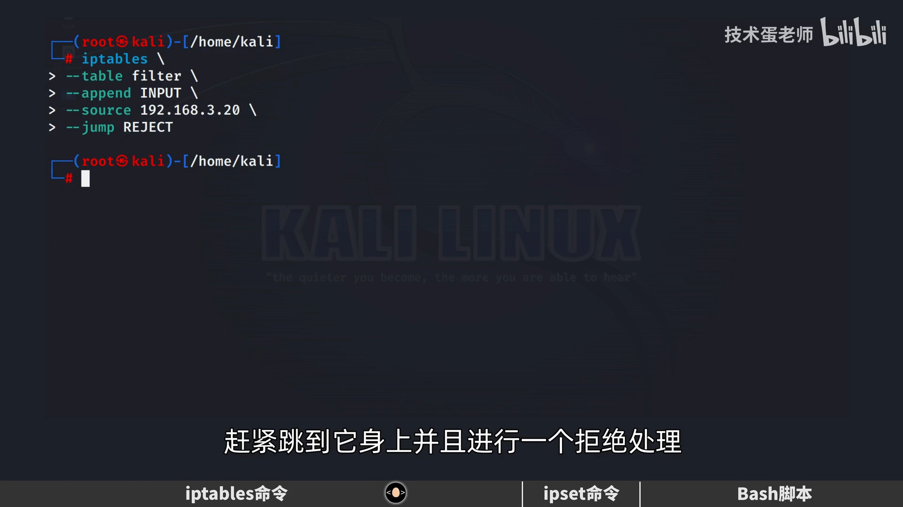
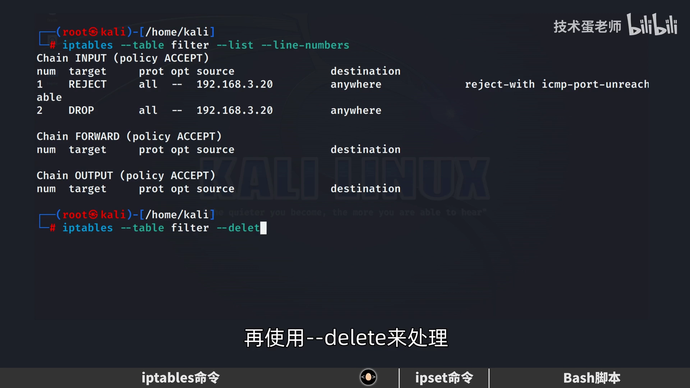
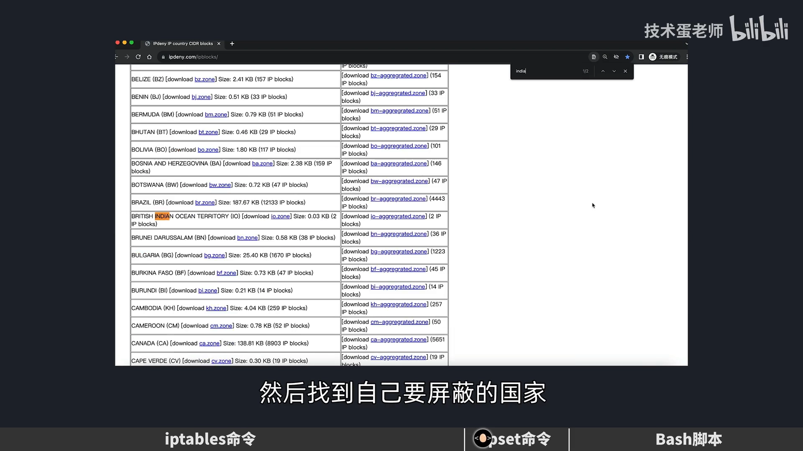
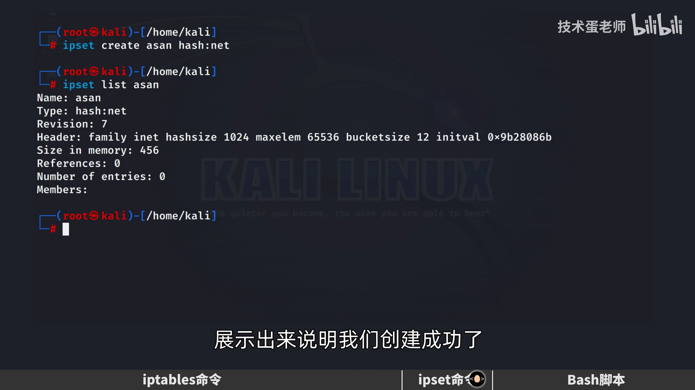
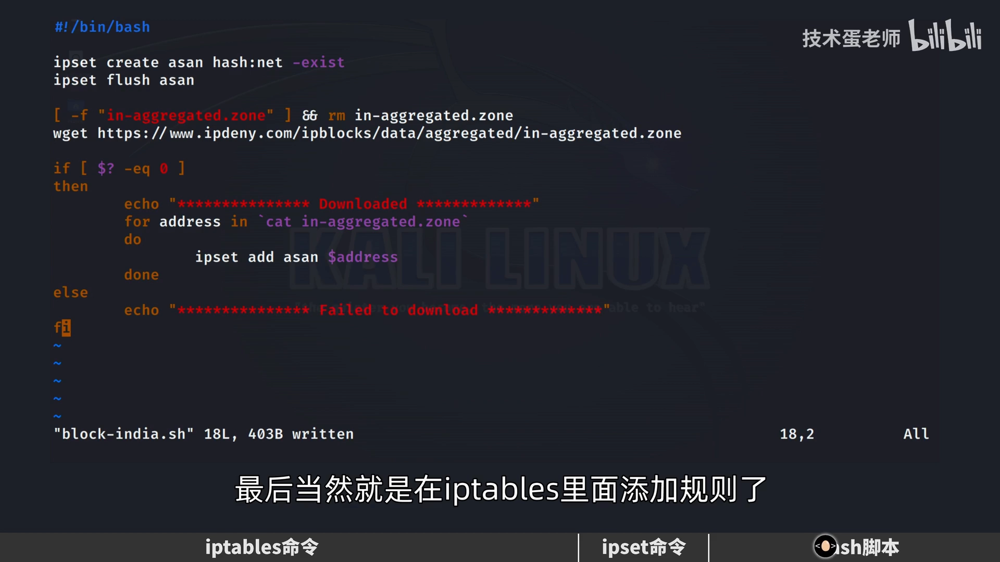

# iptables 核心运作原理：从 netfilter 到用 ipset 封禁某个国家的 IP

> 本文整理自 B 站视频《iptables核心运作原理和数据包过滤方法》（技术蛋老师）。它从一句"无法访问此网站"讲起，先把 netfilter 与 iptables 的关系讲清，再讲表/链/规则的组织方式，然后动手写规则、区分 REJECT 与 DROP，最后用一个 Bash 脚本 + ipset 实现"封禁某个国家的 IP 段"的实战。

## 本讲要解决的核心问题（SCQA）

**背景**：访问某些网站时，我们会看到"无法访问此网站"。这背后其实就是**对流量做限制**；反过来，我们也可以用同样的手段保护自己的服务器。

**冲突**：要对服务器限流，就得操作 Linux 内核；可内核不是"普通老百姓"能直接下手的，而且一上来就听人说"四表五链"，只会觉得难。

**疑问**：iptables 到底是怎么运作的？四表五链在命令里怎么体现？怎么真正写出一条规则、并且能批量封禁一大堆 IP？

**回答（中心思想）**：**iptables 只是 netfilter 的接口**——真正过滤流量的是内核里的 **netfilter** 框架。iptables 的组织方式是"**表 → 链 → 规则**"，命令写得越清楚，越能一眼看出"在哪张表、哪条链、加什么规则"。掌握这套结构后，配合 **ipset** 把大量 IP 段聚成一个集合，就能高效地一键封禁。

[【跳转到 00:00】](https://www.bilibili.com/video/BV1Jz4y1u7Lz/?t=0)

---

## 一、一台服务器可以被切成三份

要对流量做过滤，先把一台 Linux 服务器**切成三份**来看：

[【跳转到 00:31】](https://www.bilibili.com/video/BV1Jz4y1u7Lz/?t=31)



- **硬件**：网卡等；
- **内核空间**：Linux 内核；
- **用户空间**：我们跑的各种网络应用。

流量进来时的路径是：**先从网卡进入内核，最后才抵达网络应用**。所以要做过滤，最自然的做法就是——**让流量在进入内核、还没到达应用之前，先过一道防火墙**：

```
网卡 → Linux 内核（在这里过滤）→ 网络应用
```

但问题来了：**普通用户怎么去操作 Linux 内核呢？**

---

## 二、netfilter 是后端，iptables 是前端接口

[【跳转到 01:09】](https://www.bilibili.com/video/BV1Jz4y1u7Lz/?t=69)



- 内核里有个叫 **netfilter** 的框架，流量进来就会触发它，从而进行**流量过滤**；
- 但**直接操作 netfilter 很难**，于是有了 **iptables** 这个工具。

可以这样简单理解：**iptables 是 netfilter 的接口**——**iptables 在前端，netfilter 在后端**。我们只要用简单的 iptables 命令，就能驱动 netfilter 里那套复杂的过滤逻辑。

### 2.1 "iptables"是复数：有很多张表

iptables 从名字上就能看出是**复数**——意思是**有很多 table（表格）**。常见的有四张表，其中**最常用的两张**：一张负责**过滤**，另一张负责**网络地址转换（nat）**。nat 甚至强到能做负载均衡。

但对绝大多数人来说，**filter 表才是最常用的那张**，其余的表先放一放。

[【跳转到 01:49】](https://www.bilibili.com/video/BV1Jz4y1u7Lz/?t=109)

---

## 三、数据包怎么抵达应用：一进一出，外加一条转发链

最简单的数据流是**一进一出**。但别忘了：**Linux 主机本身也可以当路由器用**——有些数据包只是**经过这台主机再转发到别的设备**，于是又多出一条"转发链路"。

好在，内核里的 **netfilter 早就在链路的各个部分"埋伏"好了**。

[【跳转到 02:21】](https://www.bilibili.com/video/BV1Jz4y1u7Lz/?t=141)

### 3.1 五链：十面埋伏

[【跳转到 02:43】](https://www.bilibili.com/video/BV1Jz4y1u7Lz/?t=163)



- 数据包**一抵达系统**，就有 **PREROUTING** 负责；
- 数据包的**目标地址是本机**，就有 **INPUT** 负责；
- 如果是**本机发出去**的，就有 **OUTPUT** 负责；
- 如果**不是要到本机、只是经过本机路由**，就由 **FORWARD** 链负责；
- 如果要**离开本机**（或路由之后），还有 **POSTROUTING** 链负责。

### 3.2 为什么用"链"来表示每一部分？

因为它们可以看作**一个整体、连在一起**——就像一条链子上的多个环节。所以叫"链"。

那是不是过滤一个数据包，五条链都得管？当然不用。**这只是为了讲清数据包的完整路径。** 实际上：

- 用 **filter 表**，只需要管理 **INPUT、OUTPUT、FORWARD** 三条链；
- **其他表管理的链各有不同**。

### 3.3 表、链、规则的组合，刚好就是命令的写法

[【跳转到 03:33】](https://www.bilibili.com/video/BV1Jz4y1u7Lz/?t=213)

于是我们就能理解 iptables 的组织方式：

> **不同的表里有着不同的链，链里面可以制定不同的规则。**

而这个"**表 → 链 → 规则**"的排序，**刚好就是 iptables 命令的写法**。由于一般需要 sudo 提权，视频里直接切到 root 来演示。

---

## 四、先看现状：filter 表里有什么

[【跳转到 03:54】](https://www.bilibili.com/video/BV1Jz4y1u7Lz/?t=234)

```bash
iptables --table filter --list
```

[【跳转到 04:19】](https://www.bilibili.com/video/BV1Jz4y1u7Lz/?t=259)



- 用 `--table` 指明 filter 表，再 `--list` 把内容列出来；
- **如果不指明任何表，就默认选用 filter 表**——结果只显示了三个链，正如前面所说，filter 表一般只需要管理这三条链；
- 此时三条链里**没有任何内容**，也就是**还没设置任何规则**。

先查一下本机 IP，再用**另一台主机去 ping 它**，一切正常。接下来我们就**不想让另一台主机顺利访问**了——用 iptables 来过滤。

> 演示时故意**不使用缩写命令**，为的是让每一步都一目了然：命令长就"斜杠换行"分几行写。

---

## 五、动手加第一条规则：REJECT

[【跳转到 04:44】](https://www.bilibili.com/video/BV1Jz4y1u7Lz/?t=284)

```bash
iptables --table filter --append INPUT \
         --source 192.168.3.20 \
         --jump REJECT
```

[【跳转到 05:09】](https://www.bilibili.com/video/BV1Jz4y1u7Lz/?t=309)



- `--table filter`：指定表；
- `--append INPUT`：在 **INPUT 链**里**追加**一条规则（要用 INPUT，因为这里要对付的是"**目标地址是本机**"的数据包）；
- `--source 192.168.3.20`：指明**匹配的源地址**；
- `--jump REJECT`：匹配到之后**跳去执行 REJECT**，即**拒绝处理**。

执行后再查 filter 表，就能看到规则被加进了 INPUT 链。有一点要注意：`proto`（protocol，协议）**因为我们没指定具体协议，所以这个地址过来的包，不管走哪个协议都会被拒绝**。

此时用刚才那台主机 ping，就会显示**不可抵达**。**但也有个副作用**：你现在**去 ping 那台被设限的主机也不行了**——因为你的请求发出去后还要**回来**，而回程的包同样会被这条规则拒掉。

---

## 六、REJECT 改 DROP，以及"删规则"的经典坑

除了 REJECT，还可以用 **DROP** 直接丢弃。把刚才命令里的 REJECT 换成 DROP 即可。但这时会出现一个**需要注意的地方**：

[【跳转到 05:59】](https://www.bilibili.com/video/BV1Jz4y1u7Lz/?t=359)

```bash
iptables --table filter --list --line-numbers
```

用 `--line-numbers` 看到**两条规则**。当有多条规则时，iptables **从上往下执行**——所以要删掉第一条，才会轮到第二条生效：

```bash
iptables --table filter --delete INPUT 1
```

[【跳转到 06:24】](https://www.bilibili.com/video/BV1Jz4y1u7Lz/?t=384)



**这里有个重点**：刚才处于**第 2 条**的规则，会**顺势上移变成第 1 条**。所以如果想**按序号连续删除**，千万要小心——**很多人都在这里踩过坑**。

删完之后，用另一台主机 ping，会发现**都访问不了，但 REJECT 和 DROP 显示的结果不一样**：

- REJECT：立刻返回**不可达**；
- DROP：**一直超时、没有回应**。

> 建议：**先用 REJECT 测试，确认效果后，再换成 DROP。**

[【跳转到 06:49】](https://www.bilibili.com/video/BV1Jz4y1u7Lz/?t=409)

---

## 七、实战：封禁"某个国家"的 IP 段

过滤 IP 的核心操作我们学会了：**`--source` 匹配源地址 + `--jump` 处置**。可如果目标不是某一个 IP，而是**某个国家的全部 IP 段**呢？

[【跳转到 07:26】](https://www.bilibili.com/video/BV1Jz4y1u7Lz/?t=446)

### 7.1 从 ipdeny 拿到"国家 IP 段"

[【跳转到 07:31】](https://www.bilibili.com/video/BV1Jz4y1u7Lz/?t=451)

在 **ipdeny.com** 这个网站上能找到各国的地址段：

[【跳转到 07:36】](https://www.bilibili.com/video/BV1Jz4y1u7Lz/?t=456)



- 点击 **country IP blocks**，找到要屏蔽的国家（视频以印度为例）；
- 页面上提供两个可下载的文件，**一般建议用 `aggregate` 那个**——因为它的**规则更少**，能用更少的 IP 段实现最高效的处理；
- 用 `wget` 把文件下载下来。

[【跳转到 07:41】](https://www.bilibili.com/video/BV1Jz4y1u7Lz/?t=461)

浏览文件会发现里面有**非常多 IP 段**。**即使写脚本把每一条都加进 iptables，也会消耗不少 CPU。**

### 7.2 用 ipset 把海量 IP 段聚成一个集合

[【跳转到 07:54】](https://www.bilibili.com/video/BV1Jz4y1u7Lz/?t=474)

**ipset 可以更优雅地处理**：把众多 IP 地址段**汇聚成一个集合**，这个集合会生成**唯一的哈希值**；给 iptables 加规则时，**只需用这个哈希值来代表背后那一大堆 IP 段**，处理效率高得多。

[【跳转到 08:19】](https://www.bilibili.com/video/BV1Jz4y1u7Lz/?t=499)



```bash
ipset create asan hash:net      # 集合名 asan；处理的是网络号，所以用 hash:net
ipset list asan                 # 查看集合
```

- 因为要处理的是**网络号、不是主机号**，所以 `hash` 后面用 **`net`** 指明；
- 此时集合里**还没有成员**（有成员会显示在 `Members` 里）。

### 7.3 用一个 Bash 脚本把流程串起来

[【跳转到 08:44】](https://www.bilibili.com/video/BV1Jz4y1u7Lz/?t=524)

既然反正要写脚本，不如把 **ipset 与 iptables 合起来写成一个脚本** `block_india.sh`：

```bash
#!/bin/bash
ipset create asan hash:net -exist   # -exist：集合已存在时忽略，不报错
ipset flush asan                    # 先清空，因为地址可能有更新

[ -f "in-aggregated.zone" ] && rm in-aggregated.zone   # 删掉旧文件，保证下载的是最新的
wget https://www.ipdeny.com/ipblocks/data/aggregated/in-aggregated.zone

if [ $? -eq 0 ]; then               # 用 $? 判断上一条命令（wget）是否成功
    echo "*************** Downloaded *************"
    for address in $(cat in-aggregated.zone); do
        ipset add asan $address     # 遍历每一行，把 IP 段加进集合
    done
fi
```

[【跳转到 10:24】](https://www.bilibili.com/video/BV1Jz4y1u7Lz/?t=624)

几个关键点：

- **`-exist`**：集合可能已被创建，加上它，ipset 会**忽略重复创建**而不报错；
- **`ipset flush`**：先把集合里已有的段清掉，**再重新加入**，保证是最新的；
- **`$?`**：查看"最后一条命令"的返回状态——**返回 0 表示成功**，可以据此提示下载结果；
- **`for` 循环**：把文件里每一行 IP 段逐个 `ipset add` 进集合。

[【跳转到 10:49】](https://www.bilibili.com/video/BV1Jz4y1u7Lz/?t=649)



### 7.4 让 iptables 引用这个集合

集合里有了地址，最后一步就是在 iptables 里加规则：

```bash
iptables --table filter --append INPUT \
         -m set --match-set asan src \
         --jump DROP
```

- 用 **`-m set`** 指定扩展模块，这样才能**调用到 ipset 里的集合**；
- **源地址属于 `asan` 集合**即匹配成功，然后执行 **`-j DROP`** 丢弃。

[【跳转到 11:14】](https://www.bilibili.com/video/BV1Jz4y1u7Lz/?t=674)

先 `chmod` 让脚本可执行，**用之前能 ping 通的印度域名做个对照**；执行脚本后，它会**自动下载并加入集合**。用 `ipset list` 能看到地址段已被**全自动加入**；再用 `grep` 确认刚才那个域名对应的 IP 也在集合里；最后查 iptables 规则（**有多余规则记得及时删掉**）。**再 ping 那个域名，就已经 ping 不动了**——封禁生效。

---

## 八、让规则在重启后依然存活

[【跳转到 12:04】](https://www.bilibili.com/video/BV1Jz4y1u7Lz/?t=724)

注意：**重启服务器后，iptables 和 ipset 一般都会被清空。** 所以要先保存：

```bash
ipset save > ipset.conf
iptables-save > iptables.conf
```

重启后可以发现，两边的规则确实都不见了。这时再做恢复：

[【跳转到 12:32】](https://www.bilibili.com/video/BV1Jz4y1u7Lz/?t=752)

```bash
ipset restore < ipset.conf          # 先恢复 ipset
iptables-restore < iptables.conf    # 再恢复 iptables（注意箭头方向、别搞错文件名）
```

恢复后再分别查看，配置就都回来了。

> 小提醒：如果**不想把原有内容覆盖掉**，`iptables-restore` 后面要加 **`--noflush`（或 `-n`）**，同理 `ipset restore` 要加 **`-exist`**。当然，也有其他方法可以实现规则的永久保存。

[【跳转到 12:57】](https://www.bilibili.com/video/BV1Jz4y1u7Lz/?t=777)

---

## 小结

- **三份结构**：服务器分**硬件 / 内核空间 / 用户空间**，流量从网卡进内核、再到应用，过滤就发生在进应用之前。
- **前后端关系**：**netfilter 在后端（内核）真正干活，iptables 在前端做接口**。
- **组织方式**：**表 → 链 → 规则**，这个顺序**就是命令的写法**；filter 表最常用，只管 INPUT/FORWARD/OUTPUT。
- **五链**：PREROUTING、INPUT、OUTPUT、FORWARD、POSTROUTING，覆盖报文每一段路径。
- **写规则**：`--append INPUT --source <IP> --jump REJECT`；不指定协议则所有协议都生效。
- **REJECT vs DROP**：REJECT 立刻不可达，DROP 超时无回应；**先 REJECT 验证，再换 DROP**。
- **删规则**：按行号删时，**后面的规则会补位**，连续删除要小心。
- **批量封禁**：用 **ipset** 把海量 IP 段聚成集合，iptables 用 `-m set --match-set` 引用，`-j DROP` 丢弃。
- **持久化**：`ipset save` / `iptables-save` 保存，重启后 `ipset restore` / `iptables-restore` 恢复。

---

## 关键术语速查

| 术语 | 一句话解释 |
| --- | --- |
| **netfilter** | 内核里真正执行流量过滤的框架（后端） |
| **iptables** | 操作 netfilter 的用户态工具（前端的接口） |
| **表（table）** | 功能划分，最常用的是 filter（过滤）与 nat（地址转换） |
| **链（chain）** | 报文经过的阶段：INPUT / FORWARD / OUTPUT 等 |
| **规则（rule）** | 链里的"匹配条件 + 处置动作" |
| **--jump / -j** | 匹配后跳去执行的处置动作（如 REJECT / DROP） |
| **--source / -s** | 匹配源地址 |
| **--line-numbers** | 列出规则行号，便于按序号删除 |
| **REJECT** | 拒绝并回不可达；对方立刻知道失败 |
| **DROP** | 直接丢弃、不回话；对方只会超时 |
| **ipset** | 把大量 IP 段聚成一个集合（带唯一哈希），供 iptables 高效引用 |
| **hash:net** | ipset 的一种类型，按"网络号"存放地址段 |
| **-m set --match-set** | 让 iptables 规则匹配某个 ipset 集合 |
| **iptables-save / -restore** | 保存 / 恢复规则，用于重启后持久化 |
