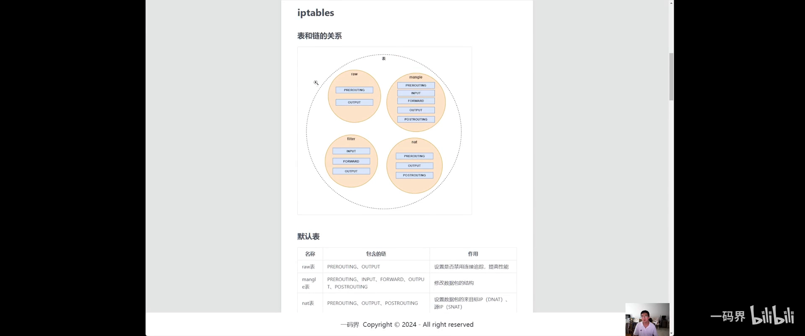
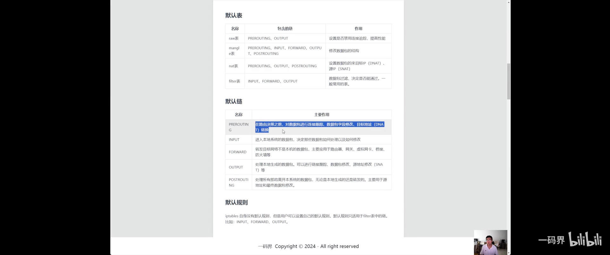
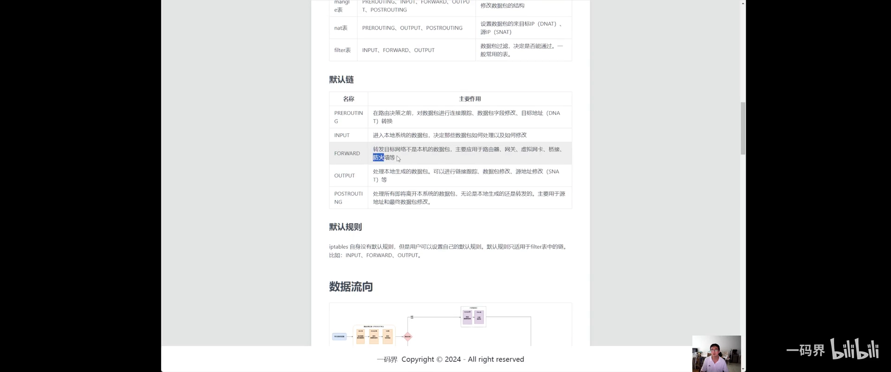
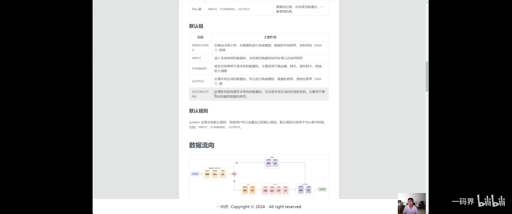
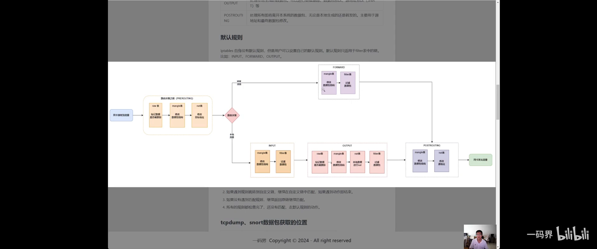
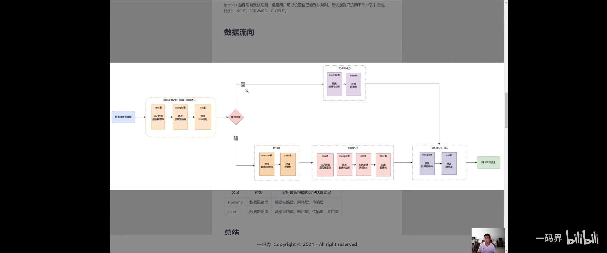

# iptables 四表五链详解：报文到底怎么在"表"与"链"之间流动

> 本文整理自 B 站视频《linux iptables 4表 5链 详解 数据包在linux的数据流量，规则生效顺序》。它把"表和链的关系""默认表与默认链""报文的完整流向""规则生效顺序"一条条拆开讲，最后还顺带说清了抓包工具相对防火墙所处的位置。

## 本讲要解决的核心问题（SCQA）

**背景**：提到 Linux 防火墙，总绕不开"四表五链"这个词。命令大家都会敲 `iptables`，可一被问"表是什么、链是什么、它们怎么配合"，就容易含糊。

**冲突**：只会背命令，不理解表与链的关系，就永远搞不清**一条数据包在什么阶段、被哪张表的规则处理**——加规则也就只能靠试。

**疑问**：表和链到底是什么关系？默认有哪些表和链？一个报文从网卡进来到网卡出去，中间到底依次经过哪些表、哪些链？规则又是按什么顺序生效的？

**回答（中心思想）**：**表是"功能的划分"，链是"规则的分类"**；所有默认表、默认链都由内核的 **netfilter** 提供，iptables 只是使用者。报文沿一条固定的流水线（PREROUTING→…→POSTROUTING）流经各个钩子，每个钩子上可能有若干张表的规则；**规则"从上到下逐条匹配、命中即执行动作"**。把这套流向图记在脑子里，加规则就有了依据。

[【跳转到 00:00】](https://www.bilibili.com/video/BV1fNadefEaf/?t=0)

---

## 一、表与链的关系：表是功能划分，链是规则分类

先记住一个前提：**iptables 里的默认表、默认链全部是 netfilter 提供的，iptables 只是使用方。** 我们平时用得最多的是 **filter 表**。

[【跳转到 00:50】](https://www.bilibili.com/video/BV1fNadefEaf/?t=50)

- **表（table）**：对规则做的**功能划分**。比如 nat 表专门做地址转换、filter 表专门做过滤。
- **链（chain）**：对**规则的分类**——规定"哪些规则在哪一个阶段（哪条链）上生效"。

> 一句话理解：**表是"干哪类活"，链是"在哪个关口干活"。** 两者交叉，就是"这个关口的这类规则"。

还可以再补一层关系：

- **表可以看作"链的集合"**，也可以看作"规则按功能的集合"；
- **链是"规则的集合"**；
- **不同表里同名的链，其实是彼此独立的**，它们之间没有直接关系，只是**恰好作用在同一个流程阶段**——因为背后都是 netfilter 在内核里预埋的同一个钩子。

另外，**用户可以自定义"链"，但不能自定义"表"**——表是 netfilter 内核提供的。

[【跳转到 07:14】](https://www.bilibili.com/video/BV1fNadefEaf/?t=434)

---

## 二、默认的"四张表"

[【跳转到 05:34】](https://www.bilibili.com/video/BV1fNadefEaf/?t=334)

| 表 | 包含的链 | 作用 |
| --- | --- | --- |
| **raw** | PREROUTING、OUTPUT | 设置**是否禁用连接追踪**，用来提高性能 |
| **mangle** | PREROUTING、INPUT、FORWARD、OUTPUT、POSTROUTING（**五链全有**） | **修改数据包的结构**（如 TOS 字段等） |
| **nat** | PREROUTING、OUTPUT、POSTROUTING | 修改数据包的**目标 IP（DNAT）** 与**源 IP（SNAT）** |
| **filter** | INPUT、FORWARD、OUTPUT | **数据包过滤**，决定是否能通过。一般最常用的一张表 |

逐个看：

- **raw 表**：标记"这个数据包**是否要被连接跟踪**"。若标记为**不跟踪**，则后边依赖连接跟踪的规则就不走了，**效率更高**。它只挂在 **PREROUTING 与 OUTPUT** 两条链上。
- **mangle 表**：在不同阶段**修改数据包**（比如调整 TOS、改包结构），也可以配合改地址；**五条链上都有它**。
- **nat 表**：做**地址转换**——SNAT 改"出去的包"的源地址（常用于共享上网），DNAT 改"进来的包"的目标地址（常用于端口映射/负载均衡）。
- **filter 表**：做**过滤**，是日常使用频率最高的一张表。

[【跳转到 01:12】](https://www.bilibili.com/video/BV1fNadefEaf/?t=112)

---

## 三、默认的"五条链"

[【跳转到 05:34】](https://www.bilibili.com/video/BV1fNadefEaf/?t=334)

| 链 | 主要作用 |
| --- | --- |
| **PREROUTING** | **路由决策之前**，对数据包做连接跟踪、字段修改、目标地址（DNAT）转换 |
| **INPUT** | **进入本机**的数据包，决定哪些能进、进到本地进程 |
| **FORWARD** | 目标**不是本机**、要**转发**出去的数据包 |
| **OUTPUT** | **本机生成**的数据包 |
| **POSTROUTING** | 处理**所有即将离开本系统**的数据包（无论本地生成还是转发），主要用于**源地址与最终包的修改** |

### 3.1 默认规则只属于 filter 表

iptables **本身没有默认规则**，但**用户可以设置自己的默认规则**。要注意：**默认规则只适用于 filter 表里的链**（INPUT / FORWARD / OUTPUT）。

举个例子：把 INPUT 的默认规则设为**拒绝**，然后加一条放行 **22 端口**的规则——

- 22 端口的报文**命中**了那条规则 → **放行**；
- 其他所有报文都没命中 → 走**默认的拒绝**。

结果就是：**只有 22 端口能访问，其余一律被拒。**

[【跳转到 09:19】](https://www.bilibili.com/video/BV1fNadefEaf/?t=559)

---

## 四、重点：报文的完整流向

[【跳转到 10:09】](https://www.bilibili.com/video/BV1fNadefEaf/?t=609)

报文流动可以看成两端：**接收流量的网卡** 与 **发送流量的网卡**（通常是同一块网卡，也可能是不同的）。中间分五个阶段——**PREROUTING、INPUT、FORWARD、OUTPUT、POSTROUTING**，也就是"五链即五阶段"。

### 4.1 一条"进入本机"的报文

[【跳转到 11:12】](https://www.bilibili.com/video/BV1fNadefEaf/?t=672)

1. 网卡接到流量，先经 **raw 表**——标记这个包**是否要被跟踪**（不跟踪则后续流程更快）；
2. 若被跟踪，再经 **mangle 表**——可以修改包结构（比如改 TOS），也可以**改目标地址（DNAT）**，让包被导向不同位置；
3. **路由决策**：内核看一眼目标地址**是不是本机**——是，就上送 **INPUT 链**；
4. **INPUT 链**上可做**过滤**，也有 **mangle / nat** 等表可做修改；
5. 合法后**交给应用程序**处理。

### 4.2 应用程序产生的"本机发出"报文

[【跳转到 12:52】](https://www.bilibili.com/video/BV1fNadefEaf/?t=772)

1. 应用处理完产生数据包，先经 **raw 表**——标记新产生的包要不要被跟踪，也可经 **mangle 表**修改格式；
2. 经 **nat 表**——可改**源地址（SNAT）**（内网地址不够用时尤其要改）；
3. 做**过滤**（如 OUTPUT 链），必要时做数据包隔离；
4. **OUTPUT 链**走完；
5. 最后回到 **POSTROUTING 链**——在**发出去之前**，还能再改包、改源地址；
6. 从网卡发出。

### 4.3 "穿过本机"的转发报文

[【跳转到 13:17】](https://www.bilibili.com/video/BV1fNadefEaf/?t=797)

若路由判断**目标不是本机**，就走**转发**：

1. 报文经 **FORWARD 链**——同样可以**修改、也可过滤**；
2. 最后到 **POSTROUTING**——在发出前改源地址；
3. 从网卡发出。

> 整个过程可以用一张图收束：**网卡入 →（raw→mangle→路由决策）→ INPUT 或 FORWARD →（nat/filter）→ POSTROUTING → 网卡出**。记住"**路由决策在 PREROUTING 之后**"这个分水岭，就能判断报文该走 INPUT 还是 FORWARD。

[【跳转到 13:42】](https://www.bilibili.com/video/BV1fNadefEaf/?t=822)

---

## 五、规则生效顺序

[【跳转到 14:28】](https://www.bilibili.com/video/BV1fNadefEaf/?t=868)

1. **按链中规则顺序依次检查**，一旦遇到**匹配**的规则，就执行它的**动作**；
2. 如果规则**跳转到自定义链**，则在自定义链里**继续匹配**，一旦遇到动作就结束；
3. 如果自定义链里**没有匹配**，就**返回原链继续**匹配后面的规则；
4. 所有规则都检查完仍然**没有匹配**，就走**默认规则**的动作。

**一句话：顺序匹配、命中即停；跳走的还会跳回来；全不中才用默认。**

---

## 六、顺带说清：抓包为什么"不受防火墙影响"

[【跳转到 15:18】](https://www.bilibili.com/video/BV1fNadefEaf/?t=918)

视频最后对比了 **tcpdump** 这类抓包工具与 **snort** 这类检测工具（IPS/IDS）：

- **抓包发生在"防火墙之前"**——也就是在更底层的**数据链路层（二层）及以上**抓取，而防火墙规则作用于更上层，所以**只要包能到网卡，抓包就抓得到，不受 iptables 规则影响**；
- **tcpdump 主要抓到传输层及以下**（链路层的 MAC、网络层的 IP、传输层的 TCP/UDP）；
- 这类**带协议解析的工具**还能继续看到**应用层**，从而判断报文属于哪种应用（如 HTTP、ICMP 等），作用更丰富。

> 这也解释了一个常见困惑：**为什么"防火墙明明没放行"，抓包却能看到包？** 因为抓包点比防火墙更靠前。

---

## 小结

- **表 vs 链**：表是**功能划分**，链是**规则分类**；不同表的同名链彼此独立，只是作用在同一阶段。
- **四张表**：raw（免跟踪）、mangle（改结构）、nat（改地址）、filter（过滤，最常用）。
- **五条链**：PREROUTING、INPUT、FORWARD、OUTPUT、POSTROUTING。
- **默认规则**只适用于 **filter 表**的链。
- **报文流向**：`网卡入 → raw → mangle → 路由决策 → INPUT/FORWARD → nat/filter → POSTROUTING → 网卡出`。
- **规则生效顺序**：顺序匹配、命中即停；跳转自定义链要返回；全不中走默认。
- **抓包在防火墙之前**，所以不受 iptables 规则影响。

---

## 关键术语速查

| 术语 | 一句话解释 |
| --- | --- |
| **表（table）** | 规则的**功能划分**：raw / mangle / nat / filter |
| **链（chain）** | 规则的**分类**，即报文经过的阶段（钩子） |
| **PREROUTING** | 路由决策**之前**的阶段，可做连接跟踪、DNAT |
| **POSTROUTING** | 报文**离开系统**前的最后阶段，常用于 SNAT |
| **INPUT / OUTPUT** | 进入本机 / 本机发出 |
| **FORWARD** | 穿过本机、需要**转发**的报文 |
| **SNAT / DNAT** | 改**源地址** / 改**目标地址** |
| **默认规则（policy）** | 链全不命中时的兜底动作，仅 filter 表可设 |
| **自定义链** | 用户自己创建的链，可被规则跳转；**表不能自定义** |
| **netfilter** | 提供默认表/链的内核框架 |
| **tcpdump / snort** | 抓包 / 检测工具，工作在防火墙之前的更底层 |
