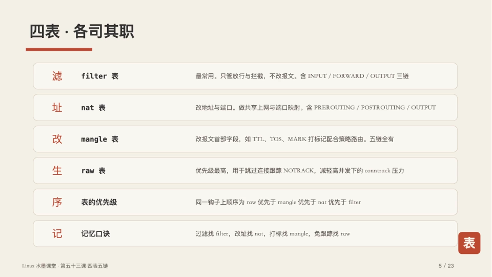
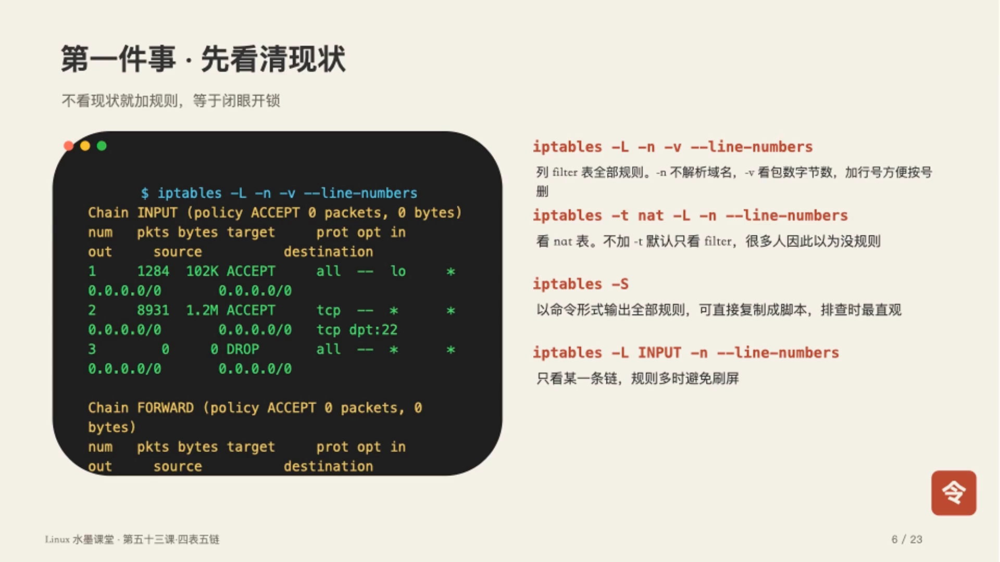
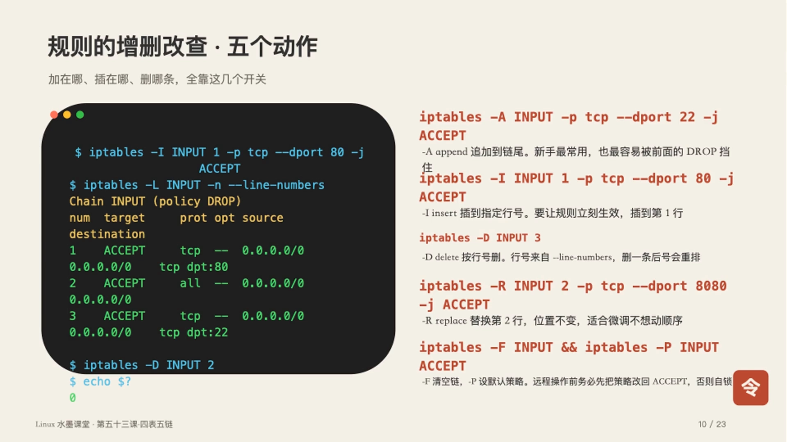
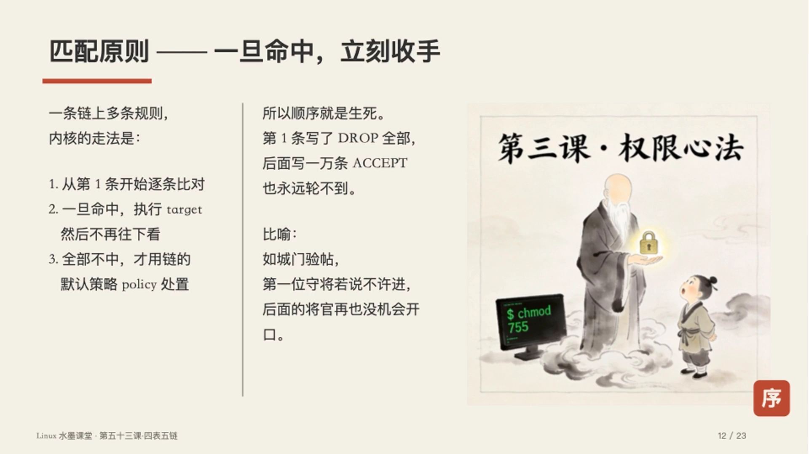
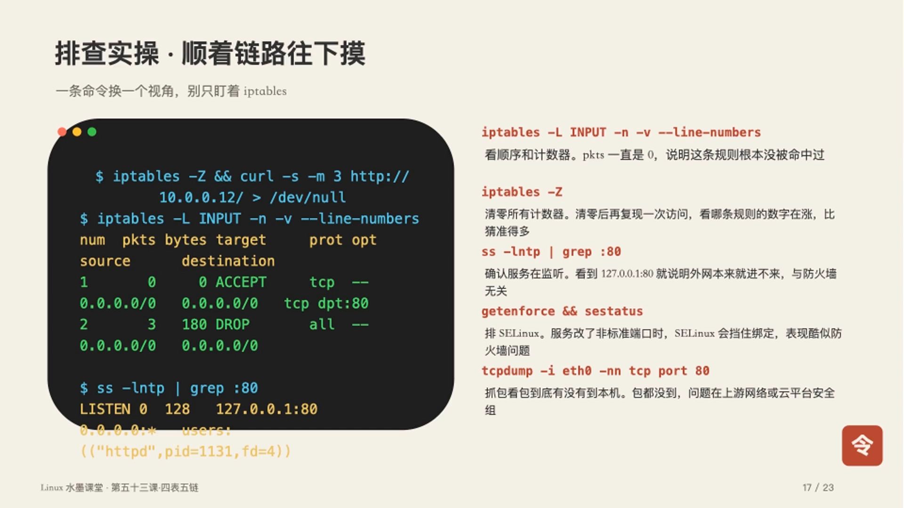
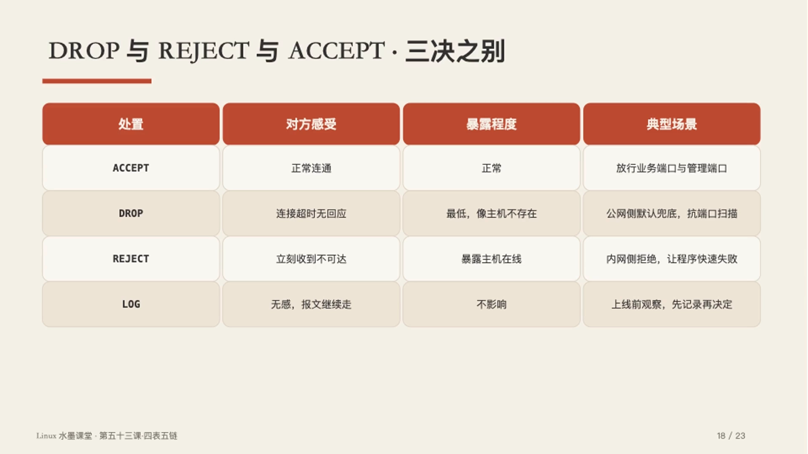
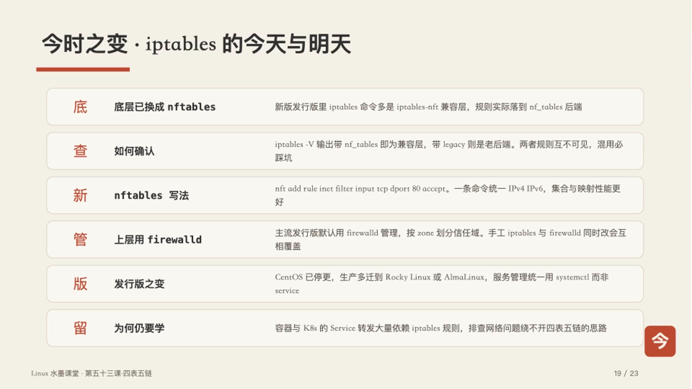

# iptables 四表五链：先把报文走向看清楚，再谈规则

> 本文整理自 B 站视频《【Linux运维·第53课】搞不懂iptables四表五链 加规则总不生效｜讲透表链关系与数据包匹配流程》。它用"立关设卡"的比喻，一次讲清 iptables 的四张表、五条链、报文的三条走向、规则匹配的先后顺序，以及"规则加了却不生效"该怎么排查。

## 本讲要解决的核心问题（SCQA）

**背景**：几乎每台 Linux 服务器上都跑着 iptables（或它的兼容层）。我们平时用 `-A` 往链里加规则，加完似乎就完事了。

**冲突**：可很多人加规则是在"凑命令"——要么加了不生效，要么一不留神把业务拦死。原因几乎都一样：**没搞清报文到底会经过哪条链，规则写在了报文根本不会经过的地方。**

**疑问**：iptables 的表、链、规则到底是什么关系？一个报文从进网卡到被处理，究竟走哪几道关口？规则按什么顺序匹配？为什么放行规则会"不生效"？

**回答（中心思想）**：iptables 只是用户态**下发规则**的工具，真正干活的是内核里的 **netfilter** 框架，它在报文路径上预埋了 **五个钩子（即五链）**；规则再按功能归入 **四张表**（filter / nat / mangle / raw）。**把报文的三条走向记牢、把规则写在报文真正会经过的链上，规则才会生效。** 防火墙的难点从来不是命令，而是"看清报文从哪来、往哪去、该在哪设卡"。

[【跳转到 00:00】](https://www.bilibili.com/video/BV1r6pw6AE57/?t=0)

---

## 一、netfilter 是本体，iptables 只是"发号施令的人"

什么叫"立关设卡"？**关卡（钩子）一直建在内核里，iptables 只是那个送来查验规则的官吏。**

[【跳转到 00:47】](https://www.bilibili.com/video/BV1r6pw6AE57/?t=47)


很多人以为 iptables 就是防火墙本身，其实不是：

- **真正干活的是内核里的 netfilter 框架**。它在 TCP/IP 协议栈的**五个关键位置预埋了钩子（hook）**，报文流经这些钩子时，就会被"抓下来"比对规则。
- **iptables 是用户态的工具**，它把我们在命令行里写的规则**下发到这些钩子上**。

用一句更好记的话：**哨位常在，令牌可换。** 哨位（netfilter 钩子）一直都在，换的是你交给它的那本通行规则（iptables 规则）。搞懂这层关系，后面的四表五链才不会"学了就忘"。

[【跳转到 01:06】](https://www.bilibili.com/video/BV1r6pw6AE57/?t=66)

---

## 二、四表：filter / nat / mangle / raw 各管什么

所谓"四表"，就是**四类功能不同的规则集合**，各司其职。

[【跳转到 01:30】](https://www.bilibili.com/video/BV1r6pw6AE57/?t=90)



| 表 | 干什么 | 包含的链 |
| --- | --- | --- |
| **filter** | 最常用。只管**放行与拦截，不改报文** | INPUT / FORWARD / OUTPUT |
| **nat** | 改**地址与端口**，做共享上网、端口映射都靠它 | PREROUTING / POSTROUTING / OUTPUT |
| **mangle** | 改**报文首部字段**（如 TTL、TOS、MARK 打标记，配合策略路由） | 五链全有 |
| **raw** | 优先级最高，用来**跳过连接跟踪**，减轻高并发下的 conntrack 压力 | PREROUTING / OUTPUT |

一句话记住：**filter 管"过不过"，nat 管"改成谁"，mangle 管"改报文头"，raw 管"要不要跟踪"。**

### 2.1 上手第一件事：先看清现状

不看现状就加规则，等于**闭眼开锁**。最常用的查看命令是：

[【跳转到 02:00】](https://www.bilibili.com/video/BV1r6pw6AE57/?t=120)

```bash
iptables -t filter -L -n -v --line-numbers
```



- `-n`：不解析域名，速度快；
- `-v`：显示**包数 / 字节数**的计数器（后面排查故障全靠它）；
- `--line-numbers`：显示**行号**，删规则时不用瞎找；
- 不加 `-t` 时，**默认看的就是 filter 表**。

---

## 三、五链与报文的三条走向（核心中的核心）

很多人写了半天规则不生效，根本原因是**搞不清报文会经过哪几个关口**，规则写在了根本不会经过的链上，纯属白费工夫。

### 3.1 五链 = 五个关口的方位

[【跳转到 02:40】](https://www.bilibili.com/video/BV1r6pw6AE57/?t=160)


| 链 | 位置 | 比喻 |
| --- | --- | --- |
| **PREROUTING** | 刚进网卡、**还没做路由判断** | 城门外验帖 |
| **INPUT** | 确认**目标是本机**、要往上送 | 入府登记 |
| **FORWARD** | 目标不是本机、**要转发出去** | 过境放行 |
| **OUTPUT** | **本机进程**发报文 | 出府报备 |
| **POSTROUTING** | 即将**离开网卡**的最后一站 | 出城盖印 |

### 3.2 报文三条走向：背下来受用终身

[【跳转到 03:04】](https://www.bilibili.com/video/BV1r6pw6AE57/?t=184)


1. **进入本机**：`PREROUTING → INPUT → 本机进程`。想拦"别人访问我"，就写在 **INPUT** 链。
2. **穿过本机（转发）**：`PREROUTING → FORWARD → POSTROUTING`。做网关时管这条，写在 **FORWARD** 链。
3. **本机发出**：`本机进程 → OUTPUT → POSTROUTING`。想拦"本机往外连"，就写在 **OUTPUT** 链。

**三条走向的分水岭是"路由判断"**：报文进了 PREROUTING 之后，内核先看一眼"目标地址是不是我本机"——是，就上送 INPUT；不是，就走 FORWARD 转发。

> 记法：**"进本机写 INPUT、转发写 FORWARD、出本机写 OUTPUT"**。绝大多数"规则不生效"，就是因为把访问本机的规则写到了 FORWARD，或者反过来。

---

## 四、规则的增删改查：核心就几个动作

[【跳转到 03:34】](https://www.bilibili.com/video/BV1r6pw6AE57/?t=214)



| 动作 | 参数 | 要点 |
| --- | --- | --- |
| **加** | `-A`（append） | 追加到**链尾**。新手最常用，也**最容易被前面的 DROP 兜底挡住，加了白加** |
| **插** | `-I`（insert） | 插到**指定行号**，插第 1 行就最优先，适合要"立刻生效"的规则 |
| **删** | `-D`（delete） | 按**行号**删；行号从 `--line-numbers` 看；**删完行号会重排** |
| **换** | `-R`（replace） | 替换某条规则，比"先删再加"更稳妥 |

> 踩坑提醒：删规则之间千万别连着按旧行号删——**删掉第 1 条后，原来的第 2 条会顺势变成第 1 条**，再按旧行号删就删错了。

---

## 五、匹配与处置：规则怎么被"挑中"、挑中后怎么办

匹配条件准不准、处置动作选得对不对，直接决定防火墙能不能正常干活、会不会误伤业务。

### 5.1 匹配原则：自上而下，命中即停

[【跳转到 04:20】](https://www.bilibili.com/video/BV1r6pw6AE57/?t=260)



内核的走法是：

1. 从链的**第 1 条**规则开始，**逐条比对**；
2. **一旦命中**某条，就执行它的处置动作（target），**然后不再往下看**；
3. 全部都不命中，才走这条链的**默认策略（policy）**。

所以**顺序就是生死**：如果第 1 条写成了"全部 DROP"，那后面写一万条 ACCEPT 也永远轮不到。

### 5.2 匹配条件：写得越准，误伤越少

[【跳转到 04:50】](https://www.bilibili.com/video/BV1r6pw6AE57/?t=290)

- `-p` 协议、`--dport` 目标端口、`-s` 源网段：例如放行数据库端口时，**只允许内网网段访问**，别全开；
- `-m multiport`：**一次写多个端口**，不用拆成好几条规则；
- `-m iprange`：匹配**连续 IP 段**，适合管控运维跳板机的访问范围。

放行时尤其注意**别把监控系统的探测地址也一起放进来**——条件写宽了，误伤的概率就高。

### 5.3 处置动作：target 四决

[【跳转到 05:11】](https://www.bilibili.com/video/BV1r6pw6AE57/?t=311)


| 动作 | 含义 | 适用场景 |
| --- | --- | --- |
| **ACCEPT** | 放行，报文进入下一阶段，不再受本链后续规则约束 | 正常联通的业务端口、管理端口 |
| **DROP** | 直接丢弃，**一声不响**，对方感受是**超时无响应** | 公网默认兜底、抗扫描（暴露程度最低） |
| **REJECT** | 拒绝并回一个 **ICMP 端口不可达**，对方**立刻知道失败** | 内网用，让程序快速失败、不用等超时 |
| **LOG** | 只写内核日志、**不做处置**，报文继续往下匹配 | 上线新规则前的**观察期**，避免误拦 |

> 记忆：**DROP 让对方"等到超时"，REJECT 让对方"立刻失败"**。对外抗扫描用 DROP，对内排障用 REJECT。

---

## 六、规则明明加了，为什么不生效？——排查现场

[【跳转到 05:41】](https://www.bilibili.com/video/BV1r6pw6AE57/?t=341)

最常见的故障：执行了放行 80 端口的规则，外部依然访问不到。顺着下面几步查，别瞎猜：

[【跳转到 06:01】](https://www.bilibili.com/video/BV1r6pw6AE57/?t=361)


1. **查顺序**：看是不是前面已经有一条 `DROP` 兜底，新规则排在后面根本轮不到；
2. **查表**：看是不是**把过滤规则误写到了 nat 表**里；
3. **看计数器**：规则的 **pkts 一直是 0**，说明报文根本没走到这条（写错链 / 写错表）；
4. **查服务监听地址**：服务是不是只监听了 `127.0.0.1`，那样外网本来就进不来。

**最准的是"计数器法"**：

[【跳转到 06:31】](https://www.bilibili.com/video/BV1r6pw6AE57/?t=391)



```bash
iptables -Z            # 先把所有规则的计数器清零
# 复现一次访问
iptables -L INPUT -n -v --line-numbers   # 看哪条规则的 pkts/bytes 涨了
```

哪条规则的计数器涨了，就说明报文命中了那条——**一目了然，不用猜**。

另外别忘了：CentOS 上 **SELinux 对非标准端口的阻挡**，症状和防火墙问题高度相似，一定要一并排查。

### 6.1 DROP、REJECT、ACCEPT 三决之别

[【跳转到 07:01】](https://www.bilibili.com/video/BV1r6pw6AE57/?t=421)



| 处置 | 对方感受 | 暴露程度 | 典型场景 |
| --- | --- | --- | --- |
| **ACCEPT** | 正常连通 | 正常 | 业务端口、管理端口 |
| **DROP** | 连接超时、无回应 | 最低，像主机不存在 | 公网默认兜底、抗扫描 |
| **REJECT** | 立刻返回失败 | 暴露主机在线 | 内网用，让程序快速失败 |
| **LOG** | —— | 不拦截，只记录 | 放新规则前的观察期 |

---

## 七、今时之变：iptables 的今天与明天

[【跳转到 07:23】](https://www.bilibili.com/video/BV1r6pw6AE57/?t=443)



- **底层已换成 nftables**：新版 Linux 发行版里，`iptables` 命令大多是 **iptables-nft 兼容层**，规则实际落到 `nf_tables` 后端；用 `iptables -V` 若输出带 `nf_tables`，就是兼容层。
- **legacy 与 nft 两条后端互不可见、混用必踩坑**：老的 legacy 后端和新的 nft 规则彼此看不到，混着用会出现"明明加了却没生效"。
- **主流发行版用 firewalld 管理**：手工改 iptables 可能**被 firewalld 覆盖**。
- **为什么还要学？** 因为**容器与 Kubernetes 的 Service 转发全靠这套逻辑**，它是理解容器网络数据面的地基。

---

## 小结

[【跳转到 07:48】](https://www.bilibili.com/video/BV1r6pw6AE57/?t=468)


- **本体关系**：iptables 是用户态工具，真正执行的是内核 **netfilter 的五个钩子**。
- **四表分工**：filter 过滤、nat 改址、mangle 打标、raw 免跟踪。
- **五链方位**：PREROUTING→INPUT→本机，PREROUTING→FORWARD→POSTROUTING，OUTPUT→POSTROUTING。
- **报文三条走向**：进本机写 INPUT、转发写 FORWARD、出本机写 OUTPUT。
- **匹配顺序**：自上而下、**命中即停**；顺序就是生死。
- **处置动作**：按场景选 ACCEPT / DROP / REJECT / LOG。
- **排障心法**：先查**顺序**、再查**表**、再看**计数器**、最后查**服务监听地址**。

> 收官口诀：**四表分工各有司，五链方位记心里；匹配自上而下走，一朝命中不回头。** 防火墙之难不在命令，而在看清报文的走向——**关口分明，知所守、治所放，方为上策**。

---

## 关键术语速查

| 术语 | 一句话解释 |
| --- | --- |
| **netfilter** | 内核里的报文处理框架，在协议栈五个位置预埋钩子 |
| **iptables** | 用户态工具，把规则下发到 netfilter 的钩子上 |
| **表（table）** | 一类功能的规则集合：filter / nat / mangle / raw |
| **链（chain）** | 报文经过的一道关口（=一个钩子位置），如 INPUT、FORWARD |
| **规则（rule）** | 链里的一条"匹配条件 + 处置动作" |
| **PREROUTING** | 刚进网卡、路由判断之前的关口 |
| **POSTROUTING** | 即将离开网卡的最后一站 |
| **target** | 规则的处置动作：ACCEPT / DROP / REJECT / LOG |
| **policy** | 一条链全不命中时走的默认策略 |
| **conntrack** | 连接跟踪；raw 表可让报文跳过它以提速 |
| **iptables-nft** | 新版发行版里 iptables 命令的 nftables 兼容层 |

> 想练手的话，视频末尾留了四道课堂练习：①把 INPUT 默认策略设为 DROP，再依次放行回环、已建立连接、22 端口，确认全程不掉线；②验证**规则顺序**对生效的影响；③用**计数器**判断命中的规则；④对比 **DROP 与 REJECT** 的表现差异。切记**在测试机上操作，不要碰生产环境**。
