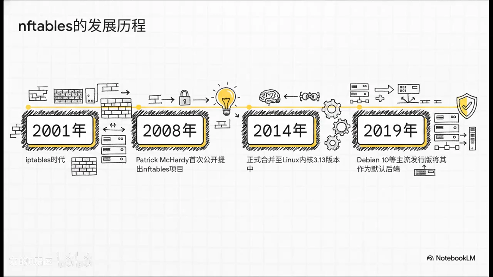
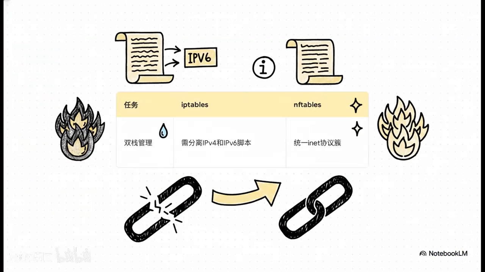
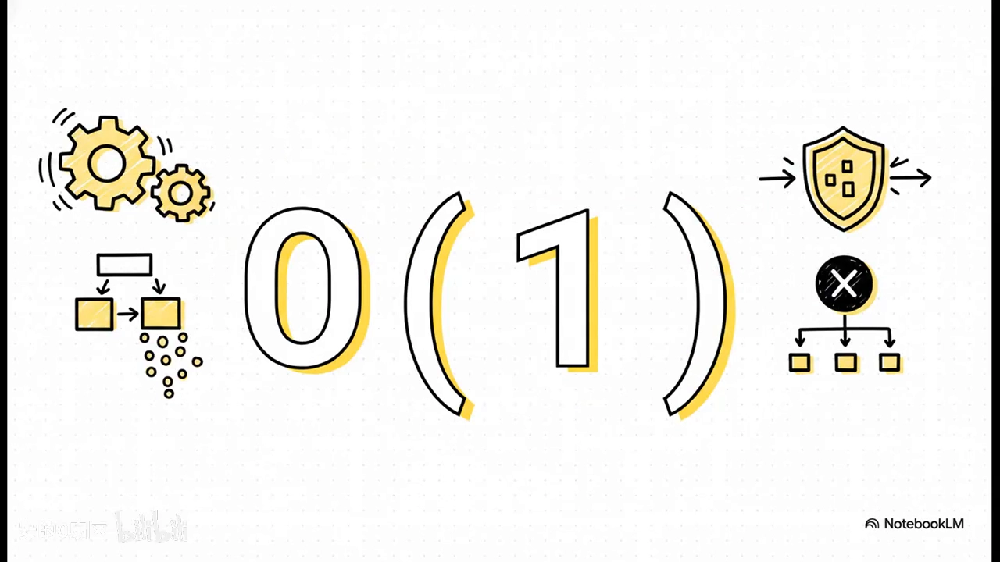
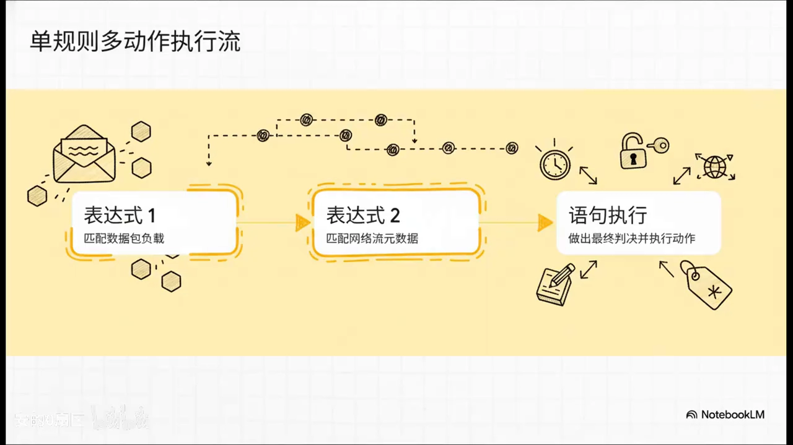
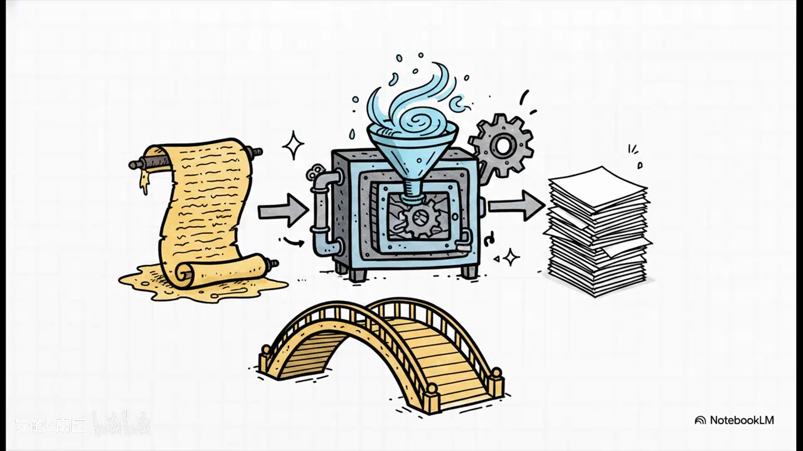

# Linux 防火墙为什么要换代：nftables 的五个卖点

> 本文整理自 B 站视频《Linux防火墙演进：掌握nftables》。它用「旧流水线 vs 智能机器人」的类比，把 **iptables 为什么越来越带不动**、**nftables 靠什么接棒** 讲清楚，并给出五步走的框架：告别 iptables → 认识 nftables → 架构优势 → 新语法 → 迁移指南。

## 本讲要解决的核心问题（SCQA）

**背景**：陪着我们二十多年的 iptables，一直是 Linux 上网管和工程师做防火墙的默认选择，命令大家都熟。

**冲突**：但今天躲不开了——每次更新规则都提心吊胆，几千行「面条一样」的防火墙脚本越看越无力。这位老战友在当前网络环境下，确实有点带不动了。

**疑问**：iptables 到底卡在哪里？nftables 是不是「换个名字的新东西」，靠谱吗？它凭什么解决这些问题？老规则要不要推倒重写？

**回答（中心思想）**：**nftables 不是 iptables 换皮，而是把防火墙引擎重做成「一个统一的、可编程的通用引擎」。** 它在四处直接挖掉了 iptables 的老病根——**重复的协议代码、乃至于整块替换的规则更新、割裂的 IPv4/IPv6 管理、随规则数量恶化的查找性能**；外加一套更自由的新语法和一个官方翻译器，让迁移可以「无痛」。

[【跳转到 00:00】](https://www.bilibili.com/video/BV1TjLr6qENr/?t=0)

---

## 一、先看旧时代的坑：iptables 为什么带不动

要往哪儿走，先看过去的坑在哪。iptables 和 nftables 都叫「Linux 防火墙」，可底层设计差得很直观。

[【跳转到 00:24】](https://www.bilibili.com/video/BV1TjLr6qENr/?t=24)

### 1.1 协议感知被硬编码：同一套代码被复制四遍

打个比方：**iptables 像一条几十年前那种死板的工厂流水线**——它的**协议感知直接硬编码在底层**。结果就是，只为了处理不同协议，同一套防火墙代码被硬生生复制了四遍：

[【跳转到 01:18】](https://www.bilibili.com/video/BV1TjLr6qENr/?t=78)

- IPv4 一遍；
- IPv6 一遍；
- ARP 一遍；
- 网桥（bridge）一遍。

这种「一套逻辑复制四份」的做法，**资源浪费非常夸张**。

而 **nftables 完全是个可编程的智能机器人**：它用的是一个真正**大一统的通用引擎**。

[【跳转到 01:43】](https://www.bilibili.com/video/BV1TjLr6qENr/?t=103)

### 1.2 更新规则的方式：整块替换 vs 原子增量

第二个坑在「改规则」这件事上，平时最糟心。

- **iptables 时代**：规则集是一个**完全绑死的单体大块**。你哪怕只改一条、只加一行，**底层也得把整个规则集全部拉出来修改，再整块塞回去**。规则少还行；规则上了规模，这就是**性能噩梦**。
- **nftables**：规则用**链表结构**组织，支持**原子级增量更新**——想加哪条加哪条、想删哪条删哪条，`完全不碰别的地方`，又快又稳。

[【跳转到 02:17】](https://www.bilibili.com/video/BV1TjLr6qENr/?t=112)

> 一句话记住第一组差别：**iptables 是「整块重写」，nftables 是「按需增删」。** 这正是它后面「事务化更新」的根基。

---

## 二、nftables 靠谱吗：从提案到默认后端的时间线

上新防火墙，很多人的第一反应是「这玩意儿靠谱吗？」。看时间线就不慌了——它**绝不是刚出炉的实验品**：

[【跳转到 02:40】](https://www.bilibili.com/video/BV1TjLr6qENr/?t=160)

- **2008 年**：Patrick McHardy 提出；
- **2014 年**：正式合并进 **Linux 3.13 内核**；
- **2019 年**：连 Debian 这种以「稳如老狗」著称的发行版，都**默认用它做后端**。

所以放一百个心，**这已经是久经沙场的企业级标配**。

[【跳转到 03:05】](https://www.bilibili.com/video/BV1TjLr6qENr/?t=185)

### 2.1 关键设计：内核里塞进一台「微型虚拟机」

它到底牛在哪？关键在于——**nftables 在内核里塞进了一个微型的虚拟机**。没听错，防火墙里有个虚拟机。

[【跳转到 03:13】](https://www.bilibili.com/video/BV1TjLr6qENr/?t=193)

它彻底扔掉了以前那种**写死在底层的协议规则**，改为**执行用户空间传下来的字节码**来检查数据包、做动态决定。这种底层架构上的「降维打击」，直接把灵活性拉满。

---

## 三、核心架构优势：要少写、要快

架构牛在哪，直接对应前面两个坑，再加上一个双栈的坑。这里有三条。

### 3.1 统一协议族 `inet`：一套规则同时管 IPv4 和 IPv6

过去为了同时搞定 IPv4 和 IPv6，大家都得**把 IPv4 的脚本整个复制一遍**，再把里面的 IP 全改成 v6 格式——这种「复制粘贴的黑历史」，谁干过谁知道。

在 nftables 里这事儿翻篇了：**有了统一的 `inet` 协议族，你只需要建一个基础链，就能同时拦截和处理 IPv4 和 IPv6 的流量**，双栈管理里的噩梦就此结束。

[【跳转到 04:14】](https://www.bilibili.com/video/BV1TjLr6qENr/?t=229)

### 3.2 性能飞跃到 O(1)：靠「拼接」把键做成哈希

从 **Linux 内核 4.1** 开始，nftables 支持了一手叫**「拼接」（concatenation）** 的绝活：它能把一堆键值拼成一个**元组（tuple）**，然后**一次哈希运算直接映射到执行动作**上。

[【跳转到 04:19】](https://www.bilibili.com/video/BV1TjLr6qENr/?t=259)

这代表什么？**不管你的规则是一条、十条还是一万条，它查找执行的时间几乎都是恒定不变的——O(1)。** 性能可以说是原地起飞。

---

## 四、新语法特性：更自由、更聪明、更省行

光架构牛还不够，代码还得写得爽。nftables 新语法的核心理念就四个字：**完全自由**。

[【跳转到 04:49】](https://www.bilibili.com/video/BV1TjLr6qENr/?t=289)

### 4.1 零预设表、零预设链

以前 iptables 有个「流氓逻辑」：**不管你用不用，先把所有默认的表和链统统塞进内核**，白白浪费性能。

现在 nftables **一开始就是一张纯白的白纸**：**零预设表、零预设链**，你需要什么才加什么；那些「占着茅坑不拉屎」的无用基础链直接统统消失。

### 4.2 一条规则塞多个表达式，命中后连做一串动作

它的**执行流也变聪明了**：以前一条规则往往只能干一件事；现在**一条规则里可以塞进好几个表达式**，像过关一样**从左往右依次测试**——比如第一个测负载，对了接着测第二个元数据，最后**一次性触发一连串动作**。

[【跳转到 05:16】](https://www.bilibili.com/video/BV1TjLr6qENr/?t=316)

具体有多爽？**单条规则命中后，你可以同时「记录、打标签、最后再放行」，逻辑清晰得不能再清晰。**

### 4.3 高级通用集合：几百行规则缩成几行查表

还有一个「超级王炸」：**高级通用集合里自带字典、映射表（verdict map）、区间和拼接。**

[【跳转到 05:46】](https://www.bilibili.com/video/BV1TjLr6qENr/?t=346)

这听起来抽象，但你只要知道：**以前为了把几百个 IP 分配给不同的动作，得写几百行规则，看得人眼花缭乱；现在靠着查表，几行极其优雅的代码就全搞定了**——代码量直接砍到脚踝。

---

## 五、迁移指南：老规则不用手抄，交给官方翻译器

听到这儿，很多人手痒了，但又怕老服务器上的「祖传规则」没法弄。别慌，官方给出了「神级工具」—— **`iptables-translate`**。

[【跳转到 06:49】](https://www.bilibili.com/video/BV1TjLr6qENr/?t=384)

老用户**不需要一行行重写**：用它自动读取你那一团乱麻的旧规则，直接转换成**优化过的、清清爽爽的 nftables 新语法**。可以说，这是从旧时代通往内核虚拟机最无痛的一座桥。

---

## 小结

- **iptables 的病根**：协议感知硬编码导致代码复制四份；单体规则集导致「改一条要整块重写」；IPv4/IPv6 各管一套。
- **nftables 的解法**：统一通用引擎 + 内核微型虚拟机执行用户空间字节码 + 链表式原子增量更新。
- **靠谱性**：2008 年提出、2014 年进 Linux 3.13、2019 年成 Debian 默认后端，早已是企业级标配。
- **两大架构红利**：统一的 `inet` 协议族一次管双栈；拼接 + 哈希让查找性能恒定 O(1)。
- **语法更自由**：零预设表链、单规则多表达式、通用集合与映射表把长规则压成查表。
- **迁移无痛**：`iptables-translate` 自动把旧规则翻译成 nftables 语法。

留一个扎心的问题：既然有了不再冗余的代码、随时能改的原子级更新、性能无敌的 O(1) 哈希，甚至还有这么优雅的语法——**你部署的下一个防火墙，凭什么还要选 iptables 呢？**

[【跳转到 06:54】](https://www.bilibili.com/video/BV1TjLr6qENr/?t=414)

## 关键术语速查

| 术语 | 一句话解释 |
| --- | --- |
| **netfilter** | Linux 内核中的包过滤框架，真正执行防火墙决策的地方 |
| **iptables** | 传统的 netfilter 规则配置接口，把规则组织成表与链 |
| **nftables** | 新一代 netfilter 规则框架，用统一引擎与统一语法表达规则 |
| **协议族 `inet`** | nftables 中可同时处理 IPv4 与 IPv6 的协议族 |
| **拼接（concatenation）** | 把多个匹配键拼成一个元组再哈希，使查找性能接近 O(1) |
| **原子级增量更新** | 只增删涉及的规则，不整块替换规则集 |
| **通用集合 / 映射表** | 把大量地址、端口等匹配值聚合成集合或「键→动作」映射，减少重复规则 |
| **`iptables-translate`** | 官方工具，把旧 iptables 规则自动翻译成 nftables 语法 |
