# nftables 值不值得迁移：关键不在命令，而在「规则集能不能作为一个事务被安全替换」

> 本文整理自 B 站视频《nftables：iptables的继任者来了，要不要迁移（深度完整版）》（DeeparchWorks）。它不去比对两条命令的写法，而是从**工程视角**回答迁移问题：nftables 改变了「规则怎样建模、怎样更新、怎样进入内核」，因此**能不能安全地整体替换规则集**，才是值不值得迁移的真正判据。

## 本讲要解决的核心问题（SCQA）

**背景**：nftables 被普遍视为 iptables 的继任者，命令能跑、语法更现代，看起来迁移只是「换个写法」。

**冲突**：**脚本能跑，不代表它适合庞大的规则集和频繁变更**；而新模型再先进，也不代表现有自动化可以「无验证地」直接切换。更麻烦的是——半套新规则会让流量短暂误放行或误丢包。

**疑问**：nftables 到底改变了什么？为什么说它的重点是**事务（transaction）**？原子性能保证什么、又不能保证什么？真要迁移，安全的顺序是什么？

**回答（中心思想）**：**nftables 不是 iptables 换皮，它用「统一表达 + 集合映射 + 事务批处理」改变了规则的建模、更新与入内核方式。** 判断要不要迁移，关键看**规则集能否作为一个事务被安全地整体替换**。但请记住一条底线：**原子性只保证「更新一致」，不保证「策略正确」**——所以语义测试、业务回放、计数器基线和可执行回滚，一个都不能少。

[【跳转到 00:00】](https://www.bilibili.com/video/BV1BM336dEou/?t=0)

---

## 一、先理解「事务」：为什么要整批换，而不是逐页换

想象一家店要**更换价目表**：如果**一页一页地换**，顾客就会看到**新旧混合**的价目——有的商品是新价、有的是旧价，中间还可能出现没有价目的空档。

nftables 要避免的，正是这个「新旧混合」的中间态。**规则之间是互相依赖的**：

- net（hook）与**跳转**互相依赖；
- 半套新规则可能**短暂误放行**或**误丢包**；
- 只有**整个批次验证通过**，内核才把状态切到 **committed**；**失败则继续使用旧的规则集**。

[【跳转到 01:14】](https://www.bilibili.com/video/BV1BM336dEou/?t=74)

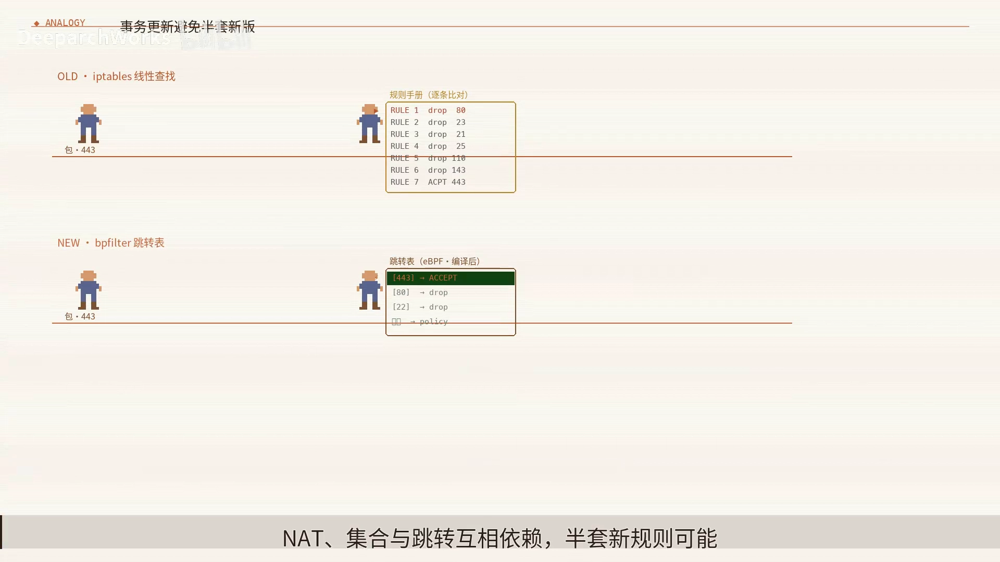

这也解释了它的工程价值：**失败结果清晰——线上不会暴露难以推理的中间态**。例如「同时删旧价目、新增集合并改三处引用」这种操作，所有修改单**先入目录**，任何一处失败，**旧版继续营业**，而不会只换掉两页。

[【跳转到 03:19】](https://www.bilibili.com/video/BV1BM336dEou/?t=199)

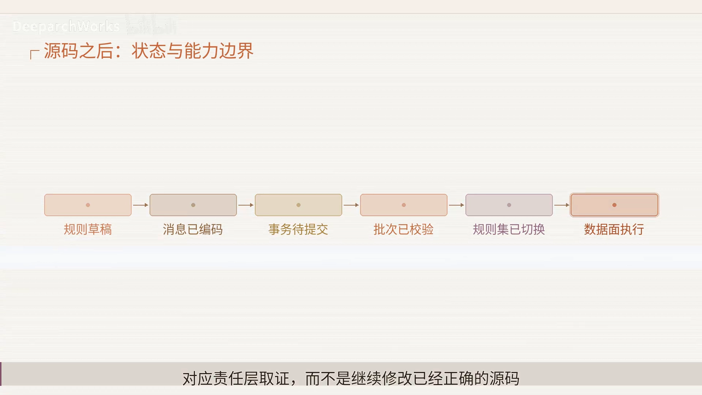

---

## 二、事务是怎么落地的：四个角色 + 一条 commit list

先看清「谁做什么」。这条链路上有四个角色：

[【跳转到 01:08】](https://www.bilibili.com/video/BV1BM336dEou/?t=68)


- **operator（运维）**：描述策略；
- **`nft`（用户态工具）**：把策略编译成对象；
- **netlink**：传输批次；
- **内核**：统一验证、提交。

### 2.1 一个例子：新增集合并让三条规则引用它

**系统先在暂存中创建对象和引用**，**全部验证通过才发布**，**任意错误都会拒绝整批**。

[【跳转到 01:39】](https://www.bilibili.com/video/BV1BM336dEou/?t=99)

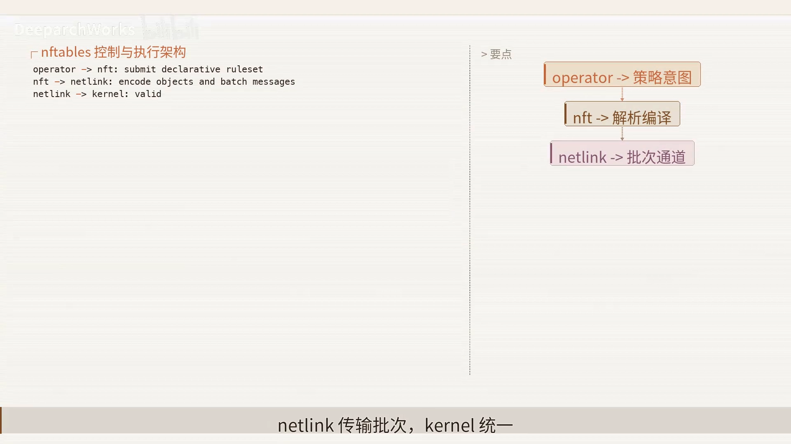

### 2.2 源码层面：每条变更都是「事务对象」，挂入 commit list

源码原理很直白：

- 把**每次规则变更保存为事务对象**，再**挂入 commit list**；
- 此时**运行中的旧规则集仍保持完整**；
- 只有**全部校验成功**，才**统一进入提交阶段**。

[【跳转到 02:04】](https://www.bilibili.com/video/BV1BM336dEou/?t=124)

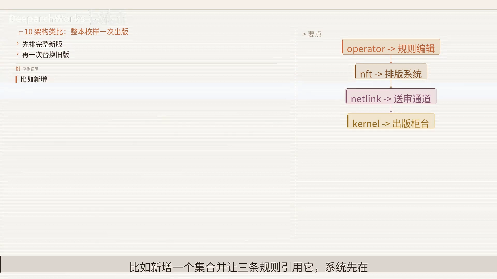

它解决的是「**让批次在统一提交前保持暂存**」这件事，从而避免新旧混合的边界。当然，后续还必须经过 **set、map 与 hook 的事务机制**配合。

---

## 三、事务的边界：它保证一致，但不保证正确

这是本讲最需要记住的一条底线。

- **原子性只保证「更新一致」**——它能让**错误的允许规则**也被「完整、原子地」发布；
- **nftables 负责规则表达、批处理与内核执行，但不能自动证明策略正确**；
- 它也**不能替代变更审计、回滚演练和应用兼容验证**。

[【跳转到 02:29】](https://www.bilibili.com/video/BV1BM336dEou/?t=149)

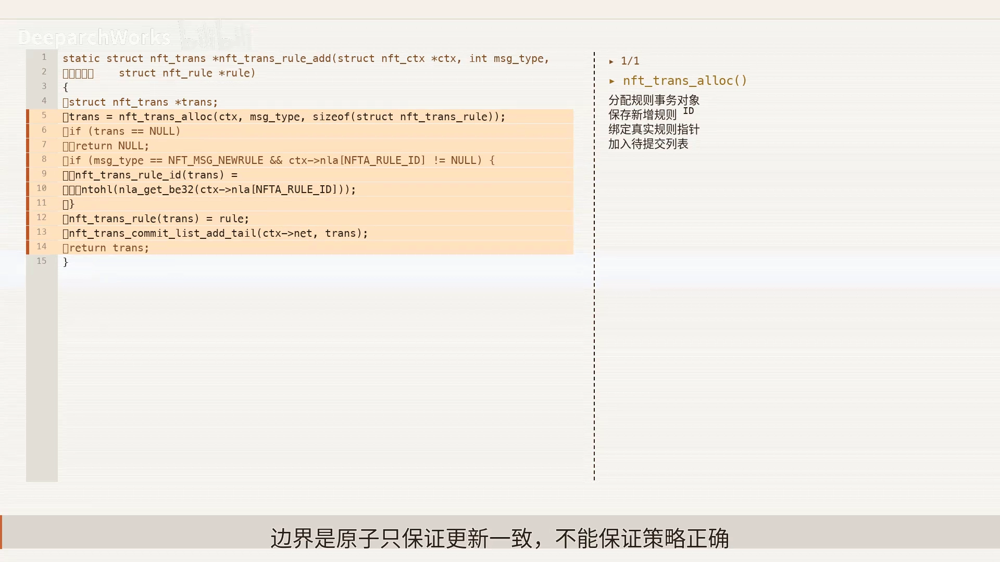

一个精准的类比：**一本排版完全正确的价目表，内容仍可能定错价格。**

因此，迁移时**必须同时准备四样东西**：**语义测试、业务回放、计数器基线、可执行回滚**。如果系统停在「规则集已切换」之前，就应回到对应责任层去取证，而不是继续修改已经正确的源码参数。

[【跳转到 02:54】](https://www.bilibili.com/video/BV1BM336dEou/?t=174)

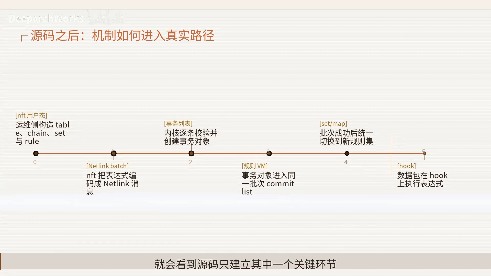

---

## 四、迁移的真正收益：不是逐行翻译，而是换模型

**如果迁移只是逐行翻译命令，就错过了集合映射和统一 family 的主要收益**，还可能**保留旧规则的线性膨胀**。

[【跳转到 03:44】](https://www.bilibili.com/video/BV1BM336dEou/?t=224)

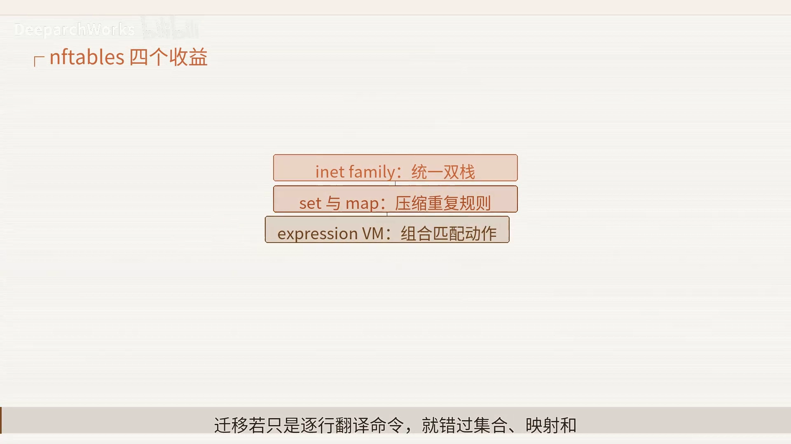

正确的顺序，是先**识别「谁在生成规则」**——尤其是 **Docker 和 Kubernetes 节点**这类「规则的真实所有者」——**再重构、回放、灰度，最后用计数器和业务流量共同确认**。

> 这里有个容易忽略的事实：**自动化控制器才是规则的真正所有者**。手动改的规则，很可能下一秒就被控制器重写。

---

## 五、把职责切开：八个可观察步骤与「同一条不通」的还原

排障的第一步不是「多装一个面板」，而是**为每个责任边界准备证据**。先把职责切开：

[【跳转到 04:09】](https://www.bilibili.com/video/BV1BM336dEou/?t=249)


- **`nft` 用户态**：描述「期望」；
- **netlink batch**：建立并接入事务列表；
- **内核**：执行真实路径规则，**内核 VM 维护运行状态**；
- **set / map**：提供**观测证据**。

分层以后，**同一句「不通」才能被还原成可验证的问题**。变更前先分别保存 **nft 用户态事务列表** 和 **set/map 的基线**，变更后才能知道**差异发生在哪一层**。

### 5.1 端到端路径有八个可观察步骤

从运维侧构造 **table、chain、set、rule**，一直到**计数器和日志返回运行证据**——**每一步都应留下输入、状态变化和输出证据**。

[【跳转到 04:34】](https://www.bilibili.com/video/BV1BM336dEou/?t=274)

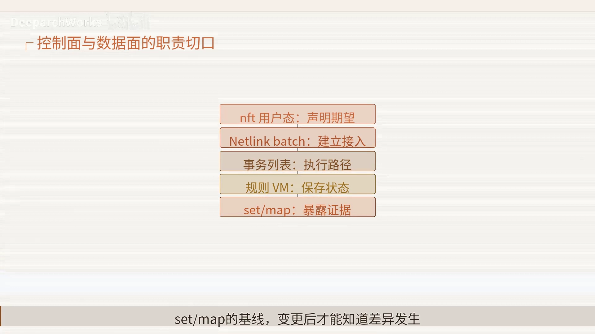

**只看到最终超时，无法区分「是前半段没建立，还是后半段回程失败」**。最有效的做法是：在内核**逐条校验并创建事务对象和数据包**，在 bootstrap 的 hook 上执行表达式，**两侧同时抓证据，用二分法快速缩小故障区间**。

### 5.2 状态序列：看到「已切换」不等于成功

一个请求会依次经过这些状态：

```
规则草稿消息 → 已编码事务 → 待提交批次 → 已校验 → 规则集已切换 → 数据面执行
```

[【跳转到 04:59】](https://www.bilibili.com/video/BV1BM336dEou/?t=299)

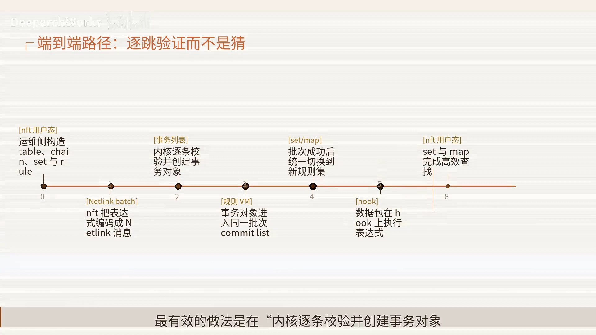

中间状态之所以存在，是因为系统要**跨步骤保存必要信息**。排障时**必须确认状态是「继续前进、被回滚，还是被连接或缓存固定」**。

> **关键提醒**：看到「规则集已切换」**只能证明倒数第二步完成**，还要验证**数据面执行**以及**反向路径**，才能宣布端到端成功。

---

## 六、六条轴、六类故障：让排障可重复观测

配置**不能按名字猜作用**。这里至少有**六条轴**：

[【跳转到 05:24】](https://www.bilibili.com/video/BV1BM336dEou/?t=324)

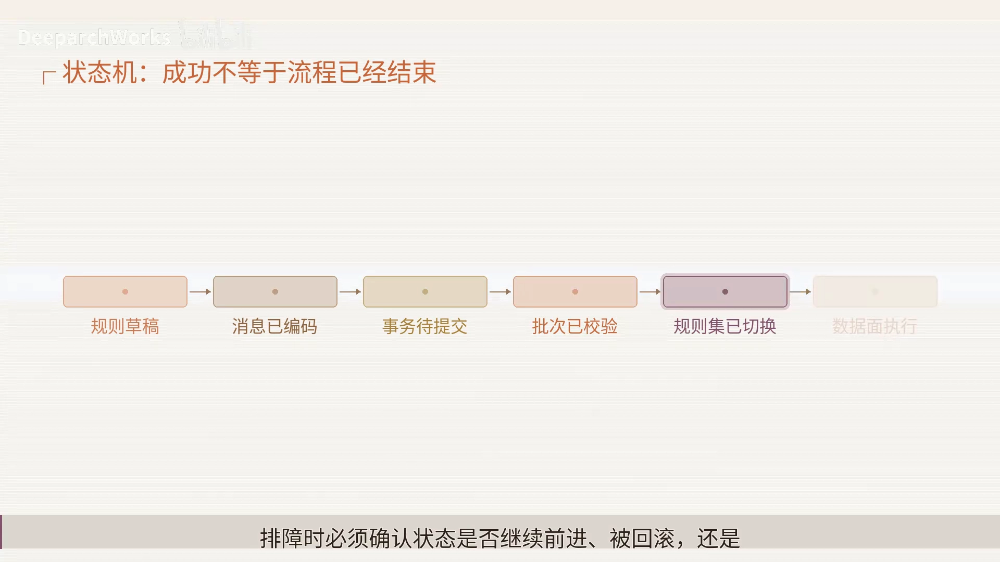

1. **inet family 是否统一了 IPv4 与 IPv6？**
2. **set 与 map 是否替代了重复规则？**
3. **batch 是否保证了成组更新？**
4. **兼容性**
5. **容量**
6. **回程**

修改任何一项前都要写清：**它改变的是「标识、路径、状态还是边界」**。**一次只改一条轴**，并记录 `nft list ruleset` 保存完整规则模型、配合 `conntrack` 统计确认状态——**比同时翻动多个开关更容易证明因果**。

### 6.1 六类故障会表现成相似的超时

[【跳转到 06:14】](https://www.bilibili.com/video/BV1BM336dEou/?t=374)


- 系统**同时存在 legacy 与 nft 两套 backend**；
- **自动化组件持续重写规则**；
- **逐行翻译丢失了原有的链优先级**；
- 后面还可能是**状态、容量或回程**问题。

**不要靠重启碰运气**，应把每个假设绑定一份能证伪它的观测证据：先用 **`update-alternatives` 确认实际 backend**，排除「接入问题」；再用**日志与 trace 确认表达式执行路径**，确认状态与传输。

[【跳转到 06:39】](https://www.bilibili.com/video/BV1BM336dEou/?t=399)

最终要把这些证据串起来：**`nft list ruleset` 保存完整规则模型 → `update-alternatives` 确认实际 backend → 规则 counter 确认命中与流量分布 → 状态表、双点抓包与业务延迟**，才能**从控制面一直追到最终用户体验**。告警也应当同时带上 **conntrack 统计、net 与状态、业务探针、允许/拒绝矩阵**，值班人员才能先判断是**状态耗尽**还是**路径丢失**。

---

## 七、性能没有免费午餐

**事务提交避免中间态，但不能证明策略正确；set 压缩规则数量，但增加数据模型设计；统一 family 减少重复，却要求重新审视双栈差异**；后面几项还会把成本转移到**内存、控制面或运维复杂度**。

[【跳转到 07:29】](https://www.bilibili.com/video/BV1BM336dEou/?t=449)

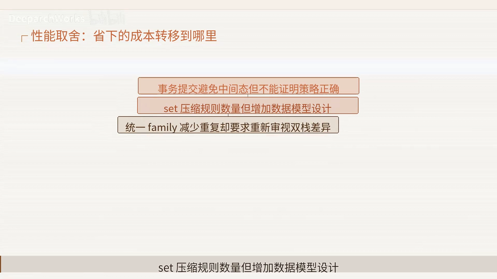

所以评估方案时必须同时看**吞吐、尾延迟、容量和恢复时间**。压测除了平均吞吐，还要**注入故障并观察**：原子回滚快，但**必须准备完整的规则快照**——要问一句「是否把恢复时间推到了不可接受的范围」。

[【跳转到 07:54】](https://www.bilibili.com/video/BV1BM336dEou/?t=474)

### 7.1 别忘了安全面

网络或协议跑通只是第一层，**默认策略必须在新旧模型中保持一致**。**链优先级变化可能形成短路，或绕过集合更新的权限**，应**独立审计**；还要审计**共享状态、默认策略和相邻层入口**，避免为了恢复联通而**永久扩大攻击面**。

故障处理中如果临时放宽了自动化控制器，**必须设置自动到期和复合记录**，否则临时措施会变成长期漏洞。

---

## 八、可靠迁移的五步与六条约束

一条可操作的顺序：

[【跳转到 08:26】](https://www.bilibili.com/video/BV1BM336dEou/?t=506)


1. **识别** legacy/nft 与兼容命令的**真实 backend**；
2. **导出**规则计数器和业务流量**基线**；
3. 用 **set/map 和 inet 重构**，而非逐行翻译；
4. **离线回放**允许、拒绝、net 与回包；
5. 选择**单节点灰度**并准备**原子回滚**；
6. **比较技术指标与业务指标后，再扩面**。

> **灰度观测和回滚必须在扩面之前准备好。** 如果只能证明新方案「能启动」、却不能证明「失败时能恢复」，那还**不具备生产迁移条件**。

在灰度节点主动制造「逐行翻译丢失原有链优先级」这样的故障、测量隔离和回滚耗时，比只跑成功用例**更接近真实风险**。

[【跳转到 08:51】](https://www.bilibili.com/video/BV1BM336dEou/?t=531)

最终决策回到**六条约束**：

[【跳转到 09:16】](https://www.bilibili.com/video/BV1BM336dEou/?t=556)


- 新系统**优先直接采用 nft 原生模型**；
- 依赖旧工具链的，先**解决规则所有权问题**；
- 规则大量重复时，**set/map 收益明显**；
- 其余约束覆盖**容量、安全和可恢复性**。

**结论不是「哪个技术永远最好」，而是「哪条路径最匹配当前系统」。** 设计评审时，把「迁移成功标准」写成「**语义等价与可运维性**」的验收项，负责人、证据和回滚条件都明确后再批准上线。

---

## 小结

- **迁移判据**：关键不在命令长什么样，而在**规则集能否作为一个事务被安全整体替换**。
- **事务的价值**：避免「新旧混合」的中间态，失败则旧规则集继续生效。
- **事务的边界**：原子性只保证**更新一致**，**不保证策略正确**——审计、策略测试、可执行回滚仍不可缺。
- **真正的收益**：**集合映射 + 统一 family**；逐行翻译只会保留旧规则的线性膨胀。
- **排障思路**：把职责切开、留下每一步证据；看到「规则集已切换」不等于端到端成功。
- **迁移口诀（五步）**：**现状盘点 → 语义重构 → 批次验证 → 原子切换 → 证据回滚**。

这套方法同样适用于**边缘防火墙、Kubernetes 节点和云安全组**。

[【跳转到 09:41】](https://www.bilibili.com/video/BV1BM336dEou/?t=581)

## 关键术语速查

| 术语 | 一句话解释 |
| --- | --- |
| **事务（transaction）** | 把一批规则变更先暂存、整体校验，全部通过才一次性提交 |
| **commit list** | 内核中挂载待提交事务对象的列表，提交前旧规则集保持完整 |
| **committed** | 批次校验通过后内核切换到的「已提交」状态 |
| **nft** | nftables 的用户态命令行工具，把策略编译成对象 |
| **netlink** | 用户态与内核之间传输规则批次的通道 |
| **set / map** | 集合与映射表，把大量匹配值聚合成可被规则引用的结构 |
| **inet family** | 统一处理 IPv4 与 IPv6 的协议族 |
| **rule counter** | 规则计数器，用于确认命中与流量分布 |
| **`update-alternatives`** | 用于确认系统实际使用的 iptables/nftables backend |
| **conntrack** | 连接跟踪，用于确认状态与连接是否耗尽 |
