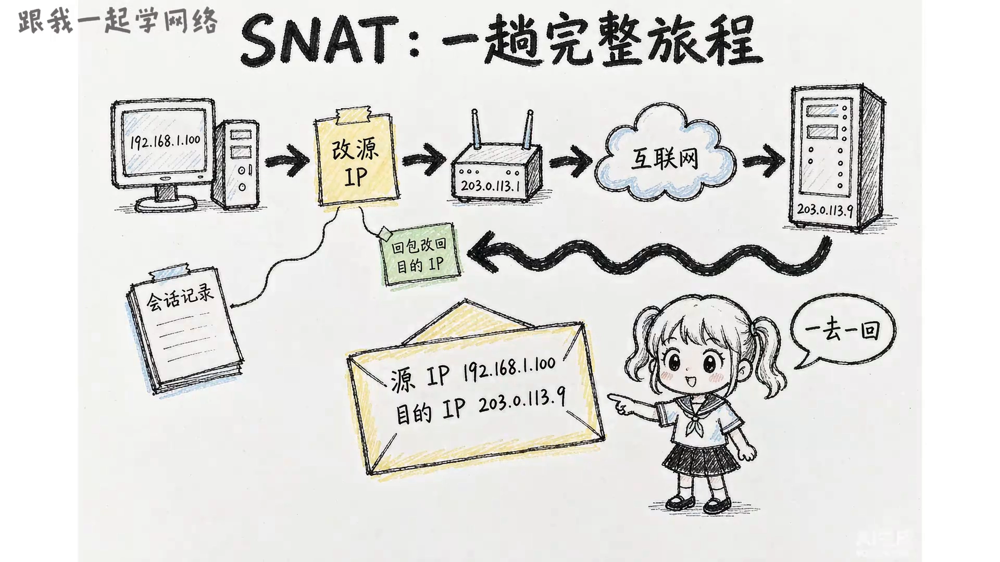
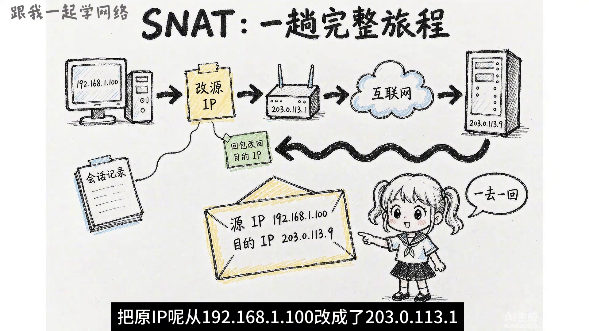
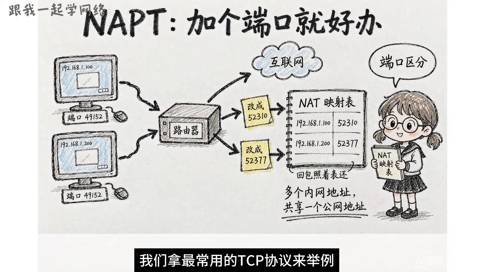

# NAT 到底在解决什么问题：从地址耗尽到 SNAT、DNAT 与 NAPT

> 本文整理自 B 站视频《NAT技术详解：原理、分类及应用》。它用一个「同一个小区三户人家，电脑 IP 竟然一模一样」的场景切入，把 **NAT 为什么会出现**、**SNAT / DNAT 各改哪个地址**、**静态 / 动态 / NAPT 三种映射方式怎么区分** 一层层讲清楚。

## 本讲要解决的核心问题（SCQA）

**背景**：我们上网用的 IP 地址，绝大多数还是 IPv4 地址，总共大约 43 亿个；扣掉环回、组播、实验保留段之后，真正能分配出去的大约只有 36 亿个。

**冲突**：全球要上网的设备远超 36 亿——光我们国家分到的 IPv4 地址就一直停在 3 亿 9000 万个左右，平均下来每人连半个地址都分不到。地址显然不够分。

**疑问**：既然公网地址这么稀缺，那为什么家里、公司里那么多台设备还能同时上网？一台拿着「内网地址」的机器，到底是怎么把数据发到互联网上的？反过来，外面的用户又怎么访问放在内网里的服务器？

**回答（中心思想）**：**NAT（Network Address Translation，网络地址转换）用「改写地址」的办法，让少量公网 IP 供大量设备共用。** 它的两个基本动作方向相反—— **SNAT 改的是源地址**（内网访问外网，把内网源 IP 换成公网 IP），**DNAT 改的是目的地址**（外网访问内网，把公网目的地址换成内网服务器地址）。为了在只有一个公网 IP 时也能区分「回包该还给谁」，映射表里还必须记录**端口号**——这就是后面 NAPT 的思路；按「地址怎么映射」再分类，NAT 又分为静态 NAT、动态 NAT 和 NAPT。

[【跳转到 00:00】](https://www.bilibili.com/video/BV18rH769EL4/?t=0)

---

## 一、为什么要 NAT：IPv4 地址根本不够分

### 1.1 一个反常识的场景：三台电脑 IP 一模一样

先看视频开头抛出的场景：同一个小区里的三户人家，家里各有一台电脑，三台电脑的地址**都是 192.168.1.100**；三台电脑同时上网，谁的网都没断过。

[【跳转到 00:08】](https://www.bilibili.com/video/BV18rH769EL4/?t=8)

三个一模一样的 IP 地址，为什么不会冲突？答案要回到 IPv4 地址的紧缺上：能分配出去的地址只有约 36 亿个，远远不够全球设备用。于是 IPv4 提前**留出了三段专门给内网使用**：

- 第一段：`10.0.0.0` ~ `10.255.255.255`（10 打头的那一片）；
- 第二段：`172.16.0.0` ~ `172.31.255.255`（172.16 到 172.31 这一片）；
- 第三段：`192.168.0.0` ~ `192.168.255.255`（192.168 打头）。

[【跳转到 01:07】](https://www.bilibili.com/video/BV18rH769EL4/?t=67)

凡是落在这三段里的地址，任何组织都可以在自己的内部网络里**自由使用、无需申请**。代价是：**内网地址不能在互联网上直接路由**，也就是说用内网地址的机器没法直接访问互联网。

> 这也解释了为什么三户人家的电脑能「同名不冲突」——它们根本不在同一个网络里，而是分属三个不同的内网，各自的内网地址互不干扰。

### 1.2 走出内网的那一刻：地址被换掉

那拿着内网地址的机器，到底怎么把数据发到互联网上？关键动作发生在**数据包离开内网的那一刻**：它的**源 IP 会被换成路由器的公网地址**。公网地址在全球是唯一的，各家换上不同的公网地址之后，再进入互联网就不会「撞车」了。

[【跳转到 01:56】](https://www.bilibili.com/video/BV18rH769EL4/?t=116)

做这件事的技术，就叫做**源地址转换**，英文缩写 **SNAT**，全称 Source Network Address Translation。

[【跳转到 02:21】](https://www.bilibili.com/video/BV18rH769EL4/?t=141)

---

## 二、SNAT：内网访问外网，改的是「源地址」

### 2.1 一个具体的 SNAT 例子

我们来看一个完整的例子：

- 内网主机地址：`192.168.1.100`；
- 它的网关：`192.168.1.254`；
- 路由器出口接的公网地址（WAN 口地址）：`203.0.113.1`；
- 主机要访问的远端服务器：`203.0.113.9`。

[【跳转到 02:34】](https://www.bilibili.com/video/BV18rH769EL4/?t=154)

主机把数据包交给路由器时，包里的：

- 源 IP = `192.168.1.100`
- 目的 IP = `203.0.113.9`

路由器往公网上发这个包**之前**，把源 IP 从 `192.168.1.100` 改成了 `203.0.113.1`（也就是它自己的公网地址），再发出去。

服务器收到之后，是**照着源 IP 去回包**的，所以回包的目的 IP 就变成了 `203.0.113.1`。路由器收到这个回包之后，再把目的 IP **改回** `192.168.1.100`，转发给内网主机——一次通信就这样走完了。

[【跳转到 03:24】](https://www.bilibili.com/video/BV18rH769EL4/?t=204)

> **「改回来」这个动作靠什么实现？** 靠路由器在转换时把对应关系记录了下来，也就是一张 **NAT 映射表**。

### 2.2 只改 IP 不够：还要靠端口号区分

问题来了：如果一个内网里有**两台主机**，`192.168.1.100` 和 `192.168.1.200`，它们同时访问同一台服务器呢？两个包被路由器转换之后，源 IP **都变成了** `203.0.113.1`。那服务器回包时，两个回包的目的 IP 都是 `203.0.113.1`——路由器**只看 IP，根本分不出这个包该还给谁**。

所以说**只改 IP 是不够的**，还需要再加一个能区分的标记。这个标记就在下一层，也就是传输层里，叫做**端口号**。以最常用的 TCP 协议为例，它的头部里有「源端口」和「目的端口」两个关键字段：

[【跳转到 04:41】](https://www.bilibili.com/video/BV18rH769EL4/?t=281)

假设两台主机的源端口刚好都是 `49152`，路由器在转换时可以：

- 把主机一的源端口改成 `52310`；
- 把主机二的源端口改成 `52377`；
- 并把「**哪个内网地址 + 哪个端口**」一起记进 NAT 映射表。

这样服务器回包发回来时，目的 IP 虽然都是 `203.0.113.1`，但目的端口一个是 `52310`、一个是 `52377`。路由器照着映射表一查，就知道哪个包该还给主机一、哪个该还给主机二。

[【跳转到 05:06】](https://www.bilibili.com/video/BV18rH769EL4/?t=306)

> 这一步其实已经把「端口」引入了映射——后面 NAPT 正是在这个基础上正式成型的。

---

## 三、DNAT：外网访问内网，改的是「目的地址」

讲完内网访问外网的 SNAT，再看反方向——**外网访问内网**，用的是 **DNAT**（Destination NAT，目标地址转换）。

它的典型场景是**内网的服务器要对外提供服务**：假设内网有一台主机跑着 Web 服务，监听 80 或 443 端口，但公网上的用户**连不进来**——因为它的地址是一个内网地址。

[【跳转到 05:50】](https://www.bilibili.com/video/BV18rH769EL4/?t=350)

于是需要在路由器上做一条 DNAT 规则，例如：把公网地址 `203.0.113.1` 的 **8080 端口**收到的请求，转给内网 `192.168.1.100` 的 **80 端口**。请求进到路由器之后，路由器把**目的地址**改成 `192.168.1.100`、**目的端口**改成 `80`，再转发给内网主机。

[【跳转到 06:15】](https://www.bilibili.com/video/BV18rH769EL4/?t=375)

> **一句话对照**：SNAT 改的是**源地址**，DNAT 改的是**目的地址**——两个方向刚好相反。

---

## 四、换个维度再分类：静态 NAT、动态 NAT 与 NAPT

前面 SNAT / DNAT 是按「**改源地址还是改目的地址**」分的，它们是一对儿。如果换一个维度——**按「地址怎么映射」来分**，NAT 还能分成三类：

[【跳转到 06:49】](https://www.bilibili.com/video/BV18rH769EL4/?t=409)

### 4.1 静态 NAT：一对一、固定不变

**一个内网地址固定对应一个公网地址**，一对一配好之后一直不变。它适合**内网服务器需要固定对外提供服务**的场景（因为对外地址稳定，别人才能稳定地找到你）。

### 4.2 动态 NAT：从一个地址池里临时分配

准备一个**公网地址池**，内网机器要上网时临时分配一个，用完之后**放回池子**。它的限制是：**同一时刻上网的机器数量不能超过池子里的地址数量**。

静态 NAT 和动态 NAT 有一个共同点——**都只看 IP 地址，不看端口号**。

### 4.3 NAPT：把端口也放进映射表

第三种叫 **NAPT**，它是在动态 NAT 的基础上**把端口号也加进映射表**，所以全称叫「网络地址端口转换」。既然映射表里多了端口号这一列，那两个不同的内网地址映射到同一个公网地址上时，会被分到**不同的端口号**。这样一来，**同一个内网里的多个不同 IP 地址，都可以共用同一个公网地址**。

[【跳转到 07:39】](https://www.bilibili.com/video/BV18rH769EL4/?t=459)

> **正是 NAPT，让 IPv4 撑到了今天**——我们家里路由器做的「共享上网」，本质上就是 NAPT。

---

## 五、NAT 的代价，以及它在今天的位置

NAT 解决了地址不够的问题，但也带来了自己的代价，主要三条：

[【跳转到 08:25】](https://www.bilibili.com/video/BV18rH769EL4/?t=505)

1. **内网机器在公网上没有地址，外面主动发起的连接进不来**。要对外提供服务，就得补一条 DNAT 规则把请求引进来。
2. **NAT 设备要为每一路连接维护映射表，连接数一多，映射表甚至设备本身的性能都会变成瓶颈**；而且一个公网地址能用的端口也就只有 6 万多个，共享它的连接数一多，可用端口就会很紧张。
3. **端到端的直连被打破了**。两个都在 NAPT 后面的设备想互相连上，得先通过一台双方都能访问的服务器交换一下地址——这就是常说的 **NAT 打洞（NAT 穿透）**。

这三个代价，也正是 **IPv6 想解决的问题**：地址多到用不完，就不必再靠 NAT 来省地址了。

不过在今天，NAT 依然无处不在。从家里的路由器，到运营商的城域网，再到云平台上一台机器绑定的弹性公网 IP，背后都是 NAT 在替我们解决 IP 地址不够的问题。**家里的路由器做的是一层 NAT，运营商那边还会再做一层**，一大批用户共用一个公网地址池——这种做法叫做**运营商级 NAT（CGNAT）**。所以有时候路由器上显示的那个「公网地址」，其实也只是运营商内网里面的一个内网地址。

[【跳转到 09:24】](https://www.bilibili.com/video/BV18rH769EL4/?t=564)

---

## 小结

- **NAT 因地址紧缺而生**：IPv4 可分配地址只有约 36 亿个，于是留出 `10/8`、`172.16/12`、`192.168/16` 三段私有地址给内网自由使用，代价是内网地址不能直接在互联网上路由。
- **SNAT 改源地址**：内网访问外网时，把内网源 IP 换成路由器的公网 IP；回包靠 **NAT 映射表**改回内网地址。
- **DNAT 改目的地址**：外网访问内网服务时，把公网目的地址（和端口）改写成内网服务器的地址（和端口）。
- **只改 IP 不够，要引入端口**：多台主机共用一个公网 IP 时，靠端口号区分回包该还给谁。
- **按映射方式分类**：静态 NAT（一对一、固定）、动态 NAT（地址池临时分配）、NAPT（把端口纳入映射、多对一）——NAPT 让 IPv4 撑到了今天。
- **NAT 的代价**：外部主动连接进不来、映射表/端口成为瓶颈、端到端直连被打破（需 NAT 打洞）；这些正是 IPv6 要解决的问题。

## 关键术语速查

| 术语 | 一句话解释 |
| --- | --- |
| NAT | Network Address Translation，网络地址转换，用改写地址的办法让少量公网 IP 供大量设备共用 |
| 私有地址 | `10/8`、`172.16/12`、`192.168/16` 三段内网专用地址，可自由使用但不能在公网路由 |
| SNAT | Source NAT，源地址转换：内网访问外网时把源 IP（和端口）换成公网地址 |
| DNAT | Destination NAT，目的地址转换：外网访问内网服务时把目的地址（和端口）改写成内网服务器地址 |
| NAT 映射表 | 记录「内网地址 + 端口 ↔ 公网地址 + 端口」对应关系，用于回包时反向改写 |
| 静态 NAT | 一个内网地址固定对应一个公网地址，一对一不变 |
| 动态 NAT | 从一个公网地址池里临时分配地址，用完归还；只看 IP、不看端口 |
| NAPT | 在动态 NAT 基础上把端口号也纳入映射，多个内网地址共用一个公网地址 |
| NAT 打洞 | 两个都在 NAT 后的设备借助第三方服务器交换地址，从而建立直连 |
| 运营商级 NAT | 运营商侧再做一层 NAT，一大批用户共用一个公网地址池（CGNAT） |
