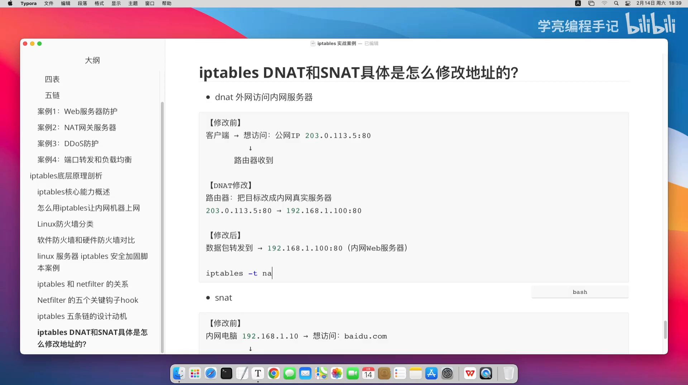
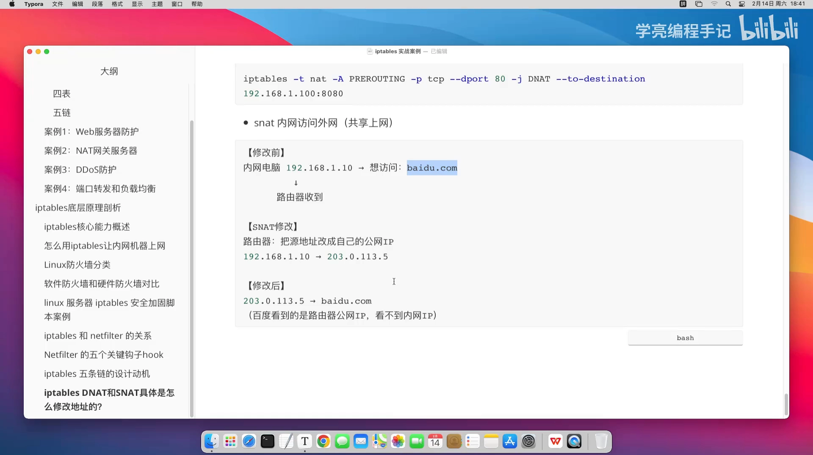
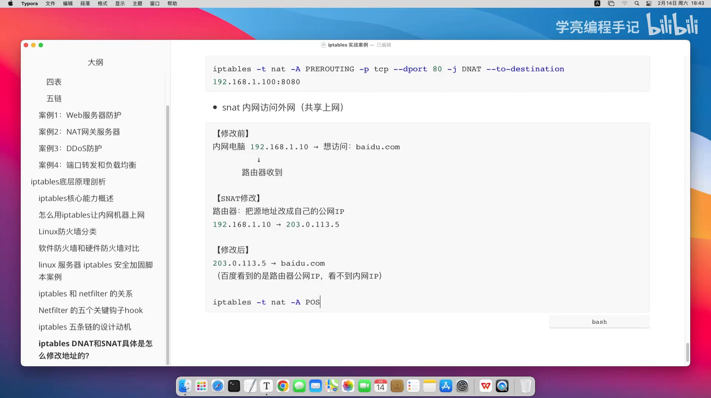

# iptables 里 DNAT 和 SNAT 到底改了哪个字段：两条命令看懂地址改写

> 本文整理自 B 站视频《iptables DNAT和SNAT具体是怎么修改地址的？》。它结合**外网访问内网服务器**和**内网共享上网**两个典型场景，用两条 iptables 命令，把 **DNAT 改目的地址**、**SNAT 改源地址** 讲得明明白白。

## 本讲要解决的核心问题（SCQA）

**背景**：我们都知道 NAT 能「改写地址」，但实际做 NAT 的时候，真正落到命令上的动作到底是什么？iptables 又是在哪个阶段、哪条链上动这个地址？

**冲突**：DNAT 和 SNAT 名字只差一个字母，方向却完全相反——一个改目的地址、一个改源地址，很容易记混，写规则时链也容易挂错。

**疑问**：DNAT 到底改的是包里哪个字段？SNAT 又改哪个？它们各自在哪条链上生效？能不能用最简单的例子讲清楚？

**回答（中心思想）**：**DNAT（Destination NAT）改的是「目的地址」，在 `PREROUTING` 链上生效**，典型场景是端口转发、负载均衡，让外网能访问内网服务；**SNAT（Source NAT）改的是「源地址」，在 `POSTROUTING` 链上生效**，典型场景是共享上网、隐藏内网地址。两者用 iptables 各一条命令就能实现。

[【跳转到 00:00】](https://www.bilibili.com/video/BV1eLZ7BEEgG/?t=0)

---

## 一、DNAT：改「目的地址」，让外网访问内网服务

### 1.1 场景：外网客户端访问内网服务器

第一个场景是**外网访问内网服务器**。客户端想要访问公网上的某个地址——例如公网 IP 的 `80` 端口。对路由器来说，它要做的就是把**目标地址**改成内网的真实服务器：把对外公网地址 `80` 端口的请求，转发到内网 `192.168.1.100` 的 `80` 端口。

修改之后，客户端发来的数据包就被送到了内网的这台 Web 服务器上——这就是 DNAT 的过程。

[【跳转到 00:50】](https://www.bilibili.com/video/BV1eLZ7BEEgG/?t=50)

> 一句话理解：**DNAT = 改「收货地址」**。外网的请求本来写着「送到公网 IP」，路由器把它改写成「送到内网某台服务器」。

### 1.2 落到命令：`-j DNAT --to-destination`

这个动作**一条命令**就能实现。视频里把端口做了点区分，方便看清「到底是哪个端口写在哪」——把公网 `80` 端口收到的请求，转发到内网这台机器的 `8080` 端口：

```bash
iptables -t nat -A PREROUTING -p tcp --dport 80 \
  -j DNAT --to-destination 192.168.1.100:8080
```

[【跳转到 01:40】](https://www.bilibili.com/video/BV1eLZ7BEEgG/?t=100)



逐个参数看：

- **`-t nat`**：先指定要操作的是 **nat 表**（不是默认的 filter 表）；
- **`-A PREROUTING`**：追加（`-A`）到 **PREROUTING 链**——都说了，**DNAT 就是在 PREROUTING 这个阶段、这条链上生效**的；
- **`-p tcp --dport 80`**：匹配「协议 TCP、目的端口 80」的包；
- **`-j DNAT --to-destination 192.168.1.100:8080`**：动作是 **DNAT**（Destination 目的地址），把目的地址改成 `192.168.1.100`、目的端口改成 `8080`。

[【跳转到 02:05】](https://www.bilibili.com/video/BV1eLZ7BEEgG/?t=125)

> 注意 DNAT 的名字来源：`D` 就是 **Destination（目的地址）**——它改的正是「包要去哪里」。

---

## 二、SNAT：改「源地址」，让内网共享上网

### 2.1 场景：内网机器访问外网

再看反方向的 **SNAT**，这个改的是**源地址**。它典型的场景就是**内网访问外网**，也就是我们常说的**共享上网**。

假设内网有一台电脑 `192.168.1.10`，想要访问外网的某个网站。路由器就会把它数据包的**源地址**改成**自己的公网 IP**。修改之后，对端的网站看到的是**路由器的公网 IP**，而**看不到内网的真实 IP**。

[【跳转到 04:10】](https://www.bilibili.com/video/BV1eLZ7BEEgG/?t=250)



这样一来，内网机器有很多，但真正「拥有公网 IP、能对外访问」的，就只有这台路由器——大家都通过它来实现共享上网。

> 一句话理解：**SNAT = 改「寄件人地址」**。就像公司员工寄快递，把**寄件人地址统一写成公司的地址**：对外只暴露公司（路由器）的地址，看不到具体是哪位员工（哪台内网主机）。

### 2.2 落到命令：`-j SNAT --to-source`

SNAT 的规则同样是一条命令。假设要让 `192.168.1.0/24` 整个网段的机器都通过出口 `eth0` 共享上网：

```bash
iptables -t nat -A POSTROUTING -s 192.168.1.0/24 -o eth0 \
  -j SNAT --to-source 203.0.113.5
```

[【跳转到 05:25】](https://www.bilibili.com/video/BV1eLZ7BEEgG/?t=325)



逐个参数看：

- **`-t nat`**：仍然是操作 **nat 表**；
- **`-A POSTROUTING`**：追加到 **POSTROUTING 链**——**SNAT 在 POSTROUTING 这个阶段生效**；
- **`-s 192.168.1.0/24`**：匹配源地址在这个网段里的包（这里写一个网段，是因为这个内网里有两百多台机器，都要通过它共享上网）；
- **`-o eth0`**：从 `eth0` 这个出口出去的包；
- **`-j SNAT --to-source 203.0.113.5`**：动作是 **SNAT**（Source 源地址），把源地址改成公网地址 `203.0.113.5`。

> SNAT 的名字来源：`S` 就是 **Source（源地址）**——它改的是「包从哪里来」。

---

## 三、一张表记住 DNAT 与 SNAT

| 对比项 | DNAT | SNAT |
| --- | --- | --- |
| 改哪个字段 | **目的地址**（Destination） | **源地址**（Source） |
| 生效的链 | **PREROUTING** | **POSTROUTING** |
| 典型场景 | 端口转发、负载均衡（外网访问内网服务） | 共享上网、隐藏内网地址（内网访问外网） |
| 快递类比 | 改**收货**地址 | 改**寄件人**地址 |

[【跳转到 06:40】](https://www.bilibili.com/video/BV1eLZ7BEEgG/?t=400)

> 视频里最后总结得很直白：**DNAT 修改目的地址，工作链在 PREROUTING；SNAT 修改源地址，工作链在 POSTROUTING。** 这么一想，其实也没那么高大上，一条命令就搞定了。

---

## 小结

- **DNAT 改目的地址**：让外网能访问内网服务，落在 `nat` 表的 **PREROUTING** 链，动作用 `-j DNAT --to-destination`。
- **SNAT 改源地址**：让内网共享上网、隐藏内网地址，落在 `nat` 表的 **POSTROUTING** 链，动作用 `-j SNAT --to-source`。
- **方向刚好相反**：一个改「包要去哪」，一个改「包从哪来」。
- **两个记忆锚点**：DNAT 像改「收货地址」（前端引导请求进来），SNAT 像改「寄件人地址」（后端统一对外身份）。

## 关键术语速查

| 术语 | 一句话解释 |
| --- | --- |
| DNAT | Destination NAT，改目的地址，在 PREROUTING 链生效，实现端口转发/负载均衡 |
| SNAT | Source NAT，改源地址，在 POSTROUTING 链生效，实现共享上网/隐藏内网地址 |
| `-t nat` | 指定操作 nat 表（做地址转换用的表） |
| PREROUTING | 包进入路由决策之前经过的链，DNAT 在这里生效 |
| POSTROUTING | 包即将发出、路由决策之后经过的链，SNAT 在这里生效 |
| `--to-destination` | DNAT 的目标：把目的地址（与端口）改成指定值 |
| `--to-source` | SNAT 的目标：把源地址（与端口）改成指定值 |
