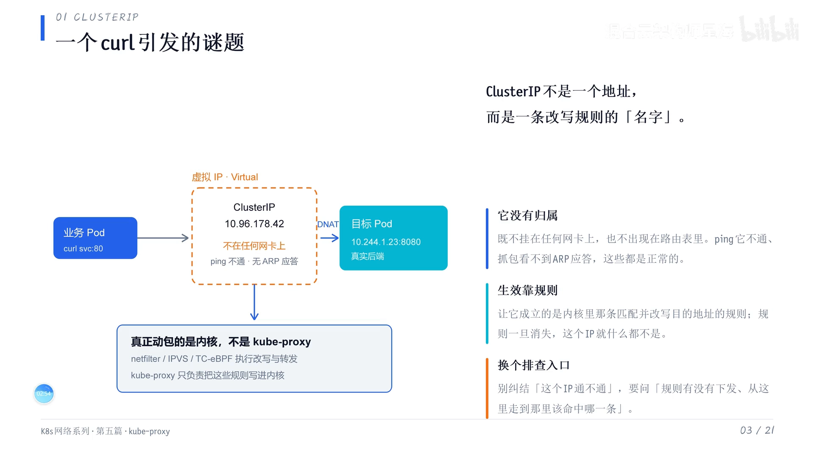
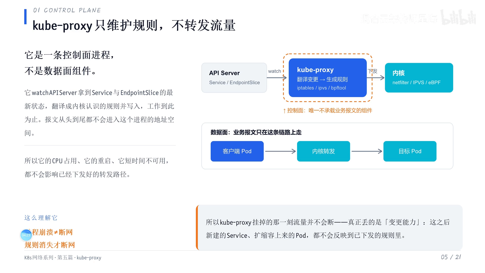
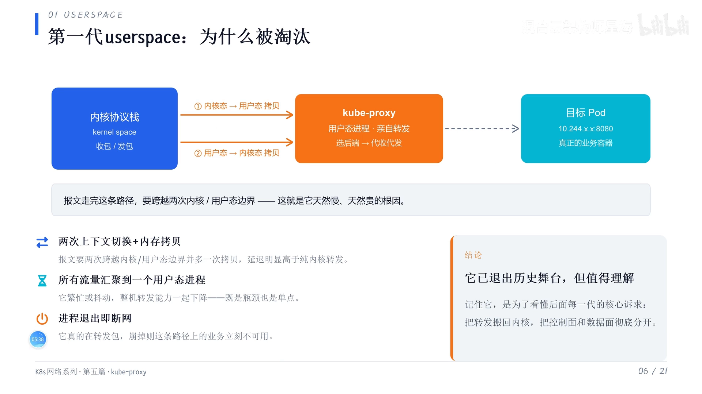
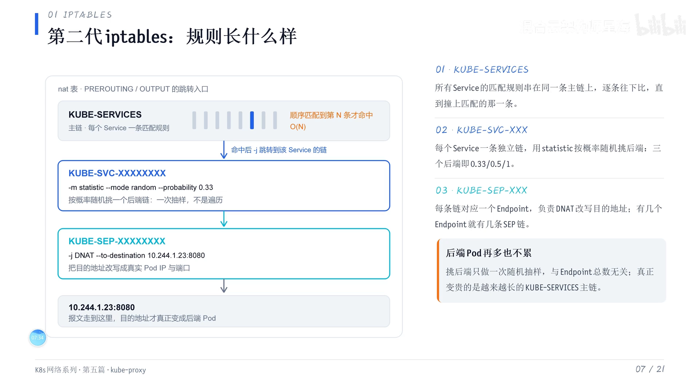
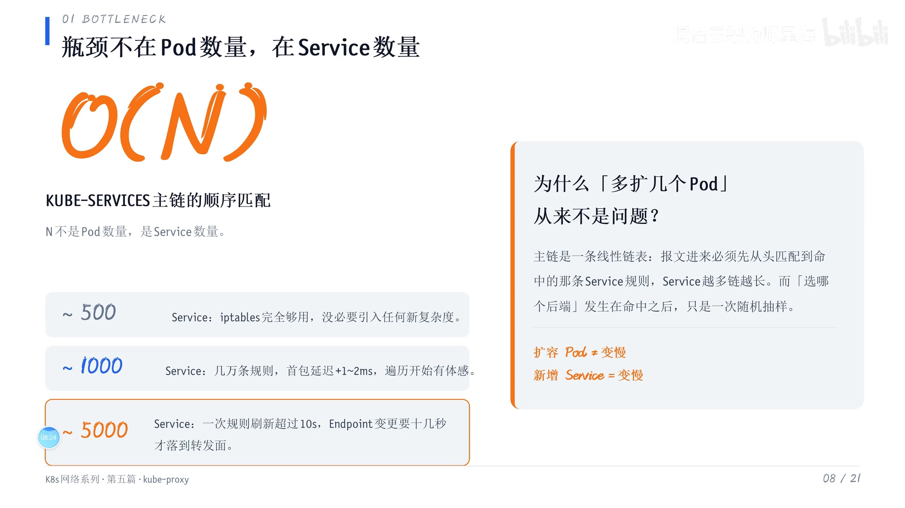
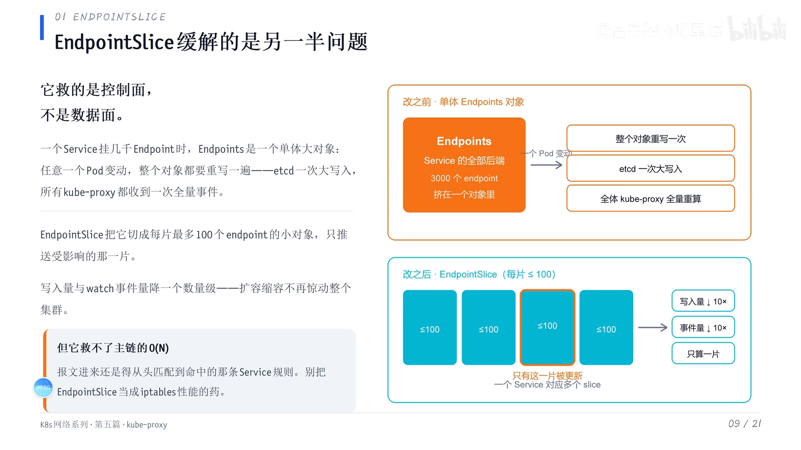

# kube-proxy 的三种网络实现到底差在哪

> 本文整理自 B 站视频《kube-proxy的三种网络实现到底差在哪》。它从一道面试题出发——**K8S 的网络到底用的是 iptables 还是 IPVS 还是 eBPF，它们有什么区别**——把 kube-proxy 的三个数据面实现（iptables、IPVS、eBPF）一代代讲清楚，并给出可落地的切换阈值。**本讲聚焦前两代与 ClusterIP 的本质（IPVS、eBPF 的细节在系列后续章节展开）。**

## 本讲要解决的核心问题（SCQA）

**背景**：在 K8S 集群里部署好服务后，你可以在 Pod 里 `curl` 一个 Service 的 **ClusterIP**（比如 `10.96.178.42`）并能通。同时，kube-proxy 是 K8S 的核心组件之一，它负责把「虚拟 IP → 真实 Pod」的转发规则落到内核里。

**冲突**：但面试官一句「你们集群的网络是 iptables 还是 IPVS，区别是什么」，就能问倒很多人。更关键的是，这三代实现并不是「谁更潮就用谁」——**它们出现的理由本质都一样：都是上一代在某个方面撑不住了。**

**疑问**：ClusterIP 到底是什么东西，为什么 `curl` 能通、`ping` 却不通？kube-proxy 到底在转发流量，还是在干别的？iptables 实现为什么会随 Service 数量增长而变慢？什么时候该换成 IPVS 或 eBPF？

**回答（中心思想）**：**ClusterIP 根本不是一个地址，而是内核里一条「改写规则」的名字。** 理解 kube-proxy 的所有实现差异，本质上都在回答**三个问题——这条规则怎么写、谁来写、写完以后多久生效**。iptables 用链式匹配、主链是一条 **O(N)（N = Service 数量）** 的线性链表，Service 一多就会变慢；因此视频给出经验阈值：**1000 与 1 万是两道坎**——**1000 个以下用 iptables，1000～1 万用 IPVS，1 万以上用 eBPF**。

[【跳转到 00:00】](https://www.bilibili.com/video/BV1LrHv6mEy6/?t=0)

---

## 一、先破一个直觉：ClusterIP 压根不是一个「地址」

最常见的困惑场景是：**你在 Pod 里 `curl` 一个 ClusterIP（如 `10.96.178.42`）能通，但你去 `ping` 它不通，抓包也看不到 ARP 应答。** 很多人第一次遇到会以为网络坏了。

[【跳转到 02:30】](https://www.bilibili.com/video/BV1LrHv6mEy6/?t=150)

其实它没坏。原因是：

> **ClusterIP 从一开始就不是一个地址——它是内核里一条「改写规则」的名字。它不挂任何网卡，也不在你的路由表里，所以没有谁会给它回 ARP。**

`ping` 需要一个真实的二层/三层地址来回应，而 ClusterIP 只是一条规则的名字，自然不会有 ARP 应答。

[【跳转到 02:55】](https://www.bilibili.com/video/BV1LrHv6mEy6/?t=175)

把这个理解固化下来，后面所有实现方式的差异，本质上都在回答**三个问题**：

1. **这条规则怎么写？**
2. **谁来写？**
3. **写完以后多久生效？**

[【跳转到 03:20】](https://www.bilibili.com/video/BV1LrHv6mEy6/?t=200)

> 顺带一个排查提示：排查 Service 不通时，**第一反应不要去 `ping` 它的 ClusterIP**——它本来就不会回。

---

## 二、kube-proxy 到底在干什么：它不「转发流量」，它「写规则」

这一章要定两件事：**一是虚拟 IP 是谁维护的，二是 kube-proxy 到底是在转发流量，还是在别的地方干活。** 因为这决定了它整个可用性模型，也决定了排查思路往哪走。

[【跳转到 03:54】](https://www.bilibili.com/video/BV1LrHv6mEy6/?t=234)

答案是：**kube-proxy 去访问 API Server，拿到 Service 和 Endpoints 的最新状态，把它们翻译成内核认识的规则写进去，然后就没啥事了。** **报文从头到尾都不进它（这个进程）的地址空间。**

[【跳转到 04:24】](https://www.bilibili.com/video/BV1LrHv6mEy6/?t=264)

**这里有一个重要推论**：

> 如果 kube-proxy 这个进程崩了——你发现它的 Pod 异常了——**但流量是不会断的**，因为**规则还在内核里跑着，规则没了才会断**。所以它真正丢的不是「连通性」，而是**「变更能力」**：之后你新建的 Service、扩缩容上来的 Pod，都**不会反映到规则里**了。

[【跳转到 04:49】](https://www.bilibili.com/video/BV1LrHv6mEy6/?t=289)

这个模型跟熟悉的 **Nginx 或某些 proxy 完全不一样**——那些是**真的在转发，挂了就真的挂了**。

[【跳转到 05:14】](https://www.bilibili.com/video/BV1LrHv6mEy6/?t=314)

---

## 三、第一代 user space：把转发「搬回内核」的起点

理解了现在的模型，再看第一代，就知道 **user space 为什么被淘汰了**。

第一代的 user space 模式是**真的做转发**：报文从**内核态搬进用户态**，让 kube-proxy 找好后端，**再搬回内核态发出去**——**出现了两次跨越边界、多一次内存拷贝**，所以它比较慢。

[【跳转到 05:39】](https://www.bilibili.com/video/BV1LrHv6mEy6/?t=339)

**但慢不是最重要的，更致命的是两点：**

1. **所有 Service 的流量都汇聚到这一个用户态进程**，它自身既是**性能瓶颈**，也是**单点**；
2. **一旦它退出，这条路径上的业务立刻就不可用。**

所以它被淘汰得很彻底。**但记住它很有用**——因为后面每一代的诉求，说白了就一句话：

> **把转发搬回内核，把控制面和数据面彻底分开。**

[【跳转到 06:29】](https://www.bilibili.com/video/BV1LrHv6mEy6/?t=389)

---

## 四、第二代 iptables：链式匹配的默认实现，以及它的 O(N) 之痛

iptables 是**大家最熟悉、也是部署 K8S 集群时的默认配置**。它长这个样子：在 **nat 表**里有一条主链叫 **`KUBE-SERVICES`**，**每一个 Service 都对应一条匹配规则**。

[【跳转到 06:45】](https://www.bilibili.com/video/BV1LrHv6mEy6/?t=405)

### 4.1 一条链走到底：匹配 → 随机挑后端 → DNAT

报文进来后：

1. **从前向后、从第一条开始往下比对**，比对到**目标地址和端口**对上为止；
2. **命中**后跳到这个 Service 自己的链 `KUBE-SVC-xxx`；
3. 链里用**静态的模块按概率随机挑一个后端**——比如三个后端概率分别是 `0.33`、`0.5`、`-1`（`-1` 代表「剩余概率」），**一次抽样搞定**；
4. 再跳到 `KUBE-SEP-xxx`（endpoint）上面。

**这条链路就是一个 DNAT**——把目标地址改成**真实的 Pod IP 加端口**，这样报文的**目标地址才真的变成后端的 Pod**。

[【跳转到 07:35】](https://www.bilibili.com/video/BV1LrHv6mEy6/?t=455)

### 4.2 真正的瓶颈：主链是 O(N) 的线性链表，N 是 Service 数量

有两个容易搞错的点：

- **挑后端只是一次随机采样**，跟你这个 Service 背后挂了**多少个 Pod 没关系**（Pod 数不影响这一步）；
- **真正贵的是最前面那一步**——**主链是一条线性链表，从头到尾命中，比对几次取决于前面排了多少条**，也就是**有多少个 Service**。

所以这个 **O(N) 里的 N 是 Service 的数量，不是 Pod 的数量。**

[【跳转到 08:25】](https://www.bilibili.com/video/BV1LrHv6mEy6/?t=505)

### 4.3 具体到用户感知：500 以内够用，1000 左右开始抖

| Service 数量 | 表现 |
| --- | --- |
| **500 以内** | iptables 完全够用 |
| **1000 左右** | 规则涨到**几万条**，**首包延迟要加 1～2ms**，**一次规则刷新可能要十几秒** |

也就是说，**你改一个 endpoint，可能要等十几秒才生效**，业务侧能明显感到抖动——因为它是**从上到下过滤**的。

[【跳转到 08:50】](https://www.bilibili.com/video/BV1LrHv6mEy6/?t=530)

**还有一个反直觉的细节**：正因为是**从上到下遍历 Service**，而**扩容时是随机选一个 Pod**，所以**扩 Pod 不会变慢，只有新增 Service 时才会变慢**。

[【跳转到 09:15】](https://www.bilibili.com/video/BV1LrHv6mEy6/?t=555)

### 4.4 EndpointSlice 能救吗？它救的是控制面，不是数据面

有人会问：「那我开 **EndpointSlice** 不就行了吗？」**这里得分清楚——两者解决的不是同一半的问题。**

**EndpointSlice 做了什么**：把装着**几千个 endpoint 的大对象切成每片最多 100 个的小对象**，**一个 Pod 的变动只推送受影响的那一片**，从而把 **etcd 的写入量和数据量降了一个数量级**。

**它救的是控制面**——你的 **API Server、etcd，以及所有 kube-proxy 的 CPU**。

[【跳转到 09:51】](https://www.bilibili.com/video/BV1LrHv6mEy6/?t=591)

**但它救不了数据面**：报文进来以后，**你还是得把它从主链第一条一直比对到命中的那一条**，这一步它一点没帮忙。**所以不要觉得用了 EndpointSlice，它就能当 iptables 性能的解药。**

[【跳转到 10:16】](https://www.bilibili.com/video/BV1LrHv6mEy6/?t=616)

---

## 五、小结与切换阈值

要治 **「从上到下一直匹配、O(N) 主链」** 这个问题，**就只能换引擎**——这正是下一代的 IPVS（哈希）与再下一代的 eBPF 出场的原因（将在本系列后续章节展开：它们怎么解决 O(N)，以及分别付出了什么代价）。

[【跳转到 10:41】](https://www.bilibili.com/video/BV1LrHv6mEy6/?t=641)

视频给出的经验阈值很简单，**1000 和 1 万是两道坎**：

| Service 规模 | 推荐实现 |
| --- | --- |
| **< 1000** | **iptables** |
| **1000 ～ 1 万** | **IPVS** |
| **> 1 万** | **eBPF** |

[【跳转到 02:05】](https://www.bilibili.com/video/BV1LrHv6mEy6/?t=125)

---

## 小结

- **ClusterIP 不是地址，是规则的名字**：不挂网卡、不在路由表、不回 ARP，所以 `curl` 能通、`ping` 不通；排查时别去 `ping` ClusterIP。
- **kube-proxy 不转发流量，它是「写规则的人」**：向 API Server 拉 Service/Endpoints，翻译成内核规则写进去，报文不进它的地址空间。它挂了，**流量不断，丢的是「变更能力」**。
- **第一代 user space 被淘汰**：真的做转发，两次跨内核/用户边界、多一次拷贝；更致命的是**单点 + 性能瓶颈**。它留下的诉求是「**把转发搬回内核、控制面与数据面分离**」。
- **第二代 iptables 的痛点**：主链 `KUBE-SERVICES` 是 **O(N) 线性链表，N 是 Service 数量**；1000 个左右规则几万条，规则刷新要十几秒。
- **EndpointSlice 只救控制面**（etcd/API Server/kube-proxy CPU），**不救数据面的 O(N) 匹配**。
- **切换阈值**：1000 以下 iptables、1000～1 万 IPVS、1 万以上 eBPF——而**每一代都是被上一代「撑不住」逼出来的**。

## 关键术语速查

| 术语 | 一句话解释 |
| --- | --- |
| ClusterIP | Service 的虚拟 IP，本质是内核里一条改写规则的名字，不是真实地址 |
| kube-proxy | K8S 组件，向 API Server 拉状态并翻译成内核转发规则，自身不转发报文 |
| user space 模式 | 第一代实现，报文在内核/用户态间来回搬，已被淘汰 |
| iptables 模式 | 第二代默认实现，链式匹配 + 主链 `KUBE-SERVICES`，O(N) 遍历 |
| `KUBE-SERVICES` / `KUBE-SVC-xxx` / `KUBE-SEP-xxx` | nat 表里 Service → 后端选择 → endpoint 的三级链 |
| DNAT | iptables 把目标地址改成真实 Pod IP + 端口的关键动作 |
| O(N) | 主链从上到下线性比对的开销，N 指 Service 数量（不是 Pod 数量） |
| EndpointSlice | 把大 endpoints 对象切成每片≤100 的小对象，降低控制面压力 |
| eBPF | 第三代数据面实现，绕开 netfilter，适合超大规模 Service |
