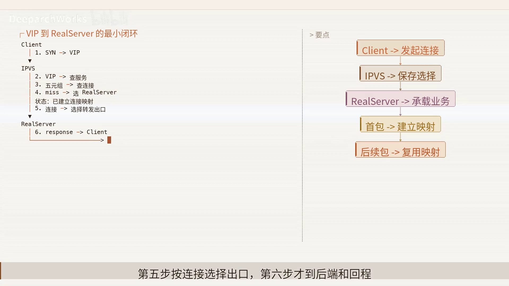
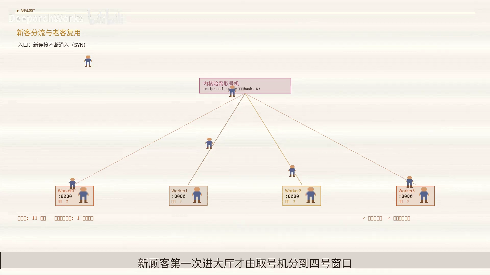
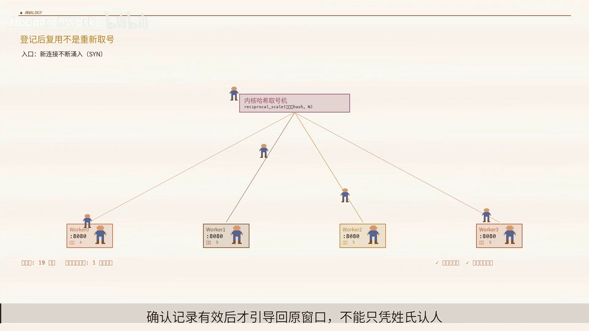
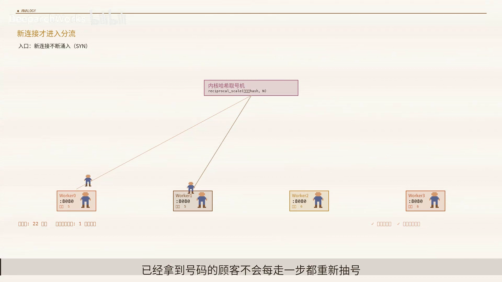
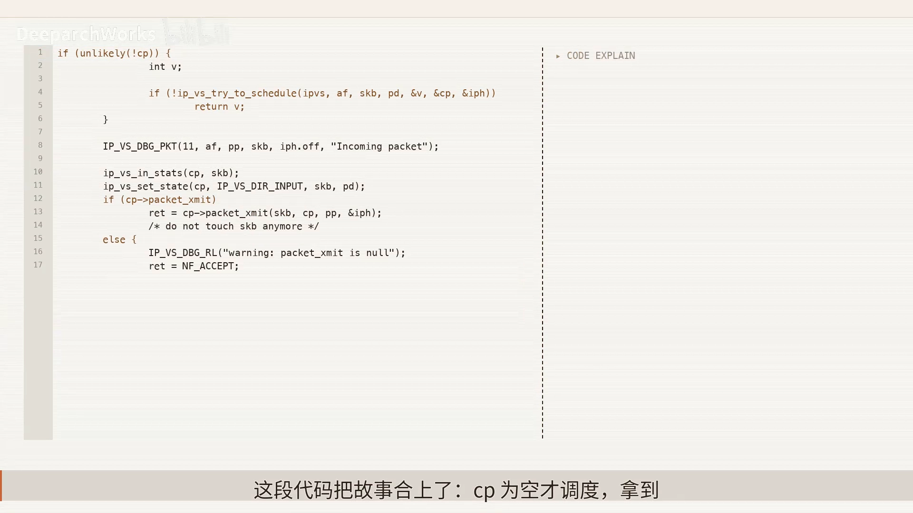
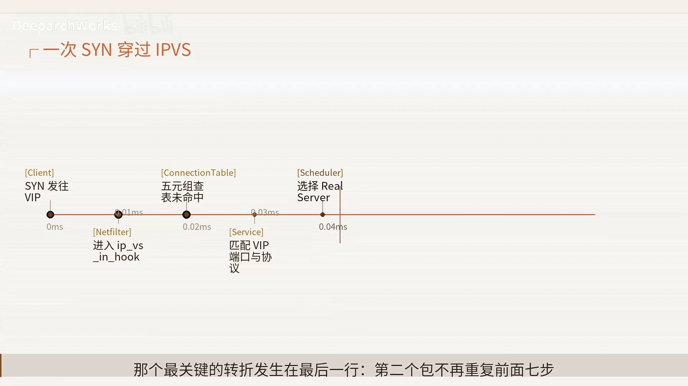
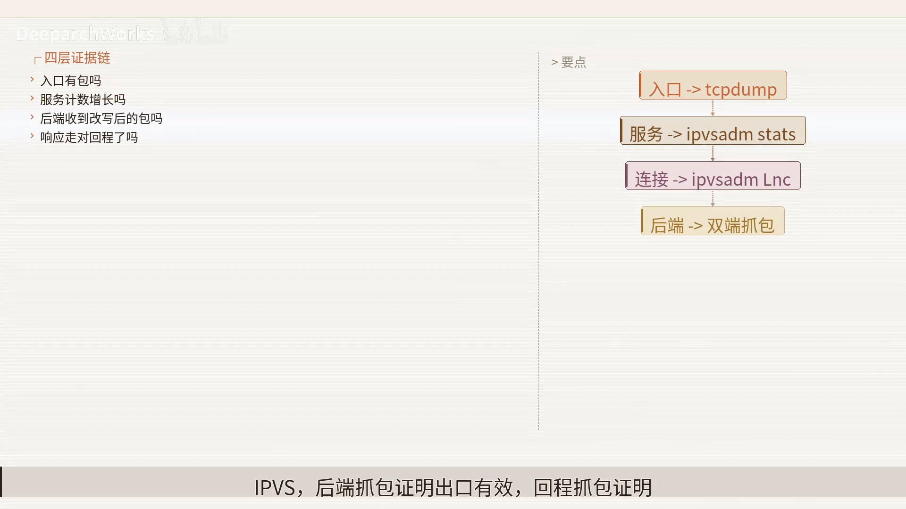

# 揭秘 IPVS：一张连接表凭什么扛住四层负载均衡

> 本文整理自 B 站视频《揭秘IPVS：一张连接表凭什么扛住四层负载均衡》。它钻进 IPVS 内核，讲透一条核心原则：**「首包决定一次、后续包一路复用」**——IPVS 真正省下的不是一次轮询，而是**后续每个包都不用再做轮询**。首包只决定一次，此后的流向全写在一张连接表里。

## 本讲要解决的核心问题（SCQA）

**背景**：IPVS 是 Linux 上经典的四层负载均衡实现，站在 netfilter 框架的钩子上工作。它把多台真实服务器藏在一个**虚拟入口（VIP）**之后，把大量四层连接分散出去。它的前身是章文嵩发起的 **Linux Virtual Server** 项目，如今由 Simon Horman 等维护，能持续跟进 IPv6、连接同步与 netfilter 的演进。

**冲突**：四层负载均衡要面对的是海量并发连接。一个很自然的想法是「谁最空闲就发给谁」，但如果**每个包都挑一次最空闲的后端**，同一条 TCP 的状态就会散落到多台机器上——**负载均衡越「积极」，连接反而越快崩掉**。

**疑问**：IPVS 凭什么能扛住四层负载均衡？它到底省下了什么？出问题时又该在哪一层找证据？

**回答（中心思想）**：**IPVS 的全部价值，建立在「首包决定一次、后续包一路复用」这套纪律上。** 一个包进入 VIP 后，**先「查连接」来决定**，查不到才「选」新目标，再沿连接绑定的出口送走——查表命中就永远走快路径，所以它省下的不是一次轮询，而是**后续每个包重复做轮询这件事**。同时它守住边界：**只负责四层连接选择与转发，不解析七层业务语义**。一句话总结这套纪律：**首次决策、完整身份、稳定状态、策略出口、明确边界**——缺任何一项，快路径都可能变成错误路径。

[【跳转到 00:00】](https://www.bilibili.com/video/BV11C3B62EPR/?t=0)

---

## 一、核心思想：为什么需要「状态」——先查连接，查不到才选

先纠正一个直觉：**IPVS 并不凭空截住报文，它站在 netfilter 的钩子上**。它和防火墙、netfilter 在同一个框架里各守边界，这条热路径因此能被长期稳定地维护。

[【跳转到 01:14】](https://www.bilibili.com/video/BV11C3B62EPR/?t=74)

要解决的问题，用一句话就能说清：**让一个虚拟服务，把大量四层连接稳定地分散到多台真实服务器上。** 这里涉及三个角色：

- **VIP**：统一入口；
- **Real Server**：真正处理连接的目标；
- **连接状态**：保存那次「选择」。

旧路径的缺口就在于——单台服务器直接监听 VIP，**吞吐和故障域都受单机上限约束**。

[【跳转到 01:25】](https://www.bilibili.com/video/BV11C3B62EPR/?t=85)

### 1.1 「同一个窗口」的类比

想象一个商场：**顾客第一次进商场时被分配到 3 号收银台，之后补货、退款、结账都得沿着同一张小票回到 3 号窗口，不能每一步都重新换窗口。**

把类比对上号：**顾客 = 连接，统一入口 = VIP，小票 = 连接状态**。（这个类比只表达「单窗口扩成多窗口」的直觉，不表达真实的哈希、RCU 或报文改写。）

[【跳转到 01:50】](https://www.bilibili.com/video/BV11C3B62EPR/?t=110)

如果没有状态会发生什么？**每个包都重新挑一次后端，同一条 TCP 的后续包可能被分到不同机器，连接状态就散架了。** 所以状态存在的目的只有一个：**让同一条流不被后续包重新分配。**

[【跳转到 00:25】](https://www.bilibili.com/video/BV11C3B62EPR/?t=25)

---

## 二、完整边界：包在 IPVS 里走两条路，最后汇合到同一个出口

把视野放大，一个包在 IPVS 里的完整边界是这样的：

1. **Client 的包经 netfilter 进入 connection table（连接表）**；
2. **命中** → 走**快路**，直接复用已有决定；
3. **未命中** → 进入 **scheduler（调度器）**，选出 Real Server 并**创建连接**；
4. 两条路最后**汇合到 `packet_xmit`** 送出去。

[【跳转到 02:40】](https://www.bilibili.com/video/BV11C3B62EPR/?t=160)

**关键边界**：IPVS 负责**四层连接的选择与转发**，但**不解析七层业务语义**——HTTP 路径、cookie、业务健康**都不属于这张图**。

[【跳转到 03:05】](https://www.bilibili.com/video/BV11C3B62EPR/?t=185)

用「新客分流、老客复用」再收一遍：**大厅入口 = VIP，取号记录 = 连接表，窗口 = Real Server**。新顾客第一次进大厅才取号；已经有号码的顾客直接回原窗口——**但取号机（调度器）不会拆开顾客的合同内容去决定业务条款**（即四层调度器不理解七层业务）。

---

## 三、连接表怎么查：先缩范围，再验全键

连接表的查找不是「哈希一下就完事」。**源码先用 IPVS 的 hash key 把范围缩小到一个桶，但哈希命中不等于身份命中**——它还会继续核对：**客户端端口、虚拟端口、地址、双方地址、协议和网络命名空间**，最后**取得一个有效引用**才算真正命中。

[【跳转到 03:30】](https://www.bilibili.com/video/BV11C3B62EPR/?t=210)

原理就是 **「先缩范围，再验全键」**：

- **正常作用**：复用已有决定；
- **边界**：它**不替新流选择目标**。

视频点出其中真正的设计智慧：**它不是"迷信哈希"，而是用三层把关——桶指针负责缩小范围，完整元组负责确认身份，引用获取负责确认生命周期。** 目的就是把高频的后续包留在短路径上执行；**成本则是：连接表仍占内存、碰撞桶仍需遍历、过期对象仍要安全回收。**

[【跳转到 03:55】](https://www.bilibili.com/video/BV11C3B62EPR/?t=235)

### 3.1 连接状态不是永久缓存

连接状态是一条**有起点也有终点**的状态机：

1. **首包未命中** → 开始；
2. 经**调度创建**连接；
3. 后续包**不断命中**并更新协议状态；
4. 最后按**超时或控制条件失效**。

这条状态机解释了连接表的边界——**它用内存换单流一致性，也就必须支付回收、同步和主备复制的成本。**

[【跳转到 04:20】](https://www.bilibili.com/video/BV11C3B62EPR/?t=260)

---

## 四、调度器：把「核实调度」和「怎样选」拆开

新流来到 IPVS 的**调度入口**时，**没有写死轮询**：

- **scheduler 描述虚拟服务**；
- **具体算法（如 RR、WLC）负责选**；
- 最后**承接目标**。

这样设计的原理是**把「核实调度」和「怎样选」拆开**，目的是让多种策略**共享同一套连接创建框架**；**边界是：入口还没有承诺一定能找到目标。**

[【跳转到 05:10】](https://www.bilibili.com/video/BV11C3B62EPR/?t=310)

关键动作其实**只有一行：`schedule` 函数返回目标**。它的作用是为**没有连接记录的新流**选择 Real Server，**受服务配置权重和目标可用性约束，却不解析 HTTP、URL 或 cookie**。**没有调度器、或没有可用目标，都会把空结果交回上层处理。**

[【跳转到 05:35】](https://www.bilibili.com/video/BV11C3B62EPR/?t=335)

**关于权重**：Real Server 的权重对应**承载能力**。但要注意——**IPVS 不会把故事里的「连接数」误当成 CPU 请求成本或应用健康**。就像两台高配窗口权重都大、一台普通窗口权重小；取号机只在顾客**首次到达时**按规则选一次，**已拿到号码的顾客不会每走一步都重新抽号**。

[【跳转到 06:00】](https://www.bilibili.com/video/BV11C3B62EPR/?t=360)

---

## 五、入口 hook 与出口 packet_xmit：一个「编排」、一个「转发」

### 5.1 入口：IPVS 的 hook 是包真正进入 IPVS 的门

入口处有三个关键输入：**`skb` 带来报文，`state` 带来钩子和网络命名空间，`cp` 则承接连接决定。**

这个入口的作用是 **「编排」，而不是亲自实现所有算法**；边界也因此清楚：**未匹配到 IPVS 服务的包，仍可以继续走 netfilter 遍历**。源码里那句判断很关键——**`cp` 为空才调度**（即没有现成连接才去选新目标）。

[【跳转到 06:25】](https://www.bilibili.com/video/BV11C3B62EPR/?t=385)

### 5.2 出口：拿到连接后统一统计、更新状态、交给 `packet_xmit`

拿到连接后，IPVS **统一统计、更新协议状态，再调用连接绑定的 `packet_xmit`**。原理是 **「决定留在连接里执行，交给出口」**，目的是把包按既定模式送到 Real Server；**边界是它只做四层转发，不保证后端应用一定健康**。

在出口，IPVS **可能改地址、改二层目的 MAC，或加隧道头**（对应 NAT / DR / TUN 三种模式）——**它不表达具体报文格式，更不承担应用健康判断。**

[【跳转到 06:50】](https://www.bilibili.com/video/BV11C3B62EPR/?t=410)

---

## 六、控制面与数据面要分开：健康探测不塞进热路径

这里要把**两条节奏**分开：

- **控制面**：**低频**修改服务权重和可用目标；
- **数据面**：**高频**处理每一个包。

**健康探测通常由 keepalived 完成，IPVS 只消费配置结果。** 为什么？因为**把探测塞进热路径，会让热路径承担它不该承担的波动和延迟。**

[【跳转到 07:43】](https://www.bilibili.com/video/BV11C3B62EPR/?t=463)

---

## 七、三种模式的差异在「回程」：容量到底由什么决定

IPVS 的 **NAT / DR / TUN 三种模式，最大的差异在回程**：

- **NAT**：通常让响应也经过 IPVS，**配置直观，但回程可能成为瓶颈**；
- **DR**：**只改二层目的 MAC**，响应由后端**直接回**客户端；
- **TUN**：用**外层封装跨三层网络**，换来的是 **MTU 和隧道可达性的成本**。

[【跳转到 08:08】](https://www.bilibili.com/video/BV11C3B62EPR/?t=488)

**一个关键认知**：**连接调度只发生在新流，但容量却由「新建率、活跃连接、包速率和回程」共同决定。** 就像机场：**不能只看分配登机口有多快，还要看候机人数、广播频率和返程道路——真正的瓶颈常常藏在算法之外。**

**举个具体例子**：高带宽下载**请求很小、响应很大**。即便 RR 调度几乎不耗时，**NAT 回程仍可能先把负载均衡节点压满**；而 **DR 能把响应直接从 Real Server 送回客户端**，避开这个瓶颈。

[【跳到 08:33】](https://www.bilibili.com/video/BV11C3B62EPR/?t=513)

把时间轴压到一起看：**首包承担服务匹配、调度和连接创建；后续包只需查表、更新状态、执行出口。** 那个最关键的转折就发生在最后一行——**第二个包不再重复前面七步**。连接表的价值，正体现在**被省掉的重复工作**里。

[【跳转到 08:58】](https://www.bilibili.com/video/BV11C3B62EPR/?t=538)

**IPVS 不是无状态魔法**：连接表用内存换单流一致性，RCU 用更复杂的更新回收换低开销，主备同步用额外网络流量换更低的切换损失。**边界说清楚，才不会把「内核态」误解成「没有成本」。**

---

## 八、排障：别从调参数开始，要沿数据路径逐层收集证据

有两个典型现象值得记住：

- **一个长连接的后端已经被控制面下线**：**新连接会绕开它，但旧连接仍可能按原映射继续存在**；
- **主备切换恰逢状态尚未同步**：**少量连接仍可能中断**。

排障的正确姿势是**沿数据路径收集证据，每一层只回答一个问题**：

1. **入口抓包**：证明包到了节点；
2. **服务条目（`ipvsadm`）**：证明匹配了 IPVS；
3. **后端抓包**：证明出口有效；
4. **回程抓包**：证明模式假设成立。

[【跳转到 09:23】](https://www.bilibili.com/video/BV11C3B62EPR/?t=563)

**两个判断例子**：

- **VIP 能看到 SYN、服务统计也增长，但 Real Server 抓不到包** → 问题应收敛到**转发模式、邻居或下一跳**；
- **后端收到 SYN 却客户端没有 ACK** → 应重点检查**应用监听和回程**。

**三种模式各有检查点，不能混用**：**NAT 先看回程是否经过 IPVS；DR 先看目的 MAC、VIP 和 ARP 是否一致；TUN 先看外层协议解封装与 MTU。** 共同终点仍是：**Real Server 是否监听、响应是否以客户端预期的 VIP 返回。**

[【跳转到 10:13】](https://www.bilibili.com/video/BV11C3B62EPR/?t=613)

---

## 九、可以迁移出去的设计原则

视频最后把这套设计抽象成**四条可迁移的原则**：**快慢路径分离、完整身份校验、策略与执行解耦、边界优先。** 它们同样适用于：

- **高性能缓存**：第一次 miss 承担加载与构建，后续命中直接复用，只有**版本变化或条目失效**时才重新支付昂贵决策成本；
- **消息队列分区**：新 key 何时选分区、映射保存多久、发送出口怎样绑定、系统能否保证业务级顺序；
- **数据库连接路由**。

而且 **IPVS 还展示了一条好设计：选择策略和执行策略分别变化**——**scheduler 决定去哪里，`packet_xmit` 决定怎么送，共同入口只维护生命周期。** 这样**新增算法不必重写报文出口，新增转发模式也不必复制全部调度逻辑。**

[【跳转到 11:53】](https://www.bilibili.com/video/BV11C3B62EPR/?t=713)

**评审一条热路径时，先问四个问题**：**首次决定在哪里？状态保存多久？出口由谁绑定？系统能否保证业务级顺序？** 这四问比单看哈希算法更接近真实架构意图。

[【跳转到 12:43】](https://www.bilibili.com/video/BV11C3B62EPR/?t=763)

---

## 小结

- **一张连接表凭什么扛住四层负载均衡**：因为它处在**一套完整纪律**里——**首次决策、完整身份、稳定状态、策略出口、明确边界**；缺少任何一项，快路径都可能变成错误路径。
- **先查连接、查不到才选**：命中走快路（复用决定），未命中才进 scheduler 选 Real Server 并创建连接，两条路汇合到 `packet_xmit`。
- **连接表查找：先缩范围，再验全键**：哈希只是缩小范围的桶指针，还要用完整元组核对身份、取有效引用；连接状态有生命周期，是要回收的。
- **调度与转发解耦**：scheduler 负责「选」，`packet_xmit` 负责「送」，入口只做编排；控制面（改权重/目标、健康探测）与数据面（高频转包）分开。
- **三模式差异在回程，瓶颈常在算法之外**：容量由新建率、活跃连接、包速率和回程共同决定。
- **排障沿数据路径逐层取证**：入口 → 服务条目 → 后端 → 回程，每层只回答一个问题；三种模式的检查点不能混用。

## 关键术语速查

| 术语 | 一句话解释 |
| --- | --- |
| IPVS | Linux 内核态四层负载均衡实现，挂在 netfilter 钩子上工作 |
| VIP | 对客户端暴露的统一虚拟入口地址 |
| Real Server | 真正处理连接的后端真实服务器 |
| 连接表 / connection table | 记录「一次选择」的状态表，让同一条流不被后续包重新分配 |
| scheduler | 调度器，为没有连接记录的新流选择 Real Server |
| `schedule` 函数 | 调度的关键动作，返回选中的目标（受权重与可用性约束） |
| `packet_xmit` | 连接绑定的转发出口，按模式改地址/改 MAC/加隧道头把包送出 |
| hash key / 桶 | 先缩小查找范围的哈希指针，命中后仍需核对完整元组 |
| RR / WLC | 轮询 / 加权最少连接，常见的调度算法 |
| RCU | 内核的读-拷贝-更新机制，用更复杂的更新回收换取低读开销 |
| keepalived | 常负责健康探测与高可用，IPVS 只消费其配置结果 |
| netfilter | Linux 内核的包处理框架，IPVS 站在它的钩子上 |
