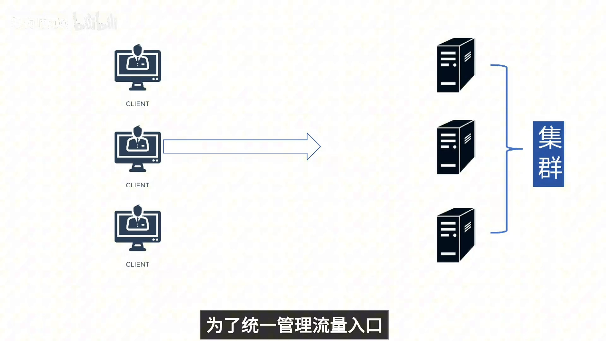
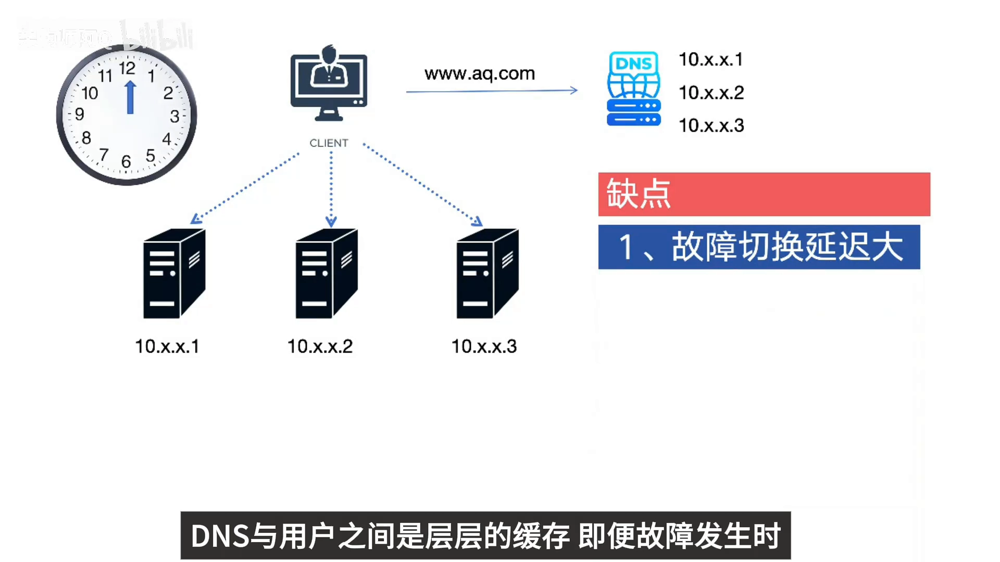
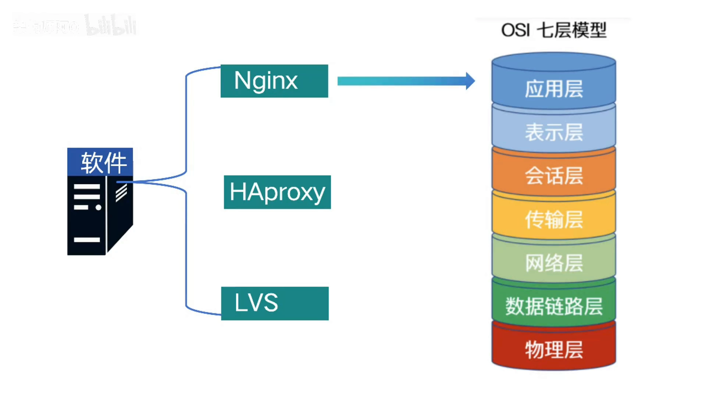
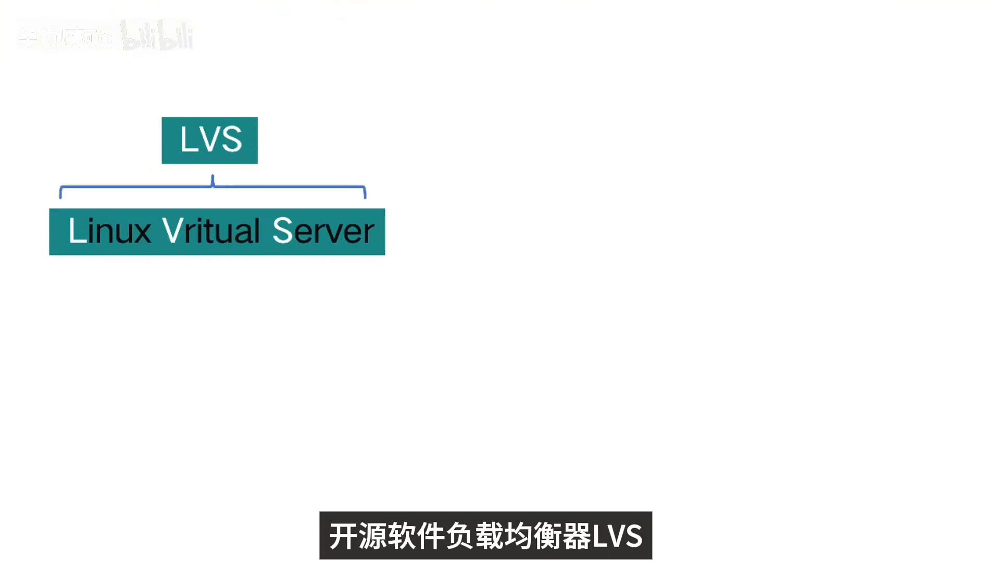
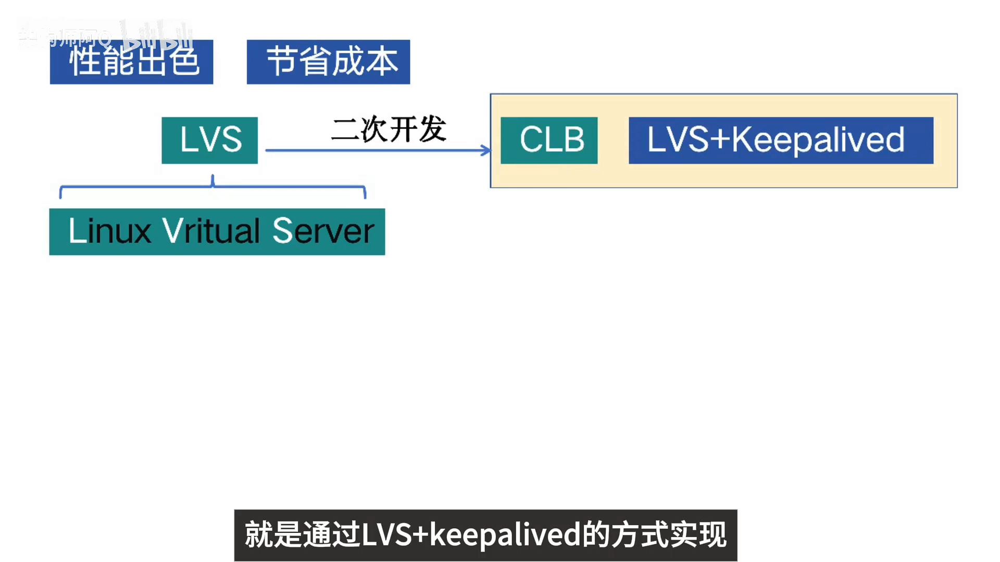
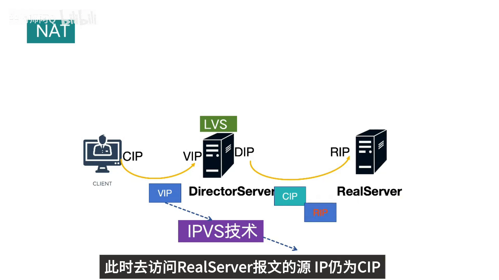
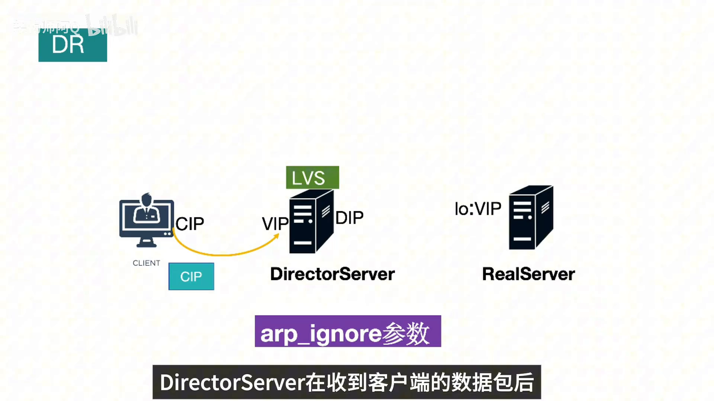
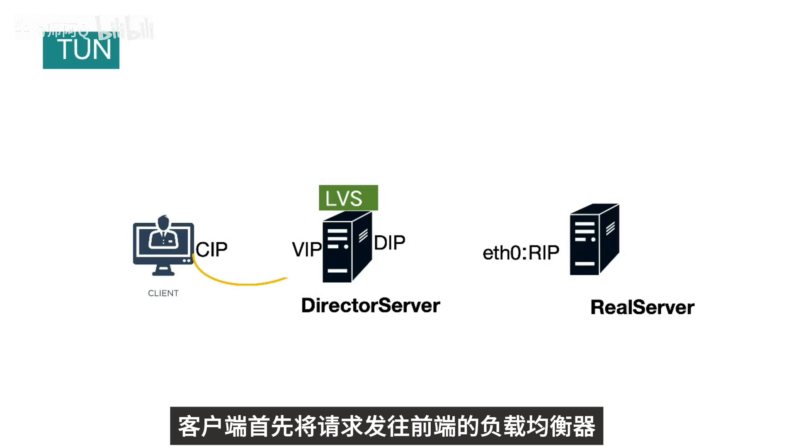
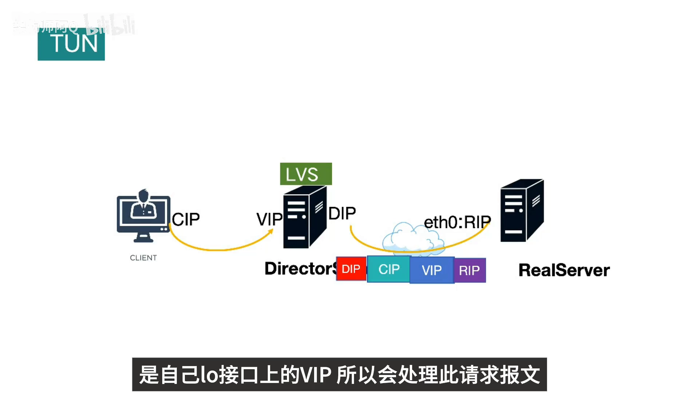

# 负载均衡是什么？LVS 的三种模式有什么区别

> 本文整理自 B 站视频《负载均衡是什么？LVS的三种模式有什么区别》。它用几分钟搭起负载均衡的整体图景——**从「为什么需要负载均衡」讲起，把负载均衡器分成 DNS / 硬件 / 软件三类**；再聚焦到 **LVS（Linux Virtual Server）这个内核态四层负载均衡器，讲透它最经典的三种工作模式：NAT、DR、TUN**。

## 本讲要解决的核心问题（SCQA）

**背景**：业务初期，一台服务器通常就能满足需求。随着用户和流量增长，大家都会把多台服务器组成集群，一起扛压力。

**冲突**：服务器一多，流量该往哪台送？入口又由谁统一管理？于是出现了「负载均衡器」。可市面上的方案五花八门——DNS、F5 硬件、Nginx/HAProxy/LVS 软件……它们到底差在哪、各自该用在什么场景？

**疑问**：负载均衡器分几类、怎么选？被称为「内核态四层负载均衡」的 LVS 凭什么性能最高？它最经典的 NAT、DR、TUN 三种模式，究竟做了什么？

**回答（中心思想）**：**负载均衡的本质是「把海量请求按预设算法分发到集群里不同服务器」的能力，广义上分 DNS / 硬件 / 软件三类。** 其中 **LVS 是运行在内核态的纯四层负载均衡，性能是软件方案里最高的**；它用 **NAT、DR、TUN 三种模式**回答同一个问题——**请求怎么送到后端，以及最关键的：响应要不要再绕回负载均衡器。** 三种模式最大的区别，恰恰就落在「回程」这条路上。

[【跳转到 00:00】](https://www.bilibili.com/video/BV1BDVzzZE4G/?t=0)

---

## 一、为什么需要负载均衡：从单机到集群，总得有个「统一入口」

业务初期，一台服务器就够用了。流量一天天涨上来，单机逐渐顶不住，我们便把多台服务器组成集群，用更多的机器来提升整体处理能力。

[【跳转到 00:05】](https://www.bilibili.com/video/BV1BDVzzZE4G/?t=5)

但集群带来一个新问题：**流量怎么均匀地分到这些机器上？** 这就需要一台「负载均衡器」——它把海量请求按照预设算法智能分发到集群中的不同服务器。这就是**负载均衡**。

[【跳转到 00:10】](https://www.bilibili.com/video/BV1BDVzzZE4G/?t=10)

---

## 二、广义负载均衡器的三类：DNS、硬件、软件

视频把广义的负载均衡器分为**三类**：DNS 负载均衡、硬件负载均衡、软件负载均衡。

[【跳转到 00:20】](https://www.bilibili.com/video/BV1BDVzzZE4G/?t=20)

### 2.1 DNS 负载均衡：最基础、最简单，但「切换慢」

DNS 是最基础的负载均衡方式：用户访问域名（如 `www.example.com`），DNS 把它解析成**多个 IP**，用户再去访问这些 IP 各自对应的服务器实例，就完成了流量调度。它甚至没有用到常规的负载均衡器，却确实完成了简单负载均衡的功能。

[【跳转到 00:40】](https://www.bilibili.com/video/BV1BDVzzZE4G/?t=40)

**优点是实现简单、成本低**；**缺点则很明显——服务器故障时切换延迟很大**。原因是 DNS 与用户之间存在**层层缓存**：

- 即便故障发生后及时改了 DNS 或摘掉了故障机器，中间还要经过运营商 DNS 缓存，而**缓存往往不遵循 TTL 规则**，导致 DNS 生效缓慢，用户仍会访问到已经挂掉的机器；
- 另外它的**流量调度策略简单、支持的算法少**——DNS 一般只支持 RR（轮询）方式。

因此在生产环境里，很少单独用 DNS 来做负载均衡。

[【跳转到 00:59】](https://www.bilibili.com/video/BV1BDVzzZE4G/?t=59)

不过，介绍 DNS 负载均衡是为了让你更清楚地理解「负载均衡」这个概念——**一些大公司确实会用 DNS 做地理级别的负载均衡**：让不同地区的用户就近访问最近的机房，提升访问速度。这类做法通常只作为入口流量的「基础级」负载均衡，下层还会有更专业的负载均衡设备来承载整套负载架构。

[【跳转到 01:30】](https://www.bilibili.com/video/BV1BDVzzZE4G/?t=90)

### 2.2 硬件负载均衡：F5 与 A10，性能强但价格昂贵

硬件负载均衡是**通过专门的硬件设备来实现负载均衡**，这台设备类似交换机、路由器，是专为负载均衡设计的网络设备。业界典型的两款是 **F5 和 A10**。

[【跳转到 01:51】](https://www.bilibili.com/video/BV1BDVzzZE4G/?t=111)

这类设备**性能好、功能强大**，但**价格非常昂贵**，普通业务量级的公司一般负担不起。

[【跳转到 02:09】](https://www.bilibili.com/video/BV1BDVzzZE4G/?t=129)

### 2.3 软件负载均衡：Nginx、HAProxy、LVS

软件负载均衡，是指**在普通服务器上运行软件**来实现负载均衡功能。常见的有 **Nginx、HAProxy、LVS**：

- **Nginx**：**七层**负载均衡，支持 HTTP 协议；
- **HAProxy**：同样是**七层**负载均衡软件，性能也很不错；
- **LVS**：**纯四层**负载均衡，**运行在内核态，性能是软件负载均衡里最高的**；因为工作在四层，也更加通用。

[【跳转到 02:33】](https://www.bilibili.com/video/BV1BDVzzZE4G/?t=153)

**软件负载均衡的优点**：部署简单、维护简单、便宜——买台 Linux 服务器把软件装上即可；还能**按业务灵活选择四层或七层**负载均衡，也方便扩展和定制功能。

---

## 三、LVS：内核态四层负载均衡的性价比之王

**LVS 全称 Linux Virtual Server**，它工作在**网络四层**，性能出色，关键是还能大幅节省成本。

[【跳转到 03:03】](https://www.bilibili.com/video/BV1BDVzzZE4G/?t=183)

正因如此，**很多大厂的负载均衡产品底层都是基于 LVS 开发的**——比如阿里云早期的四层负载均衡 **CLB**，就是用 **LVS + keepalived** 的方式实现的。对中小型公司来说，使用开源的 LVS 已经足够满足业务需求。

---

## 四、LVS 的三种工作模式：区别全在「回程」

LVS 有三种主要工作模式：**NAT、DR、TUN**。三者要回答的是同一个问题——请求如何送达 Real Server，以及响应如何返回客户端。搞懂三种模式，关键是盯住「回程」这条数据流向。

[【跳转到 03:17】](https://www.bilibili.com/video/BV1BDVzzZE4G/?t=197)

先认识三种模式共有的三个角色：

| 角色 | 含义 |
| --- | --- |
| **Client（客户端）** | 发起请求的一方，源 IP 简称 **CIP** |
| **Director Server** | 负载调度器，即安装了 LVS 模块的服务器 |
| **Real Server** | 真正处理请求的后端服务器，真实 IP 简称 **RIP** |

访问的目标地址是负载均衡器对外的**虚拟 IP（VIP）**。

[【跳转到 03:42】](https://www.bilibili.com/video/BV1BDVzzZE4G/?t=222)

### 4.1 NAT 模式：后端不用暴露真实 IP，但回程要过负载均衡器

**NAT 全称 Network Address Translation（网络地址翻译）**。它的流程如下：

1. 客户端首先访问**负载调度器 Director**，此时报文的**源 IP 为 CIP、目标 IP 为 LVS 主机的 VIP**；
2. 基于 Linux 内核的四层负载均衡技术 **IPVS** 会在 LVS 上把数据包的**目标 IP 地址改成后端 Real Server 的 IP（RIP）**，即完成一次「目标 IP 转换」，再把包送去访问 Real Server（此时报文源 IP 仍是 CIP）；
3. Real Server 处理完，构建**响应报文**发给 Director：此时源 IP 为 **RIP**、目标 IP 为 **CIP**；
4. Director 在把响应发回客户端之前，把**源 IP 改回自己的 VIP**，最终响应给客户端（源 IP 为 VIP、目标 IP 为 CIP）。

[【跳转到 03:51】](https://www.bilibili.com/video/BV1BDVzzZE4G/?t=231)

**NAT 模式的特点**：后端服务器**无需暴露真实 IP**；但负载均衡器**需要处理双向流量**（去程和回程都要经过它），所以**容易成为性能瓶颈**。

[【跳转到 04:16】](https://www.bilibili.com/video/BV1BDVzzZE4G/?t=256)

### 4.2 DR 模式：只改二层目的 MAC，响应直达客户端

**DR 全称 Direct Routing（直接路由技术）**。它做了一个巧妙的设计——**让 Director 和 Real Server 都配置同一个 VIP**：Director 把 VIP 配到**对外的网卡**上，Real Server 把 VIP 配到 **lo 网卡**上。因为两台机器都有这个 VIP，就要靠配置 **ARP 的 `ignore` 参数**来保证：数据包发出 ARP 请求时，**只有 Director 会响应该请求**。

[【跳转到 04:47】](https://www.bilibili.com/video/BV1BDVzzZE4G/?t=287)

流程如下：

1. 客户端访问 Director（源 CIP、目标 VIP）；
2. Director 收到包后，按调度算法找出对应的 Real Server，把**目的 MAC 地址改成 Real Server 的 MAC（RIP MAC）**、源 MAC 为 Director 的 MAC（DIP MAC），再把帧发出去——**注意它只改了二层包头，IP 层一个字节没动**；
3. Real Server 通过网卡 eth0 收到这个包，由于**它自己的 lo 网卡也配了 VIP**，于是正常接收、处理；
4. 处理完**直接把响应返回给客户端**（因为目标 IP 本来就是 VIP，Real Server 认为「VIP 就是我」）。

[【跳转到 05:20】](https://www.bilibili.com/video/BV1BDVzzZE4G/?t=320)

**DR 模式的约束**：因为要改写二层包头，**Director 和 Real Server 必须处在同一个广播域**（可以简单理解为连在同一台交换机上），且 **Real Server 必须配置 VIP 并禁用 ARP 响应**。

[【跳转到 05:45】](https://www.bilibili.com/video/BV1BDVzzZE4G/?t=345)

**DR 模式的特点**：**只有请求流量经过负载均衡器，响应流量直达客户端**，因此**性能极高**。

### 4.3 TUN 模式：套一层 IP 隧道，换取跨机房能力

**TUN 全称 IP Tunneling（IP 隧道技术）**。它的思路是在原报文外面再套一层 IP 头：

1. 客户端把请求发往前端负载均衡器（源 CIP、目标 VIP）；
2. 负载均衡器发现这是规则里存在的地址，于是**在客户端请求报文的首部再封装一层 IP 报文**：新外层**源地址改为 DIP、目标地址改为 RIP**，然后把包发给 Real Server；
3. Real Server 收到后**先拆开第一层封装**，发现里面还有一层 IP 首部，而它的**目标地址正是自己 lo 接口上的 VIP**，于是处理这个请求；
4. 处理完，响应报文经 lo 接口送到 **eth0 网卡，直接发给客户端**（该 eth0 一般与 Director 在同一网段）。注意：需要保证 **lo 接口上的 VIP 不会在公网上出现**。

[【跳转到 06:16】](https://www.bilibili.com/video/BV1BDVzzZE4G/?t=376)

**TUN 模式的约束与特点**：**支持跨机房部署**（因为有了外层 IP 封装，不再要求二层同网段），但**隧道的封装/解封装会带来额外开销**，且 **Real Server 需要支持隧道协议并配置 VIP**。

[【跳转到 06:41】](https://www.bilibili.com/video/BV1BDVzzZE4G/?t=401)

---

## 小结

- **负载均衡是什么**：业务从单机走向集群后，用一台「负载均衡器」把海量请求按预设算法分发到集群里不同服务器。
- **广义上分三类**：**DNS**（简单便宜，但缓存导致切换慢、算法少，适合做地理级入口）、**硬件**（F5/A10，强但贵）、**软件**（Nginx/HAProxy 是七层，**LVS 是内核态四层，性能最高**）。
- **LVS 的三种模式，区别全在「回程」**：
  - **NAT**：去程改目标 IP 为 RIP、回程改源 IP 回 VIP；后端不用暴露 IP，但**回程也要过负载均衡器，易成瓶颈**；
  - **DR**：**只改二层目的 MAC**，后端凭 lo 上的 VIP 直接回包；**响应直达客户端、性能极高**，但要求同广播域且配置好 VIP/ARP；
  - **TUN**：**外层再套一层 IP 隧道**，支持跨机房，代价是封装开销与 Real Server 需支持隧道协议。
- **选型口诀**：中小业务开源 LVS 足够；要极高性能且同网段选 DR；要跨机房选 TUN；图配置直观容忍回程瓶颈时用 NAT。

## 关键术语速查

| 术语 | 一句话解释 |
| --- | --- |
| 负载均衡 | 把海量请求按算法分发到集群中多台服务器，统一管理流量入口 |
| VIP | 负载均衡器对外的虚拟 IP，是客户端访问的统一入口 |
| CIP / RIP / DIP | 客户端 IP / 真实服务器 IP / 负载调度器 IP |
| Director Server | 负载调度器，即安装了 LVS 模块的那台服务器 |
| Real Server | 真正处理请求的后端服务器 |
| LVS | Linux Virtual Server，运行在内核态的纯四层负载均衡 |
| NAT 模式 | 读写双向流量都过负载均衡器；后端不暴露真实 IP |
| DR 模式 | 只改二层目的 MAC，响应由后端直达客户端，性能极高 |
| TUN 模式 | 外层再封装一层 IP 隧道，支持跨机房，有封装开销 |
| keepalived | 常与 LVS 搭配，负责健康检查与高可用（如阿里云早期 CLB） |
