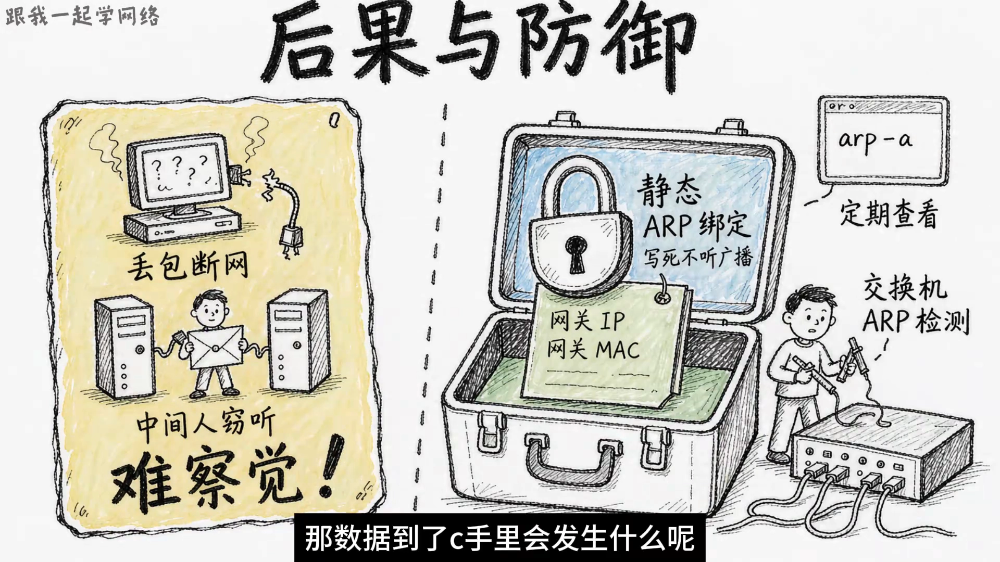

# 8 分钟讲透 ARP：原理、攻击、防御全搞懂

> 本文整理自 B 站视频《8分钟讲透ARP：原理、攻击、防御全搞懂》。它从一个再日常不过的场景切入——你在电脑上敲下一个地址、按下回车，数据却在「组装」这一步卡住了。围绕这个卡点，视频把 ARP 讲成一位**网络世界的「通讯录管理员」**：它负责把 IP 门牌号翻译成 MAC 身份证号，靠「广播问、单播答、缓存表」三板斧干活，也正因为「谁喊都信」，它成了局域网攻击的命门。

## 本讲要解决的核心问题（SCQA）

**背景**：我们在网络上通信，靠的是 IP 地址——想访问谁，就填上谁的 IP。而数据真正在网卡上发出去时，认的却是 MAC 地址。

**冲突**：一台电脑发数据包，包头里要同时填原 IP、目标 IP、原 MAC、目标 MAC。原 IP 和目标 IP 由上层指定，原 MAC 是本机网卡的，都不用操心；唯独**目标 MAC，系统只知道对方的 IP，MAC 是一片空白**。这一包数据就只能先压在手里，发不出去。

**疑问**：操作系统怎么补上这块空白？它又是怎么在「只知道 IP」的情况下，问到对方的 MAC 的？这套机制为什么还能被攻击者利用？

**回答（中心思想）**：**ARP（地址解析协议）就是通过 IP 地址反查 MAC 地址的协议**，是网络世界里那个专门「按门牌号查身份证号」的查询员。它的工作套路是三板斧：**查不到就全网广播喊话、目标本尊单播应答；查到结果就存进缓存表并定期过期；IP 变更时靠「免费 ARP」主动广播搬家消息**。而这份「谁喊都信」的信任机制，正是 ARP 攻击的命门——伪造喊话就能冒领网关、劫持流量，防御的思路就是把关键记录「焊死」。

[【跳转到 00:00】](https://www.bilibili.com/video/BV1fgaa6qE9r/?t=0)

---

## 一、先分清两个地址：IP 是门牌号，MAC 是身份证号

视频先用一个生活化的比喻把问题摆出来：你手里攥着一个包裹，面单上只写了「三栋 502 的住户」，但你压根不知道人家叫什么、长什么样，包裹再急也只能干站着。

[【跳转到 00:34】](https://www.bilibili.com/video/BV1fgaa6qE9r/?t=34)

要理解这个尴尬，先把两个地址的关系捋清楚：

- **IP 地址像门牌号**：它是分配来的、可以变——今天这台电脑在这个网段用这个 IP，明天换个地方、换个 IP 照样能用；
- **MAC 地址像身份证号**：它是网卡出厂时烧进去的全球唯一编号，跟着网卡走，一般不随位置变化。

所以在以太网上发数据，**网络层给的 IP 无法直接寻址到网卡**，必须再补一个 MAC 地址。这正是「数据组装到一半卡住」的根本原因。

[【跳转到 01:21】](https://www.bilibili.com/video/BV1fgaa6qE9r/?t=81)

---

## 二、ARP 的三板斧：广播问、单播答、缓存表

一句话总结：**ARP（Address Resolution Protocol，地址解析协议）就是通过 IP 地址反查 MAC 地址的协议**，它是网络世界里那个专门帮你按门牌号查身份证号的查询员。那这个查询员是怎么查的呢？

[【跳转到 01:46】](https://www.bilibili.com/video/BV1fgaa6qE9r/?t=106)

### 2.1 第一板斧：查不到——全网广播喊话

方法很原始，但也很好用，那就是「喊」。主机 A 想知道 `192.168.1.10` 的 MAC，它就在整个局域网里**广播**一包 ARP 请求，内容大概是：

> 所有人都听着，谁拿着 192.168.1.10 这个门牌号，请把你的 MAC 告诉我。

这包请求里面写着自己的 IP 和 MAC，还留了一个空位，等着对方去填 MAC。

[【跳转到 02:06】](https://www.bilibili.com/video/BV1fgaa6qE9r/?t=126)

### 2.2 第二板斧：目标本尊——单播应答

这一嗓子是广播，局域网里每台电脑都能听见。大家收到后都拆开看一眼，发现说的不是我，于是大部分机器把报文一丢，该干嘛干嘛；只有真正的目标主机 B 一看，「这 IP 是我的」，于是它生成一包 ARP 应答，把自己的 MAC 填进去，**单播**回复给主机 A。

注意这组反差：**请求是全网广播，应答是单独回话**——喊话用大喇叭，回复用悄悄话。因为答案只跟提问的人有关，没必要让全网再听一遍。

[【跳转到 02:31】](https://www.bilibili.com/video/BV1fgaa6qE9r/?t=151)

### 2.3 第三板斧：查到了——记进缓存表

那每发一个包都要这么喊一圈吗？那也太吵了。当然不是。ARP 查到的结果会存进一张表，叫 **ARP 缓存表**，你可以理解成主机 A 的「小本本」：第一页记着 `192.168.1.10` 对应的 MAC。下次再往这个 IP 发数据，先翻小本本，查到了直接抄上去发送，一毫秒都不用多等。只有小本本上查不到的，才会重新广播喊一圈。

这个小本本还有一个特点，就是**会过期**：表里的记录有生存时间，超时会自动清掉，防止别人换了网卡或者换了位置，你还照着旧地址发货。所以平时在电脑上敲 `arp -a`，看到的那一列 IP 和 MAC，就是这本实时更新的通讯录。

[【跳转到 03:15】](https://www.bilibili.com/video/BV1fgaa6qE9r/?t=195)

### 2.4 补充一招：免费 ARP，主动「报户口」

这里有一个隐患：IP 是会换人的。万一两台主机交换了 IP，或者一台主机的 IP 换了位置，小本本上面的旧记录就成了过期货，照着旧记录发货就会发错。

ARP 体系里的解法也很主动，叫做**免费 ARP**：一台主机设置好 IP 之后，不等别人来问，主动向全网广播一包特殊的 ARP 报文，内容大概是：

> 各位注意，门牌号 192.168.1.10 现在由我这个 MAC 住着，大家都记一下。

这包报文不需要任何人回复，它唯一的目的就是**广而告之**，登记一下当前 IP 和 MAC 的绑定关系。每台收到免费 ARP 的主机自动更新自己的小本本，于是全网几乎瞬间同步了最新的映射关系。本质上，这是一次「搬家广播」：我不等你来查，我自己上门报户口。

[【跳转到 04:10】](https://www.bilibili.com/video/BV1fgaa6qE9r/?t=250)

---

## 三、ARP 攻击：伪造「这一嗓子」会怎样

理解了免费 ARP，ARP 攻击就不神秘了——它的原理就是**伪造这一嗓子**。

视频给了一个典型场景：局域网里主机 A 要上互联网，所有出网的数据包，数据链路层的目标 MAC 都得填**网关路由器**的 MAC。那这个网关 MAC 是怎么知道的呢？还是 ARP 查的，拿网关 IP 去问，问回来记在小本本上；以后 A 上网的每一个包，都是先交给网关，再由网关送出去。

[【跳转到 05:08】](https://www.bilibili.com/video/BV1fgaa6qE9r/?t=308)

现在，局域网里混进来一台心怀不轨的主机 C，它不停地向外广播伪造的免费 ARP 报文：

> 门牌号 192.168.1.1（也就是网关的 IP）在我这里，我的 MAC 是叉叉叉叉，请记好。

A 收到这包伪造的广播，分辨不出真假，只能相信，于是它把小本本上面「网关 IP 对应网关 MAC」这一条，改成了「网关 IP 对应 C 的 MAC」。**从这一刻起，A 所有上网的数据包全都发给了 C。**

那数据到了 C 手里会发生什么呢？取决于 C 想干什么：

- **最直接的效果是断网**：C 把包丢掉，A 就上不了网，而且会被误判成网络问题，这种最难排查；
- **更进一步是中间人劫持**：C 也可以转发这些包，自己充当中间人，把流量从头到尾偷看一遍。

而且这种伪造报文和真实报文长得一模一样，普通设备还很难察觉。

[【跳转到 06:17】](https://www.bilibili.com/video/BV1fgaa6qE9r/?t=377)

---

## 四、防御思路：把关键记录「焊死」

我们防御的思路，就是堵住「谁都能随便认领网关」这个漏洞。按照从简单到专业，可以这样层层设防：

- **静态 ARP 绑定**（最简单有效）：手动把网关 IP 和网关 MAC 死死绑定在小本本上，写死了就不听广播、不改表，伪造报文自然失效；
- **动态 ARP 检测**（企业环境）：由交换机从交换层拦截伪造报文；
- **IP-MAC 绑定**（普通家用）：在路由器端做绑定，加上定期查看 `arp -a`，已经能够挡住绝大多数的情况。

[【跳转到 07:07】](https://www.bilibili.com/video/BV1fgaa6qE9r/?t=427)

---

## 小结

- **ARP 的本质**：网络世界里的通讯录管理员，全部职责就是维护「IP 门牌号」与「MAC 身份证号」之间的对应关系。
- **三板斧**：查不到就**全网广播**喊话、**目标本尊单播**应答；查到的话，结果**计入缓存表并定期过期**。
- **IP 变更时**，靠**免费 ARP** 主动广播「搬家消息」，让全网几乎瞬间同步新的映射关系。
- **命门**：这份「谁喊都信」的信任机制，正是 ARP 攻击的入口——伪造喊话就能冒领网关 IP。
- **后果**：轻则断网，重则被中间人劫持、流量被全程偷看，且伪造报文与真报文几乎无法分辨。
- **防御**：静态 ARP 绑定把关键记录焊死，企业用动态 ARP 检测在交换层拦截，家用则靠路由器 IP-MAC 绑定加上定期 `arp -a` 巡检。

下次你敲 `arp -a`，看着屏幕上那一列 IP 和 MAC 时，你就知道：你看到的不是一堆参数，而是一份被全网「喊话、应答、广播」不断维护着的小本本。

## 关键术语速查

| 术语 | 一句话解释 |
| --- | --- |
| ARP | 地址解析协议，通过 IP 地址反查 MAC 地址，让数据能在以太网上真正发出去 |
| MAC 地址 | 网卡出厂时烧录的全球唯一编号（像身份证号），跟着网卡走，一般不随位置变化 |
| ARP 缓存表 | 主机缓存「IP ↔ MAC」映射的「小本本」，可显著减少广播，记录带生存时间会过期 |
| 广播 | 发给局域网内所有设备的报文（ARP 请求用广播，相当于拿大喇叭喊话） |
| 单播 | 只发给某一台设备的报文（ARP 应答用单播，相当于说悄悄话） |
| 免费 ARP | 主机不等别人问就主动广播「某 IP 现在归我」，用于快速通告 IP 与 MAC 的新绑定 |
| ARP 攻击 | 伪造 ARP 报文冒领网关等关键 IP，可造成断网或中间人劫持 |
| 静态 ARP 绑定 | 手动把 IP 与 MAC 写死，拒绝接收广播更新，是抵御 ARP 攻击最简单有效的方法 |
| 动态 ARP 检测 | 企业交换机上从交换层拦截伪造 ARP 报文的防护手段 |
