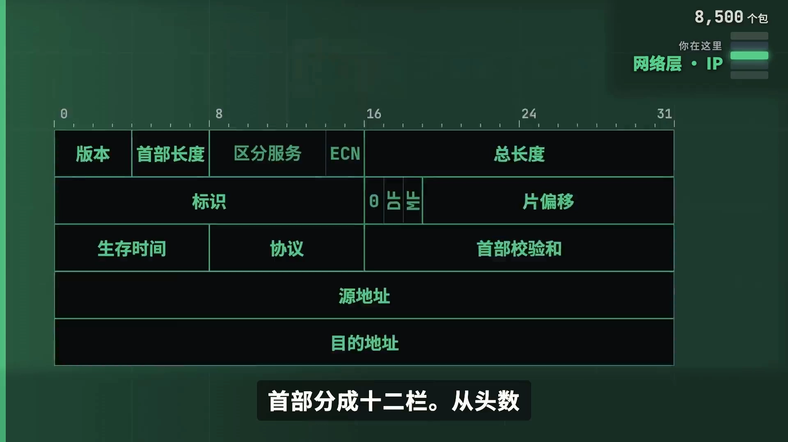
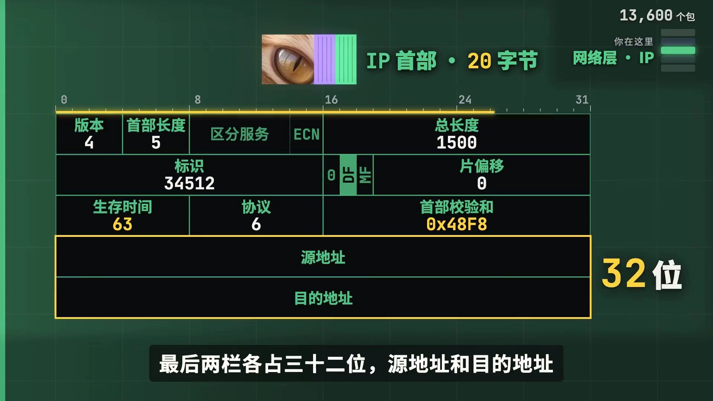
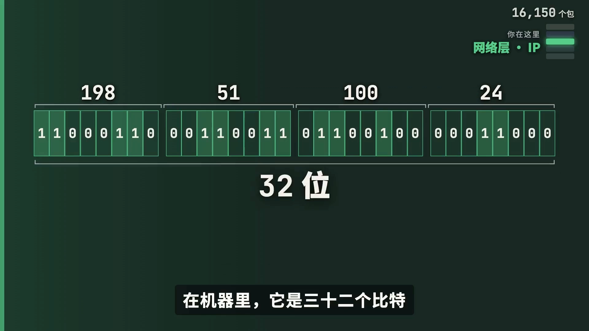
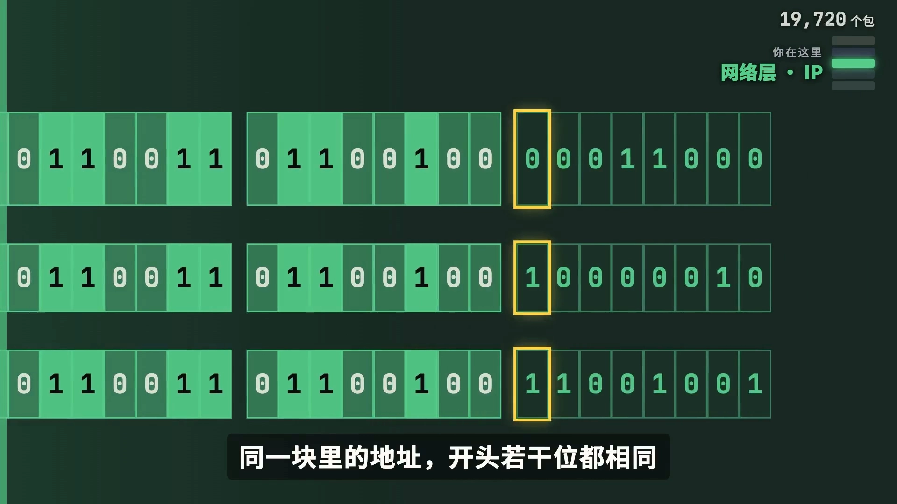
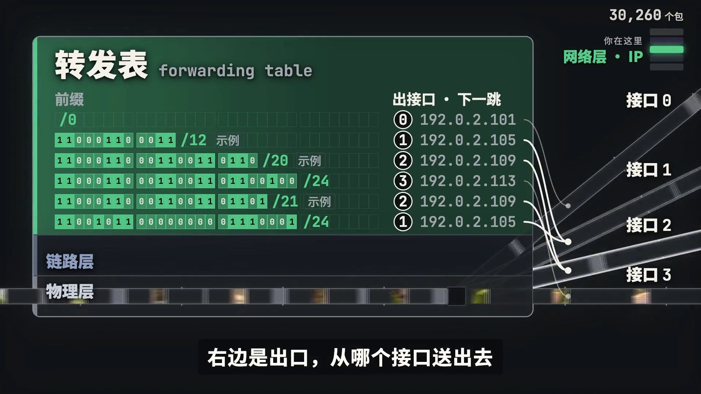
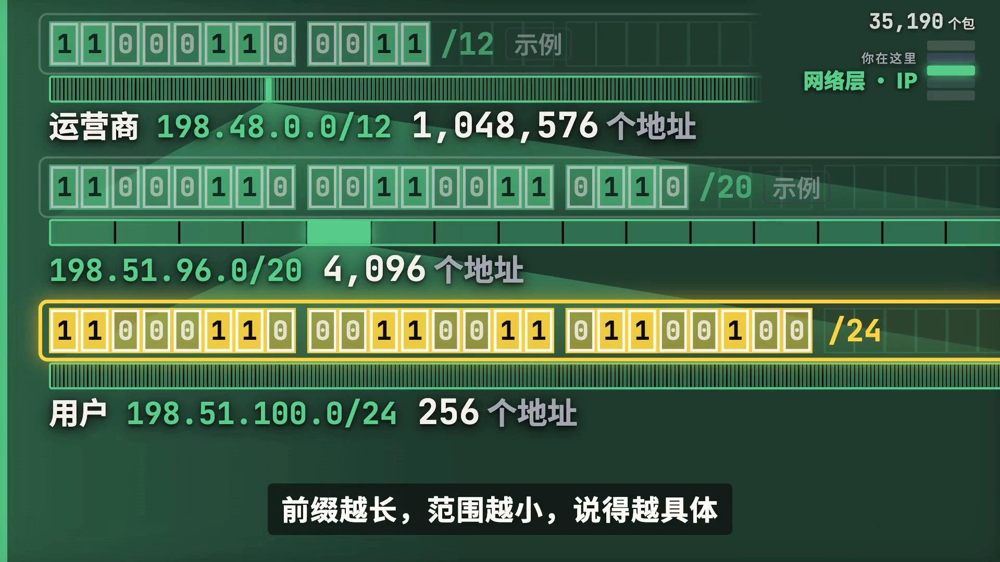
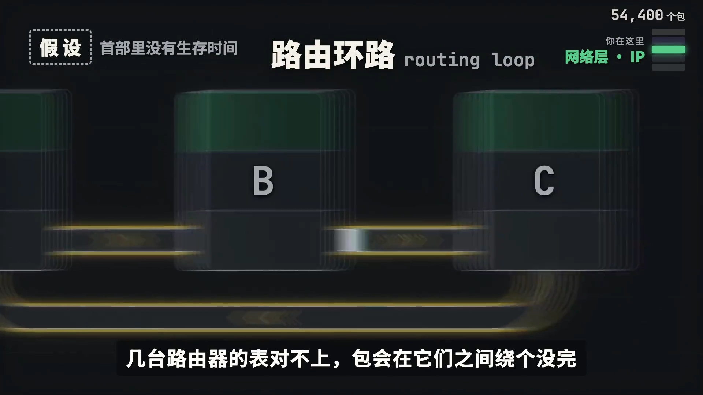

# IP路由：百万行的表，路由器怎么找到出口？｜尽力而为⑥

> 本文整理自 B 站《尽力而为》TCP/IP 系列第六集《IP路由：百万行的表，路由器怎么找到出口？》（作者：小盒子童鞋）。它从一个惊人的数字讲起——骨干路由器里那张表有 **100 多万行**，一个端口一秒钟要查 **1 亿多次**——然后「打开路由器」，拆开 IP 首部，讲透**地址、前缀、转发表、最长前缀匹配**，以及首部里那几栏管着哪些「路上的意外」。

## 本讲要解决的核心问题（SCQA）

**背景**：你点开这条视频以后，每一个送来的包，在路上要经过十几台路由器；每一台都要为它查一次表。

**冲突**：在骨干上的路由器里，这张表今天有 **100 多万行**，而路由器的一个端口，一秒钟最多要查 **1 亿多次**。要在平均 6.7 纳秒里交出一个答案——这听起来根本不可能。

**疑问**：表里记的是什么？怎么查？凭什么这么快？

**回答（中心思想）**：这张表叫**转发表**，左边是一个个**前缀**，右边是出口。查表就是拿目的地址去和每一行的前缀比——**匹配的常常不止一行，规矩是取前缀最长的那一行，这叫「最长前缀匹配」**。为了快，前缀被排成一棵按位比较的树，最多走 32 步、与表有多大无关，再交给专用硬件完成。而 IP 首部里剩下的那几栏，则负责兜住**路上的意外**：包绕圈（生存时间与 ICMP）、包太大（MTU 与分片），以及地址本身不够用（NAT 与 IPv6）。至于表里这 100 多万行是谁填的——没有谁有全网的地图，那是下一集「路由选择」的事。

[【跳转到 00:00】](https://www.bilibili.com/video/BV1cUWA66EDp/?t=0)

---

## 一、打开路由器：IP 首部里，路由器只看最前面 20 个字节

网络层的协议是 IP。一个包到了路由器，路由器脱掉最外面那层帧，露出里面的 **IP 数据包**；它要看的东西，全在最前面这 **20 个字节**里，也就是 **IP 首部**。

首部**分成 12 栏**，从头数：

| 栏位 | 作用 |
| --- | --- |
| 版本 | 这里写的是 4（IPv4） |
| 首部长度 / 区分服务 / 总长度 | 描述首部与整个数据报的长度、服务类型 |
| 标识 / 标志 / 片偏移 | 这三栏管**分片** |
| 生存时间（TTL） | 防止包在网里转个不停 |
| 协议 | 说明里面装的是 TCP 还是别的 |
| 首部校验和 | 只查首部自己有没有错 |
| 原地址 / 目的地址 | 最后两栏各占 32 位 |

**路由器转发，看的就是目的地址。**

[【跳转到 00:40】](https://www.bilibili.com/video/BV1cUWA66EDp/?t=40)

目的地址写出来是四个数（如 `192.168.1.1`），在机器里它是 **32 个比特**——每八位写成一个十进制数，只是为了让人好读。

[【跳转到 01:20】](https://www.bilibili.com/video/BV1cUWA66EDp/?t=80)

---

## 二、地址是一块一块分的：前缀与 CIDR

如果按「一个地址一行」来记，32 个比特能编出 **43 亿个地址**，那就得有几 10 亿行。所以**地址是一块一块分的**。

- 同一块里的地址，开头若干位都相同；
- 这段相同的开头，叫做**前缀**；
- 前缀的写法，是在地址后面加一条斜杠，再写上「前缀有几位」——比如 **`/24` 就是前 24 位固定、后八位随意**，这一块有 256 个地址。

前缀可以是**任意长度**，不一定是八的倍数。这套办法叫**无类别域间路由（CIDR）**。地址块是一级一级切下来的：最上面的机构分给五个地区的注册机构，再到运营商，再到用户。所以**一家运营商的用户地址，开头通常相同**，于是路由器只用记前缀。

效果惊人：**今天全网通告出来的 31 亿个地址，113 万行就记下了。**

[【跳转到 02:36】](https://www.bilibili.com/video/BV1cUWA66EDp/?t=156)

---

## 三、转发表与最长前缀匹配：为什么「最长」才是对的

这张表叫**转发表**：

- 每一行**左边是一个前缀**；
- 每一行**右边是出口**——从哪个接口送出去、交给哪一个下一跳。

**查表，就是拿目的地址去和每一行的前缀比**：前缀有几位，就比开头几位，**全对上才算匹配**。

麻烦在于，匹配的常常**不止一行**。比如运营商有一个大块，大块里某个用户另有一条更细的，**两行都对得上**。这时规矩是：

> **取前缀最长的那一行**——前缀越长，范围越小、说的越具体。

这条规矩叫做**最长前缀匹配**。

[【跳转到 03:27】](https://www.bilibili.com/video/BV1cUWA66EDp/?t=207)

---

## 四、凭什么这么快：trie 树与专用硬件

100 多万行，一行一行比太慢。办法是**把所有前缀按位排成一棵树**：

- 从树根出发，地址的每一位决定往左还是往右；
- 路过**带标记的节点**就记下来；
- 走到没路了，最后记下的那个就是答案。

**最多走 32 步，表里有多少行都一样。**

[【跳转到 03:42】](https://www.bilibili.com/video/BV1cUWA66EDp/?t=222)

视频还给了一张**真实的表**的可视化：113 万条前缀，每一块是一条，按地址排，**块越高、前缀越长**；六成多是 `/24`，大块里面立着小块，最多的地方，**同一个地址落在九条前缀里**。查找像雨一样落下来——雨点落在哪个地址上，最先碰到的总是那里**最高**的一块，而最高的正是**前缀最长**的一个。

再看性能指标：**每秒 1000 亿比特的端口，满负荷时一秒最多送来 1 亿四千八百多万个包，每个都要查一次，平均 6.7 纳秒就得交出一个答案。** 这要靠专门的硬件：

- 一种是特殊的存储器（**TCAM** 之类），把地址同时和所有的行比一遍，一步出结果；
- 另一种是把那棵树**压扁**，一步看好几位。

[【跳转到 04:45】](https://www.bilibili.com/video/BV1cUWA66EDp/?t=285)

---

## 五、首部里剩下的几栏：管的是「路上的意外」

IP 首部里除了地址和长度，剩下的几栏，管的是包在路上可能遇到的意外。

### 5.1 意外之一：转圈——生存时间与 ICMP

头一种是转圈：**几台路由器的表对不上，包会在它们之间绕个没完。**

**生存时间（TTL）**就是为这个准备的：出发时通常写 64，**每过一台路由器减一**，减到零，路由器把包丢掉，再朝原地址回一个报文，说它「超时了」。这种报文归 **ICMP** 管——它是 IP 的搭档，主要用来报告差错。

有个工具故意发出生存时间是 1、2、3……的包，让沿途的路由器**挨个回信**，这条路上有谁就都清楚了——这就是 **traceroute**（Windows 上叫 `tracert`）。

[【跳转到 05:47】](https://www.bilibili.com/video/BV1cUWA66EDp/?t=347)

### 5.2 意外之二：包太大——MTU 与分片

另一种意外是包太大。每种链路一次能装多少字节有个上限，叫**最大传输单元（MTU）**——以太网是 **1500**，有的宽带线路只有 **1492**。

老办法是**分片**：路由器把装不下的数据包切成两个，各带一个首部，**标识相同**表示出自同一个包，**片偏移**写明这一片接在哪里，到终点再拼起来。

但**现在一般不让路由器切**：发送方在标志栏里写明「不许分片」（**DF 位**），太大的包被丢掉，路由器回一个 **ICMP 报文**，写明「这段路最多能装多少」，发送方照着改小再发——这正是路径 MTU 发现（PMTUD）的思路。

[【跳转到 06:32】](https://www.bilibili.com/video/BV1cUWA66EDp/?t=392)

### 5.3 意外之三：地址本身不够用——NAT 与 IPv6

最后是地址本身：**43 亿个不够用**。2011 年 2 月 3 号，最上面那个总的地址池分完了。撑到今天，靠的是**网络地址转换（NAT）**：

- 你家的路由器对外通常只有一个**公网地址**，手机、电脑、电视用的是**私有地址**（只在家里有效，家家都能用同一批）；
- 包出门时，路由器把原地址换成自己的，端口要是和别人撞了，也换一个；它把这笔对应关系记在表里，回来的包照着表改回去。

代价是：**地址不再从头到尾指着同一台机器**——这台路由器要读第四层的端口，有时还要改，还得记住每一条连接。前面几集说过「中间的机器一条连接都不用记」，这里破了例。

根本的办法是**加长地址**：**IP 的第六版（IPv6），地址有 128 位**，路由器也不再分片。按谷歌的统计，它的用户接近一半已经在用第六版。

[【跳转到 07:43】](https://www.bilibili.com/video/BV1cUWA66EDp/?t=463)

---

## 小结

回到地图，网络层这一格现在清楚了：**首部、地址和前缀、转发表、最长前缀匹配、生存时间、ICMP、分片**。

- **路由器转发看目的地址**，依据全在 IP 首部最前面 20 个字节里。
- **地址按前缀成块划分**（CIDR）；一家运营商的用户地址开头通常相同，于是路由器只需记前缀，31 亿个地址用 113 万行就记下。
- **转发表每行是「前缀 → 出口」**；多行都匹配时，取**前缀最长**的那一行，这就是最长前缀匹配。
- **为了快**，前缀排成按位比较的树，最多走 32 步；再靠专用存储器或「压扁的树」实现单步/多位查找，扛住 6.7 纳秒一次查询。
- **路上的意外**由首部其余几栏兜底：TTL + ICMP 防绕圈（也是 traceroute 的原理）；MTU + DF + ICMP 处理「包太大」；NAT + IPv6 应对地址枯竭。
- **还剩下的问题**：表里这 100 多万行是谁填的？——没有人有全网的地图，那是下一集「路由选择」。

## 关键术语速查

| 术语 | 一句话解释 |
| --- | --- |
| IP 首部 | IPv4 包最前面的固定 20 字节，含版本、长度、TTL、协议、原/目的地址等 12 栏 |
| 前缀 | 一块地址开头若干位相同的部分，写作 `地址/位数`（如 `/24` 表示前 24 位固定） |
| CIDR | 无类别域间路由，用「前缀长度」灵活划分地址块，取代了固定分类的 A/B/C 类 |
| 转发表 | 路由器上的表，每行是「前缀 → 出口」，查表即拿目的地址逐行匹配前缀 |
| 最长前缀匹配 | 多条路由都匹配目的地址时，取前缀最长（范围最小、最具体）的那一条 |
| trie 树 | 把前缀按位排成的查找树，每走一位左右分叉，最多 32 步即得答案 |
| TTL（生存时间） | 每过一台路由器减 1，减到 0 就丢弃并回报 ICMP，用来防止包在环路上绕圈 |
| ICMP | IP 的搭档协议，用来报告差错（如超时、包太大），是 ping / traceroute 的基础 |
| MTU | 最大传输单元，一条链路一次能装的最大字节数（以太网默认 1500） |
| IP 分片 | 包超过链路 MTU 时被切成多片（标识相同、片偏移标位置），到终点重组 |
| DF 位 | 「不许分片」标志；置位后超限包被丢弃并回报 ICMP，用于探测路径 MTU |
| NAT | 网络地址转换，用「公网地址 + 端口」映射多个私有地址，缓解 IPv4 地址枯竭 |
| IPv6 | 下一代 IP，地址扩到 128 位，且规定路径上的路由器不分片 |
