# MTU 与 MSS 的区别是什么？IP 分片有哪些问题？

> 本文整理自 B 站视频《MTU与MSS的区别是什么？IP分片有哪些问题？》。它用「货车过限重桥、当场卸货分装」的故事，把网络里天天在发生的 **IP 分片**讲清楚；再沿着五层模型一路往下走，讲透 **MTU、MSS 各在哪一层、默认值从哪来**，以及为了避免分片，工程上有哪几套机制。

## 本讲要解决的核心问题（SCQA）

**背景**：你通过网络发数据，应用层产生的数据会一层层往下封装，最后变成信号发出去。可网络链路上「一次能承载多大的包」是有上限的。

**冲突**：超过上限的包会被拦下；但包也不是越小越好——每个包都要带一份头部信息，包切得越小，头部占比越大，实际数据占比反而越小，整条路的效率上不去。这就像一辆货车被限重 20 吨的桥拦下：货总共 40 吨，上不去，只能在原地卸货、拆成两辆小车分着运——每辆车多付一份运费，而且只要有一辆车没到，整批货就交付不了。

**疑问**：这条链路的「限重」到底是什么？包按多大切才合适？切包（分片）又会带来什么代价？怎么尽量避免它？

**回答（中心思想）**：**这个上限就是 MTU（最大传输单元），而「每个 TCP 段里纯数据切多大」由 MSS 决定。** 两者在不同层、是套娃关系：以太网 MTU 是二层概念（帧能装多少负载），IP MTU 是三层概念（IP 包总大小），MSS 是四层概念（TCP 段里纯数据的大小）。以太网默认 MTU 是 1500，据此算出最常见的 MSS 1460。**MSS 由双方在三次握手时互相通告**；一旦路上遇到更小的 MTU，包会被迫 IP 分片，代价是额外头部开销、任一分片丢失就要整段重传、且分片本身更易丢包。为避免分片，工程上有 **MSS clamping、PMTUD（DF 位）** 等机制，IPv6 更是把「路径设备不分片」写进了规则。

[【跳转到 00:00】](https://www.bilibili.com/video/BV1bdHv6MErz/?t=0)

---

## 一、为什么要把大包「切着发」：链路有上限，小包有开销

视频先讲清楚「为什么网络上一个大的数据包需要按 MTU 和 MSS 的大小切割发送」，有两点原因：

1. **链路有上限**：网络链路上一次能过的数据包大小有上限，超过上限的就会被拦下；
2. **包不是越小越好**：每个包都要带一份头部信息，就像每辆车都要配一个司机。数据包切得越小，总的头部信息占比就越大，实际要传输的数据占比就会越小，整条路的效率反而上不去。


所以 MTU 和 MSS 的大小，本质上是在找一个**平衡点**。那么这两个词分别在哪一层？

[【跳转到 00:50】](https://www.bilibili.com/video/BV1bdHv6MErz/?t=50)

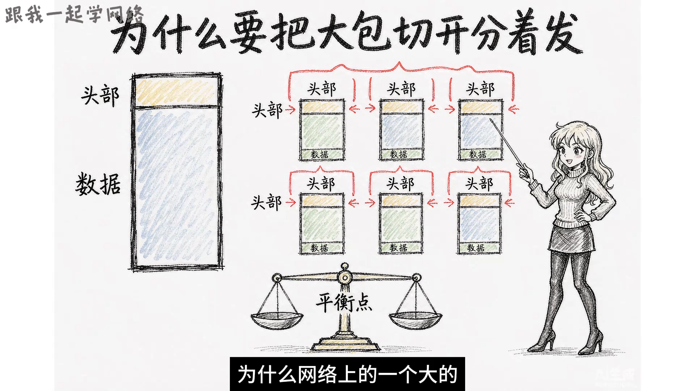

---

## 二、MTU 与 MSS 各在哪一层：三层套娃

数据从应用层产生，往下交给传输层，再到网络层、数据链路层，最后变成信号发出去；每往下走一层，就会被这一层的协议包上一层头部。按这个顺序，就能看清 MTU 和 MSS 的「楼层」：

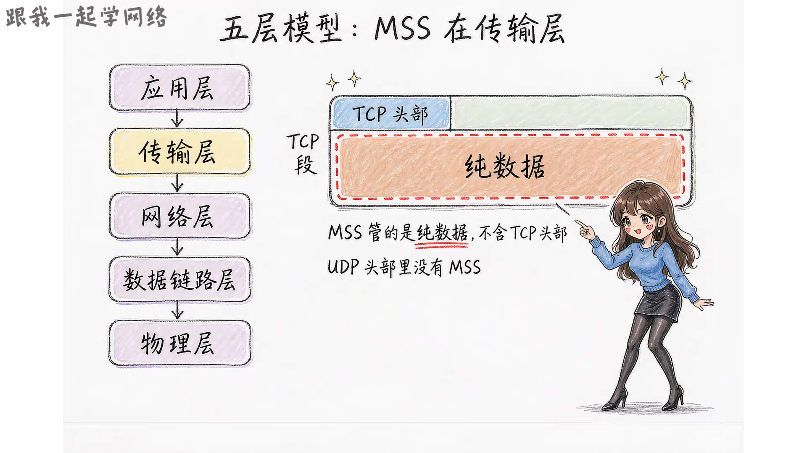

- **MSS（四层，传输层）**：数据到了传输层，如果使用 TCP，TCP 会给数据加上 TCP 头部，封装成一个 **TCP 段**。加完头部之后，段里那段**纯数据**的大小，就是 MSS 约束的对象。MSS 全称 **Maximum Segment Size**（最大分段大小），它**不包含 TCP 头部**，算的是单个 TCP 段里纯数据的最大长度，不是加了头部之后的总长度。

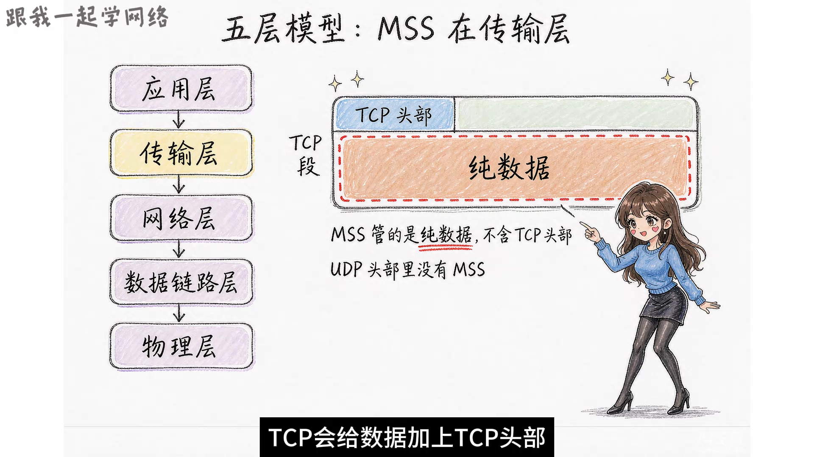

- **注意 UDP**：UDP 首部里面没有 MSS 这样的字段，所以 **MSS 只是 TCP 的概念**，UDP 发送的包靠应用层自己控制。

[【跳转到 01:12】](https://www.bilibili.com/video/BV1bdHv6MErz/?t=72)

- **MTU（三层 / 二层）**：TCP 段继续往下走，到了网络层。IP 协议会给 TCP 段再加一个 IP 头，封装成 **IP 包**——把 IP 头、TCP 头和 TCP 数据三部分加在一起，就是这个 IP 包的总大小，它受 MTU 的约束。**MTU 全称 Maximum Transmission Unit（最大传输单元）。**

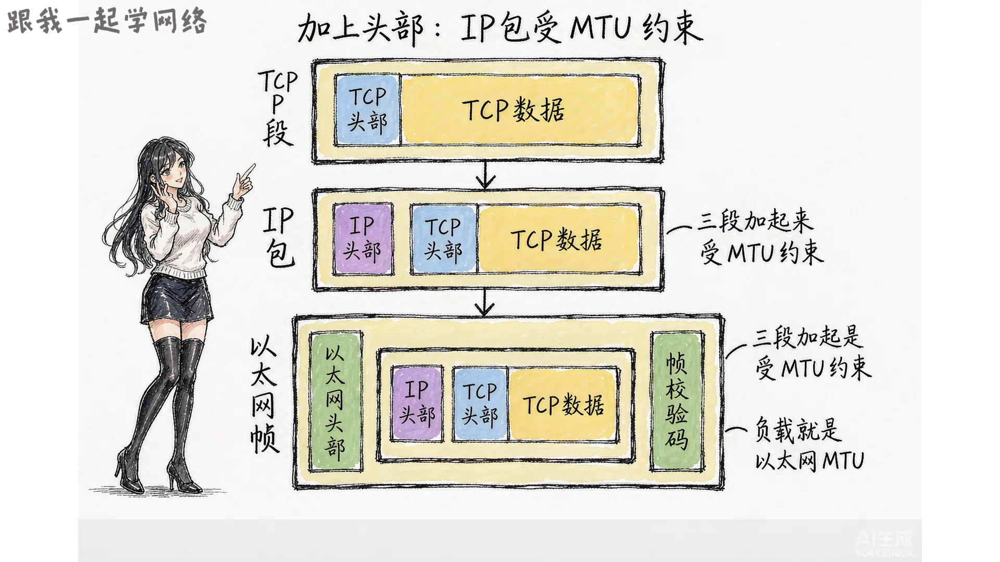

再往下就来到了数据链路层，以太网会加上自己的头部和帧校验码，封装成**以太网帧**。此时整个 IP 包就成了以太网帧的**负载**，而以太网帧能装下的这段负载，也被称为**以太网的 MTU**。

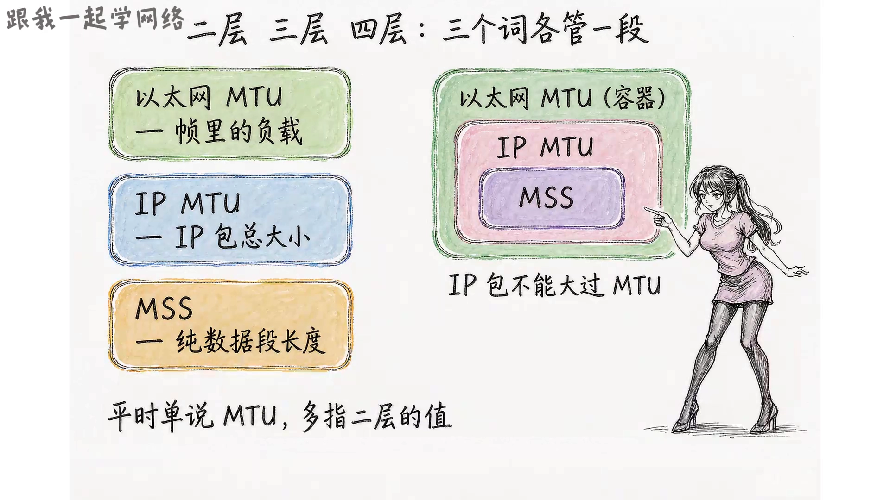

于是三者的关系是**层层套娃**：

| 名称 | 所在层 | 说的是什么 |
| --- | --- | --- |
| 以太网 MTU | 二层（数据链路层） | 帧里面能装多少负载 |
| IP MTU | 三层（网络层） | IP 包的总大小 |
| MSS | 四层（传输层） | TCP 段里面纯数据的大小 |

**以太网 MTU 是 IP MTU 的容器**，IP 包不能比它的容器还大，所以需要 IP MTU 这个概念来管住 IP 包自己。以太网 MTU 和 IP MTU 在正常情况下数值是相同的，所以平时**单说 MTU，更多指的是二层这个值**；也有人直接把它说成「IP 数据包的最大大小」，当然也是对的。

[【跳转到 03:16】](https://www.bilibili.com/video/BV1bdHv6MErz/?t=196)

---

## 三、1500 从哪来、1460 怎么算

平时我们用 `ifconfig` 这类命令查看网卡，可以看到以太网接口旁边写着 `MTU 1500`——**1500 就是以太网 MTU 的默认值**，一个包默认不能超过这个大小。而且这个 **1500 字节指的是负载部分**，不包含以太网的头部，也不包含帧校验码（帧里除了负载，其他部分都是固定开销）。

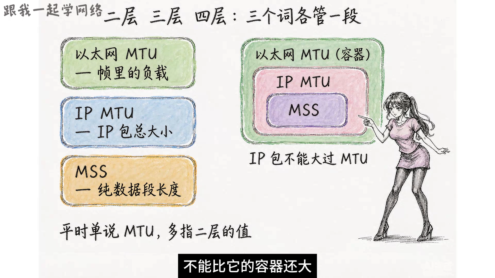

为了提升性能，有的云厂商会提供支持超大 MTU 的服务器，这种**超过 1500 的以太网帧叫做巨型帧**，最大可以做到八九千字节。但为什么大部分设备还在用 1500 呢？

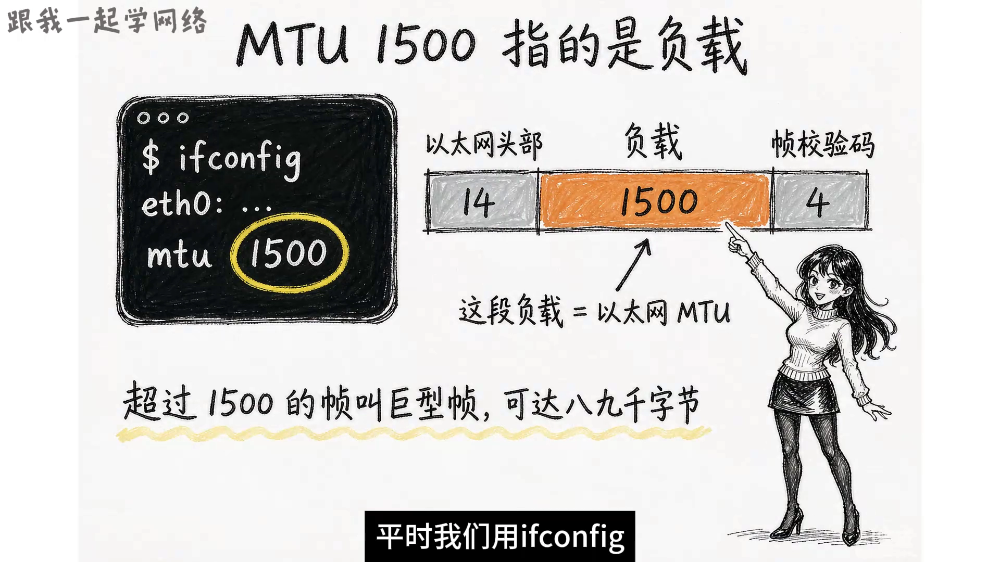

原因也很简单：数据包从你的电脑到服务器，中间要经过大量中间设备（比如路由器和交换机）。**如果你发一个 9000 字节的包出去，遇到按 1500 转发的中间设备，就会被丢掉，或者会被触发分片，反而更慢。**

[【跳转到 04:22】](https://www.bilibili.com/video/BV1bdHv6MErz/?t=262)

有了 MTU 1500，就能算出最常见的 MSS：

```text
MSS = MTU − IP 头（最小 20 字节）− TCP 头（20 字节）
    = 1500 − 20 − 20
    = 1460
```

但实际抓包时，看到的 MSS 可能**比 1460 还小**——如果 IP 头带了选项字段，或者 TCP 头带了时间戳这类扩展选项，头部占的空间变大，留给数据的空间就会变小。

[【跳转到 04:37】](https://www.bilibili.com/video/BV1bdHv6MErz/?t=277)

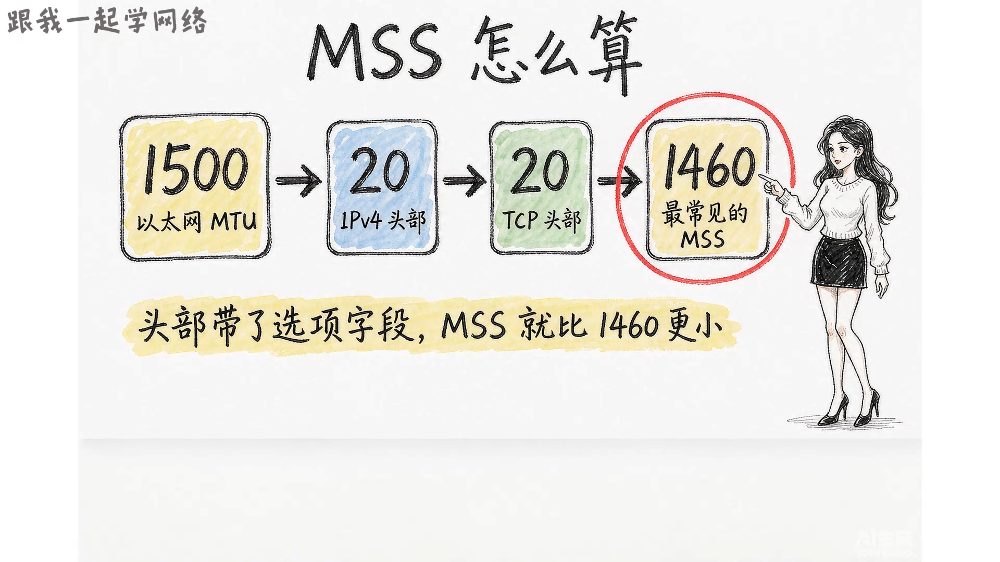

---

## 四、MSS 靠三次握手互相通告

那 MSS 是怎么定的呢？它是靠两边在**建立连接的时候互相通告**。

TCP 建立连接要经过三次握手：

- **客户端**在 SYN 这个段里，写上自己能接受的 MSS；
- **服务端**在 SYN-ACK 这个段里，写上自己的 MSS。

这是**单方面的通告**，意思就是：「发给我的数据，每个包别超过这个大小」。通告的值也不是随便填的——两边都会结合**自己的接收缓冲区**和**本机的 MTU**算出来。

举个例子：客户端通告的 MSS 是 1460，服务端通告的是 1400，那最终会**取较小的 1400** 来发，这样就可以**避免包在网络中被分片**。

[【跳转到 05:37】](https://www.bilibili.com/video/BV1bdHv6MErz/?t=337)

---

## 五、被迫分片会发生什么：IP 分片的代价

就算两边商量好了，包在路上可能还是会遇到 **MTU 更小**的接口。比如一个 1500 字节的 IP 包，经过一个 MTU 只有 576 字节的设备：包超过上限又不能不送，就会在原地被切分开——这个动作叫做 **IP 分片**。1500 字节的包在这里会被切成三份，**每一份都要重新加一个 IP 头**才能够继续走。

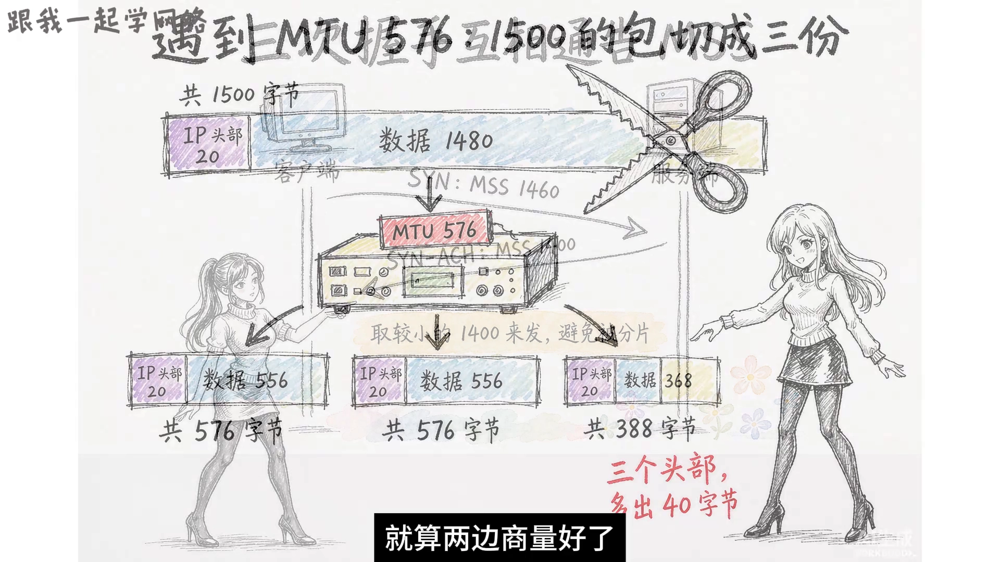

分片的代价，视频拆得很细：

1. **额外的头部开销**：原来一个包只有一个 20 字节的 IP 头，现在三个包就有三个头，对网络层来说凭空多出来 40 个字节的开销；
2. **重传代价更大**：这三个分片在网络里是**独立传输**的，只要丢了任何一个就需要重传。而重传是由 TCP（四层）来做的，而且是**把那一段数据整个重发一遍**——三个分片全部重传，传输效率大幅下降；
3. **更易引发丢包**：更麻烦的是，分片本身还更容易引发丢包。

40 个字节听着不多，但真正的代价在后面——丢一片就要整段重传，这才是分片最伤的地方。

[【跳转到 06:53】](https://www.bilibili.com/video/BV1bdHv6MErz/?t=413)

---

## 六、避免分片的三套机制

为了尽量避免分片，工程上有几套机制。

### 6.1 MSS clamping（MSS 钳制）

很多路由设备有一个功能叫做 **MSS clamping**：路由器看到 TCP 的 SYN 或者 SYN-ACK 包时，会把里面通告的 MSS 值拿出来，和这条链路的 MTU 比一比。**如果按照这个 MSS 发包会超过链路的上限、触发分片，路由器就把 MSS 改小**，改成适应这条链路的值，两边照着新的值发包就能够顺利通过。

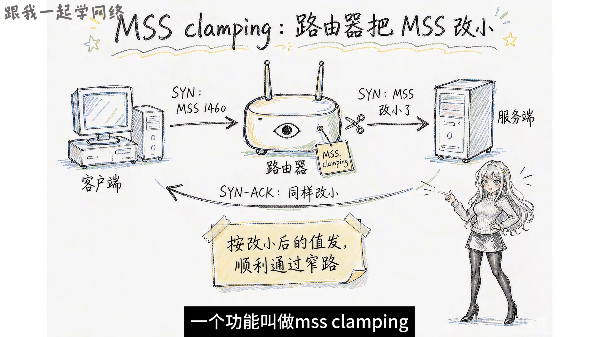

[【跳转到 07:23】](https://www.bilibili.com/video/BV1bdHv6MErz/?t=443)

### 6.2 PMTUD 与 DF 位（路径 MTU 发现）

如果链路上的 MTU 到底是多少事先不知道，那就有一套机制叫做 **PMTUD**（Path MTU Discovery，路径 MTU 发现）。

IP 头部的标志位里面还有一个 **DF 位**（Don't Fragment，不许分片）。发送方如果把 DF 设上，意思是「这个包不许被分片」：**超过 MTU 就被丢弃**——路径上遇到更小 MTU 的设备会把这个包丢掉，并且回一条 **ICMP 错误消息**，消息里还会带上「它那一段链路能接受的 MTU 大小」。发送方照着这个减小之后再发一次，一次次试下去，就能够探出这条路径上最小的那个 MTU。

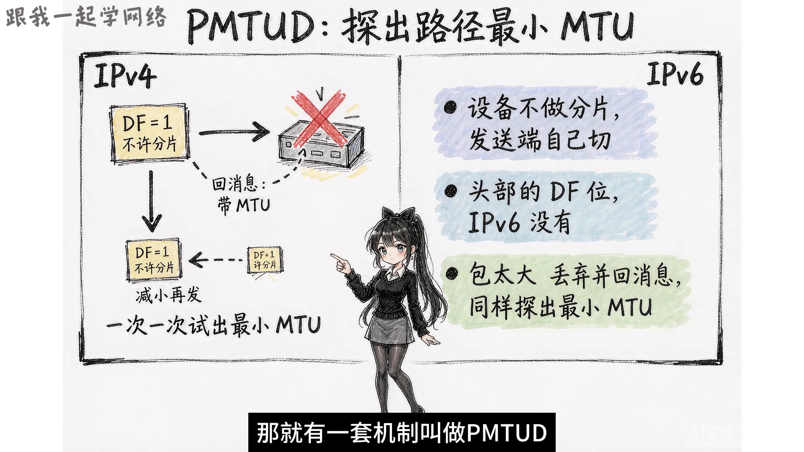

### 6.3 IPv6：把「禁止中途分片」写进规则

而 **IPv6 把这件事直接写进了规则里**：路径上的设备不做分片，分片只允许由**发送端**自己完成，所以 IPv6 头部里没有 DF 位。包太大的话，中途设备直接丢弃并回一条「包太大」的消息，发送端就会缩小重发，照样能够探出路径上的最小 MTU。

[【跳转到 08:17】](https://www.bilibili.com/video/BV1bdHv6MErz/?t=497)

---

## 小结

- **为什么要切包**：链路一次能过的包有上限，超限会被拦；但包也不是越小越好，头部占比会侵蚀数据效率，要取平衡点。
- **三者套娃**：以太网 MTU（二层，帧负载）⊃ IP MTU（三层，IP 包总大小）⊃ MSS（四层，TCP 段纯数据）。
- **默认值与换算**：以太网 MTU 默认 **1500**（只计负载，不含帧头与校验码），据此得最常见 **MSS = 1500 − 20 − 20 = 1460**；带选项时 MSS 会更小。
- **MSS 怎么定**：双方在**三次握手**时互相通告，取较小值发送，以尽量避免分片。
- **被迫分片**：遇到更小 MTU 的链路会被 IP 分片，代价是额外 IP 头开销、丢任一分片就整段重传、且分片本身更易丢包。
- **避免分片**：**MSS clamping** 让路由器改写通告的 MSS；**PMTUD + DF 位**靠「丢弃 + ICMP 回报」探测路径最小 MTU；**IPv6** 直接规定路径设备不分片、只允许发送端分片。

## 关键术语速查

| 术语 | 一句话解释 |
| --- | --- |
| MTU | 最大传输单元，一条链路一次能承载的最大包/负载大小；以太网默认 1500 字节 |
| 以太网 MTU | 二层概念，指以太网帧里能装多少负载（不含帧头与校验码） |
| IP MTU | 三层概念，指 IP 包的总大小，正常与以太网 MTU 数值相同 |
| MSS | 最大分段大小，四层概念，指 TCP 段里纯数据的最大长度（不含 TCP 头部） |
| 巨型帧 | 超过 1500 字节的以太网帧，最大可到八九千字节，需整条路径都支持才有意义 |
| IP 分片 | IP 包超过链路 MTU 时，被切成多个分片各自加 IP 头后独立传输，到终点再重组 |
| MSS clamping | 路由器改写 SYN/SYN-ACK 里通告的 MSS，使其适配本链路 MTU，避免分片 |
| PMTUD | 路径 MTU 发现，靠 DF 位 + ICMP「包太大」回报，逐步探测出路径上最小的 MTU |
| DF 位 | Don't Fragment，「不许分片」标志；置位后超限包被丢弃并回报 ICMP，用于 PMTUD |
| 三次握手 | TCP 建立连接的 SYN / SYN-ACK / ACK 过程，也是双方互相通告 MSS 的时机 |
