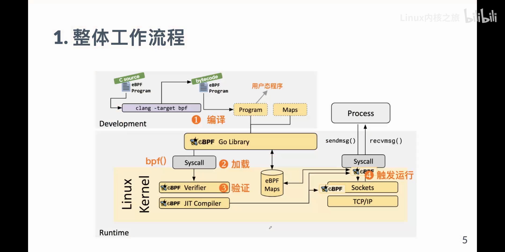
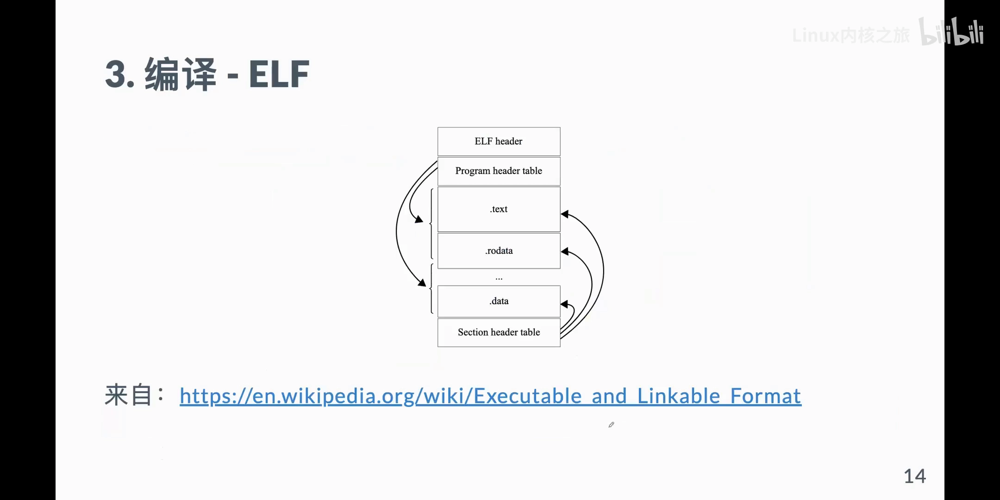
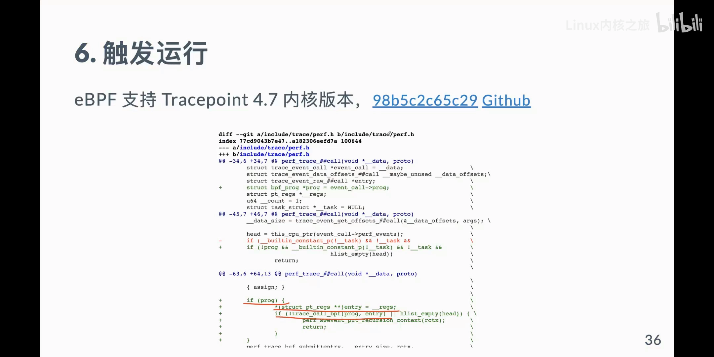
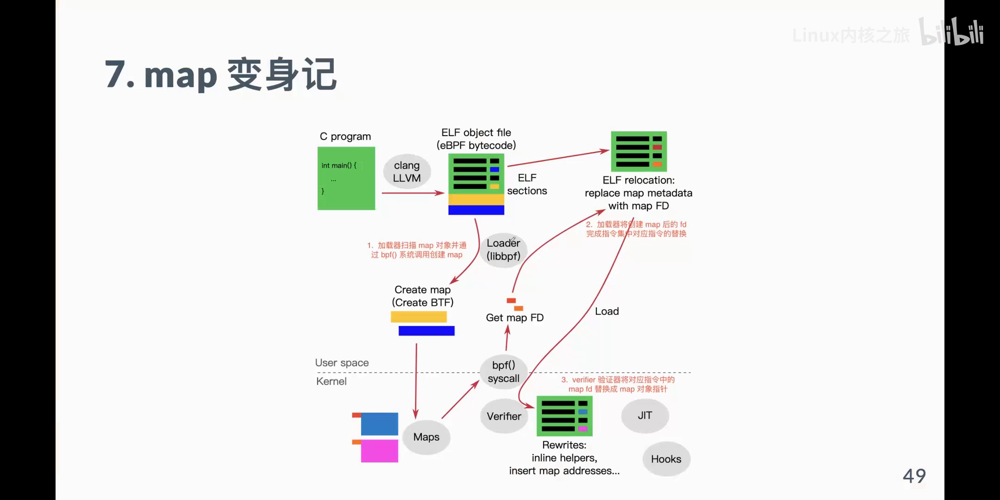

# eBPF 工作原理浅析

> 本文整理自 B 站视频《ebpf工作原理浅析》（「Linux 内核之旅」社区直播，主讲人李卫华，译有《Linux 内核观测技术 BPF》）。这场分享不给你 API 速查表，而是**一行一行地拆开一个最小的 eBPF 程序**，把「一段 C 代码是怎样变成内核里能跑、又杀不死内核的代码」讲清楚：程序类型（能干什么）→ 编译成字节码 → 加载器三阶段 → 验证器校验与改写 → 挂载触发 → 再加一个 map 时指令里发生的两次「变身」。

## 本讲要解决的核心问题（SCQA）

**背景**：eBPF 让用户写的代码安全地跑进 Linux 内核，如今在云原生、可观测性、网络安全里无处不在。但很多人只是照着模板抄程序，一旦遇到 `load` 失败或者验证器报错，就完全不知道从哪里下手。

**冲突**：真正卡住人的从来不是语法，而是原理——程序为什么有限制？helper 为什么只能用一部分？内核到底需要一段怎样的东西？网上的文章大多只给结论、不给来龙去脉，遇到问题就断线。

**疑问**：一段用 C 写的 eBPF 程序，从源码到在内核里被事件触发，中间到底经过了哪几步？每一步用户态和内核各做了什么？

**回答（中心思想）**：**eBPF 的全部约束都来自「程序类型」和「验证器」这一对设计**——程序类型决定了你这段代码能在什么场景下被触发、能调哪些 helper、能拿到什么上下文；验证器则在你加载的瞬间把字节码逐条静态地「走」一遍，证明它不会把内核搞崩，并顺手完成必要的改写。把「写 → 编译 → 加载 → 验证 → JIT → 挂载 → 触发」这条链路走通，理解每个环节各自的职责，再遇到报错就不再是黑盒。

[【跳转到 07:45】](https://www.bilibili.com/video/BV1HW4y1674H/?t=465)

---

## 一、先弄清「程序类型」：它决定你能干什么

理解 eBPF 的第一把钥匙，是**程序类型（program type）**。它不是一个可有可无的字段，而是决定这段代码「身份」的东西。

**它像团队里的角色分工**：一个软件团队里有 QA、有研发、有运维，大家做的事、负责的领域不一样，权限也不一样。程序类型也是这个意思——它规定了这段 eBPF 程序的**触发场景**，而触发场景又反过来规定了它能做的事：

- **能访问什么**：网络类型（比如 socket filter）可以访问网络数据包、对包做过滤；而基于 tracepoint 的跟踪类型只能访问跟跟踪相关的辅助函数，**碰不到网络数据包**。
- **能调哪些 helper**：eBPF 程序不能直接调用任意内核函数，社区把常用能力包装成一层「**辅助函数（helper）**」供你调用；而 helper 本身也按类别分了几个子集（基本、跟踪、网络……），**不同的程序类型只能访问对应的那个子集**。
- **入口参数长什么样**：如果声明成网络类型，程序的入口是 `sk_buff`（网络数据包结构）；如果用 `kprobe` 做动态跟踪，入口则是 `pt_regs`（寄存器上下文）。「不同的角色，看到的东西不一样」。

[【跳转到 08:41】](https://www.bilibili.com/video/BV1HW4y1674H/?t=521)

这套设计的目的是**最小授权**：一个跟踪程序既不需要、也不应该有能力去动网络包，「大路朝天，各走各路」，从源头上限制住能触碰的范围，安全性才有保证。

[【跳转到 11:11】](https://www.bilibili.com/video/BV1HW4y1674H/?t=671)

### 1.1 程序类型由 `SEC` 的名称决定

程序类型不是运行时随便设的，它在源码里就已经由 **`SEC` 宏**「登记」好了：

```c
SEC("tp/syscalls/sys_enter_execve")   // 以 tracepoint 打头 → tracepoint 类型
int trace_syscall(void *ctx) { ... }
```

`SEC` 本质上就是 `__attribute__((section("...")))`，作用是把这个函数（或数据）放进一个**指定名字的段（section）**里——你可以把它理解成「把这个函数分到某个班级」。加载器之后会**按 `SEC` 的名字去匹配**：名字以 `socket` 打头就认作 socket filter 类型，以 `kprobe` 打头就认作 kprobe 类型，以 `tracepoint`（或缩写 `tp`）打头就认作 tracepoint 类型。

[【跳转到 20:11】](https://www.bilibili.com/video/BV1HW4y1674H/?t=1211)

所以那句「我用 `socket 12345` 也能挂上」的疑问并不神秘：**名字不是随便写都行，但 `socket` 这一类确实允许自定义后缀**；而 `tracepoint` 的格式不能乱写，它后面要拆出「分类」和「名字」，必须与内核里真实存在的跟踪点一致，否则挂载会失败。

[【跳转到 46:34】](https://www.bilibili.com/video/BV1HW4y1674H/?t=2794)

---

## 二、整体工作流程：七个阶段

先把俯视图放上来。一段 eBPF 程序的一生，可以拆成七个阶段：

[【跳转到 12:01】](https://www.bilibili.com/video/BV1HW4y1674H/?t=721)



1. **写**：用 C（或 Rust）写一个 eBPF 程序，比如一个 `hello_kern.c`。此时它还只是一段文本。
   [【跳转到 15:54】](https://www.bilibili.com/video/BV1HW4y1674H/?t=954)
2. **编译**：用 LLVM / clang，把源码编译成 **eBPF 字节码**——它是一个 **ELF 格式**的文件（形如 `hello.o`），和我们平常在 Linux 上跑的可执行程序同一种容器格式。
3. **加载**：字节码只是个文件，还需要一个跑在**用户态**的**加载器（loader）**。你可以把它理解成一个**快递员**：它负责解析程序、把结构准备好，再通过一个通用的系统调用（就叫 **`bpf`**）把程序送进内核。
   [【跳转到 12:59】](https://www.bilibili.com/video/BV1HW4y1674H/?t=779)
4. **验证**：进内核不等于能跑。内核对进来的一切都要过一道 **Verifier（验证器）**：检查权限、检查你声明的类型和你调用的 helper 是否匹配、检查内存访问有没有越界……只有验证通过，程序才被认为是「合法」的。
   [【跳转到 13:49】](https://www.bilibili.com/video/BV1HW4y1674H/?t=829)
5. **JIT**：字节码像 Java 的 JVM 指令一样，解释执行性能并不高。于是内核默认开启 **JIT**，把它编译成本机 CPU 能直接执行的机器码，运行开销才降下来。
6. **挂载（attach）**：程序还得知道「挂到哪里」。加载器把它挂到指定的**挂载点（hook）**上。
7. **触发运行**：此后每次事件触发这个挂载点，内核就会运行一次你的程序。

把它想成一条高速公路上的**摄像头**：原来摄像头只能看（固定格式地采集数据），而 eBPF 允许你在各个点上**插入一块可定制的动态代码**，按你自己写的逻辑处理——所谓「对内核进行定制」，正是从这里来的。

[【跳转到 15:04】](https://www.bilibili.com/video/BV1HW4y1674H/?t=904)

> 需要提醒：即便用同样的 C 语法，eBPF 也不能用上 C 的全部特性，它被称为「**限制性的 C**」——带着镣铐写代码，很多高级用法都是不行的。
> [【跳转到 19:21】](https://www.bilibili.com/video/BV1HW4y1674H/?t=1161)

---

## 三、编译产物：ELF、section 与字节码

理解了流程，再看「编译出来到底是个啥」。

**编译命令**的关键只有一处：需要显式指定 `-target bpf`，告诉 clang「这段代码的后端是 BPF」，它才会输出 BPF 字节码而不是 x86 指令：

```bash
clang -target bpf -O2 -c hello_kern.c -o hello.o
```

[【跳转到 26:13】](https://www.bilibili.com/video/BV1HW4y1674H/?t=1573)

### 3.1 ELF 文件里有什么

`hello.o` 是一个 **ELF**（Executable and Linkable Format）二进制。用 `llvm-objdump`（或 GNU 的 `objdump`）拆开看，能看到几样东西：

- **ELF header**、**程序头（program header）**、**节头（section header）**——描述文件结构；
- **section（节）**：这里出现了我们熟悉的 `SEC` 名字（如 `tracepoint/syscalls/...`），还有一个 **`license` 节**。关键区别在于**标志位**：程序所在的节带一个 `X` 标记（可执行），license 节则没有——加载时正是靠这个 `X` 判断「这是一个程序、可以执行」。
- **符号表（symtab）**：把所有定义的符号列出来，比如我们声明的那个 `BPF prog` 函数。它记录了名字、大小、类型（是一个函数），以及一个指向「它属于哪个节」的索引。加载器就是**从符号表反向查找**，顺着「符号 → 节头 → 节里的数据区」把真正的指令找出来。

[【跳转到 27:28】](https://www.bilibili.com/video/BV1HW4y1674H/?t=1648)

打个比方：符号表像**数据库的索引**——先建好索引，再靠它定位到实体数据。一个节里可以放**多个函数**，所以必须靠「符号 → 节 → 数据区偏移」这套关系才能把每个函数精确取出来。

[【跳转到 30:27】](https://www.bilibili.com/video/BV1HW4y1674H/?t=1827)



### 3.2 字节码与寄存器约定

拆到数据区，就是一条条 eBPF 指令。**一条指令一般是 8 个字节**：其中有 opcode（指令类型，低 8 位，再按 class 细分）、目的寄存器、源寄存器、偏移量和立即数等字段——不必记细节，知道「它就是一套精简的指令集」即可。

[【跳转到 33:22】](https://www.bilibili.com/video/BV1HW4y1674H/?t=2002)

指令里反复出现的 `R0`～`R10` 是 **eBPF 的寄存器**，它们有一套约定（调用约定）：

| 寄存器 | 用途约定 |
| --- | --- |
| `R0` | 程序返回值 / 退出码 |
| `R1`～`R5` | 函数调用的入参（目前最多支持 5 个参数） |
| `R6`～`R9` | 被调用者保存（callee-saved）寄存器 |
| `R10` | 只读的栈帧指针 |

还有一条默契：调用 helper 之后，`R1`～`R5` 里原来是「垃圾值」，使用前必须先写再读。

[【跳转到 34:49】](https://www.bilibili.com/video/BV1HW4y1674H/?t=2089)

**helper 调用在字节码里只是一个编号。** 这解释了一个很容易困惑的现象：源码里调 `bpf_trace_printk`，用 `clang -E` 预编译展开后，它变成的其实是一个枚举值 `BPF_FUNC_trace_printk`——也就是一个数字（例如 `6`）。**这个数字在内核里会被换成真实的函数地址**，下面第五节会看到它在哪一步被替换。

[【跳转到 21:03】](https://www.bilibili.com/video/BV1HW4y1674H/?t=1263)

---

## 四、加载器：把「文件」变成「内核里正在跑的程序」

编译出来的 `hello.o` 只是用户态磁盘上的一个 ELF 文件。要让它真正在内核里运行，需要一个跑在**用户态**的**加载器**。早期（5.10 之前）内核 `samples/bpf` 里有个 `bpf_loader.c`，是加载器最原始的原型，约 700 行，功能不全但脉络清晰，作者建议照着它读一遍加载流程。

[【跳转到 36:32】](https://www.bilibili.com/video/BV1HW4y1674H/?t=2192)

用现在主流的 **libbpf** 来写，加载器里只有几个关键对象：

- **`bpf_object`**：一个 eBPF 程序的「总文件夹」，程序本身、用到的 map 以及其它信息都挂在它下面统一组织；
- **`bpf_link`**：后来才加的抽象。一开始没有 link，大家发现「同一个程序类型，挂载方式却各不相同」，于是抽象出一层 link 专门管「加载好的程序」与「挂载点」之间的映射——把程序挂到 BPF FS 的路径上，这样**即便用户态进程退出了，程序仍留在内核里继续跑**。计算机里几乎所有问题都能靠「加一层」解决。

[【跳转到 37:30】](https://www.bilibili.com/video/BV1HW4y1674H/?t=2250)

一个最小加载器就是三步：

1. **打开**：`bpf_object__open_file("hello.o")`，把 ELF 读成内存里的 object，再从 object 里取出要用的那个程序；
2. **加载**：`bpf_object__load()`，把程序（以及 map）送进内核——此时程序已在内核里就位，但还没和任何事件产生关系；
3. **挂载**：`bpf_prog_attach()` 把程序与触发事件挂钩，这才真正生效。

[【跳转到 38:44】](https://www.bilibili.com/video/BV1HW4y1674H/?t=2324)

也就是 **open → load → attach** 三个阶段。

### 4.1 open 阶段

- 检查 ELF 格式、初始化，并判断大端 / 小端；
- 扫描 **section** 与 **符号表**：凭 section 的 `X`（可执行）标志认出「这一段是程序」；
- 因为一个 section 里可能放着多个函数，所以要先由符号表定位到对应 section，再取出真正的程序；
- `bpf_object__init_prog`：从 `SEC` 名字里解析出**程序类型**，并拆出它对应的上下文与可用 helper，初始化进 object 的 prog 变量。

[【跳转到 41:16】](https://www.bilibili.com/video/BV1HW4y1674H/?t=2476)

一句话概括：open 就是「从 ELF 里把我这个程序的属性、长度、字节码取出来，填进 object 对象」。

### 4.2 load 阶段

`bpf_object__load()` 内部还会顺带处理 BTF、外部变量（kconfig）、map 初始化与**创建 map**、**重定位**等一堆事；但对 hello world 而言，真正有意义的只有一件事：**把程序通过 `bpf()` 系统调用送进内核**。

这个系统调用只有「命令（CMD）+ 属性（ATTR）」两部分，靠 CMD 的不同取值承担了大量功能——加载程序走的就是 `BPF_PROG_LOAD`。

[【跳转到 43:26】](https://www.bilibili.com/video/BV1HW4y1674H/?t=2606)

### 4.3 attach 阶段

attach 按 prog 的 `SEC` 类型选择具体的挂载函数（tracepoint 类型就走 `attach_tp`）。加载成功的内核程序会返回一个 **FD**，就像普通文件描述符一样；attach 就是拿这个 FD 去和挂载点「挂钩」。

以 tracepoint 为例，`attach_tp` 要把 `SEC` 名字 `tp/syscalls/sys_enter_execve` 拆开：剥掉 `tp/`（或 `tracepoint/`）前缀，再拆出**分类**（`syscalls`）和**名字**（`sys_enter_execve`）——这套命名和字段其实都沿用自更早的 Ftrace。

[【跳转到 45:14】](https://www.bilibili.com/video/BV1HW4y1674H/?t=2714) / [【跳转到 46:04】](https://www.bilibili.com/video/BV1HW4y1674H/?t=2764)

---

## 五、验证器：为什么你的程序会被拒绝

程序进了内核并不代表能跑，先要过 **Verifier（验证器）**。

[【跳转到 51:39】](https://www.bilibili.com/video/BV1HW4y1674H/?t=3099)

第一步是**权限**：

| 程序类别 | 需要的 capability |
| --- | --- |
| 网络 / 管理类 | `CAP_NET_ADMIN`、`CAP_BPF` |
| 跟踪类（kprobe / tracepoint 等） | `CAP_PERFMON` 或 `CAP_SYS_ADMIN` |

随后调用 `bpf_check()`。这里要点出一个容易被误解的地方：**验证器不只会「检查」，它还会「改写」程序**——后面第七、八节的「两次变身」正是它的手笔。

验证的几条主线：

1. **按程序类型取检查函数**：不同类型各有自己的一套校验逻辑；
2. **`check_cfg`（控制流图检查）**：把指令流画成函数调用图，检查循环是否符合条件（早期禁止循环，后来在特定条件下才放开）、是否含有**不可达指令**、有没有越界跳转；
3. **逐条模拟执行（第二遍）**：为每条指令追踪它碰到的对象——指针是什么类型、访问的是栈还是 map value、访问区间有没有越界。这一遍会分成子程序检查和主程序检查两次来做。

[【跳转到 52:29】](https://www.bilibili.com/video/BV1HW4y1674H/?t=3149) / [【跳转到 53:08】](https://www.bilibili.com/video/BV1HW4y1674H/?t=3188)

**helper 白名单**：验证器会拿你调用的 helper ID（比如 `bpf_trace_printk` 对应数字 6），去核对「当前程序类型允不允许调它」。大多数类型都能调跟踪类的基础 helper；网络类型若调了不该调的函数，就会在这里被拦下——这正是第一节「程序类型决定能调哪些 helper」的落地实现。

[【跳转到 56:35】](https://www.bilibili.com/video/BV1HW4y1674H/?t=3395)

### 5.1 看一条真实的报错

同学群里发过一个报错：调用 `bpf_probe_read` 时提示 **R1 期望是指针类型（ptr，或 map key / map value），实际给的类型不合法**。`R1` 是第一个入参寄存器，问题就出在传进去的那个变量上。由此能记住两条硬规则：

- **栈上的局部变量，必须先写后读**，不允许读未初始化的值；
- **栈有大小上限（默认 512 字节）**，指针加上访问长度一旦超出就会报错。

报错里还会顺带告诉你「处理了多少条指令、上限约 100 万条」。绝大多数加载失败最后都落在这一段，耐心看它「期望什么 / 你给了什么」，就能定位问题。

[【跳转到 57:58】](https://www.bilibili.com/video/BV1HW4y1674H/?t=3478) / [【跳转到 60:03】](https://www.bilibili.com/video/BV1HW4y1674H/?t=3603)

---

## 六、挂载之后：事件触发与上下文 ctx

eBPF 从 **4.7** 内核开始支持 tracepoint。它在原有 perf 跟踪机制之上加了一层**可运行的自定义代码**：当某个 tracepoint 上挂了 eBPF 程序，内核在触发时就会调 `trace_call_bpf()` 去运行你的程序。

原来的 perf 只能按固定格式采集数据，你没法「只取中间几个字段做累加」；eBPF 让这一层变得完全可编程，于是「什么时候进入、什么时候退出、字段之间如何关联」这类逻辑都能自己写。

[【跳转到 60:34】](https://www.bilibili.com/video/BV1HW4y1674H/?t=3634) / [【跳转到 61:22】](https://www.bilibili.com/video/BV1HW4y1674H/?t=3682)



**入口参数 `void *ctx` 到底是什么？** 以 `sys_enter_execve` 为例，它的格式由内核约定：开头 64 字节是 perf 用的、eBPF 程序不该碰，接着是系统调用号 `nr`、文件名，末尾是 `args`、`env`。所以在程序里可以把这个 `void *` 声明成对应的 `struct`，就能用 `ctx` 取到这些字段——这也回答了「参数为什么是 `void *`」这个提问。

[【跳转到 64:40】](https://www.bilibili.com/video/BV1HW4y1674H/?t=3880) / [【跳转到 65:05】](https://www.bilibili.com/video/BV1HW4y1674H/?t=3905)

---

## 七、再加一个 map：ELF 里多了什么

hello world 太简单。真实程序几乎都要用 **map**——内核程序与用户态之间、内核程序与内核程序之间的数据交换都靠它。

老式 map 的定义方式（现在推荐改用 BTF）：

```c
struct bpf_map_def SEC("maps") mymap = {
    .type        = BPF_MAP_TYPE_ARRAY,
    .key_size    = sizeof(int),
    .value_size  = sizeof(int),
    .max_entries = 1,
};
```

在程序里用 `bpf_map_update_elem()` 写一下这个 map，再用 `readelf -S -s -x` 观察，会发现多出两样东西：

1. **一个 map section**，符号表里也多一个 `mymap` 符号；
2. **一个重定位（relocation）section**。因为 `mymap` 的地址**要到内核里创建之后才知道**，属于「后置填充」，所以编译期先在指令里留一个**重定位符**：它记录「要填到字节码的哪个偏移（offset）」，并通过 `info` 里的符号索引指出「对应符号表里的哪一个」（如 3、5 这类编号）。

[【跳转到 67:12】](https://www.bilibili.com/video/BV1HW4y1674H/?t=4032) / [【跳转到 68:11】](https://www.bilibili.com/video/BV1HW4y1674H/?t=4091)

承载它的指令是 **`LD_IMM64`（64 位立即数加载）**，它比较特殊——普通指令 8 字节，它要 16 字节，专门用来放这个「暂时还未知的 64 位值」。

还有一个容易忽略的点：在**用户态**访问 map 用的是 **FD**，而在**内核**里访问用的是 **map 对象指针**——因为这段代码最终是在内核里跑的。

[【跳转到 70:16】](https://www.bilibili.com/video/BV1HW4y1674H/?t=4216) / [【跳转到 71:06】](https://www.bilibili.com/video/BV1HW4y1674H/?t=4266)

---

## 八、两次变身：从 FD 到内核指针

这是全场最绕、也最能串起所有线索的一段——「加载」其实是「加载 + 转化」。

**第一次变身（加载器阶段）**：加载器先创建 map，拿到 FD（比如 3）；再回头处理重定位符——找到 `LD_IMM64` 那条指令，把**类型标记为 map**、**立即数设为 map FD**、在源寄存器上打一个「伪指令」标记。于是指令里第一次出现具体值：`FD = 3`。

**第二次变身（验证器阶段）**：程序通过 `BPF_PROG_LOAD` 进内核后走 `bpf_check`，验证器在处理 `LD_IMM64` 时发现它带着「伪 map FD」标记，就按 FD 找到 **map 对象的内核指针**，把原来的 FD **改写成 64 位指针**，最后再把那个伪标记位清掉。

[【跳转到 73:07】](https://www.bilibili.com/video/BV1HW4y1674H/?t=4387) / [【跳转到 74:39】](https://www.bilibili.com/video/BV1HW4y1674H/?t=4479) / [【跳转到 75:47】](https://www.bilibili.com/video/BV1HW4y1674H/?t=4547)

完整链路：编译留重定位符 → 加载器扫出 map、经 `bpf()` 创建得到 FD → 重定位把指令立即数写成 FD → 验证器再改写成内核 map 指针 → 清除标记位。**验证器不只是「检查」，它同时在「改写」**，这也是它必须存在的另一半理由。

---

## 九、小结与思考题

回到整体：**编译 → 加载 → 验证 → 运行**（中间还有一步 **JIT**，把字节码逐条翻译成机器指令，函数跳转处需要做地址处理）。加载器只做三件事：**open**（把 ELF 读成内存对象）→ **load**（送进内核，接受验证与改写）→ **attach**（和触发事件挂钩）。

[【跳转到 76:23】](https://www.bilibili.com/video/BV1HW4y1674H/?t=4583) / [【跳转到 77:13】](https://www.bilibili.com/video/BV1HW4y1674H/?t=4633)



两个留给自己的思考题：

- **`char message[]` 这种栈数组有大小限制吗？** 有——栈默认 512 字节，还要分给函数调用，太大就会报「栈超限」；想放更大的数据，把它定义成 **map** 就没有这个限制。
- **能不能用 `const char *`？** 用了它，这块字符串就不分配在栈里，编译会多生成一条重定位记录。libbpf 能正常处理；老的 eBPF 库则会报「字符串不在栈上」的错。

[【跳转到 78:13】](https://www.bilibili.com/video/BV1HW4y1674H/?t=4693) / [【跳转到 78:38】](https://www.bilibili.com/video/BV1HW4y1674H/?t=4718)

### 术语速查

| 术语 | 含义 |
| --- | --- |
| **程序类型** | 决定触发场景、可访问的上下文与可调 helper 的「身份」 |
| **SEC** | 源码里把函数放进指定 section 的宏，加载器据此判定程序类型 |
| **Verifier** | 加载时静态校验（并改写）字节码，保证程序不会搞崩内核 |
| **helper** | 内核封装好、供 eBPF 调用的辅助函数（按程序类型分白名单） |
| **map** | 内核 / 用户态 / 程序间共享数据的结构，用户态以 FD、内核内以指针访问 |
| **relocation** | 编译期未知、在加载 / 验证阶段后置填充的符号引用 |
| **bpf_link** | 把「已加载程序」与「挂载点」解耦的抽象，程序可脱离用户态进程存活 |
| **JIT** | 把 eBPF 字节码即时编译成本机机器码 |
