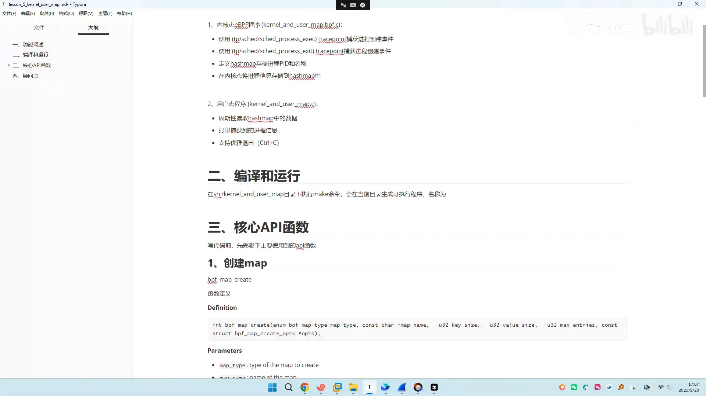
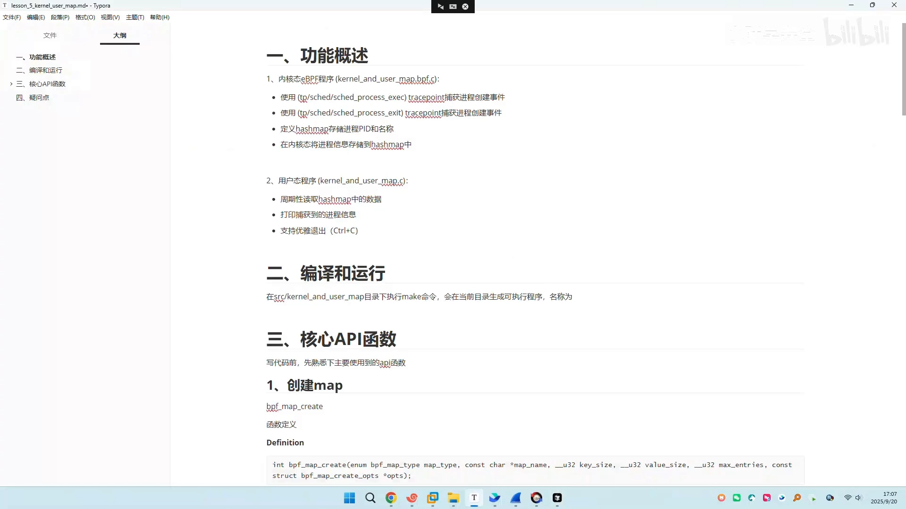
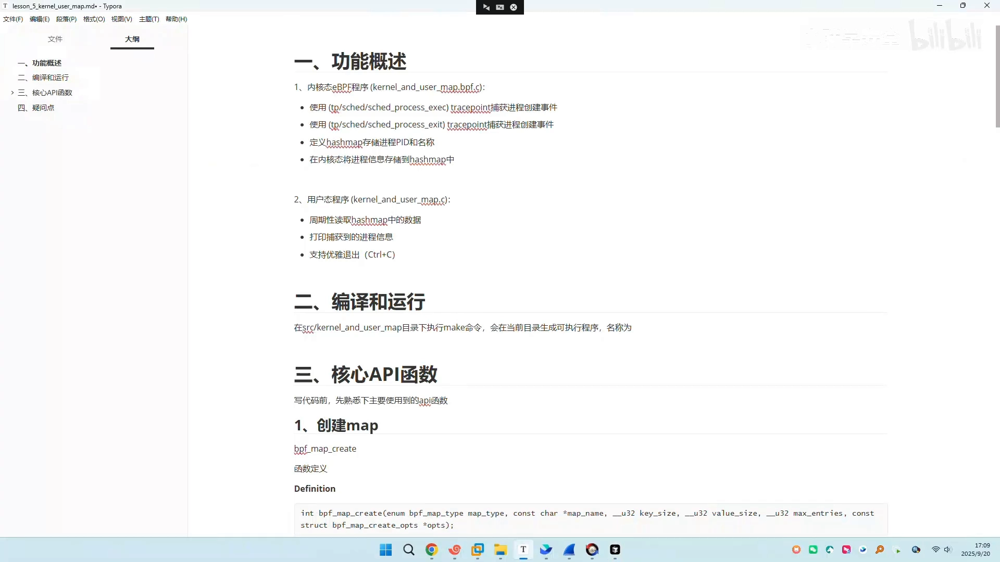
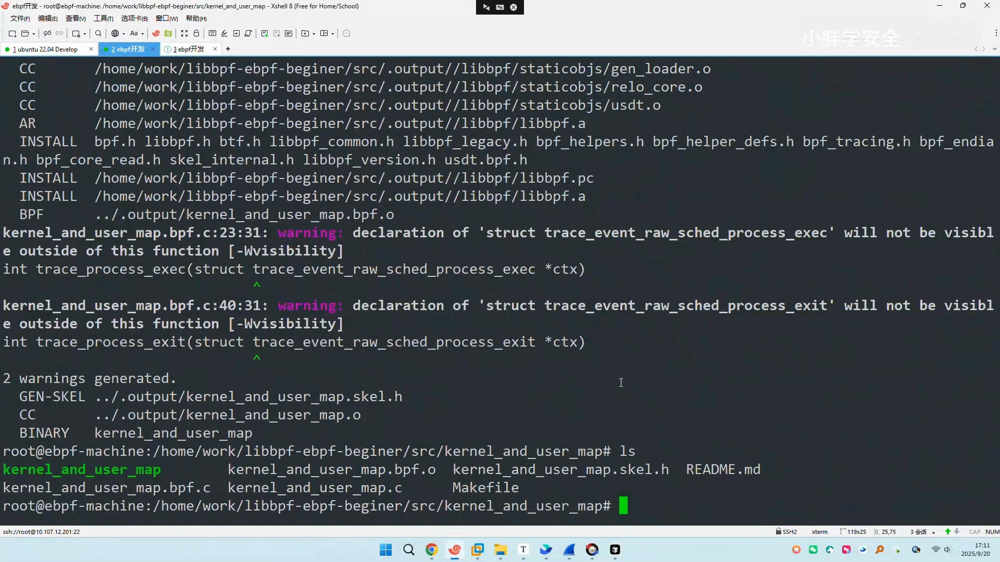
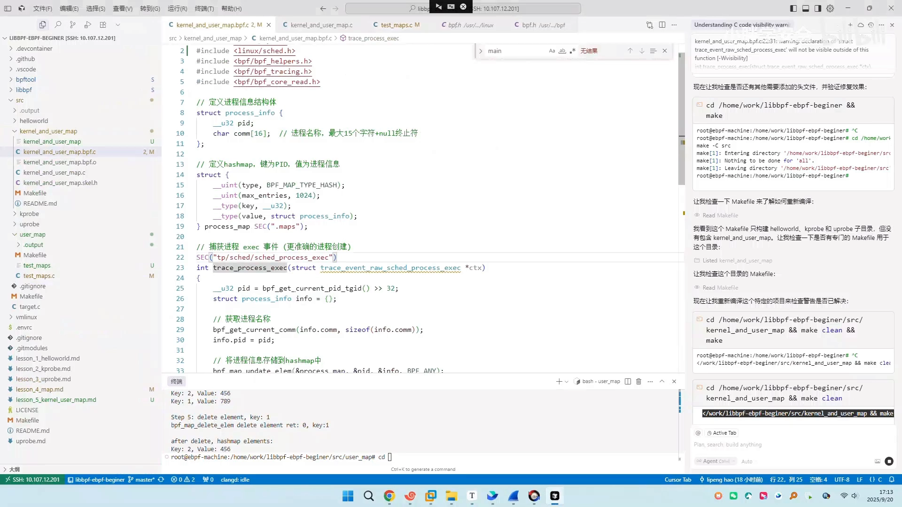
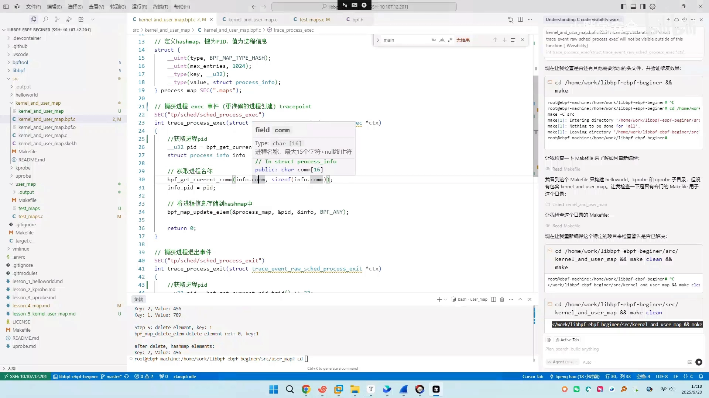
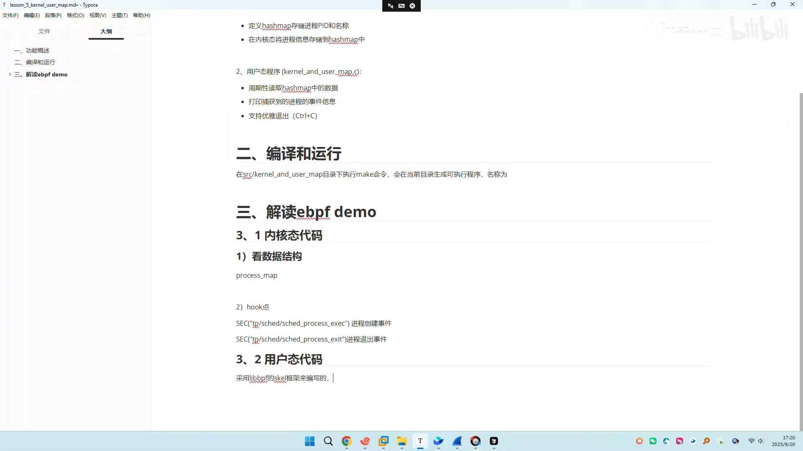
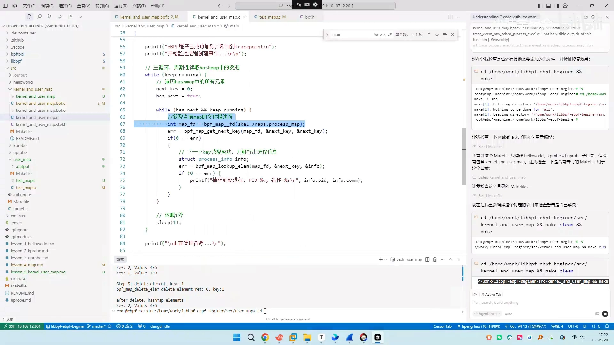
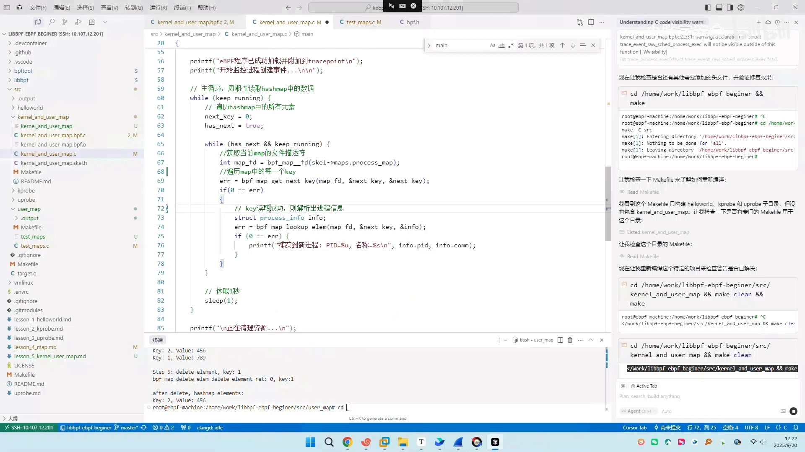
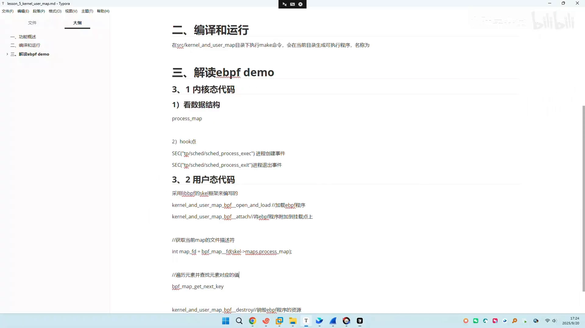

# 【硬核入门5】eBPF 内核态和用户态 map 实战

> 本文整理自 B 站视频《【硬核入门5】eBPF 内核态和用户态 map 实战》（BV1NEpRzuE76）。上一课（第四课）讲的是**纯用户态**怎么操作 map——create、insert、lookup、update、delete 的增删改查。这一课往前推进一步：讲清楚**内核态程序和用户态程序是怎么通过 map 交互的**，并用「监控进程创建事件」这个例子，把整条链路跑通。

## 本讲要解决的核心问题（SCQA）

**背景**：eBPF 程序天然分成两半——**内核态代码**负责采集事件，**用户态代码**负责加载、挂载和消费数据。两半之间靠 **map** 通信，这是 eBPF 最基础的用法。

**冲突**：上一课只在用户态演示增删改查，难度虽低，但没触及「内核写、用户读」这条真正实用的链路。很多人会写 map 的 API，却说不清「内核态采集到的事件，到底是怎么到了用户态、又怎么被打印出来的」。

**疑问**：一个「监控进程创建」的小工具，内核态和用户态各自写了什么？数据在哪一步、以什么形式交接？

**回答（中心思想）**：**把 map 理解成「内核态生产者」与「用户态消费者」之间的信箱**。内核态程序在 tracepoint 上捕获进程创建/退出事件，把信息写进一个以 **PID 为 key** 的哈希 map；用户态程序加载并挂载 eBPF 程序后，**周期性地遍历这个 map**（先 `bpf_map_get_next_key` 拿 key，再 `bpf_map_lookup_elem` 取值）并打印。抓住这一条主线，代码就没有难点了。

[【跳转到 00:05】](https://www.bilibili.com/video/BV1NEpRzuE76/?t=5)

---

## 一、先把要做的工具说清楚

map 的正常使用方式一般是这样的：

1. 在**内核态**写一个 eBPF 程序去**捕获事件**——这次演示的是「**进程创建**」事件；
2. 捕获到之后，把信息**通过 map 传递给应用层**（应用层要上报服务端，或者自己展示出来）；
3. map 里有 **key** 和 **value**：通常 **key 是 PID**，**value 是一个结构体**，里面装着 PID、PPID、进程名、命令行参数等整个进程信息；
4. **用户态**程序负责加载 eBPF 程序、挂到挂载点上，成功之后**周期性地读取**内核写进哈希 map 的事件并打印，同时支持**优雅退出**。

[【跳转到 01:26】](https://www.bilibili.com/video/BV1NEpRzuE76/?t=86)

一句话分工：**内核态是生产者，用户态是消费者**，map 是两者之间的信箱。

---

## 二、先跑起来看效果

代码在 `kernel_and_user_map` 目录下：`user_map` 是上一课纯用户态的，`kernel_and_user_map` 则是内核态与用户态交互的版本。

编译很常规：先 `make clean`，再 `make`。`make` 会先在当前目录下**构建 libbpf 库**，再编译我们自己的文件（过程中有两个可见性相关的告警，不影响使用）。这个目录下**只有两个源文件加一个 Makefile**：一个是 `.c`（用户态），一个是 `.bpf.c`（内核态），编译后会生成一个绿色的可执行文件。

[【跳转到 04:08】](https://www.bilibili.com/video/BV1NEpRzuE76/?t=248)

运行之后，程序会打印「已成功挂载到 tracepoint，可以监控进程创建事件」。怎么触发一次？**双击产生一个 SSH 连接**——对应就是一个 `ssh` 进程。点一下，马上就出现一条记录：进程名是 `sshd`，PID 是 29510。

再去确认 `29510` 这个进程还在不在——**它还在**，说明记录是准确的；而且能看到类型是 `PTS`，代表这是一个终端。也就是说，它确实把我这次进程创建监测到了。

[【跳转到 05:38】](https://www.bilibili.com/video/BV1NEpRzuE76/?t=338)

---

## 三、内核态代码（`.bpf.c`）：生产者

看 eBPF 代码其实就两条线：`.bpf.c` 是**内核态程序**，负责事件采集（这次采集的是进程创建和进程退出）；`.c` 是**用户态**，相当于消费者。**内核态是生产者，用户态是消费者。**

### 3.1 定义哈希 map

打开 `.bpf.c`，第一件事是**定义一个哈希 map**，里面是一个结构体。这里的写法用到了 `__uint`、`__type` 这类**宏**——它们会把类型等信息拼接出来。

> 给新手的建议：**不建议花大量时间研究这个宏**，研究透了对你也用处不大，先明白「怎么写」就够了。

有一个重要约束：**左侧（`__uint`、`__type` 这些名字）不能改，只能改右侧**：

- 原来是哈希，可以换成**数组**或 **per-CPU 哈希**；
- key 不一定是 `uint32`，可以是 `uint16` 等；
- value 也不一定非得是「进程信息结构体」——比如你只想存进程名、不存 PID，也可以。

`type` 那一侧用 `typeof` 取你的 value 类型，再加上 value 的名字。**只能改右侧，左侧不能改**，这是第一点。

[【跳转到 08:01】](https://www.bilibili.com/video/BV1NEpRzuE76/?t=481)

### 3.2 看 eBPF 代码的方法：分段看结构

教大家一个方法：**eBPF 程序分两部分**（3.1 是内核态代码，3.2 是用户态代码）。内核态这部分主要看**数据结构**，接着看它的 **hook 点**。

现在的挂载点写成 `TP`，也就是 **tracepoint（追踪点）**的缩写——写成完整的 `tracepoint` 也行，只是有人嫌它不好拼就缩写。除了 tracepoint，还可以用 kprobe 等，这里用 tracepoint 做演示更方便。我们的两个挂载点分别是：

- **进程创建事件**：取出该事件的信息；
- **进程退出事件**（`process_exit`）。

[【跳转到 10:24】](https://www.bilibili.com/video/BV1NEpRzuE76/?t=624)

### 3.3 创建时写入、退出时删除

**进程创建**这一侧：获取进程 PID，用 `bpf_get_current_comm` 拿进程名，把 PID、进程名复制到 `info` 结构体里分别赋值，然后**更新到 map**——如果原来没有这个元素，就相当于**插入（insert）**。

**进程退出**这一侧：同样拿到 PID，把它从 map 中**删除**。

这样两段逻辑合起来，效果就是：**这个 map 里存的就是当前系统里正在运行的进程**——进程创建时进来，进程退出时移走。

[【跳转到 12:04】](https://www.bilibili.com/video/BV1NEpRzuE76/?t=724)

---

## 四、用户态代码（`.c`）：消费者

既然 map 已经有了，用户态要干的事就很清楚：**周期性地遍历读这个 map**。看 `main` 函数，几乎全是套路。

### 4.1 加载与挂载：libbpf skeleton

main 函数第一步是**加载**。这里用的是 **libbpf 的 skeleton（骨架）框架**，它先帮你生成骨架代码。用户态大致就这么几步：

1. **open**：对应 `xxx_bpf__open`（比如 helloworld 就是 `helloworld_bpf__open`）；
2. **load**：`xxx_bpf__load`，把 eBPF 程序加载进内核；
3. **attach**：把 eBPF 程序附加到挂载点上。

附加完成后就可以读数据了。程序会先打印「我的 eBPF 程序已成功挂载到 tracepoint，可以监控进程创建事件了」。

[【跳转到 14:42】](https://www.bilibili.com/video/BV1NEpRzuE76/?t=882)

### 4.2 拿到 map 的 FD

接下来从 skeleton 里**获取 map**——也就是 `process_map`。这一步的目的，是**拿到这个 map 的文件描述符（FD）**，后面遍历、查询都要靠它。

### 4.3 遍历 map：两步走

拿到 FD 之后，就进入一个**无限循环**，反复读取 map 里的内容：

1. 用 **`bpf_map_get_next_key`** 遍历 map 里的每一个 key（上一课学过它的用法）；
2. 对每个 key，用 **`bpf_map_lookup_elem`** 把该 key 对应的 value 取出来——取出来就说明捕获到了一个新进程，把信息打印出来；
3. 然后 `sleep` 一下，进入下一轮。

[【跳转到 16:33】](https://www.bilibili.com/video/BV1NEpRzuE76/?t=993)

### 4.4 清理资源

最后一步是**清理资源**，销毁 eBPF 程序的资源，保证优雅退出。

[【跳转到 17:23】](https://www.bilibili.com/video/BV1NEpRzuE76/?t=1043)

---

## 五、把整块代码串起来

到这里就很清楚了：**从加载 BPF 程序、附加到挂载点，到最后清理资源，都是套路**；中间真正需要你自己写的，只有**循环遍历 map 并打印信息**这一小块——也就是「遍历元素 + 查找元素对应的值」两步：先用遍历函数拿到 key，再拿这个 key 到 lookup 函数里找到对应的 value，最后打印出来。

[【跳转到 18:09】](https://www.bilibili.com/video/BV1NEpRzuE76/?t=1089)

演示里重新编译后，再跑一些命令（`top`、`ps`、`cat /etc/issue` 等）就能看到对应的进程创建被捕获——和刚才 SSH 连接的效果一样，说明这个「内核态采集 → 用户态读取」的闭环已经跑通。

---

## 六、小结

- **分工**：`.bpf.c`（内核态）是**生产者**，捕获进程创建/退出事件写 map；`.c`（用户态）是**消费者**，加载挂载后周期读取；
- **map 结构**：key 用 PID，value 是装进程信息的结构体，创建时写入、退出时删除，于是 map 里始终是「当前正在运行的进程」；
- **定义 map**：用 `__uint`/`__type` 宏，**左侧固定、右侧可换**（换 map 类型、换 key/value 类型都行）；
- **用户态套路**：`open → load → attach`（libbpf skeleton）→ 取 map FD → `bpf_map_get_next_key` + `bpf_map_lookup_elem` 轮询 → 清理资源。

### 术语速查

| 术语 | 含义 |
| --- | --- |
| **.bpf.c** | 内核态 eBPF 程序源码，被 clang `-target bpf` 编成字节码，负责采集事件 |
| **skeleton（骨架）** | bpftool 根据 `.bpf.c` 生成的用户态头文件，让 open/load/attach 调用更简洁 |
| **tracepoint（TP）** | 内核预置的静态追踪点；`TP` 是其缩写写法 |
| **`bpf_get_current_comm`** | helper：读取当前进程名 |
| **`bpf_map_update_elem`** | 写入/插入 map 元素（不存在则插入） |
| **`bpf_map_delete_elem`** | 按 key 删除 map 元素 |
| **`bpf_map_get_next_key`** | 遍历 map：拿到「下一个 key」，用于逐个枚举 |
| **`bpf_map_lookup_elem`** | 按 key 取出 value |
