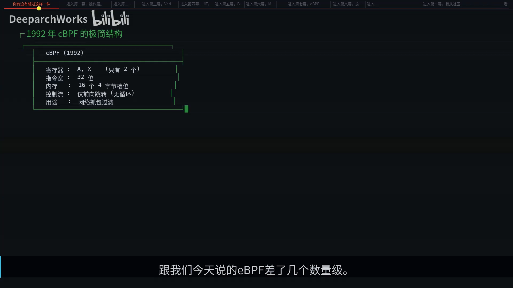
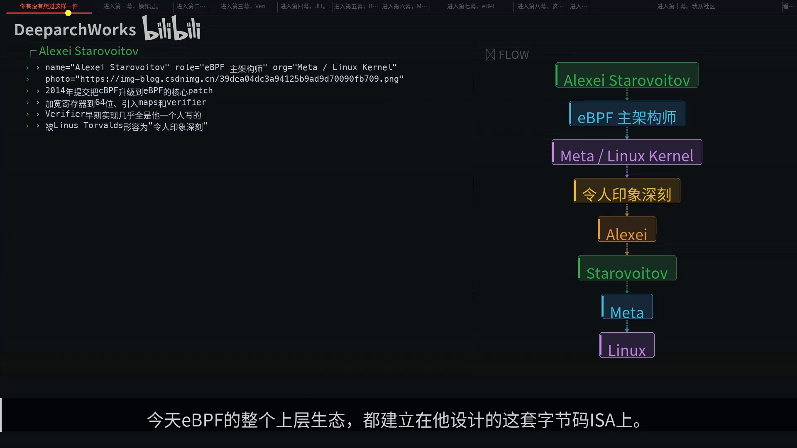
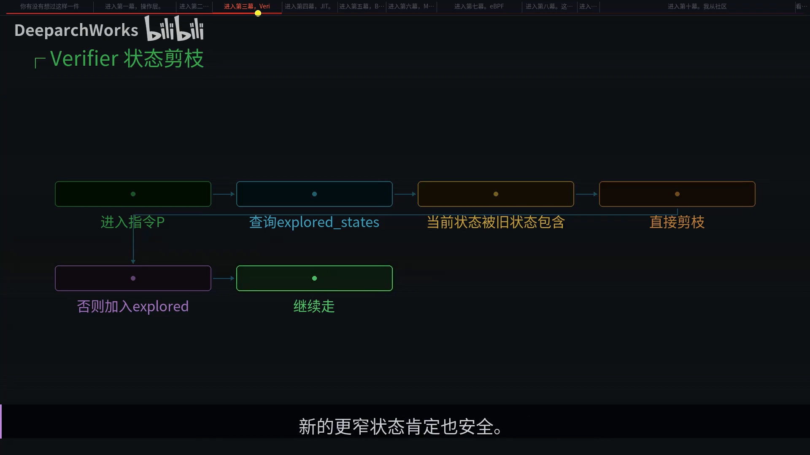
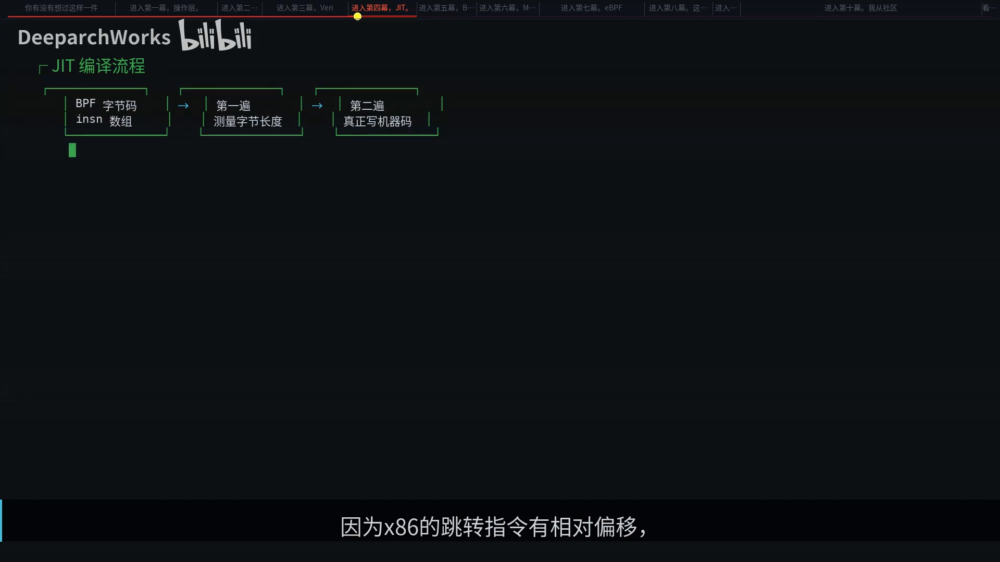
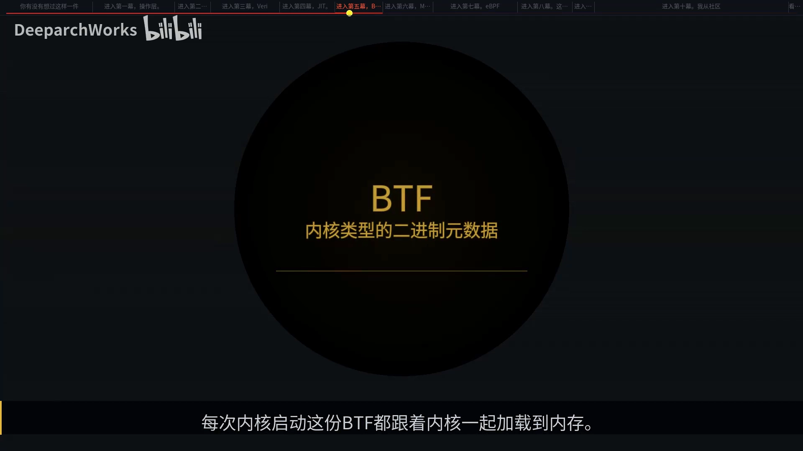
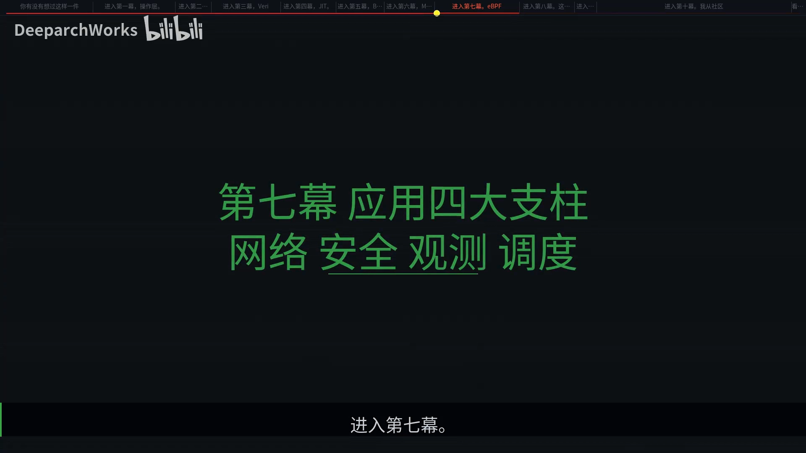
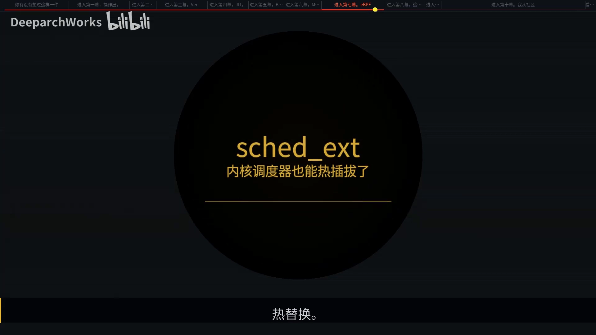
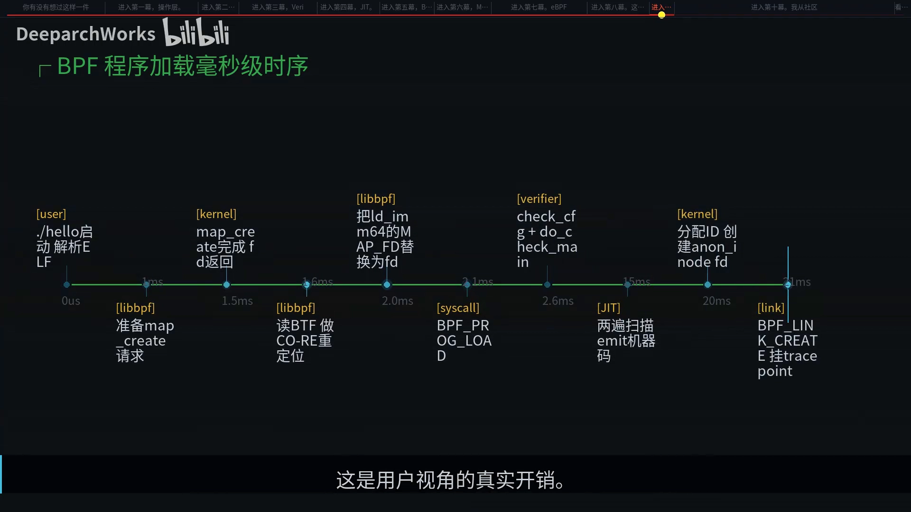

# 内核里跑用户代码还不崩，eBPF 的 Verifier 凭什么

> 本文整理自 B 站视频《内核里跑用户代码还不崩，eBPF 的 Verifier 凭什么》（BV11mRtBxELf）。看完这一篇，你会明白：Linux 内核运行几十年、几千万行代码，一直是「封闭」的——想让它多干活，得编模块或打补丁；而 eBPF 却允许你写几十行 C，**不重启、不重编内核、不写模块**地改造它，还保证它不崩。整篇视频就用约一小时，把这件事从头讲透。

## 本讲要解决的核心问题（SCQA）

**背景**：eBPF 已经成了 Linux 网络、观测、安全的事实底座，几百万台机器在跑它。但很多人只是「会用」，不理解它为什么安全——内核出错的代价是整机宕机，历史上让用户代码跑进内核一直被严格禁止。

**冲突**：eBPF 听起来像个悖论——它同时要「可编程」「安全」「高性能」，这三件事本来是互相矛盾的：能编程就可能出错，要安全就得受限，受限制往往就慢。

**疑问**：它凭什么让这三件事同时成立？一段用户写的字节码，究竟经过了哪些关卡，才被允许在内核里跑、还杀不死内核？

**回答（中心思想）**：**关键在那道叫 Verifier（验证器）的关卡**。它不真的运行你的程序，而是用 1977 年提出的「抽象解释」方法，把「不会崩」这个工程承诺翻译成一个可被机器证明的数学命题——同时模拟所有可能路径，证明你的程序不会越界、不会死循环、不会访问不该访问的内存。理解 Verifier，就理解了 eBPF 的全部设计取舍。

[【跳转到 00:00】](https://www.bilibili.com/video/BV11mRtBxELf/?t=0)

---

## 一、先讲清楚它从哪来

**1992 年**，伯克利国家实验室的 Steven McCanne 与网络传奇 Van Jacobson（TCP 慢启动、traceroute、tcpdump 背后都有他）做 tcpdump 时发现：传统包过滤性能很差——每个进程都得把规则塞进内核走一遍。他们的解法是**把过滤规则编译成一段字节码，让内核里跑一个小虚拟机来执行**。这篇论文被 USENIX 录用，成了开山之作，也就是 **cBPF**。

[【跳转到 01:15】](https://www.bilibili.com/video/BV11mRtBxELf/?t=75)

最早的 cBPF 极简到什么程度？**两个寄存器、32 位指令、16 个内存槽，控制流只允许前向跳转**（也就是不能循环）——只够给 tcpdump 过滤包用，和今天的 eBPF 差了几个数量级。

**2014 年**，Alexei Starovoitov 提交了一系列 patch，把这件事变了性质：**把寄存器加宽到 64 位、加入 maps、引入 Verifier、把 JIT 标准化**。这套 patch 被 Linus Torvalds 形容为「令人印象深刻」。他的关键洞察很简单：这套字节码不必只用于网络——把寄存器加宽、指令补齐，它就能做内核观测、做网络转发、做安全策略，甚至做调度器。

[【跳转到 02:55】](https://www.bilibili.com/video/BV11mRtBxELf/?t=175)

于是一个尘封了 22 年的小 VM，被打开了所有可能性。**可编程、安全、高性能**——三件事第一次同时成立。

### 一个贯穿全篇的类比：机场安检

想把一封「指令信」送上「内核」这架飞机，让它在飞行途中按你的意思工作，就必须过安检员 **Verifier**。它一共设了**五道关卡**——行李尺寸、X 光扫描、开箱检查、违禁品比对、重量称重，缺一不可。这五关每一关都对应 Verifier 的一个真实检查阶段，第五节会一道一道对上号。

---

## 二、俯视图：纵向五层 + 横向三件基础设施

要看清 eBPF，最好的角度是**按生命周期把它拆成五层**（纵向，回答「程序怎么进内核」）：

1. 最上层是**用户态加载器**，比如 libbpf；
2. 往下是 **`bpf` 系统调用**入口；
3. 再往下是 **Verifier** 做静态验证；
4. 通过后是 **JIT** 编译器翻译成原生指令；
5. 最底层是**挂载点**，比如 XDP、kprobe、LSM。

一段 BPF 代码就是从最上面流到最下面，最后变成内核里一段能被事件触发的原生函数。

[【跳转到 03:20】](https://www.bilibili.com/video/BV11mRtBxELf/?t=200)

横向还有三件**基础设施**，回答「它们怎么协作」：

- **maps**：程序和用户态之间的共享存储；
- **BTF（BPF Type Format）**：内核类型元数据；
- **CO-RE**：让一份字节码跑遍所有内核版本的关键。

[【跳转到 03:45】](https://www.bilibili.com/video/BV11mRtBxELf/?t=225)

---

## 三、工程师视角：从一行代码到内核里的探针

任何一个完整的 eBPF 程序都分成两块：

- 一块是**内核态代码**，后缀通常是 `*.bpf.c`，会被编成字节码；
- 一块是**用户态 loader**，是一个普通 Linux 进程，负责加载、挂载、读数据。

两块之间靠 **map** 通信。以「统计每个进程调用 open 的次数」这个最小程序为例，几个关键点：

- `SEC("...")` 括号里的字符串告诉 libbpf **这段函数挂在哪里**；声明 map 也用 `SEC(".maps")` 这个段；
- 调用 **helper** 函数，比如 `bpf_get_current_pid_tgid` 取当前 pid；
- `license` 必须是 **GPL**，否则大部分 helper 调不了——这个约束写在内核源码里。

用户态这边只做三件事：**open**（打开骨架）→ **load**（把字节码送进内核）→ **attach**（挂到事件源）。注意 **load 那一刻 Verifier 就启动了**，代码不过关，进程会在这一行直接报错退出。所以工程师最常见的踩坑就是 **load 失败**。

[【跳转到 04:35】](https://www.bilibili.com/video/BV11mRtBxELf/?t=275)

编译流程三步走：

1. 关键在于 `-target bpf` 参数，它告诉 clang 输出的是 **BPF 字节码**而不是 x86 指令；
2. **bpftool** 自动生成一个 **skeleton** 头文件，让用户态调用变得顺滑；
3. 把 loader 链接 **libbpf** 编出来。

### 3.1 `SEC` 前缀就是「挂载点语言」

`SEC` 的一个前缀就决定了 Verifier 允许你调哪些 helper、能访问什么字段：`kprobe` 挂内核函数入口，`tracepoint` 挂静态探针，`fentry` 是更快的版本，`XDP` 挂在网卡驱动入口（性能最高），`TC` 挂在 TC 层（Cilium 大量在用）。

### 3.2 map 不是一种类型，而是一族

常用的至少有这几种，每一种都对应一个工程场景：

| map 类型 | 特点 |
| --- | --- |
| `hash` | 通用键值表，bucket 级别加锁 |
| `array` | 定长数组，无锁直接覆盖 |
| `per-CPU` | 每个 CPU 一份，写完全无锁 |
| `LRU_hash` | 有容量上限，会自动淘汰旧条目 |
| `ringbuf` | 5.8 之后的高吞吐事件流 |
| `PROG_ARRAY` | 专门用于尾调用 |

### 3.3 三种主流编译路径

- **BCC**：早期方案，每次加载都在用户进程里嵌入 LLVM 编译，启动慢、内存占用大；
- **bpftrace**：适合「一行式」临时排查；
- **libbpf + CO-RE**：编译器依次产出、运行时重定位，**已是事实标准**。

为什么 libbpf 能跨内核？关键在于它的产物里带了 **BTF 和重定位记录**：运行时 libbpf 会读当前内核的 BTF 元数据，把字节码里的字段偏移逐一改写成正确的值，再调 `bpf` 系统调用加载——这就解决了内核版本之间结构体偏移不一致的根本问题。

[【跳转到 06:15】](https://www.bilibili.com/video/BV11mRtBxELf/?t=375)

### 3.4 调试三板斧

- `bpftool prog show`：列出所有已加载的程序；
- `bpftool prog dump xlated`：看 Verifier 处理过的字节码；
- `bpftool prog dump jited`：直接看 JIT 出来的原生汇编。

出问题最常用的是看 **`trace_pipe`**——`bpf_printk` 的输出都在那里。

**读 Verifier 拒绝日志的秘诀：从最后一行往上看。** 最后一行通常说明哪条指令、哪个寄存器、违反了什么约束；比如 `math between pkt pointer and unbounded ...` 这种话，基本意味着你忘了对某个变量做范围检查。

[【跳转到 07:55】](https://www.bilibili.com/video/BV11mRtBxELf/?t=475)

---

## 四、`bpf` 系统调用：一次调用里的九步

所有跟 eBPF 的交互，从用户态看就是**一个**叫 `bpf` 的系统调用。第一个参数是**命令字**，比如 `BPF_MAP_CREATE`、`BPF_PROG_LOAD`、`BPF_PROG_ATTACH`，一共二十多个。

为什么用一个 multiplex 入口，而不是二十多个独立系统调用？因为 **Linux 的系统调用号是稀缺资源**，加一个要协调所有架构——这种设计在内核里很常见。

注意第一行就有一个 **`security_bpf`** 调用，这是 **LSM 钩子**，SELinux 和 AppArmor 能在这里拦下没权限的加载请求。也就是说你的程序**还没碰到 Verifier，就要先过 Linux 安全模块这一关**——这是内核安全设计的一贯思路：全线检查放在最前面。

[【跳转到 09:10】](https://www.bilibili.com/video/BV11mRtBxELf/?t=550)

`BPF_PROG_LOAD` 进入内核后走完整的**九步**：

1. 校验基本参数；
2. 检查权限；
3. 申请 prog 结构、为字节码分配内核内存；
4. `copy_from_user` 把用户的字节码拷进内核；
5. 绑定 `prog_type` 的 ops；
6. **跑 Verifier**（关键一步）；
7. **JIT 编译**；
8. 分配 id、挂到全局列表；
9. 生成一个 **fd** 返回给用户。

九步合起来就是「用户敲一次系统调用，内核里多出一段可执行原生代码」的全部因果链。

[【跳转到 10:00】](https://www.bilibili.com/video/BV11mRtBxELf/?t=600)

---

## 五、Verifier 专题：eBPF 最反直觉的核心

`verifier.c` 在内核里有 **2 万行代码**，几乎每个版本都在修。它做的事情乍听非常奇怪——**它不真的运行你的字节码，而是同时模拟所有可能路径**。

### 5.1 为什么不能「放到沙盒里跑一遍」？

这个想法是错的，原因有三个：

1. **停机问题**：跑一遍遇到死循环，你永远等不出来；
2. **覆盖率**：跑一遍只覆盖一条路径，下次输入不同就走另一条，还得重跑；
3. **Spectre 推测执行**：越界数据会泄露，纯运行时根本检测不到。

所以 **Verifier 必须做静态分析**。

[【跳转到 10:50】](https://www.bilibili.com/video/BV11mRtBxELf/?t=650)

### 5.2 核心技术：抽象解释

Verifier 用的方法叫**抽象解释（abstract interpretation）**，是 **1977 年**法国数学家 Cousot 夫妇提出的程序分析方法。

- **具体执行**时，每个寄存器是一个具体的值，比如 `R1 = 42`；
- **抽象执行**时，每个寄存器对应一个**值的集合**，比如 `R1 ∈ [0, 100]`。

所有具体执行轨迹都被这个区间包住，所以**区间上证明的安全性可以推广到所有具体执行**。真实的 Verifier 分两遍走：

1. **`check_cfg`**：构建控制流图、DFS 找回边——回边就意味着循环，早期内核任何回边都直接拒绝；
2. **`do_check`**：做真正的抽象解释；
3. 最后还有一个 **`do_misc_fixups`**：把 `map_lookup` 这类 helper 调用替换成内联函数指针，相当于在内核里做了一次链接。

[【跳转到 12:05】](https://www.bilibili.com/video/BV11mRtBxELf/?t=725)

### 5.3 怎么精确追踪寄存器取值：tnum

光靠 min 和 max 不够——比如 `R1 & 0xFF` 这个位运算消除了高位风险，但单纯的 min/max 看不出来。于是内核引入了一个叫 **tnum** 的结构，用一对 `(mask, value)` 来追踪：**mask 里为 1 的位代表未知，为 0 的位代表已知**。这样 Verifier 才能精确处理位运算之后的范围。

### 5.4 怎么不指数爆炸：状态剪枝

即使有了 tnum，所有路径展开还是会指数爆炸。Verifier 的破解方案叫**状态剪枝**：当走到指令 P 时，如果**之前已经走过这里、且当时的状态比现在更宽松**，那这次就不用再走了——因为旧的更宽松状态都安全，新的更窄状态肯定也安全。这个判断由状态比较函数完成，把指数复杂度压到接近线性。

[【跳转到 12:55】](https://www.bilibili.com/video/BV11mRtBxELf/?t=775)

### 5.5 回到机场五关

现在可以一一对上了：

| 机场关卡 | Verifier 对应机制 |
| --- | --- |
| 第一道：指令数上限 | `BPF_COMPLEXITY_LIMIT_INSN` 宏，默认 **100 万** |
| 第二道：X 光扫描 | **tnum + 范围追踪** |
| 第三道：开箱检查 | **指针类型系统**，`PTR_TO_MAP_VALUE`、`PTR_TO_PACKET` 等标签，每条指令都在更新 |
| 第四道：违禁品比对 | **helper 白名单** |
| 第五道：重量称重 | **512 字节栈** + **调用链深度 8** |

五关全过，你的程序才被允许装上「内核」这架飞机。所以 Verifier 干的事，其实是**把「不会崩」这个工程承诺翻译成了一个可被机器证明的数学命题**。

这是 Linux 内核第一次有这种东西：在它之前，内核模块崩了就崩了，没人能事先证明它不会崩。

[【跳转到 13:45】](https://www.bilibili.com/video/BV11mRtBxELf/?t=825)

---

## 六、JIT：性能的真正来源

过了 Verifier 只是被允许进内核，要真正快起来，还得把字节码变成 CPU 能直接执行的原生指令——这就是 **JIT**。

**JIT 为什么要扫两遍？** 因为 x86 的跳转指令用的是相对偏移，得先知道每条 BPF 指令翻译后占多少字节、跳转目标在哪里：

1. 第一遍**测量长度、定下偏移表**；
2. 第二遍真正把机器码 **emit** 到一段可执行的内核内存里——这段内存叫 **`bpf_prog_pack`**，5.16 之后用大页共享，多个 BPF 程序打包到一起省 TLB。

[【跳转到 14:35】](https://www.bilibili.com/video/BV11mRtBxELf/?t=875)

BPF 的 **11 个虚拟寄存器**在 x86-64 上一一映射到物理寄存器：

| BPF 寄存器 | x86-64 物理寄存器 | 用途 |
| --- | --- | --- |
| `R0` | `rax` | 返回值 |
| `R1`–`R5` | `rdi`、`rsi` … | 函数参数 |
| `R6`–`R9` | `rbx`、`r13`、`r14`、`r15` | callee-saved |
| `R10` | `rbp` | 只读栈指针 |

Verifier 强制 `R10` 不可写，正是为了让 JIT 和 BPF 能被信任。

JIT 的核心就是一个**大 switch**，逐条把 BPF 指令翻成 x86：64 位加 → `add`，内存读 → `mov` 加偏移，helper 调用 → `call` 加目标地址。这种一对一的翻译让编译过程也很快，毫秒级就能搞定一个上千条的程序。

### 6.1 Spectre 的代价：retpoline 与 bpf_dispatcher

2018 年 Spectre 漏洞披露后，**所有间接调用都变成了潜在的数据泄露路径**——eBPF 里的 tail call、struct_ops 回调全是间接跳转。内核的解法叫 **retpoline**：把 `jmp`、`call` 这种危险指令改写成一个无害的「return-based trampoline」，让 CPU 推测执行落到一个安全循环里，性能损失约 **10%**，但安全性换来了。

retpoline 毕竟有开销，5.5 之后又引入了 **`bpf_dispatcher`**，把多路 `fentry`/`fexit` 调度做成 trampoline 加显式 `if/else`，用**直接调用代替间接调用**。这是一个看似简单的 JIT 背后，藏着对硬件细节的大量妥协。

[【跳转到 16:15】](https://www.bilibili.com/video/BV11mRtBxELf/?t=975)

**Verifier 保的是安全，JIT 保的是性能**，这两件事在 bpf 里是分开做的，互相独立又互相依赖。

---

## 七、BTF 与 CO-RE：一份字节码跑遍所有内核

你的 BPF 程序通常在开发机上编译，却要部署到几百台不同内核版本的服务器上，每台机器结构体字段偏移都不一样。**CO-RE 之前的世界**：你 `include` 内核头文件，编译出来的字节码里**写死了 `task_struct` 字段的偏移**，换个内核版本偏移就错了，必须重编——容器化部署里这非常痛苦，因为目标机器内核版本不可控。

解决方案是 **BTF**：把内核里所有 `struct`、`union`、`enum` 定义序列化成一份紧凑的二进制，存在 `/sys/kernel/btf/vmlinux`。它是 **DWARF 的一个子集**，去掉了行号和符号位置等无关信息。格式很简单：一个 header + type section + string section，每个 type 记着字段的名字、类型 id、**偏移**。

这个偏移就是关键：同一个 `task_struct`，5.4 里 `pid` 可能在偏移 1024，5.10 里在 1056，6.1 里在 1088——**每份 BTF 如实记录自己内核的偏移**。

[【跳转到 18:20】](https://www.bilibili.com/video/BV11mRtBxELf/?t=1100)

**CO-RE 的实现非常巧妙**：当你写 `bpf_core_read` 这个宏时，clang 会在字节码里多埋一条**重定位记录**，标记「这条指令访问的是 `task_struct` 的 `pid` 字段、类型 id 是 17」。这条记录跟着字节码一起带到目标机器，加载时 libbpf 做五步：

1. 解码重定位记录；
2. 读当前内核的 BTF；
3. 找到 `task_struct` 类型；
4. 查 `pid` 字段的实际偏移；
5. 把字节码里的偏移改写成正确值，再调 `bpf` 系统调用加载。

整个过程对用户完全透明，你只需要写 `bpf_core_read` 这个宏。这一招把「重编 BPF」从必须做降级成基本不需要做。**Cilium 这种部署在几千台不同内核机器上的项目能存在，靠的就是 CO-RE。**

[【跳转到 19:10】](https://www.bilibili.com/video/BV11mRtBxELf/?t=1150)

---

## 八、map 的设计哲学：为什么非要用 fd

有个反直觉的设计需要解释：BPF 程序直接拿一个内存指针读写不就行了，为什么内核非要用 **fd** 这么麻烦的方式？

- **fd 的本质是「用户态身份」**：你的进程关掉 fd，内核就知道用户不再用这个 map 了；
- **运行时并不走 fd 表**：BPF prog 里通过 `LD_IMM64` 加 `map_fd` 引用 map，这条指令会被 **Verifier 在加载时重写成绝对地址**，所以「fd 慢」这点并不存在；
- **生命周期靠引用计数解耦**：用户关 fd，refcount 减一；prog 卸载，refcount 减一，**归零才真正释放**。

[【跳转到 20:00】](https://www.bilibili.com/video/BV11mRtBxELf/?t=1200)

为什么不用裸指针？因为 fd 是 Linux 里标准的资源引用方式，能解决四件事：

1. **生命周期**：关 fd 自然减引用；
2. **跨进程共享**：通过 **BPF FS** 把 map 定到 `/sys/fs/bpf`，其他进程可以拿回 fd；
3. **权限**：fd 天然带 owner 和 mode；
4. **Verifier 友好**：`map_fd` 立即数是可静态分析的形式，裸指针就要做指针分析。

map 种类多到爆炸，是因为 BPF 程序经常在**中断上下文**里跑，任何阻塞、任何分配都不被允许，所以每种使用模式都得有专门的「**预分配 + 无锁或细锁**」实现：hash 用每个 bucket 一把 spinlock，per-CPU 完全无锁，ring buffer 用 reservation API 让多生产者也不需要锁。

有个特别的设计叫 **`bpf_spin_lock`**：可以在 map_value 里嵌一个 lock 字段，BPF 程序用 `bpf_spin_lock` / `unlock` 做临界区，但 Verifier 会强制三件事：

- lock 和 unlock 必须在**同一个 BPF 程序内成对**出现；
- 持锁期间**不能调用任何会阻塞或调度的 helper**；
- 持锁期间**不能写其他 map_value，只能读**。

这是为了防止死锁和优先级反转。

[【跳转到 21:40】](https://www.bilibili.com/video/BV11mRtBxELf/?t=1300)

所以 map 的设计哲学一个字概括叫「**预分配**」：生命周期靠 fd 和 refcount，跨进程靠 BPF FS，Verifier 友好靠 `map_fd` 立即数，运行时性能靠重写直指。

---

## 九、四大支柱：eBPF 改造了 Linux 的哪些方面

eBPF 在工业界有四大应用领域，每一个都对应着一个 Linux 子系统的革命性重构：

**网络**：绕不开 **Cilium**——Thomas Graf 在 2015 年看到 eBPF 在 TC 上挂载的潜力后发起了它，把 Kubernetes 的网络栈整个重写：iptables、kube-proxy 全部用 BPF 替代（Isovalent 2024 年被 Cisco 收购）。性能最炸的是 **XDP**，它在网卡驱动入口就跑，比 iptables 早数十层，单核可达 **1000 万包每秒**，典型用途是 DDoS 防护、负载均衡、自定义防火墙（Facebook 的 Katran、Cloudflare 的 DDoS 防护都基于 XDP）。

**XDP 和 TC 怎么选？** XDP 在驱动入口没有 SKB，速度最快但能做的少；TC 在软中断里，已经有 `sk_buff`，速度慢一档但功能全。XDP 适合 DDoS 和最前置过滤，TC 适合 Cilium 这种「修改 + 转发 + 附加 probe 信息」的复杂场景，两者经常配合使用。

**Cilium 为什么能替代 iptables？** iptables 是链式规则，每个包都得顺序扫，service 数量增加、延迟线性增长，几千 pod、几万 service 的集群里 iptables 直接抖动；Cilium 用 bpf map 做 hash 加 Maglev，单包查表 **100 纳秒以内**，service 数量上限直接飙到 **百万级**。

[【跳转到 24:10】](https://www.bilibili.com/video/BV11mRtBxELf/?t=1450)

**安全**：最有名的是 **Falco**，它用 BPF 挂在 syscall、tracepoint 上监控异常模式（比如容器逃逸、可疑写操作），是 CNCF 孵化项目，规则用 YAML 写，扩展性比 SELinux 策略语言好。更底层的能力叫 **BPF LSM**：LSM 是 Linux 的安全模块框架，SELinux 和 AppArmor 都挂在它上面，**5.7 之后 BPF 也能挂上去跟它们平起平坐**，优势是不用重编内核就能改安全策略。业界已有 Tetragon 这些基于 BPF LSM 的运行时安全工具。

**观测**：把 eBPF 推到家喻户晓的是 **Brendan Gregg**，他写的《BPF Performance Tools》八百多页，几乎成了观测圣经；他设计的 `execsnoop`、`opensnoop`、`biosnoop` 这些「一行 trace 命令」，让 SRE 能在十秒内回答任何性能问题（Linux 火焰图也是他发明的）。trace 的表达力强到一行就能做出原本需要写一个工程的事。

**调度**：最炸的应用是 2024 年合入主线的 **sched_ext**——它允许你用 BPF 实现一个 **CPU 调度类**，也就是说 Linux 的调度器不再只能在编译时选 CFS 或 RT，你可以现场加载一个用 BPF 写的新调度器**热替换**。Meta 等公司已经在生产里跑自己的调度器了。

[【跳转到 26:15】](https://www.bilibili.com/video/BV11mRtBxELf/?t=1575)

---

## 十、那些真正决定水平的进阶细节

**① bpf-to-bpf call vs tail call**：前者是真正的函数调用，有返回，调用链**不超过 8**，不能递归；后者是跳转到另一个 prog、**不返回**，链长**不超过 33**，常用来把超大程序拆断、绕过百万指令上限。注意 **tail call 不能跨 prog_type**，从 XDP 没法 tail call 到 TC，Verifier 直接拒绝。

**② Spectre 缓解**：内核加了一堆措施，比如禁止对 map_value 的非常量索引；**5.16 起默认 `unprivileged_bpf_disabled = 1`**；JIT 在条件分支后插入 `lfence`。结果就是**非特权 eBPF 基本死了**——现实部署里，加载 BPF 都需要 `CAP_BPF` 或 `CAP_SYS_ADMIN`。

**③ kfunc 取代 helper**：加一个 helper 要改 Verifier、改各个 prog_type 的子集、改 selftest、写测试，门槛高到内核维护者头疼。于是引入 **kfunc** 机制：子系统作者用 `__bpf_kfunc` 标注一个普通函数，注册一下就能给 BPF 调用，**Verifier 通过 BTF 直接解析它的签名做类型检查**。这是 eBPF 走向内核子系统标准扩展点的关键设计。

**④ ringbuf 干掉 perf_event_array**：早期输出大量事件用 `perf_event_array`，每 CPU 一个缓冲，用户态要轮询所有 CPU、**不保序**；5.8 引入的 **ringbuf** 是单一全局环，多生产者通过 reservation API 原子写槽位，**严格保序、没事件时近似零开销**。新代码全用 ringbuf。

**⑤ fentry 取代 kprobe**：kprobe 在内核函数入口插 int3 中断指令，开销大概**一微秒**；fentry 利用 trace 的五字节 NOP 做 patching 加 trampoline 直接 call bpf，开销 **50 纳秒**，差了 **20 倍**。所以 5.x 之后写 BPF 跟踪程序基本都用 fentry/fexit，kprobe 只在不可用时回退。

**⑥ bpf arena**：2024 年合入。在它之前，BPF 想用复杂数据结构只能套 map，容量大就有 OOM 风险。**arena 给一个 prog 分配一段连续虚拟地址区间**，BPF 程序在里面用普通指针读写，Verifier 把 arena 范围作为已知常量做与 packet 类似的成对边界检查。简单说就是 **BPF 终于有了自己的堆**。

[【跳转到 27:05】](https://www.bilibili.com/video/BV11mRtBxELf/?t=1625)

---

## 十一、把时间线串起来：加载贵，运行白菜价

**加载阶段是毫秒级的**：从 hello 启动到 prog 真正挂上 tracepoint 大概 **21ms**，其中 **Verifier 占了 12ms 是大头，JIT 占 5ms**，剩下的是 libbpf 在做 CO-RE 重定位、map 创建、系统调用切换。

**但真正运行的时候是纳秒级的**：tracepoint 触发到 bpf 代码跑完只有**几十纳秒**，因为 JIT 出来的代码就是一段普通函数指针调用，连切换上下文都不需要。

[【跳转到 30:25】](https://www.bilibili.com/video/BV11mRtBxELf/?t=1825)

**这是 eBPF 性能的根本秘密——加载贵，但运行白菜价。** Verifier 和 JIT 这些静态分析在加载时**一次性付掉**，运行时几乎零开销。这种把成本前置到加载器的设计，让 eBPF 能在最热路径上挂代码而不影响性能，跟传统 kprobe 那种每次触发都走异常路径的方案不是一个量级。

[【跳转到 30:50】](https://www.bilibili.com/video/BV11mRtBxELf/?t=1850)

---

## 十二、工程师追问最多的几个问题（速答）

**1. eBPF 跟内核模块比，安全在哪三个维度？** ① 可证安全：模块写错就 panic，eBPF 靠 Verifier 机器证明不会越界；② 白名单对黑名单：模块能调任意 exported symbol，eBPF 只能调几百个审查过的 helper；③ 可观测可控：每个 BPF prog 有 id、能被 bpftool 看到、能被强制卸载，模块插入后基本是黑盒。

**2. 为什么必须静态验证？** 表层是停机问题、覆盖率、Spectre 三个原因；更深层是——抽象解释用的是**数学证明**的语言，具体执行用的是**工程实测**的语言。「不会崩」要被机器证明，就必须翻译成数学命题，这个翻译就是 Verifier。

**3. vmlinux、DWARF、BTF 什么关系？** vmlinux 是带调试信息的内核 ELF，BTF 是从它的 DWARF 信息提取出的类型部分，去掉行号和符号位置后压缩重排。简化看就是：vmlinux 包含 DWARF，DWARF 包含 BTF，**BTF 是 DWARF 的子集**，但生成和加载都快一个数量级。

**4. XDP 和 TC 是对立吗？** 不是，是互补。要极致性能（如 DDoS 防护）用 XDP（驱动入口可跑 1000 万 pps）；要修改加转发到本地协议栈用 TC（有 `sk_buff`、维护 checksum、能双向、能拿 probe 信息）。Cilium 主力是 TC，XDP 只用在最前置过滤。

**5. helper 白名单是怎么强制的？** 三层——编译期，libbpf 头文件里只放白名单 helper 声明；加载期，Verifier 查 `func_proto` 表，不在表里直接拒绝；运行期，JIT 把 helper 编号 emit 成对一个固定地址的 `call`，这个地址表由 Verifier 写入、运行时不可修改。每种 prog_type 还有自己的子集，比如 XDP 没有进程上下文，不能调 `bpf_get_current_pid_tgid`。

**6. iptables 的瓶颈？** 四条——规则查找 O(n)、更新需要全量重建、conntrack 表锁竞争、观测能力差。Cilium 的解法是 bpf map 查找 O(1)、map 原地更新、conntrack 也用 bpf map、每条数据路径都能挂程序输出 ringbuf。

**7. 循环写不出来怎么办？** eBPF 的分支序列上限是 `BPF_COMPLEXITY_LIMIT_JMP_SEQ`，默认 **8192**。若循环迭代 N 次、状态仍未稳定，Verifier 会放弃并报「BPF program is too large」。实战经验是不要写裸 `for`，用 **`bpf_loop`** 这个 helper（Verifier 视它为单个 helper 调用，只验证 callback 一次），或者用 `pragma unroll` 让编译器展开成有限步。

**8. perf 和 bpftrace 怎么配合？** perf 强项是 CPU 性能剖析、PMU 事件低开销采样；bpftrace 强项是任意函数级追踪和聚合。协同方法：perf 先看哪个函数最慢 → bpftrace 看函数内部时间分布 → perf 看 cache miss 集中在哪。

**9. BPF 能调系统调用吗？** 不能。原因有三：上下文不允许；系统调用假设可阻塞、会破坏内核可重入；递归风险——挂在 `sys_enter` 上调系统调用会立刻递归触发自己。例外是 5.6 引入的 `BPF_PROG_TYPE_SYSCALL`，专门给用户主动通过 `bpf_prog_test_run` 触发的程序用。

**10. bpf-to-bpf call 和 tail call 怎么选？** 要返回原处用前者（语义和 C 函数调用一样，性能略差但代码组织自然）；不需要返回用后者（不消耗栈，可连续 33 次）。两者都**不能跨 prog_type**。

**11. ringbuf 和 perf_event_array？** 见上文第④点——新代码全用 ringbuf。

**12. kprobe 和 fentry？** 见第⑤点——差了 20 倍性能，5.x 之后基本用 fentry。

**13. BPF LSM 能替代 SELinux 吗？** LSM 是每个安全决策点的钩子框架，SELinux/AppArmor 是内置 C 实现，BPF LSM 是 5.7 之后的可编程实现。优势是不用重编内核就能改策略、用 C 写；劣势是不能完全替代 SELinux 几十年沉淀的策略库。

**14. 调试 Verifier 拒绝的五步法？** ① 把 `log_buf` 开到 16 兆、`log_level` 设 2；② 从最后一行往上看哪条指令、哪个寄存器违反了哪条约束；③ 用 `bpftool prog dump xlated` 看处理后的字节码；④ 注释可疑代码、留最小段复现；⑤ 对照常见模式速查：`unbounded` 基本是缺范围检查，`type == invalid` 是指针类型不对。

**15. bpf arena 的意义？** 2024 年才合入，但意义巨大：整段在加载时 reserve 一段固定大小，Verifier 把 arena 范围作为已知常量做边界检查，用户态可以 mmap 拷贝读写。目标是让 BPF 能实现自定义哈希、二叉树、Bloom filter——相当于 BPF 终于有了自己的堆。

[【跳转到 37:30】](https://www.bilibili.com/video/BV11mRtBxELf/?t=2250)

---

## 结语：一条被现实逼出来的 33 年时间线

这 15 个问题答案的共同特征：**所有细节都指向同一个东西——设计的取舍**。eBPF 不是一个完美方案，它是一组在不可能三角里反复挣扎出来的工程妥协，每个限制都有理由，每个能力都有代价。

也可以把整个程序的生命周期看成一个状态机：从用户态 ELF 开始 → **loaded**（结构在内核里分配好）→ **verified**（通过验证）→ **JITed**（翻译完毕）→ **attached**（挂上事件源）→ **running**（被事件触发）→ **detached**（解除挂载）→ **released**（延迟回收）。每一步都对应一组内核函数，每一次状态切换都有对应的 lock 和 refcount 变化。

把关键节点串成时间线：**1992** cBPF 抓包 → **2011** JIT → **2014** eBPF 全面升级 → **2015** XDP → **2017** BTF 与 CO-RE 跨内核 → **2019** trampoline 降低 kprobe 开销 → **2020** BPF LSM → **2022** `bpf_loop` → **2024** sched_ext → **2025** bpf arena 私有堆。每一步都是被现实需求倒逼出来的，eBPF 没有宏伟蓝图，是一连串解决具体痛点的工程演进。

[【跳转到 38:20】](https://www.bilibili.com/video/BV11mRtBxELf/?t=2300)

回到开场的问题——Linux 内核能不能在不改源码、不重启的前提下被用户改造？答案是**能**。靠的就是：**机场五道关卡的 Verifier**、**把字节码翻成原生指令的 JIT**、**用 BTF 和 CO-RE 让一份字节码跑遍所有内核**、**用 fd 和 refcount 解耦 map 生命周期**。三件事、三套机制，一个都不能少：

- **可编程**，靠字节码 ISA 加挂载点框架；
- **安全**，靠 Verifier 的抽象解释；
- **高性能**，靠 JIT 和 trampoline。

如果要用一句话概括 eBPF 对 Linux 的意义，那就是：**Linux 内核第一次有了一种可被机器证明的东西**。在它之前，内核安全靠工程师的细心和 code review；在它之后，某些路径上的安全性是**数学证明**出来的。这个差别，可能比我们今天能看到的所有应用更深远。

[【跳转到 40:25】](https://www.bilibili.com/video/BV11mRtBxELf/?t=2425)
