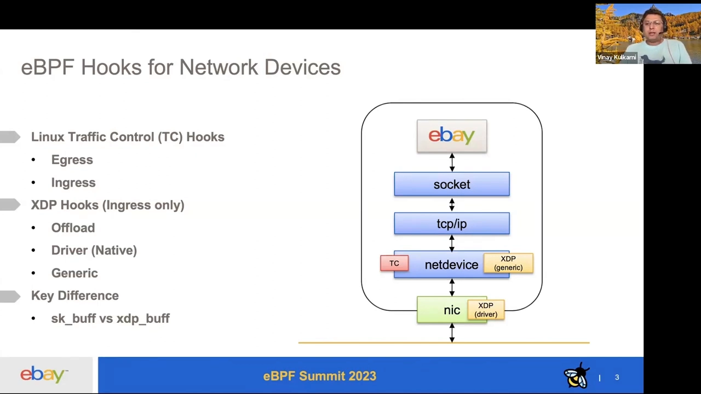
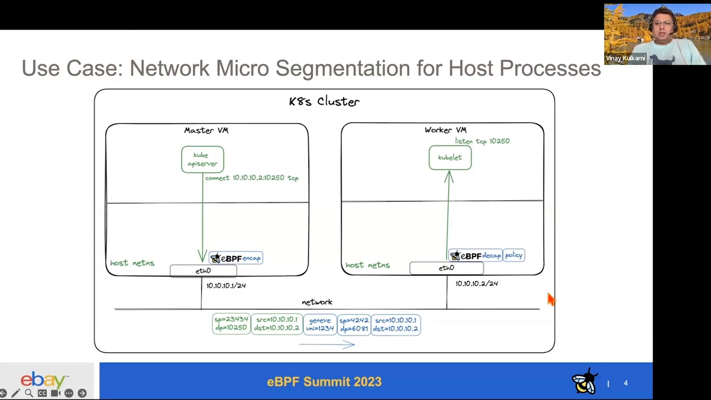
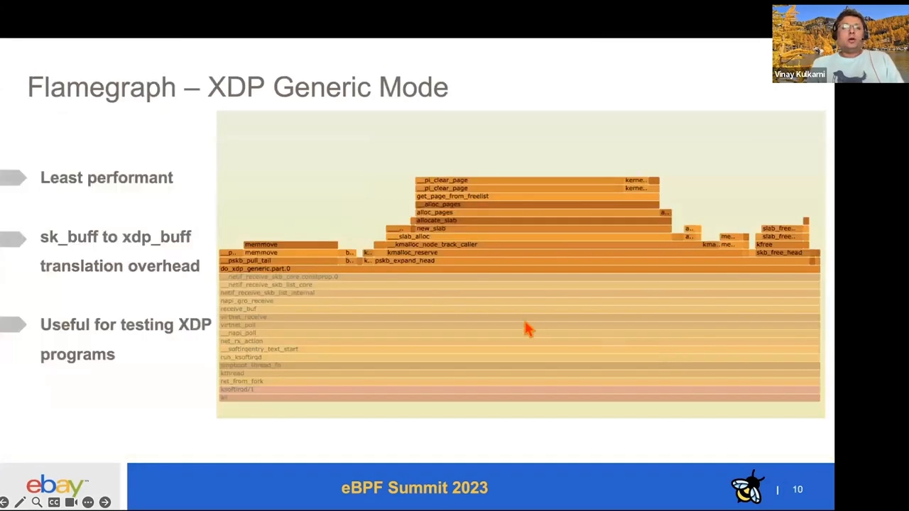

# 性能实测对比：XDP native、XDP generic 与 TC eBPF 钩子

> 本文整理自一场英文技术分享《Performance Analysis of XDP-native, XDP-generic, and TC eBPF hooks》（讲解人 Vinay）。它用一个**非常克制的实验**回答了一个工程选型问题：在网卡层做主机进程的**网络微隔离**时，eBPF 程序到底该挂在 **TC** 上，还是挂在 **XDP** 上？如果挂 XDP，又该用 **driver（native）** 还是 **generic** 模式？结论不是拍脑袋，而是靠 `iperf3` + CPU 火焰图量出来的。

## 本讲要解决的核心问题（SCQA）

**背景**：在网卡层（network device layer）挂 eBPF 程序有两个大类选择——**Linux traffic control（TC）钩子**和 **XDP 钩子**。它们各有模式，性能差异平时只能靠「听说」。

**冲突**：选错地方/模式的代价是真实的——比如把本该早早丢掉的包拖到后面才丢，白白消耗了内核资源。但「哪个更快、快多少、为什么」，很少有实测数据支撑。

**疑问**：同样的策略逻辑，挂在 **TC**、**XDP native**、**XDP generic** 上，吞吐和 CPU 开销到底差多少？又该怎么选？

**回答（中心思想）**：实测显示，**不做任何过滤时吞吐最高（≈2.13 Gbps）；挂上打桩程序后，XDP driver 模式几乎无损（≈2.12），TC 有一点点开销（≈2.09），XDP generic 掉得最多（≈1.89）**。原因是 **XDP generic 在 `skb` 已分配之后才执行，白白多做了分配与回收**。因此结论是：**要丢的包，就尽早丢——接收路径做策略执行优先选 XDP driver 模式；TC 开销很小；XDP generic 更适合测试**。

[【跳转到 00:10】](https://www.youtube.com/watch?v=nuXN5qSvDCw&t=10)

---

## 一、先看网络栈：钩子能挂在哪些位置

典型的网络栈自上而下是：**应用 → socket 层 → TCP/IP 层 → net device（网络设备层）→ 硬件网卡（NIC）**。

在 **net device 层**，eBPF 程序有两个大类挂载点：

- **Linux traffic control（TC）钩子**——**入站（ingress）和出站（egress）都有**；
- **XDP 钩子**——**目前只有入站（ingress）**。

XDP 自己又有三种模式：

| 模式 | 程序在哪执行 |
| --- | --- |
| **offload** | 在 **网卡（NIC）** 上执行 |
| **driver / native** | 在**驱动被调用来处理数据包的最早时刻**执行 |
| **generic** | 主要用于**测试** |

[【跳转到 01:17】](https://www.youtube.com/watch?v=nuXN5qSvDCw&t=77)

**两类钩子的一个关键区别**：**TC 的 eBPF 程序处理的是已经存在的 `sk_buff` 参数，而 XDP 处理的是需要序列化的 `xdp_buff`**——这句话直接预示了后面性能差异的根源。

[【跳转到 01:42】](https://www.youtube.com/watch?v=nuXN5qSvDCw&t=102)

---

## 二、动机：给主机进程做「网络微隔离」

这场性能研究不是空想，它来自一个很实际的需求：**Kubernetes 里主机进程之间的网络微隔离（network microsegmentation）**。

场景是这样的：一个 K8s 集群有 master 节点和 worker 节点。master 上跑着 **kube-apiserver**，它需要连到 worker 上监听 **TCP 10250** 端口的 **kubelet**——比如当你执行 `kubectl exec` 查看容器里发生了什么、或者拉取日志时，走的就是这条连接。

问题是：**除了 kube-apiserver，别人没有任何正当理由去连这个 10250 端口**。如果有别的来源在连它，很可能就是**某种 DoS 攻击**。

**于是 eBPF 登场**：把程序挂在 NIC 上，就能**在非常早的位置检查数据包**，判断它合不合法、做一个策略裁决（policy verdict）——决定放它上协议栈，还是直接丢掉。

正是为了做这个裁决时**该把程序挂在哪**（generic？TC？XDP driver？），团队才需要实测数据来做设计决策。

[【跳转到 02:07】](https://www.youtube.com/watch?v=nuXN5qSvDCw&t=127) / [【跳转到 02:57】](https://www.youtube.com/watch?v=nuXN5qSvDCw&t=177) / [【跳转到 03:22】](https://www.youtube.com/watch?v=nuXN5qSvDCw&t=202)

---

## 三、测试方案：只量「调用程序本身」的开销

实验设置刻意做得简单、可比（apples to apples）：

- **两台 VM**，跑在一台 Mac Studio（M2 Max）上，VM 配置 8 CPU / 16 GiB；
- 用 **virtio PCI 网卡** + **shared networking 模式**，内核 **5.15.0-78 / Ubuntu 22.04**，**MTU 1500**（受限于 bridge，但对该用例无影响），TCP 读写缓冲各一页（4096 字节）；
- **发送端用 iperf3 以最大速率发单条 TCP 流**（单流是为了公平对比），接收端就是右侧这台 VM；
- **挂上去的程序是「打桩程序」（dummy）——什么都不做，直接放行**。这样量到的就是**「仅仅调用这些程序本身」的开销**：挂这里、挂那里，各自贵多少，一目了然；
- 每个测试跑 **60 秒、连做 3 次**，取**最好值与平均值**；随机选端口（如 23434），日志重定向到 `/dev/null` 以免日志吃掉 CPU。

**采集 CPU 画像**用的是 **`profile-bpfcc`** 工具，跑 **70 秒**——在 iperf 接收端启动之后、发送端启动之前开始采，从而覆盖整段测试；产物是 CPU profile。随后用 **Brendan Gregg 的 FlameGraph** 生成火焰图（`profile.svg`），直观看到 CPU 在忙什么。

[【跳转到 03:47】](https://www.youtube.com/watch?v=nuXN5qSvDCw&t=227) / [【跳转到 05:27】](https://www.youtube.com/watch?v=nuXN5qSvDCw&t=327) / [【跳转到 05:52】](https://www.youtube.com/watch?v=nuXN5qSvDCw&t=352)

> 所有测试中 CPU 利用率只有 **9~10%**，说明 **CPU 没被打满**——瓶颈在 bridge 提供的网络带宽，而不是 CPU。这保证了对比的公平性。

---

## 四、数据：谁最快、快多少

结果如下（单位 Gbps，best of 3 / 平均值）：

| 配置 | best of 3 | 平均 |
| --- | --- | --- |
| **不挂任何 eBPF 程序** | **2.13** | 2.12 |
| **XDP driver（native）模式** | **2.12** | 2.11 |
| **Linux TC** | **2.09** | 2.087 |
| **XDP generic 模式** | **1.89** | 1.87 |

[【跳转到 07:07】](https://www.youtube.com/watch?v=nuXN5qSvDCw&t=427) / [【跳转到 07:32】](https://www.youtube.com/watch?v=nuXN5qSvDCw&t=452)

解读：

- **不带程序 → 数字最好**，这是基线；
- **XDP driver 模式**只比基线低一点点（2.12 vs 2.13），因为**程序虽然挡在路上、要付出一点调用成本，但代价极小**；
- **Linux TC** 紧随其后（2.09），**与 XDP driver 非常接近**；
- **XDP generic 模式有明显性能损失**（掉到 1.89），这才是真正值得深挖的。

**TC 和 XDP generic 之间的差距**，促使团队去做了 CPU 火焰图，想弄清到底发生了什么。

[【跳转到 07:57】](https://www.youtube.com/watch?v=nuXN5qSvDCw&t=477)

---

## 五、火焰图揭示原因：generic 模式多做了 skb 的分配与回收

看火焰图：**左侧两边很像，右侧的「天际线」却明显不同**。差异集中在一个地方——**IRQ（中断处理程序）**。

- 在较快的那侧，**IRQ 很小**（采样很少）；
- 在 XDP generic 那侧，**IRQ 相当大**。

放大看 generic 的调用链，能看到：

**IRQ 收包 → 把包送入 receive 路径 → 分配 `skb` → `do_xdp_generic` 接收 → `pull_tail` → 申请/回收 slab 内存（`napi_alloc_skb`、`new_slab` / `free` 等）。**

**这就是性能损失来源**：XDP generic 是**在 `skb` 已经被分配、包已经沿协议栈往上走之后**才执行 XDP 程序的——于是它比 driver 模式**多出了「分配 `skb`、再用 `pull_tail` 处理、再回收」这一整段开销**。

[【跳转到 08:13】](https://www.youtube.com/watch?v=nuXN5qSvDCw&t=493) / [【跳转到 08:38】](https://www.youtube.com/watch?v=nuXN5qSvDCw&t=518)

> 一句话记住：**XDP driver 在 `skb` 分配前动手，generic 却在分配后动手**——多出来的正是这份「本来可以省掉的准备工作」。

---

## 六、结论与选型建议

作者的结论很干脆：

- **接收路径做网络策略执行，XDP driver 模式是个好选择**。核心思想是——**如果你注定要丢一个包，那就趁 OS 还没为它分配资源的时候就丢**；
- **TC 的 eBPF 接收路径开销很小**（数据上也确实与 XDP driver 很接近）；
- **XDP generic 模式有额外开销，但它有它的用途**——**很适合做测试**（方便、无需特定驱动支持）。

作者把测试代码和结果都开源在 GitHub 上，感兴趣可以自行复现。

[【跳转到 09:20】](https://www.youtube.com/watch?v=nuXN5qSvDCw&t=560) / [【跳转到 09:45】](https://www.youtube.com/watch?v=nuXN5qSvDCw&t=585)

---

## 七、小结

- **两类钩子**：TC 钩子（ingress + egress）与 XDP 钩子（仅 ingress）；XDP 又有 **offload / driver / generic** 三种模式；
- **关键差异**：TC 处理**已存在的 `sk_buff`**，XDP 处理**需序列化的 `xdp_buff`**；执行时机越早，越省资源；
- **实测吞吐**：无程序 2.13 > XDP driver 2.12 > TC 2.09 > XDP generic 1.89（Gbps）；
- **原因**：XDP generic 在 `skb` 分配后才执行，**多出分配 `skb`、`pull_tail`、内存回收**等开销；
- **选型**：**要丢的包尽早丢** —— 接收路径策略执行优选 **XDP driver**；TC 开销小、也可用；XDP generic 主要用于测试。

### 术语速查

| 术语 | 含义 |
| --- | --- |
| **XDP** | eXpress Data Path，网卡层的 eBPF 钩子（仅入站） |
| **XDP offload / driver / generic** | 在网卡 / 驱动最早处 / `skb` 分配后执行 |
| **TC (traffic control)** | 内核流量控制子系统，钩子分 ingress / egress |
| **`sk_buff` vs `xdp_buff`** | TC 处理前者（已存在），XDP 处理后者（需序列化） |
| **打桩程序（dummy）** | 只放行、不做事的程序，用于量「调用开销」本身 |
| **`profile-bpfcc` / FlameGraph** | 采集 CPU profile / 生成火焰图（Brendan Gregg） |
