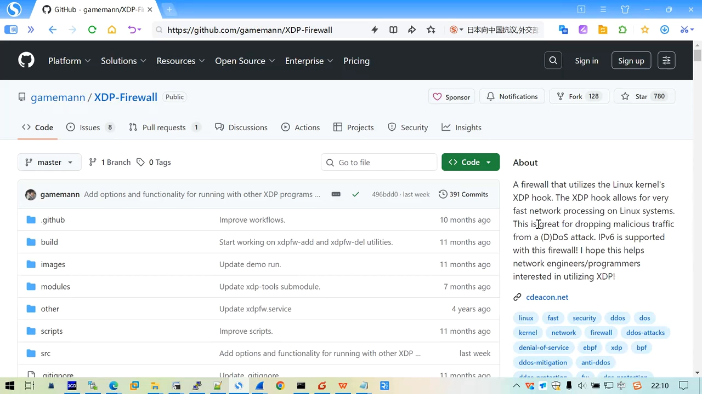
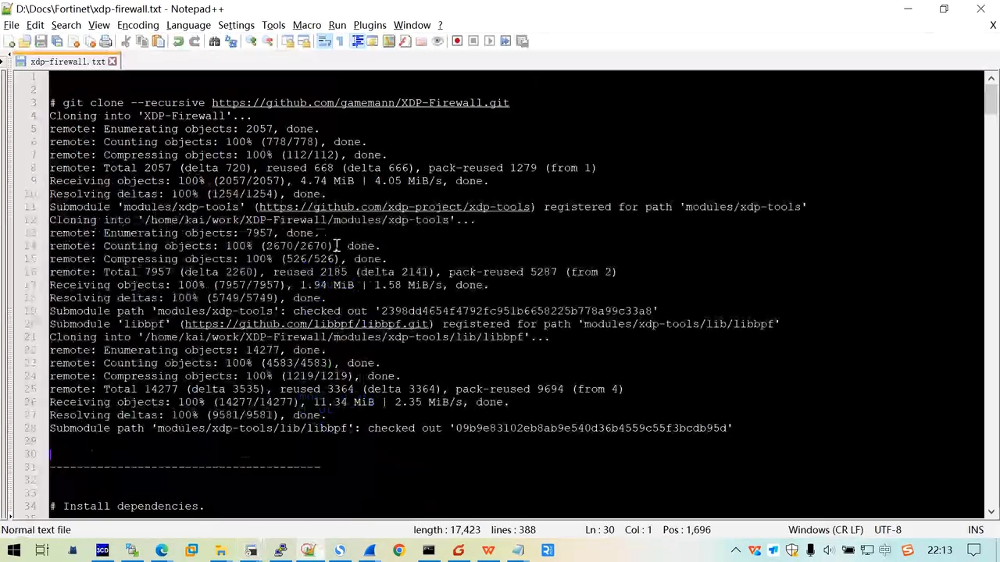
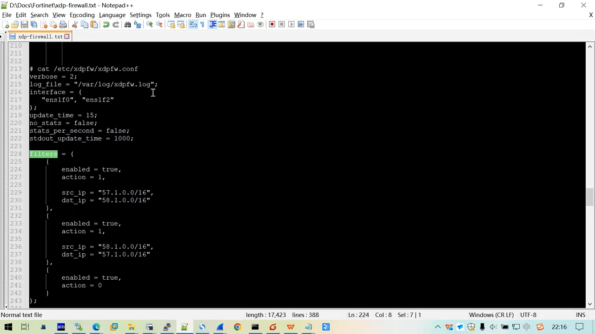
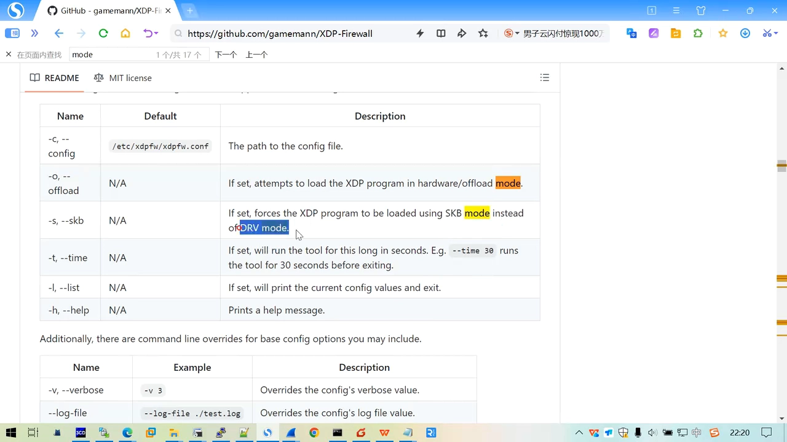

# XDP-Firewall 无状态防火墙

> 本文整理自 B 站视频《XDP-Firewall-无状态防火墙》。它不讲 eBPF 原理，而是**把一个真实开源的 XDP 防火墙从安装到实测完整跑一遍**：为什么要把程序挂在 XDP 钩子上、配置文件怎么写、`DRV` 与 `SKB` 两种挂载模式差在哪、为什么无状态防火墙必须为「来回两个方向」各配一条规则，以及最后顺带测出来的转发性能。

## 本讲要解决的核心问题（SCQA）

**背景**：DDoS 攻击、端口扫描这类流量，理想的做法是**在报文还没进入协议栈、还没占用内核资源之前就把它丢掉**。Linux 提供的 XDP（eXpress Data Path）钩子正好挂在网卡驱动收包的最前端，天生适合干这件事。

**冲突**：道理都懂，但真上手一个 XDP 防火墙时，一堆具体问题就冒出来了——程序要加载到哪些网卡上？「无状态」到底意味着什么？为什么 ping 明明放行了却还是不通？`DRV` 和 `SKB` 两种模式选哪个？性能到底掉了多少？

**疑问**：一个落地可用的 XDP 防火墙，究竟该怎么装、怎么配、怎么验证，它的能力边界又在哪里？

**回答（中心思想）**：**XDP-Firewall 把「判断」放在网卡驱动收包的最早处（`DRV`/native 模式），命中的报文在 `skb` 还没分配时就被丢弃**；而它之所以叫「无状态」，是因为程序里**不维护任何连接/会话**，所以一条放行策略只对「单方向」生效——想让 `client ↔ server` 互相 ping 通，必须**为两个方向各配一条规则**，并且要注意规则的**先后顺序**。理解了这两点，安装、配置、排障就都顺了。

[【跳转到 00:00】](https://www.bilibili.com/video/BV17yrgBtEgY/?t=0)

---

## 一、它是什么：挂在 XDP 钩子上的无状态防火墙

这个项目的定位很明确：**程序挂在 Linux 内核的 XDP 钩子上，用来做分布式 DDoS 攻击的预防**。它的核心卖点是——**能在报文进入协议栈之前就把报文 drop 掉**，也就是「越早拦截，代价越小」，同时还支持 IPv6。



它是一个开源的 GitHub 项目，因为用了 XDP，**性能被认为是它最大的优势**。它提供了几类工作模式：

- **默认：动态过滤（dynamic filter）**——可以在运行时**动态**地加入基于五元组（源/目的 IP、端口、协议等）的 IPv4 / IPv6 规则；
- **模式 1：按 IP 范围丢弃**；
- **模式 2：提取源 IP 地址做黑名单**。

启动的时候，可以用参数指定它按哪种模式工作。

[【跳转到 00:49】](https://www.bilibili.com/video/BV17yrgBtEgY/?t=49)

> **一个名字上的提醒**：它叫「防火墙」，但它是**无状态（stateless）**的——这一点会在第五、六节反复出现，也是新手最容易踩坑的地方。

---

## 二、安装：clone `--recursive` 加一个 install 脚本

安装流程和大多数 C 语言开源项目差不多，只有两个关键动作。

**第一步：下载代码。** 用它 README 里给的那条命令，注意带上 `--recursive`，它会**把所有的子仓库一起拉下来**——因为它依赖 `xdp-tools` 和 `libbpf` 这两个外部库。

```bash
git clone --recursive <项目地址>
```

[【跳转到 02:04】](https://www.bilibili.com/video/BV17yrgBtEgY/?t=124) / [【跳转到 02:29】](https://www.bilibili.com/video/BV17yrgBtEgY/?t=149)



**第二步：编译 + 安装。** 项目自带一个「编译加安装」的脚本，执行它就行。脚本内部会：

1. 先安装一批**开发工具与依赖**（编译所需的库、`libbpf` 库、内核头文件、XDP 开发库等）——示例里是 **Ubuntu 24.04、内核 6.8**，作者特别提醒 **XDP 对内核版本要求比较高**；
2. 先编译 `libxdp` / `xdp-tools` 这些依赖；
3. 再编译它自己的工程文件；
4. 最后把编译和安装一起做掉（脚本里带了 `install`），可以看到它把 **XDP-Firewall 装到了 `/usr/bin`** 下，还有一个 service 文件；
5. 另外附带两个工具：一个 **`add`**、一个 **`delete`**，用来**动态增删规则**。

[【跳转到 03:10】](https://www.bilibili.com/video/BV17yrgBtEgY/?t=190) / [【跳转到 03:55】](https://www.bilibili.com/video/BV17yrgBtEgY/?t=235) / [【跳转到 04:45】](https://www.bilibili.com/video/BV17yrgBtEgY/?t=285)

---

## 三、配置文件与「两个方向各一条规则」

视频里的测试环境很典型：

- **infinity**：装了 XDP-Firewall 的机器，地址以 `.1` 结尾；
- **autotest**：测试机，上面开了两个**网络命名空间** `client`（`.7`）和 `server`（`.8`）。

[【跳转到 05:10】](https://www.bilibili.com/video/BV17yrgBtEgY/?t=310)

启动时，防火墙会**读取一个配置文件并加载里面的规则**。规则里最重要的三项是 `enable`、`action`、`source`/`destination`：

- **`action = 0` → 丢弃（drop）**；**`action = 1` → 放通（pass）**；
- 还有两个参数：**`interface`** 决定 XDP 程序要加载到**哪些网卡**上；以及**日志文件目录**。

[【跳转到 06:00】](https://www.bilibili.com/video/BV17yrgBtEgY/?t=360) / [【跳转到 06:25】](https://www.bilibili.com/video/BV17yrgBtEgY/?t=385)



**这里就是最容易忽略的坑**：因为它**无状态**，程序里不记录「这条连接是从谁发起的」，所以**一条规则只对单方向生效**。想让 `client(57.1.1.2)` 和 `server(58.1.1.x)` 互相 ping 通，就必须写**两条规则**——`source` 和 `destination` 反过来，**两个方向都要放通**。

---

## 四、`DRV` 与 `SKB`：两种 attach 模式

启动防火墙的那条命令一执行，就能看到**它把 XDP 程序加载到了两个网口上，用的模式是 `DRV`（native）**。

[【跳转到 08:50】](https://www.bilibili.com/video/BV17yrgBtEgY/?t=530) / [【跳转到 09:02】](https://www.bilibili.com/video/BV17yrgBtEgY/?t=542)

XDP 有**两种模式**，区别就在「程序被执行的时机」：

| 模式 | 执行时机 | 特点 |
| --- | --- | --- |
| **`DRV`（native）** | 在 `skb` **尚未分配之前**就执行 | 处理得更靠前，**代价最小** |
| **`SKB`（generic）** | 网卡收到包、**已经分配好 `skb` 结构之后**才执行 | 靠后，主要用于测试/兼容 |

[【跳转到 09:26】](https://www.bilibili.com/video/BV17yrgBtEgY/?t=566) / [【跳转到 09:51】](https://www.bilibili.com/video/BV17yrgBtEgY/?t=591)



理解了这一点，你就明白它为什么「性能好」：**该丢的包，在还没为它准备内核数据结构的时候就丢了。**

---

## 五、实测：先 drop、再放通

视频用 `tcpdump` + `ping` 现场验证，过程很直观：

1. **先确认基线**：默认 `client` ping `server` 是通的，`tcpdump` 能看到 `request` 和 `reply`；
2. **加载一条 `action=0`（drop）的规则**后，**ping 立刻不通了**，而且规则里的 **drop 计数在持续上涨**；
3. **查看规则**：这条规则只配了 `enable` 和 `action=0`，IP option、源/目的 IPv4、IPv6、TCP 标志位、端口、UDP、ICMP 都**没配**，所以它**匹配所有包**——于是所有流量都被拦；
4. **要放通就得再加规则**：用 `xdpfw` 加规则，`action=1`，并指定源 IP、目的 IP；
5. **`-S` 选项的玄机**：加了 `-S` 表示**更新正在运行的配置文件、立即生效**；不加 `-S` 只是写进配置、**不会立即生效**。

[【跳转到 10:28】](https://www.bilibili.com/video/BV17yrgBtEgY/?t=628) / [【跳转到 11:16】](https://www.bilibili.com/video/BV17yrgBtEgY/?t=676) / [【跳转到 12:45】](https://www.bilibili.com/video/BV17yrgBtEgY/?t=765) / [【跳转到 13:15】](https://www.bilibili.com/video/BV17yrgBtEgY/?t=795)

**最关键的一段踩坑**：加完两条方向规则后，**ping 仍然不通**。原因是——**新规则是「往后追加」的，而最前面那条「丢弃一切」的规则还在**，于是包**一上来就先匹配到它、被拒绝**。解决办法是**删掉那条通用丢弃规则**（按它的**序号**删除，示例里序号是 `1`），删完之后 **ping 立刻恢复，`overload` 和 `pass` 计数开始增长**。

[【跳转到 15:45】](https://www.bilibili.com/video/BV17yrgBtEgY/?t=945) / [【跳转到 16:10】](https://www.bilibili.com/video/BV17yrgBtEgY/?t=970)

> **规则顺序 = 匹配优先级**。这和 iptables、nftables 的「从上到下逐条匹配、命中即停」是同一种心智模型，值得记牢。

**性能实测**：用 `iperf3` 在命名空间里起 server、以 `-P 10`（并发 10 条）打 60 秒，结果是**发送端约 693 Mbps、接收端约 618 Mbps**（过程中一度到 760 Mbps 左右），服务端到客户端大约 660~670 Mbps。

[【跳转到 17:49】](https://www.bilibili.com/video/BV17yrgBtEgY/?t=1069) / [【跳转到 19:04】](https://www.bilibili.com/video/BV17yrgBtEgY/?t=1144)

---

## 六、为什么它不做「有状态」

视频最后抛出一个很多人会问的问题：**XDP-Firewall 能不能做成有状态的？** 项目作者的回答是：**目前没有计划**。原因是——

- **做起来复杂**：有状态就得**生成会话（session）**、维护连接表；
- **性能代价大**：一旦有了会话跟踪，**对性能的影响会非常大**，这恰恰违背了 XDP「轻、快」的初衷。

[【跳转到 20:24】](https://www.bilibili.com/video/BV17yrgBtEgY/?t=1224) / [【跳转到 20:49】](https://www.bilibili.com/video/BV17yrgBtEgY/?t=1249)

所以它把「简单」当成了设计取舍：**用无状态换性能，用「手工配两个方向」换实现简单**。如果你想做更细的端口、TTL、长度、TCP flag 过滤，它也都支持配置。

---

## 七、小结

- **定位**：XDP 钩子上的**无状态防火墙**，主打在报文进协议栈前丢弃，适合 DDoS 预防；
- **安装**：`git clone --recursive`（带 xdp-tools / libbpf）→ 执行自带 install 脚本；
- **配置**：`action 0 = drop`、`1 = pass`；`interface` 决定加载到哪些网卡；
- **核心心智**：**无状态 ⇒ 一条规则只管一个方向 ⇒ 来回都要配**；**规则顺序决定匹配优先级**；
- **模式**：`DRV`/native 在 `skb` 分配前执行（快），`SKB`/generic 在其后执行（主要用于测试）；
- **能力边界**：**不做有状态**，因为会话跟踪复杂且严重影响性能。

### 术语速查

| 术语 | 含义 |
| --- | --- |
| **XDP** | eXpress Data Path，挂在网卡驱动收包最前端的 eBPF 钩子 |
| **`DRV` / native** | XDP 在 `skb` 分配前执行的模式，开销最小 |
| **`SKB` / generic** | XDP 在 `skb` 分配后执行的模式，多用于测试 |
| **无状态防火墙** | 不维护连接/会话，规则按单方向逐条匹配 |
| **`-S`** | `xdpfw` 参数：更新运行中的配置并立即生效 |
