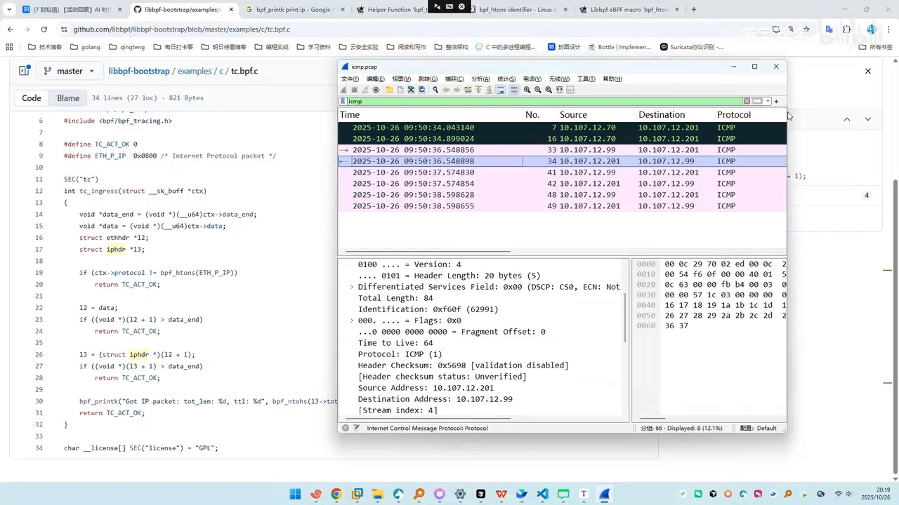
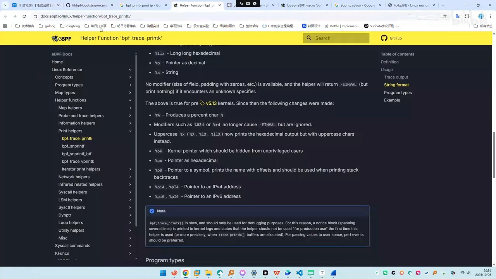
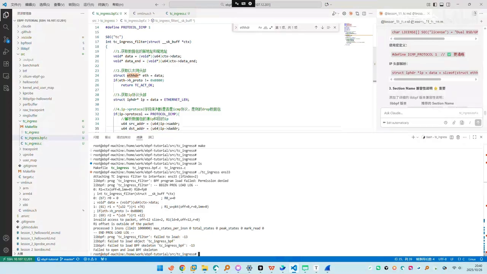

# 【硬核入门13】eBPF 实战：tc ingress 过滤入站 ICMP 包

> 本文整理自 B 站《【硬核入门13】eBPF实战之tc ingress过滤入站ICMP包》。这一讲延续「少学理论、多实践」的风格，**从官网示例出发，手把手写一个用 TC ingress 丢弃入站 ICMP 包的 eBPF 程序**：先读懂内核态代码怎么一层层解析数据包，再讲清 `TC_ACT_OK` / `TC_ACT_SHOT` 两个返回值的含义，最后把用户态「创建 tc hook 并挂载」的三步拆开——中间顺带还原了**验证器一层层逼着你加边界检查**的真实过程。

## 本讲要解决的核心问题（SCQA）

**背景**：TC（traffic control）是 Linux 内核的**流量控制子系统**；把 eBPF 程序挂到它的 **ingress（入站）** 方向，就能在数据包**刚进网卡、还没交给协议栈**时先做一层判断。

**冲突**：规则原理一句话能说完，但真写起来处处是坎——数据包在内核里长什么样？怎么从字节流里找到 ICMP？`drop` 在 TC 里到底怎么写？为什么一编译就被验证器拦住，报一堆 `invalid access to packet`？

**疑问**：一个能运行的 TC ingress eBPF 程序，从取数据包指针到把它挂上网卡，中间到底要做哪几步？

**回答（中心思想）**：**TC ingress 的本质是「在入站方向拿到数据包的首尾指针，自己按字节布局逐层解析，再返回一个动作码」**。程序做三件事——**解析**（`ctx->data`/`data_end` → 以太网头 → IP 头 → 协议号）、**判断**（`protocol == 1` 即 ICMP）、**返回**（`TC_ACT_SHOT` 丢弃 / `TC_ACT_OK` 放行）；而**每一步解析都必须先做边界检查**，这正是验证器反复报错、逼你补全的地方。

[【跳转到 00:00】](https://www.bilibili.com/video/BV1sMs6ziE1b/?t=0)

---

## 一、什么是 TC ingress

TC（traffic control）是**内核的流量控制子系统**。eBPF 的 TC 程序按方向分两种：

- **ingress**：附加到网络接口的**入站方向**，也就是**接收**数据包的方向；
- **egress**：**出站**方向。

这一讲只学**入站**。学习目标也很具体：

1. 理解 TC ingress 的**工作原理**；
2. 学会**编写处理入站数据包**的程序；
3. 掌握 **TC 程序返回值的含义**；
4. 实现一个**丢弃入站 ICMP 包**的程序。

[【跳转到 00:55】](https://www.bilibili.com/video/BV1sMs6ziE1b/?t=55) / [【跳转到 01:45】](https://www.bilibili.com/video/BV1sMs6ziE1b/?t=105)

**效果很直观**：作者在一台地址为 `10.107.12.210` 的机器上先 `ping` 通目标；**程序一挂上去，别人就 ping 不通了**——因为我们过滤掉了**入站的 ICMP 包**。

[【跳转到 02:14】](https://www.bilibili.com/video/BV1sMs6ziE1b/?t=134) / [【跳转到 02:36】](https://www.bilibili.com/video/BV1sMs6ziE1b/?t=156)

---

## 二、从官网示例入手：先看内核态代码

一开始不知道怎么写的时侯，作者去参考了 **libbpf-bootstrap** 项目里 `example/c` 下的 **`tc/bpf.c`**。这里有个新人常犯的混淆：**内核态代码和用户态代码在不同的文件、不同的路径**。

[【跳转到 02:56】](https://www.bilibili.com/video/BV1sMs6ziE1b/?t=176) / [【跳转到 03:24】](https://www.bilibili.com/video/BV1sMs6ziE1b/?t=204)

内核态程序的结构很清晰：

- 用 `SEC("tc")` 把函数放进 tc 段；
- 函数返回类型是 `int`，参数是 `struct __sk_buff *ctx`；
- **从 `ctx` 里取出数据包的首地址 `data` 与尾地址 `data_end`**；
- 再用 `ctx` 判断**是不是 IP 数据包**，不是就**直接放行**。

[【跳转到 03:36】](https://www.bilibili.com/video/BV1sMs6ziE1b/?t=216) / [【跳转到 03:41】](https://www.bilibili.com/video/BV1sMs6ziE1b/?t=221)

然后就是把指针**一层层往上挪**去解析包。以 ICMP 包为例，它的层次是：

```
[ 以太网头 L2 ] [ IP 头 L3 ] [ ICMP ... ]
```

- `eth + 1`：把 `data` 交给二层（以太网），指针往后挪一个 `struct ethhdr` 的长度；
- 若 `eth + 1 > data_end` 说明**越界**——这是**为了通过验证器**的检查；越界就**直接放行**（异常包不处理）。

[【跳转到 04:06】](https://www.bilibili.com/video/BV1sMs6ziE1b/?t=246) / [【跳转到 05:42】](https://www.bilibili.com/video/BV1sMs6ziE1b/?t=342)



**怎么识别 ICMP？** 关键在 IP 头的 **`protocol` 字段**：**`protocol == 1` 就是 ICMP**。

[【跳转到 06:11】](https://www.bilibili.com/video/BV1sMs6ziE1b/?t=371)

---

## 三、动手写内核态：五个关键点

总结一下内核态程序的写法（作者叫它「六个关键点」，核心就是下面这些）：

```c
#define ETH_HLEN      14          // 以太网帧头长度
#define IPPROTO_ICMP  1           // ICMP 协议号
#define TC_ACT_SHOT   2           // 丢弃

SEC("tc")
int tc_ingress_filter(struct __sk_buff *ctx)
{
    void *data     = (void *)(long)ctx->data;       // 包的首地址
    void *data_end = (void *)(long)ctx->data_end;   // 包的尾地址

    // 1) 以太网头
    struct ethhdr *eth = data;
    if ((void *)(eth + 1) > data_end) return TC_ACT_OK;   // 越界则放行

    // 2) 只关心 IPv4
    if (eth->h_proto != bpf_htons(0x0800)) return TC_ACT_OK;

    // 3) IP 头：数据指针往后偏移以太网头长度（14 字节）
    struct iphdr *ip = data + sizeof(struct ethhdr);
    if ((void *)(ip + 1) > data_end) return TC_ACT_OK;    // 越界则放行

    // 4) 判断是不是 ICMP
    if (ip->protocol == IPPROTO_ICMP) return TC_ACT_SHOT; // 丢弃

    return TC_ACT_OK;
}
```

几个要点展开：

1. **首、尾指针**：`void *data = ctx->data`、`void *data_end = ctx->data_end`——这对指针是后面所有解析的基础。
2. **以太网头**：`struct ethhdr *eth = data`，因为最先处理的就是以太网这一层。
3. **一眼判断是不是 IPv4**：以太网头的 **`h_proto` 字段等于 `0x0800`** 就表示上层是 IPv4；不等于就 return 放行（我们**不处理非 IPv4**）。
4. **偏移到 IP 层**：`struct iphdr *ip = data + sizeof(struct ethhdr)`，也就是**把指向数据包的指针往后偏移 14 字节**（以太网头长度）；也可以直接 `#define ETH_HLEN 14` 加 14。
5. **识别 ICMP**：`ip->protocol == 1`（`IPPROTO_ICMP`）就 `return TC_ACT_SHOT`。

[【跳转到 06:27】](https://www.bilibili.com/video/BV1sMs6ziE1b/?t=387) / [【跳转到 08:27】](https://www.bilibili.com/video/BV1sMs6ziE1b/?t=507) / [【跳转到 10:32】](https://www.bilibili.com/video/BV1sMs6ziE1b/?t=632) / [【跳转到 15:07】](https://www.bilibili.com/video/BV1sMs6ziE1b/?t=907)

> 写代码的小习惯：作者强调**每一步都标上注释**（「获取 IP 协议包」「获取以太网头」……），让逻辑有条理。

### 3.1 两个返回值：`TC_ACT_OK` 与 `TC_ACT_SHOT`

`drop` 在 TC 里怎么写？在 `bpf_tc_action` 里能找到方向：

| 返回值 | 数值 | 含义 |
| --- | --- | --- |
| **`TC_ACT_OK`** | `0` | 允许报文继续处理（**放行**） |
| **`TC_ACT_SHOT`** | `2` | **终止处理管线并丢弃该包**（**丢弃**） |

所以对我们来说，「丢弃」就是 `#define TC_ACT_SHOT 2` 后 `return TC_ACT_SHOT`。顺带还得解析出源/目的 IP 好打印：源 IP 是 IP 头里的 `saddr`（`u32`），目的 IP 是 `daddr`。

[【跳转到 12:59】](https://www.bilibili.com/video/BV1sMs6ziE1b/?t=779) / [【跳转到 13:24】](https://www.bilibili.com/video/BV1sMs6ziE1b/?t=804) / [【跳转到 17:16】](https://www.bilibili.com/video/BV1sMs6ziE1b/?t=1036)

**打印 IP** 用的是 `bpf_printk`，它的格式里有个专门的占位符 **`%pI4` 用来打印 IPv4 地址**（无符号整型用 `%u`，`%p` 打指针）：

```c
bpf_printk("ICMP %pI4 -> %pI4", &ip->saddr, &ip->daddr);
```

[【跳转到 18:29】](https://www.bilibili.com/video/BV1sMs6ziE1b/?t=1109) / [【跳转到 19:19】](https://www.bilibili.com/video/BV1sMs6ziE1b/?t=1159)

---

## 四、用户态：用 tc 就三步

用户态可以理解成「抄它例子里 `libbpf-bootstrap` 的 `tc.c`」，无非几样东西：声明 `bpf_tc_hook`、打开并加载 BPF、**再多一步「创建 tc hook 并 attach」**。用 tc 的完整流程就三步：

1. **求网口索引**：用 `if_nametoindex` 求网口索引，赋给 TC 变量；
2. **填 hook**：`bpf_tc_hook` 有两个成员——**`attach_point` 必须填 `BPF_TC_INGRESS`**（因为是入站方向），**`ifindex` 填刚求出的接口索引**；
3. **创建并挂载**：调用两个函数创建并挂载。挂载时 `tc_opts` 是自己创建的，得**指定程序的 fd**——这里**填的名字必须和内核态函数名一致**（比如作者的内核态函数叫 `tc_ingress_filter`，这里就得写 `tc_ingress_filter`，这点一定要注意）。

[【跳转到 20:14】](https://www.bilibili.com/video/BV1sMs6ziE1b/?t=1214) / [【跳转到 20:44】](https://www.bilibili.com/video/BV1sMs6ziE1b/?t=1244) / [【跳转到 21:09】](https://www.bilibili.com/video/BV1sMs6ziE1b/?t=1269)



---

## 五、真实编译过程：验证器一步步逼你补边界检查

这段很「真实」，也最有价值——**照着抄完，编译却一直在报错**，而每一次报错都在教你怎么和验证器打交道：

1. **`integer to pointer conversion`（通过 u32）**：指针在 x64 平台是 8 字节（等同 `u64`），**从 32 位直接转成 64 位指针**验证器觉得有问题，于是**先转成 `u64`、再转成指针**。
2. **`compare brain of distant pointer to void`**：指针加了偏移之后**类型变了**（原来是 `struct ethhdr` 类型），需要**再多做一次类型转换**。
3. **`invalid access to packet, off 12 size 2 ... out of the packet`**：读数据包时**可能越界**（`ETH` 头还没确认长度就往下读），于是**必须在 `eth + 1` 处做边界判断**——把「以太网头加一」的地址**和 `data_end` 比较**，比 `data_end` 大就是异常包，**放行**。IP 层同理。

[【跳转到 22:30】](https://www.bilibili.com/video/BV1sMs6ziE1b/?t=1350) / [【跳转到 27:31】](https://www.bilibili.com/video/BV1sMs6ziE1b/?t=1651) / [【跳转到 25:42】](https://www.bilibili.com/video/BV1sMs6ziE1b/?t=1542)



> **用 AI 辅助排错**：作者也把出错信息交给 Claude Code 帮忙排查，并强调一条学习原则——**先自己优先解决，解决不了再让 AI 辅助排查**，而不是一上来就全靠 AI。

[【跳转到 30:39】](https://www.bilibili.com/video/BV1sMs6ziE1b/?t=1839) / [【跳转到 31:03】](https://www.bilibili.com/video/BV1sMs6ziE1b/?t=1863)

---

## 六、挂载效果与小结

把程序挂到 `enp0s3` 上，期望值是：**`enp0s3` 收到不管谁发来的 ICMP 包都丢弃**。加载之后，对面一直在发的 `ping` **立刻断了**——目标达成。

[【跳转到 25:00】](https://www.bilibili.com/video/BV1sMs6ziE1b/?t=1500) / [【跳转到 25:12】](https://www.bilibili.com/video/BV1sMs6ziE1b/?t=1512)

回顾整条链路：

- **概念**：TC 是内核的流量控制子系统，ingress 程序挂在网卡的**入站方向**；
- **内核态**：取 `data`/`data_end` → 解析以太网头（`h_proto == 0x0800`）→ 偏移到 IP 头 → 判 `protocol == 1`（ICMP）→ 返回 `TC_ACT_SHOT`/`TC_ACT_OK`；
- **返回值**：`TC_ACT_OK(0)` 放行、`TC_ACT_SHOT(2)` 丢弃；
- **用户态**：`if_nametoindex` 求索引 → `bpf_tc_hook{ BPF_TC_INGRESS, ifindex }` → create + attach（fd 名要对上）；
- **贯穿全程的一条铁律**：**每一步解析数据包都要先做边界检查**，否则验证器不让过。

### 术语速查

| 术语 | 含义 |
| --- | --- |
| **TC (traffic control)** | Linux 内核的流量控制子系统 |
| **ingress / egress** | 入站 / 出站方向 |
| **`__sk_buff`** | eBPF 程序里看到的数据包上下文，`data`/`data_end` 给出首尾指针 |
| **`ethhdr.h_proto`** | 以太网头协议字段，`0x0800` 表示上层是 IPv4 |
| **`iphdr.protocol`** | IP 协议号，`1` 表示 ICMP |
| **`TC_ACT_OK` / `TC_ACT_SHOT`** | 放行(0) / 丢弃(2) |
| **`%pI4`** | `bpf_printk` 中打印 IPv4 地址的占位符 |
