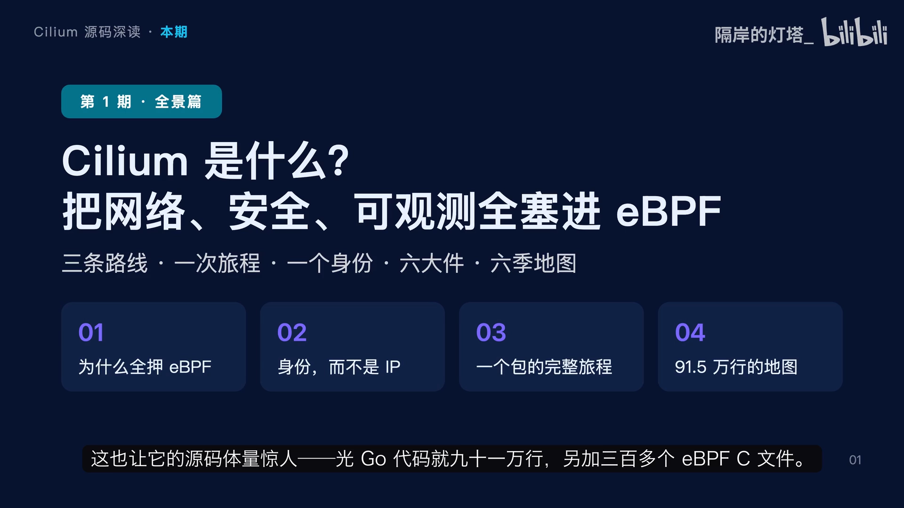
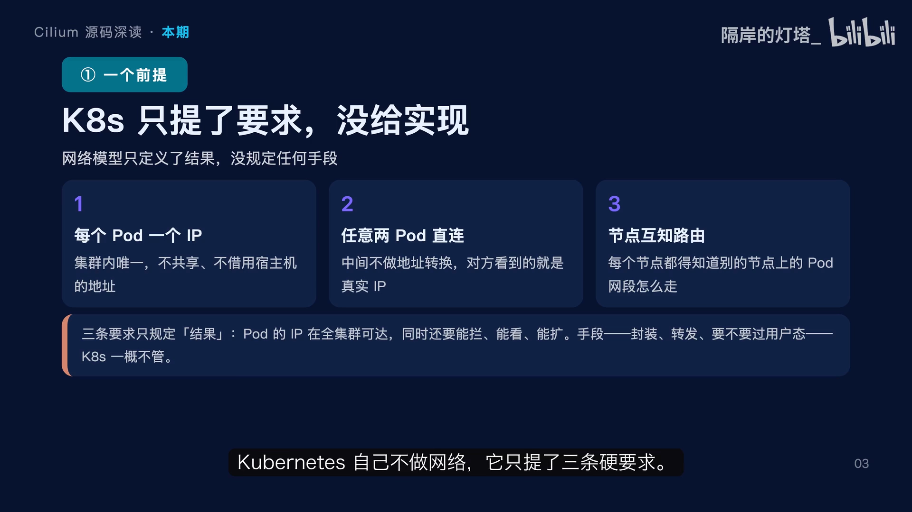
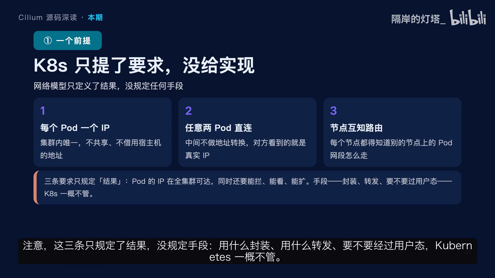
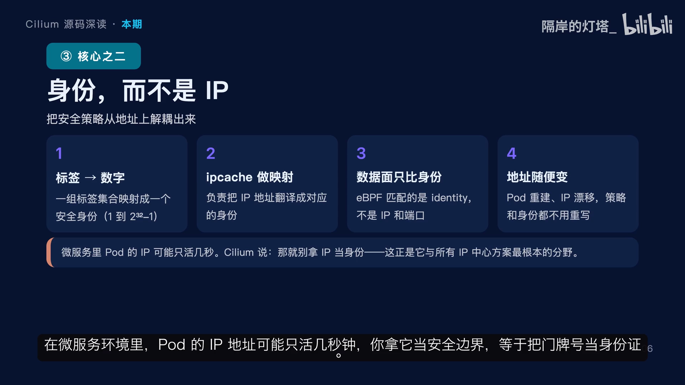
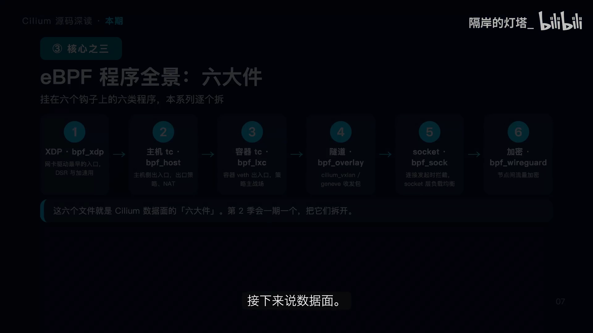
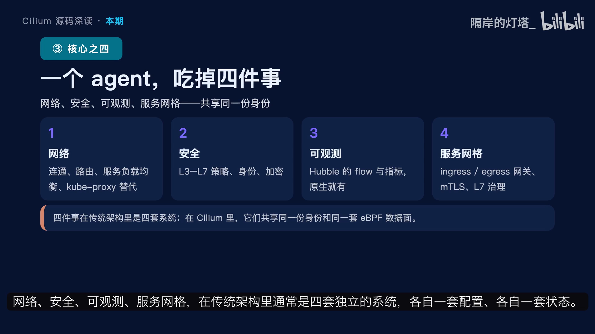
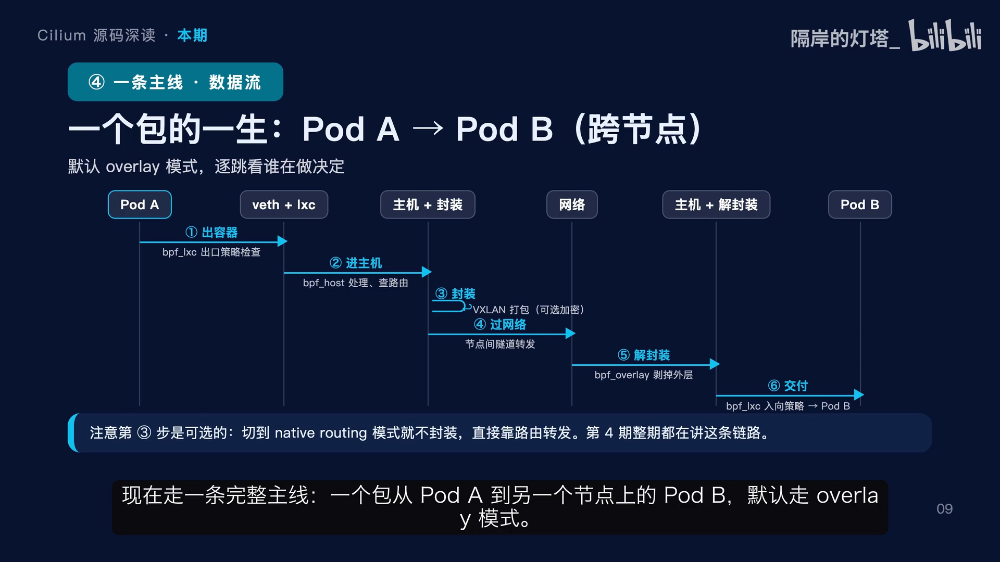
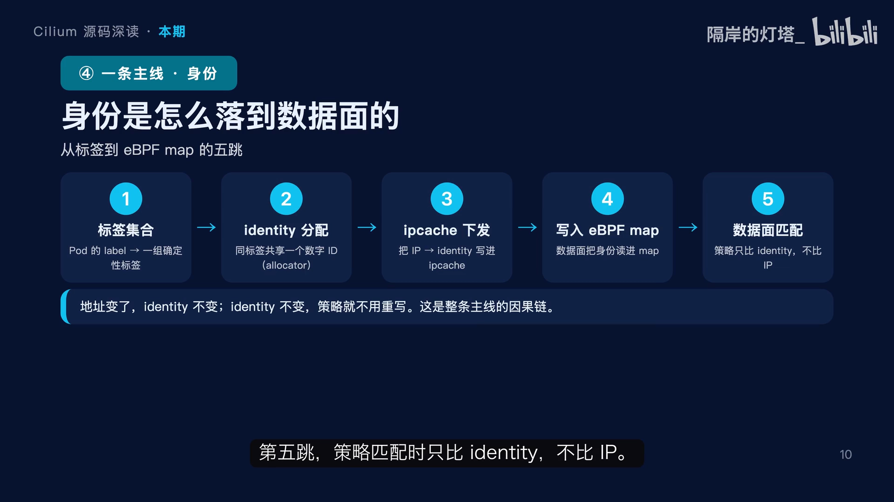
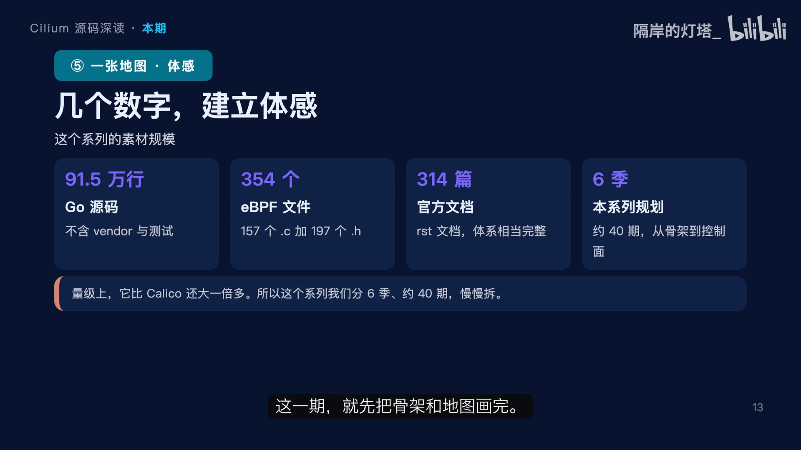
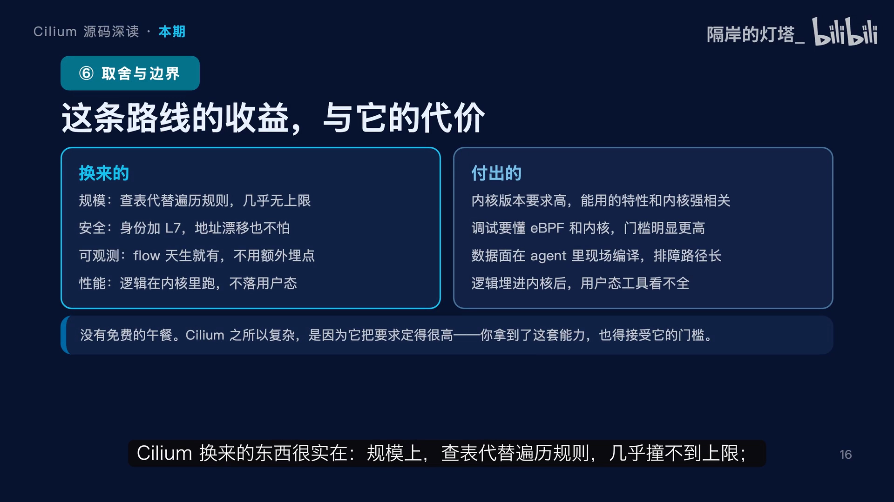

# Cilium 是什么？把网络、安全、可观测全塞进 eBPF

> 本文整理自 B 站视频《01·Cilium 是什么？把网络、安全、可观测全塞进 eBPF｜Cilium 源码深读》。这是一档「Cilium 源码深读」系列的第一期，目标不是抠某个具体函数，而是先把**整套系统的地图**画出来：Cilium 到底解决什么问题、它和传统网络方案的根本分歧在哪、一个数据包在它手里怎么走、它的代码是怎么组织的。全片沿四步展开——K8s 到底提了什么网络要求、iptables 与 eBPF 两条路线的分叉、一个 Pod 的身份如何从标签一路落到内核、以及最终的两张地图（包的旅程 + 代码分布）。

## 本讲要解决的核心问题（SCQA）

**背景（S）**：Kubernetes 已经成为容器编排的事实标准，GKE、EKS、AKS 等托管服务都在用它。每一个集群都必须在底下接一个网络方案（CNI），让分布在成百上千个节点上的 Pod 能互相通信。

**冲突（C）**：传统方案（Calico、Flannel 这类）习惯把网络规则一条条堆进 Linux 的 iptables，再额外跑一个 kube-proxy。这种「规则链 + 逐个遍历匹配」的思路在集群规模变大、Pod 频繁重建时会迅速吃力：规则数量爆炸、更新变慢，而且它的匹配依据是**随时会变的 IP 地址**。一旦把 IP 当成安全边界，就等于把门牌号当身份证。

**疑问（Q）**：有没有一种网络方案，不再往 iptables 里堆规则，而是把网络、安全、可观测这三件事一次性编译进内核里去跑？

**回答（中心思想）**：**Cilium 的整个数据面建立在 eBPF 之上**——它把策略和负载均衡编译成 eBPF 程序、直接挂到内核钩子上执行，用**哈希表查表**取代遍历规则链，用**稳定的「身份（identity）」**取代易变的 IP 做匹配，并且把能力一路做到第七层（HTTP/gRPC）。网络、安全、可观测、服务网格四件事**共享同一份身份和同一套数据面**，所以一份策略写完，四件事自动对齐。代价是：它对内核版本要求高、调试门槛高、数据面程序要现场编译、逻辑埋进内核后用户态工具看不全。

[【跳转到 00:00】](https://www.bilibili.com/video/BV1AcH16dEon/?t=0)

Cilium 是云原生世界里最重要的网络方案之一，也是 CNCF 的毕业项目，GKE、EKS、AKS 这些托管 Kubernetes 服务都把它当作默认或核心的网络与安全底座。它和 Calico、Flannel 有一个根本区别：**Cilium 不在 iptables 里堆规则，而是把网络、安全、可观测三件事全部编译进内核里跑**，这也让它的源码体量惊人——光 Go 代码就有约 91 万行，另加 300 多个 eBPF 的 C 文件。

---

## 一、起点：Kubernetes 自己不做网络，但提了三条硬要求

[【跳转到 01:10】](https://www.bilibili.com/video/BV1AcH16dEon/?t=70)

理解 Cilium 之前，先要把起点钉死：**Kubernetes 自己不做网络，它只提了三条硬要求。**

1. **每个 Pod 一个独立的 IP**：不借用宿主机的、也不跟别人共享；
2. **任意两个 Pod 之间必须能直接通信，中间不能做地址转换**：对方看到的必须就是 Pod 的真实 IP；
3. **每个节点都要知道其他节点上的 Pod 网段怎么走**。

关键在这三条**只规定了结果，没规定手段**：用什么封装、用什么转发、要不要经过用户态，Kubernetes 一概不管。这个「空白」正是所有 CNI 方案分道扬镳的地方，也是后面每一次对比的基准。

---

## 二、分叉：iptables 堆规则 vs. eBPF 编译进内核

[【跳转到 01:45】](https://www.bilibili.com/video/BV1AcH16dEon/?t=105)

同样是让 Pod 互通，两条路线差别远不止性能。

**传统做法**：在 iptables 里堆规则做服务负载均衡，还要额外跑一个 kube-proxy。它的特点是——

- 把**所有规则用链表串起来**，一个包进来就逐条遍历匹配策略，基于 IP 和端口；
- **地址一变就得重算**，规模一大规则数就爆炸；
- **更新也越来越慢**。

**Cilium 的做法**：

- 把策略和负载均衡**编译成 eBPF 程序**，直接挂在内核的钩子上；
- 数据面**查的是哈希表，不是遍历规则链**；
- 匹配的依据是**身份，不是 IP**；
- 而且能一路做到**第七层**，HTTP、gRPC 都认可；观测也是**原生内置**的。

### 2.1 eBPF 到底是什么

[【跳转到 02:34】](https://www.bilibili.com/video/BV1AcH16dEon/?t=154)

要理解 Cilium，得先理解 **eBPF 是什么**。一句话概括：**它不是内核模块，而是 Linux 内核自带的一套安全沙箱。**

它的工作方式可以拆成几步：

1. **你用 C 写一段逻辑**，编译成字节码；
2. **内核的验证器（verifier）检查**这段字节码，保证它不会把内核搞崩、而且一定会终止；
3. **JIT 编译器**把它翻译成 CPU 原生的指令，**直接在内核态运行，不落到用户态**；
4. 它的触发是**事件驱动**的：网卡收包、发包、进程发起连接，或者某段内核代码被执行，都可以挂程序。

程序之间的状态放在 **map** 里——那是一张内核和用户态共享的哈希表或数组。

所以最关键的一句话是：**eBPF 让内核变得可编程，而且不用改内核、不用加载模块、不用重启任何服务。**

### 2.2 第二个核心：身份（identity）

[【跳转到 03:17】](https://www.bilibili.com/video/BV1AcH16dEon/?t=197)

在微服务环境里，**Pod 的 IP 地址可能只活几秒钟**。你拿它当安全边界，等于把门牌号当身份证。

Cilium 干脆**不用 IP 当身份**，它把一组标签集合映射成一个数字，叫**安全身份 identity**，取值范围从 1 到 2³²−1。谁来负责 IP 到身份的翻译呢？是 **ipcache**。数据面做策略匹配时比的是**身份**，不是 IP 和端口。

这带来的直接好处是：**Pod 重建了、IP 漂移了，身份没变，策略就不用重写。** 这就是 Cilium 跟所有以 IP 为中心的方案最根本的分野。

---

## 三、数据面：一个 agent 吃四件事，六大件挂在六个钩子上

[【跳转到 03:56】](https://www.bilibili.com/video/BV1AcH16dEon/?t=236)

Cilium 的 eBPF 程序不是一个「大文件」，而是**按挂载点分成六类**，作者把它叫做「**六大件**」：

| 程序 | 挂载点 | 职责 |
| --- | --- | --- |
| `bpf_xdp` | XDP（网卡驱动最早的入口） | 性能最好，主要给 DSR 和加速用 |
| `bpf_host` | 主机网卡的 TC 钩子 | 管主机侧的出入口，做出口策略和 NAT |
| `bpf_lxc` | 容器的 veth 网卡 | **策略的主战场** |
| `bpf_overlay` | 隧道口 | 处理 overlay 的收发包 |
| `bpf_sock` | socket 层 | 在应用发起连接时就拦截，做 socket 层负载均衡 |
| `bpf_wireguard` | — | 负责节点之间的流量加密 |

### 3.1 一个 agent，吃掉四件事

[【跳转到 04:26】](https://www.bilibili.com/video/BV1AcH16dEon/?t=266)

Cilium 的 agent 吃掉四件事：**网络、安全、可观测、服务网格**。在传统架构里，这通常是四套独立的系统，各自一套配置、各自一套状态，Cilium 把它们合并了：

- **网络**：负责连通、路由、服务负载均衡，**直接替代 kube-proxy**；
- **安全**：负责 3 到 7 层的策略、身份和加密；
- **可观测**：就是 **Hubble 的 flow 和指标**，是数据面天然产生的；
- **服务网格**：是 Ingress 网关加上 mTLS 和七层治理。

**关键不在于功能多，而在于它们共享同一份身份、同一套数据面**——所以策略写完，四件事自动对齐。这是理解 Cilium 为什么能同时干这么多活的钥匙。

---

## 四、一个包的旅程（默认 overlay 模式）

[【跳转到 05:26】](https://www.bilibili.com/video/BV1AcH16dEon/?t=326)

走一条完整主线：一个包从节点 A 上的 Pod 到另一个节点上的 Pod B，默认走 **overlay 模式**，共六跳：

1. **第一跳**：包从容器出来，经过 veth 网卡，被 `bpf_lxc` 拦下做**出口策略检查**；
2. **第二跳**：进了主机，由 `bpf_host` 处理、查路由；
3. **第三跳**：如果走 overlay，就给包加上 **VXLAN 外层封装**；如果开了加密，这一步还会先加密；
4. **第四跳**：封装好的包从节点 A 的网络接口发出去，经过物理网络到节点 B；
5. **第五跳**：节点 B 上由 `bpf_overlay` **剥掉外层**；
6. **第六跳**：交给本地的 `bpf_lxc` 做**入向策略检查**，最后送进 Pod B。

要特别注意：**第三步是可选的**——切到 **native routing 模式**就完全不封装、直接靠路由。

### 4.1 第二条主线：身份从标签落到内核数据面

[【跳转到 06:15】](https://www.bilibili.com/video/BV1AcH16dEon/?t=375)

一条身份从标签一路落到内核数据面的链路：

1. Pod 带着它的 label，被整理成**一组确定性的标签集合**；
2. **身份分配器（identity allocator）**把这组标签映射成一个数字，**同样的标签集合共享同一个 identity**；
3. **ipcache** 把这个 Pod 的 IP 地址和它的 identity 对应起来，下发出去；
4. 数据面；
5. **策略匹配时只比 identity，不比 IP**。

整条链路的因果关系很干净：**地址变了，identity 不变；identity 不变，策略就不用重写。** 这也解释了为什么 Cilium 在 Pod 频繁重建的环境里依然稳。

---

## 五、组件地图：节点上跑哪些进程

[【跳转到 06:58】](https://www.bilibili.com/video/BV1AcH16dEon/?t=418)

一个 Cilium 集群里最重要的进程是 **`cilium-agent`**，每个节点跑一个，它管着这个节点所有的 eBPF 程序和状态。跟它一起装的还有：

- **`cilium-dbg`**：一个本机调试工具，直接连本节点 agent 的接口，能看 eBPF map 的原始状态；
- **Hubble 服务端**：内嵌在 agent 里，负责产出 flow 和指标；
- **Cilium CNI**：CNI 插件，Pod 被调度或删除时，Kubernetes 会调用它；
- **`cilium-operator`**：它只干那些**全集群做一次**的事，比如地址分配、资源清理。**关键点是它不在转发的关键路径上——它挂了，网络照样通**；
- **Hubble relay 和 Hubble UI**：负责跨节点聚合和图形界面。

最后，agent 之间靠什么传状态？**默认用 Kubernetes 的 CRD**，也可以选另一种机制。

### 5.1 控制面流向：一条策略怎么走到每个节点

[【跳转到 07:46】](https://www.bilibili.com/video/BV1AcH16dEon/?t=466)

1. 你用 `kubectl` 提交一个 **CiliumNetworkPolicy**；
2. 它被存进 Kubernetes 的 API server，成为一个 **CRD 资源**，也就是集群事实；
3. 每个节点上的 agent 都在 **watch** 这个资源，变更一发生就收到通知；
4. 各节点的策略引擎开始算：这条策略影响我本地的哪些 endpoint，算出一个**期望状态**；
5. agent 把结果**编译成对应的 eBPF 程序和 map 更新**，落到数据面。

整条链路最关键的一点是：**没有中心节点统一下发，每个 agent 自己算自己那一份**——这正是 Cilium 能水平扩展的原因，节点越多负载是被分摊的，不是压在中心。

---

## 六、代码地图：91.5 万行是怎么分布的

[【跳转到 08:16】](https://www.bilibili.com/video/BV1AcH16dEon/?t=496)

先建立一点体感：这个仓库的根源码去掉依赖和测试大约 **91.5 万行**，比 Calico 还大一倍多。eBPF 的 C 和头文件一共 **354 个**，其中 157 个是 `.c` 源文件，197 个是头文件。官方文档有 **314 篇**，rst 文档体系相当完整。面对这个规模，作者的规划是 **6 季、大约 47 期**：第一季讲骨架，第二季数据面，后面依次是服务负载均衡、策略与安全、可观测，最后是控制面与运维。

这张代码地图请务必记住，整个系列都在上面找坐标：

| 目录/模块 | 规模 | 职责 |
| --- | --- | --- |
| `bpf/` | — | eBPF 数据面六大件 + 90 多个库头文件 |
| `pkg/datapath` | ~6.3 万行 | 数据面的编排和加载 |
| `pkg/policy` | ~5.1 万行 | 策略引擎 |
| `pkg/hubble` | ~4.6 万行 | 可观测 |
| Envoy 集成 | ~3 万行 | 七层代理集成 |
| `loadbalancer` | ~2.3 万行 | 服务负载均衡 |
| BGP | ~2.4 万行 | BGP 控制面 |
| ClusterMesh | ~2.1 万行 | 多集群 |
| `daemon` / `operator` | — | 两大进程的入口，整个程序的启动点 |

### 6.1 第一季的路线

这一季六期都在打地基：

1. **第一期**：Cilium 是什么（你现在看的这期）；
2. **第二期**：一个 agent 是怎么启动的，重点讲 **Hive 依赖注入**——新版 Cilium 把上百个模块拼装成一个进程的框架；
3. **第三期**：把 eBPF 程序全景展开，讲清楚每类程序挂在哪个钩子、负责什么；
4. **第四期**：走一遍「一个包的一生」，也就是刚才那条主线的加长版；
5. **第五期**：endpoint 模型，一个 Pod 是怎么被 Cilium 认领、生成再重建的；
6. **第六期**：identity 和 ipcache，把第二个核心彻底讲透。

打完这六期的地基，第二季才开始一期一个挂载点，把六大件真正拆开。

---

## 七、代价：Cilium 换来了什么、又付出了什么

[【跳转到 10:35】](https://www.bilibili.com/video/BV1AcH16dEon/?t=635)

Cilium 换来的东西很实在：

- **规模上**：查表代替遍历规则，几乎撞不到上限；
- **安全上**：身份加七层策略，地址怎么飘都不怕；
- **可观测**：天生就有，不用额外埋点；
- **性能上**：逻辑在内核里跑，不落用户态。

但代价同样真实：

1. **对内核版本要求高**：能用哪些特性跟内核强相关，老内核上会退化成兼容模式；
2. **调试门槛明显更高**：你得懂 eBPF、懂内核，不然出了问题无从下手；
3. **数据面程序是在 agent 里现场编译的**：编译路径比一张静态规则表长得多；
4. **逻辑一旦埋进内核，很多用户态工具就看不全了**。

所以记住这句话：**Cilium 复杂，是因为它把要求定得高，你拿到这套能力也要接受它的门槛。**

---

## 小结

- **Cilium 的核心不是「又一个 CNI」，而是把整个数据面建立在 eBPF 之上**——策略与负载均衡编译成 eBPF 程序，挂在内核钩子上跑。
- **它用「身份 identity」取代「IP」做策略匹配**：标签集合映射成数字，pod 重建、IP 漂移都不影响策略。
- **K8s 只规定网络的三条硬要求**（Pod 独立 IP、Pod 间不做 NAT 直接通信、节点间知道彼此 Pod 网段），Cilium 用 eBPF 实现了这套要求。
- **数据面分「六大件」**，分别挂在 XDP、主机 TC、容器 veth、隧道口、socket 层等不同钩子上。
- **一个 agent 合并网络、安全、可观测、服务网格四件事**，因为它们共享同一份身份与同一套数据面。
- **一个包走六跳**：`bpf_lxc` 出口策略 → `bpf_host` → VXLAN 封装（可选）→ 物理网络 → `bpf_overlay` 解封装 → `bpf_lxc` 入向策略。
- **控制面没有中心下发节点**：每个 agent watch CRD、自己算本地的期望状态并编译下发，所以能水平扩展。
- **代价同样真实**：内核版本要求高、调试门槛高、数据面现场编译、逻辑埋进内核后用户态工具看不全。

## 关键术语速查

| 术语 | 一句话解释 |
| --- | --- |
| eBPF | Linux 内核自带的安全沙箱；用 C 写逻辑→编译字节码→验证器检查→JIT 成原生指令→内核态执行，不改内核即可编程 |
| identity（身份） | Cilium 把一组确定性标签集合映射成的数字，用作策略匹配的依据，取代易变的 IP |
| ipcache | 负责把 Pod 的 IP 与它的 identity 对应起来并下发的组件 |
| bpf_lxc / bpf_host / bpf_xdp / bpf_overlay / bpf_sock / bpf_wireguard | Cilium 数据面的「六大件」，分别挂在容器 veth、主机 TC、XDP、隧道口、socket 层等钩子上 |
| cilium-agent | 每个节点一个的进程，管着该节点所有 eBPF 程序和状态 |
| cilium-operator | 只做全集群做一次的事（地址分配、资源清理），不在转发关键路径上 |
| Hubble | Cilium 的可观测组件，由数据面天然产生 flow 和指标 |
| overlay / native routing | 跨节点通信的两种模式：前者用 VXLAN 封装，后者直接靠路由不封装 |
| CiliumNetworkPolicy | Cilium 的策略资源（CRD），提交后各节点 agent 各自派生并编译下发 |
