# eBPF 在云原生中的运用（倪朋飞）

> 本文整理自 B 站视频《eBPF在云原生中的运用-倪朋飞》。讲者是微软 AKS 团队的倪朋飞，AKS 以及微软内部大量在线服务、AI 负载都跑在 AKS 之上。这场分享从**内核视角**出发，系统讲清三件事：**eBPF 是什么、它从哪来**；**它在通用场景和云原生特殊场景里怎么用**（重点以 Cilium、Hubble、Tetragon、PWRU、Pixie 等开源项目为例）；以及**实际落地时要注意什么、有哪些最佳实践**。

## 本讲要解决的核心问题（SCQA）

**背景（S）**：云原生把应用和基础设施都拆散了——容器、Pod、微服务、多集群，网络、可观测性、安全、追踪样样都要管。这些需求大多集中在**操作系统内核**这一层，而内核历来是「改不动」的地方：想定制逻辑，通常得写内核模块（kmod），或者干脆改内核源码、重新编译。

**冲突（C）**：内核模块**非常脆弱**——里面任何一处出问题都可能把整个系统搞崩，且**没有任何有效的安全控制机制**。于是内核扩展的门槛高得吓人：不是内核开发者根本碰不了。可偏偏云原生里最需要灵活观测和处理的地方，全都埋在内核里。

**疑问（Q）**：有没有一种既能在内核里做事、又足够**安全**、还**不需要你是内核专家**的技术？它能用在网络、可观测性、安全、追踪这些场景，并且能和容器、K8s 这套云原生体系自然结合吗？

**回答（中心思想）**：**eBPF 就是这道门槛的降级器。** 它在内核里跑一个**虚拟机**，加载你的程序前**先做验证**，只有验证通过、被认为安全的指令才放进内核执行；再加上 **JIT 编译**与**全部运行在内核态**带来的高效率，**普通的应用开发者、甚至运维**都能用 eBPF 实现想要的功能。到了云原生里，eBPF 把网络、安全、可观测性、追踪四件事一次打通——Cilium 用它**跳过内核协议栈加速网络**、用 **socket redirect** 省掉 service mesh 的中转开销；Hubble / Pixie 用它**无需改应用代码**就画出服务调用图；Tetragon 用它做安全监控与策略执行。用它的核心思路是：**把从 eBPF 拿到的数据，跟你现有的网络、观测、安全系统关联起来。**

[【跳转到 00:00】](https://www.bilibili.com/video/BV1Ps4y127HN/?t=0)

---

## 一、eBPF 到底是什么

[【跳转到 01:15】](https://www.bilibili.com/video/BV1Ps4y127HN/?t=75)

可能你没用过 eBPF，但 Linux 上一个非常常用的抓包工具 **tcpdump** 你一定用过——它是排查网络问题的必备工具。而 **tcpdump 最底层的抓包实现，就是基于 BPF**（Berkeley Packet Filter，伯克利数据包过滤器）。

[【跳转到 01:28】](https://www.bilibili.com/video/BV1Ps4y127HN/?t=88)

BPF 最早**顾名思义**，就是用来做**网络数据包过滤**的。后来内核在此基础上加了一个 extended（扩展）版本，也就是 **eBPF**——从「只过滤网络包」逐步扩展到了**内核的方方面面**，成了今天的 eBPF。

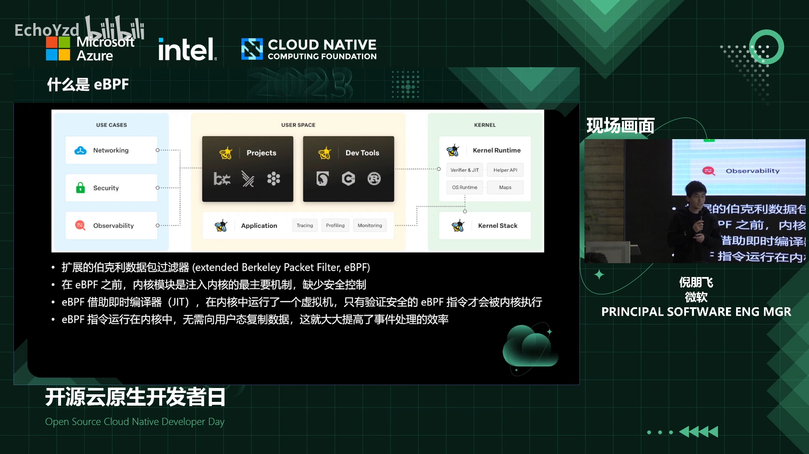

### 1.1 为什么需要 eBPF：内核模块太脆弱

[【跳转到 02:18】](https://www.bilibili.com/video/BV1Ps4y127HN/?t=138)

在 eBPF 之前，如果不想把代码贡献进内核社区、又想在核心里实现自己的特殊逻辑，通常只能**写内核模块**。但内核模块的问题很致命：**任何一处出问题，都可能让内核乃至整个系统崩溃**，而且它**没有任何有效的安全控制机制**。所以内核模块在所有应用场景里都是**非常脆弱**的。

[【跳转到 02:43】](https://www.bilibili.com/video/BV1Ps4y127HN/?t=163)

**eBPF 的诞生把这道门槛大大降低了。** 它的做法是：内核里运行一个**虚拟机**；在你加载 eBPF 指令码**之前先做验证**，只有验证通过、被认为是安全的指令才加载进内核执行。

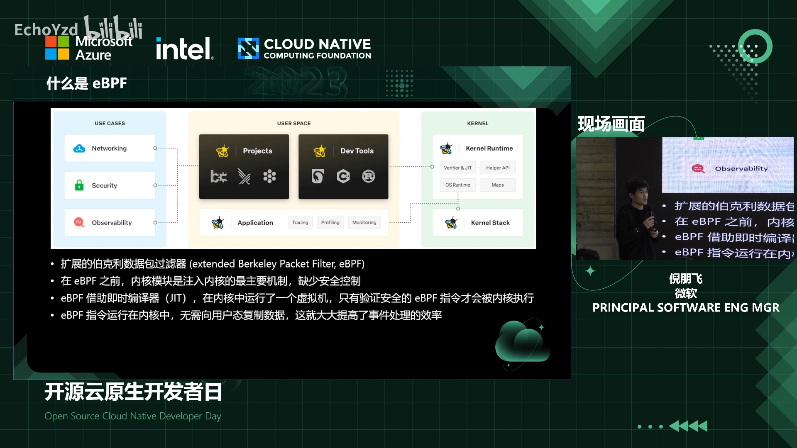

这意味着——**你不需要是内核开发者**，哪怕只是普通应用开发人员或运维，都能用 eBPF 实现很多想要的功能。

### 1.2 eBPF 用在哪、为什么高效

[【跳转到 03:33】](https://www.bilibili.com/video/BV1Ps4y127HN/?t=213)

eBPF 的主要场景包括：最传统的**网络**（数据包过滤、网络性能优化）、**安全**、**观测**、**探测/跟踪**等。

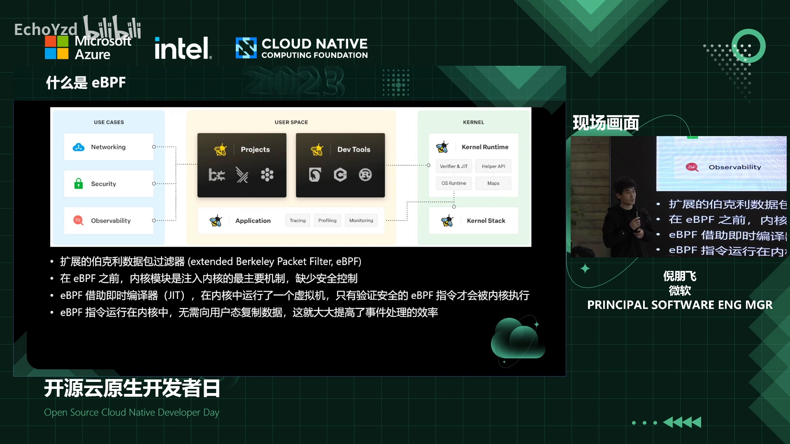

[【跳转到 03:58】](https://www.bilibili.com/video/BV1Ps4y127HN/?t=238)

eBPF 虽然有虚拟机，但它**仍然运行在内核中**，指令码也在内核里预设；它引入了一个 **JIT（即时）编译器**，把你写的程序转成**字节码**再加载到内存执行。执行时**非常高效**，而且**不需要跟用户态频繁做上下文交互**（完全在内核中运行），效率有保证。正因如此，eBPF 的应用场景变得非常广泛。

---

## 二、一个 eBPF 程序的完整生命周期

### 2.1 写、编译、加载、验证

[【跳转到 04:23】](https://www.bilibili.com/video/BV1Ps4y127HN/?t=263)

看一个最简单的例子：

1. 先**写一个 eBPF 程序**——可以用 **C 语言**或 **Rust** 写，也可以直接按指令码一步步写（后者较少见）；
2. 用编译器（**gcc / llvm**）把它编译成 **BPF 字节码**；
3. 通过 **`bpf` 系统调用**把字节码**加载进内核**；
4. 内核**验证**指令码，通过后加载进内核的 **BPF 虚拟机**执行。

### 2.2 事件触发：程序得「挂」到某件事上

[【跳转到 05:12】](https://www.bilibili.com/video/BV1Ps4y127HN/?t=312)

和内核模块不一样，eBPF 程序执行时是**事件触发**的：你必须把程序**挂载到某个事件**上。常见有四类：

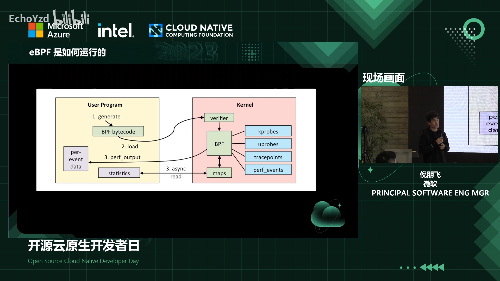

- **kprobe**：内核探针，可挂到内核的跟踪点或**内核函数**上；
- **uprobe**：用户态探针，可挂到**用户态函数**或跟踪点上；
- **tracepoint**：内核里**预先定义**的跟踪点；
- **perf_event**：性能事件，适合观测中**海量且与性能直接相关**的数据。

[【跳转到 05:37】](https://www.bilibili.com/video/BV1Ps4y127HN/?t=337)

这里有个关键区别：**tracepoint 是稳定的 API**；而 **kprobe / uprobe 是不稳定的 API**——因为你选定的内核/应用函数，它的**名字、签名本身都不稳定**。

### 2.3 map：内核态与用户态之间的桥

[【跳转到 06:27】](https://www.bilibili.com/video/BV1Ps4y127HN/?t=387)

很多场景下，我们要知道内核**内部的状态**（比如性能数据），需要把它**读出来**用于事后分析。eBPF 的 **map** 就是干这个的：比如哈希映射、性能事件，都可以存进**内核专用的存储**里，用户态再通过**系统调用读出来**。

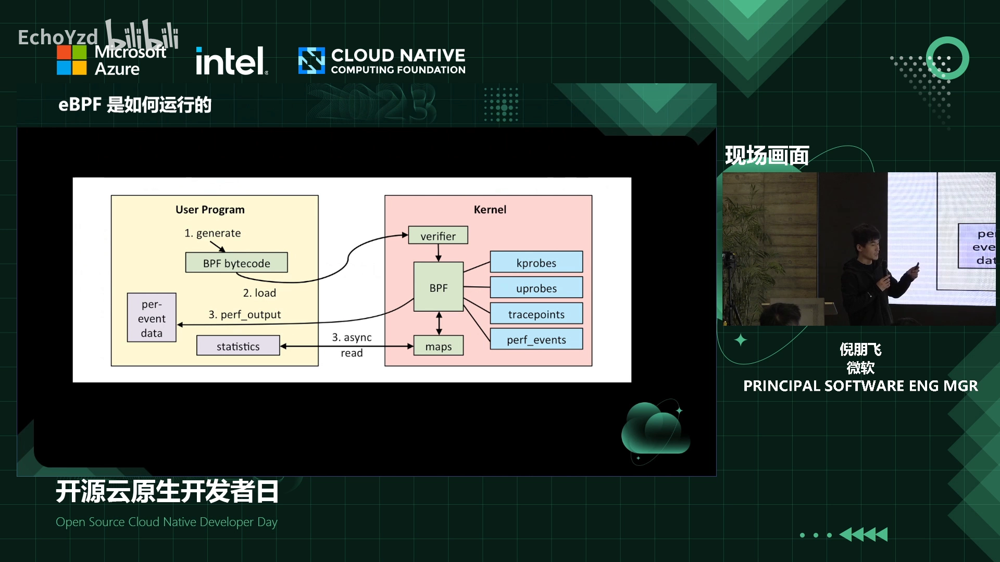

关键是：**用户态读写 map 与 eBPF 的执行是异步的**，两者没有直接交互——所以你**不会因为用户态去读写 map 而拖慢 eBPF 程序**。

### 2.4 上手示例：C + Python（BCC）

[【跳转到 07:42】](https://www.bilibili.com/video/BV1Ps4y127HN/?t=462)

最简单的写法是 **C 语言 + Python 的 BCC 库**。举一个 `hello world` 的例子：

[【跳转到 07:47】](https://www.bilibili.com/video/BV1Ps4y127HN/?t=467)

- 在 C 里写一个简单程序，打印一条 `hello world`；
- 用 Python 把这份源码**加载进来**；
- 把它**挂载到一个内核事件**上——这个例子挂的是 **kprobe** 类型的探针，event 是系统调用 **`openat`**（打开文件对应的系统调用），并指定要挂到哪个函数名上；
- 最后 `trace_print` 把内核打印的日志读出来。

[【跳转到 08:37】](https://www.bilibili.com/video/BV1Ps4y127HN/?t=517)

这里有个和普通 `hello world` 不同的点：**BPF 的 print 是在内核里的**，而 Python 程序在用户态，它读的时候并不是直接把内核态日志打到用户态，而是**通过内核的调试文件系统**（一个 `pipe`，内核里写、外面读）打印出来的。这在**调试 eBPF 程序时非常有用**，但**生产上不推荐**——它会**拖慢 eBPF 的性能**。

[【跳转到 09:27】](https://www.bilibili.com/video/BV1Ps4y127HN/?t=567)

BCC 的一个好处是：它把 eBPF 程序从**编译到执行再到挂载**的所有环节都封装好了，你只跑一个 Python 脚本就行，不用手动 `gcc` 编译字节码、手动调 bpf 系统调用、手动挂载、再手动读各种 map。

[【跳转到 09:52】](https://www.bilibili.com/video/BV1Ps4y127HN/?t=592)

在 **AKS 上已经内置了 BCC**。它除了好用的库，还提供了**非常多的小工具**——跟踪网络、跟踪 IO、跟踪各种各样的事情，排障时非常方便。

---

## 三、eBPF 的发展历程

[【跳转到 10:39】](https://www.bilibili.com/video/BV1Ps4y127HN/?t=639)

了解 eBPF 的来龙去脉，能更好理解它今天为什么这么强：

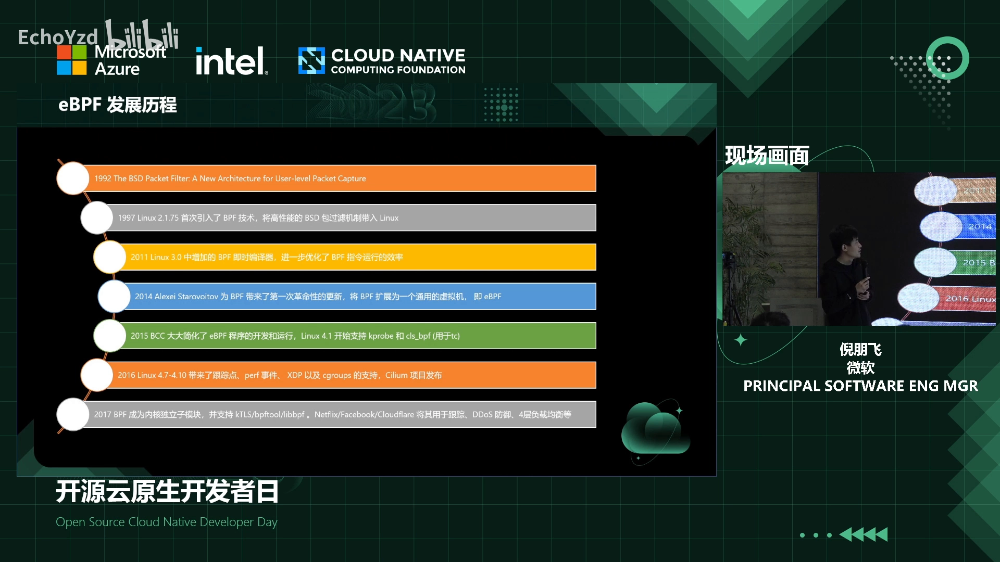

- **1992 年**：BPF 技术诞生于 **BSD 系统**，为解决**数据包过滤**而生；
- **1997 年**：引入 **Linux**；
- **2011 年**：加入 **JIT 即时编译器**，BPF 执行效率才真正有了保证——但此时它的主要用途仍是**数据包过滤**（tcpdump 这类场景）；
- **2014 年**：**eBPF 的转折点**——从一个「包过滤机制 + 即时编译器」**扩展成了一个虚拟机**，支持非常丰富的指令集；
- **2015–2016 年**：功能特性逐步扩展到**内核各个模块**——kprobe 内核探针、内核跟踪点、性能事件、**XDP**，甚至容器里常用的 **cgroup**；**2016 年 Cilium 发布**，标志 eBPF 正式进入**云原生**领域；
- **2017 年**：eBPF 在内核里**独立成为子模块**，并成为内核所有子系统里**最活跃的模块**；Facebook、Netflix、Cloudflare 等大公司开始把它用到**生产环境**——排查性能问题、做四层负载均衡、做 **DDoS 防御**；
- **2018–2019 年**：支持**内核轻量级调试信息（BTF）**——看内核/应用地址时能知道对应的符号、函数名、参数名；**Cilium 1.x 发布**，在容器/云原生场景里的基本功能都已具备；
- **2019 年**：**Cilium 1.6** 发布服务发现代理，可以用 eBPF **取代 kube-proxy**，实现从服务发现到负载均衡的机制；
- **2021 年**：**Windows eBPF 发布**（eBPF 不再只属于 Linux）；微软联合多家 eBPF 相关公司**成立 eBPF 基金会**，**Cilium 项目加入 CNCF**——标志 eBPF 正式进入**稳定的成熟期**；
- **2022 年**：功能特性继续增强，加入**动态指针、内存分配器**等，让开发更为方便。

---

## 四、通用应用场景总览

[【跳转到 16:20】](https://www.bilibili.com/video/BV1Ps4y127HN/?t=980)

现在 eBPF 比较主流的应用场景，大致有四个方面：

1. **网络**——从 BPF 诞生以来最核心的场景。除了**过滤**，还能**跳过内核网络协议栈的处理过程**来**加速网络性能**（后面会以 Cilium 为例）；
2. **可观测性**——eBPF 程序在内核中，内核所有调用过程都能被看到，因此可以收集各类性能指标、调试信息、进程与内核运行状态，而且**对应用程序完全透明**；
3. **追踪与剖析**——可以挂载到从**内核到应用**的各个探测点上，跟踪应用的执行过程；把数据汇总后就能看清应用/内核的执行路径，做到以前 BPF 之前做不到的很多事；
4. **安全**——把 eBPF 挂到很多**安全事件**上，比如挂到系统调用上，就能看到所有系统调用、所有用户/进程执行的 **shell 命令**，进而探测可疑行为、执行策略。

[【跳转到 18:50】](https://www.bilibili.com/video/BV1Ps4y127HN/?t=1130)

围绕这些场景，已经形成了一个庞大的**开源生态**（从下往上）：

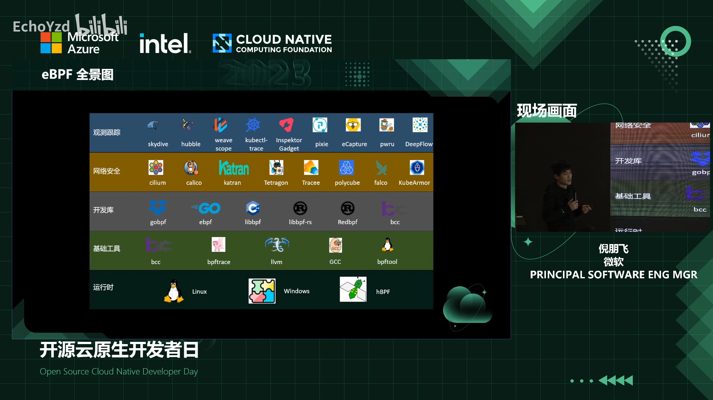

- **运行时**：Linux、Windows，以及正在讨论开发的 **hardware BPF**（把 eBPF 跑在特殊硬件上）；
- **基础工具**：把 C/Rust 写的 eBPF 程序编译成字节码的 **llvm / gcc**；用于开发调试的 **BCC、bpftrace**；以及排查 eBPF 状态的 **bpftool**；
- **语言绑定**：Python 的 **BCC**、Go 的 **Cilium/ebpf 库**、go 的 **gobpf**、以及 Rust 的库（甚至能用 Rust 同时写内核态和用户态）；
- **各场景项目**：网络有 **Cilium、Calico**（K8s 里最常用的两个网络插件）、**Katran**（四层负载均衡，性能可达硬件级）；安全有 **Falco、Tracee** 等；可观测/追踪有 **Hubble**（与 Cilium 绑定，提供从观测到追踪的完整方案）、**Pixie**、以及能跟踪 HTTPS 请求内容的 **ecapture**（不需要证书就能看到请求内容，排查时很方便）。

---

## 五、云原生中的 eBPF：网络

[【跳转到 22:45】](https://www.bilibili.com/video/BV1Ps4y127HN/?t=1365)

在云原生（尤其网络）场景里，eBPF 能挂载的事件非常多。自顶向下看：

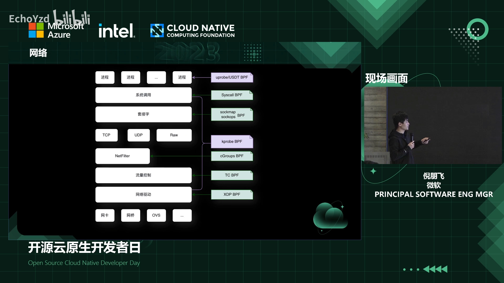

- **用户应用层**：Go / C / Python / Java 程序，可以用 **uprobe** 挂到探针上；也可以用 **USDT** 定义**稳定的**、预定义行为的探针（相当于给探测场景定义一个稳定 API）；
- **系统调用层**：挂到系统调用上，观测哪些进程执行了什么、参数与响应是什么——比如挂到 **`bpf` 系统调用**上，就能看到哪些进程加载了 eBPF 程序（这对处理 eBPF 安全隐患很关键）；
- **网络协议栈**：从 socket 到 TCP/IP 各协议，到耳熟能详的 **netfilter**，再到后面的**流量控制**，处处都能挂探针；
- **虚拟网卡/物联卡**：可以通过 **tc / XDP** 把程序挂在网卡上处理收发的数据包。

这里 **XDP 比较特殊**：它**只处理入口的数据包**，所以最常用的一个点是**替代 DPDK**——在系统收到网络包时处理请求，用来做 **DDoS 防御**、**四层负载均衡**；甚至在包到达内核协议栈**之前**就处理完，还能**卸载到网卡硬件**里执行，效率再高一个数量级。

### 5.1 案例：Cilium 如何用 eBPF 加速网络

[【跳转到 25:31】](https://www.bilibili.com/video/BV1Ps4y127HN/?t=1531)

Cilium 和 Calico 等都支持了 eBPF 数据面（dataplane）。一个 TCP 吞吐量测试结果很能说明问题：**baseline** 是节点到节点的数据；开启 eBPF 数据面后，性能**有时甚至超过 baseline**——也就是几乎达到物理机到物理机的水平；而如果没有开 eBPF 数据面、或只开了一部分、仍依赖 legacy host 的方式，**性能会因内核协议栈处理而有明显损失**，吞吐量比 baseline 低很多。

[【跳转到 26:39】](https://www.bilibili.com/video/BV1Ps4y127HN/?t=1599)

Cilium 具体怎么做的？看两张对比图：

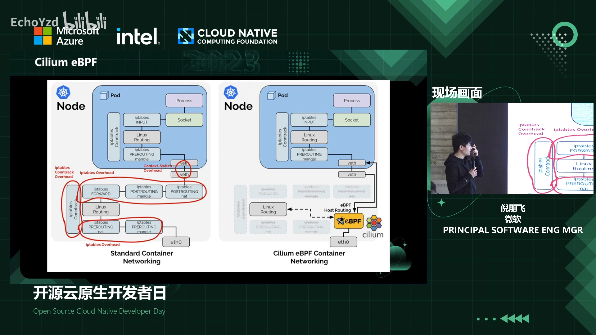

- **左（常见容器网络）**：红色标注的都是 Linux 内核处理网络数据时**可能带来性能损失**的地方——**netfilter、iptables、IPVS、conntrack（连接跟踪）**，以及后面的**虚拟网卡转发**，甚至 Linux 自己的**路由**；
- **右（Cilium）**：**把整个 netfilter 层去掉**。主机从 eth0 收到请求后，**eBPF 程序可以直接把包转发到容器虚拟网卡的一端**；对新内核，还能把网络数据**直接转发到容器内部的网卡对端**。这样**跳过了内核里各种各样的处理步骤**，性能大幅提升。

[【跳转到 28:19】](https://www.bilibili.com/video/BV1Ps4y127HN/?t=1699)

当然实现**非常复杂**——Cilium 的挂载点非常多（它挂在一个个事件上）：除了虚拟网卡上的 **tc 类型 eBPF 程序**，还会挂到**容器的 cgroup** 上。cgroup 这边能直接看到容器上的 **socket**：

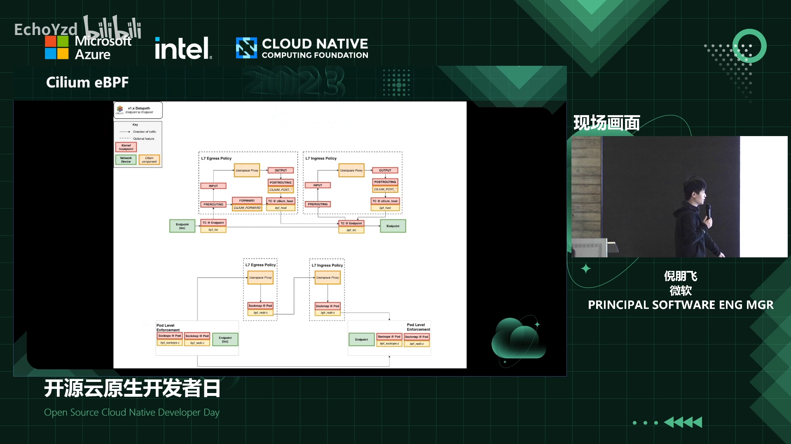

比如两个**同节点的容器/Pod**，它们的 socket 在主机上都可见，就可以把原始请求**从一个 socket 直接转发到目标容器的 socket**——这靠 **SOCK_OPS 与 SOCKMAP** 两种 eBPF 程序类型配合实现。

[【跳转到 29:39】](https://www.bilibili.com/video/BV1Ps4y127HN/?t=1779)

对于 **L7 策略**（逻辑复杂，不适合放进内核），通常会**单独跑一个容器**（比如放在 **Envoy** 里）；Envoy 本身跑在本地，向它发请求也是 socket，于是**用类似的 socket redirect 把请求先转发到 L7 代理容器**，处理完再继续转发。原始容器**向外发**、目的容器**接收**请求，都能走相同路径。

[【跳转到 30:29】](https://www.bilibili.com/video/BV1Ps4y127HN/?t=1829)

这正是 CNCF 社区里讨论火热的 **service mesh（服务网格）** 话题：以前很多场景用 sidecar——再跑一个容器、通过 iptables **劫持请求**转发到用户态容器、处理完再回来，**中间引入大量内核协议栈处理、带来性能损失**；而用 eBPF 的 **socket redirect**，就能**避免内核处理**，把原始请求**从源容器 socket 直接转发到目的容器 socket**，网络性能大幅提升。

### 5.2 Cilium 的能力远不止网络插件

[【跳转到 32:28】](https://www.bilibili.com/video/BV1Ps4y127HN/?t=1948)

以 Cilium 为例，它作为基础网络插件打通容器网络只是**最简单**的一个场景。它的功能非常丰富：

- **Observability**：提供大量数据（Cilium 自带的 metrics，或接入 Hubble 及其他观测系统），观测整个系统的行为——service map、服务间调用流程、内部各种状态；
- **网络能力**：除基础网络插件外，还支持大量 **network policy（四层/七层）**、**四层/七层负载均衡**、甚至 **IPsec 加密**，也能打通**多集群**（如多集群场景）；
- **生态**：Cilium 加入 CNCF 后，**很多云平台都已支持**（包括微软 AKS——Cilium 在 AKS 上是一个**预览 feature**，一条命令就能创建出开启了 Cilium 网络优化的集群）；
- **Security**：除 network policy 外，还有不属于 K8s 自身 L3/L4/L7 policy 范畴的东西（如 **audit**）；Cilium 还开源了 **Tetragon**，专门面向安全，提供从 audit 到执行 security policy 的方案。

---

## 六、云原生中的 eBPF：安全

[【跳转到 33:59】](https://www.bilibili.com/video/BV1Ps4y127HN/?t=2039)

安全方面同样有大量内核探针可用。如果要做安全，可以探测哪些地方？这里列出了与安全相关的探测点。

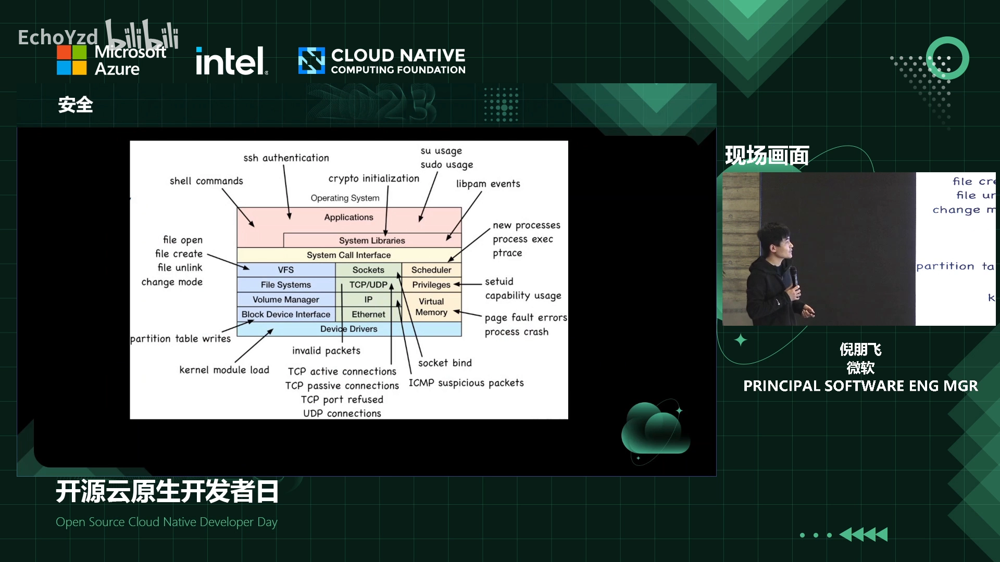

比如用得比较多的：**监控进程、登录用户执行了哪些 shell 命令**——用 BCC 的话，它已提供现成的小工具，**跑起来就能看到**所有进程/登录用户执行的命令。除此之外，从**应用程序调用的各种库、到系统调用、到内核各子模块**，各地方都能插入跟踪安全事件的 eBPF 程序，去了解系统和进程发生了哪些安全事件。

### 6.1 Tetragon：从监控到策略执行

[【跳转到 35:14】](https://www.bilibili.com/video/BV1Ps4y127HN/?t=2114)

以 **Tetragon** 为例，它的执行过程与前面类似：先写 eBPF 程序，挂到各条你感兴趣的探测点（应用、安全库、系统调用等）上；这些程序在事件发生时**产生安全事件**，存进 eBPF map，用户态程序再从 map 里取。

[【跳转到 35:45】](https://www.bilibili.com/video/BV1Ps4y127HN/?t=2145)

关键的一点：**eBPF 是单机的**，没法处理分布式事务，所以需要把**多台机器的数据收集汇总到安全分析系统/监控系统**里，再做汇总分析；有了数据之后，还可以**定义并执行安全策略**（消费事件 → 执行安全策略）。Tetragon 已经支持了这套**从安全监控到 policy 执行**的完整流程。

---

## 七、云原生中的 eBPF：追踪与可观测性

[【跳转到 36:53】](https://www.bilibili.com/video/BV1Ps4y127HN/?t=2213)

**追踪场景的方法论和前面很类似**——一旦在一个场景里用熟了，扩展到其他场景就是很自然的事，只是**挂载的探测点不同、用户态消费数据的流程不同**。

[【跳转到 37:18】](https://www.bilibili.com/video/BV1Ps4y127HN/?t=2238)

BCC 在内核各处提供的小工具覆盖了**从用户态到内核态再到最底层硬件**的各个层面，排障时非常方便，甚至支持 **Java、Python 这类脚本语言和即时编译型语言**的跟踪。

### 7.1 inspektor-gadget：更「云原生」的安全/排障工具

[【跳转到 38:33】](https://www.bilibili.com/video/BV1Ps4y127HN/?t=2313)

**inspektor-gadget** 是一个专门针对 K8s 场景、比较集成的安全工具。它定义了一系列 **gadget**（小工具），针对具体场景运行，可以挂到容器或节点上执行你想要的操作，比如检查 **DNS 请求**、跟踪 **TCP 连接**、看 **block IO / 文件系统 IO** 等。

[【跳转到 39:32】](https://www.bilibili.com/video/BV1Ps4y127HN/?t=2372)

它和 BCC 工具类似，但有两个明显好处：

1. **与 K8s 直接集成**：一条命令就能直接在容器里跑起来；
2. **分发方便**：BCC 是「Python 解释器 + 动态编译执行」的方式，所以每台运行的机器都要安装**内核头文件、开发库、开发工具（gcc、llvm）**，体积大还可能带来安全问题；而 inspektor-gadget（以及 Cilium）是用 **Go** 写的、**预先编译好**——运行时只需分发一个 **binary 或容器镜像**，不必依赖那些开发工具和头文件。

### 7.2 PWRU：内核到底在哪一步把包丢了

[【跳转到 40:54】](https://www.bilibili.com/video/BV1Ps4y127HN/?t=2454)

**PWRU（`pwru`，「我的包去哪了」）** 解决的是另一个痛点：前面的跟踪工具是「挂到一个点上，看它执行了哪些」（比如我的容器发出了哪些 TCP 连接）——但很多时候这还不够。就像 tcpdump 只能告诉你**在这台主机上丢包了**，却**说不出丢包的原因**。

[【跳转到 41:19】](https://www.bilibili.com/video/BV1Ps4y127HN/?t=2479)

PWRU 做的事是：**把 eBPF 程序挂到内核中所有与网络相关的探测点上**。发生丢包时，它能告诉你**包在内核处理的哪一步被丢了**。例子中，用 `iptables` 命令丢掉一个包，下面就能看到：在 `kfree_skb`（释放 socket buffer）**前一步**的 **`nf_hook_slow`**（nf 即 netfilter 的简称）发生了调用——**一看到 netfilter 关键字，就知道是 iptables 这一层**处理时丢的，接下来只需排查 iptables，其他网络配置就不用查了。参考这个思路，把你用到的特殊网络组件相关的探测点都挂上，一旦出问题，就能**第一时间找到根源**。

### 7.3 从单机到分布式：Hubble 与 Pixie

[【跳转到 43:24】](https://www.bilibili.com/video/BV1Ps4y127HN/?t=2604)

前面这些工具**都是单机的**——看的是**这一台机器**上内核里发生了什么。但在云原生这种**分布式系统**里，我们想看的是**整个系统**发生了什么，所以需要把数据**汇总起来**，并跟**容器/主机等元数据**挂上，变成**分布式系统的观测**。

[【跳转到 43:30】](https://www.bilibili.com/video/BV1Ps4y127HN/?t=2610)

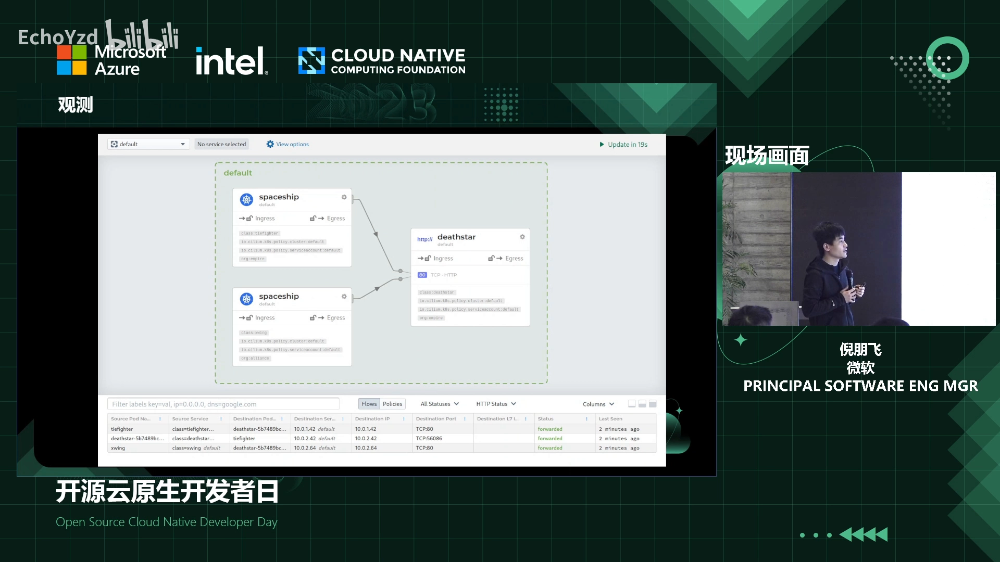

**Hubble** 就是这样一个例子：它把各主机收到的**网络连接信息**收集起来，**打上 K8s 的容器、namespace 等元数据**，于是就能知道集群里有哪些**服务间调用**、调用之间的 **latency** 是多少、每次调用都有什么——全部可观测。Hubble 用起来很方便，但有个限制：**只能在 Cilium 项目上使用**，因为它的元数据来自 Cilium。

[【跳转到 44:45】](https://www.bilibili.com/video/BV1Ps4y127HN/?t=2685)

如果没有用 Cilium 也没关系——CNCF 里有很多其他项目，比如 **Pixie**，它**支持任意类型的 CNI 网络插件**。它的机制与 Hubble 类似，区别在于：它**不把 eBPF 当作网络插件嵌入系统**，而是把 eBPF 程序嵌入到内核的各事件上；它**支持你自己写 eBPF 程序**生成想要的数据，也提供了**很多预定义的探测点**（比如一个 **service map** 的例子，能像 Hubble 一样看到服务间调用关系与 latency）。

[【跳转到 45:17】](https://www.bilibili.com/video/BV1Ps4y127HN/?t=2717)

Hubble、Pixie 这类实现的关键好处是：**只需要把 eBPF 程序挂到内核事件里**，**不需要像传统分布式跟踪框架/SDK 那样去改应用程序代码**、到处嵌入代码和元数据，就能生成 service map 之类的数据。

---

## 八、最佳实践与注意事项

[【跳转到 46:07】](https://www.bilibili.com/video/BV1Ps4y127HN/?t=2767)

eBPF 程序用起来其实很方便：写一个很小的程序，挂到对应的观测点上，就能实现想要的功能；**更核心的逻辑，是把从 eBPF 拿到的数据，跟你现有的网络、观测、安全系统集成起来**。刚才分享的都是开源项目，有类似需求可以**参考它们的实现**。用好 eBPF，有几点要注意：

### 8.1 你需要对内核有一定了解——但 eBPF 也能帮你学内核

[【跳转到 46:32】](https://www.bilibili.com/video/BV1Ps4y127HN/?t=2792)

因为程序终究要挂到内核事件上，所以**想用好 eBPF，需要对内核有一定了解**。这其实是**相辅相成**的：你不了解内核时，恰恰可以用 eBPF 去**跟踪内核的执行过程**，了解内核执行某些操作后发生了什么；BCC、Cilium 这些开源项目都是很好的参考。等熟悉了内核，反过来再想跟踪你感兴趣的事件就很方便了——你知道内部发生了哪些事、知道程序该挂到哪些事件上。**学习 eBPF 与学习内核是互相成就的。**

[【跳转到 47:44】](https://www.bilibili.com/video/BV1Ps4y127HN/?t=2864)

而且 eBPF 程序本身**不需要特别复杂**。观测内核、开发 eBPF 程序，**都不要求你是内核开发者**——普通应用开发者或运维同样能利用 eBPF 实现想要的功能。

### 8.2 分发问题：libbpf + CO-RE + BTF

[【跳转到 48:09】](https://www.bilibili.com/video/BV1Ps4y127HN/?t=2889)

用 BCC 运行 eBPF 时，**分发是个问题**：你有很多用户，分发程序时要求**每台机器都装好开发工具、内核开发包、头文件**——这不现实，也很繁琐。

[【跳转到 48:34】](https://www.bilibili.com/video/BV1Ps4y127HN/?t=2914)

eBPF 也考虑到了这一点，于是支持了 **libbpf + CO-RE + BTF** 的组合：

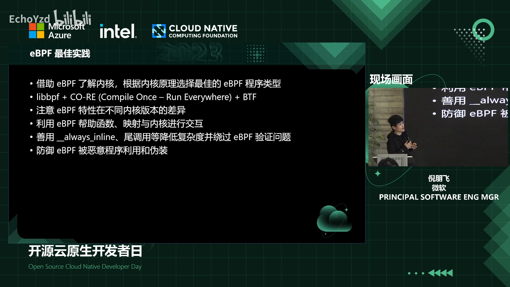

你可以把 eBPF 程序**编译成一个二进制文件**，分发时**只分发这个二进制**。但目标运行环境可能不同（内核版本、系统运行时不同），可能出现：内核**函数签名变了、参数变了，甚至某些函数在新版本里被替换或删除了**。所以在开发时，就要了解目标内核版本有哪些差异、你挂载的探测点在运行环境里**是否存在**。

[【跳转到 49:49】](https://www.bilibili.com/video/BV1Ps4y127HN/?t=2989)

**CO-RE + BTF** 的目标正是解决这个：用 **BTF 调试信息**，就能知道你的数据结构、内核函数名在目标机器上是否存在；**libbpf 提供了很多辅助函数**——探测当前内核版本是否大于某版本、目标内核函数是否存在、数据结构是否存在等。虽然它**不能自动处理这些差异**，但有这些辅助函数，你就能很方便地做特殊处理。

### 8.3 Verifier：为什么你以为没问题的程序会加载失败

[【跳转到 50:39】](https://www.bilibili.com/video/BV1Ps4y127HN/?t=3039)

eBPF 程序**加载的第一步就是验证**。有时你写的程序**看起来没问题**，加载时却报各种验证错误——因为 **eBPF 验证非常严格**，它要确保内核的安全。

[【跳转到 51:04】](https://www.bilibili.com/video/BV1Ps4y127HN/?t=3064)

所以有时需要在程序里做一些**特殊逻辑，帮验证器理解你的程序**：比如**内存访问越界**，如果你不在代码里**显式检查**，验证器（它是**静态检查**）可能无法自己判断。

[【跳转到 51:29】](https://www.bilibili.com/video/BV1Ps4y127HN/?t=3089)

另外，eBPF 本身**不支持特别复杂的指令集**，在较老的内核版本里指令集尤其有限。所以可以把一个**大的 eBPF 程序拆成很多小程序**，用 **inline 方式**或**尾调用（tail call）**把不同程序串起来，构成更复杂的逻辑。

### 8.4 安全底线：防御「恶意 eBPF 程序」

[【跳转到 51:54】](https://www.bilibili.com/video/BV1Ps4y127HN/?t=3114)

最后一点，在讲安全时也提过：**eBPF 程序的功能非常强大**——它能挂载到从内核到应用的各个地方。而**恶意程序要做的事其实类似**：它可以先挂载自己的 eBPF 程序，**把自己隐藏起来**（把文件系统、进程都藏起来）。所以一旦没注意，恶意程序进了系统、又把自己隐藏了，**事后想发现就非常难**。

[【跳转到 52:44】](https://www.bilibili.com/video/BV1Ps4y127HN/?t=3164)

因此，**对 eBPF 恶意程序的防御必须事先做**——无论你在云原生环境还是任何其他场景，**即便你自己不用 eBPF，这件事也得做**：至少要知道你的系统有没有被恶意程序利用 eBPF 搞破坏。做法比如：**把 eBPF 程序挂到 `bpf` 系统调用上**，这样后面所有加载 eBPF 程序的行为都能被检测到；如果你的系统压根不需要 eBPF，就可以**把所有的 eBPF 挂载全部拒绝掉**，从源头避免这类问题。

---

## 附：现场问答（节选）

[【跳转到 53:34】](https://www.bilibili.com/video/BV1Ps4y127HN/?t=3214)

**Q：eBPF 和 DPDK 相关的最佳实践？**
**A：** 两者**运行环境不同**——eBPF 跑在**内核**里，DPDK 跑在**用户态**，同时用没有相互影响，甚至可以结合用。实际上，**用 eBPF 可以替代 DPDK 的很多功能**：DPDK 最大的场景是处理网络请求（能接近物理交换机的线性性能），而用 eBPF 的 **XDP + 物理网卡卸载**机制，也可以达到类似性能。

**Q：ARM 架构支持吗？**
**A：** ARM **已经支持**。可以看**谷歌 Android 文档**，里面讲了很多 eBPF 的应用场景和工具。

**Q：网络处理芯片有扩展口吗？自己能实现吗？**
**A：** 这要看你的**网卡是否支持**。很多云厂商已经支持 **eBPF 程序的卸载**；如果你的网卡支持，就可以做；这需要**内核里 JIT 层的支持**（需要在 JIT 层实现）。

---

## 术语速查

| 术语 | 含义 |
| :--- | :--- |
| **BPF / cBPF** | 伯克利包过滤器，最初用于网络包过滤（tcpdump 的底层） |
| **eBPF** | 扩展版 BPF，内核里带验证器的虚拟机，支持网络/安全/观测/追踪 |
| **kprobe / uprobe** | 内核探针 / 用户态探针，属**不稳定 API**（函数名与签名不稳定） |
| **tracepoint** | 内核预定义的**稳定**跟踪点 |
| **perf_event** | 性能事件，适合观测海量、与性能直接相关的数据 |
| **USDT** | 用户态预定义静态探针，可定义稳定的探测 API |
| **eBPF map** | 内核态与用户态之间的共享存储，用户态异步读取不阻塞内核程序 |
| **BCC** | BPF Compiler Collection，Python 侧开发/工具集，自带编译与加载封装 |
| **libbpf / bpftrace / bpftool** | eBPF 开发库 / 脚本工具 / 状态排查工具 |
| **Verifier** | eBPF 验证器，加载前做严格静态检查，保证内核安全 |
| **JIT** | 即时编译器，把 eBPF 字节码译为机器指令，保障执行效率 |
| **XDP** | eXpress Data Path，只处理入口包，可替代 DPDK、支持网卡卸载 |
| **Cilium** | 基于 eBPF 的 K8s CNI 与安全/观测平台，可跳过 netfilter 加速网络 |
| **socket redirect** | 通过 SOCK_OPS + SOCKMAP 把一个 socket 的请求直接转发到另一个 socket，省掉内核协议栈中转 |
| **Hubble / Pixie** | 基于 eBPF 的分布式观测，无需改应用代码即可得到 service map |
| **Tetragon** | Cilium 开源的安全项目，覆盖从 audit 到策略执行 |
| **PWRU (`pwru`)** | 把 eBPF 挂满网络探测点，定位包在内核哪一步被丢弃 |
| **inspektor-gadget** | 面向 K8s 的集成式 eBPF 排障/安全工具集，Go 编写、便于分发 |
| **CO-RE / BTF** | 一次编译到处运行 / 轻量内核调试信息，配合 libbpf 处理内核差异 |
