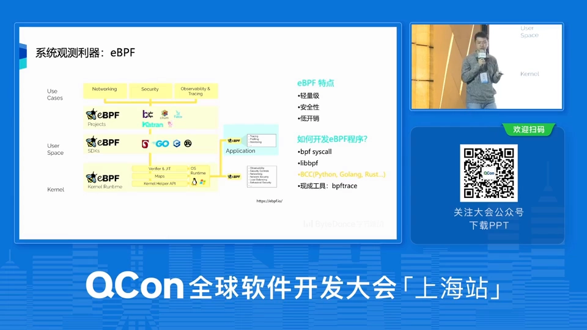
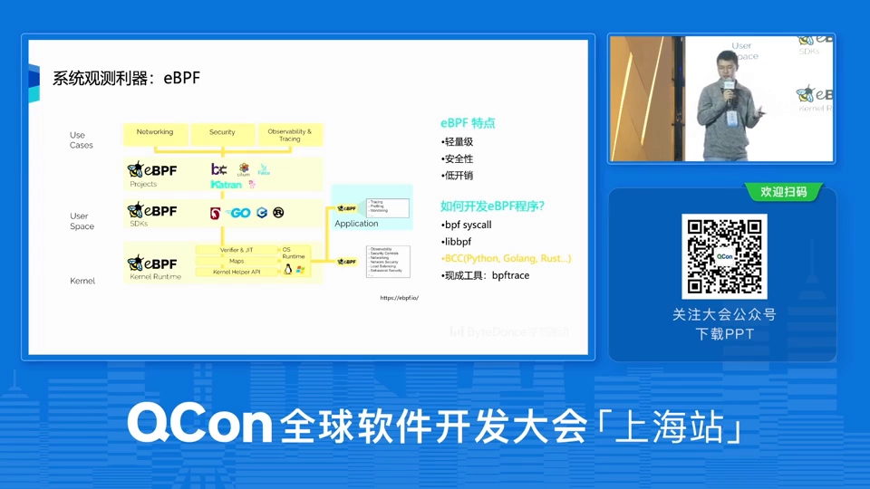
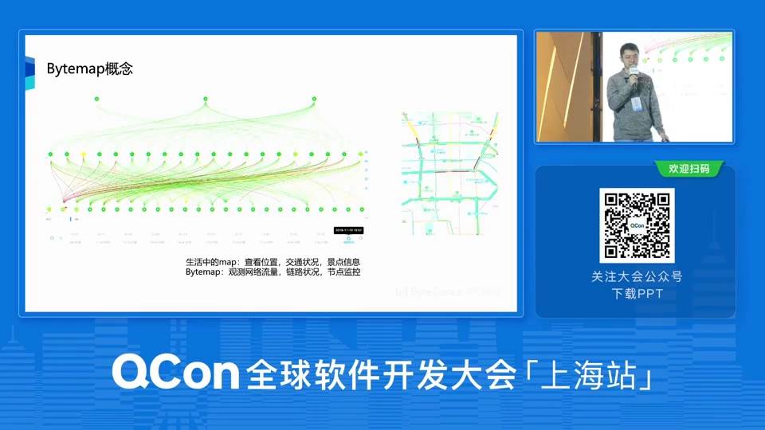
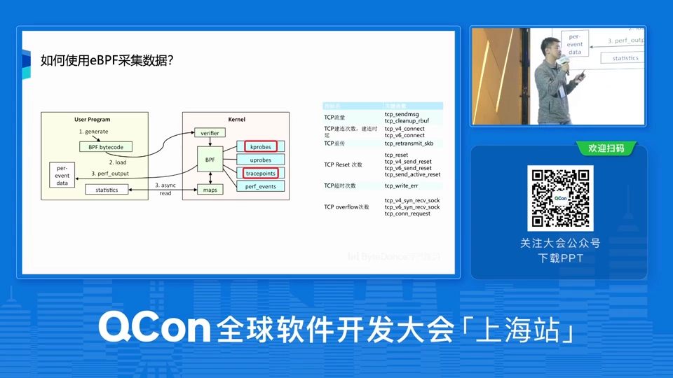
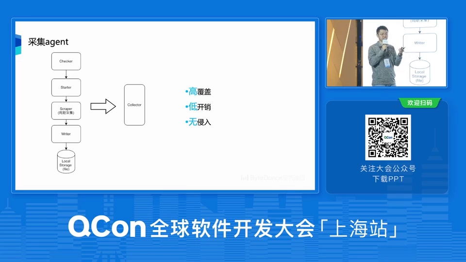
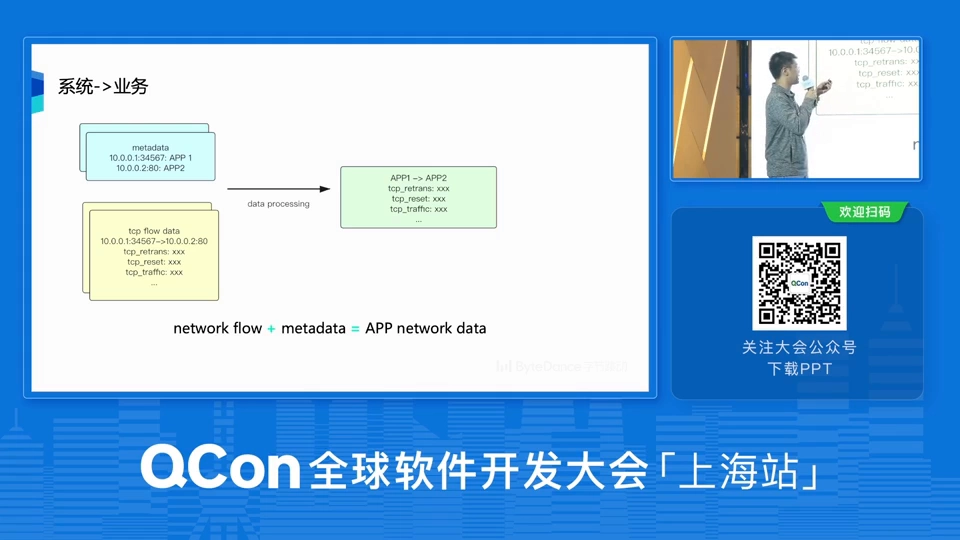
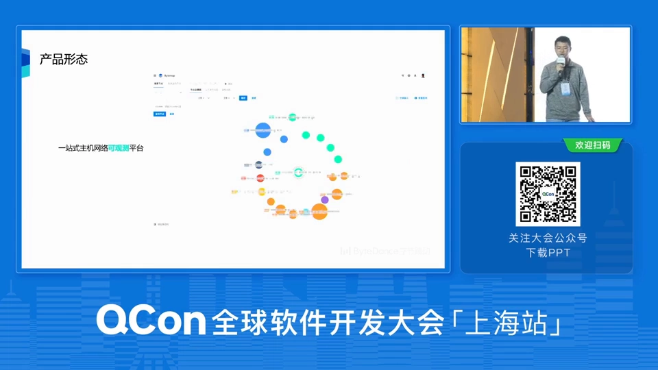
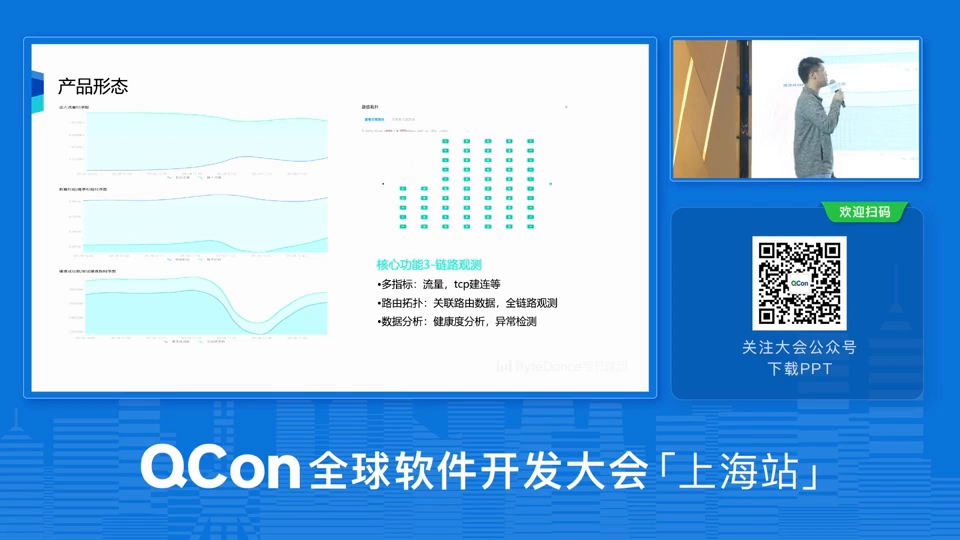

# 字节跳动基于 eBPF 的百万级主机网络可观测性实践与探索

> 本文整理自 B 站视频《字节跳动基于 eBPF 的百万级主机网络可观测性实践与探索》。这是一场来自字节跳动工程师的技术分享，讲述他们**如何用 eBPF 在内核里采集主机网络数据、再把这些数据变成一套可观测平台**的完整工程历程。全片分三部分：**背景**（微服务带来了什么麻烦、可观测性又和传统监控有何不同）、**工程实践与落地**（自研平台 ByteMap 的采集、处理、存储与产品形态）、**总结与展望**。

## 本讲要解决的核心问题（SCQA）

**背景（S）**：微服务把单体应用拆成了成百上千个可以独立部署、低耦合的小服务，扩展性、研发效率都上去了。但服务一多，它们之间的调用关系变得极其复杂——字节跳动内部的微服务节点数不胜数，一张图上密密麻麻全是点和线。

**冲突（C）**：服务拆得越细，**网络就从配角变成了主角**——远程调用变多，网络更容易成为性能瓶颈、也更容易出故障。可一旦出事，服务 owner 要在这么复杂的调用关系里快速定位问题，非常难。而传统的监控（比如对着 Grafana 看大盘）只做到了「采集 + 展示」，粒度太粗，盯不住每一条连接、每一种 TCP 行为，回答不了「这条流量到底卡在哪一环」。

**疑问（Q）**：能不能换一个视角——**不去应用层埋点，而是沉到操作系统内核里**，把主机上每一次网络通信都采下来，再跟业务、机房、链路等维度关联成一张「服务地图」，让排障一眼就能看到问题出在哪个环节？

**回答（中心思想）**：**eBPF 是把可观测性做进内核的那把钥匙。** 它轻量、安全、低开销，让工程师能在用户态写程序、注入内核态运行，采集到**极细粒度的 TCP 行为指标**；字节把这套采集器（Agent）近乎全量地部署到数据中心的物理机上，把采集结果与元信息关联，用 Flink + ClickHouse 等做流式处理与存储，最终做成一个叫 **ByteMap** 的「主机网络地图」——输入服务名，就能看到它的上下游拓扑、健康度、链路走向，排障从「猜」变成「看」。

[【跳转到 00:00】](https://www.bilibili.com/video/BV1z34y1j7U6/?t=0)

---

## 一、背景：微服务越多，网络越容易「背锅」

[【跳转到 00:52】](https://www.bilibili.com/video/BV1z34y1j7U6/?t=52)

先说微服务。大家对这个词应该都不陌生，它的好处很直观：服务之间可以**独立部署**、**耦合度低**、扩展性和研发效率都更高。

但硬币有另一面：**服务数量越多，它们之间的调用关系就越复杂**，于是冒出一批新问题。

[【跳转到 01:52】](https://www.bilibili.com/video/BV1z34y1j7U6/?t=112)

- **网络开销**：把一个单体服务拆成许多微服务，就意味着服务之间有更多的**远程调用**、更多的**网络通信**。网络因此更容易成为性能瓶颈、也更容易成为出问题的地方。想给微服务做性能调优时，我们非常需要一个**全局视角**去看清整个网络的情况。
- **服务治理**：服务一多，治理就难，尤其是需要跨机房、多地甚至跨国家做**灾备部署**时，治理难度陡增。
- **故障排查**：服务不可用时，owner、SRE 要**快速定位并修复**，这既难又有挑战。

结论是：我们**需要一个更全面、更细致的可观测性系统**来对付这些问题。

### 1.1 可观测性 ≠ 监控

很多人会把「可观测性」和「监控」混为一谈，这里讲者给出了自己的理解。

[【跳转到 03:43】](https://www.bilibili.com/video/BV1z34y1j7U6/?t=223)

**传统监控**（比如大家熟悉的 Grafana 那类系统）更聚焦于两件事：**数据的采集**和采集回来后的**大盘展示**。放在今天这么复杂的微服务场景里，这**不够用**。

**可观测性系统**则期望做到更多：

1. **更细粒度的采集**——比如对网络，能不能盯到**每一条连接**、甚至 TCP 内部的一举一动；
2. **处理与关联**——采到的数据不只是「看一眼」，而是拿它去和**不同维度的数据做关联**；
3. **分析**——通过处理/关联之后再做分析，去挖掘数据里藏着的含义与价值；
4. **可视化**——排障往往很紧急，页面上能不能**直观地把重点呈现出来**格外重要。

---

## 二、把可观测性做进内核：为什么是 eBPF

[【跳转到 05:23】](https://www.bilibili.com/video/BV1z34y1j7U6/?t=323)

提到可观测性，大家先想到的关键词通常是 **Metrics / Logging / Tracing**。这场分享想换一个**更「底层」的视角**——从**操作系统内核**的角度来看可观测性。

[【跳转到 05:48】](https://www.bilibili.com/video/BV1z34y1j7U6/?t=373)

Linux 内核本身就提供了不少可观测/监测工具，**eBPF 是其中很有力也很强大的一件「利器」**。

**eBPF 的前身是 cBPF**（classic BPF，经典 BPF）。BPF 全称是 **Berkeley Packet Filter（伯克利包过滤器）**，最早是内核里的一个功能/模块，主要用来**过滤网络数据包**。经过重新设计之后诞生了 **eBPF**，应用面一下子拓宽了——网络、安全、可观测性、Tracing 都能用。

### 2.1 eBPF 的三个关键特点：轻量、安全、低开销

[【跳转到 07:03】](https://www.bilibili.com/video/BV1z34y1j7U6/?t=423)

**轻量级**——把它和内核开发里另外两条老路比一比就明白了：

- **直接改内核源码**暴露 API：改完要**重新编译内核**、再走一遍后续流程，过程漫长而痛苦；想把它推广到更大范围、甚至合进 Linux 主线，更加遥遥无期。
- **开发内核模块（kmod）**：听起来不错，但要**针对不同内核版本分别适配**；更致命的是，**内核模块有可能直接把内核搞 crash**，这是谁都不想看到的。

[【跳转到 08:43】](https://www.bilibili.com/video/BV1z34y1j7U6/?t=523)

**安全**——eBPF 允许你在**用户态写代码**、把程序注入**内核态**运行，而它的安全性由 eBPF 自身的组件与机制来保证。**即使 eBPF 程序自己出了问题挂掉了，也不会把整个内核搞崩。**

**低开销**——因为 tracing 与这些能力都跑在**内核态**，相对来说开销更小。

### 2.2 怎么开发一个 eBPF 程序

[【跳转到 09:08】](https://www.bilibili.com/video/BV1z34y1j7U6/?t=548)

最根本的途径是调用 Linux 提供的 **bpf 系统调用（system call）**；当然也有更封装、更好用的工具，比如 **libbpf**、**BCC**、**bpftrace**。

[【跳转到 09:33】](https://www.bilibili.com/video/BV1z34y1j7U6/?t=573)

这里重点介绍 **BCC（BPF Compiler Collection）**。它的好处是：可以用**比较高级的编程语言**（Python、Go、Rust 等）去调用 eBPF 相关模块来做开发。它的运行机制大致是：

1. BCC **自带一个编译器**，把你的 eBPF 代码编译成 **eBPF 字节码**；
2. 通过 **system call** 提交；
3. 经过内核里的 **verifier（验证器）**——它会校验你的 BPF 代码是否安全，并施加一些限制（比如**不允许使用循环**等）；
4. 最后再经过 **JIT 编译**，把字节码翻译成机器能理解的指令，**在内核态执行**。

[【跳转到 10:48】](https://www.bilibili.com/video/BV1z34y1j7U6/?t=648)

BCC 的开源仓库里提供了**各种开箱即用的工具**，覆盖面很广——网络、调度、内存、块设备等内核各模块都有趁手的工具。比如右边这张图就是一个**看 TCP 重传**的工具。

[【跳转到 11:38】](https://www.bilibili.com/video/BV1z34y1j7U6/?t=698)

那个工具叫 **`tcpretrans`**（一个 Python 写的 BCC 工具），用起来极简单：**一行命令**，就能看到哪些**四元组**发生了重传、重传次数是多少。字节内部也会用这些工具，并在此基础上做**二次开发**，把它们真正跑进自己的系统；同时也会回馈开源社区——提交 patch、贡献新工具。

---

## 三、工程落地：ByteMap 是怎么长出来的

[【跳转到 12:35】](https://www.bilibili.com/video/BV1z34y1j7U6/?t=755)

第二部分进入正题：字节到底是怎么做工程实践和落地的。

[【跳转到 12:47】](https://www.bilibili.com/video/BV1z34y1j7U6/?t=767)

这套可观测性系统在字节内部叫 **ByteMap**。为什么叫「地图」？因为可观测性在生活中其实很常见——我们每天打开手机地图看位置、看路况、看景点。放到微服务语境下也一样：最早的那张系统图里，**每个节点是一个微服务，两点之间的连线是一次网络调用**，点和线组成一张巨大的「服务地图 / 网络地图」，能看流量、看链路、看节点监控。基于这个概念，就有了 **ByteMap**。

### 3.1 整体架构：采集 → 处理/落库 → 产品

[【跳转到 14:02】](https://www.bilibili.com/video/BV1z34y1j7U6/?t=842)

整体架构比较清晰，分三部分：

1. **数据采集与接入**（左侧）；
2. **数据流处理 + 数据落库 + 数据仓库建设**（中间）；
3. **数据处理完之后的产品形态与相关应用**（右侧）。

### 3.2 用 eBPF 采什么数据

[【跳转到 14:27】](https://www.bilibili.com/video/BV1z34y1j7U6/?t=867)

先补两个内核追踪技术的背景：内核里 **kprobe** 和 **tracepoint** 是比较常用的追踪手段。

- **kprobe**：**动态**追踪技术，利用软件**断点指令**去替换正常的函数调用；
- **tracepoint**：**静态**追踪技术，在内核一些关键处理流程里**预设追踪点**、注册 probe 函数。

用 eBPF 开发的程序，最终会 **attach 到 kprobe 或 tracepoint 上运行**。

[【跳转到 15:17】](https://www.bilibili.com/video/BV1z34y1j7U6/?t=917)

字节两种都在做，但实践下来发现：**理论上 tracepoint 作为静态技术性能更好，实际用起来却不够稳定**；所以在**大规模实践中主要采用 kprobe**。

那具体采的是哪些数据？看右边这张图会发现，**采的是一些非常细粒度的 TCP 行为指标**。

[【跳转到 16:07】](https://www.bilibili.com/video/BV1z34y1j7U6/?t=967)

这些指标**不是拍脑袋定的**，而是基于字节数据中心、服务器、微服务**长期发生过的网络故障/事故 case** 总结，再结合资深网络工程师的经验提炼出来的，用来观测日常最常见的几类网络故障：

- **TCP 流量**：比较直观，就是 TCP 的流量；
- **建连次数与建连时延**：当**网络被拒绝或丢包**时，TCP 建连的成功次数会**大幅减少**，这个指标能很好反映；
- **TCP 重传**：和**丢包**高度相关；
- **TCP Reset**：更多反映**网络不可用**；
- **TCP 超时**：与丢包更相关；
- **TCP overflow（TCP 监听溢出）**：能反映服务端的 **socket 是不是被打爆了**。

### 3.3 采集器：轻量、高覆盖、低开销、无侵入

[【跳转到 18:12】](https://www.bilibili.com/video/BV1z34y1j7U6/?t=1092)

采集做得非常轻量，整体流程也简单：

1. **环境 check**：采集前先校验机器环境——**并不是所有内核版本都支持 eBPF**，低版本内核可能就不支持或不适配；
2. **starter**：把 eBPF 程序**加载进内核**、跑起来；
3. **周期性采集线程**：按一定周期从 **eBPF map** 里把想要的数据捞出来；
4. **writer 模块**：把监控数据在本地留存少量，**全量数据输出到数据收集服务**。

[【跳转到 19:02】](https://www.bilibili.com/video/BV1z34y1j7U6/?t=1142)

整体可以用三个关键词概括：

- **高覆盖**：Agent 部署在数据中心主机房的物理机上，覆盖度接近**全量**；
- **低开销**：常态下 **CPU 消耗小于单核 1%，内存也小于 1%**；
- **无侵入**：这是相对于**服务层/应用层的 tracing 工具**说的——那些工具往往要在微服务框架里加功能、或让用户在自己的业务代码里接 SDK；而 eBPF 采集发生在**底层物理机系统**上，对用户**无感知、无侵入**。

### 3.4 关键一步：把「网络流」关联到「业务」

[【跳转到 20:42】](https://www.bilibili.com/video/BV1z34y1j7U6/?t=1242)

数据是在内核里采的，那怎么知道一条网络流是**抖音的**还是**头条的**？靠 **metadata（元信息）**：

- 一部分元信息是**采集时自带的**——这条网络流在哪台机器上、机器 IP 是多少、在哪个机房、属于哪个集群；
- 另一部分是**IP:port → 服务 的映射**——知道这个 IP:port 对应哪个服务。

[【跳转到 21:32】](https://www.bilibili.com/video/BV1z34y1j7U6/?t=1292)

把它和 Agent 采回来的网络流数据做一次简单的**关联处理**，就能得到**应用视角/应用维度的网络数据**：图中蓝色是 metadata、黄色是网络流数据，拼在一起就是一张应用维度的网络视图。

### 3.5 数据处理与存储

[【跳转到 22:22】](https://www.bilibili.com/video/BV1z34y1j7U6/?t=1342)

处理流程很直观：采集回来的网络流数据 + metadata，这两股 **Kafka 流**进入一个 **Apache Flink** 程序消费，**数据关联就在 Flink 里完成**；处理完的数据落入**数据仓库**。

[【跳转到 22:47】](https://www.bilibili.com/video/BV1z34y1j7U6/?t=1367)

所谓数据仓库是一组数据库的集合：

- **ClickHouse** 作为基本盘，存整个数据的**大宽表**；
- **VictoriaMetrics** 用于**时序相关分析**，充分利用 TSDB 的能力；
- 字节内部的**图数据库**用于**服务/图的关联分析**（比如后面的图计算）。

ClickHouse 的建设也经历过迭代：最早基于开源版本**自己手搭集群**，但由于理解不深，出现各种瓶颈——**消费能力跟不上、查询速度受影响**；后来用上字节内部维护的 ClickHouse 版本，性能得到提升。此外还用了 ClickHouse 的**物化视图（materialized view）**功能，把一些查询**预计算**好，特定查询直接命中物化视图而不去扫原表。这些优化让查询最终能**做到秒级**。

### 3.6 产品形态：一站式主机网络可观测平台

[【跳转到 25:17】](https://www.bilibili.com/video/BV1z34y1j7U6/?t=1517)

平台定位是**一站式的主机网络可观测平台**，用法很简单：在输入框里填**服务名**以及机房、集群等信息，就能得到这个服务的**拓扑图**。核心功能有四个：

**① 服务上下游调用。** 数据从哪来？正因为 Agent 部署量接近全量、采的是主机上**每一条网络连接**，理想情况下能采到**所有微服务之间的网络通信**。经简单计算处理，就能得到某节点的**上游/下游调用**，还能展示**多层调用关系**；节点上还会**带颜色**（红/绿），这是根据采回的指标算出的**「服务健康度」**——目标是让用户看图就知道自己的服务在**网络层面**是否健康。

**② 节点观测。** 有三个点：**多维度**（一个节点既可以是微服务，也可以是机房或机器——因为采集带了 metadata，可以对连接做聚合）、**多指标**（TCP 流量、重传、超时等）、**健康度分析**（模型还在迭代，当前做法较简单：用某节点**过去七天**的流量算出一个**预设值**，再和**实时实际值**对比，相差过大就判为不健康，仅供参考）。

**③ 链路观测。** 同样有**多指标**，另一个特别之处是**路由拓扑**——

[【跳转到 27:47】](https://www.bilibili.com/video/BV1z34y1j7U6/?t=1667)

这里关联了兄弟网络团队提供的**路由/交换机数据**：两个微服务节点之间，服务往往部署在多台机器上，关联路由数据后，就能**直观地看到从服务 A 到服务 B 经过了多少跳、经过了哪些交换机或路由器**。为什么要关联它？就是为了在网络故障时，能在页面上直接看到**到底是网络的哪一段出了问题**。

**④ 资源观测。** 看微服务所在主机/容器的**资源是否异常**。为什么要做？因为**故障可能发生在内核的任何地方**——你看到的是网络故障，最终原因却可能是 CPU 或 IO 异常；资源观测能在网络故障时提供**更多线索和视角**。

**⑤ 数据分析。** 把网络链路数据与**其他场景**结合做分析，比如**混沌工程**的网络演练、NAT 场景等。

### 3.7 两个真实案例

[【跳转到 30:17】](https://www.bilibili.com/video/BV1z34y1j7U6/?t=1817)

**混沌工程里看故障注入效果。** 给微服务注入拒绝、丢包、延时这类网络故障时，很希望能有底层指标来验证注入效果。比如注入**丢包**故障时，理论上该服务 **TCP 建连成功次数会减少**——真实演练的图上，这个指标确实出现了下降。

[【跳转到 32:11】](https://www.bilibili.com/video/BV1z34y1j7U6/?t=1931)

**一个排障实例。** 某应用在**晚高峰**访问下游的**错误率上升**。团队先怀疑是某程序发新版本引起了物理机磁盘 IO 问题，于是**回滚到旧版本**——结果第二天现象依旧。后来推荐客户使用这个平台观察，发现晚高峰时**下游服务的 TCP 监听溢出（overflow）值非常高**，初步判断是**下游 TCP socket 被打爆**；进一步排查发现，下游某台机器的 **backlog 设置不合理**，很容易触发 TCP overflow。

这个简单案例想说明的是：**如果用户一开始就能看到这样的可观测数据，排障就能少走弯路**，更快看到网络故障的线索、甚至直接定位到问题。

---

## 四、总结与展望

[【跳转到 33:59】](https://www.bilibili.com/video/BV1z34y1j7U6/?t=2039)

未来希望能**从系统内核的角度出发**，去思考如何更好地观测系统与微服务。生产环境里网络故障其实非常常见——网络不可用、丢包、延时等等都是家常便饭，而正是这些「常态」故障，最能体现一套沉到内核、细粒度、可关联的主机网络可观测系统的价值。

---

## 术语速查

| 术语 | 含义 |
| :--- | :--- |
| **eBPF** | 扩展的伯克利包过滤器，可在内核态安全运行用户写的程序，用于网络、安全、可观测性、tracing |
| **cBPF** | classic BPF，eBPF 的前身，最初只用于过滤网络包 |
| **kprobe** | 内核**动态**追踪技术，用软件断点指令替换正常函数调用 |
| **tracepoint** | 内核**静态**追踪技术，在关键流程预设追踪点并注册 probe 函数 |
| **BCC** | BPF Compiler Collection，用高级语言开发 eBPF 的工具集，自带编译器 |
| **libbpf / bpftrace** | 另外两种主流的 eBPF 开发/使用工具 |
| **Verifier** | 内核里的 eBPF 验证器，校验程序是否安全（如禁用循环） |
| **eBPF map** | 内核态与用户态之间共享数据的键值存储，采集线程从这里取数 |
| **ByteMap** | 字节内部的主机网络可观测平台，以「服务地图」形态呈现 |
| **ClickHouse / VictoriaMetrics / Flink** | 分别用于大宽表存储、时序分析、流式处理与数据关联 |
| **健康度** | 由采集指标算出的服务网络健康评分，用颜色在拓扑图上标识 |
