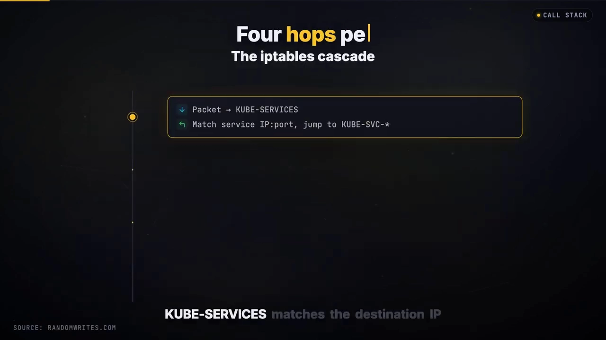
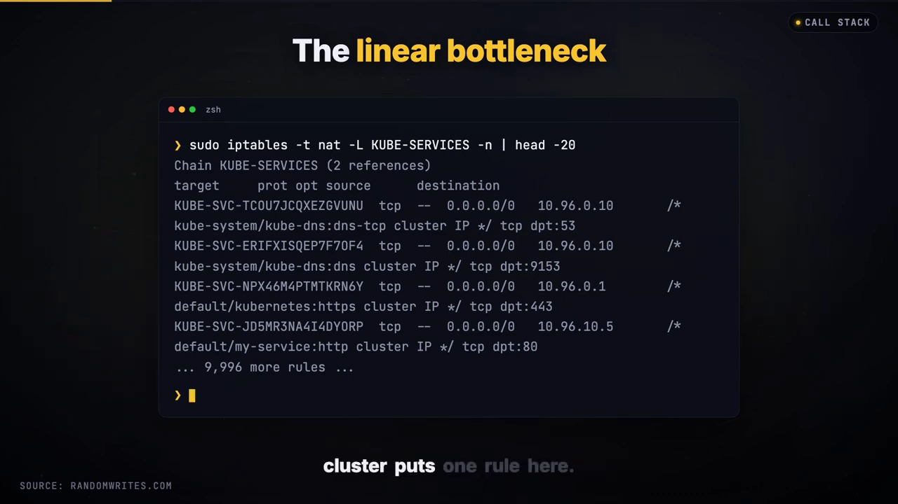
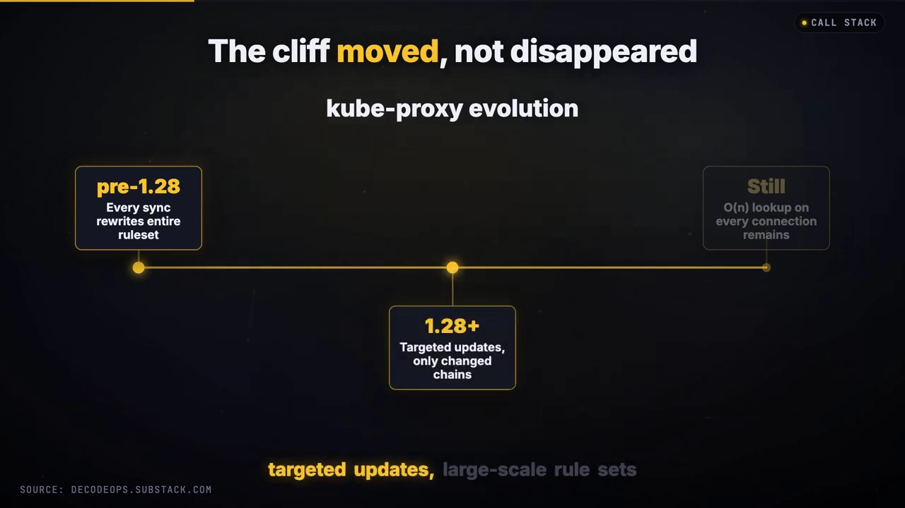
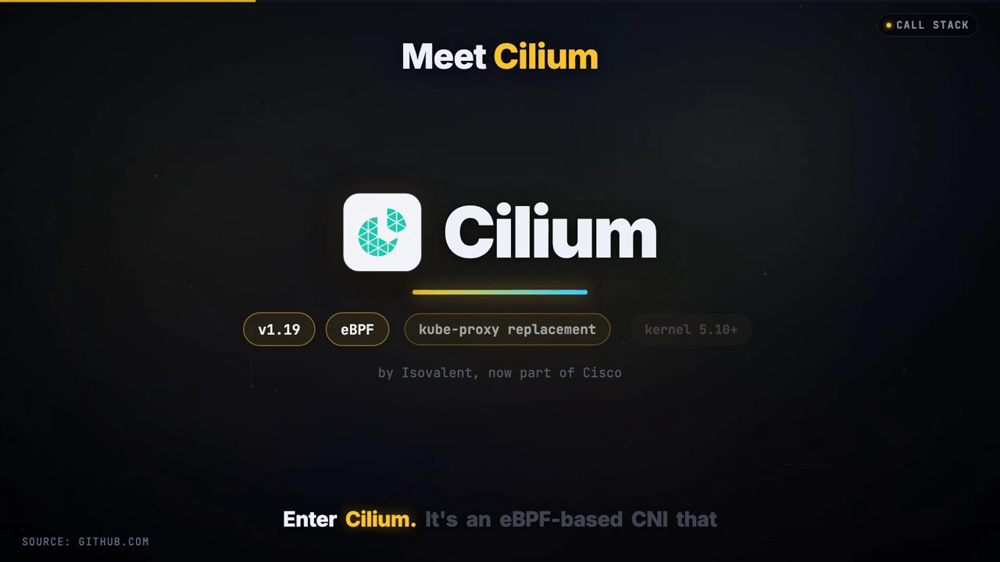
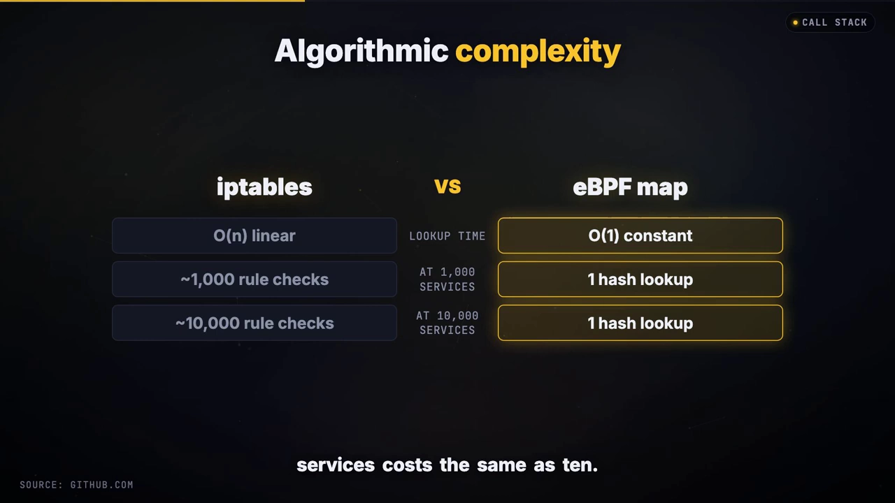
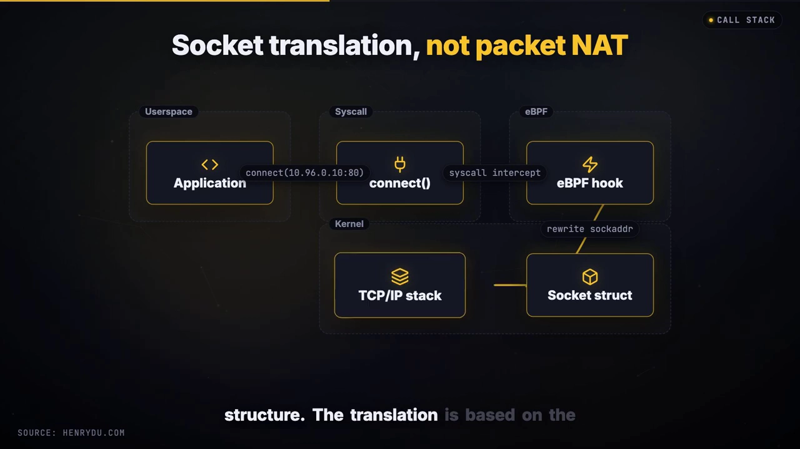
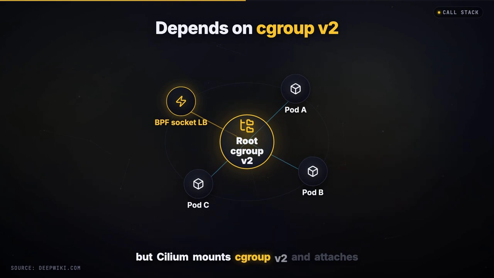
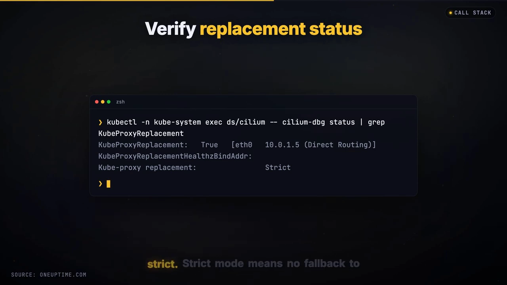
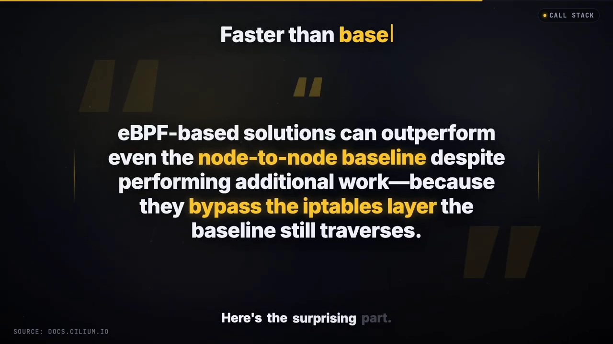
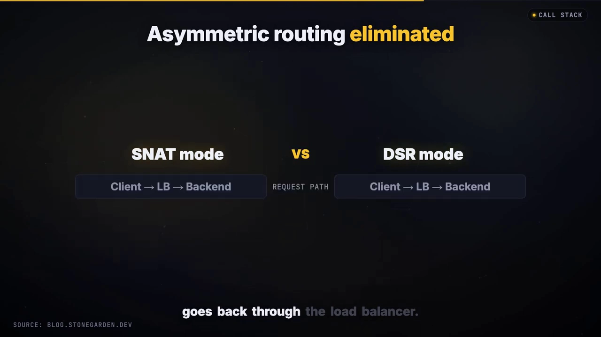

# Cilium eBPF 如何「干掉」kube-proxy：规模下延迟降低 40%

> 本文整理自 YouTube 视频《Cilium eBPF Killed kube-proxy: 40% Lower Latency at Scale》（频道 Call Stack，时长约 10 分钟）。它用一组极端的数字开场——**5,000 个 Service 时 kube-proxy 打满 100% CPU、Service 更新要 30 秒、某条延迟指标的计量单位竟然是「秒」**——然后一路回答「为什么」：kube-proxy 的 iptables 数据面到底慢在哪？Cilium 的 eBPF 数据面凭什么把 O(N) 变成 O(1)？以及 DSR（直接服务器返回）这条「让回包绕过负载均衡器」的路又藏着什么坑。

## 本讲要解决的核心问题（SCQA）

**背景**：K8S 用 kube-proxy 实现 Service 抽象已经很多年，早年大家默认用 iptables、后来换 IPVS。Cilium 这类 eBPF CNI 则宣称能**完全替代 kube-proxy**。

**冲突**：在中小集群里，iptables 用得也挺好；可一旦 Service 数量上了规模，就出现「CPU 打满、更新要几十秒、延迟以秒计」的悬崖。问题是：**慢的根因是「规则太多」，还是「查找方式」本身？**换个哈希表就真能解决？还有那个很吸引人的 DSR，为什么不是人人都在用？

**疑问**：kube-proxy 的 iptables 数据面具体慢在哪一步？Cilium 的 eBPF 数据面用怎样的机制把查找复杂度降下来？它在「包的哪一刻」完成改写？迁移和 DSR 又各有什么门槛？

**回答（中心思想）**：**kube-proxy 慢的根因不是「规则多」，而是「每次查找都要线性地走一遍规则」——复杂度是 O(N)**。Cilium 用 eBPF 哈希表（BPF map）把它降到 O(1)，并且更进一步：它在**数据包还不存在的时候**、在 `connect` / `sendmsg` 系统调用处就把 socket 的目的地址改写好（socket LB），从而省掉逐包 NAT。再叠加 DSR 让回包绕过负载均衡器，官方宣称可把延迟降低约 40%。代价是：**内核要 5.10+、要 cgroup v2、迁移必须走滚动替换而不是原地热切、DSR 还挑网络环境**。

[【跳转到 00:00】](https://www.youtube.com/watch?v=YeekZ5y_2ps&t=0)

---

## 一、kube-proxy 的 iptables 数据面：三条链与一次线性遍历

先看 kube-proxy 是怎么干活的。集群里**每个 Service 都会拿到一个虚拟 IP（VIP）**。数据包进来后先撞上 **`KUBE-SERVICES` 链**，它是整个转发逻辑的入口，**集群里每一个 Service 端口都会在这里占一条规则**。

[【跳转到 00:23】](https://www.youtube.com/watch?v=YeekZ5y_2ps&t=23)

接着的流程是：

1. `KUBE-SERVICES` 链**匹配目的 IP 与端口**，命中后跳到对应的 **`KUBE-SVC` 链**；
2. `KUBE-SVC` 链相当于一个**软件负载均衡器**，规则按该 Service 的每个后端 Pod 端点逐条列出；
3. 最后由 **`KUBE-SEP` 链执行 DNAT**，把目的 IP 从 Service 的虚拟 IP 改写成真正的后端 Pod IP。

[【跳转到 00:48】](https://www.youtube.com/watch?v=YeekZ5y_2ps&t=48)

**问题就出在「入口是一条从上到下的清单」**。在真实集群上，`KUBE-SERVICES` 链里每条 Service 端口都占一行，**内核每建立一个新连接，都要从清单顶端往下逐条比对，直到命中为止**。量级很容易算：**1,000 个 Service、平均每个 10 个 Pod，NAT 表里就有约 10,000 条规则**，而每个包都要顺着走一遍。

[【跳转到 01:13】](https://www.youtube.com/watch?v=YeekZ5y_2ps&t=73)

**查找成本只是一半的问题**。另一半在**规则更新**：每当有 Pod 挂掉、或 Service 发生变化，kube-proxy 就要重写规则集。**K8S 1.28 之前**，这意味着**整条链都要重写**——每次端点变更都要重写成千上万条规则；**1.28 之后**改为更小范围的**定向更新**，只重写真正变化了的链。但即便是定向更新，**大规模规则集本身就带来可观开销，线性查找的成本也依然存在**。

[【跳转到 01:30】](https://www.youtube.com/watch?v=YeekZ5y_2ps&t=90)

---

## 二、规模下的「悬崖」：1000 个 Service 是分界线

到了一定的规模，就会出现明显的性能悬崖：

- **Netflix 实测**：Service 超过 **1,000 个**后开始出现瓶颈；
- **AWS 的做法**：**EKS 在 Service 超过 1,000 个的集群上改用 IPVS 模式**，以避开网络延迟；
- **到了 5,000 个 Service**：kube-proxy **CPU 打满 100%**，Service 更新要 **30 秒**，某条延迟指标的计量单位甚至变成了**整秒**。

这就是 Cilium 登场的背景。Cilium 是一个**基于 eBPF 的 CNI**，可以**完全替代 kube-proxy**——提供**同样的 Service 抽象，却是一条完全不同的数据面**。它要求 **内核 5.10 或更高**，以及 **Kubernetes 1.31 到 1.34**。

[【跳转到 02:06】](https://www.youtube.com/watch?v=YeekZ5y_2ps&t=126)

---

## 三、Cilium 的 eBPF 数据面：用哈希表把 O(N) 变成 O(1)

### 3.1 BPF map：哈希表 + 零拷贝

Cilium 不用 iptables 链，改用 **eBPF 哈希表——也就是 BPF map**。BPF map 是内核里一种**通用 map 类型**，对它的键（key）和值（value）结构**没有任何限制**；它底层就是一张**哈希表**，因此支持以**任意键、在常数时间内完成查找**。

一个关键细节：**查找函数返回的是「指向内核内存中 map 值」的指针，而不是一份拷贝**——这意味着**零分配、零拷贝，只是拿了一个指针去引用**。

[【跳转到 02:30】](https://www.youtube.com/watch?v=YeekZ5y_2ps&t=150)

**复杂度为什么重要**：iptables 是 **O(N)**——每新增一个 Service，都会让每次查找更慢；eBPF 是 **O(1)**——**10,000 个 Service 和 10 个 Service 的查找代价是一样的**。

### 3.2 量化对照

| 数据面 | 单次查找 + 改写延迟 |
| --- | --- |
| iptables | 50 – 200 微秒 |
| IPVS | 5 – 20 微秒 |
| eBPF（Cilium） | 2 – 5 微秒 |

eBPF 的延迟甚至比 IPVS 还低——**2 到 5 微秒**就完成了整个查找与改写操作。

[【跳转到 03:20】](https://www.youtube.com/watch?v=YeekZ5y_2ps&t=200)

---

## 四、真正的机制：在数据包还不存在时就完成改写（socket LB）

### 4.1 connect4 / connect6 / sendmsg 三个钩子

Cilium 真正的机制，是把 eBPF 程序**挂到系统调用钩子上**，具体是 **`connect4`、`connect6` 和 `sendmsg`** 这三个（分别对应 IPv4 的 connect、IPv6 的 connect、以及发送消息）。

当应用调用 `connect` 去连一个 Service VIP 时，**内核会在 TCP/IP 协议栈合成数据包报头之前，先执行 eBPF 程序**。`connect` 和 `sendmsg` 这两个 BPF 程序会对 **socket 地址结构（socket address structure）做一次正向转换**，这次转换是**基于 socket 结构体**完成的——**这里根本没有「基于包的 NAT」**。

[【跳转到 03:37】](https://www.youtube.com/watch?v=YeekZ5y_2ps&t=217)

结果是：**socket 先被改写，内核随后才去构造报头**。应用以为自己连的是 Service 地址，而对应的内核 socket 实际上连的是后端地址——因此**不需要任何更低层的 NAT，也就没有逐包开销**。

对于**同节点内的 Pod↔Pod 流量**，连接建立时间**近乎为零**：因为内核**压根没构造数据包，它只是把两个 socket 直接连起来**。

[【跳转到 04:02】](https://www.youtube.com/watch?v=YeekZ5y_2ps&t=242)

### 4.2 socket LB 依赖 cgroup v2

这套 **socket 级负载均衡（socket LB）依赖 cgroup v2**。当时的现实是 **K8S 的 Pod 还在用 cgroup v1**，但 **Cilium 会自行挂载 cgroup v2，并把 BPF 程序挂到根 cgroup（root cgroup）上**——两者**混合使用也能很好地工作**。

[【跳转到 04:27】](https://www.youtube.com/watch?v=YeekZ5y_2ps&t=267)

---

## 五、怎么装、怎么迁：strict 模式与滚动替换

**安装很简单**：启用 kube-proxy 替代，**只需要一个 Helm 开关参数**。Cilium 还需要你的 **API server endpoints**，这样才能直接从 K8S API **同步 Service 状态**。

装完后要**验证替代是否生效**：你希望看到 **kube-proxy replacement 已启用、且 mode 为 `strict`**。**strict 模式意味着不再回退到 kube-proxy，是纯 eBPF**。

[【跳转到 04:52】](https://www.youtube.com/watch?v=YeekZ5y_2ps&t=292)

**但迁移窗口要特别小心**：

- 如果在**一个已经在跑流量的集群**上**新增或移除** eBPF kube-proxy 替代，**现有连接会中断**——因为**两张 NAT 表彼此不知道对方的存在**：kube-proxy 的 NAT 状态在 iptables 里，Cilium 的 NAT 状态在 eBPF map 里，**它们在活跃流量上无法共存**。
- 如果是在**尚未承载用户流量的新节点或新集群**上部署，则不存在连接中断问题。
- **安全的迁移路径是滚动替换节点**：**drain（驱逐）→ delete（删除）→ 用 Cilium 重新拉起节点**。等 Cilium 跑起来后，**删掉 kube-proxy 的 DaemonSet、删掉 kube-proxy 的 ConfigMap，再清理每个节点上的 iptables 规则**。

[【跳转到 05:17】](https://www.youtube.com/watch?v=YeekZ5y_2ps&t=317)

---

## 六、DSR：让回包绕过负载均衡器

### 6.1 SNAT 与 DSR 的差别

真正的收益来自 **DSR（Direct Server Return，直接服务器返回）**。

- **标准的 SNAT 模式**下，Cilium 会**改写源 IP，并让流量穿过负载均衡器**——于是回程的每一个字节都要再经过负载均衡器一次。
- **DSR** 则让**后端服务器能拿到请求的原始源 IP，并直接回应**，从而**降低延迟、提升吞吐**；**只有请求会经过负载均衡器，回程带宽完全绕开它**——这相当于**把负载均衡器的带宽压力减半**。

### 6.2 DSR 靠 IPIP 封装实现

DSR 配合 **IPIP 封装**工作时：把**发往后端的负载均衡流量封装进一条 IPIP 隧道**。**原始的客户端数据包变成内层载荷（inner payload）**；Cilium **加一个外层 IP 头**，其**源地址是负载均衡节点、目的地址是选定的后端 Pod IP**。封装后的数据包被路由到承载该 Pod 的节点，由**该节点上的 Cilium 终止隧道并执行 DNAT**。

[【跳转到 06:29】](https://www.youtube.com/watch?v=YeekZ5y_2ps&t=389)

### 6.3 DSR 有一个「坑」

DSR **并非没有代价**：**带 IP options 的 DSR 要求 Cilium 以 native routing（原生路由）模式部署**，而且在**某些公云环境里可能无法正常工作**——因为那些**网络结构（network fabric）可能会丢弃 IP options**。

所以在 dispatch 方式的取舍上（IPv4 option、IPv6 extension header，还是 IPIP 封装），**要避开那些会被部分网络结构丢掉的「Cilium 专有 IP options」**。

**启用 DSR 的配置**是：

- routing mode 设为 **native**；
- kube-proxy replacement 设为 **true**；
- load balancer mode 设为 **DSR**。

而**dispatch 模式决定隧道怎么建**：可选 **IP options、IPIP（IP-in-IP 封装）或 Geneve（隧道封装）**，其中 **IPIP 在云环境中是最稳妥的选择**。

[【跳转到 07:42】](https://www.youtube.com/watch?v=YeekZ5y_2ps&t=462)

---

## 七、实测收益

来自 **CNCF 在 10,000 Service 集群上的基准测试**：

- **与网络相关的内核 CPU 占用下降 40% – 60%**；
- **P99 延迟下降 30% – 50%**；
- **同节点流量连接建立时间近乎为零**；
- 对**短连接**（Serverless 场景常见），**Cilium 的 eBPF 连接跟踪要比 Calico 的 iptables 连接跟踪好 40% 以上**；
- 相比标准隧道，**P99 延迟下降 30% – 40%，从约 1.2 毫秒降到 0.8 毫秒**。

[【跳转到 06:54】](https://www.youtube.com/watch?v=YeekZ5y_2ps&t=414)

还有一个**「反直觉」的结论**：在**现代内核**上，**eBPF 方案甚至能超过「节点到节点」的基线性能**——尽管它多做了不少事（把包转发进容器的网络命名空间、做策略执行）。原因是：**eBPF 有能力绕过节点上的 iptables 层，而那条「节点到节点的基线路径」反而还要走一遍 iptables**。

[【跳转到 07:42】](https://www.youtube.com/watch?v=YeekZ5y_2ps&t=462)

---

## 八、快速回顾与云厂商态度

视频最后做了一次快速回顾：

- **kube-proxy 线性遍历 iptables 链，复杂度 O(N)**；
- **Cilium 做哈希表查找，复杂度 O(1)**；
- **Cilium 在数据包还不存在时就于 socket 层拦截**；
- **DSR 消除了非对称路由**；
- **生产集群实测延迟下降约 40%**；
- **前提条件**：内核 5.10 或更高（以获得 eBPF 与 cgroup v2 支持），测试过的 K8S 版本是 **1.31 到 1.34**，socket LB 需要 cgroup v2，并且你**需要一份迁移方案**（kube-proxy 与 Cilium 无法在活跃流量上共存）。

云厂商的态度也很说明问题：**Google、AWS 等主要云厂商都已把 Cilium 作为其 eBPF 网络方案**。**GKE（Google Kubernetes Engine）在 2020 年 8 月就宣布了基于 Cilium 的 eBPF 数据面**；**EKS 则建议 Service 超过 1,000 个的集群使用 IPVS 或 Cilium**。

**用视频里的话收尾**：eBPF 正在「吃掉」内核，而**kube-proxy 只是开胃菜**。

---

## 小结

- **根本病因是「查找方式」，不是「规则数量」**：kube-proxy 每个新连接都要从 `KUBE-SERVICES` 顶端线性走到命中，复杂度 **O(N)**；规则更新同样成问题（1.28 前整条链重写，1.28 后改为定向更新）。
- **规模悬崖在 1,000 个 Service 附近**：Netflix 实测超过 1,000 出现瓶颈，AWS 让 EKS 在 1,000+ 时改用 IPVS；到 5,000 个 Service，kube-proxy 会打满 100% CPU。
- **Cilium 用 BPF map（哈希表）把 O(N) 变成 O(1)**：任意键、常数时间查找，且返回指向值的**指针、零拷贝**；10,000 个 Service 与 10 个的查找代价相同。
- **关键机制是 socket LB**：eBPF 挂在 `connect4` / `connect6` / `sendmsg` 上，**在报头生成之前**改写 socket 地址，**没有逐包 NAT**；同节点 Pod↔Pod 内核直接连 socket，建立时间近乎为零。依赖 **cgroup v2**（Cilium 自行挂载并挂到根 cgroup）。
- **迁移不能原地热切**：kube-proxy 的 iptables NAT 与 Cilium 的 eBPF NAT 无法在活跃流量上共存，**只能滚动替换节点**（drain → delete → 用 Cilium 重拉），之后删掉 kube-proxy 的 DaemonSet / ConfigMap 并清理 iptables 规则。`strict` 模式表示不回退 kube-proxy。
- **DSR 让回包绕过负载均衡器**：SNAT 下每个回包字节都要过 LB；DSR 让后端直接回应、**回程带宽绕开 LB（LB 带宽压力减半）**，靠 **IPIP 封装**实现。但 DSR 需要 **native routing**，部分公云会丢弃 **IP options**，**IPIP 是最稳妥的 dispatch 方式**。
- **收益实测**：内核网络 CPU 降 40–60%、P99 延迟降 30–50%、短连接 conntrack 比 Calico 好 40%+；现代内核上 eBPF 甚至能超过「节点到节点」基线，因为它绕过了基线仍要走的那层 iptables。

## 关键术语速查

| 术语 | 一句话解释 |
| --- | --- |
| Service VIP | K8S 给一组 Pod 分配的稳定虚拟 IP，客户端连它、由数据面决定真实后端 |
| KUBE-SERVICES / KUBE-SVC / KUBE-SEP | kube-proxy 生成的三条 iptables 链：入口匹配 / 后端挑选 / 执行 DNAT |
| DNAT | 目的地址转换，把包的目的 IP 从 Service VIP 改成真实 Pod IP |
| O(N) / O(1) | 单次查找的代价是否随规则数增长：会（线性）/ 不会（常数） |
| eBPF | 让用户代码安全跑进内核的虚拟机技术，Cilium 的数据面基础 |
| BPF map | eBPF 的键值存储（此处是哈希表），常数时间查找、返回指向值的指针 |
| socket LB | eBPF 在 `connect` / `sendmsg` 处改写 socket 目的地址，避免逐包 NAT |
| connect4 / connect6 / sendmsg | Cilium 挂载 eBPF 的三个系统调用钩子 |
| cgroup v2 | 新版 cgroup；socket LB 依赖它，Cilium 会自行挂载并挂程序到根 cgroup |
| strict 模式 | kube-proxy 替代的严格模式，不回退到 kube-proxy，纯 eBPF |
| DSR（直接服务器返回） | 让后端拿到原始源 IP 并直接回应，回程绕过负载均衡器 |
| IPIP | IP-in-IP 封装，DSR 常用隧道方式，云环境里最稳妥 |
| SNAT 模式 | 改写源 IP 并让流量（含回程）穿过负载均衡器的标准模式 |
